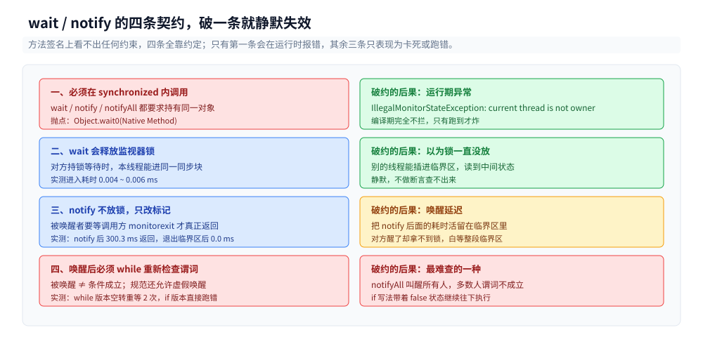
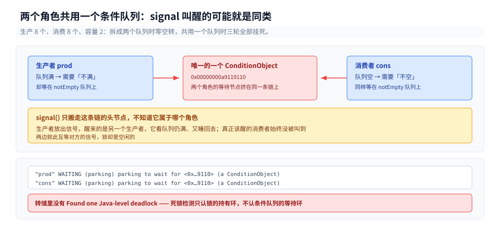
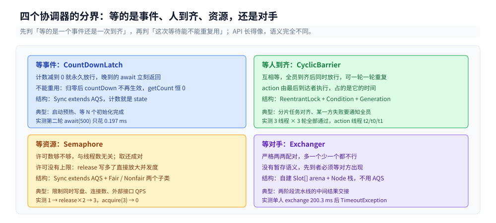
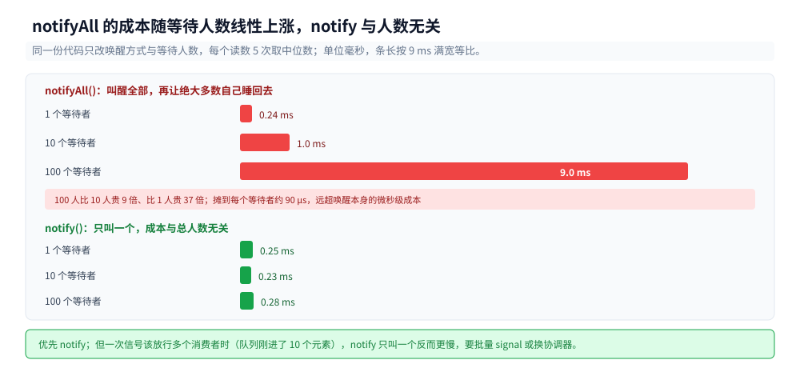

# 线程间协作与并发工具类

> 覆盖：线程之间「约好顺序」的三层手段 —— `wait/notify` 的契约、`Condition` 的多队列分工、四个协调器（`CountDownLatch` / `CyclicBarrier` / `Semaphore` / `Exchanger`）的选型边界。每条判据都有本机读数。
>
> 不覆盖：`synchronized` 的锁升级与 AQS 的 `state` 语义见 [锁与AQS.md](锁与AQS.md)；线程的六个状态与 `interrupt` 八种落点见 [线程基础与生命周期.md](线程基础与生命周期.md)；任务怎么排队与拒绝见 [线程池.md](线程池.md)；并发容器见 [并发容器.md](并发容器.md)。
>
> 内容整理自个人学习笔记，素材见 [素材清单](../../../素材清单.md)。本篇读数在 `eclipse-temurin:24-jdk`（OpenJDK 24.0.2+12，G1，cgroup v2 限额 4 CPU，5.9 GB 内存）上实测，源码在 `.workbuddy/tmp/exp/java/thread/`。

---

## 一、`wait/notify` 必须守住哪几条契约？

**本节要点**：这套 API 只有三个方法，但它有四条**不写在签名里**的约定：调用前必须持锁、`wait` 会放锁、`notify` 不放锁、唤醒后必须重新检查谓词。四条中任何一条破了，症状都不是编译错误，而是卡死或静默跑错。

### 1.1 四条契约与破约的后果

| 契约 | 破了会怎样 | 报错时机 |
|---|---|---|
| `wait` / `notify` 必须在 `synchronized(同一对象)` 内 | `IllegalMonitorStateException: current thread is not owner` | **运行时**，编译期完全不拦 |
| `wait` 返回时重新持有锁，且期间锁被释放过 | 若以为锁一直没放，临界区逻辑会被别的线程插进来 | 静默 |
| `notify` 只把等待者移出等待集，**不放锁** | 被唤醒者要等调用方退出同步块才能真正返回 | 静默，表现为「唤醒延迟」 |
| 唤醒后必须 `while` 重新检查谓词 | 被唤醒≠条件成立，`if` 写法会带着不成立的条件继续跑 | 静默，最难查 |



四条里只有第一条会立刻抛异常，其余三条都表现为「结果不对但没人报错」。这也是为什么这段代码必须靠断言与转储来验，不能靠看一眼觉得对。

第三条常被误记成「`notify` 会唤醒对方」。实测把这三条一次摆出来：

```java
static final Object L = new Object();

// 契约二：wait 释放锁 —— 对方持锁等待时，本线程能进同一同步块
Thread t = new Thread(() -> { synchronized (L) { try { L.wait(); } catch (InterruptedException e) { } } });
t.start(); Thread.sleep(200);
long t0 = System.nanoTime();
synchronized (L) { }                       // 卡住就说明锁没释放
System.out.printf("进同一同步块耗时 %.3f ms%n", (System.nanoTime() - t0) / 1e6);

// 契约三：notify 不放锁 —— 在临界区里再占 300 ms
synchronized (L) { t0 = System.nanoTime(); L.notify(); Thread.sleep(300); }
```

三轮读数：

```text
[释放锁] 对方持锁 wait 时，本线程进同一同步块耗时 0.004 ms / 0.004 ms / 0.006 ms
[不释放锁] notify 后调用方又占锁 300 ms；被唤醒线程在 notify 后 300.3 ms 返回，在退出临界区后 0.0 ms 返回
```

第二条的 0.004 ms 说明 `wait` **确实把监视器交出去了**；第三条的 300.3 ms 说明 `notify` 只是「改了一个标记」，真正的交接发生在调用方 `monitorexit` 的那一刻 —— 括号里那个 `0.0 ms` 就是在说这件事：被唤醒线程的返回时刻几乎精确等于临界区退出时刻，与 `notify` 调用的时刻无关。

第四条最有欺骗性。构造一个只满足其中一个等待者谓词的唤醒：

```java
// if 写法：只看一次
if (!ready[0]) { System.out.println("被唤醒时 ready=false，但仍继续往下执行"); }

// while 写法：不成立就回去等
while (!ready[0]) { requeued.incrementAndGet(); L.wait(); }
```

主线程先 `ticket = 1` 再 `notifyAll()`（满足 ticket 不满足 ready）：

```text
[谓词] if 写法：被唤醒时 ready=false，但仍继续往下执行
[谓词] while 写法：谓词成立才退出循环，重新等待 2 次
```

`notifyAll` 唤醒了**所有人**，其中大部分人被叫醒时谓词并不成立。`while` 版本白白重等了 2 次（这 2 次就是真实开销），`if` 版本则直接带着 `ready == false` 往下走 —— 后面的代码假定「`ready` 为真才醒」，于是读到半初始化的状态。

> `Object.wait` 的规范里还有「虚假唤醒」（spurious wakeup）允许发生 —— 即使没有人 `notify`，`wait` 也可能自己返回。`while` 循环同时挡住了虚假唤醒与「被别人的信号误叫醒」两种情况，所以它不是防御性编程，是正确性要求。

### 1.2 为什么 `wait(100)` 不是 100 ms

```text
[超时精度] wait(100) 十次：min 100.093 ms / median 100.190 ms / max 103.796 ms
[超时精度] wait(100) 十次：min 100.136 ms / median 100.219 ms / max 100.332 ms
[超时精度] wait(100) 十次：min 100.156 ms / median 100.246 ms / max 100.338 ms
```

只多不少，中位数多 0.19~0.25 ms。这个偏差是**调度粒度**，不是 `wait` 的实现问题：超时后被唤醒的线程要重新竞争监视器、再被操作系统调度上 CPU，这两步的时间都算在 `wait` 的返回时间里。写超时等待时不能把「刚好 100 ms」当上界用 —— 实际是「100 ms + 一次重获锁 + 一次调度」。

### 1.3 不持锁调 `wait` 长什么样

```text
[无锁 wait] IllegalMonitorStateException: current thread is not owner ｜ java.base/java.lang.Object.wait0(Native Method)
```

抛点在 `Object.wait0` 这个 native 方法。这意味着 **IDE 与编译器都不会提示**，只有跑起来才知道。同理，`notify` / `notifyAll` 也有这一条，且更容易犯：在 `synchronized` 块外面调 `notify` 的代码看起来「只是通知一下」。

---

## 二、信号为什么会凭空消失？

**本节要点**：`wait/notify` 没有「暂存」语义 —— `notify` 只对**此刻正在等待**的线程有效。调用方早到一步，信号就丢了，等待方会一直等到超时（或永远）。这是设计缺陷的高发区，也是 `Condition` 与协调器要解决的问题。

### 2.1 空等一场

```java
synchronized (L) { L.notify(); }        // 此刻没人在等
long t0 = System.nanoTime();
synchronized (L) { L.wait(200); }       // 之后才等
```

```text
[丢失信号] notify 早于 wait，wait(200) 实际等了 200 ms → 空等到超时，信号没有暂存
```

三轮全部等满 200 ms。这是「先通知、后等待」的典型写法：生产者先做完事再 `notify`，消费者可能晚几微秒才进入 `wait`，于是这一轮的通知彻底消失，消费者睡到超时才发现东西早就好了。

修法有三条路，按侵入性从小到大：

1. **谓词 + `while`**：把「有没有信号」变成可读的状态（`queue.isEmpty()`），`wait` 前先查一次，就不依赖信号本身；
2. **换成 `CountDownLatch`**：计数的归零状态是**持久**的，晚到的 `await` 立刻返回；
3. **换成 `BlockingQueue`**：入队/出队自带「有就取、没有就等」，`take` 天然不会丢。

第 2 条是「一次性事件」的正解 —— 后文 5.1 会用读数证明它的归零状态确实能跨时间保留。

### 2.2 把「丢信号」变成「卡死」只需要一个条件队列

如果条件只有一个，还可以靠 `while` 兜住。一旦两个角色共用一个条件队列，`notify` 唤醒了「同类」，就没人去叫真正该醒的那一方：

```java
// 生产者与消费者都等 notEmpty，signal 也只叫 notEmpty
while (q.size() == CAP)  { ... notEmpty.awaitUninterruptibly(); }
while (q.isEmpty())      { ... notEmpty.awaitUninterruptibly(); }
notEmpty.signal();
```

生产 8 个、消费 8 个，容量 2：

```text
[两个 Condition] 生产 8 消费 8 ｜ 被唤醒但条件不满足、重新 await 的次数 = 0 ｜ 耗时 28.05 ms
[一个 Condition]  <<< 10 秒未结束（挂死）  ← 3 轮全部挂死
```

挂死时抓的线程转储（`jcmd <pid> Thread.print`）：

```text
"prod" #23 [530] WAITING (parking)
	at jdk.internal.misc.Unsafe.park(Native Method)
	- parking to wait for  <0x00000000a9119110> (a AbstractQueuedSynchronizer$ConditionObject)
	at AbstractQueuedSynchronizer$ConditionObject.awaitUninterruptibly(AbstractQueuedSynchronizer.java:1704)

"cons" #24 [531] WAITING (parking)
	at jdk.internal.misc.Unsafe.park(Native Method)
	- parking to wait for  <0x00000000a9119110> (a AbstractQueuedSynchronizer$ConditionObject)
```

生产者和消费者停在**同一个** `ConditionObject` 地址上，而转储里**没有** `Found one Java-level deadlock` 这一段。



图的右半截是这次挂死时转储原文：两条线程的 `parking to wait for` 指向同一个地址，说明它们排在同一个等待集里，互相等对方的信号。

这条判据比「卡死」本身更值得记住：**`jstack` 的死锁检测只认监视器与锁的持有环，不认条件队列的等待环**。这里是「两个线程互相等对方的信号」，锁是空闲的、没有持有环，所以工具不报警。生产环境遇到「进程没死、CPU 不涨、日志不动」，转储里又找不到 deadlock，就该去数有几个 `Condition`。

### 2.3 两个条件队列是正确性，不是优化

同一份代码只把两个角色拆到两个队列上（消费者等 `notEmpty`、生产者等 `notFull`、各自 `signal` 对面的队列），空转次数直接归零：

```text
[两个 Condition] 生产 8 消费 8 ｜ 被唤醒但条件不满足、重新 await 的次数 = 0 ｜ 耗时 28.05 / 29.02 / 34.44 ms
```

`0 次` 的含义是：每一次被唤醒都恰好是「条件已成立」，没有任何一次需要回去重等。上面挂死版本与这里的差别只有一行 `Condition` 的声明，结果一个是死锁、一个是零空转。

---

## 三、`Condition` 比 `wait/notify` 多给了什么？

**本节要点**：多出来的能力有四项 —— 一个锁挂多个条件队列、可中断与不可中断两种等待、带超时的等待能拿到剩余时间、`signal` 与 `await` 的语义完全对称。**但没有多出「不用持锁」这一项**，这是最常见的误判。

### 3.1 四项差异对照

| 能力 | `Object.wait/notify` | `Condition.await/signal` |
|---|---|---|
| 一个锁挂几个条件队列 | 1 个（监视器的 wait set） | 任意多个（`lock.newCondition()`） |
| 可中断等待 | `wait()` 可中断 | `await()` 可中断，`awaitUninterruptibly()` 不可中断 |
| 超时等待的返回信息 | `wait(ms)` 返回 `void`，超时与否要自己算时间 | `awaitNanos(ns)` 返回**剩余纳秒**，负数即超时 |
| 唤醒是否精确到条件 | 只能对整把锁 `notify`/`notifyAll` | `signal` 只搬对应队列的头节点 |
| 是否需要持锁 | 需要 | **需要**（`await` 与 `signal` 都在锁内） |

最后一行实测：

```text
[无锁 await] IllegalMonitorStateException ｜ java.util.concurrent.locks.ReentrantLock$Sync.tryRelease(ReentrantLock.java:151)
```

栈顶是 `tryRelease` —— `await` 内部先把锁完全释放掉再 park，所以调它之前必须真持有锁。`wait` 的抛点在 native 的 `wait0`，`await` 的抛点在 Java 层的 `tryRelease`，两者报的是同一个异常但落点不同，排查时看栈顶就能分清是哪种等待写错了。

### 3.2 `awaitNanos` 的返回值怎么用

```text
[awaitNanos] 传入 200 ms，实际等 200 ms，返回剩余 0 ms（负数即已超时）
```

返回值的用途是**重入循环**：`signal` 之后条件仍不成立时需要继续等，但总预算不能翻倍。正确写法是把剩余值传回下一次：

```java
long remain = budgetNanos;
while (!predicate()) {
    if (remain <= 0) break;              // 预算耗尽
    remain = cond.awaitNanos(remain);    // 只花掉真实等待的那部分
}
```

`Object.wait(ms)` 做不到这一点 —— 它不返回「还剩多少」，只能自己在外面记 `System.nanoTime()`，而 `while` 循环里每次重等都会重新拿到完整的 `ms`。

### 3.3 与 AQS 的分工

`Condition` 的等待队列是 AQS 内部的一条单向链表（`ConditionObject` 的 `firstWaiter`/`lastWaiter`），`signal` 做的是「把节点从条件队列搬到同步队列」。这部分结构见 [锁与AQS.md](锁与AQS.md) 第四节，本篇只关心**用它的时候要守什么**。

---

## 四、四个协调器各管哪一种「等」？

**本节要点**：四个类的差别不在 API，而在**等什么**与**谁等谁**。判据先看「等的是一个事件还是等其他人到齐」，再看「这个等待能不能重复用」。

### 4.1 一张表定选型

| 类 | 等什么 | 谁等谁 | 能否重用 | 内部实现 |
|---|---|---|---|---|
| `CountDownLatch` | 一个计数减到 0（一次性事件） | 等待方单向等 | **不能**，归零即永久放行 | `Sync extends AQS`，计数就是 `state` |
| `CyclicBarrier` | 固定数量的线程**互相**到齐 | 互相等，全员同时放行 | **能**，换代后可再来一轮 | `ReentrantLock` + `Condition` + `Generation`，**不用 AQS** |
| `Semaphore` | 许可数够不够 | 等待方单向等，取还成对 | 能，许可可增可减 | `Sync extends AQS`，公平性靠 `FairSync`/`NonfairSync` |
| `Exchanger` | 有没有另一个线程来换 | 严格两两配对 | 能，每次调用换一次 | 自建 `Slot[] arena` + `Node` 栈，无锁 |



四格的排列顺序就是选型顺序：先问等的是事件还是人到齐，再问这次等待能不能重复，两问下来只剩一个答案。

「内部实现」这一列不是背的，反射打出来就是这样：

```text
=== CountDownLatch ===
  内部类 Sync extends java.util.concurrent.locks.AbstractQueuedSynchronizer
  字段 Sync sync
=== Semaphore ===
  内部类 NonfairSync extends Semaphore$Sync
  内部类 Sync extends AbstractQueuedSynchronizer
  内部类 FairSync extends Semaphore$Sync
  字段 Sync sync
=== CyclicBarrier ===
  内部类 Generation extends java.lang.Object
  字段 ReentrantLock lock ｜ Condition trip ｜ int parties ｜ Runnable barrierCommand ｜ Generation generation ｜ int count
=== Exchanger ===
  内部类 Slot / Participant extends ThreadLocal / Node
  字段 Slot[] arena ｜ int ncpu ｜ int bound
```

三个结构性结论：

1. `CountDownLatch` 只有 `sync` 一个字段 —— 它的全部状态就是一个 `int`，**没有地方存「第几轮」**，所以天生不能重用；
2. `CyclicBarrier` 有 `generation` 与 `count` 两个可变字段，`count` 每轮重新填满、`generation` 每轮换一个对象 —— 「循环」不是靠重置计数，是靠**换代**；
3. `Exchanger` 连 AQS 都没用，`arena` 是分槽的无锁结构 —— 它的争用模型与另外三个完全不同（两两配对，天然低冲突）。

### 4.2 判据：先问「等的是事件还是人」

- **等事件**（某个初始化做完、某个任务算完）→ `CountDownLatch`。事件只会发生一次，归零后所有等待者都放行，这正是想要的语义。
- **等人到齐**（分片任务，所有分片到齐才能进入下一阶段）→ `CyclicBarrier`。每轮都要重新到齐，还必须能把「有人没来」这件事传播给所有参与者。
- **等资源**（限流、连接数、并发写盘）→ `Semaphore`。要的是「同时最多几个」，与人数无关。
- **等对手**（两阶段流水线，A 算出中间结果交给 B）→ `Exchanger`。严格一对一，多一个少一个都不行。

---

## 五、`CountDownLatch` 与 `CyclicBarrier` 能互换吗？

**本节要点**：不能。三个不可替代的点：**重用性**（Latch 归零后永久放行）、**方向**（Latch 是单向等、Barrier 是互相等）、**异常传播**（Barrier 坏了会传给所有人，Latch 不会）。

### 5.1 归零之后 `CountDownLatch` 就废了

```text
[Latch] 归零后 getCount=0
[Latch] 再 countDown 一次后 getCount=0
[Latch] 复用意图：第二轮 await(500) 实际耗时 0.197 ms（立刻返回，无法当作新一轮的门闩）
```

`getCount()` 停在 0 不再变负，`await(500)` 只花 0.173 / 0.197 / 0.658 ms —— 它连 500 ms 的门都没碰，直接走了。想用它做「每轮同步」的人会发现第二轮、第三轮全部形同虚设，而且**不报错**。

有些实现会尝试「重新 new 一个 Latch 赋给字段」，这在多线程下是竞态源：晚到的线程读到的还是旧对象，或者读到新对象却丢掉了旧对象的信号。正确做法是直接换 `CyclicBarrier`。

### 5.2 `CyclicBarrier` 的「循环」是换代

3 个线程跑 3 轮，每轮都设 `barrierAction`：

```text
    [Barrier] action 执行线程 = t2
    第 1 轮放行，parties=3 waiting=1
    [Barrier] action 执行线程 = t0
    第 2 轮放行，parties=3 waiting=0
    [Barrier] action 执行线程 = t1
    第 3 轮放行，parties=3 waiting=0
[Barrier] 3 线程 × 3 轮全部通过，栏杆可重用
```

两点从读数里直接读出来：

- **`action` 由最后到达的那个线程执行**（t2 / t0 / t1 三轮各不相同）—— 它不是「另起一个线程跑回调」，而是在放行前占用最后一个到达者的时间。`action` 里做耗时操作会把所有人卡住。
- `getNumberWaiting()` 读到的是**此刻**仍在等的人数，不是「刚才有几个」（三轮实测出现过 `1 / 1 / 0` 与 `1 / 0 / 0` 两种序列）。要统计参与度只能在 `await` 之前自己数。

### 5.3 一个人超时，整道栏杆废掉

```text
[Broken] [fast1 TimeoutException, fast2 BrokenBarrierException] ｜ isBroken=true
[Broken] 之后再 await 立刻 BrokenBarrierException（必须 reset）
[Broken] reset 后 isBroken=false
```

`fast1` 用 200 ms 超时、`fast2` 用 1500 ms。`fast1` 先超时 → 它自己抛 `TimeoutException`，同时把栏杆置为 broken → `fast2` 被 `BrokenBarrierException` 提前叫醒，不用等满 1500 ms。

这个传播是**故意设计**的：只要有一个参与者没来，剩下的人就不该继续等，而应该知道「这一轮废了」。`CountDownLatch` 没有对应机制 —— 计数没减到 0 就是一直等，除非每个 `await` 都自己带超时。

恢复只有 `reset()` 一条路，而 `reset()` 会让所有仍在等待的线程抛 `BrokenBarrierException`：它是「推倒重来」，不是「继续这一轮」。所以生产代码里的处理方式通常是**放弃这一轮**，而不是原地 reset 后接着跑。

---

## 六、`Semaphore` 的许可与公平性边界在哪？

**本节要点**：它是唯一一个「计数可以涨回去、且能涨过初始值」的协调器 —— 许可数没有上限，`release` 写多了就直接放大并发度。公平模式能堵住插队，代价是排队者全部走完才能轮到新到达者。

### 6.1 许可数没有上限

```text
[Semaphore] 初始 availablePermits=1
[Semaphore] release 两次（未 acquire）后 availablePermits=3 —— 许可数没有上限
[Semaphore] acquire(3) 后 availablePermits=0
[Semaphore] acquire 可被 interrupt 打断
```

从 1 出发、连 `release()` 两次（一次都没 `acquire`），许可变成 3。这个行为不是 bug，`Semaphore` 不校验「谁在还」，它的模型是纯计数而不是所有权标记。

后果很实际：`try { ... } finally { s.release(); }` 里如果 `acquire` 之前就抛了异常，`finally` 会凭空多还一个许可，限流就永久失效一格。正确写法是把 `acquire` 放在 `try` 之外：

```java
s.acquire();                    // 在 try 之前
try { /* 临界区 */ } finally { s.release(); }
```

`acquire` 可被中断这一点也要注意：中断抛出后**没有拿到许可**，此时若在 `finally` 里 `release` 就会多还一格。上一条写法里 `acquire` 在 `try` 之外，正好把这个坑一起堵住。

### 6.2 公平与非公平的差别：新到达者能不能插队

低冲突下公平模式与非公平模式看不出差别（8 个线程各拿一次，两种模式的顺序都是乱的，因为线程被唤醒的先后本身就随机）。要看出差别，得构造「有人排队时，新线程到达」这个场景：

```java
Semaphore s = new Semaphore(1, fair);
s.acquire();                                  // 主线程占住唯一许可
// 起 5 个线程，各自 acquire 后 sleep 5 ms 再 release
Thread.sleep(200);                            // 让它们真的 park
long t0 = System.nanoTime();
s.release();                                  // 放行
s.acquire();                                  // 主线程作为新到达者再抢一次
```

```text
[插队 fair=true  第 1/2/3 轮] 释放后立刻重新 acquire 耗时  26.8 / 27.0 / 27.5 ms
[插队 fair=false 第 1/2/3 轮] 释放后立刻重新 acquire 耗时   0.0 /  0.1 /  0.1 ms
```

公平模式要等 5 个排队者挨个走完（5 × 5 ms ≈ 25 ms，加上调度就是 27 ms），非公平模式**当场抢回**。

原理在 `FairSync` 与 `NonfairSync` 的 `tryAcquire`：非公平版先无条件试一次 `compareAndSetState`，成功就直接拿 —— 完全不管同步队列里还排着人；公平版多一个 `hasQueuedPredecessors()` 判断，队列里有人就放弃。

代价的量级可以记住一个数：**公平模式让新到达者的等待从 0.1 ms 变成 27 ms（本场景下约 270 倍）**。所以默认一律用非公平，只在「必须按到达顺序」时才开公平 —— 例如按顺序分配号码、按顺序写分片。

### 6.3 与 `ReentrantLock` 公平锁的同一笔账

`锁与AQS.md` 里测过公平锁把吞吐压到约 1/300，这里测的是**单次等待延迟**，方向一致：公平性不是免费的微调，它把「后来的有机会先走」这个能力直接关掉了。选型时先问「乱序会不会产生业务错误」，答案为否就别开公平。

---

## 七、什么时候 `notifyAll` 会把系统拖垮？

**本节要点**：`notifyAll` 的成本与等待人数**线性相关**，`notify` 与人数无关。同一把锁上挂着几百个等待者时，一次 `notifyAll` 就是几十毫秒的停顿，而其中绝大多数线程醒来后发现条件不成立，又回去睡了。

### 7.1 唤醒成本随人数线性上升

同一份代码，只改唤醒方式与等待人数（每个读数 5 次取中位数）：

| 等待者 | `notifyAll` | `notify` |
|---|---|---|
| 1 | 0.224 ~ 0.264 ms | 0.215 ~ 0.266 ms |
| 10 | 0.867 ~ 1.316 ms | 0.191 ~ 0.281 ms |
| 100 | **8.776 ~ 9.553 ms** | 0.234 ~ 0.326 ms |



红色条按人数等比变长，绿色条三档几乎等长，这张图的形状本身就是判据：`notifyAll` 的成本挂在人数上，`notify` 不挂。

`notifyAll` 从 1 人到 100 人涨了约 35 倍，`notify` 三档都在 0.2~0.4 ms 的噪声带里。

折算到单线程：`notifyAll` 100 个等待者约 9 ms，摊到每个等待者约 90 µs —— 这个数字远超「唤醒一个线程」本身的成本（微秒级），多出来的部分是 **100 个线程同时从 park 中返回、抢同一把锁、再依次失败并重新 park** 的排队与上下文切换。

### 7.2 选型顺序

按代价从低到高，遇到「要等」时依次问：

1. **能不能不用等待**：谓词先查一次（`if (!queue.isEmpty())`），能直接做完就别进等待；
2. **用 `notify` 而不是 `notifyAll`**：只有确认「一个信号只够一个消费者」时才成立 —— 若条件允许多个线程同时推进（比如队列里放了 10 个元素），`notify` 只叫一个就慢了，此时要批量 `notify` 或用协调器；
3. **把条件拆开**：一个锁挂多个 `Condition`，`signal` 只搬对应队列的头节点，从根上避免「叫醒不该醒的人」（2.3 的 0 次空转就是这条路）；
4. **换成协调器**：一次性事件用 `CountDownLatch`、到齐用 `CyclicBarrier`，它们内部直接 park/unpark 到具体节点，没有「叫醒所有人再筛」这一步；
5. **换成阻塞队列**：`BlockingQueue.take/put` 把「空/满」两种等待封装好了，不用自己维护谓词。

第 4、5 条的共同点是**把「唤醒谁」这件事交给库**。手写 `notifyAll` 的问题不在于慢，而在于「醒来后发现条件不成立」的概率随并发度上升，最终变成 CPU 空转。

---

## 八、应用场景

**本节要点**：四个协调器分别对应「等事件」「等人」「等许可」「等一轮」四种语义；先认清等的是什么，再查表选集，不要凭名字选。

| 场景 | 选什么 | 为什么 |
|---|---|---|
| 服务启动时等缓存、连接池、配置全部就绪 | `CountDownLatch(3)` | 三个初始化各 `countDown`，主线程 `await` 一次；只发生一次 |
| 分批导入数据，每个分片算完再统一提交 | `CyclicBarrier(分片数)` | 每批都要重新到齐；某一分片失败要能通知其他分片放弃 |
| 限制同时写对象存储的并发数 | `Semaphore(N)` | 要的是「同时几个」，与总任务数无关；非公平即可 |
| 与外部进程做「一进一出」的握手 | `Exchanger` | 严格一对一，多一个就没人配 |
| 生产者-消费者自定义缓冲 | 两个 `Condition`（或直接用 `BlockingQueue`） | 空/满两种条件必须分队列，否则如 2.2 会卡死 |
| 主线程等所有工作线程结束 | `Thread.join()` 或 `CountDownLatch` | `join` 只等一个线程，多个要循环；`Latch` 一次等齐 |

按这套模型对照本项目：连接池的「借还」是 `Semaphore` 模型（许可数 = 最大连接数，`release` 写多了就会超发），启动预热是 `CountDownLatch` 模型，分片任务是 `CyclicBarrier` 模型。可观测性侧的 MDC 跨线程传递不在这四类里，见后续的「ThreadLocal 与上下文传递」一篇（本篇不展开）。

## 九、具体使用

**本节要点**：三段骨架 —— 生产者-消费者（双条件队列）、`CountDownLatch` 的带超时等待、`Semaphore` 做限流；每段都标出「不这么写会卡在哪」。

### 9.1 一段可直接套用的生产者-消费者骨架

```java
final ReentrantLock lock = new ReentrantLock();
final Condition notFull  = lock.newCondition();
final Condition notEmpty = lock.newCondition();
final Deque<Task> queue = new ArrayDeque<>();
final int cap = 1024;

void put(Task t) throws InterruptedException {
    lock.lockInterruptibly();
    try {
        while (queue.size() == cap) notFull.await();     // 满则等「不满」
        queue.addLast(t);
        notEmpty.signal();                                // 只叫一个消费者
    } finally { lock.unlock(); }
}

Task take() throws InterruptedException {
    lock.lockInterruptibly();
    try {
        while (queue.isEmpty()) notEmpty.await();         // 空则等「不空」
        Task t = queue.pollFirst();
        notFull.signal();                                 // 只叫一个生产者
        return t;
    } finally { lock.unlock(); }
}
```

四个必守点：`wait` 用 `while` 不用 `if`；两个角色两个队列；`signal` 叫**对面**的队列；`lock` 与 `unlock` 成对且在 `finally`。

### 9.2 `CountDownLatch` 的正确用法：`await` 带超时

```java
CountDownLatch ready = new CountDownLatch(3);
for (Runnable init : inits) executor.execute(() -> {
    try { init.run(); } finally { ready.countDown(); }   // 必须放 finally
});
if (!ready.await(30, TimeUnit.SECONDS)) {
    throw new IllegalStateException("初始化超时，已就绪 " + (3 - ready.getCount()) + "/3");
}
```

`countDown` 放 `finally` 是因为「初始化失败」也必须让门闩走完 —— 否则主线程会一直等到超时，而真正的错误信息在子线程的日志里。

### 9.3 `Semaphore` 做限流

```java
private final Semaphore permits = new Semaphore(64, false);   // 非公平，吞吐优先

void upload(byte[] data) throws IOException {
    permits.acquireUninterruptibly();        // 在 try 之外
    try { doUpload(data); } finally { permits.release(); }
}
```

`acquireUninterruptibly` 还是 `acquire`，取决于「中断时该不该放弃这次上传」：前者会一直等到拿到许可，适合「任务必须完成」的后台批处理；后者可被优雅关闭打断，适合请求链路。

## 延伸追问

- **`wait` 和 `sleep` 都能让线程暂停，差别在哪？** → `wait` 释放监视器锁、必须在同步块内、只能被 `notify`/`notifyAll`/超时/中断唤醒；`sleep` 不释放任何锁、可以在任何地方调、只等时间到。用 `sleep` 做线程间同步是错的 —— 对方永远不知道你睡了多久。
- **`notifyAll` 之后，等待者按什么顺序被唤醒？** → `Object` 的 wait set 与 `Condition` 的等待队列都**不保证** FIFO。规范只要求「至少一个」（`notify`）或「全部」（`notifyAll`）。要顺序就得自己用一个 `ConcurrentLinkedQueue` 记排队序号。
- **`CountDownLatch.getCount()` 能不能用来做进度条？** → 能，但要注意它是**已减掉的量**不是「完成了多少」：`初始值 - getCount()` 才是完成数。且归零后永远读到 0，无法区分「刚开始」与「早就完了」。
- **`CyclicBarrier` 的 `action` 抛异常会怎样？** → 与超时一样，栏杆置为 broken，所有等待者收到 `BrokenBarrierException`，`action` 的异常本身抛给最后到达的那个线程。
- **`Semaphore(0)` 有什么用？** → 当作「开关」用：所有线程先 `acquire` 阻塞，控制方 `release(N)` 一次性放行 N 个。这比 `CountDownLatch` 灵活 —— 它可以放行部分、也可以反复开关。
- **`Exchanger` 只有一个线程在等会怎样？** → 一直等到另一方出现或超时。实测 `exchange(x, 200, MILLISECONDS)` 在 200.3 ms 后抛 `TimeoutException`。它没有「先存着等以后来取」的能力，必须先有配对者。
- **这套东西在虚拟线程下还成立吗？** → 语义成立，但成本模型变了：`synchronized` 里阻塞会 pin 住载体线程（JDK 24 已大幅缓解），`ReentrantLock`/`Semaphore` 会正常让出载体。详见后续的「虚拟线程」一篇（本篇不展开）。

## 关联

- **上游/总纲**：[README.md](README.md) — 并发编程 13 篇的分工表与主线读序（本篇位次 ④；Java 目录的两条主线入口与横切篇目在 [java/README.md](../README.md)）
- **上游/前置**：[线程基础与生命周期.md](线程基础与生命周期.md) — 六状态、`interrupt` 八种落点、`join` 的字节码
- **下游机制**：[锁与AQS.md](锁与AQS.md) — `synchronized` 的实现、AQS 的 `state` 与同步队列、`Condition` 的内部链表
- **对照/互补**：[线程池.md](线程池.md) — 任务怎么排队、拒绝策略；阻塞队列与本篇的条件队列是两套抽象
- **对照/互补**：[并发容器.md](并发容器.md) — `BlockingQueue` 家族已经内建了本篇 2.1、2.2 要手写的东西
