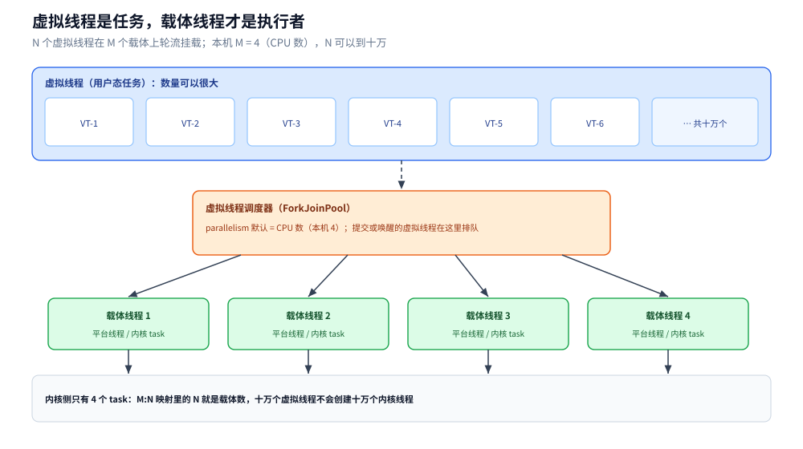
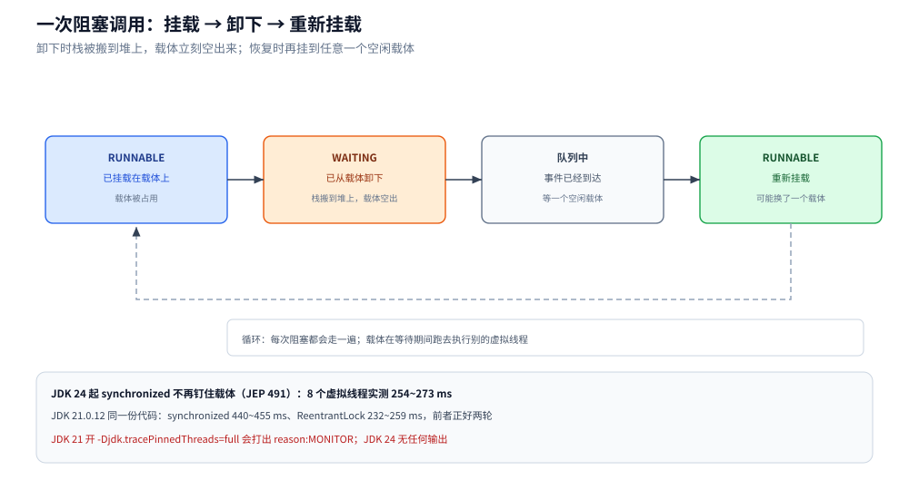
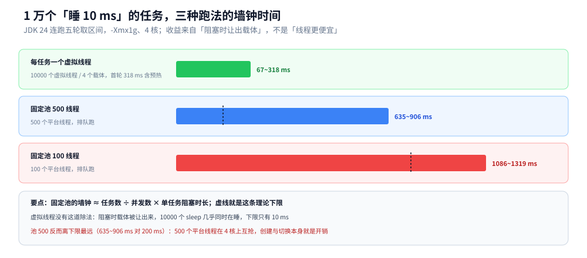

# 虚拟线程

> 覆盖：虚拟线程与平台线程的分层（虚拟线程 → 调度器 → 载体 → 内核）、十万个虚拟线程的真实成本账单、阻塞时「挂载 / 卸载」到底发生了什么、一万个阻塞任务在三种跑法下的墙钟差距、`synchronized` 钉住载体在 JDK 24 上的变化、`ThreadLocal` 在虚拟线程上的开销，以及从线程池迁移过来要改的三处。
>
> 不覆盖：线程对象本身的状态与中断语义见 [线程基础与生命周期.md](线程基础与生命周期.md)；平台线程池的参数与拒绝策略见 [线程池.md](线程池.md)；`ForkJoinPool` 的工作窃取与并行流见 [ForkJoin与并行流.md](ForkJoin与并行流.md)；异步编排见 [CompletableFuture与异步编排.md](CompletableFuture与异步编排.md)；上下文跨线程传递见 [ThreadLocal与上下文传递.md](ThreadLocal与上下文传递.md)；线程转储里怎么认出被钉住的载体见 [死锁与并发缺陷诊断.md](死锁与并发缺陷诊断.md)。
>
> 内容整理自个人学习笔记，素材见 [素材清单](../../../素材清单.md)。
>
> 实测口径：主容器 `java-lab`，`eclipse-temurin:24-jdk`（24.0.2+12，linux/amd64，4 CPU，`-Xmx1g`）；另起 `jdk21-lab` 容器（`eclipse-temurin:21-jdk`，21.0.12.1+1，镜像经 `dockerproxy.net` 拉取）专做 `synchronized` 钉住的新旧对照。源码在 `.workbuddy/tmp/exp/java/vt/`：`VT.java` 六组主实验、`VT3.java` 五轮吞吐、`VT2.java` 使用示例、`PinTest.java` 双 JDK 钉住对照；平台线程的地址空间用容器内独立进程 `VszProbe3/4.java` 读 `/proc/self/status`。内存与耗时都做了多轮复测并给区间。⚠️ `StructuredTaskScope` 是预览 API，未编译未运行，本篇只在延伸追问里提一句。

---

## 一、虚拟线程到底是什么？

**本节要点**：它是一段由 JVM 自己调度的栈，不是内核线程；要真正跑起来，必须先挂到一个**载体线程**上。所以「虚拟」的是栈与调度权，不是「不需要线程」。

### 1.1 从零：二十行看到它的身份

```java
import java.util.concurrent.*;

public class Quick {
    public static void main(String[] args) throws Exception {
        try (ExecutorService ex = Executors.newVirtualThreadPerTaskExecutor()) {
            Future<String> f = ex.submit(() -> {
                Thread.sleep(50);                          // 阻塞：此刻载体被让出去
                return Thread.currentThread().toString();
            });
            System.out.println(f.get());
        }
    }
}
```

```text
VirtualThread[#24]/runnable@ForkJoinPool-1-worker-1
```

这一行名字就把分层写完了：前半截 `VirtualThread[#24]` 是任务自己的身份，后半截 `@ForkJoinPool-1-worker-1` 是它**当时**挂着的载体。同一个虚拟线程在不同时刻可以挂在不同的 worker 上。

`isVirtual()` 返回 `true`，`ThreadMXBean.getThreadCount()` 却数不到它 —— 只统计平台线程。实测：启动时平台线程 6 个，跑完一个虚拟线程任务后 MXBean 仍报 9 个（多了几个 JVM 内部线程），虚拟线程一个都没被计入。

### 1.2 分层：虚拟线程 → 调度器 → 载体 → 内核



图里四层的数量是递减的：一万个虚拟线程 → 一个 `ForkJoinPool` 调度器（本机 parallelism = 4）→ 4 个载体线程 → 内核侧同样只有 4 个 task。要读出的结论是：**并发度由虚拟线程数决定，并行度始终等于载体数**；增开虚拟线程不会增加内核线程，也不会增加真正同时执行的指令流。

四个对象的职责：

| 层 | 是什么 | 由谁创建 | 数量 |
|---|---|---|---|
| 虚拟线程 | 一段堆上的栈 + 一个状态机 | `Thread.ofVirtual()` 或 `newVirtualThreadPerTaskExecutor()` | 十万、百万 |
| 调度器 | 一个专用的 `ForkJoinPool`（FIFO 模式） | JVM 启动时建好，全局共享 | 1 个 |
| 载体线程 | 普通平台线程，虚拟线程跑在它上面 | 调度器按需创建 | parallelism ≈ CPU 核数 |
| 内核 task | 载体对应的调度实体 | 内核 | 同上 |

`parallelism` 默认取 `Runtime.getRuntime().availableProcessors()`；本机 4 核，实测调度器 parallelism = 4。可用 `-Djdk.virtualThreadScheduler.parallelism` 改，但不建议：载体是纯计算资源，超过核数只是增加切换。

### 1.3 与平台线程的四处差别

| 维度 | 平台线程 | 虚拟线程 |
|---|---|---|
| 谁调度 | 内核（1:1 映射到一个 task） | JVM 调度器（M:N，M 个虚拟线程复用 N 个载体） |
| 栈在哪 | 进程地址空间里 `mmap` 的一块，默认 1 MB | 堆上的一段可伸缩栈，用多少长多少 |
| 一个的成本 | 地址空间约 1.18 MB、常驻约 28 KB（实测） | 地址空间约 3.3 KB、常驻约 1 KB（实测） |
| 阻塞的代价 | 内核线程睡下，只能靠「多开线程」堆并发 | 卸下载体，载体立刻去跑别的虚拟线程 |
| 数量量级 | 几千就开始吃力 | 十万级是常规操作 |

第 4 行才是它存在的理由：平台线程的并发上限是「内存 ÷ 1 MB」，虚拟线程的上限是「堆 ÷ 几 KB」。

## 二、它到底便宜在哪？

**本节要点**：便宜在**创建**与**内存**，且内存上省得最多的是地址空间而不是常驻集。这两个数必须分开看，否则会得出「差别不大」的错误结论。

### 2.1 十万个虚拟线程 vs 五千个平台线程

```text
虚拟线程 100000 个：创建 343 ms（复测 1413 ms）｜ 全部结束 1081 ms ｜ 存活时 RSS +89 MB（复测 +97 MB）｜ 地址空间 +325 MB
平台线程 5000 个：创建 4926 ms ｜ VmSize +5899 MB ｜ RSS +140 MB
```

换算成单个：

| 指标 | 虚拟线程（10 万个） | 平台线程（5000 个） | 倍数 |
|---|---|---|---|
| 创建耗时 | 3~14 µs / 个 | 约 1 ms / 个 | ~100 倍 |
| 地址空间 | 约 3.3 KB / 个 | 约 1.18 MB / 个 | ~360 倍 |
| 常驻内存 | 约 0.9~1 KB / 个 | 约 28 KB / 个 | ~30 倍 |

平台线程的地址空间确实随栈大小线性增长，这一点用 `-Xss` 单独验证过（2000 个线程）：

```text
-Xss256k  → VmSize +1399 MB
-Xss1024k → VmSize +2899 MB
-Xss2m    → VmSize +4899 MB
```

⚠️ **这里有个测量陷阱**：在同一进程里先建 10 万个虚拟线程、再建 5000 个平台线程，读到的平台线程地址空间只有 +483~502 MB —— 因为建 5000 个平台线程要 5 秒，采样那一刻最早的一批（`sleep(3000)` 的）已经退出了。上表用的是容器内独立进程、每建 1000 个读一次 `/proc/self/status` 的读数，才是干净的。**结论：内存类读数必须确认「被测对象在采样时还活着」，否则会系统性偏小。**

### 2.2 便宜的是「不跑的时候」

这点容易被忽略：虚拟线程省的不是**执行**成本，而是**等待**成本。它跑起来的时候还是占一个载体，一条指令都少不了。省下来的时间只发生在「它睡着」的那一段 —— 那一段它连栈都可能被压缩、连载体都不占。

所以判据只有一条：**这段逻辑里有没有阻塞**。有阻塞（网络、磁盘、锁、`sleep`）才谈得上收益；纯计算一段不省。

## 三、阻塞时发生了什么？

**本节要点**：阻塞的虚拟线程把载体**让出来**，载体在原地接着跑别人的代码；等阻塞结束，调度器再找一个空闲载体把它**挂回去**。整个过程在用户态完成，内核完全不知道有这么个线程。

### 3.1 挂载、卸载、再挂载



图里四态是一个循环，关键在于「卸下」这一步：调用 `Thread.sleep`、`Socket` 读写、`Lock.park` 这类会阻塞的 JDK 方法时，虚拟线程把当前栈冻结、从载体上摘下来，载体空出来去跑队列里的下一个虚拟线程。要读出的结论是：**同一时刻真正在 CPU 上跑的虚拟线程，最多等于载体数；但「活着」的虚拟线程可以有无数个。**

反过来说，只要有一次阻塞没有触发卸载（见 3.3），这个循环就断了 —— 那个载体被白白占着，退化成平台线程。

### 3.2 一万个阻塞任务，三种跑法

同样是 10000 个任务、每个 `sleep(10)`，连跑五轮：

| 轮次 | 每任务一个虚拟线程 | 固定池 100 | 固定池 500 |
|---|---|---|---|
| 1 | 318 ms | 1106 ms | 635 ms |
| 2 | 95 ms | 1141 ms | 649 ms |
| 3 | 105 ms | 1086 ms | 785 ms |
| 4 | 113 ms | 1276 ms | 906 ms |
| 5 | 67 ms | 1319 ms | 688 ms |



图里三个条形落在同一条时间轴上，虚线标的是「任务数 ÷ 并发数 × 10 ms」这条理论下限。要读出两个结论：**第一，固定池的时间基本由并发数除出来**（池 100 的理论 1000 ms、实测 1086~1319 ms）；**第二，虚拟线程那条没有除法**，10000 个任务几乎同时在睡，首轮 318 ms 主要是 JIT 预热与建 10 万个对象的开销，稳定后 67~113 ms。

有意思的是**池 500 反而离下限最远**：理论 200 ms，实测 635~906 ms。原因是 500 个平台线程挤在 4 个核上，创建（每个约 1 ms）与上下文切换本身就是几百毫秒的开销 —— 线程开得比核多太多，除法算出来的下限根本不成立。

### 3.3 什么时候让不出来：「钉住」

有两种情况虚拟线程阻塞了却卸不下来：

1. **栈上有 native 帧**（JNI 调用、`Object.wait` 等老式阻塞），JVM 不能冻结跨 native 的栈；
2. **JDK 21~23 上的 `synchronized`**：monitor 的所有者记在载体线程头上，虚拟线程被摘下来就没法表示「谁持有锁」，所以只能把载体一起钉住。JDK 24 的 JEP 491 把 monitor 的所有权改记到虚拟线程自己身上，这条限制消失。

本机实测两组，同一份 `PinTest.java`：8 个虚拟线程、每个 `sleep(200)`、**各自一把独立的锁**（避免互斥，只观察钉住）。

| 版本 | `synchronized` | `ReentrantLock` |
|---|---|---|
| JDK 21.0.12.1（Temurin） | 440~455 ms | 232~259 ms |
| JDK 24.0.2（Temurin） | 254~273 ms | 241~245 ms |

判读方法很关键：8 个任务、4 个载体，**若真的钉住**，一次只能推进 4 个，要排两轮 → 约 400 ms。JDK 21 的 `synchronized` 正是 440~455 ms（钉住），同一台机器上 `ReentrantLock` 只要 232~259 ms（不钉住）；到了 JDK 24 两者都在 250 ms 上下，说明 JEP 491 生效、`synchronized` 不再钉住载体。

开 `-Djdk.tracePinnedThreads=full` 的差异更直接，JDK 21 会打出一整段栈：

```text
VirtualThread[#22]/runnable@ForkJoinPool-1-worker-3 reason:MONITOR
    java.base/java.lang.VirtualThread$VThreadContinuation.onPinned(VirtualThread.java:199)
    java.base/java.lang.VirtualThread.parkNanos(VirtualThread.java:635)
    java.base/java.lang.Thread.sleep(Thread.java:507)
    PinTest.withSync(PinTest.java:23) <== monitors:1
```

`reason:MONITOR` 说明「载体被 monitor 挡住了」，`<== monitors:1` 指到出问题的那一行。同一份代码在 JDK 24 上跑，**这段输出完全没有**。这就是升级到 24 最直接的验收方式：开这个参数跑一遍压测，日志里搜 `reason:MONITOR`。

## 四、`ThreadLocal` 在虚拟线程上贵吗？

**本节要点**：一个虚拟线程一份 `ThreadLocalMap`，固定开销约 100~200 B。相对虚拟线程自身 1 KB 级的内存，它不是主要矛盾；但到了百万量级就是百 MB 级。

让 10 万个虚拟线程同时停在一个屏障上，分别测「什么都不放」与「每个放一个 16 B 数组」的堆增量（`System.gc()` 之后读）：

```text
不用 ThreadLocal：堆增量 119 MB（复测 75 MB）
每个放一个 16 B 数组：堆增量 99 MB（复测 95 MB）
```

两组读数互相穿越 —— 理论上的差值（`ThreadLocalMap` 表头约 120 B × 10 万 ≈ 12 MB，加 16 B 的 value）比测量噪声（±20 MB）还小，**测不出稳定差异**。这本身就是结论：在这个量级上 `ThreadLocal` 不是瓶颈，真正决定内存的是虚拟线程自身的栈。

要记住的是它**仍然需要 `remove`**：机制与池化线程完全一样（见 [ThreadLocal与上下文传递.md](ThreadLocal与上下文传递.md)），只是「读到上一个请求的值」这类正确性问题在虚拟线程上同样存在，因为 `newVirtualThreadPerTaskExecutor` 内部也会复用虚拟线程对象吗？不会 —— 每个任务一个新虚拟线程，用完即弃。所以虚拟线程上的 `ThreadLocal` 泄漏风险低于池化平台线程，但跨任务共享的 `ThreadLocal`（比如写在 `static` 上的）仍然要清。

## 五、CPU 密集任务上它有用吗？

**本节要点**：没有。没有阻塞就没有卸载，并行度仍然等于 4，虚拟线程只是多了一层调度开销。

同样一个纯计算任务，交替用虚拟线程与固定 4 线程池跑：

```text
第 1 轮：虚拟线程 545 ms ｜ 固定 4 线程池 498 ms
第 2 轮：虚拟线程 493 ms ｜ 固定 4 线程池 493 ms
```

两轮方向相反、差值 47 ms 与 0 ms，属于噪声。另一组复查里是 413 / 468 与 423 / 368 —— 同样是互相穿越。结论：**同一量级，谁快说不准**；在高并发下虚拟线程还多一层「M 个虚拟线程抢 N 个载体」的用户态调度，往往略慢。

⛔ 因此不要因为「虚拟线程更轻」就把 `parallelStream`、数值计算、`ForkJoin` 里的任务全换成虚拟线程 —— 那是把计算任务塞进一个专门为阻塞设计的调度器。

**本节要点**：虚拟线程的适用面是「大量阻塞等待」，不是「更快的计算」；下表每一行都写了它的前提与替代方案。

| 场景 | 为什么用虚拟线程 | 要注意什么 |
|---|---|---|
| 一次请求里串行调用多个下游 | 代码保持同步写法，阻塞时不占载体 | 每个下游都要有超时；串行本身没变，想并行还得用 [CompletableFuture与异步编排.md](CompletableFuture与异步编排.md) |
| 网关 / 代理的「每连接一线程」模型 | 十万连接 = 十万虚拟线程，不必改写成 Reactor | 不要池化；并发上限改用信号量控制 |
| 批处理里大量「一次远程调用」的小任务 | 池的除法效应消失，吞吐由下游决定 | 用 `newVirtualThreadPerTaskExecutor()` 并 `close()` |
| Web 应用的请求处理（Spring Boot 3.2+ 的 `spring.threads.virtual.enabled=true`） | 请求线程不再昂贵，可放开并发 | 连接池、DB、下游限流都会先成为瓶颈，要一起调 |
| 定时 / 延迟任务 | 不适用 | 用 `ScheduledExecutorService` |
| 纯 CPU 计算 | 不适用（见第五节） | 用固定大小平台线程池或并行流 |
| 需要上下文透传 | 可用，注意百万级时的内存 | 见 [ThreadLocal与上下文传递.md](ThreadLocal与上下文传递.md) |

**本节要点**：四段骨架 —— 每任务一条虚拟线程、用信号量限并发、把池化的旧代码迁过来、以及排查「钉住载体」。

### 7.1 最小写法：每任务一个虚拟线程

```java
try (ExecutorService ex = Executors.newVirtualThreadPerTaskExecutor()) {
    Future<String> f = ex.submit(() -> {
        Thread.sleep(50);
        return Thread.currentThread().toString();
    });
    System.out.println(f.get());
}
```

```text
任务所在线程 = VirtualThread[#24]/runnable@ForkJoinPool-1-worker-1
```

`newVirtualThreadPerTaskExecutor()` 返回的 `ExecutorService` 实现了 `AutoCloseable`：`close()` 会先停止接收新任务，再等已提交的任务全部结束 —— 这就是 try-with-resources 能当「等待全部完成」用的原因。它**没有池**：每个 `submit` 建一个新的虚拟线程。

### 7.2 用信号量限流，而不是用池

虚拟线程便宜不代表下游能承受。要限并发，用 `Semaphore` 挡在任务里：

```java
Semaphore permits = new Semaphore(4);
try (ExecutorService ex = Executors.newVirtualThreadPerTaskExecutor()) {
    for (int i = 0; i < 64; i++) {
        ex.submit(() -> {
            permits.acquire();
            try {
                // 真正受限的临界区：一个 DB 连接、一个下游配额
                Thread.sleep(20);
            } finally {
                permits.release();
            }
        });
    }
}
```

```text
峰值并发 = 4 ｜ 用时 342 ms（复测 371 ms）
```

64 个任务、4 个许可、每个 20 ms：理论 64 ÷ 4 × 20 = 320 ms，实测 342 / 371 ms。要点是**限流的粒度从「线程数」搬到了「许可数」**：线程数可以无限，许可数写下游能承受的值。

### 7.3 结果按提交顺序收集

```java
try (ExecutorService ex = Executors.newVirtualThreadPerTaskExecutor()) {
    List<Future<Integer>> fs = new ArrayList<>();
    for (int i = 0; i < 5; i++) {
        int n = i;
        fs.add(ex.submit(() -> { Thread.sleep(10L * (5 - n)); return n; }));
    }
    StringBuilder sb = new StringBuilder();
    for (Future<Integer> f : fs) sb.append(f.get()).append(' ');
    System.out.println(sb.toString().trim());
}
```

```text
按提交顺序收集 = 0 1 2 3 4
```

第一个任务的睡眠最长（50 ms）、最后完成，但按 `fs` 的顺序 `get()` 仍然得到 `0 1 2 3 4`。**并发执行 + 按序收集**这件事和线程池完全一样，变化只在于执行者从「池里的线程」换成了「一次性虚拟线程」。

### 7.4 从线程池迁移过来的三处改动

| 原来 | 改成 | 不改会怎样 |
|---|---|---|
| `newFixedThreadPool(n)` 当池用 | `newVirtualThreadPerTaskExecutor()` + 信号量限流 | 保留池 = 池化的虚拟线程，既没省资源又多了队列积压 |
| 靠线程数限制下游并发 | `Semaphore` / 连接池 / 下游配额 | 并发从 n 涨到任务数，直接把下游打穿 |
| `synchronized` 里做阻塞 IO | 换 `ReentrantLock`，或确认已在 JDK 24 | JDK 21~23 上钉住载体，吞吐退化成 并发数 ÷ 载体数 |

迁移后要重新量的三件事：**下游能不能承受新并发**、**连接池/线程本地缓存会不会被打爆**、**`-Djdk.tracePinnedThreads` 有没有告警**。

## 延伸追问

- **虚拟线程和 Go 的 goroutine 是一回事吗？** → 都是 M:N 调度，差别在栈与调度器实现：goroutine 初始栈约 2 KB、按需复制扩容，调度器是 Go 运行时自己的（含 `P` 与本地队列）；虚拟线程的栈是一段堆上的可伸缩栈（`Continuation`），复用 JVM 的 `ForkJoinPool` 做载体调度。对使用者的判据相同：**有阻塞才有收益**。
- **虚拟线程能放进线程池吗？** → 技术上能（池里放虚拟线程工厂），但没意义：池的价值是复用昂贵资源，虚拟线程恰恰不昂贵。池化后反而多了队列、任务堆积与上下文残留的问题。要限流用信号量。
- **`Thread.sleep` 在虚拟线程里会阻塞载体吗？** → 不会，它走的是可中断的 `park`，会触发卸载。真正阻塞载体的是 native 帧与（JDK 21~23 的）`synchronized`。
- **JDK 24 之后 `synchronized` 就完全没问题了吗？** → 不是。JEP 491 只解决了 monitor 的归属；栈上仍有 native 帧时照样钉住。判据是「这次阻塞是不是 JVM 自己能识别的可卸载点」。
- **`ScopedValue` 能替代 `ThreadLocal` 吗？** → JDK 24 里它仍是预览 API（需 `--enable-preview`），本篇未实测。设计意图是「不可变、有作用域、随作用域结束自动失效」，正好补上 `ThreadLocal` 要手动 `remove` 的缺口；但生态未跟上，暂时只适合新代码试验。
- **虚拟线程有数量上限吗？** → 没有硬上限，受堆与调度器队列限制。实测建 10 万个耗时 0.3~1.4 s；再往上主要吃的是堆（每个约 1 KB）。
- **怎么调虚拟线程调度器的并行度？** → `-Djdk.virtualThreadScheduler.parallelism=N`（默认 = CPU 核数）、`maxPoolSize` 控制载体上限。除非有明确的 CPU 配额依据，不建议改。
- **虚拟线程里设置优先级有用吗？** → 没用。调度器按 FIFO 取任务，不看 `Thread` 优先级；要分优先级得自己在任务队列层面做。
- **线上怎么确认服务真的用上了虚拟线程？** → 看线程转储里有没有 `VirtualThread` 条目、看 `jdk.VirtualThreadStart` 这类 JFR 事件，方法见 [JFR与诊断工具.md](../运行时/JFR与诊断工具.md)。

## 关联

- **上游/总纲**：[README.md](README.md) — 并发编程 13 篇的分工表与主线读序（本篇位次 ⑪：ForkJoin 之后、成本与缺陷诊断之前）
- **前置**：[线程基础与生命周期.md](线程基础与生命周期.md) — 平台线程的状态与中断；虚拟线程的六态语义与之对齐
- **前置**：[线程池.md](线程池.md) — 池化的前提是「线程昂贵」，本篇正是推翻这个前提
- **前置**：[ThreadLocal与上下文传递.md](ThreadLocal与上下文传递.md) — 每个线程一份 map 的机制，在虚拟线程上按「每个虚拟线程一份」放大
- **对照/互补**：[ForkJoin与并行流.md](ForkJoin与并行流.md) — 虚拟线程的调度器就是一个 `ForkJoinPool`，工作窃取在那边讲
- **对照/互补**：[CompletableFuture与异步编排.md](CompletableFuture与异步编排.md) — 同样是解决阻塞等待，一个靠回调、一个靠「写起来像同步」
- **下游机制**：[运行时数据区与栈帧.md](../运行时/运行时数据区与栈帧.md) — 平台线程的栈在地址空间里，虚拟线程的栈在堆上，两者的溢出表现不同
- **对照/互补**：[goroutine实战模式.md](../../go/并发编程/goroutine实战模式.md) — Go 侧 M:N 调度与「不要池化 goroutine」的同一结论
> 反向引用（本篇被下列文档引到）：[死锁与并发缺陷诊断.md](死锁与并发缺陷诊断.md)
