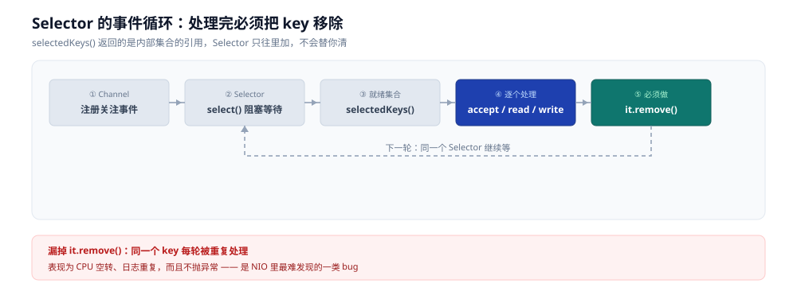

# NIO 与 Selector

> 覆盖：Java NIO 的三件套（`Channel` / `Buffer` / `Selector`）、一个 `Selector` 服务的完整骨架、事件循环里必须做对的四件事、部分写与背压怎么落地、Netty 的主从 Reactor 与它为什么不用 JDK AIO。
>
> 不覆盖：`epoll` 的内核语义、LT 与 ET 的差别、五种 I/O 模型的划分，见 [IO多路复用.md](../../../02-计算机基础/操作系统/IO多路复用.md)；TCP 连接的状态与关闭见 [TCP四次挥手.md](../../../02-计算机基础/网络/传输层/tcp/TCP四次挥手.md)；Java 线程与锁的地基见 [锁与AQS.md](../并发编程/锁与AQS.md)。
>
> 内容整理自个人学习笔记，素材见 [素材清单](../../../素材清单.md)。
>
> ✅ 实测口径：本篇代码在 `eclipse-temurin:8-jdk`（`javac 1.8.0_504`）容器内**编译通过并真实跑通**——单条连接 echo 往返 `recv=hello`，10 条并发连接两轮均 `echoed_ok=10`；Netty 部分为机制说明，未实测。

---

## 一、NIO 三件套各自负责什么？

**本节要点**：三件套不是三个并列的类，而是「**通道 + 数据容器 + 一个等待点**」——`Selector` 是那个等待点，它让一个线程盯住许多条连接。

| 组件 | 作用 | 与另两个的关系 |
|---|---|---|
| `Channel` | 双向 I/O 通道 | 非阻塞 `Channel` 注册到 `Selector` |
| `Buffer` | 保存待读写的数据 | `Channel` 从 `Buffer` 写出，或向 `Buffer` 读入 |
| `Selector` | 一个线程等待多个 `Channel` | 用 `SelectionKey` 管理关注的事件与状态 |

写入 `Buffer` 后用 `flip()` 切到读模式，消费完用 `clear()` 或 `compact()` 回到写模式。

### 1.1 为什么必须显式 flip

`Buffer` 只有一组 `position` / `limit` 指针，读写**共用同一块内存**。写模式下 `position` 指向下一个可写位置；`flip()` 把 `limit` 设为当前 `position`、`position` 归零，于是「已写的那一段」变成了「可读的那一段」。

- `clear()`：整体回到写模式（未读完的数据会被覆盖）。
- `compact()`：把**没读完的**挪到开头，再从后面继续写——**半包场景必须用这个**，用 `clear()` 会丢数据。

### 1.2 `SelectionKey` 的四类事件

| 事件 | 常量 | 含义 |
|---|---|---|
| 可接受连接 | `OP_ACCEPT` | 服务端 `ServerSocketChannel` 上有新连接 |
| 可读 | `OP_READ` | 对端有数据到达（或已关闭） |
| 可写 | `OP_WRITE` | 发送缓冲区有空间 |
| 可连接 | `OP_CONNECT` | 客户端非阻塞 `connect` 完成 |

⚠️ `OP_WRITE` 与另外三个性质相反：**绝大多数时刻它都是就绪的**。订阅它等于让 `select()` 立刻返回，所以只在「确实有数据要发」时才订阅，发完立即取消。

---

## 二、一个 Selector 服务的最小骨架长什么样？

**本节要点**：骨架只有五步——开 `Selector`、开 `ServerSocketChannel` 并设非阻塞、注册 `OP_ACCEPT`、循环 `select()`、遍历 `selectedKeys()` 并**逐条移除**。

```java
import java.io.IOException;
import java.net.InetSocketAddress;
import java.nio.ByteBuffer;
import java.nio.channels.*;
import java.util.Iterator;

public class NioEchoServer {
    public static void main(String[] args) throws IOException {
        int port = args.length == 0 ? 8080 : Integer.parseInt(args[0]);
        try (Selector selector = Selector.open();
             ServerSocketChannel server = ServerSocketChannel.open()) {
            server.configureBlocking(false);
            server.bind(new InetSocketAddress(port));
            server.register(selector, SelectionKey.OP_ACCEPT);
            while (true) {
                selector.select();
                Iterator<SelectionKey> it = selector.selectedKeys().iterator();
                while (it.hasNext()) {
                    SelectionKey key = it.next();
                    it.remove();
                    if (!key.isValid()) continue;
                    try {
                        if (key.isAcceptable()) {
                            acceptAll(server, selector);
                            continue;
                        }
                        if (key.isReadable()) read(key);
                        if (key.isValid() && key.isWritable()) write(key);
                    } catch (IOException e) {
                        close(key);
                    }
                }
            }
        }
    }

    private static void acceptAll(ServerSocketChannel server, Selector selector)
            throws IOException {
        SocketChannel channel;
        while ((channel = server.accept()) != null) {
            channel.configureBlocking(false);
            channel.register(selector, SelectionKey.OP_READ, ByteBuffer.allocate(8192));
        }
    }

    private static void read(SelectionKey key) throws IOException {
        SocketChannel channel = (SocketChannel) key.channel();
        ByteBuffer buffer = (ByteBuffer) key.attachment();
        int n = channel.read(buffer);
        if (n == -1) { close(key); return; }
        if (n > 0) {
            buffer.flip();
            key.interestOps(SelectionKey.OP_WRITE);
        }
    }

    private static void write(SelectionKey key) throws IOException {
        SocketChannel channel = (SocketChannel) key.channel();
        ByteBuffer buffer = (ByteBuffer) key.attachment();
        channel.write(buffer);
        if (!buffer.hasRemaining()) {
            buffer.clear();
            key.interestOps(SelectionKey.OP_READ);
        }
    }

    private static void close(SelectionKey key) {
        key.cancel();
        try { key.channel().close(); } catch (IOException ignored) { }
    }
}
```

```bash
javac NioEchoServer.java
java NioEchoServer 8080
```



图注：`Selector` 的事件循环——`Channel` 注册进来后由 `Selector` 统一等待，`select()` 返回的是**已就绪**的 `SelectionKey`；每处理完一条必须主动 `remove()`，否则下轮会重复处理同一条。

### 2.1 实测：这段代码真的接得住多条连接

在 `eclipse-temurin:8-jdk`（`javac 1.8.0_504`）容器里编译并启动上面的服务，用两个探针去连：

| 探针 | 做法 | 真实输出 |
|---|---|---|
| 单条往返 | 发 `hello` 后读回 | `PROBE sent=hello bytes=5 recv=hello` |
| 10 条并发 | 同时开 10 条连接各发一条 `msg-i` | `MULTI conns=10 echoed_ok=10`（连跑两轮都是 10/10） |

⭐ 这 10 条连接**从头到尾只有一个线程**在 `select()`，没有人 `new Thread`。这就是 I/O 多路复用在 Java 侧的落点：把「每连接一线程」换成「一个等待点盯住所有连接」。

⚠️ 探针是本机 loopback，只验证「模型成立」，不表示生产吞吐；读写都是小包，未触到发送缓冲区打满的分支。

---

## 三、事件循环里有哪些必须做对的细节？

**本节要点**：四条规矩——**移除已处理的 key**、**先判 `isValid()`**、**异常要关掉这条连接**、**I/O 线程不做阻塞事**。漏掉第一条是最常见的静默 bug。

### 3.1 为什么必须 `it.remove()`

`selectedKeys()` 返回的是 `Selector` 内部那个集合的**引用**，不是副本。`Selector` 只会往里**加**，不会替你清。不移除的后果是：同一个 `SelectionKey` 每轮都被重新处理一次，而它此时往往已不再就绪 —— 表现为 CPU 空转、日志重复，且不报错。

### 3.2 `isValid()` 与异常出口

`key.cancel()` 之后 key 不会立刻消失，它会在下一次 `select()` 时生效。所以本轮遍历里可能遇到已取消的 key，必须 `isValid()` 过滤。

读写抛 `IOException` 意味着这条连接已经废了，正确动作是 `close(key)` 而不是继续用同一个 key 重试。

### 3.3 I/O 线程上不能做的事

`select()` 那一个线程是所有连接**共用**的。它一旦被阻塞，全部连接一起停摆：

- 阻塞 DNS 解析、磁盘读写、同步 HTTP 调用；
- 加锁去抢一个业务锁；
- 单条连接上做耗时的编解码。

Netty 的说法更直接：**Handler 里绝对不能做阻塞调用**，要丢给业务线程池。

---

## 四、部分写与背压怎么落地？

**本节要点**：一次 `write` 不保证写完剩下的在 `Buffer` 里；**因此要订阅 `OP_WRITE` 等可写，写完立刻取消订阅**。发送侧有上限，这个上限就是背压。

### 4.1 订阅 `OP_WRITE` 的正确姿势

```java
// 有待发数据时才订阅
buffer.put(outbound);
buffer.flip();
key.interestOps(SelectionKey.OP_READ | SelectionKey.OP_WRITE);

// 写完立即取消，否则 select() 会立刻返回，变成忙循环
if (!buffer.hasRemaining()) {
    buffer.clear();
    key.interestOps(SelectionKey.OP_READ);
}
```

### 4.2 背压从哪里来

对端读得慢 → 本端发送缓冲区满 → `write` 返回 0 → 剩余数据只能堆在**用户态内存**里。若不设上限，慢客户端会把服务端内存吃干。

⚠️ 所以生产实现要有一个**发送队列上限**：超过就停止读对端（`OP_READ` 也取消订阅），等队列降下来再恢复。上面的示例代码用 `OP_WRITE` 处理部分写，并在输出完成前暂停读取，正是这个思路的最小版。

---

## 五、Netty 的主从 Reactor 是什么？

**本节要点**：Netty 把「接连接」和「管读写」拆到两组线程上，`bossGroup` 只做 accept，`workerGroup` 里的每个 `EventLoop` 单线程管一批 `Channel`。

| 概念 | 职责 |
|---|---|
| `bossGroup` | 接收连接，把 `Channel` 注册给 worker |
| `workerGroup` | 管理连接的读写，包含多个 `EventLoop` |
| `EventLoop` | 一个线程管理多个 `Channel`，串行执行它们的事件与任务 |
| `ChannelPipeline` | 让事件依次经过编解码和业务 Handler |

一个 `Channel` 通常固定绑定一个 `EventLoop`，因此事件天然有序；阻塞业务必须移出 I/O `EventLoop`。

### 5.1 为什么「固定绑定」很重要

既然每个 `Channel` 只在一个线程上跑，那这个 `Channel` 的 Handler 就**不需要加锁**。Netty 的很多「无锁」正是建立在这个绑定关系上，而不是靠乐观并发。

⚠️ 反过来说：一旦你在 Handler 里把任务丢给业务线程池，回调就可能发生在别的线程上，编解码状态的线程安全性要重新评估。

---

## 六、为什么 Netty 不用 JDK AIO？

**本节要点**：不是 AIO 不好，而是**在 Linux 上 JDK 的 `AsynchronousSocketChannel` 常常还是线程池在兜**，跨平台行为还不一致；Netty 要的是可控。

| 候选 | Linux 上的实际形态 | Netty 的取舍 |
|---|---|---|
| NIO（`Selector`） | 落到 `epoll`，语义与内核一致 | **默认传输层** |
| Native epoll transport | JNI 直接调 `epoll`，少一层中转 | Linux 上可选，性能更好 |
| JDK AIO（`AsynchronousSocketChannel`） | 常由线程池承接，「异步」未必真省线程 | Linux 上**不作为主流传输层** |

Netty 采用成熟的 Reactor/NIO，也可用 Linux native epoll transport，而非把 AIO 作为主流传输层：**线程模型、背压和跨平台行为更可控**。

⚠️ JDK `AsynchronousSocketChannel` 在 Linux 上实际常由线程池承接，使用较少；Windows 的 `IOCP` 才是真正的完成式模型，`io_uring` 是 Linux 侧对应的那条路（见 [IO多路复用.md](../../../02-计算机基础/操作系统/IO多路复用.md) 第十节）。

---

## 七、应用场景

**本节要点**：需要「一个线程盯住很多条连接」时就该上 NIO；连接数少、逻辑简单时，阻塞式写法反而更省心。

| 场景 | 用什么 | 为什么 |
|---|---|---|
| 长连接网关、推送、IM | NIO + Netty | 连接数远大于活跃数，一个等待点最划算 |
| 普通 HTTP / RPC 服务 | Netty 或 Servlet 容器 | 框架已封装，不要自己写事件循环 |
| 连接数很小的内部工具 | 阻塞 I/O + 线程池 | 模型简单，QPS 也够 |
| 高 IOPS 本地文件 | 线程池 / `io_uring` | `epoll` 对普通文件不合适 |

---

## 八、生产实践有哪些坑？

**本节要点**：三类高频事故——**忘了 `remove()` 导致空转**、**半包粘包没处理**、**fd 与内存上限**。

### 8.1 忘了移除 `selectedKeys`

表现：`sys` CPU 高、日志重复、吞吐反而下降。它不抛异常，是最难发现的一类。

### 8.2 半包、粘包与 `compact()`

一次 `read` 到的字节数**没有消息边界**。必须用长度前缀或分隔符自己切包；没切完的那一半要用 `compact()` 保留，用 `clear()` 会静默丢数据。

### 8.3 fd 与内存上限

每条连接占一个 fd，每个 `Buffer` 占一块内存。`ulimit -n`、发送队列上限、`ByteBuffer` 的分配策略要一起算；`CLOSE_WAIT` 堆积则是应用没关连接，见 [TCP四次挥手.md](../../../02-计算机基础/网络/传输层/tcp/TCP四次挥手.md)。

---

## 延伸追问

- **`Channel`、`Buffer`、`Selector` 各自负责什么？** → `Channel` 是双向通道，`Buffer` 是数据容器，`Selector` 是一个线程等待多个 `Channel` 的那个等待点；三者的纽带是 `SelectionKey`。
- **为什么写完要 `flip()`？** → 读写共用同一组 `position` / `limit`，`flip()` 把「已写区间」变成「可读区间」；半包场景要用 `compact()` 而不是 `clear()`。
- **为什么必须移除已处理的 `SelectionKey`？** → `selectedKeys()` 返回的是内部集合的引用，`Selector` 只加不清；不移除就会每轮重复处理已不就绪的 key，表现为 CPU 空转且不报错。
- **`OP_WRITE` 为什么不能一直订阅？** → 发送缓冲区绝大多数时候都有空间，一直订阅会让 `select()` 立刻返回，退化成忙循环。正确做法是「有数据才订阅，发完立即取消」。
- **一个 `Channel` 绑定一个 `EventLoop` 有什么好处？** → 事件在这个 `Channel` 上天然串行，Handler 不需要加锁；代价是 Handler 里绝对不能阻塞。
- **Netty 为什么不用 JDK AIO？** → Linux 上 `AsynchronousSocketChannel` 常由线程池承接，未必真省线程，跨平台行为也不一致；NIO（可再换 native epoll）可控性更好。
- **NIO 是不是一定比阻塞 I/O 快？** → 不是。它省的是「等待连接的线程」，不是单次读写的延迟；连接数少、逻辑简单时阻塞式写法更快也更好维护。

---

## 关联

- **上游/总纲**：[IO多路复用.md](../../../02-计算机基础/操作系统/IO多路复用.md) — 本篇的**机制宿主**：五种 I/O 模型、`epoll` 三代演进、LT 与 ET、`io_uring`
- **对照/互补**：[网络IO与netpoll.md](../../../01-编程语言/go/运行时/网络IO与netpoll.md) — 同主题的 Go 侧：runtime 替你跑事件循环，Java 侧要自己跑
- **对照/互补**：[net包与TCP-UDP编程.md](../../../01-编程语言/go/网络编程/net包与TCP-UDP编程.md) — Go 侧直接用 `epoll` 系统调用的最小 ET 服务
- **下游机制**：[TCP四次挥手.md](../../../02-计算机基础/网络/传输层/tcp/TCP四次挥手.md) — `CLOSE_WAIT` 的成因，即「应用没关连接」
- **运维/配置**：[性能排查.md](../../../02-计算机基础/linux/性能排查.md) — 连接状态分布与 fd 上限的排查

---

## 校验口径

| 项 | 结论 |
|---|---|
| `NioEchoServer.java`（本篇第二节） | ✅ **真编译 + 真运行**：`eclipse-temurin:8-jdk`、`javac 1.8.0_504`，编译通过；单条往返 `recv=hello`，10 条并发两轮均 `echoed_ok=10` |
| `EchoProbe` / `MultiProbe` 探针 | ✅ 与上面同一容器、同一次运行 |
| Netty 的主从 Reactor 与 AIO 取舍（第五、六节） | ⚠️ **只讲机制，未实测**：未引入 Netty 依赖、未跑过 `bossGroup` / `workerGroup` 的真实分组 |
| 背压上限、发送队列阈值（4.2、8.2） | ⚠️ **未实测**：示例代码未做队列上限，只给了思路 |
| 跨平台行为（JDK AIO 在 Windows `IOCP` 上的差异） | ⚠️ **未实测**：本机为 Windows，但容器内只跑了 Linux 侧 |

> 反向引用（本篇被下列文档引到）：[IO多路复用.md](../../../02-计算机基础/操作系统/IO多路复用.md)
