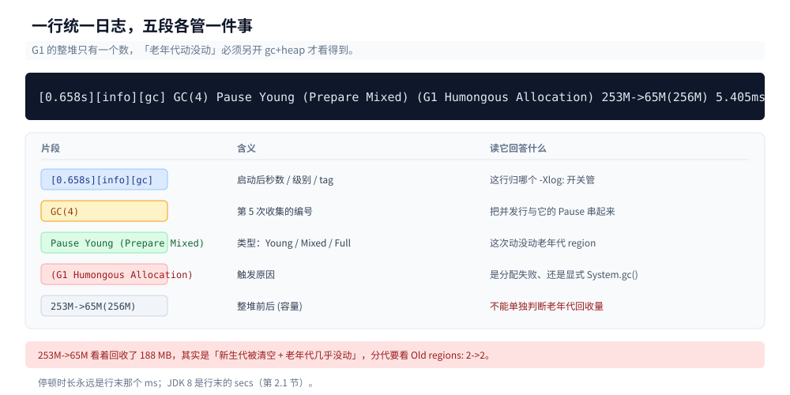
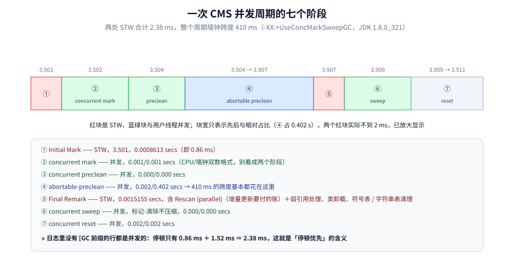
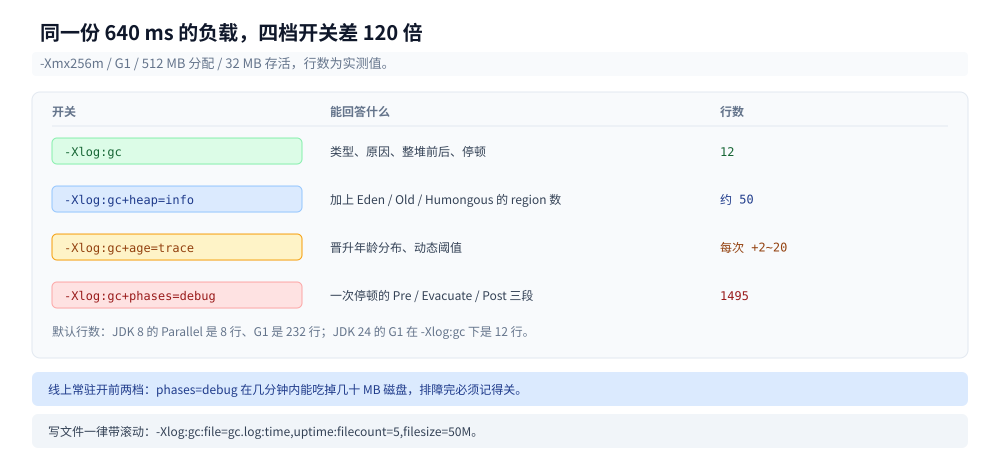
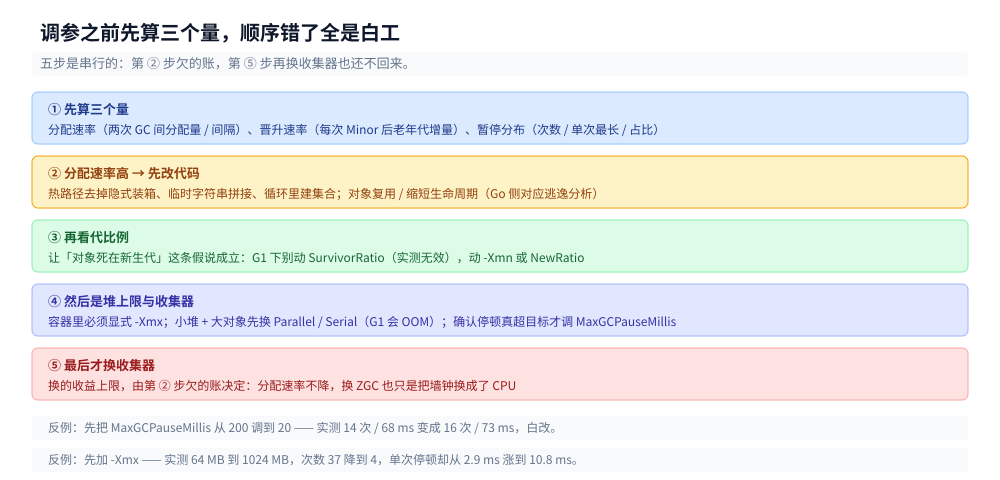

# GC 调优与日志

> 覆盖：从一份 GC 日志读到一组参数 —— 日志开关在 JDK 8 与 JDK 9+ 的**两套写法**、每个字段怎么认、
> `-Xlog` 开到什么级别的体量代价、只改 `-Xmx` / 只改新生代的实测曲线、`jstat` / `jcmd` / `jmap` 的现场流程、
> 以及"先看什么数、再动哪个旋钮"的调优顺序。
>
> 不覆盖：分代结构、根集合、收集器演进与 G1/ZGC 的机制，见 [垃圾回收原理与收集器.md](垃圾回收原理与收集器.md)；
> 算法层的通用原理见 [垃圾回收](../../../02-计算机基础/垃圾回收/)；`jcmd` 的命令家族与 JFR 见
> [JFR与诊断工具.md](JFR与诊断工具.md)；CPU / 死锁的现场流程见 [线上问题排查.md](线上问题排查.md)。
>
> 内容整理自个人学习笔记，**结论配套两套实测坐标**：JDK 1.8.0_321（Windows / server class / 8 核）
> 与 Temurin 24.0.2（Linux 容器 / 4 vCPU / 5.9 GB）。**日志格式两版完全不同**，正文每一节都分别给出写法。

---

## 一、先认版本：日志开关换了一整套

**本节要点**：JDK 9 之后 `PrintGCDetails` 这一族参数被**统一日志框架**取代，JDK 24 上拿老参数启动会直接失败 —— 调优第一步永远是确认自己手上是哪个版本的日志。

### 1.1 两套开关的对照

| 想知道什么 | JDK 8 写法 | JDK 9+ 写法 |
|---|---|---|
| 每次 GC 一行摘要 | `-XX:+PrintGCDetails` | `-Xlog:gc` |
| 加上墙钟日期 | `-XX:+PrintGCDateStamps` | 默认就带（`[0.472s]` 是相对时间，日期要 `-Xlog:gc:...:time` 或 `decorators`） |
| 输出到文件 | `-Xloggc:gc.log` | `-Xlog:gc:file=gc.log` |
| 每次 GC 的前后堆快照 | `-XX:+PrintHeapAtGC` | `-Xlog:gc+heap=debug` |
| 晋升年龄分布 | `-XX:+PrintTenuringDistribution` | `-Xlog:gc+age=trace` |
| 自适应策略的决策 | `-XX:+PrintAdaptiveSizePolicy` | `-Xlog:gc+ergo=trace` |
| 分阶段耗时 | `-XX:+PrintGCApplicationStoppedTime` | `-Xlog:gc+phases=debug` |
| 安全点 | `-XX:+PrintSafepointStatistics` | `-Xlog:safepoint` |

⚠️ **实测：JDK 24 上老开关是硬失败，不是警告**：

```text
$ java -Xmx256m -XX:+PrintGCDetails -XX:+PrintGCDateStamps -Xloggc:/tmp/old.log Churn 64 8
Unrecognized VM option 'PrintGCDateStamps'
Error: Could not create the Java Virtual Machine.
Error: A fatal exception has occurred. Program will exit.
```

⭐ 注意它报的是 `PrintGCDateStamps` 而不是 `PrintGCDetails` —— **JVM 一次只报第一个不认识的参数**，
所以"改掉这个就能起来"是错觉，得逐个试。从老项目抄启动脚本时，最快的做法是 `java <参数> -version` 跑一遍。

### 1.2 JDK 24 的日志长什么样

`-Xlog:gc`（默认级别 `info`）在 G1 下的完整输出（`-Xmx256m`，512 MB 分配 / 32 MB 存活 / 每块 1 MB）：

```text
[0.027s][info][gc] Using G1
[0.269s][info][gc] GC(0) Pause Young (Concurrent Start) (G1 Humongous Allocation) 42M->41M(96M) 5.505ms
[0.269s][info][gc] GC(1) Concurrent Undo Cycle
[0.269s][info][gc] GC(1) Concurrent Undo Cycle 0.234ms
[0.273s][info][gc] GC(2) Pause Young (Concurrent Start) (G1 Humongous Allocation) 43M->43M(96M) 1.453ms
[0.273s][info][gc] GC(3) Concurrent Mark Cycle
[0.294s][info][gc] GC(3) Pause Remark 57M->57M(99M) 4.982ms
[0.306s][info][gc] GC(3) Pause Cleanup 63M->63M(99M) 0.057ms
[0.312s][info][gc] GC(3) Concurrent Mark Cycle 39.465ms
[0.658s][info][gc] GC(4) Pause Young (Prepare Mixed) (G1 Humongous Allocation) 253M->65M(256M) 5.405ms
[1.006s][info][gc] GC(5) Pause Young (Mixed) (G1 Humongous Allocation) (Evacuation Failure: Allocation) 253M->65M(256M) 7.105ms
[1.024s][info][gc] GC(6) Pause Young (Concurrent Start) (G1 Humongous Allocation) 115M->65M(256M) 11.906ms
```

⭐ 与 JDK 8 相比，三件事变了：

- **方括号里是"标签"不是"字段"**：`[时间][级别][tag]`，tag 决定这行归哪个 `-Xlog:` 开关管；
- **GC 有编号**：`GC(3)` 是这个 JVM 里第 4 次收集，跨行能串起来（`Concurrent Mark Cycle` 的 start 与耗时是同一个编号）；
- **原因写得更细**：`(Concurrent Start)` / `(Prepare Mixed)` / `(Mixed)` / `(Humongous Allocation)` / `(Evacuation Failure: Allocation)` 全是 JDK 8 打不出的信息。

---

## 二、认字段：一次 Minor GC 的每一段

**本节要点**：JDK 8 的方括号格式与 JDK 9+ 的标签格式字段不同，但**要看的三个数一样**：这次停顿多长、回收了多少、老年代动没动。

### 2.1 JDK 8 的 Parallel 日志

```text
2026-09-27T23:07:12.077+0800: 0.175: [GC (Allocation Failure) [PSYoungGen: 64799K->4920K(76288K)] 64799K->4928K(251392K), 0.0072831 secs] [Times: user=0.00 sys=0.00, real=0.01 secs]
```

| 字段 | 含义 |
|---|---|
| `2026-09-27T23:07:12.077+0800` | 墙钟时间（`PrintGCDateStamps` 打开后才有；排查时先对齐业务日志的时间轴） |
| `0.175` | JVM 启动后的秒数 |
| `GC (Allocation Failure)` | **触发原因**：Eden 分配失败（最常见的一种） |
| `[PSYoungGen: 64799K->4920K(76288K)]` | 新生代 回收前 → 回收后 (**总容量**) |
| `64799K->4928K(251392K)` | **整堆** 回收前 → 回收后 (总容量) |
| `0.0072831 secs` | 本次 GC 的**墙钟耗时**（这就是这次 STW 的长度） |
| `[Times: user/sys/real]` | CPU 时间三段 |

⭐ **两个数一眼定健康**：① `0.0072831 secs` 就是停顿，亚毫秒到几毫秒都正常；② 对比新生代与整堆的前后差值 —— 这次新生代回收了 59879 KB，整堆只回收 59871 KB，说明**这次几乎全是短命对象，老年代基本没动**。反过来，如果整堆回收量远大于新生代回收量，说明对象在被晋升。

### 2.2 JDK 24 的 G1 日志

同一行在统一日志下的形态：

```text
[0.658s][info][gc] GC(4) Pause Young (Prepare Mixed) (G1 Humongous Allocation) 253M->65M(256M) 5.405ms
```

| 字段 | 含义 |
|---|---|
| `0.658s` | JVM 启动后的秒数（**唯一的时间字段**，没有墙钟日期） |
| `info` | 日志级别；`debug` / `trace` 要显式开 |
| `gc` | tag，这行归 `-Xlog:gc` 管 |
| `GC(4)` | 第 5 次收集的编号（从 0 起） |
| `Pause Young (Prepare Mixed)` | 类型：**Young** = 只收新生代；`Mixed` = 顺带收一部分老年代 region；`Prepare Mixed` = 本次不 mixed 但下一轮开始 mixed |
| `(G1 Humongous Allocation)` | 触发原因 |
| `253M->65M(256M)` | **整堆** 回收前 → 回收后（容量）。G1 不再分代打印，要看代际明细得加 `gc+heap` |
| `5.405ms` | 停顿时长 |

⚠️ **G1 的 `M->M(M)` 只有整堆一个数**，这是最容易被误读的地方：`253M->65M` 看着像回收了 188 MB，
其实里面混着"新生代被清空"和"老年代几乎没有回收"两种情况。要分代看必须加 `-Xlog:gc+heap=info`：

```text
[0.267s][info][gc,heap] GC(4) Eden regions: 0->0(87)
[0.267s][info][gc,heap] GC(4) Survivor regions: 1->1(1)
[0.267s][info][gc,heap] GC(4) Old regions: 2->2
[0.267s][info][gc,heap] GC(4) Humongous regions: 40->40
```

⭐ **`Old regions: 2->2` 才是"老年代没动"的硬证据**；`Humongous regions: 40->40` 说明那 32 MB 存活对象一直占着。
`(87)` 是这种 region 的容量上限，不是使用量。



**图怎么读**：最上面是把日志原文黑底摆出来，下面五条按片段从左到右拆开，最后一列写清"读到这一段能回答什么、不能回答什么"。

### 2.3 一次 Full GC 的日志

JDK 8 的 Full GC 看 `[ParOldGen: 31468K->31460K(32768K)]` 这一段：**老年代回收前后的差值就是这次 Full GC 的产出**。
差值接近 0 → 堆不够了（详见 [垃圾回收原理与收集器.md](垃圾回收原理与收集器.md) 1.3）。

G1 在 JDK 24 上的 Full GC 是另一回事：它是**退化后的整堆压缩**，日志长这样（触发往往来自 `System.gc()` 或并发收集跟不上）：

```text
[1.006s][info][gc] GC(5) Pause Young (Mixed) (G1 Humongous Allocation) (Evacuation Failure: Allocation) 253M->65M(256M) 7.105ms
```

`(Evacuation Failure: Allocation)` 是 **G1 的"担保失败"**：复制目标 region 不够，本次晋升失败，对象退回原处。
它通常紧跟着一次 `Pause Full (G1 Compaction Pause)` —— 看到 `Evacuation Failure` 就该知道：这一轮白干了，
下一轮大概率是整堆 Full GC。

---

## 三、认一次并发周期

**本节要点**：并发收集器的日志是"讲故事"的 —— 要能从一串并发阶段里挑出**哪两条才是 STW**，剩下的都是可以忽略的并发耗时。

### 3.1 CMS 的七个阶段（JDK 8）

CMS 的日志是"讲故事"最完整的，逐步看（`-XX:+UseConcMarkSweepGC`）：

```text
3.501: [GC (CMS Initial Mark) [1 CMS-initial-mark: 225824K(349568K)] 244256K(506816K), 0.0008613 secs]
3.502: [CMS-concurrent-mark-start]
3.504: [CMS-concurrent-mark: 0.001/0.001 secs]
3.504: [CMS-concurrent-preclean-start]
3.504: [CMS-concurrent-preclean: 0.000/0.000 secs]
3.504: [CMS-concurrent-abortable-preclean-start]
3.907: [CMS-concurrent-abortable-preclean: 0.002/0.402 secs]
3.907: [GC (CMS Final Remark) [YG occupancy: 141021 K (157248 K)][Rescan (parallel) , 0.0007380 secs][weak refs processing, 0.0000125 secs][class unloading, 0.0001878 secs][scrub symbol table, 0.0003495 secs][scrub string table, 0.0001536 secs][1 CMS-remark: 225824K(349568K)] 366846K(506816K), 0.0015155 secs]
3.909: [CMS-concurrent-sweep-start]
3.909: [CMS-concurrent-sweep: 0.000/0.000 secs]
3.909: [CMS-concurrent-reset-start]
3.911: [CMS-concurrent-reset: 0.002/0.002 secs]
```

⭐ 逐行读出的三件事：

- **只有两行是 STW**：`CMS Initial Mark`（0.86 ms）与 `CMS Final Remark`（1.52 ms）；中间的 mark / preclean / sweep / reset 都是**并发**的（日志里没有 `[GC` 前缀）。本次周期墙钟跨度 **410 ms，其中停顿合计只有 2.38 ms** —— 这就是"停顿优先"的含义；
- **`Final Remark` 里在干什么**：`Rescan (parallel)` 就是**增量更新**要付的那笔账（以并发期间被改过的黑对象为根重扫），后面还有弱引用处理、类卸载、符号表/字符串表清理 —— 这是 CMS 最贵的 STW 段，也是它"停顿不像宣传那么低"的原因；
- **`abortable-preclean: 0.002/0.402 secs`** 这种 `CPU/墙钟` 双数格式在 CMS 日志里到处都是，别看成两个阶段。



**图怎么读**：横条按日志时间戳排出七个阶段，只有红色两块（① Initial Mark、⑤ Final Remark）带 `[GC` 前缀、是 STW；下面那块面板把每行日志的实测耗时对齐到对应阶段。

### 3.2 G1 的并发周期（JDK 24）

同一件事在 G1 上的形态（取自 1.2 那份日志）：

```text
[0.273s][info][gc] GC(3) Concurrent Mark Cycle
[0.294s][info][gc] GC(3) Pause Remark 57M->57M(99M) 4.982ms
[0.306s][info][gc] GC(3) Pause Cleanup 63M->63M(99M) 0.057ms
[0.312s][info][gc] GC(3) Concurrent Mark Cycle 39.465ms
```

⭐ 结构比 CMS 更清楚：`Concurrent Mark Cycle`（39.465 ms）是整段周期的**总墙钟**，其中只有
`Pause Remark`（4.98 ms）与 `Pause Cleanup`（0.06 ms）两条带 `Pause` 前缀 = STW。
**看 G1 的停顿问题，只数带 `Pause` 的行**，其余全是可以和业务并行跑的。

### 3.3 体量：G1 比 Parallel 多打多少

同一份负载（512 MB 分配 / 32 MB 存活 / `-Xmx256m`）：

| 写法 | 行数 |
|---|---|
| JDK 8 Parallel，`-XX:+PrintGCDetails` | 8 行 |
| JDK 8 G1，`-XX:+PrintGCDetails` | **232 行**（每个 GC 工作线程的分阶段耗时都打） |
| JDK 24 G1，`-Xlog:gc` | 12 行 |
| JDK 24 G1，`-Xlog:gc+heap=info` | 约 50 行（每次 GC 多 4 行 region 明细） |
| JDK 24 G1，`-Xlog:gc+phases=debug` | **1495 行**（640 ms 的负载） |

⭐ 这决定了**默认开什么**：线上常驻用 `-Xlog:gc`（或 `gc+heap=info`），排障时才临时加 `phases=debug`，
并且一定要带 `file=` 与滚动（`-Xlog:gc:file=gc.log:time,uptime:filecount=5,filesize=50M`）——
否则 `phases=debug` 能在几分钟内吃掉几十 MB 磁盘。

---

## 四、把日志开到什么级别

**本节要点**：统一日志是 `tag=级别` 的组合，**级别决定体量、tag 决定看什么**；四档够用，再高就是给编译器看的。

### 4.1 四档的实际输出

| 命令 | 能回答什么 | 实测体量（同一份 640 ms 负载） |
|---|---|---|
| `-Xlog:gc` | 每次收集的类型、原因、整堆前后、停顿 | 12 行 |
| `-Xlog:gc+heap=info` | 加上 Eden / Survivor / Old / Humongous 的 region 数 | 约 50 行 |
| `-Xlog:gc+age=trace` | 晋升年龄分布（判断"是不是过早晋升"） | 每次 GC 多 2~20 行 |
| `-Xlog:gc+phases=debug` | 一次停顿的 Pre / Evacuate / Post 三段拆解 | **1495 行** |



**图怎么读**：四行按行数从少到多往下排，底色由绿转红 —— 最下面那档比最上面多出 120 倍的行，只为了回答"这次停顿的三段各花了多久"。

### 4.2 `gc+age=trace`：晋升年龄怎么看

```text
[0.096s][debug][gc,age] GC(0) Desired survivor size 2097152 bytes, new threshold 15 (max threshold 15)
[0.099s][trace][gc,age] GC(0) Age table:
[0.099s][trace][gc,age] GC(0) - age   1:      81848 bytes,      81848 total
[0.100s][debug][gc,age] GC(2) Desired survivor size 2097152 bytes, new threshold 15 (max threshold 15)
[0.102s][trace][gc,age] GC(2) GC(2) Age table:
[0.102s][trace][gc,age] GC(2) - age   2:      81848 bytes,      81848 total
```

⭐ 三处判读：

- **`new threshold 15 (max threshold 15)`** —— 前面是**本次生效**的阈值，后面是你设的上限。两者不等，就是动态年龄判定起作用了；
- **`Desired survivor size` 在变**（2097152 → 1572864 → 5767168）：这个数就是"survivor 空间的一半"，它变说明 survivor 大小在自适应调整；
- **age 表里只有 81848 bytes（约 80 KB）** —— 本实验那 32 MB「存活对象」**一个都没进 age 表**，因为它们是 1 MB 的 humongous 对象，直接进 humongous region、不走年龄计数。**"晋升年龄"只对普通对象成立**，这是读 age 表最常踩的坑。

显式设 `-XX:MaxTenuringThreshold=2` 后立刻能看到生效，且能看到动态判定把它再压到 1：

```text
[0.165s][debug][gc,age] GC(0) Desired survivor size 2097152 bytes, new threshold 2 (max threshold 2)
[0.218s][debug][gc,age] GC(1) Desired survivor size 1572864 bytes, new threshold 1 (max threshold 2)
```

### 4.3 `gc+phases=debug`：停顿的三段

```text
[0.292s][info ][gc,phases] GC(4)   Pre Evacuate Collection Set: 0.56ms
[0.293s][info ][gc,phases] GC(4)   Evacuate Collection Set: 1.17ms
[0.293s][info ][gc,phases] GC(4)   Post Evacuate Collection Set: 1.20ms
```

对照外层那行 `Pause Young (Mixed) ... 4.057ms`：三段合计 2.93 ms，剩下的花在根扫描与收尾上。
⭐ 判读抓手：**`Pre` 大 → 根扫描慢；`Evacuate` 大 → 存活集大；`Post` 大 → RSet / 卡表 / 引用处理慢**。
同一份 debug 日志里每个阶段还带 `Min/Avg/Max/Diff/Sum/Workers` 六个统计量，能看出**并行度有没有用满**。

### 4.4 `gc+ergo=trace`：G1 的决策日志

JDK 8 里用 `-XX:+PrintAdaptiveSizePolicy` 看的两行 CSet 预测：

```text
[G1Ergonomics (CSet Construction) start choosing CSet, _pending_cards: 0, predicted base time: 10.00 ms, remaining time: 190.00 ms, target pause time: 200.00 ms]
[G1Ergonomics (CSet Construction) finish choosing CSet, eden: 1 regions, survivors: 0 regions, old: 0 regions, predicted pause time: 24.70 ms, target pause time: 200.00 ms]
```

这段日志把 G1 的核心讲完了：**在"剩余时间预算"（`remaining time 190.00 ms`）里挑 region 组成本次回收集（CSet），并预测停顿不超 `MaxGCPauseMillis=200 ms`**。

JDK 24 上对应的开关是 `-Xlog:gc+ergo=trace`，输出的决策种类更多但**不再有这两行 CSet 预测**，
实际打出来的是这类（`-Xmx256m`，同一份负载）：

```text
[0.166s][debug][gc,ergo] Request concurrent cycle initiation (requested by GC cause). GC cause: G1 Humongous Allocation
[0.266s][debug][gc,ergo] GC(4) Running G1 Merge Heap Roots using 4 workers for 1 regions
[0.441s][debug][gc,ergo] GC(5) do not continue mixed GCs (candidate old regions not available)
```

⭐ `do not continue mixed GCs (candidate old regions not available)` 这句话很有价值：它说明**这一轮没得 mixed 可做**，
原因不是停顿预算不够，而是老年代没有值得回收的 region（存活率太高）。**看到这句就别去调 `MaxGCPauseMillis` 了**。

---

## 五、只改 `-Xmx`

**本节要点**：堆越大 → 次数越少、单次越贵；**总停顿可能降，但延迟看的是单次与 P99**。这条趋势跨版本稳定，具体数值不。

### 5.1 JDK 8 / Parallel

固定 512 MB 分配压力、存活 32 MB，只改最大堆：

| `-Xmx` | 实测堆上限 | Minor GC 次数 | Minor 总耗时 | 单次均摊 | Full GC | Eden 峰值 | Old 峰值 |
|---|---|---|---|---|---|---|---|
| 64m | 62 MB | **37** | 109 ms | 2.9 ms | 0 | 17408 KB | 34376 KB |
| 256m | 241 MB | **8** | 52 ms | 6.5 ms | 0 | 64799 KB | 21024 KB |
| 1024m | 910 MB | **4** | 43 ms | 10.8 ms | 0 | 148114 KB | 15368 KB |

⭐ 三点读出来的结论：

1. **堆越大，GC 次数越少但单次越贵**：次数 37 → 4（9 倍），单次均摊 2.9 ms → 10.8 ms（3.7 倍）—— 因为每次要复制的 Eden 更大。**总耗时仍降了**（109 → 43 ms），但降幅（2.5 倍）远小于次数降幅；
2. **老年代峰值反而随堆增大而下降**（34 MB → 21 MB → 15 MB）：Eden 大，对象有更多机会在新生代里死去，晋升变少；
3. **别只看次数**：线上常有人吹"我把 GC 次数降了十倍"，但每次停顿变长了 —— 延迟看的是**单次停顿与 P99**，不是次数。

> ⚠️ 这张表是**单次运行**的读数：GC 次数受并发调度影响，重复跑有 ±20% 左右波动（复核实测 38 / 8 / 4 次、单次均摊 4.8 / 8.5 / 9.5 ms）。
> **稳定的只有两条趋势**：次数随堆增大而减少、单次停顿随堆增大而上升 —— 引用数字时请带上这两条趋势，而不是某个具体值。

### 5.2 JDK 24 / G1

同一份负载、只改 `-Xmx`（3 轮）：

| `-Xmx` | 墙钟 3 轮 | Pause 次数 | 总停顿 |
|---|---|---|---|
| 64m | 未跑完 | — | **`OutOfMemoryError`** |
| 256m | 374 / 415 / 450 ms | 15 / 15 / 15 | 43 / 50 / 38 ms |
| 1024m | 1021 / 696 / 691 ms | 3 / 3 / 3 | 27 / 15 / 15 ms |

⭐ **`-Xmx64m` 这一格是空的，本身就是结论**：G1 的 region 只有 1 MB，1 MB 的对象是 humongous，
32 MB 存活对象要吃掉 32~64 个 region，而整堆才 64 个。同样的负载 **Serial 203 ms、Parallel 227 ms 都能跑完**
（原理见 [垃圾回收原理与收集器.md](垃圾回收原理与收集器.md) 5.2）。这是"**小堆 + 大对象别用 G1**"的硬证据，
也是容器里给 64 MB 堆的推荐落点。

1024m 那一列的总停顿（27 / 15 / 15 ms）明显低于 256m（43 / 50 / 38 ms），次数也从 15 掉到 3 ——
**G1 在大堆上确实更省**，因为每次 only 挑几个 region；而 Parallel 在大堆上单次会更贵（5.1 的结论）。

---

## 六、只改新生代

**本节要点**：`NewRatio = N` 表示**新生代 : 老年代 = 1 : N**（不是占比）；而在 G1 下 **`NewRatio` 与 `-Xmn` 仍然生效、`SurvivorRatio` 已失效**。

### 6.1 JDK 8：`NewRatio`（`-Xmx512m`）

`NewRatio = N` 表示 **新生代 : 老年代 = 1 : N**（⚠️ 不是"新生代的占比"，这是最容易记反的一个）：

| `NewRatio` | 新生代占比 | Minor GC 次数 | 总耗时 | Eden 峰值 | Old 峰值 |
|---|---|---|---|---|---|
| 1 | 1/2 | **3** | 27 ms | 196404 KB | 9224 KB |
| 2（默认） | 1/3 | 4 | 26 ms | 140237 KB | 15368 KB |
| 8 | 1/9 | **13** | 45 ms | 50144 KB | 31304 KB |

**新生代越小 → Minor GC 越频繁、老年代涨得越快**（`NewRatio=8` 时老年代峰值 31 MB，是 `NewRatio=1` 的 3.4 倍）。复核实测次数为 4 / 6 / 13，同样是单调递增（次数值有波动，"越小的新生代 → 越频繁"这条趋势稳定）。

调新生代大小的方向性原则：

| 症状 | 动作 |
|---|---|
| Minor GC 太频繁、每次停很短 | **放大新生代**（降 `NewRatio` 或直接 `-Xmn`） |
| 单次 Minor GC 停顿太长 | **缩小新生代**（复制量正比于存活集，但 Eden 大→扫描/复制面大） |
| 老年代增长快、Full GC 频繁 | 先查**晋升速率**（是不是 Survivor 太小导致过早晋升），再考虑放大老年代 |

### 6.2 JDK 24 / G1：哪些参数还认

G1 没有"连续的年轻代"，但 `NewRatio` 与 `-Xmn` 被翻译成"young region 的最大数量"。
实测（`-Xmx256m`，看 Eden 的 region 容量上限）：

| 参数 | Eden regions 容量 |
|---|---|
| 默认 | 24 |
| `-XX:NewRatio=1` | **46** |
| `-XX:NewRatio=8` | **9** |
| `-XX:SurvivorRatio=2` | 24（**没变**） |
| `-Xmn64m` | 47 |
| `-Xmn128m` | 67 |

⭐ 三条结论：

- **`NewRatio` 在 G1 下仍然生效**（24 → 46 / 9），"JDK 9 起这些分代参数全废"是错的；
- **`-Xmn` 比 `NewRatio` 更直接**（47 / 67 是绝对值，不受老年代比例牵动）；
- **`SurvivorRatio` 确实失效了** —— G1 的 survivor 数量由 `-XX:MaxGCPauseMillis` 与 `G1AdaptiveSurvivorSizePolicy` 决定，不读这个比例。

### 6.3 `MaxGCPauseMillis` 不是越小越好

`-Xmx512m`、1024 MB 分配 / 64 MB 存活 / 每块 64 KB，只改停顿目标（3 轮）：

| `-XX:MaxGCPauseMillis` | Pause 次数 | 总停顿 |
|---|---|---|
| 200（默认） | 14 / 14 / 14 | 68 / 68 / 62 ms |
| 20 | 16 / 15 / 16 | 73 / 85 / 74 ms |

⭐ **目标收紧 10 倍，次数只多了 2 次、总停顿反而涨了**。原因是 G1 为了压单次停顿去缩小 CSet，
于是收得更频繁 —— 这个负载本来就只有 68 ms 总停顿，目标 200 ms 根本没被勒住，收紧只是白白增加了次数。
**`MaxGCPauseMillis` 只在该收的收不动时才起作用**：先确认日志里出现了"某次停顿超过了目标值"，
再调它；否则收益是零、代价是次数。

---

## 七、现场诊断三件套

**本节要点**：从"是不是 GC 的问题"到"到底谁占着内存"，三步固定动作；**`jstat` 看趋势、`jcmd` 看精确值、`jmap` 看对象**。

### 7.1 先确认「是不是 GC 的问题」

```bash
# 每 1 秒打一次，共 5 次；看 O（老年代使用率）、FGC 是否在涨
jstat -gcutil <pid> 1000 5
```

实测输出（JDK 8，`-Xmx64m` + Serial，程序里已放 12 MB 大对象进老年代）：

```text
  S0     S1     E      O      M     CCS    YGC     YGCT    FGC    FGCT     GCT
  0.00   0.00  10.02  28.11  17.38  19.94      0    0.000     0    0.000    0.000
```

`O = 28.11%` 正好对上"老年代 12288 KB / 容量 43712 KB"。

⭐ **判据**：

- `O` 长期高位不降 + `FGC` 持续增长 = **存活集顶到上限**（对应"Full GC 收不动"）；
- `YGC` 涨得快而 `YGCT` 很小 = **分配太猛**，先改代码；
- `GCT` 占墙钟的比例（`GCT / 运行秒数`）超过 10% 就该动手了。

### 7.2 要精确数字，用 `jstat -gc` 或 `jcmd`（不要用 JMX）

```bash
jstat -gc <pid>          # 各代容量与使用量（单位 KB），比 -gcutil 精确
jcmd <pid> GC.heap_info  # 堆的分代实况，含元空间
```

```text
# jstat -gc
   S0C    S1C    S0U    S1U      EC       EU        OC         OU       MC     MU    CCSC   CCSU   YGC  YGCT  FGC  FGCT   GCT
2176.0 2176.0   0.0    0.0   17472.0   1749.9   43712.0    12288.0   4480.0 778.5  384.0   76.6    0  0.000    0 0.000 0.000

# jcmd <pid> GC.heap_info
def new generation   total 19648K, used 1749K
 eden space 17472K,  10% used
tenured generation   total 43712K, used 12288K
Metaspace       used 3614K, capacity 4600K, committed 4864K, reserved 1056768K
```

⚠️ **实测踩到的坑**：用 `MemoryPoolMXBean.getUsage()`（JMX）读老年代用量，同一个程序连读三次得到 `0 / 4096 / 8192 KB` 三个不同值 —— **读数明显滞后于实际分配**。要做精确对照（比如验证 `PretenureSizeThreshold`），必须用 `jstat` / `jcmd` / GC 日志，**JMX 的峰值可用、瞬时值不可信**。

### 7.3 看"到底是谁占着内存"

```bash
jmap -histo <pid> | head -20            # 直方图：按类和对象数排序
jmap -dump:live,format=b,file=heap.hprof <pid>   # 堆快照，交给 MAT 看支配树
```

实测节选：

```text
 num     #instances         #bytes  class name
----------------------------------------------
   1:           174       12701008  [B
   2:           643         632248  [I
   3:          5293         622672  [C
   4:          4102          98448  java.lang.String
   5:           684          77704  java.lang.Class
```

`[B` = `byte[]`、`[I` = `int[]`、`[C` = `char[]`（JVM 内部类型签名）。⭐ **排第一的 `[B` 占了 12.1 MB**，与"12 个 1 MB 数组进老年代"完全吻合 —— **排查内存问题，先看数组类型，它们往往是大头**。

### 7.4 查"生效参数"，别靠记忆

```bash
java -XX:+PrintFlagsFinal -version | grep <关键字>   # 启动前：看默认值与 ergonomics 的选择
jinfo -flags <pid>                                   # 运行中：看实际生效值
```

```text
-XX:MaxHeapSize=67108864
-XX:PretenureSizeThreshold=2097152
-XX:+UseSerialGC
```

⚠️ 换收集器会**偷偷改掉别的默认值**。JDK 8 的 GC 日志第 3 行会打印完整生效参数：

```text
# -XX:+UseParallelGC
CommandLine flags: -XX:InitialHeapSize=266412288 -XX:MaxHeapSize=268435456 ... -XX:+UseParallelGC

# -XX:+UseConcMarkSweepGC
CommandLine flags: -XX:InitialHeapSize=266412288 -XX:MaxNewSize=89481216 -XX:MaxTenuringThreshold=6 ... -XX:+UseConcMarkSweepGC -XX:+UseParNewGC
```

CMS 那一行多出来的 `-XX:MaxTenuringThreshold=6` **不是你设的** —— 是 ergonomics 为了让 Survivor 装得下而把默认 15 压到了 6。**换收集器前后一定要重新看一遍生效参数**，别拿旧的经验值套。

### 7.5 诊断套路速查

| 症状 | 先看什么 | 常见根因 |
|---|---|---|
| **CPU 高** | `top -Hp <pid>` 找线程 → 转十六进制 → `jstack <pid>` 对照 | 死循环、锁竞争、GC 线程抢 CPU |
| **停顿长** | GC 日志的单次 `secs` / `ms`、`O` 使用率、`gc+phases` 三段 | 存活集太大、Full GC、`finalize` 队列、元空间不足 |
| **内存只涨不降** | `jstat -gcutil` 的 `O` + `jmap -histo` | 泄漏（缓存无上限 / 静态集合 / 长生命周期监听器） |
| **频繁 Full GC 但回收量小** | Full GC 前后老年代差值 | 存活集顶到堆上限 → **加堆或减对象**，调收集器无效 |
| **G1 一直 OOM 而堆看着还够** | `-Xlog:gc+heap=info` 的 `Humongous regions` | 大对象撕裂 region，见第五节 64m 那格 |
| **G1 的 mixed 一直不执行** | `-Xlog:gc+ergo=trace` 的 `do not continue mixed GCs` | 老年代存活率太高，没有可回收 region，调 `MaxGCPauseMillis` 无用 |

---

## 八、调优顺序

**本节要点**：调参的真正关键是"**先看什么数，再动哪个旋钮**"；顺序错了，所有参数都是在给第 ② 步欠的账付利息。

```text
① 打开 GC 日志，先算三个量
   - 分配速率 = 两次 GC 之间的分配量 / 时间间隔
   - 晋升速率 = 每次 Minor GC 后老年代的增量
   - 暂停分布 = Minor / Full 各自的次数、单次最大、占比
② 分配速率高 → 先改代码（别急着调 JVM）
   - 热路径避免隐式装箱、临时字符串拼接、循环里建集合
   - 对象复用 / 池化；缩短对象生命周期（对应 Go 侧看逃逸分析）
③ 看代比例：让"对象死在新生代"这条假说成立
   - Survivor 太小 → 过早晋升 → 放 Survivor 或降低晋升压力
   - G1 下别调 SurvivorRatio（实测无效），动 -Xmn 或 NewRatio
④ 内存上限与收集器
   - 容器里一定显式 -Xmx（别让 JVM 看到宿主机的 1/4）
   - 停顿目标明确就上 G1 + -XX:MaxGCPauseMillis（先确认目标真被超过）
   - 小堆 + 大对象先换 Parallel / Serial（G1 会 OOM）
⑤ 最后才换收集器：换的收益上限，由第 ② 步欠的账决定
```

> ⚠️ **`-Xmx` 不是越大越好**：堆大 → 单次回收更贵（5.1 实测）、且更容易被 Full GC 一次收很长的停顿。容器里还要预留堆外内存（元空间、线程栈、直接内存），别把容器限额全给 `-Xmx`。



**图怎么读**：五块从上到下是必须串行的顺序，颜色由蓝到红表示"越靠后越不该先动"；最下面两条灰条是两个最常见的越序动作及其实测代价。

---

## 九、校验口径

> ✅ 本篇的实测范围与边界：

- **JDK 8 侧（1.8.0_321 / Windows / server class / 8 核）**：第五节 5.1 的 `-Xmx` 三档、第六节 6.1 的 `NewRatio` 三档、
  第二节 2.1 的 Parallel 日志原文、第三节 3.1 的 CMS 完整周期、第四节 4.4 的 CSet 预测日志、第七节 7.1 / 7.2 / 7.4 的输出 ——
  全部为当时真跑的原始输出，未重跑。
- **JDK 24 侧（Temurin 24.0.2 / Linux 容器 / 4 vCPU / 5.9 GB）**：第一节 1.1 的参数失败原文、1.2 的 G1 日志、
  第二节 2.2 的 region 明细、第三节 3.2 / 3.3 的行数统计、第四节 4.2 / 4.3 / 4.4 的 tag 输出、
  第五节 5.2 的 `-Xmx` 三档、第六节 6.2 / 6.3 的参数扫描 —— 全部真跑，3 轮取区间。
- **未实测**：
  - JDK 8 之外的版本在 K8s 里跑 `-Xlog:gc` 接日志采集的落盘行为（只验证了 `file=` 能写）。
  - `-Xlog:gc+phases=debug` 在长时间常驻服务上的磁盘占用（只在一份 640 ms 的负载上量到 1495 行）。
  - G1 的 `Pause Full (G1 Compaction Pause)` 原文未在本机复现（`Evacuation Failure` 复现了，Full 没跑出来）。
- **复现命令**：`Churn.java`（512 MB 分配 / 32 MB 存活 / 每块 1 MB 的固定负载）在
  `.workbuddy/tmp/exp/java/gc/`，两套坐标下的调用方式见各节代码块。

| 依赖 | 实际版本 |
|---|---|
| JDK（旧坐标） | 1.8.0_321（Windows） |
| JDK（新坐标） | Temurin 24.0.2+12（容器） |
| 采集脚本 | `jstat` / `jcmd` / `jmap`（同 JDK 自带） |

---

## 延伸追问

- **JDK 8 的 `-XX:+PrintGCDetails` 在 JDK 24 上还能用吗？** → 不能。实测 `-XX:+PrintGCDateStamps` 直接 `Unrecognized VM option` + `Could not create the Java Virtual Machine`；统一日志用 `-Xlog:gc`、`-Xlog:gc+heap=info`、`-Xlog:gc+age=trace`、`-Xlog:gc+phases=debug` 四档替代。⚠️ JVM **一次只报第一个不认识的参数**，逐个试比对照文档快。
- **G1 的 `253M->65M(256M)` 能看出老年代回收了多少吗？** → 不能，那是整堆一个数。要分代必须加 `-Xlog:gc+heap=info`，看 `Old regions: 2->2`（没动）与 `Humongous regions: 40->40`（一直占着）。
- **怎么判断"过早晋升"？** → 看 `-Xlog:gc+age=trace` 的 `new threshold`：它远小于 `max threshold` 就是动态年龄判定在提前晋升（实测设 2 后被压到 1）。⚠️ humongous 对象不进 age 表，别拿 age 表里的小数字当"存活很少"。
- **`-Xmx` 是不是越大越好？** → 不是。JDK 8 实测同压力下 64 MB / 256 MB / 1024 MB 的 Minor GC 次数是 37 / 8 / 4，但**单次停顿从 2.9 ms 涨到 10.8 ms**；总停顿虽降，延迟看的是单次与 P99。且容器里要预留堆外内存。
- **容器里给 64 MB 堆会发生什么？** → JDK 24 默认 G1 下**直接 OOM**（实测），而 Serial 203 ms / Parallel 227 ms 能跑完。原因是 1 MB region 下 1 MB 对象是 humongous（见 [垃圾回收原理与收集器.md](垃圾回收原理与收集器.md) 5.2）。要么换收集器，要么把 `-XX:G1HeapRegionSize` 调大。
- **`-XX:MaxGCPauseMillis` 设成 20 ms 会更快吗？** → 不会。实测 200 ms → 14 次 / 68 ms 总停顿，20 ms → 16 次 / 73 ms：次数多两次、总停顿反升。**只在该收的收不动时才调它**。
- **G1 下 `SurvivorRatio` 还有用吗？** → 没有（实测改它 Eden region 数不变）；但 `NewRatio`（24 → 46 / 9）与 `-Xmn`（47 / 67）**仍然生效**。
- **日志开太细会有什么代价？** → 同一份 640 ms 负载：`-Xlog:gc` 12 行、`gc+heap=info` 约 50 行、**`gc+phases=debug` 1495 行**。线上常驻用前两档，排障时临时加并带 `file=` 与滚动。
- **为什么 JMX 读到的内存用量不准？** → 实测同一程序连读三次 `MemoryPoolMXBean.getUsage()` 得到 `0 / 4096 / 8192 KB`，明显滞后于实际分配。峰值可用、瞬时值不可信；精确值用 `jstat -gc` 或 `jcmd GC.heap_info`。
- **怎么排查线上内存问题？** → `jstat -gcutil` 看 `O` 与 `FGC` 趋势 → `jstat -gc` / `jcmd GC.heap_info` 拿精确分代用量 → `jmap -histo` 看谁占内存（先看 `[B`/`[I` 这类数组）→ 必要时 `jmap -dump` + MAT 看支配树；CPU 高则 `jstack` 对照线程栈。
- **调堆和调代码，先做哪个？** → 先看**分配速率与晋升速率**：分配速率高时扩堆只是把问题推后；判据是"老年代增长快 + Full GC 收不动"，那时先查对象生命周期（临时对象、缓存无上限），再动参数。
- **为什么换收集器后旧参数不能直接套？** → 换收集器会改别的默认值：JDK 8 实测 `-XX:+UseConcMarkSweepGC` 会顺带把 `MaxTenuringThreshold` 从 15 压到 6（GC 日志第 3 行的 `CommandLine flags` 里有）。换完必须重看生效参数。

---

## 关联

- **上游/总纲**：[java/README.md](../README.md) — 运行时线的读序与篇间依赖
- **对照/互补**：[垃圾回收原理与收集器.md](垃圾回收原理与收集器.md) — **同一次拆分的另一半**：分代结构、根集合、收集器演进、G1 region 与 ZGC 机制
- [GC基础算法.md](../../../02-计算机基础/垃圾回收/GC基础算法.md) — 算法层入口，含通用的调优顺序
- [JFR与诊断工具.md](JFR与诊断工具.md) — `jcmd` 的命令家族、JFR 事件流、`jstat` 为什么走 PerfData
- [线上问题排查.md](线上问题排查.md) — CPU 飙高、死锁、线程池打满的现场流程（本篇只管 GC 线）
- [JVM启动与参数体系.md](JVM启动与参数体系.md) — `-X` 与 `-XX` 的翻译、参数的四个家族、来源与覆盖顺序
- [对象布局与引用类型.md](对象布局与引用类型.md) — 对象多大、四种引用的强度（判断"是不是真的泄漏"要先知道对象多大）
- [Stream流实战.md](../Stream流实战.md) — 隐式装箱与临时对象，是分配速率的主要来源之一
- [集合容器.md](../集合容器.md) — `ArrayList` 扩容产生的旧数组、`LinkedList` 的百万级 `Node`，都是分配速率的显著来源
- [资源限制与运维.md](../../../06-工程实践/部署/docker/资源限制与运维.md) — 容器里 JVM 为什么要感知 cgroup、为什么必须显式 `-Xmx`

> 反向引用（本篇被下列文档引到）：[性能排查.md](../../../02-计算机基础/linux/性能排查.md)、[GC基础算法.md](../../../02-计算机基础/垃圾回收/GC基础算法.md)、[资源限制与运维.md](../../../06-工程实践/部署/docker/资源限制与运维.md)、[目录.md](../../../目录.md)、[README.md](../README.md)、[Stream流实战.md](../Stream流实战.md)、[接入Jaeger.md](../可观测性/接入Jaeger.md)、[子进程与外部命令.md](../工程实践/子进程与外部命令.md)、[并发容器.md](../并发/并发容器.md)、[集合容器.md](../集合容器.md)、[JFR与诊断工具.md](JFR与诊断工具.md)、[JVM启动与参数体系.md](JVM启动与参数体系.md)、[对象布局与引用类型.md](对象布局与引用类型.md)、[线上问题排查.md](线上问题排查.md)
