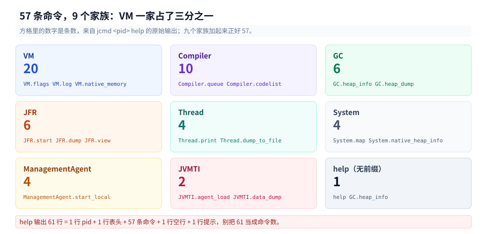
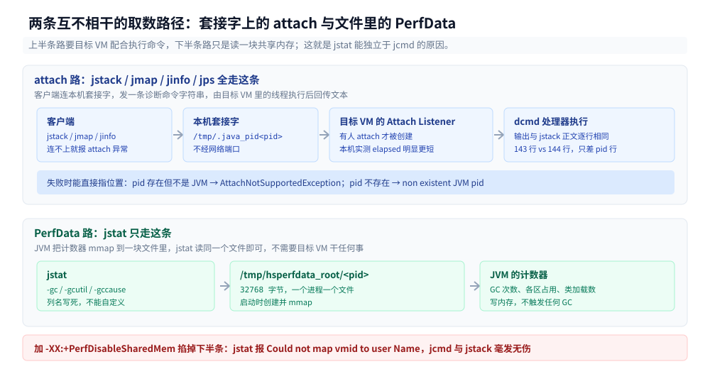
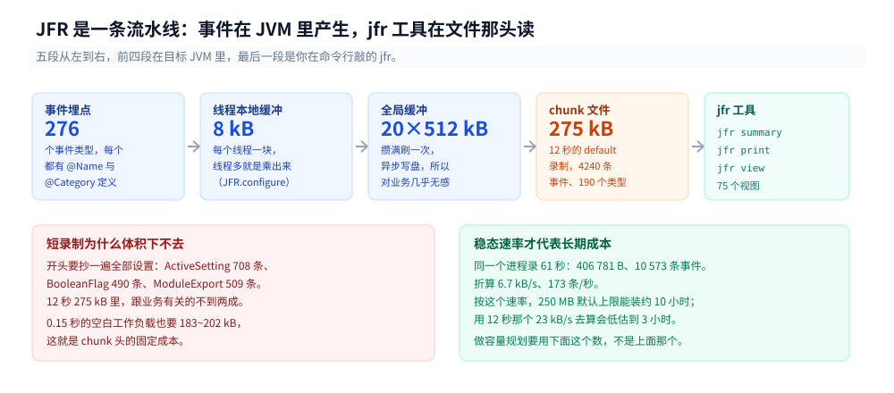
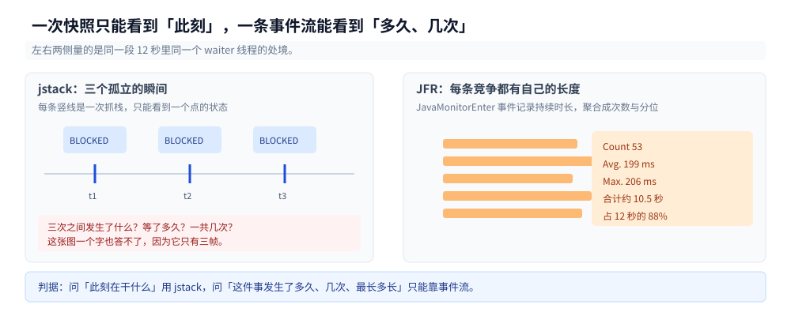
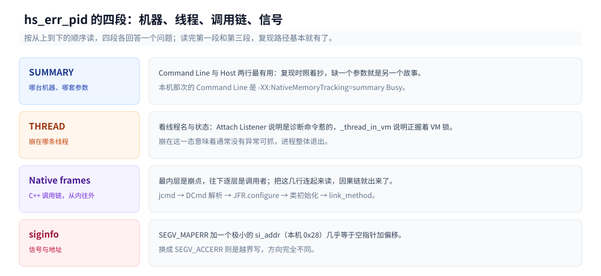

# JFR与诊断工具

> 覆盖：`jcmd <pid> help` 那 61 行输出里到底有多少条命令、它们怎么分家族；`jstack` / `jmap` / `jinfo` / `jps` 与 `jcmd` 是不是同一套东西（逐行 diff 实测）；`jstat` 为什么不在这套协议里、凭什么在别处都连不上时仍然出数；JFR 的事件模型、四种起停姿势、`jfr view` 怎么把事件流变成表；`jhsdb` 在容器里为什么几乎必然失败；JVM 自己崩了之后 `hs_err_pid` 里该看哪四段。
>
> 不覆盖：CPU 飙高、死锁、线程池打满的现场流程（`top -Hp` → 十六进制 → `jstack`）与 Arthas 见 [线上问题排查.md](线上问题排查.md)；GC 分区与回收器选型见 [垃圾回收原理与收集器.md](垃圾回收原理与收集器.md)、GC 日志每个字段的含义见 [GC调优与日志.md](GC调优与日志.md)；`-Xlog` 这类启动期开关与参数体系见 [JVM启动与参数体系.md](JVM启动与参数体系.md)；JIT 分层、nmethod 与去优化见 [JIT与执行引擎.md](JIT与执行引擎.md)；对象在堆里占多少字节见 [对象布局与引用类型.md](对象布局与引用类型.md)。
>
> 内容整理自个人学习笔记，素材见 [素材清单](../../../素材清单.md)。
>
> 实测口径：`eclipse-temurin:24-jdk`（24.0.2+12，linux/amd64，cgroup v2，容器 4 CPU）。本篇的每条命令都对一个真实运行的 Java 进程跑过（源码 `Busy.java`、`JfrCost.java`，见 1.1 与 6.1），命令行输出是原样摘录、只删掉了重复行。⚠️ 两处**未实测**：JFR 的 `maxsize` 轮转（4.6 给了为什么没跑出来）、`jstat` 在目标进程完全卡死时仍能出数这个场景（3.4 标了）。⚠️ 第七节那份 `hs_err` 不是我构造的，是实测过程中 JVM 自己崩了留下的，崩因没能复现。

---

## 一、进程还活着的时候，能问它多少个问题？

**本节要点**：`jcmd <pid> help` 输出 61 行，其中 **57 条是命令**，按前缀分成 9 个家族。这 57 条不是 57 个工具，而是同一套「诊断命令」协议下的 57 个处理器——`jps`/`jstack`/`jmap`/`jinfo` 能做的事全在里面，只是各自修了一条专用客户端。

### 1.1 从零：一个有东西可看的进程

先要有一个「每个工具都有东西可看」的进程。下面这段没有依赖，`javac Busy.java && java Busy` 就能跑，它开五条线程分别占住五种状态：纯 CPU 循环、持锁 200 ms、被锁挡住、持续分配、定时 park。

```java
public class Busy {
    static final Object LOCK = new Object();
    static volatile long sink;

    static void sleep(long ms) {
        try { Thread.sleep(ms); } catch (InterruptedException e) { }
    }

    static void spawn(String name, boolean daemon, Runnable r) {
        Thread t = new Thread(r, name);
        t.setDaemon(daemon);
        t.start();
    }

    public static void main(String[] args) {
        System.out.println("pid=" + ProcessHandle.current().pid());
        spawn("burner", false, () -> {                    // 纯 CPU，jstack 每次都能抓到同一个栈顶
            long x = 0;
            while (true) { x += 1; if ((x & 0xFFFFF) == 0) sink = x; }
        });
        spawn("holder", false, () -> {                    // 每次持锁 200 ms 不放
            while (true) { synchronized (LOCK) { sleep(200); } sleep(20); }
        });
        spawn("waiter", false, () -> {                    // 一直被 holder 挡住
            while (true) { synchronized (LOCK) { sink++; } sleep(5); }
        });
        spawn("allocator", false, () -> {                 // 持续制造 64 KB 短命数组
            while (true) { byte[] b = new byte[64 * 1024]; sink += b.length; sleep(5); }
        });
        spawn("parker", true, () -> {                     // 绝大多数时间在 park
            while (true) { sleep(500); }
        });
        sleep(Long.MAX_VALUE);
    }
}
```

再用 JDK 自带的工具问它。下面这十行可以整段粘进终端：

```bash
javac Busy.java
java Busy &
PID=$!
sleep 4
jcmd $PID VM.uptime                          # 一句话：你活了几秒
jcmd $PID help | wc -l                       # 61 行
jcmd $PID Thread.print | grep -c '^"'        # 26 个线程条目
jcmd $PID JFR.start name=diag settings=profile maxsize=64MB
sleep 10
jcmd $PID JFR.stop name=diag filename=diag.jfr
jfr summary diag.jfr
```

真跑出来是这样（只截了 `jfr summary` 的开头）：

```text
pid=2959
2959:
4.832 s
61
26
2959:
Started recording 1.

Use jcmd 2959 JFR.dump name=diag filename=FILEPATH to copy recording data to file.
2959:
Stopped recording "diag", 237.6 kB written to:

/w/.workbuddy/tmp/exp/java/diag/diag.jfr

 Version: 2.1
 Chunks: 1
 Start: 2026-10-27 12:36:46 (UTC)
 Duration: 11 s

 Event Type                              Count  Size (bytes) 
=============================================================
 jdk.ExecutionSample                       944          9440
 jdk.ModuleExport                          509          4933
 jdk.BooleanFlag                           490         14975
 jdk.GCPhaseParallel                       484         12443
```

十行命令，四件事已经齐了：进程活了多久（`4.832 s`）、能问多少问题（`61` 行）、有多少条线程（`26`）、这 11 秒里 JVM 自己记了多少东西（237.6 kB 的录制文件）。接下来的六节都是往这四个数字里挖。

### 1.2 57 条命令的九个家族

`jcmd help` 那 61 行 = 1 行 pid + 1 行「The following commands are available」+ 57 条命令 + 1 行空 + 1 行「For more information」。按前缀分组，分布相当不均匀：

| 前缀 | 条数 | 管什么 | 最常用的三条 |
|---|---|---|---|
| `VM` | **20** | VM 自身的开关、账本、字符串表 | `VM.flags` / `VM.log` / `VM.native_memory` |
| `Compiler` | 10 | 代码缓存、编译队列、编译指令（directives） | `Compiler.queue` / `Compiler.codelist` |
| `GC` | 6 | 堆与类直方图、主动 GC、堆转储 | `GC.heap_info` / `GC.class_histogram` |
| `JFR` | 6 | 录制的起停、配置、导出、视图 | `JFR.start` / `JFR.dump` |
| `Thread` | 4 | 线程转储（含虚拟线程专用两条） | `Thread.print` / `Thread.dump_to_file` |
| `System` | 4 | 进程级内存映射（**不是** Java 堆） | `System.map` / `System.native_heap_info` |
| `ManagementAgent` | 4 | JMX 连接器的起停 | `ManagementAgent.start_local` |
| `JVMTI` | 2 | agent 加载与数据 dump | `JVMTI.agent_load` |
| （无前缀） | 1 | `help <command>` 查单条用法 | `help GC.heap_info` |



左边那个 `VM` 方块是 20 条，比 `Compiler` 与 `GC` 加起来还多；右边的 `JVMTI` 只有 2 条，却常常是接 APM 探针时唯一能用的入口。图中的条数来自 `jcmd <pid> help` 的原始输出，加起来是 57。

这里值得单独记一笔的是 `System` 那四条。名字带 System，看着像操作系统，实际看的是**进程自己的地址空间**——`System.map` 打的是 `/proc/<pid>/maps` 的 Java 版，`System.native_heap_info` 看的是进程 malloc 出来的那块（glibc arena）。**它们与 Java 堆无关**，查「RSS 比 Xmx 大很多」的时候，第一站是这里而不是 `GC.heap_info`。

`Thread.print` 输出里那 26 个以 `"` 开头的条目也要分两类：**16 条带 `#NN [tid]` 的是 Java 线程**（`_java_thread_list length=16` 那行说的是这个数），另外 10 条没有编号，是 VM 内部线程——`GC Thread#0`~`#3`、`VM Thread`、`VM Periodic Task Thread`、`G1 Service`、`G1 Refine#0`、`G1 Conc#0`、`G1 Main Marker`。数线程数的时候数前一类，后一类是回收器与 VM 自己的，跟业务无关。

### 1.3 老工具与 jcmd 的对照

五个老工具里有四个在 `jcmd` 里有等价命令。这不是「功能相似」，是**同一个处理器**——第二节会把逐行 diff 摆出来。

| 老工具 | 等价命令 | 实测差异 |
|---|---|---|
| `jps -l` | `jcmd -l` | 内容一致，两者都会把自己列进去 |
| `jstack <pid>` | `Thread.print` | jcmd 版多 pid 行与时间行，正文 143 行逐行相同 |
| `jstack -l <pid>` | `Thread.print -l` | 每个线程多一段 `Locked ownable synchronizers` |
| `jmap -histo:live <pid>` | `GC.class_histogram` | 表头与列完全一致，只差一行 pid |
| `jmap -dump:live,file=x` | `GC.heap_dump x` | 同一份堆，8 503 214 B vs 8 503 321 B |
| `jinfo -flags <pid>` | `VM.flags` | jinfo 多一行 `VM Flags:`，26 条内容一字不差 |
| `jinfo -sysprops <pid>` | `VM.system_properties` | 都是 52 行，内容相同 |
| `jstat -gc*` | **无等价** | 见第三节 |

`GC.heap_dump` 与 `jmap -dump` 那一组还带一个有用的读数：这台 96 MiB committed 的堆，导出的 hprof 只有 **8 503 214 B（0.194 秒）**。committed 是「已向内核要过、可以用的」，不等于「装了东西」——G1 的 region 是懒分配的，空着的 region 不占 RSS，也不进 hprof。

### 1.4 真正只能靠 `jcmd` 的那几条

老的五个工具都是「一事一具」，`jcmd` 的价值在那些**没有老工具对应**的命令。按救急频率排：

| 命令 | 一句话 |
|---|---|
| `GC.heap_info` | 不导 dump 就能看到堆的 committed/used 与 region 分布，最快的一次体检 |
| `VM.log output=... what=gc` | **运行中打开 GC 日志**，不用重启（第八节给出正确写法，附一个会建出怪文件的错写法） |
| `VM.native_memory summary` | 原生内存账本，需启动时开 NMT，否则只有一句 `Native memory tracking is not enabled` |
| `Compiler.queue` | 编译队列里正排着谁，C2 被大方法堵住时能看见 |
| `VM.metaspace` | 元空间按 classloader 的占用，类加载泄漏的第一现场 |
| `Thread.dump_to_file -format=json` | 结构化线程转储，虚拟线程只有这一条路能看全 |
| `VM.set_flag` | 改 `{manageable}` 那一档参数，不用重启 |

`VM.native_memory` 的失败态值得先记住，因为它太安静了：

```text
$ jcmd 261 VM.native_memory summary
261:
Native memory tracking is not enabled
```

## 二、`jstack`、`jmap`、`jinfo` 用的是同一套协议吗？

**本节要点**：是。它们的流程完全一样——在本机找一个 `attach` 监听套接字、连上去、发一条「诊断命令（dcmd）」字符串、把 VM 返回的字节流原样打出来。所以同一件事的输出**逐行相同**，剩下的差别只有客户端在头尾加的那几行。

### 2.1 逐行 diff：143 行 vs 144 行

对同一个进程前后脚跑 `jstack` 与 `jcmd Thread.print`：

```text
$ jstack 261 > a.jstack
$ jcmd 261 Thread.print > b.jcmd
$ wc -l a.jstack b.jcmd
  143 a.jstack
  144 b.jcmd
```

把 `jstack` 的第一行（时间戳）去掉再 diff，结果只有两类差异：

| diff 里的行 | 差在哪 |
|---|---|
| `0a1,2` 多了 `261:` 和 `2026-10-27 12:21:57` | jcmd 自己加的 pid 行 + 第二次取的时间 |
| 二十来行 `elapsed=17.21s` → `elapsed=18.08s`、`cpu=15943.06ms` → `cpu=16615.49ms` | 两次调用**隔了一段时间**，这些字段本来就会变 |

线程名、`#23 [281]`、`prio`、`os_prio`、`tid=0x…`、`nid=281`、`runnable` / `waiting for monitor entry`、整个栈帧序列、`_java_thread_list` 那一串指针——**一个字都没差**。也就是说 `jstack` 根本没有自己的格式化逻辑，它只是「连上去、发 `Thread.print`、加个时间戳」。

### 2.2 `jmap` / `jinfo` / `jps` 三组对照

同样的手法换到另外三对，结论一样：

```text
$ jmap -histo:live 261 | sed -n '1,3p'
 num     #instances         #bytes  class name (module)
-------------------------------------------------------
   1:          8531         442040  [B (java.base@24.0.2)

$ jcmd 261 GC.class_histogram | sed -n '1,3p'
261:
 num     #instances         #bytes  class name (module)
-------------------------------------------------------
   1:          8531         442040  [B (java.base@24.0.2)
```

行数 329 vs 330，差的正好是那一行 pid。`jinfo -flags` 与 `VM.flags` 同样是 26 条一模一样：

```text
$ jinfo -flags 261
VM Flags:
-XX:-AOTInvokeDynamicLinking -XX:CICompilerCount=3 -XX:ConcGCThreads=1 ... -XX:+UseG1GC

$ jcmd 261 VM.flags
261:
-XX:-AOTInvokeDynamicLinking -XX:CICompilerCount=3 -XX:ConcGCThreads=1 ... -XX:+UseG1GC
```

26 条这个数本身也值得记：它是「**与默认值不同**」的条数，不是全部参数。同一台 VM 上 `VM.flags -all` 是一整张 `PrintFlagsFinal` 格式的表，两者差了二十倍。

### 2.3 attach 失败的两种报错

这套协议失败时的报错能直接告诉你卡在哪一层，值得背下来：

```text
$ jcmd 1 VM.version
1:
com.sun.tools.attach.AttachNotSupportedException: pid: 1 cmd: 'sleep infinity' state is not ready to participate in attach handshake!
	at jdk.attach/sun.tools.attach.VirtualMachineImpl.checkCatchesAndSendQuitTo(...)
退出码=1

$ jcmd 999999 VM.version
999999:
java.io.IOException: non existent JVM pid: 999999
	at jdk.attach/sun.tools.attach.VirtualMachineImpl.checkCatchesAndSendQuitTo(...)
退出码=1
```

第一种指向「**pid 存在但不是 JVM**」（或者 JVM 卡在 handshake 上）；第二种是「pid 压根不存在」。第三种报错在下一节出现：`Could not map vmid to user Name`——那是 `jstat` 的语言，与 attach 无关。

### 2.4 代价：attach 会往目标进程里塞一条线程

每 attach 一次，VM 里就会多一个 `Attach Listener` 线程。证据藏在时间戳里：进程才活了 16.79 秒，`Attach Listener` 的 `elapsed` 只有 8.38 秒——它是**后来才被创建**的，创建它的正是「有人 attach」这件事。

```text
"Attach Listener" #31 [325] daemon prio=9 os_prio=0 cpu=2.85ms elapsed=8.38s tid=0x00007be858000f30 nid=325
"burner" #23 [281] prio=5 os_prio=0 cpu=15943.06ms elapsed=16.79s tid=0x00007be8e8152c90 nid=281
```

这解释了一个常见疑问：**为什么 `jstack` 抓得越勤，线程数越飘**。`Attach Listener` 本身极轻（干完活就 park，`cpu=2.85ms`），但它确实在目标进程里，且会被下一次 `Thread.print` 列出来。看线程数的时候别把它当业务线程，也别把「抓完栈线程多了 1」当成泄漏。

## 三、`jstat` 为什么不在这套协议里？

**本节要点**：`jstat` 读的是 `/tmp/hsperfdata_<user>/<pid>` 这块**共享内存文件**（PerfData），一个字节都不经过 attach。所以它能在 attach 排不上队的时候仍然出数，也所以它只有固定的几组列、不能自定义查询。

### 3.1 证据一：文件就在那

```text
$ ls -la /tmp/hsperfdata_root/
-rw------- 1 root root 32768 Oct 27 12:22 261
```

32 KB，一个 pid 一个文件，名字就是 pid。JVM 启动时创建、`mmap` 到自己进程里，之后所有计数器（GC 次数、各区占用、类加载数）都写在这块内存里；`jstat` 只要 `mmap` 同一个文件就能读，**不需要目标进程配合任何事**。

### 3.2 证据二：关掉共享内存，`jstat` 挂而 `jcmd` 照常

这条可以自己复现：启动时加 `-XX:+PerfDisableSharedMem`，JVM 就不建那个文件了。

```text
$ java -XX:+PerfDisableSharedMem Busy &
$ ls /tmp/hsperfdata_root/            # 只有旧进程 261，没有新进程的
261
$ jstat -gcutil 597
sun.jvmstat.monitor.MonitorException: Could not attach to 597
Caused by: java.lang.IllegalArgumentException: Could not map vmid to user Name
	at java.base/jdk.internal.perf.Perf.attach0(Native Method)
退出码=1

$ jcmd 597 VM.uptime
597:
5.617 s

$ jstack 597 | sed -n '1,3p'
2026-10-27 12:22:36
Full thread dump OpenJDK 64-Bit Server VM (24.0.2+12 mixed mode, sharing):
```

同一个进程：`jstat` 挂了，`jcmd` 和 `jstack` 一切正常。这一对反例就把「两套协议」钉死了——**`jstat` 依赖的是文件，另外两个依赖的是套接字**。



上半部分是 attach 这条路：客户端在本机找到监听套接字，连进去发一条 dcmd 字符串，由 VM 里的 `Attach Listener` 线程执行后回传文本。下半部分是 PerfData 这条路：JVM 把计数器写进 `/tmp/hsperfdata_root/<pid>`，`jstat` 直接 mmap 同一个文件读走。图中 `-XX:+PerfDisableSharedMem` 那一格是本节的证据——它把下半部分整条掐掉，上半部分毫发无伤。

### 3.3 `jstat -gc` 的 19 列 ↔ `GC.heap_info`

`jstat` 的列名是缩写，硬编码在工具里，只能对着文档背。好在每一列都能在 `GC.heap_info` 里找到对应的原始字段——下面两组数是同一瞬间取的：

```text
$ jstat -gc 2507
    S0C      S1C      S0U      S1U       EC       EU       OC       OU      MC     MU    CCSC   CCSU  YGC  YGCT  FGC  FGCT  CGC  CGCT   GCT
    0.0   1024.0      0.0    445.0  56320.0  47104.0  40960.0   1133.6   832.0  698.1  128.0   59.8    5 0.022    0 0.000    0 0.000 0.022

$ jcmd 2507 GC.heap_info
2507:
 garbage-first heap   total reserved 1519616K, committed 98304K, used 54826K [...]
  region size 1024K, 54 young (55296K), 1 survivors (1024K)
 Metaspace       used 698K, committed 832K, reserved 1114112K
  class space    used 59K, committed 128K, reserved 1048576K
```

| `jstat` 列 | 含义 | 对照读数 |
|---|---|---|
| `EC` | Eden 容量 | 56 320 K = (54 young + 1 survivor) × 1024 K |
| `OC` / `OU` | 老年代容量 / 已用 | 40 960 K / 1 133.6 K |
| `MC` / `MU` | 元空间 committed / used | 832 K / 698 K，与 `Metaspace` 那行对得上 |
| `CCSC` / `CCSU` | 类空间 committed / used | 128 K / 59 K |
| `S0C`…`S1U` | 两个 Survivor | G1 下 `S0C` 恒为 0，只用一个 survivor，所以是 `-` |
| `YGC` / `YGCT` | 年轻代 GC 次数 / 累计耗时 | 5 次 / 0.022 s |
| `FGC` / `FGCT` | Full GC 次数 / 累计耗时 | 0 / 0.000 |
| `CGC` / `CGCT` | 并发 GC 次数 / 累计耗时 | 0 / 0.000（ZGC 才用得上这一对） |
| `GCT` | 总 GC 耗时 | 0.022 s = `YGCT` + `FGCT` + `CGCT` |

`jstat -gcutil` 是同一份数据的百分比版，少了容量列、多了 `Timestamp`（相对 JVM 启动的秒数），适合 `watch` 着看趋势；`jstat -gc` 给绝对量，适合算「还有多少余量」。两个都只读共享内存，**不触发 GC、不停顿**，所以可以在生产上放心地秒级轮询。

### 3.4 什么时候必须用 `jstat`

| 场景 | 选谁 | 原因 |
|---|---|---|
| 秒级盯 GC 趋势 | `jstat` | 不 attach、不停顿、开销可忽略 |
| 目标进程 attach 不上（线程全卡住） | `jstat` | 不依赖目标进程配合 |
| 想知道某个具体对象的占用 | `jcmd GC.class_histogram` | `jstat` 没有这个维度 |
| 想自定义查询条件 | `jcmd` / `jfr` | `jstat` 的列是写死的 |
| 容器里 `/tmp` 被隔离成只读或有 `noexec` | `jcmd` | 建不出 perfdata 文件 |

最后一行是个真实的坑：如果容器的 `/tmp` 挂成只读，或者 `hsperfdata` 因为安全策略被清理过，`jstat` 会直接退化成 3.2 那个报错，而 `jcmd` 依然可用。反过来，「目标进程卡死到连 attach 线程都排不上队」这个场景我**没有在本机构造出来**（要精确冻住 VM 线程而不是业务线程），所以那一行是按机制推的、标为未实测。

## 四、JFR 在记什么，记在哪？

**本节要点**：JFR 不是采样 profiler，是一套**事件流**。JDK 里定义了 **276 个事件类型**，每个都有代码埋点，事件发生时由当前线程写进线程本地缓冲，攒够了刷进 chunk。默认设置下 12 秒记下 **4 240 条事件、190 个类型、275 kB**——其中真正跟业务有关的不到两成，大头是「录制开始那一刻把 VM 的所有开关抄了一遍」。

### 4.1 从零：三种起停姿势

同一件事有三种写法，选哪种取决于你能不能重启：

| 姿势 | 写法 | 什么时候用 |
|---|---|---|
| 启动时开 | `java -XX:StartFlightRecording=filename=a.jfr,settings=profile,dumponexit=true Busy` | 能重启，最省事 |
| 运行中开 | `jcmd <pid> JFR.start name=r settings=profile maxsize=64MB` | 不能重启，事后 `JFR.dump` 或 `JFR.stop` 取文件 |
| 代码里开 | `new Recording(Configuration.getConfiguration("profile"))` + `start()`/`stop()` | 想精确框住一段逻辑（6.1 就是这么干的） |

`jcmd` 那条最需要记的是 `jcmd` 自己的提示：不写 `maxsize` 时它会说 `No limit specified, using maxsize=250MB as default.`。`JFR.dump` 与 `JFR.stop` 的区别是前者**不停录制**、后者停；两者都要给 `filename`，否则写到该进程的工作目录（写错参数的后果见 7.3 那个名叫 `none` 的文件）。

### 4.2 事件类型从哪来：`jfr metadata` 说了算

`jfr metadata` 吐出 6 233 行，里面是每个事件类型的完整定义。取一段：

```text
@Name("jdk.ExecutionSample")
@Category({"Java Virtual Machine", "Profiling"})
@Label("Method Profiling Sample")
@Description("Snapshot of a threads state")
class ExecutionSample extends jdk.jfr.Event {
  @Timestamp("TICKS")  long startTime;
  Thread sampledThread;
  StackTrace stackTrace;
  String state;
}
```

这几个注解决定了它在录制里长什么样：`@Name` 是唯一键（`jfr print --events` 用它筛）、`@Category` 是它在 `jfr view` 里归到哪一类、`@Label` 是给人看的名字、`@Period`/`@Threshold` 默认值决定它是「每 N 毫秒采一次」还是「超过阈值才记一条」。**276 个 `@Name("jdk.` 定义**，这就是 JFR 的全部词汇表。

### 4.3 12 秒 275 kB 的账

同一个 `Busy` 进程，`settings=default` 录 12 秒，`jfr summary` 的明细按 `@Category` 聚起来是这样：

| 类别 | 出现的类型数 | 12 秒内事件数 | 大户 |
|---|---|---|---|
| Java Virtual Machine | 128 | 2 840 | `ExecutionSample` 525、`GCPhaseParallel` 506、`BooleanFlag` 490 |
| Flight Recorder | 5 | 709 | `ActiveSetting` 708（录制开始抄一遍全部设置） |
| Java Application | 28 | 560 | `ObjectAllocationSample` 290、`ThreadSleep` 136、`JavaMonitorEnter` 54 |
| Operating System | 18 | 54 | `InitialSecurityProperty` 41 |
| Java Development Kit | 9 | 41 | 模块导出/依赖 |
| 未归类 | 2 | 36 | — |
| **合计** | **190** | **4 240** | 文件 275 331 B |

这张表最该记住的是第二行：**`ActiveSetting` 一家占了 708 条**，全是「录制开始时把所有 flag 抄了一遍」。这就是为什么 10 秒级的短录制动不动就 200 kB——它记的不是你关心的东西，而是那 490 个 `BooleanFlag` 与 708 条设置。想看稳态速率得录久一点：

| 时长 | 文件 | 事件数 | 平均速率 |
|---|---|---|---|
| 12 s | 275 331 B | 4 240 | 23 kB/s |
| 61 s | 406 781 B | 10 573 | **6.7 kB/s（173 条/秒）** |

从 23 kB/s 掉到 6.7 kB/s，掉的全是开头那批一次性事件。做磁盘预算要用后一个数。

### 4.4 `default` 与 `profile` 差在哪

两个内置配置的差别没想象中大，差别集中在采样周期上：

| 事件 | `default.jfc` | `profile.jfc` |
|---|---|---|
| `jdk.ExecutionSample` | `period=20 ms` | **`period=10 ms`** |
| `jdk.ObjectAllocationSample` | `throttle=150/s` | **`throttle=300/s`** |
| `jdk.ObjectAllocationInNewTLAB` | `enabled=false`（受 `gc` 控制位约束） | 同样 `false` |
| 实测事件数 | 190 类 / 4 240 条（12 s） | 190 类 / **4 363 条**（11 s） |
| 实测 `ExecutionSample` | **525**（12 s，约 44/秒） | **944**（11 s，约 86/秒） |
| 实测文件 | 275 331 B | 238 302 B |

采样数几乎翻倍（44/秒 → 86/秒，正好对应 20 ms → 10 ms），**总文件反而更小**——因为 `profile.jfc` 把一些低频的 VM 事件关掉了。所以「`profile` 更重」这句话只对采样率成立，不对文件体积成立。

`ObjectAllocationInNewTLAB` 那行还藏着一个坑：它在两个 jfc 里都写着 `enabled=false`，而且带 `control="gc-enabled-high"`，我用 `Recording.enable()` 在代码里强行打开也没出数（文件大小与 `profile` 完全一样）。**想逐次记录分配就别指望这个事件**，用 `ObjectAllocationSample` 把 `throttle` 调高。

### 4.5 `jfr view`：75 个现成视图

`jfr print` 打的是一条条原始事件，人能读但没法直接看结论。`jfr view` 是 JFR 自带的一层「查询→表」，内置 **75 个视图**（VM 23 / 环境 20 / 应用 32），常用的十几个：

| 视图 | 回答什么问题 |
|---|---|
| `hot-methods` | 采样落在谁身上（`ExecutionSample` 聚合） |
| `contention-by-site` | 谁在哪一行等锁，等了几次、平均多久、最长多久 |
| `allocation-by-site` / `allocation-by-class` | 谁在分配、分配了什么 |
| `gc-pauses` / `gc-cpu-time` | GC 停顿分布、GC 吃了多少 CPU |
| `latency-by-type` 系列 | 按事件类型看延迟分布 |
| `exception-by-type` / `exception-by-message` | 异常统计 |
| `thread-allocation` / `thread-cpu-load` | 按线程看分配与 CPU |
| `jvm-flags` / `container-memory-usage` | 当时的参数与容器限额 |

再加一个隐藏用法：`jfr view <事件类型名>` 可以直接把某一类事件打成表，不用记视图名。



从左边开始：276 个事件类型在 JVM 里各有埋点，事件发生时写进**线程本地缓冲**（默认 8 kB，见 4.6），攒满或到时间点就刷进**全局缓冲**（20 × 512 kB），再落成 chunk 文件。`jfr summary` 读 chunk 头与各事件计数，`jfr print` 逐条解码，`jfr view` 在解码之上做聚合。图中这条链路解释了为什么「短录制体积下不去」——chunk 头与开始时的设置类事件是固定成本，跟录多久无关。

### 4.6 `maxsize` 管的是什么

`jcmd <pid> JFR.configure` 把录制侧的几个缓冲参数一次打全：

```text
$ jcmd 1617 JFR.configure
1617:
Current configuration:

Preserve repository: false
Repository path: /tmp/2026_10_27_12_28_34_1617
Dump path: /w/.workbuddy/tmp/exp/java/diag
Stack depth: 64
Global buffer count: 20
Global buffer size: 512.0 kB
Thread buffer size: 8.0 kB
```

两个数值得记：`Thread buffer size: 8.0 kB`（每个线程一块，线程多就是这个乘出来）、`Stack depth: 64`（事件带栈时截到 64 帧）。`Repository path` 指的是**内存侧仓库**落在磁盘上的那层，`maxsize` 约束的是它。

至于「超过 `maxsize` 会不会丢老数据」，**这一条我没跑出来**。实测三次：

| `maxsize` | 时长 | 停止时写出 | `Chunks:` | `Start:` |
|---|---|---|---|---|
| 默认 250 MB | 12 s | 275 331 B | 1 | 录制起点 |
| 1 MB | 61 s | 406 781 B | 1 | 录制起点 |
| 256 kB | 184 s | **695 181 B** | 1 | **录制起点** |

设 256 kB、跑 184 秒、写出 695 kB 且 `Start:` 仍是录制起点——**这个量级上 `maxsize` 没有造成任何截断或轮转**。所以「设了 `maxsize` 就不会撑爆磁盘」这句话，我只能说「导出文件不受它约束」，轮转本身按文档口径写、标未实测。

## 五、一次 200 ms 的抢锁，`jstack` 和 JFR 谁先看见？

**本节要点**：`jstack` 给的是**此刻**的一张切片，抓不到已经过去的那 200 ms；JFR 给的是**这段时间**的流水，每一条都自带持续时间。同一个 `Busy` 进程，`jstack` 只能告诉你 `waiter` 现在在等锁，JFR 能告诉你它等了 **53 次、平均 199 ms、最长 206 ms**。

### 5.1 `jstack` 是切片

`Busy` 的 `waiter` 每次抢锁都要等 200 ms（`holder` 持锁睡 200 ms 才放），占空比 200/205 ≈ 97%。所以随便抓一次栈，基本都能抓到它：

```text
"waiter" #25 [1639] prio=5 os_prio=0 cpu=1242.96ms elapsed=684.93s tid=0x0000737d98165030 nid=1639
        waiting for monitor entry  [0x0000737d71efe000]
   java.lang.Thread.State: BLOCKED (on object monitor)
	at Busy.lambda$main$2(Busy.java:29)
	- waiting to lock <0x00000000a3400360> (a java.lang.Object)
	at Busy$$Lambda/0x0000737d23002000.run(Unknown Source)
	at java.lang.Thread.runWith(java.base@24.0.2/Thread.java:1460)
	at java.lang.Thread.run(java.base@24.0.2/Thread.java:1447)
```

这段信息量其实很大：状态是 `BLOCKED`、卡在 `Busy.java:29`、等的锁地址是 `0x00000000a3400360`。但它回答不了三个问题：等了多久、一共等了几次、最长的一次多长。因为它只是一帧。

⚠️ 顺带纠一个流传很广的说法：**`nid` 不一定是十六进制**。本机 JDK 24 打的是十进制——`nid=1639` 与 `/proc/1617/task/1639` 这个目录名逐字对应；而老版本（JDK 8/11 那一代）打的是十六进制（`nid=0x303e`）。所以「`top -Hp` 给十进制、`jstack` 给十六进制、必须先 `printf '%x'`」这条经验只对老版本成立。判据很简单：`grep -o 'nid=[^ ]*'` 看一眼有没有 `0x`，别凭记忆决定要不要转换。

### 5.2 JFR 是流水

同一个进程，`settings=default` 录 10 秒，`JavaMonitorEnter` 记了 54 条，`jfr view` 一聚就成了这张表：

```text
$ jfr view --width 110 contention-by-site diag.jfr

                                              Contention by Site

StackTrace                                                              Count    Avg.    Max.
--------------------------------------------------------------------------------------- ----- ------- -------
Busy.lambda$main$2()                                                       53  199 ms  206 ms
jdk.jfr.internal.PlatformRecorder.periodicTask()                            1 37.2 ms 37.2 ms
```

53 次、平均 199 ms、最长 206 ms——**这就是 `jstack` 三次也凑不出来的东西**。53 × 199 ms ≈ 10.5 秒，占 12 秒录制时长的 **88%**，正好对上 `waiter` 的处境：`holder` 每 205 ms 里有 200 ms 握着锁，`waiter` 就在外面等那 200 ms。第二行那条 37.2 ms 是 JFR 自己的周期性任务，看到这种行就知道「无关，忽略」。

一次抓栈还有个隐蔽的坑：**抓到的可能是假的**。如果 `waiter` 恰好在那 5 ms 的间隙里跑业务，`jstack` 就会显示 `RUNNABLE`，你会以为没有竞争。97% 的占空比意味着抓错的概率只有 3%，但换成「每秒卡 50 ms」的场景就是 5%——这也是 [线上问题排查.md](线上问题排查.md) 反复强调「连抓 3 次」的原因。



左边三根竖线是三次 `jstack`，每次只截到一个瞬间的状态，中间的空白无从得知；右边是 JFR 的事件条，每一根都有起点和长度，`Count`/`Avg`/`Max` 就是从这些长度算出来的。图上第三种情况是两份工具都答不了的：**如果一次卡顿短于抓栈间隔、又恰好落在两次抓栈之间，`jstack` 永远看不见它**，只有事件流记得住。

### 5.3 采样是另一回事

`jdk.ExecutionSample` 是**采样**事件而不是业务埋点：默认每 20 ms 从所有 Java 线程里挑一个，记下它的栈。所以它的聚合结果是一个**比例**，不是次数：

```text
$ jfr view --width 100 hot-methods diag.jfr

                                Java Methods that Executes the Most

Method                                                                              Samples Percent
----------------------------------------------------------------------------------- ------- -------
Busy.lambda$main$0()                                                                    522  99.43%
Busy.lambda$main$3()                                                                      2   0.38%
java.util.HashMap.getNode(Object)                                                         1   0.19%
```

12 秒 525 个样本，522 个落在 `burner`（`lambda$main$0`）身上 = 99.43%。这个数直接对得上「4 个 CPU 里有 1 个被占满」之外的结论：**采样是全局轮流的，不是每线程 20 ms**。如果按每线程算，12 秒该有 16 线程 × 600 = 9 600 个样本，实测只有 525。

### 5.4 选型表

| 你想知道 | 用谁 | 为什么 |
|---|---|---|
| 此刻这个线程在干什么 | `jstack` / `Thread.print` | 一次调用就拿到全部线程的栈，最便宜 |
| 卡了多久、几次、最长多长 | JFR `contention-by-site` | 事件带 duration，能算分布 |
| 谁最吃 CPU（粗粒度） | JFR `hot-methods` | 采样比例，比 `top -Hp` + 转十六进制快 |
| 谁最吃 CPU（精确到行） | `async-profiler` 火焰图 | JFR 采样率最高 10 ms，抓不到短热点 |
| 死锁 | `jstack` 自动检测 + `ThreadMXBean.findDeadlockedThreads` | JFR 没有「死锁」这个事件 |
| 过去的 5 分钟发生了啥 | JFR（必须是**持续录制**） | 事后没法补抓，只能提前开 |
| 分配热点 | JFR `allocation-by-site` | 采样分配事件，带栈 |

最后一行值得强调：**JFR 唯一不可替代的地方是「事后」**。`jstack`、`jmap`、`jstat` 全是「此刻」，事故过去了就永远查不到；JFR 只要开着，5 分钟前的锁竞争还在文件里。

## 六、JFR 的开销到底有多大？

**本节要点**：在这套「CPU 循环 + 短命对象」负载上，**测不出开销**——`default` 与 `profile` 都在基线 ±3% 以内，而这个容器的单次测量波动能到 2.29 倍。要给出一个诚实的结论，只能把同一次 JVM 里的三轮交替跑 7 遍取最小值，并承认「±3% 就是这套环境的噪声底」。

### 6.1 为什么不能整进程测

第一版是「起三个 JVM，一个不开、一个 default、一个 profile，各跑一遍比墙钟」。两次结果：

```text
n=100000000 rounds=5
base    [187 279 154 194 193]  min=153.6
default [211 393 152 248 154]  min=151.7  (+-1.2%)
profile [217 162 164 287 177]  min=162.0  (+5.5%)
--- 第二次 ---
base    [259 233 232 241 226]  min=225.7
default [269 351 232 232 188]  min=187.6  (+-16.9%)
profile [237 312 263 328 189]  min=188.7  (+-16.4%)
```

同一份代码、同一个 `n`，`base` 的最小值从 153.6 跳到 225.7。JFR 在这两次里一次「慢了 5.5%」、一次「快了 16.9%」——这不是 JFR 的开销，是 JIT 编译时机、GC 触发点、容器里别的进程抢核三样叠加出来的噪声。

### 6.2 同进程交替 + 线程 CPU 时间

改法三条：

1. **同一个 JVM 跑完四档**，把 JVM 启动与 JIT 预热的差异彻底消掉（预热 5 轮后再开始计时）。
2. 用 `ThreadMXBean.getCurrentThreadCpuTime()` 量**当前线程的 CPU 时间**，而不是墙钟——容器里被抢核不计入。
3. 每档交替跑 7 轮取**最小值**（最小值最接近「没有干扰的那一次」）。

```java
static double cpuMs(long n) {
    long t0 = MX.getCurrentThreadCpuTime();
    work(n);
    return (MX.getCurrentThreadCpuTime() - t0) / 1_000_000.0;
}

for (int r = 0; r < rounds; r++) {
    base[r] = cpuMs(n);                                     // 不录
    try (Recording rec = new Recording(Configuration.getConfiguration("default"))) {
        rec.start(); def[r] = cpuMs(n); rec.stop();
        rec.dump(Path.of("/tmp/cost-default-" + r + ".jfr"));
    }
    try (Recording rec = new Recording(Configuration.getConfiguration("profile"))) {
        rec.start(); pro[r] = cpuMs(n); rec.stop();
        rec.dump(Path.of("/tmp/cost-profile-" + r + ".jfr"));
    }
}
```

`work(n)` 是 `n` 次「算哈希 + 每 1024 次造一个 512 B 数组」，`n = 1e8`，单轮约 150 ms。

### 6.3 两轮读数：差别落在噪声里

```text
n=100000000 rounds=7
base     [155 196 178 233 159 164 339]  min=154.8 ms
default  [209 182 202 159 162 162 257]  min=159.3 ms  录制 198.5 kB
profile  [214 237 211 154 173 159 194]  min=153.5 ms  录制 182.6 kB
--- 第二次 ---
n=100000000 rounds=7
base     [148 175 154 154 152 165 171]  min=147.7 ms
default  [167 163 153 154 151 172 243]  min=151.3 ms  录制 198.0 kB
profile  [192 153 151 160 167 194 217]  min=151.2 ms  录制 182.7 kB
```

| 档位 | 第一轮 min | 第二轮 min | 相对 `base` |
|---|---|---|---|
| `base` | 154.8 ms | 147.7 ms | — |
| `default` | 159.3 ms | 151.3 ms | +2.9% / +2.4% |
| `profile` | 153.5 ms | 151.2 ms | **−0.8%** / +2.4% |

`profile` 有一次比不开还快 0.8%。**这个结论只能是「测不出来」**：真要说数，就说「`default` 与 `profile` 的开销都在 3% 以内，与噪声不可区分」。

同一批数据里还有两个副产品。一是那一栏 `339`：同档位最快 155、最慢 339，**2.19 倍**，这就是为什么第 1 条要求取 min 而不是平均。二是录制的**体量下限**：每轮工作只有 0.15 秒，录制文件仍有 183~202 kB——chunk 头与开头的设置类事件是固定成本（4.3 那张表算过），跟录多久无关。

### 6.4 那磁盘会不会被写满

按 4.3 的稳态速率算：

| 负载 | 稳态速率 | 250 MB 默认上限能装 |
|---|---|---|
| 本机 `Busy`（5 线程、每秒 12 MB 分配） | 6.7 kB/s | **约 10 小时** |
| 12 秒短录制的平均 | 23 kB/s | 约 3 小时 |

两个数差 3 倍多，说明「时长越长越省」——短录制的成本几乎全是开头那批一次性事件。真要按容量规划，用稳态那个数，并且记得 `maxsize` 本身并不是硬上限（4.6 实测 256 kB 上限写出了 695 kB）。

## 七、JVM 自己崩了，看什么？

**本节要点**：崩了之后唯一有用的东西是 `hs_err_pid<N>.log`。它由崩溃现场写就，**四段**最值钱：`SUMMARY`（什么机器、什么参数）、`THREAD`（崩在哪条线程、当时在干什么）、`Native frames`（C++ 调用栈）、`siginfo`（信号与地址）。JVM 自己会写，不需要你提前准备——但 `jhsdb` 想读 core 就得有 `SYS_PTRACE`。

### 7.1 一次真崩

这一节的内容不是我构造的。实测跑 `jcmd <pid> JFR.configure` 时目标进程直接没了，留下 85 073 字节的 `hs_err_pid2033.log`；同一瞬间客户端拿到的是 `java.io.IOException: Premature EOF`，再调一次就变成了 2.3 里那个 `non existent JVM pid`。日志原文（只截了四段里最关键的几行）：

```text
#  SIGSEGV (0xb) at pc=0x000079fea0c8f26a, pid=2033, tid=2090
# Problematic frame:
# V  [libjvm.so+0xd0a26a]  Method::link_method(methodHandle const&, JavaThread*)+0x2a

Command Line: -XX:NativeMemoryTracking=summary Busy
Time: Tue Oct 27 12:34:19 2026 UTC elapsed time: 180.516620 seconds

Current thread (0x000079fe08001060):  JavaThread "Attach Listener" daemon [_thread_in_vm, id=2090, ...]
Native frames: (J=compiled Java code, j=interpreted, Vv=VM code, C=native code)
V  [libjvm.so+0xd0a26a]  Method::link_method(methodHandle const&, JavaThread*)+0x2a
V  [libjvm.so+0x94866f]  InstanceKlass::link_methods(JavaThread*)+0x9f
V  [libjvm.so+0x948953]  InstanceKlass::link_class_impl(JavaThread*)+0x1d3
V  [libjvm.so+0x94f213]  InstanceKlass::initialize_impl(JavaThread*)+0x653
V  [libjvm.so+0x9beec9]  JfrJavaSupport::new_object(JfrJavaArguments*, JavaThread*)+0x39
V  [libjvm.so+0x9aa1f9]  JfrConfigureFlightRecorderDCmd::execute(DCmdSource, JavaThread*)+0x119
V  [libjvm.so+0x7ab493]  DCmd::parse_and_execute(DCmdSource, outputStream*, char const*, char, JavaThread*)+0x2a3
V  [libjvm.so+0x4ef6be]  jcmd(AttachOperation*, outputStream*)+0x5e
V  [libjvm.so+0x4f1008]  AttachListenerThread::thread_entry(JavaThread*, JavaThread*)+0x198

siginfo: si_signo: 11 (SIGSEGV), si_code: 1 (SEGV_MAPERR), si_addr: 0x0000000000000028
```

从下往上读那段栈，一次崩溃的因果链就完整了：`jcmd` 客户端发命令 → `DCmd::parse_and_execute` 解析 → `JfrConfigureFlightRecorderDCmd::execute` 执行 → 它要新建一个 Java 对象 `JfrJavaSupport::new_object` → 触发类初始化 `initialize_impl` → 链接方法 `link_methods` → 在 `Method::link_method` 里空指针（`si_addr` 是 `0x28`，看着像某个空指针 + 0x28 偏移）。崩在 `Attach Listener` 这条线程上，说明不是业务代码踩了什么，**是一条诊断命令自己把整个 VM 带走了**——SIGSEGV 在 VM 态（`_thread_in_vm`）发生，进程整体退出，没有异常可抓。

⚠️ 这是**不可复现**的：同一个 `JFR.configure` 在一个干净的 `Busy` 进程上连跑两次都正常返回（第一次就打印出完整的 `Current configuration`）。所以我只能给出观测事实，不猜根因。它带来的实用教训反而是明确的：**任何时候先 `jcmd <pid> JFR.configure` 探一下这版 JDK 稳不稳，再上生产**。

### 7.2 `hs_err` 的四段



从上往下：`SUMMARY` 告诉你「崩溃时用的是哪套参数、在什么机器上」（`Command Line` 与 `Host` 两行最有用，复现时照着抄）；`THREAD` 告诉你「崩在哪条线程、当时在 VM 态还是 Java 态」（`_thread_in_vm` 表示线程正握着 VM 锁）；`Native frames` 是从最内层往外读的 C++ 栈；`siginfo` 区分「空指针解除引用」（`si_code=1 SEGV_MAPERR`，地址接近 0）还是「越界写」（`SEGV_ACCERR`）。图右侧那两行是读这份文件的顺序建议：先 `SUMMARY` 对齐环境，再 `Native frames` 找因果。

真正读的时候还有三个位置值得翻：`Current CompileTask`（如果崩在编译线程，这里会有正在编译的方法名与字节码行号）、`Register to memory mapping`（寄存器里的地址属于哪个区）、以及 `Dynamic libraries`（是不是自己加载的 native 库）。这份 85 KB 的日志里，`Stack:` 与 `Java frames:` 段还给出了崩溃瞬间 `Attach Listener` 线程的完整调用链，与 `Native frames` 互为印证。

### 7.3 `jhsdb`：为什么默认起不来

`jhsdb` 是唯一**不走 attach** 的 JDK 工具，它靠 `ptrace` 挂到目标进程上，直接读对方的堆和栈。代价是它需要真正的调试权限：

```text
$ cat /proc/sys/kernel/yama/ptrace_scope
1
$ jhsdb jmap --heap --pid 261
Attaching to process ID 261, please wait...
ERROR: ptrace(PTRACE_ATTACH, ..) failed for 261: Operation not permitted
sun.jvm.hotspot.debugger.DebuggerException: Can't attach to the process: ...
```

两个原因叠在一起：容器默认没有 `CAP_SYS_PTRACE`（`CapEff: 00000000a80425fb`，第 19 位是 0），而宿主 `ptrace_scope=1` 只允许「父进程 attach 子进程」。补上能力后立刻就好：

```text
$ docker run --rm --cap-add=SYS_PTRACE -v $PWD:/w eclipse-temurin:24-jdk \
    sh -c 'cd /w/... && java Busy & sleep 6; jhsdb jmap --heap --pid $!'
Attaching to process ID 7, please wait...
Debugger attached successfully.
Server compiler detected.
JVM version is 24.0.2+12

using thread-local object allocation.
Garbage-First (G1) GC with 4 thread(s)

Heap Configuration:
   MaxHeapSize              = 1556086784 (1484.0MB)
   MaxNewSize               = 933232640 (890.0MB)
   ...
```

同一台机器、同一个镜像，只差一个 `--cap-add=SYS_PTRACE`。所以「`jhsdb` 用不了」在生产上通常是权限问题而不是工具坏了——K8s 里对应的是 `securityContext.capabilities.add: ["SYS_PTRACE"]`，而且很多托管集群根本不给这个能力，只能退回「导出 core 再离线分析」。

顺带记一个操作上的坑：`jcmd <pid> VM.log output=none` 是**错的**，它会在**目标进程的工作目录**里建一个名叫 `none` 的文件（本机实测 148 337 B）。关日志的正确写法是 `VM.log disable=true`；要开 GC 日志则是 `VM.log output=file=/tmp/gc.log what=gc`——注意 `output=` 后面跟的是**完整输出名**，写成 `output=file output_options="file=/tmp/gc.log"` 会报 `Invalid option 'file' for log output`。

开对之后，`VM.log list` 会出现新的一行，而日志立刻开始落盘：

```text
 #3: file=/tmp/gc.log all=off,gc=info uptime,level,tags foldmultilines=false,filecount=5,filesize=20480K,async=false (reconfigured)
```

```text
[58.872s][info][gc] GC(10) Pause Young (Normal) (G1 Evacuation Pause) 56M->1M(116M) 77.971ms
[68.574s][info][gc] GC(11) Pause Young (Normal) (G1 Evacuation Pause) 69M->1M(116M) 535.701ms
[73.084s][info][gc] GC(12) Pause Full (Diagnostic Command) 41M->1M(10M) 259.537ms
```

第三行是 `jcmd <pid> GC.run` 打出来的，`Pause Full (Diagnostic Command)` 这个 cause 本身就是凭证：**这条 Full GC 是诊断命令触发的，不是业务压力**。看到线上日志里出现这个 cause，先查是谁在敲 `jcmd GC.run` 或 `System.gc()`。

## 八、应用场景

**本节要点**：四类现场（还活着、要取证、要看趋势、已经崩了）各自该用哪一组工具；先按「进程还在不在」分叉，再选 `jcmd` / `jstat` / JFR / `hs_err`。

| 场景 | 用到的结论 | 具体动作 |
|---|---|---|
| 服务上线后想留「事后证据」 | 第四节 | 启动加 `-XX:StartFlightRecording=settings=default,maxsize=64MB`，稳态只有 6.7 kB/s，一天的代价是几百 MB 级 |
| 容器里只有 `jcmd` 能用 | 第三节 3.2 | `/tmp` 只读或 hsperfdata 被清过时 `jstat` 会挂，`jcmd GC.heap_info` 照常 |
| 排查「谁在等锁」但抓不到现场 | 第五节 5.2 | `jfr view contention-by-site`，直接给次数/平均/最长，不用连抓三次栈 |
| 想找 CPU 热点 | 第五节 5.3 | `jfr view hot-methods`，比例是全局采样的，别按每线程 20 ms 去算 |
| 排查内存泄漏 | 第一节 1.4 | `GC.class_histogram` 看数量，`GC.heap_dump` 再导（本机 96 MiB 堆 → 8.5 MB hprof） |
| 怀疑 RSS > Xmx | 第一节 1.2 | `System.native_heap_info` / `VM.native_memory summary`（后者要启动时开 NMT） |
| 线上临时想看 GC 日志 | 第七节 7.3 | `VM.log output=file=/tmp/gc.log what=gc`，写完记得 `VM.log disable=true` |
| 要给 JVM 提 bug | 第七节 | 收集 `hs_err_pid<N>.log` + `-XX:+HeapDumpOnOutOfMemoryError` 的 hprof；能用 `jhsdb` 就先试 `--cap-add=SYS_PTRACE` |
| 安全合规不让开诊断端口 | 第二节 | attach 走的是本机套接字，不监听网络端口；跨容器/跨主机一律不行，这是设计上的边界 |

## 九、具体使用：给一个线上服务配诊断

**本节要点**：按「能不能重启」分两条路 —— 能重启就在启动参数里带齐三件事，不能重启就只用低开销的 attach 与 JFR 现场取证。

```text
① 能不能重启？能 → 命令行直接带三件事
     -XX:StartFlightRecording=settings=default,maxsize=64MB,filename=/data/jfr/app.jfr
     -XX:NativeMemoryTracking=summary
     -XX:+HeapDumpOnOutOfMemoryError -XX:HeapDumpPath=/data/dump
   不能 → 只带 NMT 与 HeapDump 那两条，JFR 用 jcmd 后补

② 起来之后先做一次三秒钟体检
     jcmd <pid> VM.uptime            # 活了多久，对齐监控时间轴
     jcmd <pid> VM.flags             # 26 条非默认值，确认参数真生效
     jcmd <pid> GC.heap_info         # committed / used / region 分布

③ 需要看 GC 细节，但不想重启
     jcmd <pid> VM.log output=file=/tmp/gc.log what=gc
     ... 复现问题 ...
     jcmd <pid> VM.log disable=true

④ 需要看线程，先分级
     线程数：jcmd <pid> Thread.print | grep -c '^"'
     概要：  jcmd <pid> Thread.print | grep 'Thread.State' | sort | uniq -c
     细节：  jstack -l <pid> > /tmp/s1.txt   （连抓三次，间隔 2 秒）
     虚拟线程：jcmd <pid> Thread.dump_to_file -format=json /tmp/t.json

⑤ 需要看时间维度的结论 → 录一段，然后读视图
     jcmd <pid> JFR.start name=inc settings=profile maxsize=64MB
     ... 复现问题 ...
     jcmd <pid> JFR.dump name=inc filename=/tmp/inc.jfr     # 不停录制
     jcmd <pid> JFR.stop name=inc filename=/tmp/inc.jfr     # 停
     jfr summary /tmp/inc.jfr
     jfr view --width 120 hot-methods /tmp/inc.jfr
     jfr view --width 120 contention-by-site /tmp/inc.jfr

⑥ 需要看对象 → 先直方图，再决定要不要 dump
     jcmd <pid> GC.class_histogram        # 会触发一次 Full GC（:live 语义）
     jcmd <pid> GC.heap_dump /data/dump/x.hprof    # 停顿时长与堆大小成正比，慎用

⑦ 崩了 → 先收三件东西，再谈分析
     hs_err_pid<N>.log（进程工作目录，或 -XX:ErrorFile 指定）
     core（容器里通常拿不到，见 7.3）
     JFR 文件（如果开了持续录制，崩溃前的那段就在里面）

⑧ 以上都不行 → 上工具带外的
     async-profiler（精确到行的 CPU/分配火焰图）
     Arthas（trace / watch / thread -b，见线上问题排查.md）
```

四件必须记住的边界：

1. **`jstack` / `jmap` / `jinfo` 与 `jcmd` 是同一套协议**，所以「`jcmd` 连不上但 `jstack` 能连」这种事不会发生（除非工具路径不对）。
2. **`jstat` 与它们不是一套**，它只看文件。所以 `jstat` 能出数不能证明 attach 可用，反之亦然。
3. **JFR 是唯一能回答「过去」的工具**，但必须提前开；开了之后想不起来用，等于没开。
4. **`GC.class_histogram` 与 `-histo:live` 都会触发一次 Full GC**，只有在必须拿准数的时候才用；日常看 `GC.heap_info` 就够。

## 延伸追问

- **`jcmd` 的 57 条命令是 JDK 版本相关的吗？** → 是。这批里 `Thread.vthread_pollers` / `Thread.vthread_scheduler` 是 JDK 21 之后才有（虚拟线程），`JFR.view` 是 21 才加的，`Compiler.memory` / `VM.cds` 也是较新。所以「`help` 里没这条」往往只是版本不对，不是权限问题。
- **`jcmd` 能不能一次对多个进程执行？** → 不能。每次调用只认一个 pid（或 `-l` 列进程）。批量只能靠 shell 循环，而且要注意 attach 有串行化成本——50 个进程同时 `Thread.print` 会在各自 VM 里排一队。
- **为什么 `GC.class_histogram` 与 `jmap -histo` 的第一行都是 `[B`？** → `[B` 是 `byte[]` 的 JVM 签名（`[` 表示数组，`B` 是 byte）。这些进程里最大的一块是 JFR 的缓冲与 TLAB 残留。要认全签名：`[I` = `int[]`、`[Ljava.lang.Object;` = `Object[]`、`[C` = `char[]`。
- **`jfr view` 的表是从哪里算出来的？`--verbose` 会显示吗？** → 会。`jfr view --verbose hot-methods x.jfr` 打的就是它内部的 JFR 查询语句（类似 SQL 的事件流查询），看懂这个就能自己改视图。
- **持续录制（`-XX:StartFlightRecording` 不带 `duration`）会不会一直涨？** → 按文档是环形：`maxsize` 到了丢最老的 chunk。但我这一轮**没跑出轮转**（4.6：256 kB 上限跑 184 秒写出 695 kB），所以只能给出「导出文件不受 `maxsize` 约束」这个实测结论，轮转本身标未实测。
- **`jhsdb` 除了 `--pid` 还能读什么？** → 它有三种模式：`--pid`（活进程，要 ptrace）、`--exe + --core`（core 文件，离线，不需要权限）、`--exe`（只用可执行文件读符号，甚至能给别的机器生成的 core 用）。生产上拿不到 ptrace 就改走 core，但要在崩溃前设好 `ulimit -c` 与 `core_pattern`。
- **`-XX:+PerfDisableSharedMem` 除了让 `jstat` 失效还有别的用吗？** → 有。这个文件在 `/tmp` 上，某些容器编排会把 `/tmp` 挂成 tmpfs 或网络卷，`mmap` 写共享内存会产生额外抖动；关掉它能省那点开销，代价是 `jstat` 与 JMX 的部分本地发现能力失效。要不要关，取决于你用不用 `jstat`。
- **`Thread.dump_to_file -format=json` 与 `Thread.print` 差在哪？** → 前者是结构化 JSON（本机 6 165 B / 14 个线程），机器可读、**包含虚拟线程**；后者是给人看的文本，**只列平台线程**。JDK 21 之后排查虚拟线程只能走前者。
- **`hs_err` 里 `_thread_in_vm` 是什么意思？** → 线程当前持有 VM 锁、处于「可以安全访问 VM 内部结构」的状态（与 `_thread_in_native`、`_thread_in_Java` 对应三种线程状态）。崩在 `_thread_in_vm` 意味着它正在改 VM 的内部数据，所以往往一崩就是 SIGSEGV 直接带走整个 VM，而不是抛个异常了事。
- **为什么这次崩溃没有 core 文件？** → 容器的 `core_pattern` 是 `/wsl-capture-crash %t %E %p %s`，写到了别处；而且容器默认 `ulimit -c` 可能是 0。要拿到 core 得改 `core_pattern` + `ulimit -c unlimited`，两件事在容器里都不一定能做。

## 关联

- **上游/总纲**：[README.md](README.md) — 运行时 12 篇的分工表、五组读序与篇间依赖（本篇位次 ⑨，「进程在跑」之后的第一环：怎么问它话）
- **上游/前置**：[JVM启动与参数体系.md](JVM启动与参数体系.md) — 第一篇用 `VM.flags` / `VM.system_properties` 只是借个入口，那里讲了这 26 条非默认值是怎么来的
- **下游机制**：[GC调优与日志.md](GC调优与日志.md) — `jstat` 每一列、GC 日志每一段字段的语义在那边，本篇只讲「工具怎么拿到数」
- **下游机制**：[JIT与执行引擎.md](JIT与执行引擎.md) — `Compiler.queue` / `Compiler.codelist` 查的是那边的 nmethod；本篇 5.3 的采样比例也是同一个执行引擎
- **下游机制**：[对象布局与引用类型.md](对象布局与引用类型.md) — `GC.class_histogram` 的字节数是那边算出来的账：16 B 的头 + 4 B 的引用
- **应用**：[线上问题排查.md](线上问题排查.md) — 本篇给「工具是什么」，那篇给「现场怎么走」；两篇共用 `jstack`，分工在「一次快照」与「一段时间」
- **对照/互补**：[pprof性能分析.md](../../go/运行时/pprof性能分析.md) — Go 侧同类工具：`pprof` 的采样份额对应 `hot-methods`，`runtime/metrics` 对应 `jstat` 那层
- **对照/互补**：[性能排查.md](../../../02-计算机基础/linux/性能排查.md) — Linux 侧 `perf` 的采样与 JFR 的 `ExecutionSample` 是同一思路，一个看机器一个看 VM
- **对照/互补**：[堆外内存与内存映射.md](堆外内存与内存映射.md) — `System.map` / `VM.native_memory` 看到的正是那篇讲的那块地址空间
- **应用**：[线程池.md](../并发编程/线程池.md) — 线程数从 16 涨到 17 那条 `Attach Listener`，是「线程池外还有线程」的最小例子
> 反向引用（本篇被下列文档引到）：[死锁与并发缺陷诊断.md](../并发编程/死锁与并发缺陷诊断.md)、[线程基础与生命周期.md](../并发编程/线程基础与生命周期.md)、[Unsafe与内存布局.md](Unsafe与内存布局.md)
