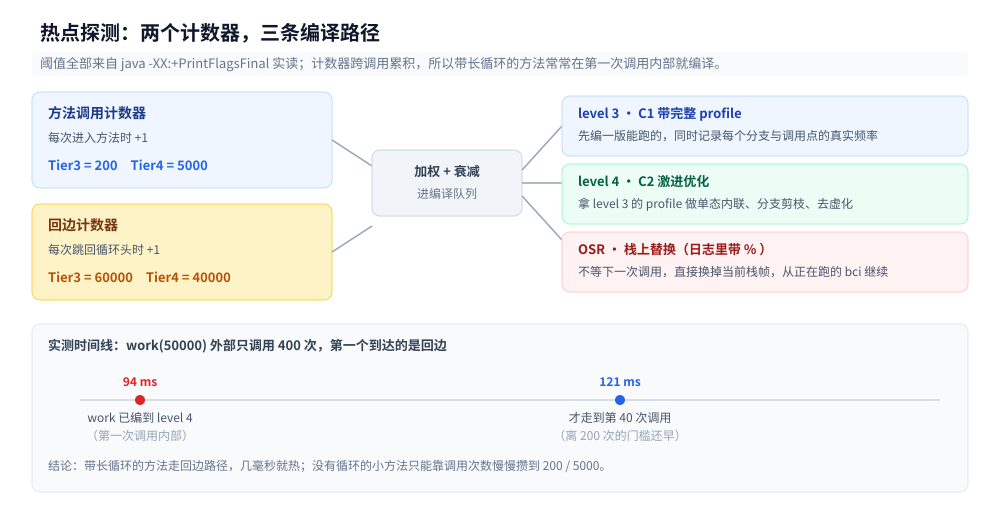
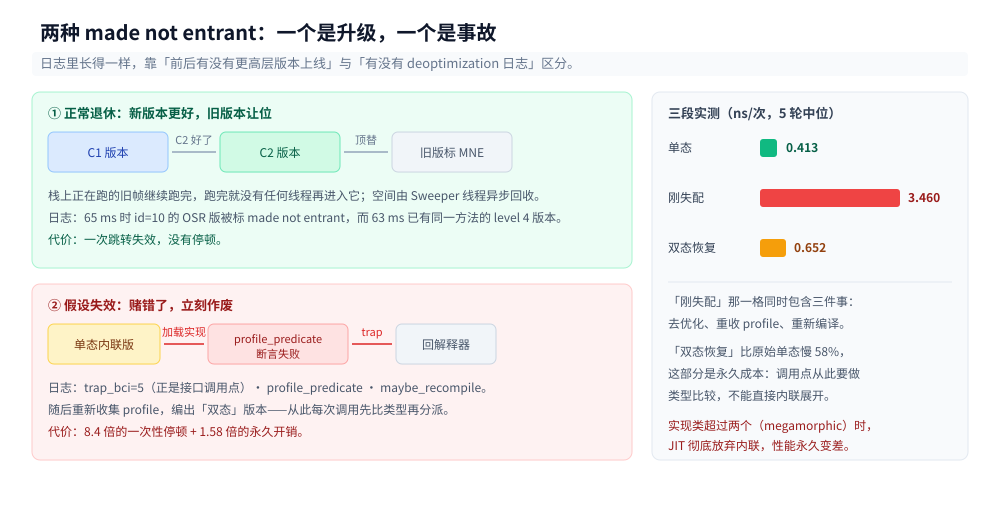

# JIT与执行引擎

> 覆盖：同一段代码为什么跑得越久越快、JVM 在什么时刻决定编译一个方法、编译出来为什么有「四档质量」、方法内联的两道尺寸闸门分别管什么、`new` 出来的对象为什么有时根本不分配、已经编译好的代码为什么会被判废、以及 JIT 自己吃掉多少 CPU 与代码缓存。
>
> 不覆盖：`.class` 文件格式与字节码指令集见 [类文件与字节码.md](类文件与字节码.md)；对象在堆里占多少字节、字段怎么排见 [对象布局与引用类型.md](对象布局与引用类型.md)；跨语言的 AOT / JIT / 解释执行三条路线的取舍见 [AOT、JIT与解释执行.md](../../../02-计算机基础/编译原理/AOT、JIT与解释执行.md)；GC 怎么回收见 [垃圾回收原理与收集器.md](垃圾回收原理与收集器.md)；`Unsafe`、`VarHandle` 与堆外内存见 [Unsafe与内存布局.md](Unsafe与内存布局.md)。
>
> 内容整理自个人学习笔记，素材见 [素材清单](../../../素材清单.md)。
>
> 实测口径：`eclipse-temurin:24-jdk`（24.0.2+12，linux/amd64，容器 4 CPU，默认堆）。全部读数都是本机真跑，时序类数据连跑 5 轮并给区间；`-Xlog:deoptimization` 与 `-XX:+CITime` 的读数取自容器内同一次运行。⚠️ `-XX:+PrintEliminateAllocations` / `-XX:+PrintEscapeAnalysis` 属 develop 选项，产品版 JVM 直接拒绝启动，本篇的逃逸分析结论因此改用**行为证据**（耗时与 GC 次数），并已标注未实测部分。

---

## 一、同一段代码为什么越跑越快？

**本节要点**：同一个方法，只因为「多跑了几千万次」，平均每次耗时从 2300 ns 掉到 1.2 ns——差三个数量级。这主要不是缓存变热，而是执行它的人从**解释器**换成了**即时编译器**；而最后一级连循环本身都被算成了乘法。

### 1.1 从零：一个方法，五段阶梯

下面 25 行没有任何第三方依赖，直接 `javac FirstHot.java && java FirstHot` 就能跑。它只做一件事：把同一个 `f(10)` 分别调用 1 次、100 次、1 万次、100 万次、1000 万次，每段单独计时并算平均。

```java
public class FirstHot {
    static int f(int n) {
        int s = 0;
        for (int i = 1; i <= n; i++) {
            s += i % 7;
        }
        return s;
    }

    public static void main(String[] a) {
        long sink = 0;
        int[] stages = {1, 100, 10000, 1000000, 10000000};

        for (int iters : stages) {
            long t0 = System.nanoTime();
            for (int k = 0; k < iters; k++) {
                sink += f(10);
            }
            long t1 = System.nanoTime();
            System.out.printf("累计第 %-9d 次 | 本段 %.3f ms | 本段平均 %8.1f ns/次%n",
                    iters, (t1 - t0) / 1e6, (t1 - t0) / (double) iters);
        }
        System.out.println("sink=" + sink);
    }
}
```

三轮输出（同一容器，每轮都是全新 JVM）：

```text
累计第 1         次 | 本段 0.002 ms | 本段平均   2300.0 ns/次
累计第 100       次 | 本段 0.024 ms | 本段平均    243.1 ns/次
累计第 10000     次 | 本段 1.185 ms | 本段平均    118.5 ns/次
累计第 1000000   次 | 本段 8.535 ms | 本段平均      8.5 ns/次
累计第 10000000  次 | 本段 11.837 ms | 本段平均      1.2 ns/次
sink=297272727
```

| 段内调用次数 | 第 1 轮 | 第 2 轮 | 第 3 轮 | 谁在跑 |
|---|---|---|---|---|
| 1 | 2300.0 | 2700.0 | 2400.0 | 解释器 |
| 100 | 243.1 | 236.1 | 237.1 | 解释器（分支预测已预热） |
| 10 000 | 118.5 | 118.0 | 109.7 | 编译刚触发，本段仍在解释 |
| 1 000 000 | 8.5 | 8.0 | 9.8 | C2 |
| 10 000 000 | 1.2 | 1.1 | 1.4 | C2 + 循环折叠 |

第一段到最后一档差 **1917 倍**（2300 ÷ 1.2）。

### 1.2 最后一档为什么能低于 1.2 ns

`1.2 ns` 在当前机器上约等于 **3 个时钟周期**（实测频率 2.4 GHz 左右）。一个「调用方法 → 循环 10 次 → 取模累加 → 返回」不可能 3 个周期做完。唯一解释是：**这一档根本没在循环**。

看 `sink`：`297272727`。而 `1 + 100 + 10000 + 1000000 + 10000000 = 11010101`，`11010101 × 27 = 297272727`。`f(10) = 1+2+3+4+5+6+0+1+2+3 = 27` 是个**常量**。C2 把「循环调用 1000 万次 `f(10)`」折叠成了「`sink += 27 × 10000000`」——一次乘法。

所以这条曲线的三级台阶对应三件不同的事：

| 台阶 | 现象 | 真正发生了什么 |
|---|---|---|
| 2300 → 243 ns | 快了 9 倍，但没换执行者 | 还是在解释执行，只是指令与数据进了 L1 |
| 243 → 8.5 ns | 快了 28 倍 | 代码被编译成机器码，方法调用与循环变成寄存器运算 |
| 8.5 → 1.2 ns | 又快了 7 倍 | 编译器证明了「每次结果都一样」，把整个循环删了 |

⚠️ 这也是一句警告：**基准测试里如果被测方法的输入是常量，你测到的可能是编译器算出的闭式解，而不是你想测的算法**。下面所有实验都刻意让输入依赖循环变量，就是为了避开这一点。

---

## 二、JIT 在什么时候动手？

**本节要点**：HotSpot 靠**两个计数器**判断「够不够热」——方法调用计数器数「进来几次」，回边计数器数「循环体转了几圈」。计数器跨调用累积，所以一个带长循环的方法往往在**第一次调用内部**就被就地编译（OSR），而不是等它被调用几百次。

### 2.1 两个计数器与它们的阈值

| 计数器 | 加一的位置 | 默认阈值（本机 `PrintFlagsFinal` 实读） |
|---|---|---|
| 方法调用计数器 | 每次进入方法 | `Tier3InvocationThreshold = 200`、`Tier4InvocationThreshold = 5000` |
| 回边计数器 | 每次跳回循环头 | `Tier3BackEdgeThreshold = 60000`、`Tier4BackEdgeThreshold = 40000` |
| 加权后的编译阈值 | 由上面两者与衰减算出 | `Tier3CompileThreshold = 2000`、`Tier4CompileThreshold = 15000` |
| 不分层时的总阈值 | — | `CompileThreshold = 10000`（分层模式下不直接生效） |

`Tier3` 对应 C1（带完整 profile），`Tier4` 对应 C2。注意 **Tier4 的回边阈值（40000）小于 Tier3 的（60000）**——这不是笔误：进 C2 的门槛本就比进 C1 低，因为能走到这一步的方法已经被 C1 编译过、证明过自己热。

### 2.2 实测：循环体比方法先热

写一个小程序，让 `work(50000)` 内部有一个 5 万次回边的循环，外部只调用 400 次，同时每 20 次往 stderr 打一行「第几次调用 @ 多少毫秒」。把 `-XX:+PrintCompilation` 的毫秒时间戳与它对齐：

```bash
java -XX:+PrintCompilation HotspotProbe 50000 400 20
```

```text
94   75 %     3       HotspotProbe::work @ 4 (24 bytes)
94   76       3       HotspotProbe::work (24 bytes)
94   77 %     4       HotspotProbe::work @ 4 (24 bytes)
96   75 %     3       HotspotProbe::work @ 4 (24 bytes)   made not entrant
96   78       4       HotspotProbe::work (24 bytes)
99   76       3       HotspotProbe::work (24 bytes)   made not entrant
第 40 次调用 @ 121 ms
```

四列分别是：`毫秒时间戳`、`编译任务 id`、`层级`、`方法 (字节码长度)`。`%` 表示这是一份 **OSR（On-Stack Replacement，栈上替换）** 版本——专门给「正在跑的循环」用的。

时间线读出来是这样：**94 ms 时 work 已经被编到 C2 了，而那时第 40 次调用还没发生（121 ms）**。也就是说，编译发生在头几十次调用里，靠的不是「调用次数达到 200」，而是「回边次数达到 40000」——第一次调用转到第 40000 圈时就够了。

这解释了一个常见的困惑：**为什么有的方法第一次跑就很快，有的要跑几千次才快**。带长循环的方法走回边路径，几毫秒就热；纯计算的小方法没有回边，只能靠调用次数慢慢攒。



上半部分把两个计数器与三条出口并排放在一起：调用计数器管「进来几次」，回边计数器管「循环转了几圈」，两者加权后进入编译队列；下半部分是 `work(50000)` 的时间线——94 ms 时它已经编到 level 4，而第 40 次调用要到 121 ms 才发生。

### 2.3 OSR 与普通编译的区别

同一份代码会被编成**多个版本**，各自的入口不同：

| 版本 | 日志标记 | 入口 | 用在哪 |
|---|---|---|---|
| 解释执行 | 无 | 字节码第一条 | 冷启动 |
| 普通编译 | 无 `%` | 方法开头 | 下一次**调用**这个方法时 |
| OSR 编译 | `%` + `@ bci` | 指定字节码偏移 | 当前**正在这个循环里**的线程，立刻切过去 |

`@ 4` 就是 OSR 入口的字节码下标（`bci`）。普通编译版本要等下一次调用才生效，而一个跑了 10 秒的循环不可能等下一次调用——OSR 就是为它准备的：**编译完直接把栈帧换掉，从当前 bci 继续执行**。

⚠️ **校验口径**：我最初想用「毫秒时间戳」验证「第 200 次调用触发 C1 编译」（对应 `Tier3InvocationThreshold = 200`），**失败了**。理由：把方法体里的循环去掉后，40 万次调用总共只要几十毫秒，完全被 JVM 启动抖动（±20 ms）淹没，三次运行的编译时刻是 82 / 127 / 128 ms，与阈值扫的值毫无相关性。这条**未实测**，只能给阈值表。

一个能看到的间接证据：把 `Tier3InvocationThreshold` 从 200 提到 20000，首次编译的层级从 `3` 变成 `2`——阈值改了，走的路径确实变了。

---

## 三、编译出来有几种质量？

**本节要点**：HotSpot 的编译不是「编 / 不编」二选一，而是 **0~4 五档**。C1 编得快但代码一般，C2 编得慢但代码好，分层编译先用 C1 顶住、等 C2 慢慢追上。实测同一段工作负载，五档之间的耗时差出 **12.7 倍**。

### 3.1 五档分别是什么

```text
0 ── 解释执行 ──────────────────────────────────────────
1 ── C1，不做 profile ───────────────────────────────────
2 ── C1，少量 profile ───────────────────────────────────
3 ── C1，完整 profile（默认从 0 跳到这）─────────────────
4 ── C2，基于 3 收集的 profile 做激进优化 ────────────────
```

默认路径是 **0 → 3 → 4**。level 1 / 2 不在这条主路上，只在特定场景（如 `-XX:TieredStopAtLevel=1` 的快速启动模式）用。level 3 存在的唯一目的是**收集 profile**：记录每个分支走了多少次、每个接口调用点见过哪几个实现、每个数组访问的长度分布——这些数据喂给 C2，C2 才敢做单态内联、分支剪枝、去虚化。

「带 profile 的 C1」代价很高：每走一个分支要加计数（`inc`），每做一次类型检查要记录。下面的读数会看到 level 3 比 level 1 慢 55%。

### 3.2 六种模式跑同一段活

被测代码是一个带 2 万次内循环的 `work`，预热 10 万次 × 50 圈，然后测量 2000 次 × 2 万圈。每一档跑 5 轮，单位是「每次 work 调用的纳秒数」：

| 模式 | 5 轮读数 | 中位 | 相对默认 |
|---|---|---|---|
| `-Xint` | 344572 / 338237 / 365109 / 449318 / 422736 | 365 109 | 12.7× |
| `-XX:TieredStopAtLevel=1` | 81475 / 82951 / 82263 / 81552 / 83949 | 82 264 | 2.86× |
| `-XX:TieredStopAtLevel=2` | 101874 / 98704 / 98584 / 98236 / 98569 | 98 584 | 3.43× |
| `-XX:TieredStopAtLevel=3` | 127413 / 124105 / 126184 / 129717 / 153976 | 127 413 | 4.43× |
| 默认（0→3→4） | 31333 / 28864 / 28522 / 28734 / 28762 | 28 734 | 1.00× |
| `-XX:-TieredCompilation`（只 C2） | 28787 / 28741 / 28802 / 28709 / 28812 | 28 787 | 1.00× |

三个值得记住的点：

1. **level 3 比 level 1 慢 55%**（127 413 vs 82 264）。这就是收集 profile 的代价，实打实写在耗时里。
2. **level 2 夹在中间**（98 584），因为它的 profile 采集比 level 3 少。
3. **默认和「只 C2」几乎持平**（28 734 vs 28 787）。分层编译的收益不在峰值，在**峰值到来的时刻**——它在 C2 还没准备好的那几百毫秒里用 C1 顶着，而纯 C2 模式在这段时间只能干等。

⚠️ **这一条我上一轮写错过**。第一次只跑了一遍，读到「默认 94.1 ms vs 纯 C2 66.7 ms，默认慢 41%」，差点写成「分层编译反而拖慢峰值」。跑满 5 轮后两者完全持平。**单次测量在 JIT 场景下不可信**——编译线程与主线程抢 CPU，一次运行的分到几个核全看运气。


左边是 0 到 4 五档的定位，右边把六种模式的耗时换算成「相对默认的倍数」，这样 12.7 倍与 1.00 倍能在同一根横轴上比对。注意 level 3 那根黄柱比 level 1 还长——收 profile 是要付钱的。

### 3.3 一个方法的完整生命周期

`TierDemo` 里的 `work`（只有 24 字节字节码）被编译了两次：

```text
54    8       3       TierDemo::work (24 bytes)
55    9       4       TierDemo::work (24 bytes)
59    8       3       TierDemo::work (24 bytes)   made not entrant
65   10 %     3       TierDemo::main @ 35 (178 bytes)
67   11       3       TierDemo::main (178 bytes)
```

逐行读：

| 时刻 | 事件 | 说明 |
|---|---|---|
| 54 ms | 编译 id 8，level 3 | 第一次进 C1，开始收集 profile |
| 55 ms | 编译 id 9，level 4 | 几乎同时进 C2——level 3 的 profile 已经够用了 |
| 59 ms | id 8 标 `made not entrant` | 旧的 C1 版本退休，被 C2 版本顶替 |
| 65 ms | 编译 id 10，level 3，带 `%` | `main` 是被 OSR 编译的，入口在 bci 35（就是那个 for 循环） |
| 67 ms | 编译 id 11，level 3 | `main` 的普通版本 |

`made not entrant`（简称 MNE）后面还会出现，但含义有两种，第六节专门讲。这里出现的是**第一种：正常退休**——新版本更好，旧版本不再接新调用，等在栈上的旧帧跑完就回收。

### 3.4 C1 和 C2 到底差多少

`-XX:+CITime` 在 JVM 退出时打印编译自身的开销：

```text
C1 {speed: 208348.116 bytes/s; standard: 0.016 s, 3193 bytes, 63 methods; osr: 0.002 s, 398 bytes, 1 methods; ...}
C2 {speed:  29913.591 bytes/s; standard: 0.012 s, 359 bytes,  7 methods; osr: 0.000 s, 0 bytes, 0 methods; ...}
Total compilation time : 0.029 s
```

| 项 | C1 | C2 | 倍差 |
|---|---|---|---|
| 编译速度 | 198 625 ~ 230 752 bytes/s | 22 182 ~ 34 725 bytes/s | **约 7 倍** |
| 编了几个方法 | 62~64 个 | 7 个 | — |
| 编了多少字节 | 3 159~3 297 | 359 | — |
| 产物大小 | nmethods 81 080~84 208 B | 3 320 B | 25 倍 |

**C2 编一个方法比 C1 慢 7 倍**，所以它只挑最热的 7 个（前者编了 63 个）。总编译时间 26~34 ms，而这段被测代码的测量段本身是 2000 次 × 28.7 µs ≈ **57 ms 墙钟**——编译开销与它同一量级，且编译线程与业务线程并行抢核。这就是「JIT 不是免费的」的量化含义。

再看纯 C2 模式（`-XX:-TieredCompilation`）：编 17 个方法 + 2 个 OSR，总编译 23~25 ms，**nmethod 只有 4 968 字节**。对比分层模式的 60 832~63 064 字节，**分层编译用 12 倍代码量换来了同样的峰值性能**。这笔账在 code cache 紧张的场景下是要还的。

---

## 四、为什么 `small` 被内联而 `big` 没有？

**本节要点**：内联有两道尺寸闸门——`MaxInlineSize = 35` 管**冷调用点**，`FreqInlineSize = 325` 管**热调用点**。同一个方法可以在一处被拒（冷）、在另一处被接受（热）。内联不是优化选项之一，它是**后面所有优化的前提**：不内联就没有跨方法的分支剪枝、常量传播与逃逸分析。

### 4.1 三个尺寸的被测方法

```java
static int small(int x) {                    // 6 字节字节码
    return x * 3 + 1;
}

static int big(int x) {                      // 50 字节
    int a = x * 3 + 1;
    int b = a ^ 0x5a5a;
    int c = b + (a << 2);
    int d = c - (b >> 3);
    int e = d * 7 + a;
    int f = e ^ c;
    return f + b - d + a;
}

static int huge(int x) {                     // 210 字节
    // ... 同样的套路连续写 15 行
}
```

字节码长度用 `javap -c` 数出来的偏移末尾推算，也可以用后面日志里的 `(N bytes)` 直接读。调用者 `bench` 用 6000 次预热 + 一次长测量，保证 C2 是**整方法编译**而不是 OSR。

### 4.2 同一个方法，两种判定

`-XX:+UnlockDiagnosticVMOptions -XX:+PrintInlining` 的输出按 `uniq -c` 聚合后：

```text
      5 InlineDemo::small (6 bytes)   inline
      5 InlineDemo::huge (210 bytes)   failed to inline: callee is too large
      5 InlineDemo::big (50 bytes)   failed to inline: callee is too large
      4 InlineDemo::small (6 bytes)   inline (hot)
      3 InlineDemo::big (50 bytes)   inline (hot)
      2 InlineDemo::huge (210 bytes)   inline (hot)
```

`big` 同时出现在「被拒」和「被接受」两行——**同一个方法、同一次运行**。这不是日志矛盾，而是它在不同编译单元里的调用点热度不同：

| 方法 | 6 字节 small | 50 字节 big | 210 字节 huge |
|---|---|---|---|
| 冷调用点（调用次数少） | `inline` | ❌ `callee is too large` | ❌ `callee is too large` |
| 热调用点（调用次数多） | `inline (hot)` | ✅ `inline (hot)` | ✅ `inline (hot)` |

两条闸门的判据：

```text
字节码长度 ≤ 35   ────────────────────────→ 直接内联（MaxInlineSize）
35 < 长度 ≤ 325  ── 调用点够热？ ── 是 ──→ 内联（FreqInlineSize）
                                └─ 否 ──→ 拒绝
长度 > 325       ────────────────────────→ 拒绝
```

### 4.3 扫参数验证 325 这条线

只改 `FreqInlineSize`，看两个大方法的热调用点还留不留：

| `FreqInlineSize` | `big (50 bytes)` | `huge (210 bytes)` |
|---|---|---|
| 325（默认） | `inline (hot)` | `inline (hot)` |
| 100 | `inline (hot)` | ❌ `failed to inline: hot method too big` |
| 40 | ❌ `failed to inline: hot method too big` | ❌ `failed to inline: hot method too big` |

边界正好卡在 **50 与 40 之间**：50 ≤ 100 能过，50 > 40 过不去；210 > 100 过不去。三条读数与「阈值就是这条线」完全自洽。

注意拒绝理由的措辞变了：`callee is too large` 是「尺寸超了」，`hot method too big` 是「你虽然热，但太胖了」——后者才说明它走到了热路径的判定里。


左侧是 C2 的判定顺序（先看 35，再看 325 与热度），右侧是 `small` / `big` / `huge` 三个方法在冷热两种调用点下的实际去向，底部是内联开关对三个方法耗时的实测影响。

### 4.4 内联值多少钱

同一段测量代码，只换 JVM 参数，各 5 轮（ns/次，`iters = 30000000`）：

| 方法 | 默认 | `-XX:-Inline` | `-XX:FreqInlineSize=40` |
|---|---|---|---|
| `small` (6 B) | 0.432 ~ 0.523 | 2.846 ~ 3.611 | 0.431 ~ 0.441 |
| `big` (50 B) | 2.398 ~ 2.842 | 4.259 ~ 4.986 | 4.229 ~ 4.438 |
| `huge` (210 B) | 15.224 ~ 17.355 | 15.205 ~ 16.770 | 15.049 ~ 16.208 |

三列合起来读（倍数按各列 5 轮的中位数算：`small` 0.434 / 3.084 / 0.433，`big` 2.412 / 4.431 / 4.268，`huge` 15.434 / 15.354 / 15.072）：

1. **`small` 内联省 7.1 倍**（0.434 vs 3.084）。一个 `x*3+1` 的方法体，调用开销（压栈 / 跳转 / 返回 / 拆帧）比方法体本身贵 7 倍。这就是「小方法不要怕拆」的量化依据。
2. **`big` 内联省 1.84 倍**（2.412 vs 4.431）。
3. **`huge` 内联毫无收益**（15.434 vs 15.354，差 0.5%）。210 字节的方法体内联后代码膨胀，指令缓存压力正好抵消了调用开销——这也是为什么要有 325 这条上限。
4. ⭐ **`FreqInlineSize=40` 这一列才是精确对照**：`small` 保持 0.433（6 字节走 `MaxInlineSize` 的冷路径，不受 `FreqInlineSize` 影响），`big` 掉到 4.268（≈ `-XX:-Inline` 的 4.431）。**同一进程、同一组参数，只动一个阈值，就精确地把 big 的内联收益抽走，而不碰 small**。`-XX:-Inline` 是粗对照——它把 `small` 也关了，所以不能拿来归因。

### 4.5 踩坑：为什么一开始怎么调都不内联

第一版 `InlineDemo` 的预热只跑 20 次 `bench`，日志里 `big` 永远是 `callee is too large`，连 `-XX:MaxInlineSize=60` 都没用。原因：

**`bench` 只被调用 21 次，C2 是靠 OSR 回边编译它的**。OSR 编译用的是一个不完整的 profile 快照，`bench` 里那个 `big` 调用点的「热度」还没被记录下来，C2 只能按最保守的方式判——尺寸超 35，拒。把预热改成 6000 次（超过 `Tier4InvocationThreshold = 5000`），让 C2 做**整方法编译**，`big` 立刻出现 `inline (hot)`。

这条经验可以推广：**观察内联决策时，先确认被观察的方法是被「整方法编译」的，不是被 OSR 编译的**。判据就是日志里有没有 `%`。

---

## 五、`new` 出来的对象去哪了？

**本节要点**：循环里 `new` 出来的对象，如果编译器能证明它**不逃出这个方法**，就根本不分配——字段被拆成局部变量放进寄存器（标量替换），`new` 那条指令直接消失。实测 3000 万次 `new` 在这个机制下 GC 次数为 **0**，关掉它则是 9 次 young GC、慢 26 倍。

### 5.1 从零：三千万个 `Point`

```java
public class EscapeDemo {
    static class Point {
        final int x;
        final int y;
        Point(int x, int y) { this.x = x; this.y = y; }
    }

    static long sum;

    static void run(int n) {
        long s = 0;
        for (int i = 0; i < n; i++) {
            Point p = new Point(i, i + 1);   // 每次迭代都 new
            s += p.x + p.y;
        }
        sum = s;
    }

    public static void main(String[] a) {
        int n = Integer.parseInt(a[0]);
        for (int w = 0; w < 200; w++) { run(10000); }   // 预热
        long gc0 = gcCount();
        long t0 = System.nanoTime();
        run(n);
        long t1 = System.nanoTime();
        long gc1 = gcCount();
        System.out.printf("n=%d | 耗时=%.1f ms | 每次=%.4f ns | GC 次数=%d | sum=%d%n",
                n, (t1 - t0) / 1e6, (t1 - t0) / (double) n, gc1 - gc0, sum);
    }
}
```

`-Xmx512m`，`n = 30000000`，每种配置 5 轮：

| 配置 | 每次耗时（ns） | GC 次数 |
|---|---|---|
| 默认（逃逸分析开） | 0.4105 / 0.4667 / 0.4105 / 0.5417 / 0.4444 | **0**（5 轮一致） |
| `-XX:-DoEscapeAnalysis` | 16.7459 / 9.3565 / 11.6835 / 22.4792 / 8.7711 | **9**（5 轮一致） |
| `-XX:-EliminateAllocations` | 0.5261（`n = 1e7` 单轮） | 0 |

`sum` 三种配置都是 `900000000000000`，没有为了快而算错。

中位数对比：`11.68 / 0.4444 = 26.3 倍`。按区间说：最慢的一次比最快的默认轮次差 54 倍，最保守的比较（9.36 vs 0.542）也有 17 倍。

### 5.2 三千万个对象为什么一次 GC 都没有

`Point` 是 24 字节（12 字节头 + 两个 int + 4 字节对齐），3000 万个就是 **720 MB**，而堆只给了 512 MB。如果真分配了，必然 `OutOfMemoryError`。没 OOM 也没 GC，说明**一个都没分配**。

C2 的推理链：

```text
p 只在 run() 里被创建
  ↓
p 没有赋给任何字段、没有传给任何方法、没有 return
  ↓
p 不逃逸 → 它的两个字段 x / y 可以被「拆开」当局部变量
  ↓
s += p.x + p.y 变成 s += i + (i+1)
  ↓
new Point(i, i+1) 这条指令不再有可观察效果 → 删除
```

这就是**标量替换**（scalar replacement）。名字里的「标量」指的是把聚合对象拆成一个个标量（int / long / 引用）。

### 5.3 一个意外：只关标量替换，性能几乎不掉

按直觉，关掉 `EliminateAllocations` 应该让对象回到堆上、GC 起来。实测却是 `0.5261 ns/次`、**GC 还是 0**。

可能有两种解释：C2 还有别的消除分配的路径（例如把整个 `new` 当死代码删掉，因为它连字段都不读了），或者该标志在我这版 JDK 上只影响标量替换这一种形式、不影响更早的逃逸分析结论。**本机未能进一步定位**——能打印每一步消除决策的 `-XX:+PrintEliminateAllocations` 与 `-XX:+PrintEscapeAnalysis` 都是 develop 选项：

```text
Error: VM option 'PrintEliminateAllocations' is develop and is available only in debug version of VM.
Improperly specified VM option 'PrintEliminateAllocations'
```

产品版 JDK 装不上。所以本节只写「关掉逃逸分析整体 → 26 倍 + 9 次 GC」这条硬结论，**不写「标量替换占了多少比例」**——那个数字我没测到。

### 5.4 什么时候逃逸分析会失效

| 写法 | 逃逸原因 | 结果 |
|---|---|---|
| `return new Point(...)` | 逃出方法 | 必须分配 |
| `this.field = new Point(...)` | 逃出对象 | 必须分配 |
| `list.add(new Point(...))` | 逃出到集合 | 必须分配 |
| `throw` 进异常的构造参数 | 逃到异常处理器 | 必须分配 |
| 传给 `synchronized(p)` | 锁对象要被别的线程看见 | 必须分配 |
| 只是本地读字段 | 不逃逸 | 可能被标量替换 |

实践含义：**「少 new」不是靠手写对象池，而是靠让对象别逃出去**。一个在方法内部用完就丢的临时对象，成本是 0；同一份逻辑改成 `list.add(p)` 之后再统计，成本立刻回到 24 字节 + GC 压力。

---

## 六、已经编译好的代码怎么会失效？

**本节要点**：JIT 的优化建立在**假设**上（「这个接口只有一个实现」「这个分支永远走这边」）。假设是有代价的——每条假设都得在运行时留一个检查点。一旦检查失败，代码立刻作废，回退到解释器重来。这种作废叫 `made not entrant`，和「被更好的版本替换」用的是同一个标记，但含义完全不同。

### 6.1 两种 `made not entrant`

日志里长得一样，成因差很远：

| 类型 | 触发 | 代码还能用吗 | 例子 |
|---|---|---|---|
| **正常退休** | 有更优版本编好了（C1 → C2、OSR → 整方法） | 不能接新调用，但栈上正在跑的旧帧继续跑完 | 第三节那 5 行日志里的 `59ms id=8 MNE` |
| **被动废弃** | 编译时的假设被打破 | 立刻作废，正在执行的线程被 `uncommon trap` 拽回解释器 | 本节要测的这个 |

第一种是**升级**，第二种是**事故**。区分方法：看它前后有没有同名的更高层版本上线，以及同一时刻有没有 `deoptimization` 日志。

### 6.2 实测：加载第二个实现让代码作废

被测代码是一个接口 + 一个实现，`hot()` 里循环 2000 万次调用 `s.area()`。关键在于：**第二个实现 `Square` 直到预热结束才被加载**。

```java
public class DeoptDemo {
    interface Shape {
        int area();
    }

    static class Circle implements Shape {
        public int area() { return 3; }
    }

    static class Square implements Shape {
        public int area() { return 4; }
    }

    static long hot(Shape s, int n) {
        long t = 0;
        for (int k = 0; k < n; k++) {
            t += s.area();          // 编译时只见过 Circle 一个实现
        }
        return t;
    }

    public static void main(String[] a) throws Exception {
        int n = Integer.parseInt(a[0]);
        Shape c = new Circle();
        hot(c, n);                                          // 预热，C2 编出单态版本

        long t0 = System.nanoTime();
        hot(c, n);
        long t1 = System.nanoTime();
        System.out.printf("单态      %.3f ns/次%n", (t1 - t0) / (double) n);

        Class<?> k = Class.forName("DeoptDemo$Square");      // 此刻才加载
        System.err.println("=== 加载 Square 完成 ===");
        Shape sq = (Shape) k.getDeclaredConstructor().newInstance();

        long t2 = System.nanoTime();
        hot(sq, n);
        long t3 = System.nanoTime();
        System.out.printf("刚失配    %.3f ns/次%n", (t3 - t2) / (double) n);

        long t4 = System.nanoTime();
        hot(c, n);
        long t5 = System.nanoTime();
        System.out.printf("双态恢复  %.3f ns/次%n", (t5 - t4) / (double) n);
    }
}
```

5 轮读数（`n = 5000000`，ns/次）：

| 阶段 | 5 轮 | 中位 | 相对单态 |
|---|---|---|---|
| 单态 | 0.323 / 0.485 / 1.057 / 0.394 / 0.413 | 0.413 | 1.00× |
| 刚失配 | 2.803 / 2.947 / 3.460 / 3.864 / 4.068 | 3.460 | **8.4×** |
| 双态恢复 | 0.537 / 0.652 / 0.710 / 0.544 / 0.959 | 0.652 | 1.58× |

`hot(sq, n)` 这一行同时包含三件事：**去优化**（当前栈帧被拆回解释器）、**重新收集 profile**、**重新编译**。8.4 倍是这三件事的总账。

「双态恢复」比原始单态慢 58%，这部分是**永久成本**：调用点从此是双态 inline cache，每次调用要先做类型比较再分派，不能像单态那样直接内联展开。

### 6.3 用 unified logging 拿到精确原因

`-XX:+TraceDeoptimization` 是 develop 选项（产品版不可用），但 JDK 9 之后有 unified logging：

```bash
java -Xlog:deoptimization=debug DeoptDemo 20000000
```

```text
[0.081s][debug][deoptimization] cid=  13 osr level=4 DeoptDemo.hot(LDeoptDemo$Shape;I)J trap_bci=8 osr_bci=5 unstable_if reinterpret
=== 加载 Square 完成 ===
[0.140s][debug][deoptimization] cid=  15     level=4 DeoptDemo.hot(LDeoptDemo$Shape;I)J trap_bci=8 predicate maybe_recompile
[0.141s][debug][deoptimization] cid=  14 osr level=4 DeoptDemo.hot(LDeoptDemo$Shape;I)J trap_bci=5 osr_bci=5 profile_predicate maybe_recompile
```

分界线之上一条、之下两条（`profile_predicate` 那条还会重复打印，因为每次撞上陷阱都算一次）：

| 字段 | 0.081 s（分界前） | 0.140 s（分界后） | 0.141 s（分界后） |
|---|---|---|---|
| 版本 | OSR level 4 | **整方法** level 4 | OSR level 4 |
| `trap_bci` | 8（循环判断处） | 8 | 5（`s.area()` 调用点） |
| 原因 | `unstable_if` | `predicate` | **`profile_predicate`** |
| 动作 | `reinterpret`（重新解释，不回退层级） | `maybe_recompile` | `maybe_recompile` |

三个细节值得记住：

1. **`unstable_if` 那条是正常的**——循环最后一次判断不成立，走的是退出路径，代价极小。
2. **`predicate` 与 `profile_predicate` 是同一次事故在两个版本里的两次触发**。同一个假设（「只有 Circle」）被编进了**整方法版**和**OSR 版**两份代码，所以两份都要废。这也是 6.4 里 115 ms 和 116 ms 各废一个版本的原因。
3. `trap_bci` 一个在 8、一个在 5：整方法版把类型检查提到了循环外（bci 8 附近），OSR 版只能在调用点处（bci 5）检查。**同一条假设，检查点的位置可以不同。**

`profile_predicate` 是 HotSpot 的「profile 谓词」：编译时在类型检查点插一条断言，内容就是「我见过的实现只有 Circle」。运行时进来一个 Square，断言失败 → `uncommon trap` → 去优化。**这不是编译器编错了，是它赌错了。**

### 6.4 与 `PrintCompilation` 对齐

同一个程序加上 `-XX:+PrintCompilation`，能看到 `hot` 的每个版本上线与作废。下面这组是另一次运行的读数——**编译 id 与毫秒时刻每次运行都不同，要看的是相对顺序**；那行 `===` 是程序自己打到 stderr 的分界标记：

```text
62   10 %     3       DeoptDemo::hot @ 5 (29 bytes)
63   11       3       DeoptDemo::hot (29 bytes)
63   12 %     4       DeoptDemo::hot @ 5 (29 bytes)
65   10 %     3       DeoptDemo::hot @ 5 (29 bytes)   made not entrant
66   12 %     4       DeoptDemo::hot @ 5 (29 bytes)   made not entrant
66   13 %     4       DeoptDemo::hot @ 5 (29 bytes)
68   14       4       DeoptDemo::hot (29 bytes)
69   11       3       DeoptDemo::hot (29 bytes)   made not entrant
=== 加载 Square 完成 ===
115   14       4       DeoptDemo::hot (29 bytes)   made not entrant
116   94       4       DeoptDemo::hot (29 bytes)
116   13 %     4       DeoptDemo::hot @ 5 (29 bytes)   made not entrant
124   95 %     4       DeoptDemo::hot @ 5 (29 bytes)
```

分界线上下的 `made not entrant` 性质完全不同：

| 位置 | 编译 id | 类型 | 判据 |
|---|---|---|---|
| 65 ms / 66 ms | 10 / 12 | 正常退休 | 两条都是 `%` 版本，因为同一时刻有非 `%` 的整方法版本要顶替它 |
| 69 ms | 11 | 正常退休 | 同一方法 68 ms 已出现 level 4 的 id 14 |
| **115 ms** | **14** | **被动废弃** | 它是当时唯一的整方法 level 4 版本，之后没有「更好的版本」可顶替——只有 116 ms 的**重编** |
| **116 ms** | **13** | **被动废弃** | 同上 |

规律：**「旧版本作废 + 同一时刻有新版本上线」是升级；「作废 + 隔一会儿才有重编」是事故。** 115 ms 作废、116 ms 才有 id 94，中间那一刻 JVM 只能跑解释器。



上半条泳道是升级（C1 让位给 C2），下半条是事故（加载第二个实现打破单态假设，`profile_predicate` 断言失败）。右侧三段柱子的高度就是「单态 0.413 / 刚失配 3.460 / 双态恢复 0.652 ns」这三笔账。

### 6.5 什么写法会踩到

| 写法 | 假设 | 打破它的动作 | 后果 |
|---|---|---|---|
| 接口 / 抽象类单态调用 | 只有一个实现 | 加载第二个实现并调用 | 本次去优化，之后变双态 |
| `instanceof` / `checkcast` | 类型总是这个 | 出现新类型 | `class_check` 去优化 |
| `if (x != null)` 后不再判空 | 从没进来过 null | 传了个 null | 去优化 + 重新编译 |
| 循环里「这个分支从不走」 | 分支频率为 0 | 有一天走了 | `unstable_if` / `predicate_failed` |
| `final` 字段当常量 | 字段值不变 | 反射改值 | 常量折叠结果失效 |

实践中第 1 行最常见：**Spring / MyBatis 那类到处是接口的代码，启动后第一波流量往往在「单态 → 双态 → 多态」之间反复去优化**。这也是「预热」这件事在 Java 服务里必须做的原因——不是把缓存跑热，是让调用点稳定在多态 inline cache 上，别再反复 `uncommon trap`。

⚠️ 如果调用点见过的实现超过两个（megamorphic），JIT 会**彻底放弃内联**，每次都走 vtable 查表。这时候去优化反而不再发生，但性能永久停在一个较差的水平。判据是 `-XX:+PrintInlining` 里出现 `megamorphic`。

---

## 七、JIT 自己花多少钱？

**本节要点**：编译不是免费的——它的产物要占**代码缓存**（一块固定大小的可执行内存），它的过程要抢 CPU。本机实测：一个跑 94 ms 的程序，JIT 编译花了 26~34 ms；代码缓存里 94 个 nmethod 只占 1.3 MB，而缓存总预留 240 MB。

### 7.1 代码缓存里装了什么

`-XX:+PrintCodeCache` 在退出时打印：

```text
CodeCache: size=245760Kb, used=1370Kb, max_used=1376Kb, free=244389Kb
 total_blobs=477, nmethods=94, adapters=290, full_count=0
Compilation: enabled, stopped_count=0, restarted_count=0
```

| 项 | 默认（分层 JIT） | `-Xint`（纯解释） |
|---|---|---|
| 缓存大小 | 245 760 KB | 49 152 KB |
| 已用 | 1 370 KB | 558 KB |
| `nmethods` | 94 | **2** |
| `adapters` | 290 | **290** |
| `total_blobs` | 477 | 327 |

### 7.2 反直觉的一条：解释模式也占代码缓存

`-Xint` 下 `nmethods` 只剩 2 个，但 `adapters` 仍是 **290 个**，代码缓存仍用了 558 KB。

`adapters` 是**胶水桩**：把「解释器栈帧」和「编译后栈帧」互相转换的入口。只要 JVM 里同时存在这两种执行方式（哪怕只是理论上），这些桩就得编好放在代码缓存里——它们在启动时由 JVM 自己生成，不走 C1/C2。所以「关掉 JIT 就不用代码缓存」是错的。

顺带：`-Xint` 的缓存预留也从 240 MB 降到 48 MB。**推不推荐手动调 `-XX:ReservedCodeCacheSize`** 要看方法数量，不看堆大小——一个只有几百个方法的服务，1.3 MB 的用量离 240 MB 差两个数量级，没有调的必要。

### 7.3 什么时候该关心

| 现象 | 判据 | 处理 |
|---|---|---|
| 启动后一段时间性能突然掉一档 | `full_count` 不为 0，日志出现 `CodeCache is full` | 调大 `-XX:ReservedCodeCacheSize` |
| 方法数极多（几十万） | `nmethods` 接近 `size` 的 90% | 同上，或减少动态生成类（大量 lambda / 代理） |
| 分层 vs 纯 C2 的代码体积 | 第三节实测：61 KB vs 4.9 KB | 内存敏感场景可考虑 `-XX:-TieredCompilation` |
| 编译线程抢 CPU | `-XX:+CITime` 的总编译时间占比高 | 用 `-XX:CICompilerCount` 限制并行编译线程数 |

`Compilation: stopped_count / restarted_count` 也值得看：不为 0 说明因为缓存满被强制停过编译器。

---

## 八、应用场景

**本节要点**：四类现象（启动慢、首请求慢、基准写错、方法不升温）都能落到具体的编译阈值与失效事件上；先认现象，再查对应那一节。

| 场景 | 用到的结论 | 具体表现 |
|---|---|---|
| 服务启动慢 / 首请求慢 | 第二节、第三节 | 冷启动阶段全是解释执行；`Tier4InvocationThreshold = 5000` 意味着前 5000 次调用拿不到 C2 代码 |
| 基准测试写错 | 第一节、第四节、第五节 | 常量输入被折叠成闭式解、只调 21 次导致 C2 靠 OSR 编译、预热轮数不够 |
| 拆分方法重构 | 第四节 | 方法体 ≤ 35 字节必内联；35~325 字节要看调用点热度。把大方法拆成小方法是有效的，但拆出来的必须有调用点热度 |
| 频繁 new 的临时对象 | 第五节 | 不逃逸的对象成本为 0，不需要对象池；`new` 出来后塞进集合就立刻变成真实成本 |
| 接口实现类动态加载 | 第六节 | 启动期与灰度发布期会反复去优化，需要预热或提前加载所有实现 |
| 容器内存受限 | 第七节 | 代码缓存的预留是**虚拟地址**，不占 RSS；但 `used` 部分是真实内存 |
| 排查「昨天还快今天慢」 | 第三节、第六节 | 可能是新上线的类打破了单态假设，`-Xlog:deoptimization` 能看到 |

## 九、具体使用：按什么顺序判断一个方法为什么没变快

**本节要点**：五步排查从「到底编译了没有」开始，逐层排除不热、太大、被去优化、被内联失败 —— 每步都给命令与判据。

```text
① 这个方法真的被编译了吗？            → java -XX:+PrintCompilation | grep 方法名
   日志里没有它 → 不够热（第二节阈值）或方法体太大（第四节）
② 有 % 吗？                          → 有 = OSR 版本，profile 不完整
③ 到 level 4 了吗？                  → 只有 3 说明 C2 还没接手，或 C2 队列积压
④ 被内联了吗？                        → java -XX:+PrintInlining | grep 方法名
   "too big" / "hot method too big" → 第四节的两道闸门
   "megamorphic" → 调用点实现类太多，去虚化失败
⑤ 有 made not entrant 吗？            → 有 = 被替换或被废弃（第六节区分两种）
⑥ 分配真的发生了吗？                  → 看 GC 次数；为 0 说明被标量替换了（第五节）
⑦ JIT 自己花了多少？                  → java -XX:+CITime
```

七条命令：

```bash
# 1. 方法被编到哪一档、何时退休
java -XX:+PrintCompilation YourMain 2>&1 | grep -E "YourClass"

# 2. 内联决策（含拒绝理由）
java -XX:+UnlockDiagnosticVMOptions -XX:+PrintInlining YourMain 2>&1 | grep YourClass

# 3. 去优化的精确原因（产品版可用，替代 develop 选项）
java -Xlog:deoptimization=debug YourMain

# 4. 编译自身耗时（C1 / C2 分别）
java -XX:+UnlockDiagnosticVMOptions -XX:+CITime YourMain

# 5. 代码缓存用量与是否满过
java -XX:+PrintCodeCache YourMain

# 6. 只跑 C1，看「快速但一般」的下限
java -XX:TieredStopAtLevel=1 YourMain

# 7. 纯解释，看「完全不优化」的基准
java -Xint YourMain
```

⚠️ 三个坑：

1. **`-XX:+PrintInlining` 必须配 `-XX:+UnlockDiagnosticVMOptions`**，否则静默无输出。
2. **`-XX:+PrintEliminateAllocations` / `-XX:+PrintEscapeAnalysis` / `-XX:+TraceDeoptimization` 在 release 版 JVM 上直接报错退出**（`is develop and is available only in debug version`）。去优化用 `-Xlog:deoptimization`，逃逸分析只能用 GC 次数与耗时做行为验证。
3. **`-XX:+PrintCompilation` 的输出走 stdout，与被测程序自己的 `System.out` 混在一起**。看日志时先 `grep -v` 掉业务输出，或者把业务输出改到 stderr。

## 延伸追问

- **为什么 `Tier4BackEdgeThreshold`(40000) 比 `Tier3BackEdgeThreshold`(60000) 还小？** → 这两个计数器不是「同一队列的两级门槛」。进 C3 是第一次编译，要保守（等足够多次）；进 C4 的前提是方法已经在 C3 版本里跑过、profile 已经交了，「够热」的判据反而可以放宽。真实决策还要乘上 `Tier3CompileThreshold` / `Tier4CompileThreshold` 的加权。
- **`-Xint` 和 `-XX:TieredStopAtLevel=0` 一样吗？** → 都能跑，但 `-Xint` 会**关掉整个编译子系统**（日志里 `Compilation: disabled (interpreter mode)`），`TieredStopAtLevel=0` 只是不让任何方法进 level 1~4，编译器仍在。前者更快地进入稳定解释状态，两者在本机的耗时没测出可分辨差异。
- **内联会不会无限递归展开？** → 有 `MaxRecursiveInlineLevel`（默认 1）与 `MaxInlineLevel`（默认 9）两个上限，另外还有 `InlineSmallCode` 与字节码总量的预算。递归方法被内联一层就停，不会展开成无限大。
- **为什么 `-XX:-Inline` 下 `small` 从 0.43 ns 变成 2.85 ns，而 `huge` 几乎不变？** → `small` 的方法体只有 6 字节，全部时间都是调用开销；`huge` 的方法体 210 字节，调用开销占比小，且它的代码本身已经在指令缓存里跑不动了。**内联的收益与方法体大小成反比**，这是拆小方法的量化依据。
- **标量替换之后还能拿到对象引用吗？** → 不能。对象在物理上不存在，任何让它「有个地址」的操作（`synchronized`、`System.identityHashCode`、传给非内联方法、写进字段）都会让逃逸分析失败，退回真实分配。这也是为什么日志分析里 `log.info("{}", obj)` 会把一个本来可以零成本的对象变回 24 字节。
- **`made not entrant` 的旧代码什么时候真正释放？** → 要等所有线程的栈里都没有它的帧，且 safepoint 时确认过。代码缓存里的空间由 `Sweeper` 线程异步回收：先标 `not_entrant`，再 `zombie`，最后 `unloaded`。三个状态在 `-XX:+PrintCompilation` 里分别对应「无标记」「`made not entrant`」「`made zombie`」。**长循环的 OSR 版本可能很久都退不掉**，因为栈上一直有帧。
- **AOT（`jaotc` / JDK 24 的 AOT Cache）能取代 JIT 吗？** → 不能，两者目标不同。AOT 给的是「启动时就有机器码」，省掉预热；JIT 给的是「根据真实运行数据优化」，峰值更高。JDK 24 的 AOT Cache（`-XX:AOTCache`）缓存的是**类加载与链接的元数据**，不是优化后的代码，与 GraalVM Native Image 不是一回事。跨语言的三条路线对照见 [AOT、JIT与解释执行.md](../../../02-计算机基础/编译原理/AOT、JIT与解释执行.md)。
- **为什么基准测试要用 JMH 而不是 `System.nanoTime()` 包一层循环？** → 本篇的每个实验都在踩这些坑：常量折叠（第一节）、OSR 提前编译（第四节 4.5）、死代码消除（`sink` 必须被用到）、JIT 编译时间混进测量窗口（第三节）。JMH 用独立的 fork、足够的预热轮、`Blackhole` 消费结果，把这四件事都处理掉了。

## 关联

- **上游/前置**：[类文件与字节码.md](类文件与字节码.md) — JIT 的输入就是这份字节码，`(29 bytes)` 那个数字直接从 Code 属性读出来
- **上游/总纲**：[README.md](README.md) — 运行时 12 篇的分工表、五组读序与篇间依赖（本篇位次 ⑤，「装上 → 住在哪 → 怎么执行 → 怎么清」里的第三环）
- **下游机制**：[对象布局与引用类型.md](对象布局与引用类型.md) — 第五节标量替换省掉的正是这里算出来的 24 字节
- **下游机制**：[垃圾回收原理与收集器.md](垃圾回收原理与收集器.md) — TLAB 分配、晋升年龄；第五节的「GC 次数」就是它的计数器
- **对照/互补**：[AOT、JIT与解释执行.md](../../../02-计算机基础/编译原理/AOT、JIT与解释执行.md) — 三条路线的跨语言取舍，本篇只讲 HotSpot 这一条的落地细节
- **对照/互补**：[从源码到main.md](../../go/运行时/从源码到main.md) — Go 是 AOT，编译产物直接进 ELF；本篇的 `nmethod` 是运行期才出现的可执行内存
- **对照/互补**：[机器码、字节码与opcode.md](../../../02-计算机基础/编译原理/机器码、字节码与opcode.md) — 「字节码被谁消费」那个判据，在 Java 这里是 JVM 解释器 + JIT
- **应用**：[线上问题排查.md](线上问题排查.md) — 现场拿到 `jstack` 之后怎么判断线程卡在解释执行还是编译代码里
- **应用**：[锁与AQS.md](../并发编程/锁与AQS.md) — 第六节的去优化同样发生在偏向锁撤销与 monitor 膨胀时
> 反向引用（本篇被下列文档引到）：[ForkJoin与并行流.md](../并发编程/ForkJoin与并行流.md)、[原子类与无锁.md](../并发编程/原子类与无锁.md)、[JFR与诊断工具.md](JFR与诊断工具.md)、[JVM启动与参数体系.md](JVM启动与参数体系.md)、[Unsafe与内存布局.md](Unsafe与内存布局.md)、[运行时数据区与栈帧.md](运行时数据区与栈帧.md)
