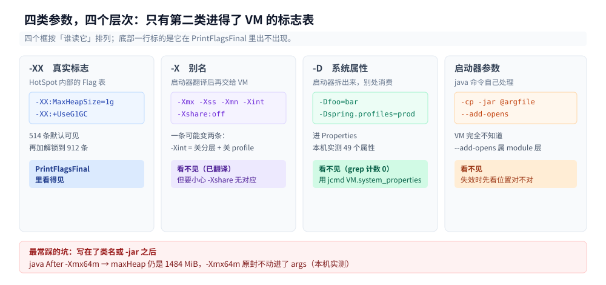
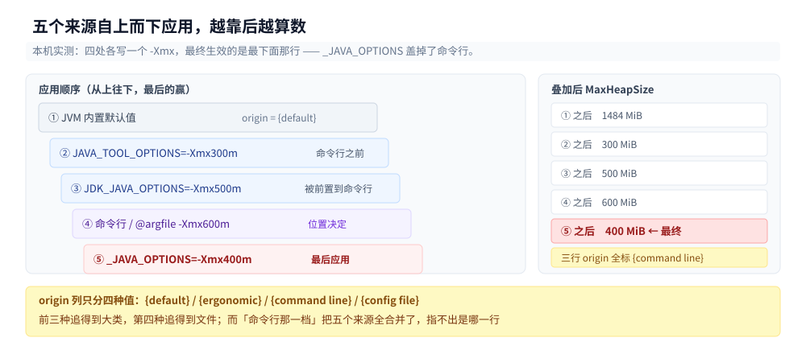
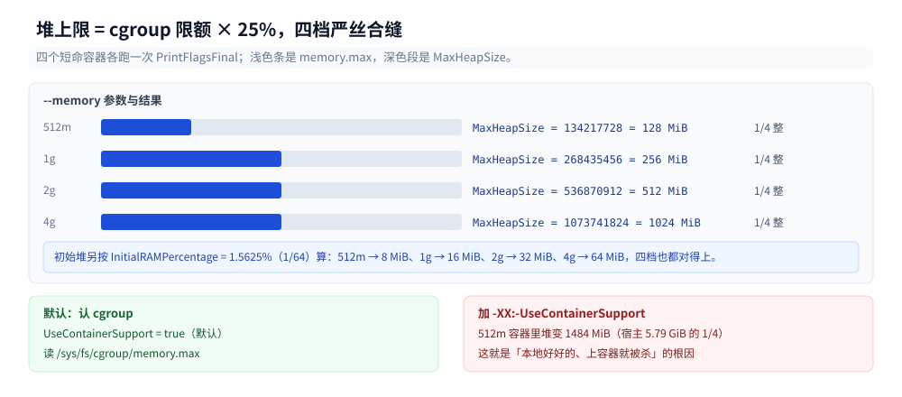
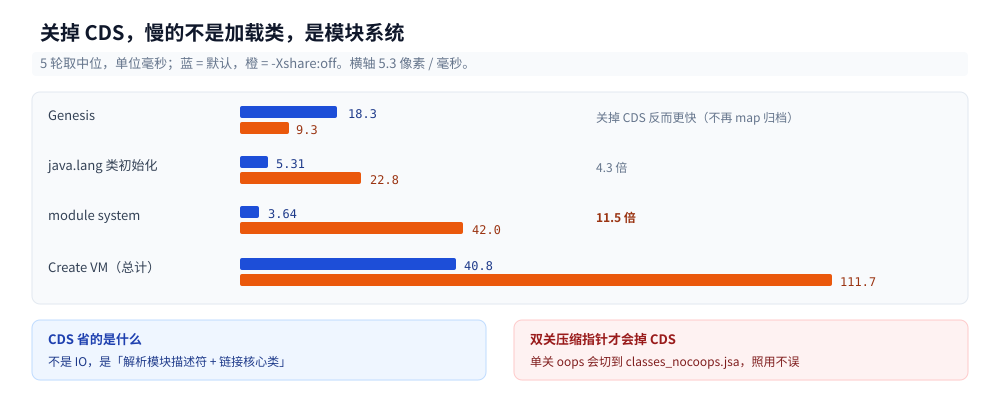

# JVM启动与参数体系

> 覆盖：`-X` / `-XX` / `-D` 三种写法到底差在哪、`PrintFlagsFinal` 那五百多行怎么读、参数从哪几个地方来且谁盖住谁、容器里的 JVM 看到的「机器」和 `nproc` 看到的是不是一回事、堆开得比容器限额还大会有什么下场、改一个参数为什么会让启动慢两倍。
>
> 不覆盖：JIT 怎么把字节码变成机器码、内联阈值与去优化见 [JIT与执行引擎.md](JIT与执行引擎.md)；对象在堆里占多少字节、压缩指针与 32 GB 分界见 [对象布局与引用类型.md](对象布局与引用类型.md)；`.class` 文件格式与字节码指令集见 [类文件与字节码.md](类文件与字节码.md)；`-XX:+UseG1GC` 之后的分区与回收器选型见 [垃圾回收原理与收集器.md](垃圾回收原理与收集器.md)、GC 日志与调参见 [GC调优与日志.md](GC调优与日志.md)；运行中抓线程栈、火焰图与 Arthas 的现场流程见 [线上问题排查.md](线上问题排查.md)；JFR 事件与 `jcmd` 全量诊断命令见 [JFR与诊断工具.md](JFR与诊断工具.md)，本篇只用它的 `VM.flags`。
>
> 内容整理自个人学习笔记，素材见 [素材清单](../../../素材清单.md)。
>
> 实测口径：`eclipse-temurin:24-jdk`（24.0.2+12，linux/amd64，cgroup v2，容器 4 CPU）。参数盘点、`-X` 翻译表、覆盖顺序、`origin` 列全部真跑；容器内存那组用 `docker run --memory=` 现开短命容器，四档各跑一次；超配堆的三行对照各跑一次并给了耗时；启动耗时按 7 轮取 min/中位/max，启动阶段耗时按 5 轮取中位。⚠️ 测量时宿主 load average = 2.78，绝对毫秒数偏大且抖动明显，**结论只看比值不看绝对值**。⚠️「OOMKilled」这一条要靠 `--memory-swap` 手动关掉 swap 才能复现，默认参数下复现不出来，原因写在第五节。

---

## 一、一个 `-Xmx` 到底改了什么？

**本节要点**：`-Xmx` 只改「上限」，不改「起点」。`-Xmx200m` 下堆上限是 200 MiB，但 `totalMemory()` 仍报 96 MiB——初始堆由另一条规则（`InitialRAMPercentage`）算出来，与 `-Xmx` 无关。只有把上限压到初始堆以下，才会看到「夹取」。

### 1.1 从零：十行程序，三个参数

这段代码没有依赖，`javac HeapEcho.java && java HeapEcho` 就能跑。它把 JVM 三个最常被问的数字打出来：堆上限、当前已提交的堆、可用核心数。

```java
public class HeapEcho {
    public static void main(String[] a) {
        Runtime r = Runtime.getRuntime();
        long mb = 1024 * 1024;
        System.out.printf("maxHeap  = %5d MiB  (%d 字节)%n", r.maxMemory() / mb, r.maxMemory());
        System.out.printf("totalMem = %5d MiB  可用核心 = %d%n",
                r.totalMemory() / mb, r.availableProcessors());
    }
}
```

同一份代码，只换参数：

```text
$ java HeapEcho
maxHeap  =  1484 MiB  (1556086784 字节)
totalMem =    96 MiB  可用核心 = 4

$ java -Xmx200m HeapEcho
maxHeap  =   200 MiB  (209715200 字节)
totalMem =    96 MiB  可用核心 = 4

$ java -XX:MaxRAMPercentage=10 HeapEcho
maxHeap  =   594 MiB  (622854144 字节)
totalMem =    96 MiB  可用核心 = 4
```

三行里有两件事值得盯住：`-Xmx200m` 之后 `totalMem` **一动没动**（还是 96 MiB）；`MaxRAMPercentage=10` 把上限从 1484 拉到 594，`totalMem` 也一动没动。这说明「上限」和「起点」是两条独立算出来的数。

这台机器没有容器的内存限制，`MemTotal` 是 6070864 kB（5.79 GiB）。JVM 按 `MaxRAMPercentage = 25%` 算出 1484 MiB——与 5.79 GiB × 25% ≈ 1.45 GiB 对得上（反推的 MaxRAM 是 5936 MiB，与 `MemTotal` 差几 MiB，是内核保留页与取整）。

### 1.2 五百多个参数，你只改了一个

`-XX:+PrintFlagsFinal` 会把**所有**可见标志和它们的最终值打出来。先数一下规模：

| 解锁组合 | 可见参数条数 | 增量 |
|---|---|---|
| 默认 | **514** | — |
| 加 `-XX:+UnlockExperimentalVMOptions` | 669 | +155 |
| 加 `-XX:+UnlockDiagnosticVMOptions` | 757 | +243 |
| 两个都加 | **912** | +398 |

514 这个数可以按「种类标签」拆开，加起来正好对得上：

| 种类标签 | 条数 | 含义 |
|---|---|---|
| `{product}` | 352 | 稳定可用的产品参数 |
| `{C2 product}` | 64 | 只影响 C2 编译器 |
| `{pd product}` | 35 | 平台相关（platform-dependent） |
| `{ARCH product}` | 18 | 架构相关（x86 / aarch64 各有一套） |
| `{C1 product}` | 16 | 只影响 C1 编译器 |
| `{manageable}` | 14 | 运行中可通过 JMX / `jcmd` 改 |
| `{C2 pd product}` | 12 | 两个标签叠加 |
| `{product lp64_product}` | 3 | 64 位专有 |
| **合计** | **514** | |

352 + 64 + 35 + 18 + 16 + 14 + 12 + 3 = 514，与表格第一行的总数一致。加实验选项多出来的 155 条全部带 `experimental` 标签（`experimental` 123 + `JVMCI experimental` 23 + `C2 experimental` 4 + `pd experimental` 3 + `experimental lp64_product` 1 + `ARCH experimental` 1 = 155），加诊断选项多出来的 243 条全部带 `diagnostic`（186 + 45 + 6 + 4 + 2 = 243）。

`{experimental}` 与 `{diagnostic}` 就是「默认看不见」的那两批：没有对应的 `Unlock` 开关，你连它存在都不知道，写上去会直接报 `Unrecognized VM option`。这条限制与 [JIT与执行引擎.md](JIT与执行引擎.md) 里「`-XX:+PrintEliminateAllocations` 在产品版 JVM 上直接拒绝启动」是同一件事的另一面——那批是 `{develop}`，比 `diagnostic` 还多一道门，产品版二进制里根本不存在。

每一行只有五个字段，读法是固定的：

```text
   size_t MaxHeapSize              =   1556086784                    {product} {ergonomic}
   ^^^^^^ ^^^^^^^^^^^              ^   ^^^^^^^^^^                    ^^^^^^^^^ ^^^^^^^^^^
   类型    名字                    =   最终值                        种类标签  来源(origin)
```

还有一组更值得看的对比：`-XX:+PrintFlagsInitial` 与 `-XX:+PrintFlagsFinal` 各 514 行，逐行比下来**有 61 条的值在启动过程中变了**。其中只有 17 条被标成 `{ergonomic}`，另外 **44 条的 `origin` 仍写着 `{default}`**——它们是初始化代码里 `set_*_default()` 悄悄改掉的。比如 `AlignVector` 在 `Initial` 里是 `true`、在 `Final` 里是 `false`。

**所以「`origin` 是 `{default}`」不等于「这个值就是 C++ 源码里的那个字面量」。** 想知道一个参数到底被谁改过，只有 `Initial` 与 `Final` 对拍这一条路。

### 1.3 上限、起点、与夹取

初始堆在没写 `-Xms` 时，由 `InitialRAMPercentage` 算：

| 参数 | `maxHeap` | `totalMem` | 说明 |
|---|---|---|---|
| 默认 | 1484 MiB | 96 MiB | 初始堆 ≈ MaxRAM 的 1.5625% = 1/64 |
| `-Xmx200m` | 200 MiB | **96 MiB** | 上限变了，起点没变 |
| `-Xmx64m` | 64 MiB | **64 MiB** | 起点被上限夹住 |
| `-XX:InitialRAMPercentage=20` | 1484 MiB | **1188 MiB** | 起点独立抬高，上限不动 |

`InitialRAMPercentage` 默认 `1.5625`，也就是 1/64——这个数不是随便取的，它让 JVM 启动时只向操作系统要很小一块，剩下的按需扩。把它改成 20，`totalMem` 立刻变成 1188 MiB（5936 × 20% ≈ 1187），**启动即向 OS 要 1.2 GB**。生产上这是一条容易被忽略的坑：进程 RSS 在 `main` 还没跑起来时就已经占满。

⚠️ `totalMemory()` 报的 96 MiB 与 `InitialHeapSize` 标志值 98566144 字节（94 MiB）差 2 MiB。差值来自 G1 提交时按 region（`G1HeapRegionSize` = 1 MiB）补齐，本篇未深究，不影响「起点与上限独立」这个结论。

两个百分比的耦合还有一层：只写 `-XX:InitialRAMPercentage=50` 而不动上限，512 MiB 容器的初始堆算出 256 MiB，但上限仍是 128 MiB（25%），于是被夹回 128 MiB——`totalMem` 直接等于 `maxHeap`。加上 `-XX:MaxRAMPercentage=75` 之后才看得出两个数各自的值：

```text
$ docker run --rm --memory=512m eclipse-temurin:24-jdk sh -c \
    'java -XX:MaxRAMPercentage=75 -XX:InitialRAMPercentage=50 -XX:+PrintFlagsFinal -version 2>&1 \
     | grep -E " MaxHeapSize | InitialHeapSize "'
size_t InitialHeapSize = 268435456 {product} {ergonomic}    # 256 MiB = 512 × 50%
size_t MaxHeapSize     = 402653184 {product} {ergonomic}    # 384 MiB = 512 × 75%
```

**读参数的顺序永远是「先看上限、再看起点、最后看两者谁夹谁」。**

---

## 二、`-X`、`-XX`、`-D` 是三样东西还是三样写法？

**本节要点**：`-X` 只是 `-XX` 的别名，启动器在把参数交给 VM 之前就翻译成 `-XX` 了；`-D` 根本不是 VM 参数，`PrintFlagsFinal` 里一个都找不到，它进的是 `System.getProperties()`；还有第四类——启动器自己的参数（`-cp`、`-jar`、`@argfile`、`-Xshare`），VM 从来看不见它们。

### 2.1 一条命令把六种写法翻译给同一台 VM 看

`-XX:+PrintCommandLineFlags` 打印的是「VM 最终收到的那串 `-XX`」，等于让 VM 把心里话写出来。逐个喂给它：

```text
$ java -XX:+PrintCommandLineFlags -Xmx256m -version
-XX:-AOTInvokeDynamicLinking -XX:ConcGCThreads=1 -XX:G1ConcRefinementThreads=4
-XX:InitialHeapSize=97133824 -XX:MarkStackSize=4194304 -XX:MaxHeapSize=268435456
-XX:MinHeapSize=6815736 -XX:+PrintCommandLineFlags -XX:ReservedCodeCacheSize=251658240
-XX:+SegmentedCodeCache -XX:-THPStackMitigation -XX:+UseCompressedOops -XX:+UseG1GC
```

我写的 `-Xmx256m` 不见了，出来的是 `-XX:MaxHeapSize=268435456`。剩下的十几条我一个都没写——它们是 19 个 `{ergonomic}` 里被「非默认值」筛出来的那部分，JVM 自己算的。

### 2.2 `-X` → `-XX` 的对照表

同一条命令跑六次，只看变化的那几项：

| 你写的 | VM 收到的 | 备注 |
|---|---|---|
| `-Xmx256m` | `-XX:MaxHeapSize=268435456` | 一比一 |
| `-Xss512k` | `-XX:ThreadStackSize=512` | 单位是 KB，`512k` 变 `512` |
| `-Xmn64m` | `-XX:NewSize=67108864 -XX:MaxNewSize=67108864` | **一条变两条** |
| `-Xint` | `-XX:-ProfileInterpreter -XX:-TieredCompilation` | **一条变两条，见 2.3** |
| `-Xshare:off` | *（没有任何 `-XX` 出现）* | 启动器/CDS 层面，不是 VM flag |
| `-XX:+UseSerialGC` | `-XX:+UseSerialGC` | 原样，同时 `ConcGCThreads` 等三个 G1 专属项消失 |
| `-Dfoo=bar` | *（没有任何 `-XX` 出现）* | 进 `System.getProperties()`，见 2.4 |

`-Xmn64m` 那一行还有一处隐藏改动：`MinHeapSize` 从 6815736 变成 72561456（约 69 MiB）。原因是「年轻代不能大于初始堆」，设了 `NewSize=64 MiB` 就把初始堆的下限一起顶上去了。**这是一条 `-X` 参数悄悄改了另一个参数的例子**，只看 `-Xmn` 的文档永远发现不了。

### 2.3 ⭐ `-Xint` 不是「一条参数」

`-Xint` 展开成 `-XX:-ProfileInterpreter -XX:-TieredCompilation` 两条。所以它和「只关分层编译」不是一回事：

| 写法 | 实际关掉了什么 | 编译子系统 |
|---|---|---|
| `-Xint` | 分层编译 + profile 收集 | 整个关掉，日志里是 `Compilation: disabled (interpreter mode)` |
| `-XX:-TieredCompilation` | 只关分层 | 仍在，C2 独占 |
| `-XX:TieredStopAtLevel=1` | 只让方法最高到 level 1 | 仍在，C1 独占 |

这三者在本机上的耗时差在 [JIT与执行引擎.md](JIT与执行引擎.md) 第三节有完整对照（`-Xint` 365 109 ns / 只 C2 28 787 ns）。**看到 `-Xint` 的读数，不能说成「关掉 JIT 的读数」**——它连 profile 收集都关了，是更彻底的一档。

### 2.4 `-D` 去哪了

`-D` 进的是系统属性，不是 VM 标志：

```text
$ java -Dfoo=bar -XX:+PrintFlagsFinal -version 2>&1 | grep -c foo
0

$ java -Dfoo=bar Prop
foo = bar
sun.java.command = Prop
java.class.path = .
属性总数 = 49
```

`grep -c foo` 返回 0，说明 `PrintFlagsFinal` 里根本没有这条；`System.getProperty("foo")` 却拿得到。**`-D` 在 VM 启动之前就被启动器拆出来、塞进一个 `Properties` 对象**，VM 从头到尾不认识它。

这也解释了为什么 `-D` 的覆盖顺序和 `-XX` 不一样：同一批 `-D` 里后写的赢，环境变量里的 `-D` 会被命令行盖掉。

```text
$ JAVA_TOOL_OPTIONS="-Dfoo=env" java -Dfoo=line Prop
Picked up JAVA_TOOL_OPTIONS: -Dfoo=env
foo = line
```

### 2.5 四类参数的分工表

| 家族 | 例子 | 谁读它 | 出现在 `PrintFlagsFinal` | 存在哪 |
|---|---|---|---|---|
| `-XX`（真实标志） | `-XX:MaxHeapSize`、`-XX:+UseG1GC` | HotSpot 内部 | ✅ | `Flag` 表 |
| `-X`（别名） | `-Xmx`、`-Xss`、`-Xmn`、`-Xint` | 启动器 / VM 解析期 | ❌（已翻译成 `-XX`） | 无 |
| `-D`（系统属性） | `-Dfoo=bar` | 启动器 → `Properties` | ❌ | `System.getProperties()` |
| 启动器参数 | `-cp`、`-jar`、`@argfile`、`-Xshare`、`--add-opens` | `java` 启动器 | ❌ | 启动器自己 |



四列从左到右是「离 VM 越来越远」：`-XX` 直接进 `Flag` 表，`-X` 被翻译后才进，`-D` 被启动器拆走，启动器参数 VM 从没见过。底部那行红框是最常踩的坑——参数写在类名之后，四列一个都不沾，直接被当成程序参数吃掉。

`--add-opens` / `--add-exports` 是第四类里最容易被误当成 `-XX` 的：它们写在 module 系统那一层，效果体现在「反射能不能访问」，`PrintFlagsFinal` 里一个字都没有。

还有一类不算参数但效果一样的东西：**写在 `java` 之后、类名之后的参数会被当成程序参数**。

```text
$ java After -Xmx64m
maxHeap = 1484 MiB
收到的程序参数 = [-Xmx64m]
```

`maxHeap` 一动没动，`-Xmx64m` 原封不动进了 `args`。`-jar` 之后同理——`java -jar app.jar -Xmx1g` 里的 `-Xmx1g` 是给 `app.jar` 的，JVM 看都不看。**「参数不生效」的第一嫌疑永远是位置，不是写法。**

---

## 三、参数从哪来，谁盖住谁？

**本节要点**：五个来源，**后解析的赢**。真正的坑是 `_JAVA_OPTIONS` 排在命令行**之后**应用，所以它能盖掉命令行；`@argfile` 与命令行等价，位置决定胜负。而 `PrintFlagsFinal` 的 `origin` 列只分 `default` / `ergonomic` / `command line` / `config file` 四种，**命令行、`JAVA_TOOL_OPTIONS`、`@argfile` 三种来源全标成 `command line`**，根本区分不出来。

### 3.1 五个来源

| 来源 | 写法 | 打印什么 | 应用时机 |
|---|---|---|---|
| JVM 默认 | — | `{default}` | 最早 |
| `JAVA_TOOL_OPTIONS` | 环境变量 | `Picked up JAVA_TOOL_OPTIONS: ...`（stderr） | 早，在命令行之前 |
| `JDK_JAVA_OPTIONS` | 环境变量 | `NOTE: Picked up JDK_JAVA_OPTIONS: ...` | 启动器把它**前置**到命令行参数里 |
| 命令行 / `@argfile` | 直接写 / `java @file` | 无 | 中 |
| `-XX:Flags=文件` | 文件 | 无 | 中（`origin` 标 `config file`） |
| `_JAVA_OPTIONS` | 环境变量 | `Picked up _JAVA_OPTIONS: ...`（stderr） | **最后** |

### 3.2 覆盖顺序实测

同一个 `-Xmx`，五种来源同时上，只看 `MaxHeapSize` 等于谁：

| 配置 | `MaxHeapSize` | 谁赢 |
|---|---|---|
| 只 `JAVA_TOOL_OPTIONS=-Xmx300m` | 314572800（300 MiB） | 环境变量 |
| 只 `JDK_JAVA_OPTIONS=-Xmx500m` | 524288000（500 MiB） | 环境变量 |
| `JDK_JAVA_OPTIONS=500m` + 命令行 `-Xmx600m` | **600 MiB** | **命令行**（`JDK_JAVA_OPTIONS` 被前置，命令行在后） |
| `JAVA_TOOL_OPTIONS=300m` + 命令行 `-Xmx600m` | **600 MiB** | **命令行** |
| 三个都设（300/500） + 命令行 `-Xmx600m` | **400 MiB** | ⭐ **`_JAVA_OPTIONS=400m`** |
| 三个都设，不给命令行 | **400 MiB** | ⭐ `_JAVA_OPTIONS` |

第五行是这一节的重点：**命令行 600m 也没能赢过 `_JAVA_OPTIONS` 的 400m**。所以「我在命令行写了 `-Xmx600m` 为什么堆还是 400m」这个现场问题的答案，是去 `env` 里翻 `_JAVA_OPTIONS`——它比你手写的更靠后。



左边五个框是按「应用时机」排的，往下走就是往后覆盖；右边那列是叠加上去的实际值，从 1484 MiB 一路压到 400 MiB，最后一行才是生效值。这张图要记住的是最后一格：命令行 600m 明明更靠下，却输给了再下面那行环境变量。

顺带一条：`_JAVA_OPTIONS` 还会往 stderr 打一行 `Picked up _JAVA_OPTIONS: ...`。**任何把 stderr 当纯净输出的脚本都会被这行污染**，这是它在生产环境里最直接的副作用。

### 3.3 ⭐ origin 列会说谎

同一个 `-XX:MaxHeapSize=300m`，三种来源摆在一起看 `origin`：

```text
$ java -XX:MaxHeapSize=300m -XX:+PrintFlagsFinal -version 2>&1 | grep " MaxHeapSize "
   size_t MaxHeapSize = 314572800 {product} {command line}

$ JAVA_TOOL_OPTIONS="-XX:MaxHeapSize=300m" java -XX:+PrintFlagsFinal -version 2>&1 | grep " MaxHeapSize "
   size_t MaxHeapSize = 314572800 {product} {command line}

$ printf -- "-XX:MaxHeapSize=300m\n" > g.txt
$ java @g.txt -XX:+PrintFlagsFinal -version 2>&1 | grep " MaxHeapSize "
   size_t MaxHeapSize = 314572800 {product} {command line}
```

三行输出一模一样。**`origin` 只记录「是不是从命令行那一批来的」，不记录「从哪一行来的」**——因为环境变量和 `@argfile` 在进 VM 之前就已经被拼进同一个参数数组了。

唯一能区分出来的是旧式配置文件：

```text
$ printf "MaxHeapSize=320m\n+UseSerialGC\n" > f.txt
$ java -XX:Flags=/tmp/f.txt -XX:+PrintFlagsFinal -version 2>&1 | grep -E " MaxHeapSize | UseSerialGC "
   size_t MaxHeapSize = 335544320 {product} {config file}
     bool UseSerialGC = true      {product} {config file}
```

`-XX:Flags=` 的文件内容**不带 `-XX:` 前缀**（写 `MaxHeapSize=320m` 而不是 `-XX:MaxHeapSize=320m`），写上 `-Xmx320m` 会报 `Unrecognized VM option 'Xmx320m'`。这个功能还在，但新项目应该用 `@argfile`——后者支持 `#` 注释、支持引号、能被启动器统一处理。

所以 `origin` 的完整取值是四种，各自的含义要背下来：

| `origin` | 含义 | 能不能追到出处 |
|---|---|---|
| `{default}` | 编译进二进制的默认值 | — |
| `{ergonomic}` | JVM 按机器条件自己算的 | 去看算它的输入（内存上限、CPU 数） |
| `{command line}` | 命令行 / `JAVA_TOOL_OPTIONS` / `JDK_JAVA_OPTIONS` / `_JAVA_OPTIONS` / `@argfile` 五者之一 | ❌ 区分不出 |
| `{config file}` | `-XX:Flags=文件` | ✅ 文件就在那 |

### 3.4 同义参数看位置

`-Xmx` 与 `-XX:MaxHeapSize` 是同一条标志，谁赢只看谁在后面：

```text
$ java -Xmx300m -XX:MaxHeapSize=500m ... → 524288000（500 MiB）
$ java -XX:MaxHeapSize=500m -Xmx300m ... → 314572800（300 MiB）
```

两条规则叠起来就是全部：**同一来源内，后写的赢；不同来源之间，按 3.1 表的应用时机排序，靠后的赢。**

---

## 四、容器里 JVM 看到的机器和 `nproc` 看到的一样吗？

**本节要点**：JVM 不看 `nproc`，也不看 `/proc/meminfo` 的原始值——它读 cgroup 的 `memory.max`，再乘 `MaxRAMPercentage`（默认 25%）得到堆上限。四档容器限额下这个换算是**严格线性**的：512m → 128 MiB、1g → 256、2g → 512、4g → 1024。把 `-XX:-UseContainerSupport` 关掉，它立刻退回去看宿主内存，堆上限变成宿主的 1/4。

### 4.1 从 cgroup 到 `MaxHeapSize` 的四档线性

`docker run --memory=` 现开短命容器，每次只跑 `PrintFlagsFinal`：

| 容器 `--memory` | `InitialHeapSize` | `MaxHeapSize` | 换算 |
|---|---|---|---|
| 512m | 8388608（8 MiB） | 134217728（128 MiB） | 512 / 4 |
| 1g | 16777216（16 MiB） | 268435456（256 MiB） | 1024 / 4 |
| 2g | 33554432（32 MiB） | 536870912（512 MiB） | 2048 / 4 |
| 4g | 67108864（64 MiB） | 1073741824（1024 MiB） | 4096 / 4 |

上限严格等于 `memory.max × 25%`，起点严格等于 `memory.max × 1.5625%`（= 1/64）。四个数字一次都不偏。



浅灰长条是容器限额，深蓝段是堆上限，四行都只占整条的 1/4。右下角那个红框是本节的另一个重点：一旦关掉容器感知，512 MiB 容器里的堆会跳到 1484 MiB，因为 JVM 转头去看了宿主的 5.79 GiB。

没有容器限额时（本篇的 `java-lab` 就是），JVM 退回看 `/proc/meminfo` 的 `MemTotal`：6070864 kB 算出 1556086784 字节。反推的 MaxRAM 是 5936 MiB，比 `MemTotal` 的 5928 MiB 多 8 MiB——差额来自内核保留页与向下取整，量级可忽略。

### 4.2 三个旋钮

同一个 512 MiB 容器，只动一个旋钮：

| 参数 | `MaxHeapSize` | 说明 |
|---|---|---|
| 默认 | 128 MiB | 25% |
| `-XX:MaxRAMPercentage=75` | 384 MiB | 75% |
| `-XX:InitialRAMPercentage=50` | 128 MiB（起点也被夹到 128） | 只改起点，被上限夹住 |
| `-XX:-UseContainerSupport` | **1484 MiB** | 不认 cgroup，回到宿主 |
| `-Xmx256m` | 256 MiB，`origin` 变 `{command line}` | 显式值永远赢过百分比 |

最后一列是重点：`-XX:-UseContainerSupport` 在 512 MiB 容器里给出 1484 MiB——这就是那个经典的「本地好好的，上容器就被杀」的根因。**Java 8u191 之前默认就是这个行为**（`UseContainerSupport` 从 8u191 才有），所以老镜像跑在新 K8s 上是双重风险。

### 4.3 核心数也要显式给

`availableProcessors()` 在容器里默认跟着 CPU 配额走。这台机器的 `java-lab` 没有 CPU 限制（`cpu.max` 是 `max 100000`），`nproc` = 4，JVM 看到 4。想让 JVM 少开 GC 线程或 JIT 编译线程，用 `-XX:ActiveProcessorCount=`：

```text
$ java -XX:ActiveProcessorCount=2 HeapEcho
maxHeap  =  1484 MiB  (1556086784 字节)
totalMem =    96 MiB  可用核心 = 2
```

堆不受影响，只有「按核数算」的东西变了——`ConcGCThreads`、`ParallelGCThreads`、`CICompilerCount` 全都跟着走。这是「给一个 64 核宿主上的小程序限流」的标准做法：容器 `--cpus=2` 有时因为 cgroup v1 的 `cpu.shares` 语义算不准，`ActiveProcessorCount` 是最硬的一刀。

---

## 五、堆开得比容器还大会怎样？

**本节要点**：不会立刻被杀。`-Xmx1g` 写在 512 MiB 容器里，JVM 照单全收（它只是把「上限」设成 1 GiB，并不去核对 cgroup）。真跑起来撞到 `memory.max` 之后，内核**先 reclaim 而不是 kill**——有 swap 就靠换页苟活，慢 8 倍但活着；只有把 swap 也一起掐死，才会看到干净的 exit 137。

### 5.1 三种结局

同一个 512 MiB 容器、同一个吃 700 MiB 的程序（`Eat 700`），三种配法：

| 配法 | 结局 | 耗时 | 说明 |
|---|---|---|---|
| `-Xmx1g`（默认有 swap） | **exit 0，存活** | 2802 ms | 靠换页硬撑，`memory.current` 峰值正好卡在 536870912 |
| `-Xmx1g` + `--memory-swap=512m` | **exit 137** | 906 ms | 没有 swap 可换，OOMKilled |
| 默认堆（128 MiB） | **exit 1** | 337 ms | `OutOfMemoryError: Java heap space`，JVM 自己先死 |

第一行的 2802 ms 与第三行的 337 ms 差 8.3 倍。多出来的时间全是缺页与换出——**这就是「堆配大了反而慢」的物理来源**，而不是「堆大了 GC 慢」。

三行的失败姿态完全不同，这决定了线上看到的现象：

- exit 0 + 慢：容器活着、接口变慢、CPU 不高、swap 在涨。监控上看不出来，只有延迟曲线能看。
- exit 137：`docker inspect` 里 `OOMKilled: true`，重启计数上涨，日志断在最中间。
- exit 1 + `OutOfMemoryError`：日志里有完整堆栈与「Java heap space」字样，能定位到具体分配点。

**「配小了至少死得明白」不是反话，是运维事实。**

### 5.2 为什么本地复现不出 OOMKilled

第一行能活下来的原因是 swap。Docker 的 `--memory-swap` 默认等于 `--memory` 的 2 倍，也就是说 `--memory=512m` 实际上给了 512 MiB 内存 + 512 MiB swap：

```text
$ docker run --rm --memory=512m eclipse-temurin:24-jdk sh -c \
    'cat /sys/fs/cgroup/memory.max; cat /sys/fs/cgroup/memory.swap.max'
536870912
536870912
```

总共 1 GiB 的额度，700 MiB 的堆当然活得下来。所以在本机用 `docker run --memory=512m` 想复现 OOMKilled 会一直失败，必须显式写 `--memory-swap=512m`（等于把 swap 关掉）。

⚠️ 生产上的 K8s 不一定是这个语义：`resources.limits.memory` 只限内存，节点上有没有 swap 取决于 kubelet 的 `swapBehavior`（NodeSwap 自 1.28 转 beta，但默认仍是节点禁用 swap）。**同一条 `-Xmx1g` 在本地 Docker Desktop 上「活着但慢」，在关掉 swap 的节点上直接 137**，这是「本地测不出来」的完整解释。

### 5.3 `memory.events` 的读法

两行 `/sys/fs/cgroup/memory.events` 就能把「撞墙了但没死」和「被杀」分开：

| 字段 | 含义 | 5.1 第一行（存活） | 5.1 第二行（被杀） |
|---|---|---|---|
| `max` | 撞到 `memory.max` 的次数 | **1555** | 57 |
| `oom` | 触发 OOM 的次数 | 0 | 1 |
| `oom_kill` | 实际被杀的次数 | 0 | 1 |
| `oom_group_kill` | 整组被杀 | 0 | 0 |

`max` 上千而 `oom_kill` 为 0，就是「一直在 reclaim、一直没杀」；`oom_kill` 变 1，才是真死了。这两个计数器在 `docker inspect` 里看不到，得进容器读——所以线上排查「到底是被谁杀的」时，`exit 137` 只能说明「SIGKILL」，可能是因为 OOM，也可能是 `docker stop` 超时、也可能是节点驱逐，**必须配合 `oom_kill` 计数才能定案**。

---

## 六、改了参数为什么启动慢一倍？

**本节要点**：`-Xshare:off` 把启动从「中位 77 ms」拉到「中位 145 ms」，接近 1.9 倍。慢的部分不在「加载类」本身，而是集中在两个阶段：**module system 从 3.64 ms 涨到 42.0 ms（11.5 倍）**、**`java.lang` 类初始化从 5.31 ms 涨到 22.8 ms（4.3 倍）**。这两段正是 CDS 归档省下来的。

### 6.1 启动阶段清单

`-Xlog:startuptime` 是产品版可用的统一日志标签，它把 `JNI_CreateJavaVM` 内部的 18 个阶段逐个打出来：

```text
$ java -Xlog:startuptime -version 2>&1 | head -4
[0.005s][info][startuptime] StubRoutines generation initial stubs, 0.0002052 secs
[0.005s][info][startuptime] SharedRuntime generate_throw_exception, 0.0000310 secs
[0.023s][info][startuptime] Genesis, 0.0174225 secs
[0.023s][info][startuptime] StubRoutines generation continuation stubs, 0.0000265 secs
```

按耗时排序，前五名是 `Create VM`（外层，包含全部）、`Genesis`、`Initialize java.lang classes`、`Initialize module system`、`Initialize java.lang.invoke classes`。注意 `Create VM` 是**嵌套的外层计时**，它等于「VM 从开始初始化到能跑 Java 代码」的总时长，不是第五个并列阶段。

这 18 个阶段里没有一个叫「解析参数」——参数解析在更早的 `Arguments::parse()` 里，`startuptime` 还没开始计时。**参数写错在最早的一刻就会失败，比日志第一行还早。**

### 6.2 CDS 的钱花在哪一段

同一台机器，5 轮取中位：

| 阶段 | 默认 | `-Xshare:off` | 倍数 |
|---|---|---|---|
| `Genesis` | 18.3 ms | **9.3 ms** | 0.51（反而更快） |
| `Initialize java.lang classes` | 5.31 ms | **22.8 ms** | 4.3 |
| `Initialize module system` | 3.64 ms | **42.0 ms** | **11.5** |
| `Create VM`（总计） | 40.8 ms | **111.7 ms** | 2.7 |

`Genesis` 在关掉 CDS 之后反而**变快**了——因为它不再需要 map 那个归档。真正变慢的是后面两段：module system 慢 11.5 倍，`java.lang` 类初始化慢 4.3 倍。



每一组上蓝下橙，橙色条一长就说明这一段被 CDS 撑着。`Genesis` 那一组反过来了，橙条更短；`module system` 那一组差得最夸张，19 像素对 223 像素。总计那条 40.8 vs 111.7，是「启动慢一倍」这个体感的来源。

这就是 CDS 的价值所在：它把「解析模块描述符」「加载并链接 `java.lang` 的几十个核心类」的结果存成一份 `classes.jsa`，启动时直接 mmap 进来，变成一次 `mmap` + 少量重定位。**它省的不是 IO，是解析与链接。**

`-Xlog:cds=info` 能看到它用的是哪个归档，以及归档的构建参数：

```text
[0.012s][info][cds] trying to map /opt/java/openjdk/lib/server/classes.jsa
[0.012s][info][cds] Opened archive /opt/java/openjdk/lib/server/classes.jsa.
[0.012s][info][cds] Archive was created with UseCompressedOops = 1, UseCompressedClassPointers = 1, UseCompactObjectHeaders = 0
```

最后一行是「归档的构建指纹」。它与当前运行时的参数**逐项比对**，不匹配就整份作废。

### 6.3 关压缩指针会不会连带掉 CDS

[对象布局与引用类型.md](对象布局与引用类型.md) 里记过一条：「`-XX:-UseCompressedOops -XX:-UseCompressedClassPointers` 会顺带让 CDS 失效」。这轮把边界测清楚了——**只关 oops 不掉，双关才掉**：

| 参数组合 | 用的归档 | CDS 状态 | 启动 7 轮中位 |
|---|---|---|---|
| 默认 | `classes.jsa`（oops=1, ccp=1） | ✅ | 77 ms |
| `-XX:-UseCompressedOops` | **`classes_nocoops.jsa`**（oops=0, ccp=1） | ✅ | **68 ms** |
| 双关 | `classes_nocoops.jsa` 但 ccp 期望 0 | ❌ 作废 | 115 ms |

JDK 24 的镜像里**自带两份归档**：`classes.jsa` 和 `classes_nocoops.jsa`。只关 oops 时 JVM 会自动切到 `classes_nocoops.jsa`，指纹仍然匹配，所以启动不但不慢，还比默认快一点（68 vs 77 ms，因为归档小、重定位少）。双关之后 `UseCompressedClassPointers` 也不匹配了，才打出这段：

```text
[warning][cds] Unable to use shared archive.
The saved state of UseCompressedOops and UseCompressedClassPointers is different from runtime, CDS will be disabled.
[info   ][cds] Initialize static archive failed.
```

**所以「关压缩指针会让启动变慢」是错的，准确说法是「关到 CDS 不认了才会变慢」。** 这中间隔着一个 `classes_nocoops.jsa`。

### 6.4 启动耗时七轮区间

| 参数 | min | 中位 | max |
|---|---|---|---|
| 默认 | 67 | 77 | 148 |
| `-Xshare:off` | 107 | 145 | 206 |
| `-XX:-UseCompressedOops` | 66 | 68 | 91 |
| 双关（CDS 作废） | 100 | 115 | 149 |

⚠️ 测量时宿主 load average = 2.78（4 个逻辑 CPU），max 列的抖动来自负载而不是参数。**这组数只能看比值**：`-Xshare:off` 约为默认的 1.9 倍，双关约为 1.5 倍，单关 oops 基本持平。

---

## 七、参数不生效、参数拼错、参数被谁改了——怎么查？

**本节要点**：分两类。**没起来**的看报错原文，`Unrecognized VM option` 里 JDK 24 会给拼写建议；**起来了但值不对**的看 `origin` 列，`{ergonomic}` 说明是 JVM 自己算的（去找算它的输入），`{command line}` 说明有五个来源中的一个在起作用（去 `env` 里翻）。进程已经在跑，用 `jcmd <pid> VM.flags` 读它真正生效的那份。

### 7.1 三种报错原文

```text
$ java -XX:+NoSuchFlag -version
Unrecognized VM option 'NoSuchFlag'
Error: Could not create the Java Virtual Machine.
Error: A fatal exception has occurred. Program will exit.
```

exit = 1。加一个字母的拼写错误会多给一行建议：

```text
$ java -XX:+UseG1GCC -version
Unrecognized VM option 'UseG1GCC'
Did you mean '(+/-)UseG1GC'?
Error: Could not create the Java Virtual Machine.
Error: A fatal exception has occurred. Program will exit.
```

`Did you mean` 是 JDK 24 新加的模糊匹配。它有用，但也有风险：`Did you mean` 是 stderr 上的一行普通文本，**任何 `grep -q Error` 的启动脚本都判不出来**——它匹配不到就静默通过，服务起来一半又挂掉。稳妥做法是判 exit code，不是判输出。

`-X` 的报错措辞不一样，没有建议：

```text
$ java -XnoSuch -version
Unrecognized option: -XnoSuch
Error: Could not create the Java Virtual Machine.
Error: A fatal exception has occurred. Program will exit.
```

还有一类不是「不认识」而是「自相矛盾」：

```text
$ java -Xmx256m -Xms512m -version
Error occurred during initialization of VM
Initial heap size set to a larger value than the maximum heap size
```

同样 exit = 1。**这类错误只在 VM 初始化时才发现**，也就是说 `-Xmx` 和 `-Xms` 各自的语法都没问题，是它们的组合不成立——`PrintFlagsFinal` 一行都不会输出。

### 7.2 运行中的进程怎么读最终生效值

进程已经起来了，起它的脚本可能早就不在了。这时候看「它真正在用的那份参数」：

```text
$ jcmd <pid> VM.flags
-XX:-AOTInvokeDynamicLinking -XX:CICompilerCount=3 -XX:InitialHeapSize=98566144
-XX:MaxHeapSize=314572800 -XX:MaxNewSize=104857600 ...

$ jinfo -flags <pid>
VM Flags:
-XX:-AOTInvokeDynamicLinking -XX:CICompilerCount=3 -XX:InitialHeapSize=98566144 ...
```

两条命令给的是同一份东西：**全部 `-XX` 形式，且只包含「非默认值」那一批**。`-D` 不在里面（那是系统属性，用 `jcmd <pid> VM.system_properties`），`-cp` 也不在（那是启动器的）。两个工具都靠 attach 机制，容器里要保证 `jcmd` 与目标 JVM 是同一个 JDK、同一用户。

### 7.3 排障表

| 现象 | 最可能的原因 | 第一步查什么 |
|---|---|---|
| `Unrecognized VM option` | 拼错 / 参数属 `experimental`·`diagnostic`·`develop` 未解锁 | 先加对应 `Unlock` 开关再试；`Did you mean` 给的候选直接抄 |
| 参数写了但值不对 | 写在了类名/`-jar` 之后 | `java After -Xmx64m` 那样跑一遍，看 `args` 里有没有 |
| 值不是自己写的那个数 | `_JAVA_OPTIONS` 盖掉了命令行 | `env \| grep -E 'JAVA_TOOL_OPTIONS\|_JAVA_OPTIONS\|JDK_JAVA_OPTIONS'` |
| 值是 `{ergonomic}` | JVM 自己算的 | 看 `MaxRAMPercentage`、cgroup `memory.max`、`ActiveProcessorCount` |
| 容器里堆比预期大 4 倍 | `UseContainerSupport` 没生效（老 JDK） | `java -version` 是否 ≥ 8u191；`PrintFlagsFinal` 里 `UseContainerSupport` 是否 `true` |
| exit 137 | OOMKilled / 驱逐 / stop 超时 | `docker inspect` 的 `OOMKilled` + 容器内 `memory.events` 的 `oom_kill` |
| 容器活着但很慢 | 堆超配，靠 swap 换页 | `memory.current` 是否贴着 `memory.max`；`memory.events` 的 `max` 计数 |
| 启动比本地慢一倍 | CDS 没了（改了对齐/压缩指针/换了 JDK） | `-Xlog:cds=info` 看 `Unable to use shared archive` |
| `-D` 读不到 | 拼在 `-jar` 之后 | 同上，看启动脚本里 `-D` 的位置 |

---

## 应用场景

| 场景 | 用到的结论 | 具体表现 |
|---|---|---|
| K8s 里给 JVM 配堆 | 第四节 | 别写死 `-Xmx`，给 `MaxRAMPercentage` 让 JVM 跟着 `limits.memory` 走；留 25%~30% 给元空间、线程栈、直接内存与代码缓存 |
| 老镜像迁到新集群 | 第四节 4.2 | JDK 8u191 之前不认 cgroup，堆按宿主算，一上容器就被杀 |
| 本地复现 OOMKilled | 第五节 5.2 | 必须 `--memory-swap=512m` 把 swap 关掉，否则只能看到「活着但慢」 |
| 接口 P99 莫名变慢、CPU 不高 | 第五节 5.1 | 先看 `memory.current` 是否贴着 `memory.max`，再看 swap 使用量 |
| 启动时间卡在 SLA 边上 | 第六节 | `-Xshare:off` 会让启动翻倍；`-XX:-UseCompressedOops` 单关反而更快 |
| 基准测试参数不一致 | 第三节 | `_JAVA_OPTIONS` 在机器上全局生效，压测机和生产机可能跑的不是一套参数 |
| 灰度发布时参数不同 | 第三节 3.3 | `origin` 区分不出环境变量与命令行，必须把启动脚本与 `env` 一起进版本库 |
| 多语言混合部署 | 第二节 2.4 | `-D` 是应用级配置，`-XX` 是 VM 级；容器化的应用配置优先走环境变量而非 `-D` |

## 具体使用：按什么顺序确认「参数真的生效了」

```text
① 值到底是多少？
     java -XX:+PrintFlagsFinal -version 2>&1 | grep -E " MaxHeapSize "
   → 看 `=` 后面的数，以及最后的 {origin}

② origin 是 {default}？
   → 你写的参数没到 VM。回命令行确认：是不是写在类名 / -jar 之后了？

③ origin 是 {ergonomic}？
   → JVM 自己算的。找它的输入：
     MaxHeapSize      ← MaxRAMPercentage × min(cgroup memory.max, 物理内存)
     ConcGCThreads    ← 核数（ActiveProcessorCount 或 cgroup cpu.max）
     G1HeapRegionSize ← MaxHeapSize 分档

④ origin 是 {command line} 但你没写？
   → env | grep -E "JAVA_TOOL_OPTIONS|_JAVA_OPTIONS|JDK_JAVA_OPTIONS"
   → 再看启动脚本里有没有 @argfile
   → 注意 _JAVA_OPTIONS 排最后，能盖掉命令行

⑤ origin 是 {config file}？
   → 有人用了 -XX:Flags=，去看那个文件

⑥ 进程已经起来了，改不了？
   → jcmd <pid> VM.flags          （-XX 形式，只列非默认值）
   → jcmd <pid> VM.system_properties  （-D 在这）

⑦ 想确认容器语义？
   → cat /sys/fs/cgroup/memory.max /sys/fs/cgroup/memory.swap.max
   → cat /sys/fs/cgroup/memory.events  （max / oom_kill 两个计数）

⑧ 想确认 CDS 还在不在？
   → java -Xlog:cds=info -version 2>&1 | grep -iE "Opened archive|Unable"
```

三条必须记住的边界：

1. **`origin` 只有四种值，`{command line}` 涵盖五个来源。** 别指望它指出是哪一行。
2. **`-X` 会被翻译成 `-XX`，一条可能变两条**（`-Xint`、`-Xmn`），所以「我改了一个参数」有时实际改了两个。
3. **`PrintFlagsFinal` 里没有的东西不是不存在**——`-D`、`-cp`、`--add-opens` 都在别的层，用 `jcmd` 或 `-XshowSettings` 才看得到。

## 延伸追问

- **`InitialRAMPercentage` 默认 1.5625 是谁定的？** → 就是 1/64。选它是为了让启动时只承诺一小块堆，避免小容器（比如 512 MiB limit）一启动就吃掉 25% 的上限。`-Xms` 与 `-XX:InitialRAMPercentage` 同时写时，`-Xms` 是一等公民——它直接盖掉百分比。
- **`-XX:MaxRAM` 是干什么的？** → 它是「假装这台机器的内存只有这么多」，默认 137438953472（128 GiB）。它不限制堆，只影响所有按内存比例算的 ergonomic 决策（`MaxHeapSize`、`MarkStackSize`、`ReservedCodeCacheSize`）。测试「大内存机器上的默认行为」时可以用它，不用真的找台大机器。
- **`SoftMaxHeapSize` 与 `MaxHeapSize` 差在哪？** → `MaxHeapSize` 是硬上限，`SoftMaxHeapSize` 是 G1 的「软目标」：GC 会尽量把堆压到这个值以下，压不住才涨到硬上限。它在 `{manageable}` 那一档，运行中可以用 `jcmd VM.set_flag SoftMaxHeapSize <bytes>` 调，改它不用重启——14 条 `{manageable}` 里与堆上限直接相关的只有这一条。
- **`-XX:+PrintFlagsInitial` 和 `Final` 差在哪？** → `Initial` 是「还没跑任何初始化代码」的 C++ 字面量，`Final` 是「ergonomic 决策 + 命令行 + 初始化代码」都合并完的结果。本机对拍：两边各 514 条，**61 条的值变了**，其中 17 条标 `{ergonomic}`、44 条 `origin` 仍是 `{default}`（`set_*_default()` 改的）。另外 2 条 `{ergonomic}`（`MarkStackSize`／`MarkStackSizeMax`）值反而没变——**标记与取值是两回事**。
- **`-Xmx` 写 `4g` 和 `4096m` 有区别吗？** → 没有。`-Xmx4g`、`-Xmx4G`、`-Xmx4096m` 实测都得到 `4294967296`，单位字母大小写不敏感。但**不能写小数**：`-Xmx1.5g` 报 `Invalid maximum heap size: -Xmx1.5g` 然后退出，连 VM 都建不起来。
- **为什么 `jcmd VM.flags` 只列非默认值？** → 它复用 `PrintCommandLineFlags` 那套逻辑，只输出「与 default 不同」的项。想看全部要 `jcmd <pid> VM.flags -all`（它会带 origin，但语义与 `PrintFlagsFinal` 略有差别）。
- **容器里 `nproc` 和 `availableProcessors()` 会不会不一致？** → 会。`nproc` 读的是 cgroup 的 CPU 配额换算，`availableProcessors()` 在 JDK 里走的是另一套（`os::active_processor_count`），cgroup v1 的 `cpu.shares` 语义下两者容易差。**要精确控制就用 `-XX:ActiveProcessorCount=`**，不要指望两层换算能对上。
- **`-XX:+UseContainerSupport` 能不能在 JDK 8u191 之前的版本上打开？** → 不能，那个标志是 8u191 才有的。老版本只有 `-XX:-UseContainerSupport` 这种反向写法的补丁版（某些发行版 backport 过），标准做法是升级或显式写 `-Xmx`。
- **`-Xlog` 与 `-XX:+PrintFlagsFinal` 谁先生效？** → `-Xlog` 更早。日志系统在 `Arguments::parse()` 里就初始化了，所以「参数解析阶段的日志」能打出来；`PrintFlagsFinal` 要等所有参数合并完才输出。**排查「参数为什么被拒」时，`-Xlog:arguments=debug` 比 `PrintFlagsFinal` 更有用**——但这一条我本轮没跑，标为未实测。

## 关联

- **上游/前置**：[类文件与字节码.md](类文件与字节码.md) — CDS 归档里存的就是这些类元数据，第六节的「module system 慢 11.5 倍」省下的正是解析它们的功夫
- **上游/总纲**：[java/README.md](../README.md) — Java 目录的运行时主线，本篇是「装上」之后的第一环：进程怎么起来
- **下游机制**：[对象布局与引用类型.md](对象布局与引用类型.md) — 压缩指针的开关会动 CDS 的指纹（第六节 6.3），也决定堆上限能不能过 32 GB
- **下游机制**：[JIT与执行引擎.md](JIT与执行引擎.md) — `-Xint` 的真实展开是两条 `-XX`（第二节 2.3），那里有这三档的耗时对照
- **下游机制**：[GC调优与日志.md](GC调优与日志.md) — `MaxHeapSize` / `NewSize` / `SoftMaxHeapSize` 是回收器的输入，本篇只讲它们怎么被算出来
- **对照/互补**：[堆外内存与内存映射.md](堆外内存与内存映射.md) — 「RSS > Xmx」的另一半原因是直接内存与 mmap，`MaxDirectMemorySize` 默认等于 `MaxHeapSize`
- **应用**：[线上问题排查.md](线上问题排查.md) — 本篇给的是「参数是什么」，那篇给的是「进程卡在哪」，两篇合起来才是完整的现场
- **应用**：[锁与AQS.md](../并发/锁与AQS.md) — 偏向锁在 JDK 18 起已移除，`PrintFlagsFinal` 里再找不到 `BiasedLocking`，这属于「参数表随版本变」的实例
- **对照/互补**：[从源码到main.md](../../go/运行时/从源码到main.md) — Go 没有运行时参数表，`GOMAXPROCS` 与 `GOGC` 是仅有的两个旋钮，对照起来能看出 JVM 参数体系为什么这么庞杂
- **对照/互补**：[用户态内核态与一次IO的内存路径.md](../../../02-计算机基础/操作系统/用户态内核态与一次IO的内存路径.md) — 第五节的「撞到 memory.max 后 reclaim 而不是 kill」发生在这个内核路径里
