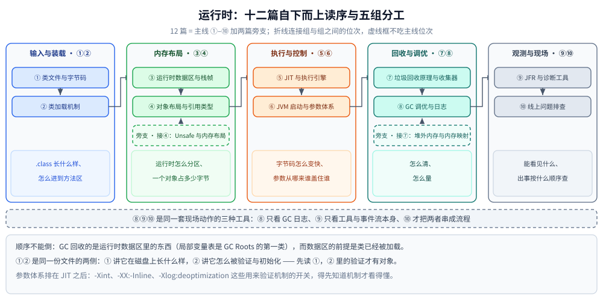

# 运行时

> 覆盖：本目录 12 篇的分工表、自下而上的读序与篇间依赖 —— 判据是「JVM 怎么执行、怎么存」：类文件的字节布局、类怎么装进方法区、运行时数据区与栈帧、一个对象占多少字节、字节码怎么被编成机器码、参数从哪来、堆怎么回收与怎么量、诊断工具能看见什么、出事怎么走。
>
> 不覆盖：线程、锁、AQS、线程池、并发容器这些「API 怎么用」见 [并发编程/README.md](../并发编程/README.md)；语言无关的 GC 算法层见 [垃圾回收/](../../../02-计算机基础/垃圾回收/)；集合与 Spring 在 [java/README.md](../README.md) 的横切表。
>
> 内容整理自个人学习笔记；素材见 [素材清单](../../../素材清单.md)。

---

## 一、一句话定位与它凭什么

**本节要点**：本目录是 Java 这条线的**机器侧** —— 它不谈「该用哪个并发工具」，只谈「你写的这些东西在 JVM 里被怎么装、怎么排、怎么执行、怎么清」。判据与 Go 侧完全一致：写「`ReentrantLock` 该怎么配」进 [并发编程/](../并发编程/)，写「对象头里哪几位被改了、逃逸分析把分配消掉了吗」进这里。

| 这个问题在问 | 归哪层 | 本目录对应篇 |
|---|---|---|
| `.class` 里那十段怎么排、`javap` 怎么读 | `运行时/` | [类文件与字节码.md](类文件与字节码.md) |
| 这个类是谁加载的、为什么 `ClassNotFoundException` | `运行时/` | [类加载机制.md](类加载机制.md) |
| 栈溢出和堆溢出的界线在哪、`-Xss` 给多大 | `运行时/` | [运行时数据区与栈帧.md](运行时数据区与栈帧.md) |
| 一个对象到底占多少字节、字段为什么重排 | `运行时/` | [对象布局与引用类型.md](对象布局与引用类型.md) |
| 同一段代码为什么越跑越快 | `运行时/` | [JIT与执行引擎.md](JIT与执行引擎.md) |
| `synchronized` 的对象头锁位怎么变、AQS 怎么排队 | `并发编程/` | 见 [并发编程/锁与AQS.md](../并发编程/锁与AQS.md) |

⭐ 本目录与 [并发编程/](../并发编程/) 有**三处刻意重叠**，各自只讲自己那一半：对象布局讲 MarkWord 的**位**、锁与 AQS 讲这些位的**用法**；JIT 讲逃逸分析怎么把 `new` 消掉、原子类讲因此测到的数为什么漂；JFR 与诊断工具讲事件模型、死锁诊断讲从转储里认环。

---

## 二、分工表：12 篇各讲什么

**本节要点**：一张表说清每篇的独有能力 —— **同一张表只在这里维护一份**，[java/README.md](../README.md) 的主线 A 只留指向本节的入口。

| 篇 | 讲什么 |
|---|---|
| [类文件与字节码.md](类文件与字节码.md) | `.class` 的十段结构、常量池、字段与方法表、属性表；`javap` 怎么读；字节码为什么是栈式的；分支与栈映射帧怎么配合验证；`invokedynamic` 在文件里的形态；运行时改写字节码的两个入口与一次不用 ASM 的实测改写 |
| [类加载机制.md](类加载机制.md) | 类加载器的四个层次与 JDK 9 之后的平台类加载器、双亲委派的流程与边界、五个阶段与初始化时机（哪些引用触发、哪些不触发）、打破委派的 SPI、类找不到 / 类冲突 / 类版本不对三类线上问题 |
| [运行时数据区与栈帧.md](运行时数据区与栈帧.md) | 六个区域哪些线程私有、各自抛什么异常；栈帧的五个组成部分与动态链接；局部变量表的 Slot 分配；五种方法调用指令的实际形态；`-Xss` 与最大递归深度之间那个「不线性」 |
| [对象布局与引用类型.md](对象布局与引用类型.md) | 一个对象在堆里占多少字节、这十几个字节由谁决定；字段为什么不按声明顺序排；数组头为什么多 4 字节；两把压缩指针开关分别省了什么；MarkWord 里哪些位真能读到；四种引用与 `Cleaner` 在回收时机上的差别；JDK 24 的紧凑对象头 |
| [JIT与执行引擎.md](JIT与执行引擎.md) | 为什么跑得越久越快、JVM 在什么时刻决定编译一个方法、四档质量从哪来；方法内联的两道尺寸闸门；`new` 出来的对象为什么有时根本不分配；已编译的代码为什么会被判废；JIT 自己吃掉多少 CPU 与代码缓存 |
| [JVM启动与参数体系.md](JVM启动与参数体系.md) | `-X` / `-XX` / `-D` 差在哪；`PrintFlagsFinal` 那五百多行怎么读；参数从哪几个地方来、谁盖住谁；容器里的 JVM 看到的「机器」和 `nproc` 是不是同一台；堆开得比容器限额大的下场；改一个参数为什么让启动慢两倍 |
| [垃圾回收原理与收集器.md](垃圾回收原理与收集器.md) | 堆怎么分代、一次 Minor / Full GC 各做了什么、对象何时进老年代；根集合在 JVM 里具体化成了什么；收集器谱系怎么演化；G1 为什么切 region；ZGC 凭什么做到亚毫秒 |
| [GC调优与日志.md](GC调优与日志.md) | 日志开关在 JDK 8 与 JDK 9+ 的**两套写法**；每个字段怎么认；`-Xlog` 开到什么级别的体量代价；只改 `-Xmx` / 只改新生代的实测曲线；`jstat` / `jcmd` / `jmap` 的现场流程；先看什么数、再动哪个旋钮 |
| [JFR与诊断工具.md](JFR与诊断工具.md) | `jcmd <pid> help` 那 61 行输出里有多少条命令、怎么分家族；`jstack` / `jmap` / `jinfo` / `jps` 与 `jcmd` 是不是同一套（逐行 diff）；`jstat` 为什么不在这套协议里、凭什么别处都连不上时仍然出数；JFR 的事件模型与四种起停姿势；`jhsdb` 在容器里为什么几乎必然失败；`hs_err_pid` 该看哪四段 |
| [线上问题排查.md](线上问题排查.md) | 三步把「哪个线程在吃 CPU」和「它在跑哪一行」对上；线程状态分布判断死锁、锁竞争还是池打满；`jcmd` / `jstat` 补内存与 GC 的现场；Arthas 把这套动作自动化的命令对照 |
| [Unsafe与内存布局.md](Unsafe与内存布局.md) | 旁支。`sun.misc.Unsafe` 能做几类事、`theUnsafe` 怎么拿到；JDK 24 的终端弃用在编译期与运行期各打什么、`--sun-misc-unsafe-memory-access` 四档各拦什么；`VarHandle` 与 `MemorySegment` 能替掉哪几类；堆外的三本账；越界访问的三种下场 |
| [堆外内存与内存映射.md](堆外内存与内存映射.md) | 旁支。堆内 `HeapByteBuffer` / 堆外 `DirectByteBuffer` / 文件映射 `MappedByteBuffer` 三个位置；直接内存为什么只能靠 GC 归还、三条释放路径的实测差距；`FileChannel.map` 与 `force()` 的落盘语义；「RSS 为什么远大于 `-Xmx`」的逐项账单 |

---

## 三、阅读路线

**本节要点**：12 篇是一条**自下而上**的主线，位次基本不能倒；旁支两篇不吃位次，读到哪篇再插哪篇。

```text
类文件与字节码.md          ① 输入侧：.class 十段结构与字节码指令
      ↓
类加载机制.md              ② 装上：找到、验证、准备、解析、初始化
      ↓
运行时数据区与栈帧.md       ③ 住在哪：内存怎么分、栈帧长什么样
      ↓
对象布局与引用类型.md       ④ 一个对象多少字节：对象头、字段重排、压缩指针
      ↓
JIT与执行引擎.md           ⑤ 怎么变快：热点探测、分层编译、内联、去优化
      ↓
JVM启动与参数体系.md        ⑥ 谁在控制：-X / -XX / -D、来源与覆盖顺序、容器内存
      ↓
垃圾回收原理与收集器.md      ⑦ 怎么清：分代、GC Roots、收集器谱系、G1 与 ZGC
      ↓
GC调优与日志.md            ⑧ 怎么量：两套日志开关、字段解读、调优五步
      ↓
JFR与诊断工具.md           ⑨ 能看见什么：jcmd 家族、attach 与 PerfData、JFR 事件流
      ↓
线上问题排查.md            ⑩ 出事怎么办：CPU 高、死锁、线程池打满的现场流程
```

旁支两篇**不吃主线位次**，读到哪篇再插哪篇：

- [Unsafe与内存布局.md](Unsafe与内存布局.md) ← 接 ④：字段偏移从哪来、`VarHandle` 与 `MemorySegment` 能替掉哪几类、终端弃用四档；
- [堆外内存与内存映射.md](堆外内存与内存映射.md) ← 接 ⑦：RSS 为什么大于 `-Xmx`、`FileChannel.map` 与 `force()`。

| 分组 | 篇（主线位次） | 这组在回答什么 |
|---|---|---|
| **输入与装载** | ①② | 「`.class` 长什么样、怎么进到方法区并被初始化」 |
| **内存布局** | ③④ | 「运行时怎么分区、一个对象真实占多少字节」 |
| **执行与控制** | ⑤⑥ | 「字节码怎么变快、参数从哪来、谁盖住谁」 |
| **回收与调优** | ⑦⑧ | 「怎么清、怎么量」 |
| **观测与现场** | ⑨⑩ | 「能看见什么、出事按什么顺序查」 |
| **旁支** | 不占位次 | Unsafe 接 ④、堆外内存接 ⑦ |

⭐ **顺序不能倒**：GC 要回收的是「运行时数据区」里的东西（局部变量表是 GC Roots 的第一类），
而运行时数据区的前提是「类已经被加载」；参数体系排在 JIT 之后，是因为 `-Xint`、`-XX:-Inline`、
`-Xlog:deoptimization` 这些「用来验证前面机制的开关」得先知道机制才看得懂。

⭐ ① 与 ② 是**同一份文件的两侧**：① 讲它在磁盘上长什么样，② 讲它怎么被找到、验证、准备、解析、初始化 —— 先读 ①，② 里的「验证」与「解析」才有对象。

⭐ ⑧⑨⑩ 三篇是**同一套现场动作的三种工具**：⑧ 只看 GC 日志，⑨ 只看工具与事件流本身，⑩ 才是把两者串成流程（`top -Hp` → 十六进制 → `jstack`）；不出事时按症状检索 ⑩，不必通读。



看图时抓住三点：**编号 ①–⑩ 才是主线位次**（写在每个框里），五列是按「读它理由」分的组，组与组之间用折线接上；第二列与第四列底部各挂一个虚线框，虚线箭头指回 ④ 与 ⑦，表示旁支只在这两篇之后才读得懂；底部三行小结的第一行「顺序不能倒」是这张图唯一的硬约束，其余位次只是建议。

---

## 四、篇间依赖（谁是谁的前置）

**本节要点**：「硬前置」是没有它就读不懂本篇的篇目，「强关联」是读完该马上对照的篇 —— 运行时 12 行**只在本表维护一份**，[java/README.md](../README.md) 第三节已删掉重复的行，只留下横切三篇的前置。

| 篇目 | 硬前置 | 强关联 |
|---|---|---|
| [类文件与字节码.md](类文件与字节码.md) | — | [类加载机制.md](类加载机制.md)（装的就是它）、[JIT与执行引擎.md](JIT与执行引擎.md)（字节码就是 JIT 的输入） |
| [类加载机制.md](类加载机制.md) | 类文件与字节码 | [运行时数据区与栈帧.md](运行时数据区与栈帧.md) |
| [运行时数据区与栈帧.md](运行时数据区与栈帧.md) | 类加载机制 | [线程池.md](../并发编程/线程池.md)（每个线程一个栈）、[线程基础与生命周期.md](../并发编程/线程基础与生命周期.md)（`-Xss` 的账） |
| [对象布局与引用类型.md](对象布局与引用类型.md) | 运行时数据区与栈帧 | [集合容器.md](../集合容器.md)（每元素成本）、[JIT与执行引擎.md](JIT与执行引擎.md)（标量替换省掉的就是它算出来的字节）、[Unsafe与内存布局.md](Unsafe与内存布局.md)（字段偏移） |
| [JIT与执行引擎.md](JIT与执行引擎.md) | 类文件与字节码 | [AOT、JIT与解释执行.md](../../../02-计算机基础/编译原理/AOT、JIT与解释执行.md)（跨语言三条路线）、[从源码到main.md](../../go/运行时/从源码到main.md)（Go 的 AOT 对照） |
| [JVM启动与参数体系.md](JVM启动与参数体系.md) | 类文件与字节码（CDS 里存的就是它） | [对象布局与引用类型.md](对象布局与引用类型.md)（压缩指针会动 CDS 指纹）、[GC调优与日志.md](GC调优与日志.md)（`-Xmx` 与 `-Xlog` 的归属） |
| [垃圾回收原理与收集器.md](垃圾回收原理与收集器.md) | 运行时数据区与栈帧 | [垃圾回收/](../../../02-计算机基础/垃圾回收/) 五篇（算法层）、[堆外内存与内存映射.md](堆外内存与内存映射.md)（RSS > Xmx） |
| [GC调优与日志.md](GC调优与日志.md) | 垃圾回收原理与收集器 | [JFR与诊断工具.md](JFR与诊断工具.md)（`jstat` 的数据源）、[线上问题排查.md](线上问题排查.md)（非 GC 的现场流程） |
| [JFR与诊断工具.md](JFR与诊断工具.md) | JVM启动与参数体系（`VM.flags` 只是借个入口）、类文件与字节码（`Thread.print` 的栈帧来源） | [线上问题排查.md](线上问题排查.md)（工具分工）、[死锁与并发缺陷诊断.md](../并发编程/死锁与并发缺陷诊断.md)（`jdk.JavaMonitorEnter`） |
| [线上问题排查.md](线上问题排查.md) | JFR与诊断工具 | [死锁与并发缺陷诊断.md](../并发编程/死锁与并发缺陷诊断.md)（并发缺陷的专项流程） |
| [Unsafe与内存布局.md](Unsafe与内存布局.md) | 对象布局与引用类型（字段偏移就是它给出的尺子）、JVM启动与参数体系（`MaxDirectMemorySize` 与 `-Xmx` 的默认换算） | [unsafe与内存布局.md](../../go/运行时/unsafe与内存布局.md)（Go 侧两道闸门对照） |
| [堆外内存与内存映射.md](堆外内存与内存映射.md) | 垃圾回收原理与收集器、Unsafe与内存布局 | [内存管理.md](../../../02-计算机基础/linux/内存管理.md)（虚拟内存、Page Cache、cgroup 限额的内核侧） |

---

## 五、本轮实测坐标

**本节要点**：十篇读数是 `eclipse-temurin:24-jdk` 一套跑的，**GC 那两篇（⑦⑧）额外背着一套 JDK 8** —— 日志开关与默认参数在两个大版本之间不兼容，跨版本的结论必须写明是哪一版跑出来的。

- **主力容器 `java-lab`**：`eclipse-temurin:24-jdk`（24.0.2+12，linux/amd64，4 CPU，cgroup v2）。
  ①②③⑤⑥⑨⑩ 与旁支两篇的读数都取这里；④ 用自写 `-javaagent` 挂 `Instrumentation.getObjectSize()` 量体积、`Unsafe.objectFieldOffset()` 量偏移、`Unsafe.getLong(o, 0)` 读 MarkWord。
- **⑦⑧ 两套坐标**：[垃圾回收原理与收集器.md](垃圾回收原理与收集器.md) 与 [GC调优与日志.md](GC调优与日志.md) 同时给出 JDK `1.8.0_321`（Windows / server class / 8 核）与 Temurin `24.0.2+12`（Linux 容器 / 4 vCPU / 5.9 GB）；后者的第 11.1 节两套启动参数另在 `eclipse-temurin:24-jdk` 与 `eclipse-temurin:8-jdk`（`1.8.0_504`）里验证 —— ⚠️ 同一份 `-Xlog` 参数在 8 容器里能启动，但**生成的文件名不是 `gc.log`**。
- **读数的可信度分档**：⑥ 启动耗时按 7 轮取 min / 中位 / max、容器内存四档各跑一次；⑤ 时序类连跑 5 轮给区间；③ 的 `-Xss` 五档各跑 JIT 3 次 + `-Xint` 1 次，⚠️ 递归深度本身不稳定，只按趋势引用；旁支两篇的 `force` 连跑 2 次、RSS 区间取 ±2 MB。⚠️ ⑥ 测量时宿主 load average = 2.78，**绝对毫秒数偏大且抖动，结论只看比值**。
- ⚠️ **明确的未实测项**（篇首已各自写明，别当结论引用）：⑤ 的 `-XX:+PrintEscapeAnalysis` / `PrintEliminateAllocations` 是 develop 选项、产品版 JVM 直接拒绝启动，逃逸分析改用行为证据；⑨ 的 JFR `maxsize` 轮转与「目标进程完全卡死时 `jstat` 仍出数」；⑩ 的 Arthas 段（容器无 `curl`/`wget`，`arthas-boot.jar` 拉不下来）；旁支 Unsafe 的 `Arena.ofGlobal()` 线程约束与 `MemorySegment` 经 `Linker` 调 C 函数；旁支堆外的「Windows 下映射期间删不掉文件」只按文档描述。
- **源码落点**：`.workbuddy/tmp/exp/java/` 下按主题分 `classfile/`、`loader/`、`runtime/`、`unsafe/`、`diag/`（均不入库）。

---

## 六、本目录的边界

**本节要点**：本目录只管 **HotSpot 在 JDK 8 / 21 / 24 这三档上的行为**；算法层、内核层、别的实现与接入手册都不在这里重讲。

- **算法层**在 [垃圾回收/](../../../02-计算机基础/垃圾回收/)（判定垃圾的两条路线、四类算法的代价、三色抽象与写屏障、安全点）与 [编译原理/](../../../02-计算机基础/编译原理/)（AOT / JIT / 解释执行的跨语言取舍）—— 本目录只讲 JVM 的实现，两边互引不重复。
- **内核层**在 [内存管理.md](../../../02-计算机基础/linux/内存管理.md)（虚拟内存、Page Cache、cgroup 限额怎么看）与 [性能排查.md](../../../02-计算机基础/linux/性能排查.md)（CPU / 内存 / 磁盘 / 网络四步下钻）；[线上问题排查.md](线上问题排查.md) 只讲 Java 侧那三步。
- **API 侧**在 [并发编程/](../并发编程/)：对象头的**锁位**变化、AQS 队列、线程池参数、虚拟线程的载体与 pin 住，那边才是主战场。
- **框架与接入**在 [java/README.md](../README.md) 的横切表：`Spring-boot核心.md`（类加载与动态代理的落点）、[资源限制与运维.md](../../../06-工程实践/部署/docker/资源限制与运维.md)（容器里 JVM 为什么必须显式 `-Xmx`）。
- **Go 侧对照**在 `../../go/运行时/`：同一批问题（启动、调度、分配、GC、观测）Go 只有 14 篇但覆盖面相同，差别在于 Go 是 AOT 且没有参数体系这一层。

---

## 延伸追问

- **12 篇里哪几篇是「只读一次」的地基？** → [类文件与字节码.md](类文件与字节码.md) 与 [运行时数据区与栈帧.md](运行时数据区与栈帧.md)：后面类加载「装的是什么」、JIT「编的是什么」、诊断工具「打印的是什么」、GC「回收的是哪块」，全部以这两篇为底。
- **为什么不把 GC 写成一篇？** → 机制（⑦：分代、根集合、收集器谱系）与测量（⑧：两套日志开关、字段、调优顺序）在 JDK 8/9+ 之间断代，混写一篇会让每个参数都要重复说明「哪一版」。
- **⑨ 与 ⑩ 会不会重复？** → 不会。⑨ 只回答「`jcmd` 家族里有哪些命令、`jstat` 走的是另一条协议、JFR 事件怎么变表」，⑩ 才回答「CPU 飙高时先跑哪三条」；工具分工的边界写在 ⑩ 第一节。
- **本目录的分工表会不会和 `java/README.md` 打架？** → 不会。表与主线读序只在本篇维护，`java/README.md` 的主线 A 已改成指向本篇的入口。

---

## 关联

- **上游/总纲**：[java/README.md](../README.md) — Java 目录两条主线的入口与横切篇目
- **同层另一目录**：[并发编程/README.md](../并发编程/README.md) — API 侧「这个原语怎么用」
- **对照/互补**：[go/运行时/README.md](../../go/运行时/README.md) — Go 运行时的对照线（14 篇）
- **对照/互补**：[go/并发编程/README.md](../../go/并发编程/README.md) — CSP 路线的同一批问题
- **下层概念**：[垃圾回收/](../../../02-计算机基础/垃圾回收/) — 语言无关的算法层；[AOT、JIT与解释执行.md](../../../02-计算机基础/编译原理/AOT、JIT与解释执行.md) — 跨语言三条路线
- **下层概念**：[内存管理.md](../../../02-计算机基础/linux/内存管理.md) — 虚拟内存、Page Cache 与 cgroup 限额
- **素材**：[素材清单.md](../../../素材清单.md) — 来源登记
