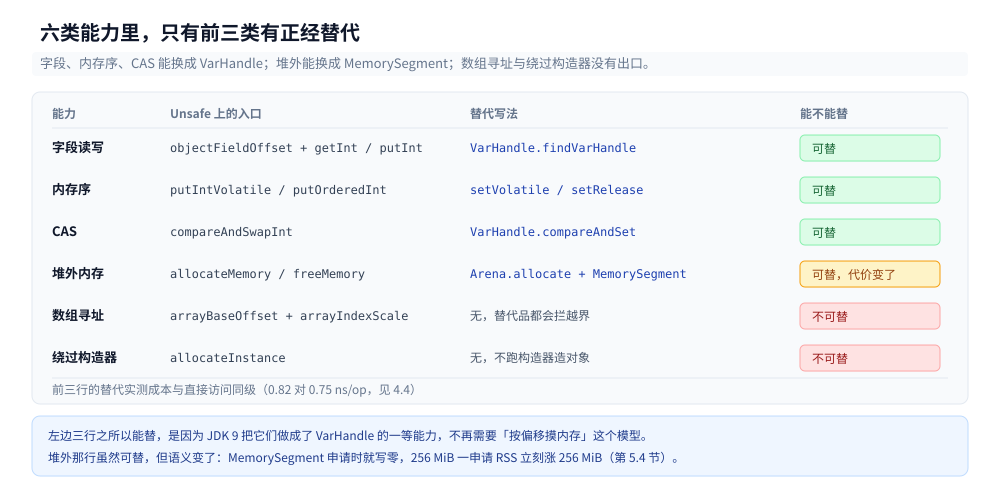
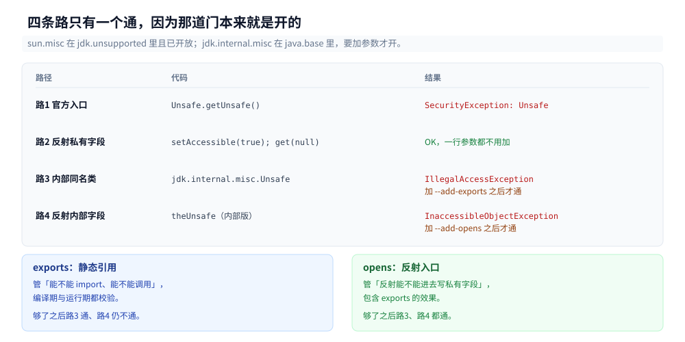
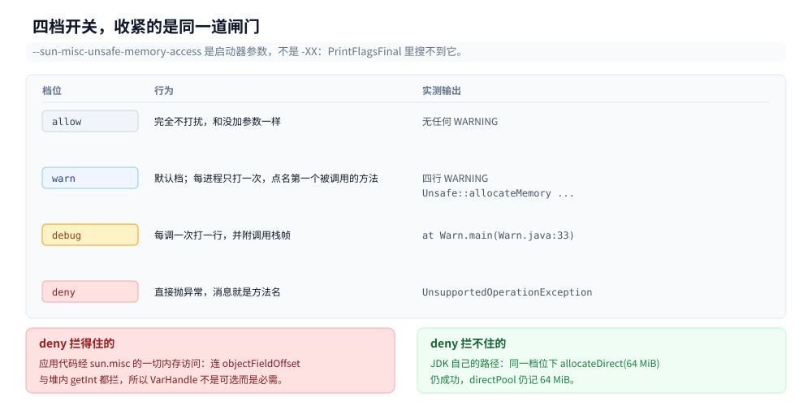
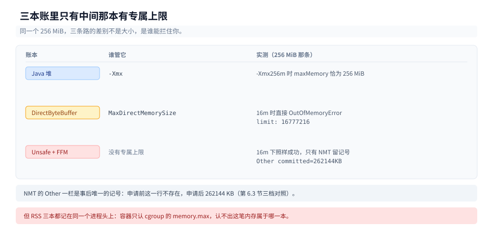
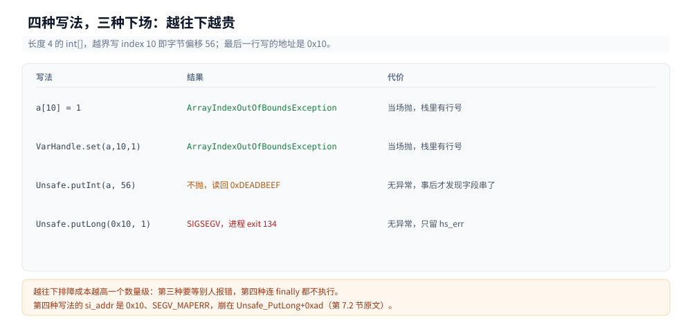

# Unsafe与内存布局

> 覆盖：`sun.misc.Unsafe` 到底能做几类事、`theUnsafe` 是怎么被拿到的、JDK 24 的「终端弃用」在编译期与运行期各打什么、`--sun-misc-unsafe-memory-access` 四档各自拦什么、`VarHandle` 与 `MemorySegment` 能替掉哪几类、堆外内存的三本账（`-Xmx` / `-XX:MaxDirectMemorySize` / RSS 与 NMT 的 `Other`）、越界访问的三种下场。
>
> 不覆盖：对象多大、字段怎么重排、Mark Word 哪几位、压缩指针怎么寻址见 [对象布局与引用类型.md](对象布局与引用类型.md)；字段访问被 JIT 编成什么机器码见 [JIT与执行引擎.md](JIT与执行引擎.md)；`jcmd` / JFR / `jhsdb` 这些工具本身见 [JFR与诊断工具.md](JFR与诊断工具.md)；`Cleaner` 与 `DirectByteBuffer` 的回收链路见 [堆外内存与内存映射.md](堆外内存与内存映射.md)。
>
> 内容整理自个人学习笔记，素材见 [素材清单](../../../素材清单.md)。
>
> 实测口径：`eclipse-temurin:24-jdk`（24.0.2+12，linux/amd64，cgroup v2，容器 4 CPU），源码与 class 在 `.workbuddy/tmp/exp/java/unsafe/`。堆外地址每次运行都不同（ASLR），文中地址只当示意；基准用 `ThreadMXBean.getCurrentThreadCpuTime()` 计线程 CPU 时间、连跑 5 轮给 min / median / max。⚠️ 三处**未实测**：`--sun-misc-unsafe-memory-access` 的默认档在后续版本改掉之后的行为（本机只有 24.0.2）、`Arena.ofShared()` / `Arena.ofGlobal()` 的线程约束（只验证了 `ofShared()` 能申请）、`MemorySegment` 经 `Linker` 调 C 函数那条线。

---

## 一、`Unsafe` 能做什么？一段程序把六类能力跑一遍

**本节要点**：`Unsafe` 不是「一个危险方法」，是一个类名下并排的六类能力：按偏移读写任意字段、给读写加内存序、CAS、申请与释放堆外内存、按偏移手工访问数组、绕过构造器造对象。六类里前两类加 CAS 有等价替代，后三类没有。

### 1.1 从零：38 行跑出两个偏移和一次堆外读写

```java
import sun.misc.Unsafe;

import java.lang.reflect.Field;

public class FirstUnsafe {
    static final Unsafe U;

    static {
        try {
            Field f = Unsafe.class.getDeclaredField("theUnsafe");
            f.setAccessible(true);
            U = (Unsafe) f.get(null);
        } catch (Exception e) {
            throw new ExceptionInInitializerError(e);
        }
    }

    static class Point {
        int x;
        long y;
        Point(int x, long y) { this.x = x; this.y = y; }
    }

    public static void main(String[] args) throws Exception {
        // ① 只给偏移，不改字段本身
        long ox = U.objectFieldOffset(Point.class.getDeclaredField("x"));
        long oy = U.objectFieldOffset(Point.class.getDeclaredField("y"));
        Point p = new Point(1, 2);
        U.putInt(p, ox, 111);
        U.putLong(p, oy, 222L);
        System.out.println("① x@" + ox + "=" + p.x + "  y@" + oy + "=" + p.y);

        // ② 堆外 8 字节：申请 → 写 → 读 → 释放
        long addr = U.allocateMemory(8);
        U.putLong(addr, 0xCAFEBABEL);
        System.out.println("② " + Long.toHexString(U.getLong(addr)).toUpperCase() + " @0x" + Long.toHexString(addr));
        U.freeMemory(addr);

        // ③ 数组：基址 + 下标 × 步长，自己算地址
        int[] a = {10, 20, 30, 40};
        int base = U.arrayBaseOffset(int[].class);
        int scale = U.arrayIndexScale(int[].class);
        U.putInt(a, (long) base + 2L * scale, 333);
        System.out.println("③ base=" + base + " scale=" + scale + " -> a[2]=" + a[2]);
    }
}
```

编译它，会先收到一堆告警，然后才是输出。这些告警不是噪音，第三节会讲它们到底在说什么：

```text
$ javac FirstUnsafe.java
FirstUnsafe.java:1: warning: Unsafe is internal proprietary API and may be removed in a future release
import sun.misc.Unsafe;
               ^
FirstUnsafe.java:43: warning: [removal] putInt(Object,long,int) in Unsafe
        has been deprecated and marked for removal
15 warnings

$ java FirstUnsafe
WARNING: A terminally deprecated method in sun.misc.Unsafe has been called
WARNING: sun.misc.Unsafe::objectFieldOffset has been called by FirstUnsafe (file:/w/.workbuddy/tmp/exp/java/unsafe/)
WARNING: Please consider reporting this to the maintainers of class FirstUnsafe
WARNING: sun.misc.Unsafe::objectFieldOffset will be removed in a future release
① x@12=111  y@16=222
② CAFEBABE @0x7cd61816e2b0
③ base=16 scale=4 -> a[2]=333
```

三段输出各说明一件事：`x@12` / `y@16` 说明**字段偏移由 JVM 决定而不是声明顺序**（为什么是 12 和 16、为什么 `long` 抢在 `int` 后面，见 [对象布局与引用类型.md](对象布局与引用类型.md)）；`CAFEBABE @0x…` 说明堆外内存只是一串地址，读写靠你自己记住长度；`base=16 scale=4` 说明**数组下标只是一次乘加**，`a[2]` 的真实地址是 `16 + 2 × 4 = 24`，而这次写根本没经过 `a[2]` 那个语法。

### 1.2 六类能力的清单

同一份 `Unsafe` 实例上，能做的事分成六组。下面每一条都真调用过一次（源码 `Capabilities.java`）：

```text
① 字段     x@12=111  y@16=222
② volatile putIntVolatile -> 333   有序写 putOrderedInt -> 444
③ CAS      期望444->555 true，再拿444换666 false，现值 555
④ 堆外     addr=0x77ee0c1d42a0 [+0]=1234567890123 [+8]=42
⑤ 数组     base=16 scale=4 -> 10,20,30,40
⑥ 无构造   allocateInstance -> x=0 y=0
```

| # | 能力 | 代表方法 | 一句话 | 有没有等价替代 |
|---|---|---|---|---|
| ① | 按偏移读写字段 | `objectFieldOffset` + `getInt` / `putObject` | 跳过 getter、跳过 `final` 检查 | `VarHandle.findVarHandle` |
| ② | 内存序 | `putIntVolatile` / `putOrderedInt` / `getIntAcquire` | 把 volatile 与有序写拆成两个方法 | `VarHandle.setVolatile` / `setRelease` |
| ③ | CAS | `compareAndSwapInt` / `compareAndSwapObject` | 原子类与 AQS 的底座 | `VarHandle.compareAndSet` |
| ④ | 堆外内存 | `allocateMemory` / `freeMemory` / `setMemory` | 手动 `malloc` + 手动 `free` | `Arena.allocate` + `MemorySegment` |
| ⑤ | 数组手工寻址 | `arrayBaseOffset` / `arrayIndexScale` | 把 `a[i]` 拆成乘加，可越界 | 无（`VarHandle` 会拦越界） |
| ⑥ | 绕过构造器 | `allocateInstance` | 造出字段全零的对象 | 无 |

第 ⑥ 类容易被忽略：`allocateInstance` 出来的对象**不跑任何构造器、不跑字段初始化器、不跑父类构造器**，实测 `Point` 的 `x` / `y` 都是 0。某些序列化框架就是靠它跳过构造器校验——这也意味着它能造出「永远不该存在」的非法状态对象。



图里按「能不能被替代」把这六类分成两组：字段、内存序、CAS 三类在 JDK 9 之后都有正经出口，堆外、数组寻址、绕过构造器三类没有——后三类正是 `Unsafe` 一直删不掉的原因。

### 1.3 编译期就打了两道警告

同一个文件编译出 15 条警告，其实是两类：

- `warning: Unsafe is internal proprietary API and may be removed in a future release` —— javac 对「引用 `sun.*` 内部 API」的固定告警，每个使用点一条（本目录 14 个源文件合计 44 条）。
- `warning: [removal] putInt(Object,long,int) in Unsafe has been deprecated and marked for removal` —— 这一类带 `[removal]` 前缀，是 `@Deprecated(forRemoval=true)` 的直接结果，和第三方的废弃 API 告警长得一样。

第二类才是「要删」的正式通知，第一类只是「别用内部 API」。两者经常被混着说，其实来源不同：前者是编译器对包名的白名单判断，后者是 JDK 源码里真的加了注解。

---

## 二、`theUnsafe` 是怎么到手的？为什么官方入口一定失败？

**本节要点**：`Unsafe.getUnsafe()` 检查调用者的类加载器，应用代码永远拿不到；能走通的只有反射读私有静态字段 `theUnsafe`。它能一路畅通，是因为 `jdk.unsupported` 模块把 `sun.misc` 打开了——这是 JDK 留给生态的一条「明知不优雅但保留」的缝。

### 2.1 四条路一起跑

```java
// 路 1：官方入口
Unsafe.getUnsafe();
// 路 2：反射私有静态字段
Field f = Unsafe.class.getDeclaredField("theUnsafe");
f.setAccessible(true);
Unsafe u = (Unsafe) f.get(null);
// 路 3：换一个同名类 jdk.internal.misc.Unsafe
Class<?> k = Class.forName("jdk.internal.misc.Unsafe");
k.getMethod("getUnsafe").invoke(null);
// 路 4：反射「内部版」的 theUnsafe
Field g = k.getDeclaredField("theUnsafe");
g.setAccessible(true);
```

默认参数下四次尝试的输出（源码 `GetUnsafe.java`）：

```text
路1 getUnsafe()      -> java.lang.SecurityException: Unsafe
路2 theUnsafe        -> OK sun.misc.Unsafe / addressSize=8 / pageSize=4096
路3 jdk.internal.misc -> 类可见 jdk.internal.misc.Unsafe
路3 getUnsafe()      -> java.lang.IllegalAccessException: class GetUnsafe cannot access class
                        jdk.internal.misc.Unsafe (in module java.base) because module java.base
                        does not export jdk.internal.misc to unnamed module @c387f44
路4 theUnsafe(内部)  -> java.lang.reflect.InaccessibleObjectException: Unable to make field
                        private static final jdk.internal.misc.Unsafe jdk.internal.misc.Unsafe.theUnsafe
                        accessible: module java.base does not "opens jdk.internal.misc" to unnamed module @c387f44
```

四行里最值得记的是路 1 和路 2 的反差：**官方入口 `getUnsafe()` 失败，私有字段反而成功**。`getUnsafe()` 的实现是 `if (caller != null) throw new SecurityException("Unsafe")` —— 它要求调用者由 bootstrap 类加载器加载（也就是 JDK 自己），应用代码的 caller 一定非空，所以这条路过不去；而 `theUnsafe` 只是一个普通私有静态字段，反射能拿到就能用。

### 2.2 两道模块闸门：`exports` 与 `opens`

路 3 与路 4 的失败信息点名了两个不同的东西：`does not export` 与 `does not "opens"`。加对应参数后都能通（源码不变，只改启动命令）：

```text
$ java --add-exports java.base/jdk.internal.misc=ALL-UNNAMED GetUnsafe
路3 getUnsafe()      -> OK jdk.internal.misc.Unsafe@3fee733d
路4 theUnsafe(内部)  -> java.lang.reflect.InaccessibleObjectException: ... does not "opens" ...

$ java --add-opens java.base/jdk.internal.misc=ALL-UNNAMED GetUnsafe
路3 getUnsafe()      -> OK jdk.internal.misc.Unsafe@3fee733d
路4 theUnsafe(内部)  -> OK jdk.internal.misc.Unsafe@3fee733d
```

`--add-exports` 管的是「编译期与运行期的**静态引用**能不能过」，`--add-opens` 管的是「**反射**能不能进去」，后者包含前者的效果。所以想走 `jdk.internal.misc` 这条路，最少要 `--add-opens`。

而路 2 一行参数都不用加，原因在模块声明上：`sun.misc.Unsafe` 属于 `jdk.unsupported` 模块，这个模块对 `sun.misc` 是开放的，所以 `setAccessible(true)` 直接成功。**这才是「`Unsafe` 拿得到」的全部原因**——不是反射有什么魔力，是 JDK 故意留了这个口子。



图上把四条路的结果并排画出来：路 1 被 `SecurityException` 挡在自己家门口，路 3 / 4 被模块系统挡在门外，只有路 2 一路无阻——因为那道门本来就是开的。

### 2.3 那条内部路径值不值得走

不值得。`jdk.internal.misc.Unsafe` 与 `sun.misc.Unsafe` 是两份独立代码，方法签名并不一一对应：`sun.misc` 这份为了兼容冻结了签名，`jdk.internal.misc` 那份随 JDK 版本改。走内部版等于把自己的代码绑到某个具体的小版本上，还得在启动参数里常年挂着 `--add-opens`。用 `sun.misc` 至少告警是明确的、迁移路径是官方公布过的。

---

## 三、「终端弃用」在 JDK 24 上表现成什么？

**本节要点**：编译期一条 `[removal]` 告警，运行期一组四行 WARNING——**每个进程只打一次，点名的是第一个被调用的终端弃用方法**，不是全部。`--sun-misc-unsafe-memory-access` 是**启动器参数**（不在 `-XX` 里），四档 `allow` / `warn` / `debug` / `deny`，`deny` 档连 `objectFieldOffset` 与堆内 `getInt` 都拦。

### 3.1 运行期那四行

```text
WARNING: A terminally deprecated method in sun.misc.Unsafe has been called
WARNING: sun.misc.Unsafe::objectFieldOffset has been called by FirstUnsafe (file:/w/.workbuddy/tmp/exp/java/unsafe/)
WARNING: Please consider reporting this to the maintainers of class FirstUnsafe
WARNING: sun.misc.Unsafe::objectFieldOffset will be removed in a future release
```

四行里有用的信息是第二行：**方法名 + 调用方的类名 + 调用方来自哪个位置**。它比 JVM 大多数告警都友好，因为直接把「谁的代码该改」写出来了。第一行是固定文案，第三行是让你去催上游，第四行是时限声明。

### 3.2 它每进程只打一次，点名的是第一个

这一点很容易误判成「哪些方法会告警」的名单，其实不是。同一进程里先调 `allocateMemory` 再调 `putIntVolatile`，只会看到 `allocateMemory` 被点名：

```java
static void two() {
    U.allocateMemory(8);                  // 第一个
    U.putIntVolatile(new P(), 12L, 1);    // 第二个，不出现
}
```

```text
WARNING: sun.misc.Unsafe::allocateMemory has been called by Warn ...
（只有这一组，没有 putIntVolatile）
```

所以想得到一份可靠的名单，只能**一个方法起一个 JVM** 单独跑。本机就是这么测的：`Warn.java` 每个分支只碰一个方法，`Warn2.java` 则先用 `ByteBuffer.allocateDirect` 拿一个合法的裸地址（不调用 `allocateMemory`），再单独测地址类方法。

### 3.3 会被点名的名单

| 类别 | 会被点名的方法（逐个 JVM 单独验证） | 不会被点名 |
|---|---|---|
| 字段与数组 | `objectFieldOffset`、`arrayBaseOffset`、`getInt(Object,long)`、`putInt(Object,long,int)`、`putIntVolatile`、`compareAndSwapInt` | `allocateInstance`、`addressSize` |
| 裸地址 | `allocateMemory`、`freeMemory`、`getLong(long)`、`putLong(long,long)`、`putInt(long,int)`、`putIntVolatile(null,long,int)`、`setMemory`、`copyMemory`、`putAddress`、`getByte` | — |

⚠️ 表里 `putInt` 的对象版（`putInt(Object,long,int)`）没有单独起 JVM 验证——`Warn.java` 那次先调了 `objectFieldOffset`，名字被它抢走了。但它同样被标了删，证据在编译期：1.1 那条 `[removal] putInt(Object,long,int) ... marked for removal` 就是它。

结论不意外但边界很清楚：**只有「内存访问」这一类被标了终端弃用，`allocateInstance` 与 `addressSize` 这种不碰内存的留了下来**。这意味着将来 `deny` 变成默认之后，`Unsafe` 不会消失，而是退化成一个「只能造对象、不能碰内存」的残废类。

顺带记一个技巧：`putIntVolatile(null, ADDR, 1)` 这种「传 `null` 对象 + 绝对地址」的写法在 `sun.misc.Unsafe` 里是合法的，`null` 表示偏移量就是地址本身。它是我为了在不调用 `allocateMemory` 的前提下测 `putIntVolatile` 才用上的，但它同时说明了另一件事：**对象引用与裸地址在这套 API 里只差一个参数**，编译器不会帮你区分。

### 3.4 四档开关

`--sun-misc-unsafe-memory-access` 是 `java` 启动器的参数，不是 `-XX` 选项——`java -XX:+PrintFlagsFinal -version` 里搜不到任何相关行。

| 档位 | 行为 | 实测输出 |
|---|---|---|
| `allow` | 完全静默 | 直接出结果，无任何 WARNING |
| `warn` | 默认档，四行 WARNING | 见 3.1 |
| `debug` | 每次调用打一行 + 栈帧 | `WARNING: sun.misc.Unsafe::allocateMemory called by Warn` 后跟 `at Warn.main(Warn.java:33)` |
| `deny` | 直接抛异常 | `UnsupportedOperationException: <方法名>` |

写成非法值会直接卡在 VM 创建阶段：

```text
$ java --sun-misc-unsafe-memory-access=off Warn alloc
Value specified to --sun-misc-unsafe-memory-access not recognized: 'off'
Error: Could not create the Java Virtual Machine.
```

`debug` 档比 `warn` 实用得多：`warn` 只报第一个，`debug` 是**逐次报**，一次运行就能把整个调用面扫出来。要做迁移，先跑 `debug` 而不是 `deny`。

### 3.5 `deny` 档到底拦住了什么

```text
$ java --sun-misc-unsafe-memory-access=deny Warn <每个方法一次>
objectFieldOffset   -> UnsupportedOperationException: objectFieldOffset
getInt(Object,long) -> UnsupportedOperationException: getInt
putIntVolatile      -> UnsupportedOperationException: putIntVolatile
compareAndSwapInt   -> UnsupportedOperationException: compareAndSwapInt
allocateMemory      -> UnsupportedOperationException: allocateMemory
arrayBaseOffset     -> UnsupportedOperationException: arrayBaseOffset
allocateInstance    -> OK
addressSize         -> OK
```

两点容易想反：

1. **它拦的不是「堆外内存」，是「一切经 `sun.misc.Unsafe` 的内存访问」**。连读一个堆内字段的 `getInt(obj, offset)`、连算数组基址的 `arrayBaseOffset` 都被拦。想在 `deny` 下跑，`VarHandle` 是必须的，不是可选的。
2. **它拦不住 JDK 自己的实现**。同一档位下 `ByteBuffer.allocateDirect(64 MiB)` 照常成功、`directPool` 照常记 64 MiB：

```text
$ java --sun-misc-unsafe-memory-access=deny OffHeap 64
① allocateDirect(64 MiB) -> OK, capacity=67108864
   RSS = 107480 kB, directPool=64 MiB
② allocateMemory(64 MiB) -> Exception in thread "main"
   java.lang.UnsupportedOperationException: allocateMemory
	at jdk.unsupported/sun.misc.Unsafe.beforeMemoryAccessSlow(Unsafe.java:1822)
```

堆栈里那句 `beforeMemoryAccessSlow` 说明了拦截点：`sun.misc.Unsafe` 自己在每个内存访问方法前插了一道检查。而 JDK 内部的 `DirectByteBuffer` 走的是另一份实现，所以不受影响。**这就是「闸门」的精确范围：它管应用代码，不管 JDK 内部**。



图里把四档画成一条收紧的闸门：`allow` 全通，`warn` 只在第一次放行时喊一句，`debug` 每次喊，`deny` 直接关上——但关上的只是「应用代码经 `sun.misc.Unsafe`」这一条通道，右边的 JDK 内部实现始终畅行。

---

## 四、`VarHandle` 能替掉哪几类？替不掉哪几类？

**本节要点**：字段读、写、内存序、CAS 四类全都能替，而且**没有包装税**——实测 `VarHandle.get` 与直接 `c.v` 同级（0.82 vs 0.75 ns/op），CAS 贵 10 倍但与 API 无关。替不掉的是「手算地址」与「按任意偏移读」，这两类只能去 `MemorySegment` 或者留在 `Unsafe`。

### 4.1 从零：一份 `VarHandle` 覆盖前四类

```java
MethodHandles.Lookup l = MethodHandles.lookup();
VarHandle V = l.findVarHandle(Counter.class, "v", int.class);          // 实例字段
VarHandle A = MethodHandles.arrayElementVarHandle(int[].class);        // 数组元素

V.set(c, 7);                        // 写
int r = (int) V.get(c);             // 读
V.compareAndSet(c, 7, 8);           // CAS
V.setVolatile(c, 9);                // 内存序：volatile 写
V.setRelease(c, 10);                // 内存序：释放写
int a = (int) V.getAcquire(c);      // 内存序：获取读
A.set(arr, 3, 400);                 // 数组元素
```

```text
① set/get/CAS -> 7 / 8 / cas=true
② setVolatile/setRelease/getAcquire -> 10  op=10
③ arrayElement set -> 100,400
③ 越界 index=4 -> java.lang.ArrayIndexOutOfBoundsException
```

② 那行值得停一下：`Unsafe` 只有 `putInt` / `putIntVolatile` / `putOrderedInt` 三个名字，语义全靠记；`VarHandle` 直接给出 `set` / `setVolatile` / `setRelease` / `setOpaque` 四档，名字即语义。

③ 那行是**行为差异**而不是写法差异：`A.set(arr, 4, 500)` 在长度 4 的数组上抛 `ArrayIndexOutOfBoundsException`，而 `Unsafe.putInt` 在同一位置会静默写进去（第七节实测）。

### 4.2 字节序：两个默认是反的

```text
④ BIG_ENDIAN  字节 = 01 02 03 04
④ nativeOrder 字节 = 04 03 02 01（ByteOrder.nativeOrder()=LITTLE_ENDIAN）
⑤ ByteBuffer 默认 order = BIG_ENDIAN
④ Unsafe.getInt(byte[0x01,0x02,0x03,0x04]) = 0x4030201
```

同一个 int `0x01020304`，三种读法给出三种结果：

- `byteArrayViewVarHandle(int[].class, ByteOrder.BIG_ENDIAN)` → `0x01020304`，**和 `ByteBuffer` 的默认一致**。
- `byteArrayViewVarHandle(int[].class, ByteOrder.nativeOrder())` → `0x04030201`，本机是小端。
- `Unsafe.getInt(byte[], base)` → `0x04030201`，**`Unsafe` 永远用本机序，且没有参数可选**。

这就是迁移里最容易被忽略的一处：`Unsafe` → `VarHandle` 不是机械替换，原来的本机序读法必须显式写成 `ByteOrder.nativeOrder()`，否则换到 `BIG_ENDIAN`（很多人会顺手写这个，因为 `ByteBuffer` 默认是它）就会在大端机器上「碰巧正确」、在小端机器上读反。

### 4.3 静态字段与 `final`

```text
① 静态 set(42) -> s=42，get=42
② final get -> 7
② final set(99) -> java.lang.UnsupportedOperationException: set
```

- 静态字段用 `findStaticVarHandle`，用法与实例字段一致。
- `final` 字段：`findVarHandle` **能拿到、能读，但 `set` 抛 `UnsupportedOperationException`**，消息就是方法名 `set`。这是 `VarHandle` 比 `Unsafe` 严格的一处——它把「改 `final`」这个能力彻底关掉了。

### 4.4 性能：没有包装税，CAS 贵在指令

1 亿次操作 × 5 轮，`ThreadMXBean.getCurrentThreadCpuTime()` 计线程 CPU 时间，取 min / median / max（源码 `FieldBench.java`；数组长度取 1024 防止 JIT 把读操作提出循环）：

| 操作 | 直接访问 | `VarHandle` | `Unsafe` |
|---|---|---|---|
| 读 | 0.7454 / 0.9709 / 1.1337 | 0.8184 / 0.9610 / 1.0725 | 0.6564 / 0.8511 / 0.9312 |
| 写 | 0.9000 / 1.0784 / 1.2776 | 0.9026 / 1.0514 / 1.2535 | 0.8833 / 0.9048 / 1.2650 |
| CAS | — | 8.6587 / 9.7604 / 13.6011 | 8.9213 / 9.2796 / 11.6740 |

（单位 ns/op）

三条结论：

1. **读写三者同级**。`VarHandle` 的 min 0.8184 与直接访问的 0.7454 只差 0.07 ns，落在轮间抖动（max−min 有 0.3 ns）之内。所谓「`VarHandle` 是方法调用会有开销」在 C2 之后不成立——它被内联成了同一条 `mov`。
2. **`Unsafe` 的读略快**（0.6564），但这 0.09 ns 是「省掉了数组边界检查」而不是「省掉了 API 包装」，换句话说这是安全性差价，不是性能优势。
3. **CAS 贵 10 倍，且与 API 无关**：`VarHandle` 8.66 与 `Unsafe` 8.92 几乎一样。贵的是 `lock cmpxchg` 这条原子指令本身（还要加上 1024 个对象挤在几条缓存行上带来的争用）。想快只能减少争用，不能换 API。

### 4.5 `VarHandle` 替不掉的三件事

| 替不掉的能力 | 为什么 | 该去哪 |
|---|---|---|
| 按任意偏移读写（`getInt(obj, offset)` 里 offset 是运行时算出来的） | `VarHandle` 在查找时就绑定了字段，没有「按偏移」这个入口 | 留在 `Unsafe`，或者改成 `MemorySegment` 的地址模型 |
| 手算数组地址（`base + i * scale` 越界不检查） | `arrayElementVarHandle` 会做边界检查，这是它的设计目标 | 没有替代，属于该被淘汰的能力 |
| 申请与释放裸内存 | `VarHandle` 只操作已有的内存 | `Arena` + `MemorySegment`（第五节） |

---

## 五、`MemorySegment` 把裸地址关进笼子后，代价是什么？

**本节要点**：`MemorySegment` 换来的是三件事——越界抛 `IndexOutOfBoundsException`、作用域关闭后再访问抛 `IllegalStateException`、不用记得 `free`；代价是**申请时就写零**：256 MiB 的段一申请，RSS 立刻涨 256 MiB，而 `Unsafe.allocateMemory` 是懒的。

### 5.1 从零：一个 1 KiB 的段

```java
try (Arena arena = Arena.ofConfined()) {
    MemorySegment seg = arena.allocate(1024);
    seg.set(ValueLayout.JAVA_LONG, 0, 0x1122334455667788L);
    seg.set(ValueLayout.JAVA_INT, 8, 42);
    System.out.println(seg.get(ValueLayout.JAVA_LONG, 0));
}
```

```text
① set/get  -> long=1122334455667788 int=42 byteSize=1024 address=0x7d989c16adf0
```

`Arena.ofConfined()` 的作用域就是那个 `try` 块，`seg` 的生命周期被绑在上面；`seg.address()` 拿到的还是裸地址（`0x…`），所以它并不是「不许碰内存」，而是「碰之前先对一下账」。

### 5.2 三种越界都会被拦

```text
② 越界 offset=1024 -> java.lang.IndexOutOfBoundsException: Out of bound access on segment
                      MemorySegment{ address: 0x7d989c16adf0, byteSize: 1024 }; new offset = 1024; new length = 8
② 负偏移 -1 -> java.lang.IndexOutOfBoundsException
```

异常消息比想象中详细：段地址、段大小、你给的偏移、你要的长度，四个数都在，能直接手算。对比 `Unsafe` 在同一位置的静默写入（第七节），这是 `MemorySegment` 存在的全部理由。

### 5.3 关掉之后不能再摸

```text
③ 关掉 Arena 后读 -> java.lang.IllegalStateException: Already closed
③ seg.scope().isAlive() = false
```

这一条是 `Unsafe.allocateMemory` 永远做不到的：`freeMemory` 之后再读那块地址，读到的是别人的数据或者直接 SIGSEGV，没有任何检查。`MemorySegment` 把「释放后使用」从「未定义行为」降级成了「可捕获异常」。

### 5.4 代价：申请时就写零

同一台机器上，256 MiB 的两条路，逐步读 RSS（源码 `Rss.java`）：

| 时刻 | `Unsafe` 路 | `Arena` 路 |
|---|---|---|
| 起点 | 41000 kB | — |
| 申请后（还没写） | **42044 kB** | **312896 kB** |
| 写满 | 304432 kB | 312928 kB |
| 释放 / 关闭后 | 42608 kB | 50820 kB |

`Unsafe.allocateMemory(256 MiB)` 申请完只涨 1 MB——它只是 `mmap`，页还没落到物理内存上；写满才涨到 304 MB。而 `Arena.allocate(256 MiB)` **申请的那一刻就直接 312 MB**，因为 `MemorySegment` 承诺「新段全部为零」，实现上就是申请完立刻 `memset`。

这条差异在实际系统里很致命：一个用 `Arena` 批量申请 1 GiB 缓冲的服务，启动阶段就会吃掉 1 GiB RSS，而不是「用到多少吃多少」。`-Xmx` 管不到它，`-XX:MaxDirectMemorySize` 也管不到它（第六节），容器会被 OOMKill，日志里只有一行 `exit 137`。

### 5.5 作用域的三种，只用了一种

`Arena` 有三种作用域：`ofConfined()`（单线程）、`ofShared()`（多线程，靠引用计数关闭）、`ofGlobal()`（不释放）。本篇只实测了 `ofConfined()`；`ofShared()` 在 NMT 那段用过一次（能正常申请、正常记账），但「多线程同时访问的线程安全边界」与「引用计数何时归零」没有构造实验，标**未实测**。

---

## 六、堆外内存到底谁在记账？

**本节要点**：`-XX:MaxDirectMemorySize` 只管 `DirectByteBuffer` 这一种；`Unsafe.allocateMemory` 与 `Arena.allocate` 都不在它账上，但都进 NMT 的 `Other` 一栏。同一个 256 MiB，三条路的差别是「谁能拦住你」。

### 6.1 从零：三本账一起读

同一个程序，先试 `ByteBuffer.allocateDirect`，再试 `Unsafe.allocateMemory`，最后试 `Arena.allocate`，每次都读 RSS 与 `BufferPoolMXBean` 的 `direct` 计数（源码 `OffHeap.java`）。

默认参数：

```text
Runtime.maxMemory  = 1484 MiB
RSS 起点           = 41356 kB
① allocateDirect(256 MiB) -> OK, capacity=268435456
   RSS = 304072 kB, directPool=256 MiB
② allocateMemory(256 MiB) -> OK, addr=0x7381a7ffe010
   RSS = 575608 kB, directPool=256 MiB
③ Arena.allocate(256 MiB) -> OK, byteSize=256 MiB
   RSS = 576848 kB, directPool=256 MiB
④ 全部释放后 RSS = 314732 kB
```

把上限压到 16 MiB：

```text
$ java -XX:MaxDirectMemorySize=16m OffHeap 256
① allocateDirect(256 MiB) -> java.lang.OutOfMemoryError: Cannot reserve 268435456 bytes
                              of direct buffer memory (allocated: 0, limit: 16777216)
   RSS = 41832 kB, directPool=0 MiB
② allocateMemory(256 MiB) -> OK, addr=0x795063fff010
   RSS = 313440 kB, directPool=0 MiB
③ Arena.allocate(256 MiB) -> OK, byteSize=256 MiB
   RSS = 314624 kB, directPool=0 MiB
```

同一次运行里，①被拦、②③照跑，`directPool` 全程只记 ① 的量。**`MaxDirectMemorySize` 的名字有误导性：它限的是 `DirectByteBuffer` 的计数器，不是「直接内存」这个类别**。

### 6.2 `MaxDirectMemorySize=0` 不是「不限」

默认 `MaxDirectMemorySize = 0`，`PrintFlagsFinal` 里看就是 0。它的含义是「等于最大堆」。把堆压到 256 MiB 就能看出这个 0 被翻译成了什么：

```text
$ java -Xmx256m OffHeap 300
Runtime.maxMemory  = 256 MiB
① allocateDirect(300 MiB) -> java.lang.OutOfMemoryError: Cannot reserve 314572800 bytes
                              of direct buffer memory (allocated: 0, limit: 268435456)
```

`limit: 268435456` = 256 × 1024 × 1024，与 `-Xmx256m` 逐字节相等。所以「我堆设了 256m，直接内存怎么会超」这个问题不成立——**直接内存的默认额度就是跟着堆走的**，堆小额度也小。

### 6.3 NMT 的 `Other` 一栏

NMT 是唯一能把这两类「没人管的内存」记上账的地方。同一个程序三种模式各起一次（源码 `Nmt.java`，`-XX:NativeMemoryTracking=summary`，申请 256 MiB 后挂住，再用 `jcmd <pid> VM.native_memory summary` 读）：

| 模式 | `Other` 行 | Total committed |
|---|---|---|
| 不申请 | 无 `Other` 行 | 167283 kB |
| `Unsafe.allocateMemory(256 MiB)` | `Other (reserved=262144KB, committed=262144KB)` | 429597 kB |
| `Arena.allocate(256 MiB)` | `Other (reserved=262144KB, committed=262144KB)` | 429736 kB |

三者分得干干净净：`Other` 从「不存在」变成 262144 KB（正好 256 MiB），Total committed 同步涨 262 MB。所以排查「RSS 比 `-Xmx` 大很多」的时候有两条腿：先看 NMT 的 `Other`（是不是有人 `allocateMemory`），再看 NMT 的 `Thread`（是不是线程太多）——这比翻代码快得多，工具本身的操作见 [JFR与诊断工具.md](JFR与诊断工具.md)。

⚠️ `Other` 是个杂物筐，`Arena Chunk`（JVM 自己的 arena，实测 1 KB）与真正的 `Unsafe` 申请混不到一起，但 `Other` 里还可能混进别的东西。判据是**增量**：申请前读一次、申请后读一次，差出来的才是你关心的那笔。



图里三本账一字排开：左边 Java 堆由 `-Xmx` 管、中间 `DirectByteBuffer` 由 `MaxDirectMemorySize` 管、右边 `Unsafe` 与 FFM 谁都不管，只有 NMT 的 `Other` 在事后留个记号——而三本账的 RSS 都算在同一个进程头上。

### 6.4 一条常见误判

「设了 `-XX:MaxDirectMemorySize=256m`，为什么还是被容器 OOMKill 了？」——因为被拦的只是 ①。②③ 两条路完全绕过这个计数器，而它们消耗的 RSS 与 ① 一模一样。反过来说，如果代码里到处都是 `Unsafe.allocateMemory` 与 `Arena.allocate`，这个参数设成多少都没意义，真正能兜住的只有容器的 `memory.max` 与一个够小的 `-Xmx`。

---

## 七、越界的三种下场差多远？

**本节要点**：直接下标与 `VarHandle` 抛 `ArrayIndexOutOfBoundsException`；`Unsafe` 对数组越界**不抛、静默写进去**；`Unsafe` 对裸地址越界直接 SIGSEGV 带走进程（exit 134、只留 `hs_err`，没有异常）。另外，「改 `final` 字段改不掉」这件事和 JIT 无关，是 javac 的常量折叠。

### 7.1 同一个数组，三种越界

长度 4 的 `int[]`，合法字节区间 `[16, 32)`，越界写 `index = 10`（字节偏移 56）：

```text
base=16 scale=4 length=4，合法区间 byte[16, 32)
① a[10]=1                  -> java.lang.ArrayIndexOutOfBoundsException
② VarHandle.set(a,10,1)    -> java.lang.ArrayIndexOutOfBoundsException
③ Unsafe.putInt(offset=56) -> 没抛，读回 0xDEADBEEF
```

③ 那行不是「写进去了但看不见」——`U.getInt(a, 56)` 读回来就是 `0xDEADBEEF`，值确实落在了数组尾之后 24 字节处。那块内存属于谁取决于堆的布局，可能是填充、可能是另一个对象的对象头。**这就是「静默写坏」的准确含义：没有异常、没有日志、程序继续跑，直到某个毫不相干的字段莫名其妙变了值**。

### 7.2 裸地址：SIGSEGV，没有异常

往地址 `0x10` 写一个 `long`：

```text
$ java Crash 16
before: 准备写地址 0x10
#
# A fatal error has been detected by the Java Runtime Environment:
#
#  SIGSEGV (0xb) at pc=0x000078da0874ef0d, pid=1153, tid=1155
#
# Problematic frame:
# V  [libjvm.so+0x108df0d]  Unsafe_PutLong+0xad
...
siginfo: si_signo: 11 (SIGSEGV), si_code: 1 (SEGV_MAPERR), si_addr: 0x0000000000000010
$ echo $?
134
```

四个读数值得记：

- `si_addr: 0x0000000000000010` —— 崩在你给的那个地址上，地址本身原样出现在日志里。
- `SEGV_MAPERR` —— 这个地址压根没映射，不是权限问题。
- `Unsafe_PutLong+0xad` —— 崩在 `Unsafe` 的本地入口里，说明 JIT 把这次写编成了一次直接的内存写指令，**中间没有任何检查代码**。
- `exit 134`（128 + 6，SIGABRT）—— 进程被自己的信号处理器收走，`catch (Throwable)` 抓不到，`finally` 不会跑。

`hs_err_pid1153.log` 共 58686 字节，`elapsed time: 0.340768 seconds`——从启动到崩只用了 0.34 秒。日志四段怎么读见 [JFR与诊断工具.md](JFR与诊断工具.md) 第七节。

### 7.3 「改 `final`」的幻觉来自 javac，不是 JIT

`Unsafe` 改 `final` 字段是流传很广的用法，但实测结果反直觉。同一个类里两个 `final` 字段：

```java
final int f = 7;   // 编译期常量
final int g;       // 构造器里赋值
Mini() { g = 8; }
```

用 `Unsafe` 分别写 123 和 456，然后分别用 `Unsafe` 与普通语法读：

```text
③ Unsafe.putInt(final) -> Unsafe 读回=123，而 m.f=7
③b 非编译期常量 final -> Unsafe 读回=456，而 m2.g=456
```

数值写进去了（`Unsafe` 读回 123），但 `m.f` 依然是 7。这不是 JIT 干的——加 `-Xint` 纯解释执行，结果一模一样：

```text
$ java -Xint Mini
③ Unsafe.putInt(final) -> Unsafe 读回=123，而 m.f=7
```

原因是 **javac 的常量折叠**：`final int f = 7` 是「常量变量」（constant variable），同一个编译单元里所有 `m.f` 在 **class 文件生成阶段**就被替换成了字面量 `7`，`getfield` 指令根本不存在，运行时读多少次都是 7。而 `final int g` 在构造器里赋值，不算常量变量，`getfield` 保留着，所以读到的是写入后的 456。

所以「`Unsafe` 改 `final` 不生效」这个经验要拆成两半：**改的是内存，改不动的是已经被编译掉的读取点**。跨类读取时如果对方类没有重新编译，行为又会变一次——这类「有时行有时不行」的表现，根源全在编译期，调 JVM 参数救不回来。



图上四条路径从上到下依次是「抛异常、抛异常、静默写坏、进程消失」：前两条是被语言与 `VarHandle` 兜住的，后两条是 `Unsafe` 单独放行的，越往下排障成本越高一个数量级。

---

## 八、怎么把存量代码迁出去？

**本节要点**：按「读写与 CAS → `VarHandle`、数组与字节序 → `arrayElement` / `byteArrayViewVarHandle`、堆外 → `Arena` + `MemorySegment`」三分法搬；顺序上先用 `debug` 档扫全调用面、再用 `deny` 档跑测试当闸门；最后允许留在 `Unsafe` 的只剩 `allocateInstance` 一类。

### 8.1 方法对照表

| 原来的写法 | 替代 | 注意 |
|---|---|---|
| `objectFieldOffset` + `getInt` / `putInt` | `findVarHandle` + `get` / `set` | `final` 字段 `set` 会抛，原来能改的现在改不了 |
| `putIntVolatile` / `putOrderedInt` | `setVolatile` / `setRelease` | 语义名字变了，`putOrderedInt` 对应 `setRelease` 不是 `setOpaque` |
| `compareAndSwapInt` | `compareAndSet` | 返回值含义一致 |
| `arrayBaseOffset` + `arrayIndexScale` | `arrayElementVarHandle` | 越界从「静默」变成「抛异常」 |
| `getInt(byte[], base + i)` | `byteArrayViewVarHandle(int[].class, ByteOrder.nativeOrder())` | **必须显式写 `nativeOrder()`**，默认大端会读反 |
| `allocateMemory` + `freeMemory` | `Arena.allocate` + `try-with-resources` | 申请即写零，RSS 会立刻涨 |
| `getLong(addr)` / `putLong(addr, v)` | `MemorySegment.get` / `set` + `ValueLayout` | 越界与关闭后访问都会抛 |
| `allocateInstance` | 无替代 | 这一条留着 |

### 8.2 迁移顺序

1. **先扫面**：`java --sun-misc-unsafe-memory-access=debug ...` 跑一遍完整测试，把「哪个方法被谁调用」全部打出来。`warn` 只报第一个，不够用。
2. **再分类**：把打出来的调用点按 8.1 的表归到三类里，剩下的才是真替不掉的。
3. **先换读写与 CAS**：这一类最机械，`VarHandle` 语义一一对应，改动风险最低。
4. **再换堆外**：这一类改动最大（`long` 地址要变成 `MemorySegment`），而且会带出「申请即写零」的性能变化，要单独压测。
5. **最后开闸**：`java --sun-misc-unsafe-memory-access=deny ...` 跑整套测试。能过就说明应用侧已经没有 `sun.misc.Unsafe` 的内存访问了——注意这个档位**连 `objectFieldOffset` 都拦**，所以它能当完成度的判据，比代码扫描可靠。

### 8.3 三条判据

- **能不用地址算术就不用**。`base + i * scale` 这类写法没有一种替代品会保留它，说明它本来就是该被淘汰的能力。
- **堆外优先用 `Arena` + `MemorySegment`**，哪怕牺牲一点「懒分配」的 RSS 优势——「释放后使用」能从 SIGSEGV 降级成异常，这笔买卖绝大多数时候划算。
- **`deny` 档是唯一可靠的完成度判据**。代码里 `grep sun.misc.Unsafe` 只能看到引用，看不到「哪条路径真的被走到」；用 `deny` 跑一遍测试，走到哪条路径就报哪条。

---

## 延伸追问

- **`Unsafe.getUnsafe()` 到底在检查什么？** → 检查调用者的类加载器是不是 `null`（bootstrap）。实现就是 `if (caller != null) throw new SecurityException("Unsafe")`，所以只有 JDK 自己的代码能过。应用代码想拿只能反射私有字段，或者用 `--add-opens` 打开 `jdk.internal.misc` 走另一份实现（第二节）。
- **为什么 `sun.misc.Unsafe` 的反射不用加 `--add-opens`？** → 因为它在 `jdk.unsupported` 模块里，而这个模块对 `sun.misc` 是开放的。这是 JDK 有意留的兼容口子，不是漏洞；反过来 `jdk.internal.misc` 在 `java.base` 里，没有这个待遇（2.2 实测）。
- **`--sun-misc-unsafe-memory-access=deny` 会不会把我的 `ByteBuffer.allocateDirect` 打死？** → 不会。实测 deny 档下 `allocateDirect(64 MiB)` 照常成功、`directPool` 照常记账，抛异常的只有应用侧显式调用 `sun.misc.Unsafe` 的那一条（3.5）。JDK 内部走的是另一份实现。
- **`VarHandle` 真的和直接访问一样快吗？会不会在某些场景退化？** → 本篇实测的 1 亿次读里两者同级（0.82 vs 0.75 ns/op）。会退化的是**间接使用**：把 `VarHandle` 存进数组、或者调用点类型不稳定（同一处 `get` 面对多个不同 `VarHandle`），内联就会失败，那时才会看到方法调用开销。判据是看 `-XX:+PrintInlining` 里那个 `get` 有没有被内联。
- **`setRelease` / `getAcquire` / `setOpaque` 什么时候用？** → 三条线：`volatile`（全屏障）用于「必须让所有线程立刻看见」；`release` / `acquire` 配对用于「我写完了数据，再发个标志位」这种发布-订阅结构；`opaque` 只保证不重排、不保证可见性，用于「防止编译器把循环里的读优化掉」这类场景。`Unsafe` 的 `putOrderedInt` 对应的是 `setRelease`，不是 `setOpaque`——这一点迁移时最容易错。
- **`MemorySegment` 的 `Arena` 关掉之后，底层内存真的还给操作系统了吗？** → 还了。实测 256 MiB 的段关闭后 RSS 从 312928 kB 掉回 50820 kB（5.4），一步到位，没有等 GC。这正是它与 `DirectByteBuffer` 的关键差别：后者要等 `Cleaner` 被触发，而 `Cleaner` 又要等 GC。
- **`Arena.ofShared()` 和 `ofConfined()` 除了线程数还有什么区别？** → `ofShared()` 有引用计数，最后一段被关才真正释放，开销更大；`ofConfined()` 只允许创建线程访问，关闭是即时的。本篇只验证了 `ofShared()` 能正常申请与记账，「多线程同时访问的边界」未实测（5.5）。
- **`MaxDirectMemorySize` 是不是完全没用？** → 有用，但只对 `DirectByteBuffer` 有用。它是 Netty 这类框架的「池上限」，因为 Netty 的 `PooledByteBufAllocator` 最终就走 `ByteBuffer.allocateDirect`。而任何直接 `Unsafe.allocateMemory` 的库都绕过它（6.1）。
- **NMT 的 `Other` 涨了，怎么知道是谁申请的？** → 只能靠「申请前后各读一次，看增量」+ 查代码。NMT 在 `summary` / `detail` 级别都不给调用栈（要给栈得用 `-XX:NativeMemoryTracking=detail` 配合 `VM.native_memory detail` 的调用点汇总，粒度仍然粗）。真正想知道「谁在申请」，得用 `async-profiler` 的 `alloc` 模式或者 JFR 的 `ObjectAllocationOutsideTLAB`。⚠️ 这一条本节未实测。
- **`Unsafe.putInt(null, addr, 1)` 里传 `null` 是什么语义？** → 表示「第一个参数不是对象引用，`offset` 就是绝对地址」。`sun.misc.Unsafe` 的所有 `getX` / `putX` 都支持这种写法，而 `putIntVolatile` 只有这一个签名，所以想按地址做 volatile 写只能这么写（3.3）。编译器完全不会提示你——引用与地址在这套 API 里只差一个参数。
- **改 `final` 字段在跨类场景下会不会「有时成功」？** → 会。常量折叠发生在**编译期**，所以 A 类里读 `b.FINAL` 时如果 B 那次编译带的是旧值，读到的就是旧值；反过来如果读取点保留了 `getfield`（字段不是常量变量），`Unsafe` 的写入就能被看到。表现是「改了 A 模块生效、改了 B 模块不生效」，根因在编译期而不是运行时（7.3）。
- **这套东西在 Android / GraalVM 上还成立吗？** → 不成立。Android 的 `sun.misc.Unsafe` 是另一份实现（`libcore`），没有终端弃用那套告警；GraalVM native-image 在构建期就要求所有 `Unsafe` 用法可静态解析，反射拿 `theUnsafe` 那一步通常需要额外的配置文件。本篇所有读数只对 HotSpot 有效。

## 关联

- **上游/总纲**：[README.md](README.md) — 运行时 12 篇的分工表、五组读序与篇间依赖（本篇是旁支，接在 ④「对象长什么样」之后：怎么绕过语言去摸它）
- **上游/前置**：[对象布局与引用类型.md](对象布局与引用类型.md) — 字段偏移、对象头、压缩指针的读数在那边；本篇 1.1 的 `x@12` / `y@16` 直接沿用它的结论，不重复推导
- **下游机制**：[JIT与执行引擎.md](JIT与执行引擎.md) — `VarHandle` 为什么没有包装税（4.4）要靠那边的内联机制解释；7.3 的常量折叠发生在 javac，与 JIT 无关，这是两篇的分界线
- **下游机制**：[堆外内存与内存映射.md](堆外内存与内存映射.md) — `DirectByteBuffer` 的 `Cleaner` 回收链路、`MappedByteBuffer` 与零拷贝在那边；本篇只管「申请与记账」，不管「谁在什么时候释放」
- **应用**：[JFR与诊断工具.md](JFR与诊断工具.md) — 6.3 的 `VM.native_memory` 与 7.2 的 `hs_err` 读法在那边；本篇给出「读出来的数意味着什么」
- **应用**：[线上问题排查.md](线上问题排查.md) — 「RSS 比 `-Xmx` 大很多」的现场流程：先从本篇 6.3 的 NMT `Other` 定位到是不是堆外申请
- **对照/互补**：[锁与AQS.md](../并发编程/锁与AQS.md) — `compareAndSwapInt` 是 AQS 的底座，那边讲锁的状态机，本篇 4.4 只给 CAS 的单次成本（9 ns）
- **对照/互补**：[unsafe与内存布局.md](../../go/运行时/unsafe与内存布局.md) — Go 侧的对标篇：`unsafe.Pointer` 的四条转换规则与 `checkptr` 两档闸门，对应本篇的 `VarHandle` 与 `--sun-misc-unsafe-memory-access` 四档
- **对照/互补**：[运行时数据区与栈帧.md](运行时数据区与栈帧.md) — 堆外内存不归 GC 管这件事的运行时视角，那边讲「直接内存在 JVM 规范之外」
- **上游/前置**：[JVM启动与参数体系.md](JVM启动与参数体系.md) — 6.2 那句「`MaxDirectMemorySize=0` 等于最大堆」的换算规则属于那边的参数家族，本篇只用它的结论来解释三本账的边界
> 反向引用（本篇被下列文档引到）：[原子类与无锁.md](../并发编程/原子类与无锁.md)
