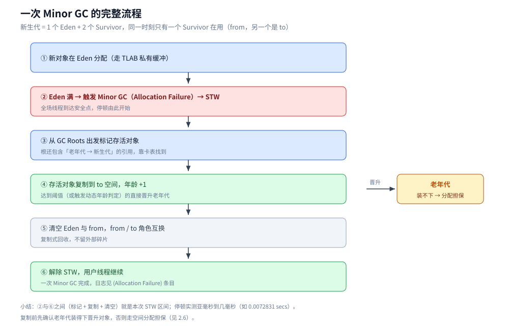
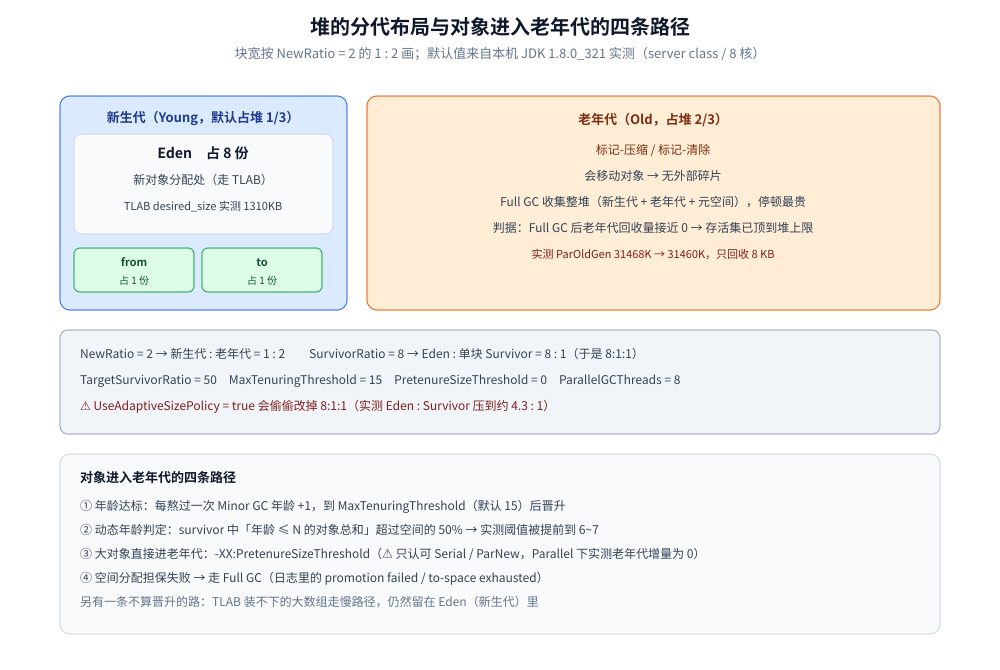
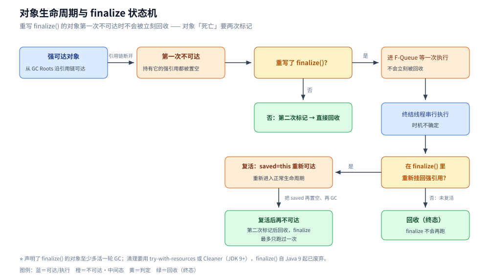
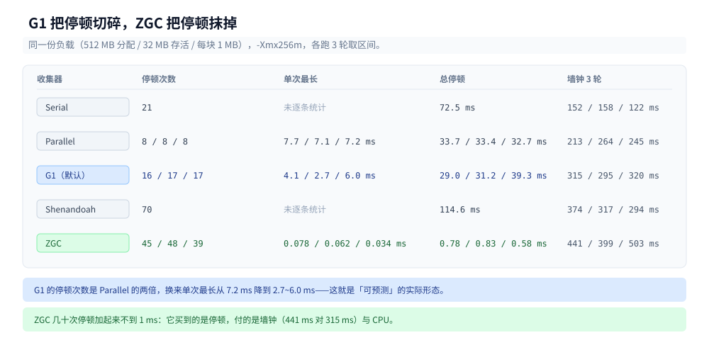
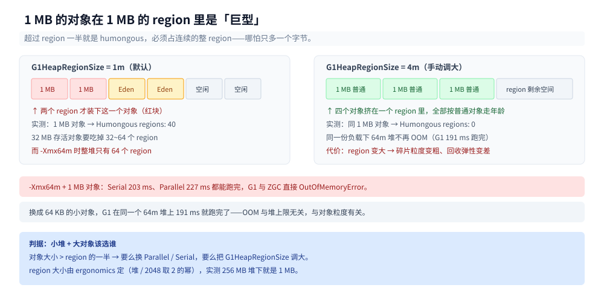

# 垃圾回收原理与收集器

> 覆盖：JVM 自己的 GC 实现视角 —— 堆怎么分代、一次 Minor / Full GC 各做了什么、对象何时进老年代、
> 根集合在 JVM 里具体化成了什么、收集器谱系怎么演化、G1 为什么切 region、ZGC 凭什么做到亚毫秒。
>
> 不覆盖：GC 日志的逐个字段、堆与代比例怎么调、`jstat` / `jcmd` / `jmap` 的现场流程，见
> [GC调优与日志.md](GC调优与日志.md)；算法层的通用原理（判定垃圾的两条路线、标记-清除 / 复制 /
> 压缩 / 分代的代价、三色抽象与写屏障、安全点）见 [垃圾回收](../../../02-计算机基础/垃圾回收/)；
> 类与运行时数据区见 [类加载机制.md](类加载机制.md)、[运行时数据区与栈帧.md](运行时数据区与栈帧.md)。
>
> 内容整理自个人学习笔记，素材见 [素材清单](../../../素材清单.md)。**结论配套两套实测坐标**：JDK 1.8.0_321（Windows / server class / 8 核）
> 与 Temurin 24.0.2（Linux 容器 / 4 vCPU / 5.9 GB），实验源码在 `.workbuddy/tmp/exp/java/gc/Churn.java`。凡是两个版本读数不同的地方，正文都会分别标出 ——
> 这正是本篇要讲清的一件事：**GC 的默认值随版本变，判据不变**。

---

## 一、从零：一个新对象是怎么一步步走向被回收的？

**本节要点**：一个对象的一生只有三个岔路口——**在 Eden 出生（小对象走 TLAB）→ 每次 Minor GC 被判一次生死、活下来年龄 +1 → 攒够年龄或被判定「大」就搬进老年代**；等它在老年代也死掉，才轮到 Full GC 按可达性把它清掉。判据始终是「**从根出发还能不能走到它**」，与它被多少个对象引用无关。

### 1.1 三次「考试」

| 时刻 | 发生什么 | 谁做的判定 | 本篇实测证据 |
|---|---|---|---|
| 出生 | 在 Eden 分配，小对象走线程私有的 TLAB | 分配器（指针加法） | `desired_size: 1310KB`（3.5） |
| 第一次 Minor GC | 从根出发标记，活的复制到 Survivor，年龄 +1 | 复制算法 | 一次 Minor GC 的六步（2.2） |
| 第 N 次 Minor GC | 年龄 ≥ 阈值，或同龄对象总和超 Survivor 一半 → 晋升 | 动态年龄判定 | 阈值被提前到 6~7（3.3） |
| 老年代满 / 元空间不足 | Full GC 整堆标记-压缩 | 标记-压缩 | `31468K -> 31460K`，只回收 8 KB（2.3） |

### 1.2 三个问题就是本篇的三条主线

- **怎么判断一个对象死了？** → 可达性分析（不是引用计数），根集合在 JVM 里具体化成五类来源（第四节）。
- **死掉的对象怎么被找出来、搬走？** → 分代 + 复制/压缩 + 卡表记录跨代引用；G1 再把整堆切成 region（第三节、第六节）。
- **用哪个收集器来搬、代价是什么？** → 收集器谱系与选型（第五节），ZGC 把「搬」这件事也做成并发（第七节）。

### 1.3 三个反直觉点

- **循环引用照样被回收**：两个互引对象把外部强引用置空后仍被回收（4.2 实测）——JVM 不数引用。
- **「8:1:1」只是名义值**：默认 `UseAdaptiveSizePolicy=true` 下实测 Eden:Survivor 是 **4.3:1**（3.3 实测）。
- **同一份代码能在一种堆上 OOM、在另一种堆上跑完**：`-Xmx64m` + 1 MB 对象时 G1 与 ZGC 直接 `OutOfMemoryError`，Serial / Parallel 却能跑完（5.3 实测）——原因是 humongous 规则（6.2）。

---

## 二、JVM 的 GC 是什么类型？和 Go 有什么不一样？

**本节要点**：能一句话点出"**分代 + 复制/压缩 + 停顿型为主**"，并说明这套取舍换来了什么。

### 2.1 四个特征

| 特征 | 说明 |
|---|---|
| **分代** | 堆按对象存活期切成新生代 / 老年代，**各代用不同算法**：新生代复制、老年代标记-清除或标记-压缩 |
| **会压缩（会移动对象）** | 复制与标记-压缩都会改对象地址，所以**没有外部碎片**；代价是移动时必须在安全点上停住全场 |
| **以停顿型为主** | Minor GC 与 Full GC 都是 STW；CMS / G1 / ZGC 把**部分**工作搬到并发阶段，但仍有 STW 段 |
| **目标函数是吞吐与停顿的平衡** | 默认收集器明确偏向吞吐或停顿，可通过换收集器与参数把权重挪过去 |

> 判定垃圾用**可达性分析**（不是引用计数），标记过程就是三色标记 —— 原理见
> [GC基础算法.md](../../../02-计算机基础/垃圾回收/GC基础算法.md) 第二节与
> [并发标记与写屏障.md](../../../02-计算机基础/垃圾回收/并发标记与写屏障.md)。

### 2.2 一次 Minor GC 的完整流程

新生代 = 1 个 Eden + 2 个 Survivor，同一时刻只有一个 Survivor 在用（记作 from，另一个是 to）：

```text
① 新对象在 Eden 分配（走 TLAB，见 3.5）
② Eden 满 → 触发 Minor GC（日志里的 Allocation Failure）→ 全场到达安全点（STW）
③ 从 GC Roots 出发标记存活对象（新生代 GC 的根还要加上「老年代指向新生代的引用」，靠卡表找）
④ 存活的复制到 to 空间，年龄 +1；达到阈值（或触发动态年龄判定）的直接晋升老年代
⑤ 清空 Eden 与 from，from / to 角色互换
⑥ 解除 STW，用户线程继续
```



**图怎么读**：左侧主链是 ①～⑥ 的执行顺序，红色两段是 STW 的起止；④ 右侧分支是晋升去向老年代（装不下时走空间分配担保）。

⭐ 三个要点：① 是**复制**不是标记清除，所以存活对象少时极快；② 新生代的根**不只 GC Roots**，还要把"老年代 → 新生代"的引用当作根（卡表就是干这个的，原理见 [复制与分代回收.md](../../../02-计算机基础/垃圾回收/复制与分代回收.md)）；③ 复制前要先确认老年代装得下晋升对象，否则要走**空间分配担保**（见 3.6）。

### 2.3 一次 Full GC（Major GC）在做什么

- 收集**整堆**（新生代 + 老年代 + 元空间），老年代用标记-压缩，**通常会压缩** → 停顿最贵；
- 触发原因在日志里写得很清楚，实测见到过的几种：`Ergonomics`（自适应策略判定该收了）、分配失败、`Metadata GC Threshold`、显式 `System.gc()`、CMS 的并发失败退化；
- ⭐ **看 Full GC 值不值，只看一个数**：老年代回收前后的差值。实测 JDK 8 下 `-Xmx48m` 那次的日志——

```text
[Full GC (Ergonomics) [PSYoungGen: 1024K->0K(14336K)] [ParOldGen: 31468K->31460K(32768K)] 32492K->31460K(47104K), ..., 0.0043090 secs]
[Full GC (Ergonomics) [PSYoungGen: 11504K->0K(14336K)] [ParOldGen: 31460K->31350K(32768K)] 42965K->31350K(47104K), ..., 0.0107810 secs]
[Full GC (Ergonomics) [PSYoungGen: 11497K->0K(14336K)] [ParOldGen: 31350K->32374K(32768K)] 42847K->32374K(47104K), ..., 0.0030506 secs]
```

`ParOldGen: 31468K -> 31460K` —— **收了半天只回收 8 KB**；第三次甚至 `31350K -> 32374K` 反而涨了（新生代对象被晋升进来）。
这就是"**Full GC 频繁但收不动 = 存活集已经顶到堆上限**"的教科书信号：此时调收集器没用，**只能加堆或减对象**。

（复核实跑该场景时读到 `31296K->31272K`，差 24 KB —— 具体数字每轮不同，但"回收量接近 0"这个特征是稳定的。）

⚠️ 在 G1 上这个字段要换个名字找：G1 的整堆收集叫 **`Pause Full (System.gc())`** 或 `Pause Full (G1 Compaction Pause)`，日志里不再有 `ParOldGen` 那一段，看的是 `M->M(M)` 里堆总量回收前后的差（见 [GC调优与日志.md](GC调优与日志.md) 第三节）。

### 2.4 与 Go 的对照

| 维度 | JVM（JDK 8 默认 Parallel；G1/ZGC 同理） | Go |
|---|---|---|
| 判定垃圾 | 可达性分析 | 可达性分析 |
| 分代 | **有**（新生代 / 老年代） | **无**（一次全堆标记） |
| 压缩 / 移动 | 复制与标记-压缩，**会移动** | 标记-清除，**不移动** |
| 写屏障税 | 卡表 + SATB / 增量更新 | 混合写屏障 |
| 触发方式 | **按代容量**（Eden 满即 Minor GC；老年代水位触发并发周期） | 按**目标堆** `存活堆 × (1 + GOGC/100)` |
| 停顿 | Minor GC / Full GC 都是 STW，停顿与**存活集**成正比 | 只有两次极短的 STW，标记与清扫并发 |
| 调优主旋钮 | `-Xmx` / 新生代比例 / 收集器选择 / `MaxGCPauseMillis` | `GOGC` / `GOMEMLIMIT` |

> ⭐ 一句话对比：**JVM 用"分代 + 复制"减少工作量、用压缩换无碎片，接受较长的停顿**；
> **Go 放弃这两件武器，只保留"并发标记 + 并发清除"，把代价换算成内存水位与碎片。**
> Go 侧的完整实测见 [垃圾回收机制.md](../../go/运行时/垃圾回收机制.md)。

---

## 三、堆是怎么分代的？参数怎么算？

**本节要点**："8:1:1"人人会背，关键在能不能说清**它什么时候不成立**、**哪些参数在 G1 下已经不管事**、以及**默认值从哪来**。

### 3.1 布局

```text
┌──────────────── 新生代（Young，默认占堆 1/3）────────────────┐ ┌──── 老年代（Old，2/3）────┐
│      Eden (8)      │ Survivor from (1) │ Survivor to (1)     │ │      标记-压缩 / 标记-清除    │
└────────────────────┴───────────────────┴─────────────────────┘ └───────────────────────────┘
     NewRatio = 2 → 新生代 : 老年代 = 1 : 2
     SurvivorRatio = 8 → Eden : 单块 Survivor = 8 : 1（于是 8:1:1）
```

⚠️ 上面这张图描述的是 **JDK 8 的 Parallel / Serial 布局**：老年代是一整块连续空间。**G1 不是这样** ——
它把整堆切成大小相等的 region，新生代和老年代都是 region 的集合，同一时刻哪块属于哪一代是可以变的
（机制见第六节）。所以从 JDK 9 起，`NewRatio` 描述的那种"1 : 2 的连续两段"在默认配置下就不存在了。



**图怎么读**：上排两块按 `NewRatio = 2` 的 1 : 2 画出新生代与老年代的相对大小（新生代内部再按 8:1:1 分 Eden 与两块 Survivor）；灰色条是 `PrintFlagsFinal` 的实测默认值，其中 `UseAdaptiveSizePolicy = true` 就是让 8:1:1 失效的那一项；最下面四条是对象进老年代的全部路径。

### 3.2 实测：默认值是从哪来的

JDK 8 下：

```bash
java -XX:+PrintFlagsFinal -version | grep -E "UseParallelGC|InitialHeapSize|MaxHeapSize|NewRatio|SurvivorRatio|MaxTenuringThreshold|UseAdaptiveSizePolicy"
```

```text
uintx InitialHeapSize          := 268435456          （256 MB ≈ 物理内存的 1/64）
uintx MaxHeapSize              := 4263510016         （≈ 4 GB = 物理内存的 1/4）
uintx NewRatio                  = 2
uintx SurvivorRatio             = 8
uintx TargetSurvivorRatio       = 50
uintx MaxTenuringThreshold      = 15
uintx PretenureSizeThreshold    = 0
uintx ParallelGCThreads         = 8
bool  UseAdaptiveSizePolicy     = true                （⚠️ 就是它，见 3.3）
bool  UseTLAB                   = true
bool  UseParallelGC            := true                （:= 表示由 ergonomics 自动选择，不是 flag 默认值）
bool  UseParallelOldGC         := true
```

同一组参数在 JDK 24 容器里的读数（4 vCPU / 5.9 GB）：

```text
   size_t InitialHeapSize              = 98566144      {product} {ergonomic}     （94 MB ≈ 5.9 GB / 64）
   size_t MaxHeapSize                  = 1556086784    {product} {ergonomic}     （1.45 GB ≈ 5.9 GB / 4）
   size_t G1HeapRegionSize             = 1048576       {product} {ergonomic}     （1 MB）
    uintx NewRatio                     = 2             {product} {default}
    uintx SurvivorRatio                = 8             {product} {default}
    uint  MaxTenuringThreshold         = 15            {product} {default}
   size_t PretenureSizeThreshold       = 0             {product} {default}
    uintx MaxGCPauseMillis             = 200           {product} {default}
    uint  ParallelGCThreads            = 4             {product} {default}
     bool UseAdaptiveSizePolicy        = true          {product} {default}
     bool UseG1GC                      = true          {product} {ergonomic}
```

两处要读懂的地方：

- **`:=` 与 `=` 的区别**：`PrintFlagsFinal` 输出里带 `:=` 的行是**被 ergonomics 自动设置**的（JVM 按机器 CPU / 内存自己选的），`=` 才是写在源码里的默认值。所以"JDK 8 默认用 Parallel"这句话严格说是"**server class 机器上 ergonomics 选了 Parallel**"；同理"JDK 9+ 默认 G1"是 ergonomics 的结论，`UseG1GC` 那一行也带 `{ergonomic}`；
- **堆的上下限来自物理内存**：初始堆取 1/64、最大堆取 1/4（JDK 8 本机 15.9 GB → 256 MB / 4 GB；JDK 24 容器 5.9 GB → 94 MB / 1.45 GB）。容器里部署必须显式 `-Xmx`，否则 JVM 看到的是宿主机内存（JDK 8u191+ 才有 `UseContainerSupport`）。

### 3.3 ⚠️ 实测：自适应策略会改掉你的 8:1:1

`UseAdaptiveSizePolicy=true` 时，JVM 会**动态调整新生代内部比例与晋升阈值**去凑停顿 / 吞吐目标。同一份压力（512 MB 分配、存活 32 MB）下，GC 日志结尾的堆快照：

```text
# 默认（UseAdaptiveSizePolicy=true）
 PSYoungGen      total 73216K, used 35502K
  eden space 59392K, 42% used        ┐
  from space 13824K, 74% used        ├─ 59392 : 13824 ≈ 4.3 : 1   ← 不是 8:1！
  to   space 13824K, 0% used         ┘
 ParOldGen       total 175104K, used 22236K

# 加上 -XX:-UseAdaptiveSizePolicy -XX:SurvivorRatio=8
 PSYoungGen      total 78336K, used 58266K
  eden space 69632K, 71% used        ┐
  from space 8704K, 99% used         ├─ 69632 : 8704 = 8.00 : 1   ← 正好 8:1
  to   space 8704K, 0% used          ┘
 ParOldGen       total 175104K, used 22784K
```

⭐ **结论：不关自适应，"8:1:1" 只是个名义值**。实测里 Eden 被压到 4 份左右、Survivor 被撑大 —— 因为幸存对象多，JVM 怕 Survivor 装不下而提前晋升。（这个比例每轮会变：另一次实测是 `57344K / 14848K ≈ 3.86`；而关掉自适应后的 8.00 是**精确可复现**的。）

同理，**晋升阈值也不是设的 15**。打开 `-XX:+PrintTenuringDistribution`：

```text
Desired survivor size 11010048 bytes, new threshold 7 (max 15)
...
Desired survivor size 16252928 bytes, new threshold 6 (max 15)
```

`max 15` 是你设的上限，`new threshold 7` 是**本次真正生效的阈值** —— 这就是**动态年龄判定**：若 survivor 中「年龄 ≤ N 的对象总和」超过 survivor 空间的一半（`TargetSurvivorRatio=50`），直接把阈值降到 N，不等 15 了。

### 3.4 对象什么时候进老年代

| 路径 | 条件 | 备注 |
|---|---|---|
| **年龄达标** | 每熬过一次 Minor GC 年龄 +1，达到 `MaxTenuringThreshold`（默认 15）后晋升 | 实测常被动态年龄判定提前到 6~7 |
| **动态年龄判定** | survivor 中「年龄 ≤ N 的对象总和」> survivor 空间的 50% | 见 3.3 实测，可随时改阈值 |
| **大对象直接进入** | 超过 `-XX:PretenureSizeThreshold` 的对象直接在老年代分配 | ⚠️ **对 Parallel Scavenge 与 G1 都无效**，见下 |
| **空间分配担保** | 晋升时老年代放不下 | 担保失败就走 Full GC；G1 日志里写作 `Evacuation Failure` |
| **TLAB 装不下的大数组** | 走「慢路径」直接向 Eden 申请 | 与上面一条不同，它仍在新生代 |
| **humongous 对象**（G1 专有） | 对象大于 region 的一半 | 直接进 humongous region，不走年龄，见 6.2 |

⚠️ **实测踩到的坑：`-XX:PretenureSizeThreshold` 只认 Serial**。同一段代码（分配 24 个 4 MB 大对象）看老年代增量：

```text
# JDK 8：默认 Parallel + -XX:PretenureSizeThreshold=2m
  EC 16384.0  EU 13938.1   OC 44032.0  OU      0.0     ← 12 MB 全在 Eden，阈值被忽略
# JDK 8：-XX:+UseSerialGC -XX:PretenureSizeThreshold=2m
  EC 17472.0  EU  1749.9   OC 43712.0  OU 12288.0     ← 12 MB 全在老年代，阈值生效
```

这条在 JDK 24 上重做了三档对照，结论更硬（`Churn 96 96 4096`，96 个 4 MB 对象）：

| 收集器 | 不做设置 | 阈值 2m | 阈值 8m |
|---|---|---|---|
| Serial | 首次 Tenured 25709K | **62653K** | — |
| Parallel | 首次 Old 21613K | 21613K | 21613K |
| G1 | 首次 Old 2 regions | 2 regions | 2 regions |

**Parallel 三档读数逐字节相同、Serial 一设就跳 36 MB** —— 参数本身没坏，是 Parallel 与 G1 都不读它。
G1 读的是 region 大小（humongous 规则），根本不用这个阈值：把 `-XX:G1HeapRegionSize` 从 1m 调到 4m，
同一份 1 MB 对象就从"40 个 humongous region"变成"0 个"（见 6.2 实测），这才是 G1 侧该动的旋钮。

> 顺手确认：该参数的单位后缀 `2m` / `2M` / `2097152` 都会被正确解析成 `2097152` 字节。

### 3.5 TLAB：为什么小对象分配这么快

`UseTLAB=true`（默认）时，每个线程在 Eden 里划走一小块**私有**的分配缓冲，小对象分配只需"指针 + 大小"的本地运算，不需要任何同步。实测（`-XX:+PrintTLAB`）：

```text
TLAB: gc thread: [id: 17820] desired_size: 1310KB slow allocs: 63  refill waste: 22984B alloc: 1.00000 64800KB refills: 1 waste 34.4% gc: 462096B
TLAB totals: thrds: 1  refills: 1 max: 1 slow allocs: 63 max 63 waste: 34.4% gc: 462096B
```

- `desired_size: 1310KB` —— 本次 TLAB 约 1.3 MB（会随分配速率自适应）；
- `slow allocs: 63` —— 有 63 次**慢路径**分配：对象比 TLAB 剩余空间大（本实验每块都是 1 MB），只能直接找 Eden；
- `waste 34.4%` —— TLAB 尾部用不上的碎片，占总分配的三分之一；下一次采样已经降到 21.1%，说明 JVM 在按浪费率调整 TLAB 大小。

### 3.6 空间分配担保

Minor GC 前，JVM 要先确认"**最坏情况下**（新生代所有对象都晋升）老年代装得下"，装不下就不做 Minor GC 而直接做 Full GC。JDK 8 里 `HandlePromotionFailure` 这个开关**已经被移除**（`PrintFlagsFinal` 里查不到），担保逻辑改为按历次晋升的平均大小做更精确的预估。日志里的 `(promotion failed)` 就是担保出问题的现场；G1 上对应的是 `(to-space exhausted)` 与 `(Evacuation Failure: ...)`，后者在 JDK 24 上实测现形如下：

```text
[0.472s][info][gc] GC(5) Pause Young (Mixed) (G1 Humongous Allocation) (Evacuation Failure: Allocation) 253M->65M(256M) 4.057ms
```

---

## 四、哪些对象算 GC Roots？

**本节要点**：原理（两条判定路线、根集合、三色标记）在 [垃圾回收](../../../02-计算机基础/垃圾回收/) 里；这一节只看**JVM 把根具体化成了什么**，以及两个高频陷阱。

### 4.1 根的五个来源

| 类别 | 说明 |
|---|---|
| **虚拟机栈（栈帧局部变量表）中引用的对象** | 每个线程各一份 —— 所以枚举根必须让所有线程停在安全点上 |
| **方法区中类静态属性引用的对象** | `static` 字段 |
| **方法区中常量引用的对象** | 字符串常量池、`final` 常量 |
| **本地方法栈中 JNI 引用的对象** | native 代码持有的引用 |
| **JVM 内部引用** | 基本类型的 `Class` 对象、常驻异常对象、系统类加载器、被同步锁（`synchronized`）持有的对象、活跃线程 |

① 是"每个线程一份"这件事，直接推出了 STW 的必要性：**根枚举的到齐时间由最慢的那个线程决定**（原理与安全点的展开见 [GC基础算法.md](../../../02-计算机基础/垃圾回收/GC基础算法.md) 的「安全点」一节）。

### 4.2 实测：循环引用照样被回收

用两个互相引用的对象 + 弱引用队列来验证（引用计数法在这里必然失败，因为两个计数都停在 1）：

```java
Node a = new Node("A");
Node b = new Node("B");
a.peer = b;
b.peer = a;                                        // 互相引用
WeakReference<Node> wa = new WeakReference<Node>(a, queue);
WeakReference<Node> wb = new WeakReference<Node>(b, queue);
a = null;
b = null;                                          // 只剩"环"里的互相引用
System.gc();
```

```text
置空前：wa.get()=CycleRef$Node@232204a1 ｜ wb.get()=CycleRef$Node@4aa298b7 ｜ A.peer==B 且 B.peer==A
   [引用队列] 收到通知：java.lang.ref.WeakReference@196406c7
   [引用队列] 收到通知：java.lang.ref.WeakReference@17a3eb9b
System.gc() 之后：wa 被清除=true ｜ wb 被清除=true
→ 循环引用照样被回收：JVM 不靠引用计数，靠「从 GC Roots 出发的可达性分析」
```

### 4.3 对象"死亡"要两次标记：`finalize()` 的实测

重写了 `finalize()` 的对象，第一次不可达时**不会被立刻回收**，而是进 `F-Queue` 等一次执行机会；若在 `finalize()` 里重新挂回强引用，就"复活"了：

```java
@Override
protected void finalize() throws Throwable {
    finalized++;
    if ("复活者".equals(name)) {
        saved = this;                 // 在 finalize 里重新建立强引用 → 复活
    }
    super.finalize();
}
```

```text
== 第一次 GC：对象已不可达，但重写了 finalize → 进 F-Queue 等一次执行机会 ==
   [F-Queue] 复活者.finalize() 被调用（累计第 1 次）
   finalize 累计 1 次 ｜ saved != null ? true → 对象被「复活」了
== 把复活后的引用也置空，再 GC 一次 ==
   finalize 累计 1 次（本次 +0）→ 第二次标记后直接回收，finalize 不会再跑
```



**图怎么读**：从左到右是对象从强可达走到第一次不可达；黄色是两次判定分叉，橙色是 F-Queue / 复活等中间态，绿色是回收终态——「是」分支进 F-Queue 跑一次 `finalize()`，跑完再判是否挂回强引用。

⭐ **`finalize()` 只跑一次**是这条规则最实用的推论。所以：

- 声明了 `finalize()` 的对象**至少多活一轮 GC**，且终结线程串行执行、时机不确定 → 大对象 + 终结器 = 内存水位与停顿的双重负担；
- 实战里要"对象释放时做清理"，用 **try-with-resources**（确定性）或 `java.lang.ref.Cleaner`（JDK 9+），**不要用 `finalize()`** —— Java 9 起它已被标记废弃，JDK 18 起 `finalization=disabled` 已可整体关掉。

---

## 五、收集器谱系：谁在优化什么？

**本节要点**：不能只记名字，还要知道"**各代收集器分别在优化什么**"、"**哪些已经退场**"，以及**同一份负载换收集器，实测差在哪**。

### 5.1 演进时间线

| 收集器 | 分代 | 算法 | 优化目标 | 状态 |
|---|---|---|---|---|
| **Serial / Serial Old** | 新生代 / 老年代 | 复制 / 标记-压缩 | 简单、内存少 | 仍在（Client 模式默认、小容器） |
| **ParNew** | 新生代 | 复制（多线程） | 缩短新生代暂停 | ⚠️ JDK 24 已移除（`Unrecognized VM option`） |
| **Parallel Scavenge / Parallel Old** | 新生代 / 老年代 | 复制 / 标记-压缩 | **吞吐量**（自适应调代大小） | **JDK 8 server class 的默认**；JDK 24 仍有 |
| **CMS** | 老年代 | 标记-清除（不压缩） | **停顿优先**；并发标记用**增量更新** | JDK 9 废弃、**JDK 14 移除** |
| **G1** | 整堆 Region 化 | 局部复制 + 整体标记-压缩 | **可预测停顿**；标记用 **SATB** | JDK 9 起为默认 |
| **ZGC / Shenandoah** | 整堆 Region 化 | 着色指针 / 读屏障 + 并发整理 | 亚毫秒停顿 | JDK 15+ 生产可用；ZGC 自 JDK 21 支持分代 |

### 5.2 ⚠️ 实测：老收集器在新版本上直接起不来

JDK 24 上逐个试（`java -XX:+XxxGC -version`）：

```text
-XX:+UseConcMarkSweepGC  Unrecognized VM option 'UseConcMarkSweepGC'
                         Error: Could not create the Java Virtual Machine.
-XX:+UseParNewGC         Unrecognized VM option 'UseParNewGC'
-XX:+UseParallelOldGC    Unrecognized VM option 'UseParallelOldGC'
                         Did you mean '(+/-)UseParallelGC'?
```

⭐ **`UseParallelOldGC` 的提示最能说明问题**：JDK 8 里它是独立开关（Parallel Scavenge + Parallel Old 两代），
JDK 24 里 Parallel Old 已经并进 `UseParallelGC` 一个开关里，老参数只剩"拼错"这一种命运。
所以从老项目抄启动参数时，**先 `-version` 试一遍能不能起来**，比对照文档快。

### 5.3 实测：同一负载换五种收集器

固定压力（512 MB 分配、存活 32 MB、每块 1 MB）、固定 `-Xmx256m`，JDK 8 版读数（GC 次数 / 总耗时）：

| 收集器 | 新生代收集器 | 老年代收集器 | GC 次数 | 总耗时 |
|---|---|---|---|---|
| Serial | `Copy` | `MarkSweepCompact` | 7 | 53 ms |
| Parallel | `PS Scavenge` | `PS MarkSweep` | 8 | 33 ms |
| CMS | `ParNew` | `ConcurrentMarkSweep` | 7 | 53 ms |
| G1 | `G1 Young Generation` | `G1 Old Generation` | 7 | 21 ms |

⚠️ **这张表不能当"G1 比 Parallel 快 1.5 倍"的结论**：① 负载太小（几百毫秒就跑完），停顿受 JIT 与启动阶段影响很大；② 本实验每块都是 1 MB 的 **humongous 对象**，恰好是 G1 最不擅长的形态（见 6.2）。**选收集器要看负载特征，不是看某个微基准**。

JDK 24 上重做同一份负载（4 vCPU / 3 轮），看的是**停顿的口径**：单次最长比总时长更有意义。

| 收集器 | 墙钟 3 轮 | 停顿次数 | 总停顿 | 单次最长 |
|---|---|---|---|---|
| Serial | 152 / 158 / 122 ms | 21 | 72.5 ms | — |
| Parallel | 213 / 264 / 245 ms | 8 / 8 / 8 | 33.7 / 33.4 / 32.7 ms | 7.7 / 7.1 / 7.2 ms |
| **G1（默认）** | 315 / 295 / 320 ms | 16 / 17 / 17 | 29.0 / 31.2 / 39.3 ms | **4.1 / 2.7 / 6.0 ms** |
| Shenandoah | 374 / 317 / 294 ms | 70 | 114.6 ms | — |
| **ZGC** | 441 / 399 / 503 ms | 45 / 48 / 39 | **0.78 / 0.83 / 0.58 ms** | **0.078 / 0.062 / 0.034 ms** |



**图怎么读**：五行按停顿次数从左到右排开，蓝底是 G1、绿底是 ZGC —— 次数多的那两行恰恰是单次停顿最短的，这正是"切碎"与"抹掉"两种思路的分界。

三点读出来的：

- **G1 把停顿切碎而不是消灭**：次数是 Parallel 的两倍（16 vs 8），但单次最长从 7.2 ms 降到 2.7~6.0 ms，总停顿也略低。这就是"可预测停顿"的实际形态；
- **ZGC 的停顿时长与堆大小基本无关**：几十次停顿加起来不到 1 ms，单次最长 0.078 ms。它买到的是停顿，付的是墙钟（441 ms vs G1 的 315 ms）与 CPU；
- **小堆 + 1 MB 大对象是 G1 的弱项**：`-Xmx64m` 下 Serial 203 ms / Parallel 227 ms 都能跑完，**G1 与 ZGC 直接 `OutOfMemoryError`**；把 chunk 换成 64 KB 后 G1 191 ms 就正常了。原因见 6.2 的 humongous 规则。

### 5.4 怎么选

| 场景 | 选择 | 理由 |
|---|---|---|
| 批处理、后台计算、吞吐优先 | **Parallel** | 吞吐最高，停顿可容忍 |
| 单核小容器 / 内存极紧 / 大量大对象 | **Serial** 或 **Parallel** | footprint 最小；`-Xmx64m` + 1 MB 对象这档 G1 会 OOM（5.3 实测） |
| 交互服务、堆 4~16 GB、停顿目标 100~500 ms | **G1** | 停顿可预测，可给 `-XX:MaxGCPauseMillis` |
| 堆很大（几十 GB）、停顿要求 < 1 ms | **ZGC**（JDK 21+ 用分代版） | 停顿与堆大小基本解耦 |
| 还在 JDK 8 且老年代有碎片问题 | 只能 `-XX:+UseCMSInitiatingOccupancyOnly` + 调阈值，或**升级** | CMS 已无出路（JDK 14 移除） |

---

## 六、G1 为什么要切 region？

**本节要点**：G1 的全部设计都压在"**把整堆切成小块、每次只收其中一部分**"这一个动作上；理解 region 大小与 humongous 规则，就理解了它一半的收益与全部的小堆翻车场景。

### 6.1 region 化换来了什么

老年代在 Parallel 里是一整块连续空间，"收多少"没有选择余地 —— 要么不收，要么全收。G1 把它切成一堆等大的 region（默认 2048 个左右，大小由堆除以 2048 再取 2 的幂，`-XX:G1HeapRegionSize` 可显式指定），于是：

- **每次只挑一部分 region 组成本次的回收集（CSet）**，"收多少"变成一个可以按停顿预算求的量；
- region 的身份是**动态**的：这次是 Eden，下次可以是 Survivor 或 Old，堆不需要预留"老年代该多大"；
- 代价是**跨 region 引用要记账**（每个 region 一张 RSet），以及**大对象会撕裂 region 的粒度**。

实测的 region 初始化参数（`-Xlog:gc+init`，JDK 24 容器 / `-Xmx256m`）：

```text
[0.005s][info][gc,init] CardTable entry size: 512
[0.012s][info][gc,init] Heap Region Size: 1M
[0.012s][info][gc,init] Heap Min Capacity: 8M
[0.012s][info][gc,init] Heap Initial Capacity: 94M
```

`CardTable entry size: 512` —— 卡表的一"卡"管 **512 字节**堆内存。这就是 2.2 里"老年代 → 新生代的引用靠卡表找"的粒度：
一次引用赋值最多弄脏一张卡（512 B），GC 时按脏卡回扫。卡表本身占堆的约 1/512，是**固定的额外开销**。

### 6.2 humongous：大对象为什么是 G1 的死穴

⭐ **规则**：对象大小超过 region 的**一半**就是 humongous，必须占用**连续**的整 region（哪怕只要 1 字节也占满一个）。
1 MB region 下，**大于 512 KB 的对象都是 humongous**。



**图怎么读**：左半边是默认的 1 MB region，红块表示一个对象吃掉两个连续 region；右半边把 region 调到 4 MB，同样大小的对象变成普通对象，四个挤在一个 region 里按年龄走。

同一份 1 MB 对象，只改 region 大小（`-Xmx512m`，分配 256 MB）：

| `-XX:G1HeapRegionSize` | 首次 GC 的 humongous region 数 |
|---|---|
| 1m（默认，由 ergonomics 定） | **40 个** |
| 4m | 0 个 |
| 16m | 0 个 |

⭐ 反过来说：`-Xmx64m` 时 region 只有 1 MB，1 MB 的对象每个占 1~2 个 region，**32 MB 存活对象要吃掉 32~64 个 region**，
而整堆才 64 个 region —— 这就是 5.3 里"G1 在 64 MB 堆上直接 OOM、Serial/Parallel 却能跑完"的全部原因。
改 `-XX:G1HeapRegionSize=4m` 或换 Parallel 都能绕开。

实测的 region 级账本（`-Xlog:gc+heap=info`，本实验那 32 MB keep 全在 humongous 里）：

```text
[0.139s][info][gc,heap] GC(0) Eden regions: 1->0(24)
[0.139s][info][gc,heap] GC(0) Survivor regions: 0->1(4)
[0.139s][info][gc,heap] GC(0) Old regions: 2->2
[0.139s][info][gc,heap] GC(0) Humongous regions: 40->40
```

`Humongous regions: 40->40` 一路不降 —— 那 32 MB 是被 `keep` 数组强引用的存活对象，收不掉。
**这四行是 G1 上判"内存去哪了"最快的一眼**：Eden 在清、Old 在涨、Humongous 不动，三种状态对应三种结论。

### 6.3 一次 Young Pause 在内部干什么

`-Xlog:gc+phases=debug` 把一次停顿拆成三段（`-Xmx256m`，GC(4)）：

```text
[0.292s][info ][gc,phases] GC(4)   Pre Evacuate Collection Set: 0.56ms
[0.293s][info ][gc,phases] GC(4)   Evacuate Collection Set: 1.17ms
[0.293s][info ][gc,phases] GC(4)   Post Evacuate Collection Set: 1.20ms
```

对照外层那一行 `Pause Young (Mixed) ... 4.057ms`，三段加起来只有 2.93 ms —— 剩下的时间花在
`Pre Evacuate` 之前的根扫描与 `Post` 之后的清理上（同一份 debug 日志里，`Ext Root Scanning` 的
`Min/Avg/Max/Diff/Sum/Workers` 六个统计量每个阶段都有）。

⭐ 这三段的名字就是排障的抓手：
**`Pre` 大** → 根扫描慢（线程多、JNI 引用多、类多）；**`Evacuate` 大** → 复制量大（存活集大）；
**`Post` 大** → RSet / 卡表清理或引用处理慢。日志体量也要有预期：这一份 640 ms 的负载，
`-Xlog:gc+phases=debug` 打了 **1495 行**。

### 6.4 G1 的并发标记与 SATB

G1 的"可预测停顿"靠的是**先并发标记出哪些 region 该收，再用停顿预算挑一部分收**。标记阶段用 **SATB**
（Snapshot-At-The-Beginning）：在标记开始时给存活对象拍个快照，之后新产生的引用不改变快照里的存活集合 ——
代价是"标记期间死掉的对象这一轮收不掉"，收益是**不需要重扫被改过的对象**（CMS 的增量更新要重扫，见
[并发标记与写屏障.md](../../../02-计算机基础/垃圾回收/并发标记与写屏障.md)）。两者的分野在日志上也看得见：

```text
[0.269s][info][gc] GC(1) Concurrent Undo Cycle
[0.273s][info][gc] GC(3) Concurrent Mark Cycle
[0.294s][info][gc] GC(3) Pause Remark 57M->57M(99M) 4.982ms
[0.306s][info][gc] GC(3) Pause Cleanup 63M->63M(99M) 0.057ms
[0.312s][info][gc] GC(3) Concurrent Mark Cycle 39.465ms
```

`Concurrent Mark Cycle 39.465ms` 是**整段并发周期**，其中只有 `Pause Remark`（4.98 ms）与 `Pause Cleanup`（0.06 ms）
是 STW。⭐ 记住这个结构：**G1 的一次并发周期里，STW 只占尾巴上那两条**，判断停顿问题就看这两条。

---

## 七、ZGC 凭什么做到亚毫秒？

**本节要点**：ZGC 的停顿不随堆变大，是因为它把**移动对象**这件事也做成了并发的 —— 靠的是着色指针与读屏障，代价写在 CPU 与吞吐上。

### 7.1 三个决定性的机制

| 机制 | 做了什么 | 换来什么 |
|---|---|---|
| **着色指针（colored pointers）** | 把标记位塞进 64 位指针的空闲位里（Marked0 / Marked1 / Remapped / Finalizable） | 标记状态不用额外位图，**改状态不需要动对象** |
| **读屏障（load barrier）** | 每次从堆里读引用都过一道检查：指针是"旧"的就当场修正 | 对象可以在**应用线程运行时**被移动，不需要整场 STW |
| **并发重定位 + 转发表** | 移动对象时把旧地址记进转发表，读屏障负责把旧地址翻译成新地址 | 压缩/整理不再需要"停住全场再搬" |

> 写屏障 vs 读屏障是 ZGC 与 G1/CMS 的分水岭：**G1 用写屏障（SATB）记"谁被改过"，ZGC 用读屏障处理"谁被搬过"**。
> 读屏障的代价是**每条读引用的指令都要多干一点活**，这就是 ZGC 吞吐偏低、CPU 占用偏高的来源。

### 7.2 实测：停顿与堆解耦

`-Xlog:gc*` 在 ZGC 下打的是 phase 级停顿（`-Xmx256m`，本实验）：

```text
[0.160s][info][gc,phases   ] GC(0) Y: Pause Mark Start (Major) 0.025ms
[0.164s][info][gc,phases   ] GC(0) Y: Pause Mark End 0.013ms
[0.178s][info][gc,phases   ] GC(0) Y: Pause Relocate Start 0.031ms
[0.181s][info][gc,phases   ] GC(0) O: Pause Mark End 0.013ms
[0.215s][info][gc,phases   ] GC(0) O: Pause Relocate Start 0.030ms
```

⭐ 三件事看这一小段就够了：

- **`Y:` / `O:` 前缀** —— JDK 21 起 ZGC 默认**分代**，`Y` 是 young、`O` 是 old，各自独立走一轮；
- **停顿单位是 0.0X ms** —— 45~48 次停顿、总 0.58~0.83 ms、单次最长 0.078 ms（5.3 表）。对照 G1 的 2.7~6.0 ms，差两个数量级；
- **`-Xlog:gc` 看不到这些行** —— 只有 `-Xlog:gc*` 才带 `phases` tag。第一次用 ZGC 觉得"日志里没有停顿"的，基本都是这个原因。

对应的收集动作在 `-Xlog:gc` 下长这样（注意**没有 `Pause` 字样**，墙钟时间也不等于停顿）：

```text
[0.120s][info][gc] GC(0) Major Collection (Warmup)
[0.181s][info][gc] GC(0) Major Collection (Warmup) 26M(10%)->124M(48%) 0.061s
[0.201s][info][gc] GC(2) Minor Collection (Allocation Rate)
[0.218s][info][gc] GC(2) Minor Collection (Allocation Rate) 134M(52%)->100M(39%) 0.017s
```

⭐ **`0.061s` 是这轮收集的总墙钟，不是停顿**。这是读 ZGC 日志最容易犯的错：拿 61 ms 当停顿，
会得出"ZGC 停顿 61 ms"的荒谬结论。要停顿必须加 `phases` tag。

初始化参数（`-Xlog:gc+init`）说明它为什么能解耦：

```text
[0.020s][info][gc,init] Address Space Size: 4096M
[0.021s][info][gc,init] Min Capacity: 8M
[0.021s][info][gc,init] Max Capacity: 256M
[0.021s][info][gc,init] Medium Page Size: 8M
[0.023s][info][gc,init] Uncommit: Enabled
```

ZGC 用的是**虚拟地址空间预留 + 动态提交**（`Address Space Size: 4096M` 而 `Max Capacity: 256M`），
页大小按对象大小分档（小/中/大页，中页 8 MB），所以它能"边跑边整理"，不需要像 G1 那样先把堆划成固定 region。

---

## 八、应用场景

**本节要点**：GC 的知识只在四种现场被真正用到——**容器里内存对不上账、发布后停顿变长、大对象把 G1 拖垮、批处理吞吐上不去**；每种现场对应本篇的一张表，认错现场就会调错旋钮。

| 现场 | 现象 | 先查本篇哪一节 | 常见误判 |
|---|---|---|---|
| 容器被 OOMKilled，堆监控正常 | RSS 远超 `-Xmx`，进程直接消失 | 3.2 的堆上下限来源（ergonomics 看的是宿主机） | 以为是内存泄漏，其实没显式 `-Xmx` |
| 发布后 P99 抖动 | 停顿次数不多但单次很长 | 5.3 的停顿口径（次数 / 总停顿 / 单次最长） | 只看总停顿，忽略单次最长 |
| 大对象服务（图片、报文、序列化块）在 G1 上频繁 full | `Humongous regions` 不降 | 6.2 的 humongous 规则 | 去调 `PretenureSizeThreshold`，G1 根本不读 |
| 批处理跑得慢、CPU 打满 | 吞吐上不去，停顿可接受 | 5.4 的选型表（Parallel） | 上来就选 G1 / ZGC |
| 交易 / 网关要求 < 1 ms 停顿 | 堆很大，G1 单次仍有几毫秒 | 7.1 的着色指针与读屏障 | 拿 `-Xlog:gc` 的墙钟当停顿 |
| 老项目抄了 JDK 8 的启动参数 | 进程起不来，`Unrecognized VM option` | 5.2 的实测报错清单 | 以为参数还能用 |

---

## 九、具体使用

**本节要点**：日常只需要四件事——**确认当前用的是哪个收集器、开一份能读的日志、按三行判读、对大对象做一次 humongous 自检**；四件事都能在启动参数里一次配好。

### 9.1 确认当前收集器与堆上下限

```bash
java -XX:+PrintFlagsFinal -version | grep -E "Use(G1|Z|Serial|Parallel)GC|MaxHeapSize|MaxGCPauseMillis"
jcmd <pid> VM.flags | tr ' ' '\n' | grep -i gc
```

`PrintFlagsFinal` 里带 `{ergonomic}` 的那几行是**按机器自动选的**，不是你写的（3.2 解释了 `:=` 与 `=` 的区别）。

### 9.2 开一份能读的 GC 日志

JDK 8 与 JDK 9+ 是两套写法，**不能混用**：

```bash
# JDK 8
-XX:+PrintGCDetails -XX:+PrintGCDateStamps -XX:+PrintTenuringDistribution \
-Xloggc:/var/log/app/gc.log -XX:+UseGCLogFileRotation -XX:NumberOfGCLogFiles=5 -XX:GCLogFileSize=20M

# JDK 9+（统一日志）
-Xlog:gc*,gc+heap=info,gc+phases=info:file=/var/log/app/gc.log:time,uptime,level,tags:filecount=5,filesize=20M
```

⚠️ JFR 也是同一层的补充手段：`-XX:StartFlightRecording=duration=60s,filename=app.jfr`，两者互为对照，字段判读见 [GC调优与日志.md](GC调优与日志.md)。

### 9.3 三行判读

抓到日志后先只看三类行，各自对应一个结论：

| 日志行 | 长什么样（实测） | 结论 |
|---|---|---|
| `Pause Young` | `Pause Young (Mixed) (G1 Humongous Allocation) ... 253M->65M(256M) 4.057ms` | 新生代 / 混合收集，看**回收量**与**单次耗时** |
| `Pause Full` | `ParOldGen: 31468K->31460K(32768K)` | 回收量接近 0 → 存活集顶到堆上限（2.3） |
| `Humongous regions` | `Humongous regions: 40->40` | 一路不降 → 大对象被强引用（6.2） |

```bash
grep -E "Pause (Young|Full|Remark)" gc.log | tail -20          # 最近的停顿
grep "Humongous regions" gc.log | tail -5                      # 大对象账本（G1）
grep -c "Pause" gc.log                                         # 停顿次数（配合时长看抖动）
```

### 9.4 humongous 自检

```bash
# ① 看 region 多大
java -Xlog:gc+init -version 2>&1 | grep "Heap Region Size"
# ② 对象若大于 region 一半就是 humongous，两条路：调大 region 或换 Parallel
java -XX:G1HeapRegionSize=4m -Xmx512m -Xlog:gc+heap=info -cp out Churn 96 96 4096
```

实测对照（`-Xmx512m`、96 个 4 MB 对象）：`G1HeapRegionSize=1m` 时首次 GC 出现 **40 个 humongous region**，调到 `4m` 后变成 **0 个**，改用 Parallel 则完全不出现 humongous 这个概念。

---

## 延伸追问

- **JVM 的 GC 是什么类型？和 Go 有什么不一样？** → 分代 + 复制/压缩（会移动对象）、Minor 与 Full 都是 STW；Go 是不分代、不压缩、并发标记清除，只有两次极短 STW。JVM 用"少干活 + 无碎片"换较长的停顿，Go 用"内存水位 + 碎片"换低延迟。
- **怎么判断对象已死？** → **可达性分析**：从 GC Roots 出发遍历引用图，不可达即可回收；引用计数法收不掉循环引用（实测两个互引对象置空后照样被回收），且有写放大与计数器占位两笔成本。原理与根集合的通用构成见 [GC基础算法.md](../../../02-计算机基础/垃圾回收/GC基础算法.md)。
- **哪些对象可以作为 GC Roots？** → 虚拟机栈（栈帧局部变量表）引用的对象、方法区静态属性引用的对象、方法区常量引用的对象、本地方法栈 JNI 引用的对象，加上活跃线程、被同步锁持有的对象等 JVM 内部引用。
- **对象什么时候进老年代？** → ① 年龄达到 `MaxTenuringThreshold`（默认 15，实测常被**动态年龄判定**提前到 6~7）；② 超过 `PretenureSizeThreshold` 的大对象（⚠️ **该参数只对 Serial 生效**，JDK 24 实测 Serial 一设就跳 36 MB、Parallel 三档读数逐字节相同）；③ 动态年龄判定（survivor 中同龄对象总和超一半）；④ 空间分配担保失败；⑤ G1 的 humongous 对象绕过年龄直接进老年代。
- **"新生代 8:1:1"什么时候不成立？** → 默认 `UseAdaptiveSizePolicy=true` 时会动态调整，实测同一负载下 Eden:Survivor 是 **4.3:1** 而不是 8:1；要固定比例得 `-XX:-UseAdaptiveSizePolicy -XX:SurvivorRatio=8`，此时实测正好 8.00:1。另外 **G1 下 `SurvivorRatio` 已经不起作用**（实测改它 Eden region 数不变），但 `NewRatio` 与 `-Xmn` 仍然生效（实测 Eden 上限 regions 24 → 46 / 9）。
- **一次 Minor GC 都做了什么？** → 到安全点 → 从根（含"老年代→新生代"的卡表引用）标记存活 → 复制到 to 空间、年龄+1、达标者晋升 → 清空 Eden 与 from → from/to 互换。
- **什么情况下会 Full GC？** → 老年代 / 元空间不足、显式 `System.gc()`、CMS 并发失败退化、自适应策略判定（日志里写 `Ergonomics`）。**判据是"Full GC 后老年代回收量接近 0"**（JDK 8 实测 `31468K->31460K`，只回收 8 KB）→ 说明存活集顶到上限，只能加堆或减对象。
- **CMS 与 G1 的区别？** → CMS：分代、老年代标记-清除不压缩、并发标记用**增量更新**、有碎片、JDK 14 移除；G1：整堆 Region 化、整体标记-压缩、并发标记用 **SATB**、有可预测停顿模型（`-XX:MaxGCPauseMillis`）。JDK 8 实测 CMS 一个完整周期内**两次 STW 合计 2.38 ms，而周期墙钟跨度 410 ms**。
- **为什么 JDK 24 上 `-XX:+UseConcMarkSweepGC` 起不来？** → CMS 在 **JDK 14 被移除**，JDK 24 上直接 `Unrecognized VM option` 退出；`UseParNewGC` 同样被移除，`UseParallelOldGC` 则给出 `Did you mean '(+/-)UseParallelGC'?` —— Parallel Old 已并入 `UseParallelGC` 一个开关。
- **G1 为什么在 64 MB 堆上会 OOM？** → region 只有 1 MB、超过 region 一半的对象是 humongous、每个要吃 1~2 个 region；32 MB 存活对象要 32~64 个 region，整堆才 64 个。实测同一份负载 Serial 203 ms / Parallel 227 ms 跑完、**G1 与 ZGC 直接 OOM**；把对象换成 64 KB 或把 region 调到 4m 就正常。
- **`-XX:MaxGCPauseMillis` 是怎么实现的？** → G1 的 CSet 选择：在"剩余时间预算"内挑 region，并预测停顿不超目标。JDK 8 实测日志 `predicted base time: 10.00 ms, remaining time: 190.00 ms, target pause time: 200.00 ms` 就是它在算这道题（JDK 9+ 这条日志迁到了 `-Xlog:gc+ergo`，见 [GC调优与日志.md](GC调优与日志.md)）。
- **ZGC 的停顿时长为什么和堆大小无关？** → 着色指针 + 读屏障让"移动对象"可以并发做：标记、重定位、转发表修正都不需要停住应用线程，STW 只留 `Pause Mark Start / Mark End / Relocate Start` 这几个极短的点。实测 256 MB 堆上 45~48 次停顿合计 0.58~0.83 ms、单次最长 0.078 ms。
- **为什么读 ZGC 日志会得出"停顿 61 ms"？** → `-Xlog:gc` 那行 `Major Collection ... 0.061s` 是**整轮收集的墙钟**，含并发阶段；停顿必须用 `-Xlog:gc*` 才打出来（带 `phases` tag 的 `Pause ...` 行）。
- **为什么不建议用 `finalize()`？** → 重写它的对象第一次不可达时只进 `F-Queue` 等一次执行（实测 finalize 被调用一次、对象复活），**至少多活一轮 GC**、终结线程串行且时机不确定，还只跑一次；清理应该用 try-with-resources 或 `Cleaner`。

---

## 关联

- **上游/总纲**：[README.md](README.md) — 运行时 12 篇的分工表、五组读序与篇间依赖（本篇位次 ⑦）
- **对照/互补**：[GC调优与日志.md](GC调优与日志.md) — **同一次拆分的另一半**：日志字段怎么认、堆与代比例怎么调、`jstat`/`jcmd`/`jmap` 的现场流程
- [GC基础算法.md](../../../02-计算机基础/垃圾回收/GC基础算法.md) — **本篇的算法层入口**：判定垃圾的两条路线与根集合、算法选型总表、安全点、调优顺序
- [并发标记与写屏障.md](../../../02-计算机基础/垃圾回收/并发标记与写屏障.md) — 三色抽象、漏标两条件、增量更新 vs SATB（CMS 与 G1 的分野）
- [复制与分代回收.md](../../../02-计算机基础/垃圾回收/复制与分代回收.md) — 复制算法、分代假说与卡表（本篇 Minor GC 的机制来源）
- [标记类GC算法.md](../../../02-计算机基础/垃圾回收/标记类GC算法.md) — 标记-清除与标记-压缩的完整过程（老年代算法）
- [垃圾回收机制.md](../../go/运行时/垃圾回收机制.md) — 另一种取舍：不分代、不压缩的并发标记清除，配 `gctrace` 实测
- [运行时数据区与栈帧.md](运行时数据区与栈帧.md) — 局部变量表就是 GC Roots 的第一类
- [类加载机制.md](类加载机制.md) — 类何时可被卸载，直接决定元空间的 GC 行为
- [对象布局与引用类型.md](对象布局与引用类型.md) — 对象头里的分代年龄位、四种引用的强度
- [资源限制与运维.md](../../../06-工程实践/部署/docker/资源限制与运维.md) — 容器里 JVM 为什么要感知 cgroup、为什么必须显式 `-Xmx`
- [锁与AQS.md](../并发编程/锁与AQS.md) — 锁与 GC **共享同一套对象头**：偏向锁占用 Mark Word，GC 分代年龄也在里面

> 反向引用（本篇被下列文档引到）：[JMM与内存屏障.md](../并发编程/JMM与内存屏障.md)、[线程池.md](../并发编程/线程池.md)、[JIT与执行引擎.md](JIT与执行引擎.md)、[堆外内存与内存映射.md](堆外内存与内存映射.md)、[引用计数与增量回收.md](../../../02-计算机基础/垃圾回收/引用计数与增量回收.md)
