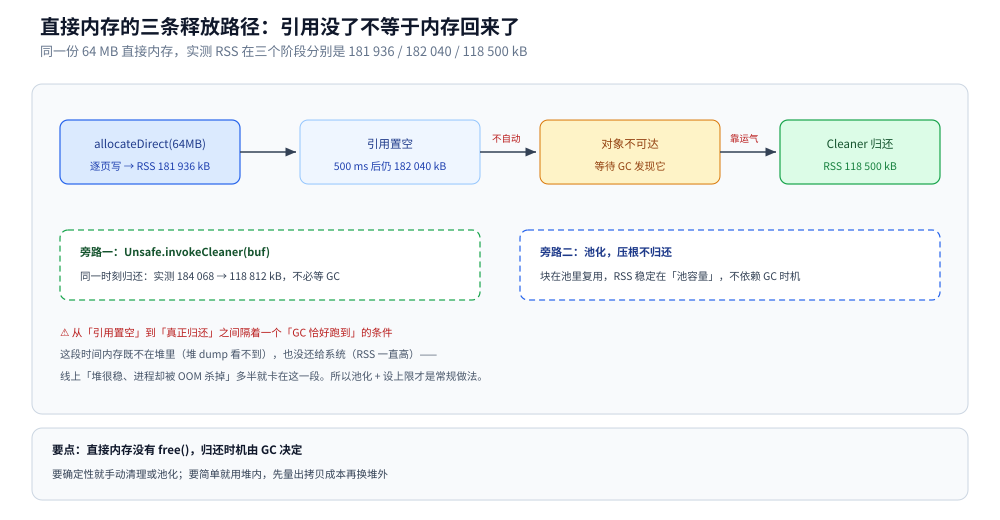
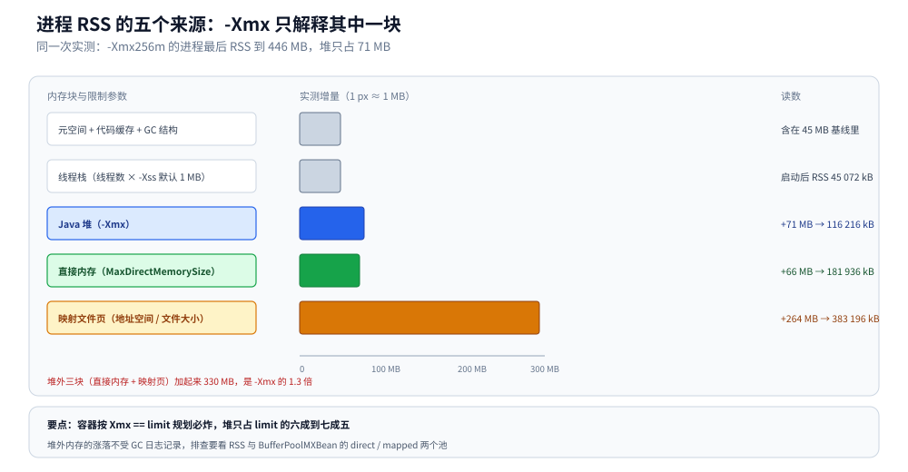

# 堆外内存与内存映射

> 覆盖：从零分清一块字节数据能待的三个位置（堆内 `HeapByteBuffer`、堆外 `DirectByteBuffer`、文件映射 `MappedByteBuffer`）、直接内存为什么只能靠 GC 归还、三条释放路径的实测差距、`FileChannel.map` 与 `force()` 的落盘语义，以及「RSS 为什么远大于 `-Xmx`」的逐项账单。
>
> 不覆盖：JVM 堆内的分代与 GC 算法见 [垃圾回收原理与收集器.md](垃圾回收原理与收集器.md)；运行时数据区与栈帧见 [运行时数据区与栈帧.md](运行时数据区与栈帧.md)；`Unsafe.allocateMemory` 这类裸分配见 [Unsafe与内存布局.md](Unsafe与内存布局.md)；Linux 侧的虚拟内存、Page Cache 与 cgroup 回收见 [内存管理.md](../../../02-计算机基础/linux/内存管理.md)。
>
> 内容整理自个人学习笔记，素材见 [素材清单](../../../素材清单.md)。
>
> 实测口径：容器 `java-lab`，`eclipse-temurin:24-jdk`（24.0.2+12，linux/amd64，4 CPU），启动参数 `-Xmx256m -XX:MaxDirectMemorySize=128m`。源码 `.workbuddy/tmp/exp/java/unsafe/OFF.java`，进程内读 `/proc/self/status` 的 `VmRSS` / `VmSize` 做对照。⚠️ 耗时类读数（`force`）连跑 2 次给区间；RSS 是精确读数但会随代码缓存、GC 线程等抖动，区间取 ±2 MB 写。⚠️ Windows 下「映射期间删不掉文件」只按文档描述，未在 Windows 容器实测。

---

## 一、从零：一块字节数据能待在哪儿？

**本节要点**：同一段 64 MB 的数据，放在堆内、堆外、文件映射三个地方，**读写代码几乎一样，RSS 的涨幅也一样，差别全在「谁管这块内存」和「怎么归还」**。先把三个写法并排跑一遍，再谈机制。

### 1.1 三十行把三种缓冲都摸一遍

```java
import java.nio.*;
import java.nio.channels.*;
import java.nio.file.*;

public class Three {
    public static void main(String[] args) throws Exception {
        // ① 堆内：GC 管，受 -Xmx 限制
        ByteBuffer heap = ByteBuffer.allocate(64 * 1024 * 1024);
        heap.put(0, (byte) 1);

        // ② 堆外：JVM 自己 malloc，受 -XX:MaxDirectMemorySize 限制，靠 Cleaner 归还
        ByteBuffer direct = ByteBuffer.allocateDirect(64 * 1024 * 1024);
        for (int i = 0; i < direct.capacity(); i += 4096) direct.put(i, (byte) 1);

        // ③ 文件映射：mmap，页缓存就是你的缓冲区，落盘靠 force()
        try (FileChannel ch = FileChannel.open(Paths.get("/tmp/big.bin"),
                StandardOpenOption.CREATE, StandardOpenOption.READ, StandardOpenOption.WRITE)) {
            MappedByteBuffer mb = ch.map(FileChannel.MapMode.READ_WRITE, 0, 64L * 1024 * 1024);
            for (int i = 0; i < mb.capacity(); i += 4096) mb.put(i, (byte) 1);
            mb.force();
        }
    }
}
```

三行 `put` 的写法一模一样，但三块内存的归属完全不同：

| | 堆内 `HeapByteBuffer` | 堆外 `DirectByteBuffer` | `MappedByteBuffer` |
|---|---|---|---|
| 分配 | `ByteBuffer.allocate(n)` | `ByteBuffer.allocateDirect(n)` | `FileChannel.map(...)` |
| 内存在哪 | JVM 堆里（一个 `byte[]`） | 进程的匿名映射区（`malloc` / `mmap`） | 文件的页缓存映射进来的虚拟地址 |
| 受谁管 | GC，`-Xmx` | 只受 `-XX:MaxDirectMemorySize` | 虚拟地址空间 + 文件大小 |
| 谁归还 | GC 直接回收 | ⚠️ 靠 `Cleaner` 在**那个 `ByteBuffer` 对象被 GC 时**归还 | 同左，靠 `Cleaner` 触发 `munmap` |
| 省了什么 | — | 写 socket / 文件时**少一次堆内到堆外的拷贝** | 读写大文件**少一次内核缓冲区到用户缓冲区的拷贝** |

### 1.2 差别不在「快慢」，在「什么时候归还」

这是本篇最需要先建立的一条：堆外内存**没有 `free()`**，`allocateDirect` 返回的 `ByteBuffer` 一旦丢掉引用，就只剩 GC 能帮你还。三条路径各跑一遍：

```text
== B. 堆外 64MB 逐页写后 ==
VmRSS: 181936 kB
== C. 只去引用不 GC ==
置空引用 500ms（未 GC）后 | VmRSS: 182040 kB
System.gc() 之后            | VmRSS: 118500 kB
== C2. 手动 invokeCleaner ==
第二个 64MB 逐页写后          | VmRSS: 184068 kB
U.invokeCleaner 之后（同一时刻）| VmRSS: 118812 kB
```

三次读数的含义逐条对：

| 动作 | RSS | 说明 |
|---|---|---|
| 分配并逐页写 64 MB | 181 936 kB | 逐页写很关键：只 `allocate` 不写，页还没真正落到物理内存，RSS 不会涨 |
| 把引用置空、等 500 ms | 182 040 kB | **一点没还**。没有 `free`，没有 GC，内存就一直挂着 |
| `System.gc()` 之后 | 118 500 kB | 少了 63 MB：`Cleaner` 被触发，归还给了操作系统 |
| 再分配 64 MB 后 `invokeCleaner` | 184 068 → 118 812 kB | 手动清理**同一时刻**就还，不必等 GC |



这张图把「引用没了一定释放」这个直觉纠正过来：从置空到真正归还之间还隔着一个「GC 恰好跑到」的条件，中间这段时间内存既不在堆里（堆 dump 看不到），也没有被归还（RSS 一直高）。线上「堆很稳但进程被 OOM 杀掉」多数就是卡在这一段。

## 二、为什么要有堆外内存？

**本节要点**：堆内缓冲区写 socket 时，内核要求的数据必须在**堆外**（因为 GC 会移动对象、地址不稳定），所以 JDK 每次都要先拷到一块临时直接内存。堆外缓冲区省的就是这一次拷贝——代价是失去 GC 的自动归还。

### 2.1 省下的那一次拷贝

一次 `SocketChannel.write(ByteBuffer)` 的路径：

| 写入的缓冲 | 实际发生的事 | 拷贝次数 |
|---|---|---|
| `HeapByteBuffer` | JDK 在内部临时 `allocateDirect` 一块同大小的直接内存 → 把堆内数据拷过去 → 写入 | 2（堆内 → 临时直接内存 → 内核） |
| `DirectByteBuffer` | 直接把用户态地址交给内核 | 1（直接内存 → 内核） |

这就是 Netty 默认用直接内存的原因：一次请求里省一次 64 KB 级别的拷贝，百万 QPS 下就是可观的 CPU 与内存带宽。代价同样明确——这块内存不在堆里，堆监控看不见它。

### 2.2 直接内存的上限与 OOM 原文

直接内存的上限由 `-XX:MaxDirectMemorySize` 决定（不设时约等于 `-Xmx`）。写成 `128m` 之后，一块 16 MB 地分配、并把引用留着不放：

```text
== E. 超过 MaxDirectMemorySize ==
第 9 块 16MB 时 OutOfMemoryError: Cannot reserve 16777216 bytes of direct buffer memory (allocated: 134217728, limit: 134217728)
```

三点从这行原文读出来：

1. 触发点在**第 9 块**：前 8 块 128 MB 正好到 limit，第 9 块连「先分配再检查」的机会都没有。
2. `allocated` 与 `limit` 相等都是 134 217 728（= 128 MB），说明这个计数由 JVM 自己维护，不依赖操作系统。
3. 报错类型是 `OutOfMemoryError` 但**不是堆溢出**——堆此时只用了 64 MB（第一节的 `byte[]`），`-Xmx256m` 远没到。看到这个措辞要先看 `MaxDirectMemorySize`，别急着调 `-Xmx`。

⚠️ 反过来说：如果循环里分配的直接内存**没有留住引用**，GC 会不断回收，你永远不会看到这个 OOM——但 RSS 也可能一直涨（分配速度超过回收速度）。这也是「本地复现不出来、线上却炸」的常见原因。

## 三、内存映射：文件怎么进地址空间？

**本节要点**：`map` 之后文件的内容直接出现在进程的虚拟地址里，读写就是读写内存；**但没有 `force()` 就没有落盘保证**，掉电时页缓存里没刷的部分会丢缓存（文件里留着旧内容）。

### 3.1 map 之后写入落在哪

```java
try (FileChannel ch = FileChannel.open(p, StandardOpenOption.CREATE,
        StandardOpenOption.READ, StandardOpenOption.WRITE)) {
    MappedByteBuffer buf = ch.map(FileChannel.MapMode.READ_WRITE, 0, 4096);
    buf.put("hello mmap".getBytes(StandardCharsets.UTF_8));
    buf.force();                                  // 等价 msync：把脏页写回文件
}
```

实测一块 256 MB 的映射、逐页写完之后：

```text
mmap 256MB 逐页写后 | VmSize: 3321684 kB
mmap 256MB 逐页写后 | VmRSS:   383196 kB
mb.force() = 602 ms，文件大小 = 256 MB
```

`VmRSS` 涨了 264 MB（从 `System.gc()` 之后的 118 MB 到 383 MB），说明**映射的文件页真的进了进程的物理内存**——它不是「一块虚拟地址空壳」，用的是 Page Cache，但计在进程 RSS 里。这也解释了为什么 `mmap` 大文件时容器的内存看起来「凭空多了一大块」。

`force()` 602 ms 是把 256 MB 脏页写回磁盘的代价（容器内写的是 overlayfs，实际落盘路径比裸机长，绝对值偏大，只看量级）。两个变体：

| 调用 | 等价于 | 刷什么 |
|---|---|---|
| `buf.force()` / `buf.force(false)` | `msync(MS_SYNC)` | 只刷数据页 |
| `buf.force(true)` | `fsync` 语义 | 数据 + 元数据（文件大小、mtime） |
| `channel.force(true)` | `fsync` | 同上，用于非 mmap 的普通写 |

### 3.2 映射什么时候解除

`MappedByteBuffer` 没有 `close()`。解除映射同样靠 `Cleaner`（`Unsafe.invokeCleaner(buf)` 可手动触发），在解除之前：

- 文件被这个进程「占着」：Linux 下删掉目录项仍可，Windows 下会直接拒绝删除。
- 映射区一直占着虚拟地址空间；RSS 里的那些页可以被内核回收（它们有文件做后备），但地址不释放。

所以大文件批处理的做法是**分段映射、用完就清**，而不是整个文件一次映射到底。

## 四、RSS 为什么远大于 Xmx？

**本节要点**：`-Xmx` 只限制**Java 堆**一块。进程的真实占用 = 堆 + 元空间 + 线程栈 + 直接内存 + 代码缓存 / GC 自身结构 + 映射的文件页。容器里按 `Xmx == limit` 规划，必炸。

### 4.1 一次实验的逐项账单

同一个进程（`-Xmx256m -XX:MaxDirectMemorySize=128m`）在每一步的 RSS：

| 阶段 | VmRSS | 增量 | 这块内存属于 |
|---|---|---|---|
| 刚启动（只有 JVM 自身） | 45 072 kB | — | 堆的已用部分、元空间、代码缓存、GC 线程栈、JVM 自己的 so |
| 分配堆内 64 MB（`byte[]`，只写一个字节） | 116 216 kB | +71 MB | Java 堆，受 `-Xmx` 管 |
| 再分配堆外 64 MB 并逐页写 | 181 936 kB | +66 MB | 直接内存，受 `MaxDirectMemorySize` 管 |
| `System.gc()` 归还直接内存 | 118 500 kB | −63 MB | 回到「只有堆」的水平 |
| 再 mmap 256 MB 并逐页写 | 383 196 kB | +264 MB | 文件页，受地址空间与文件大小管 |

两个细节值得记住：

- **VMSize 从启动的 2 992 976 kB 起跳**（约 2.9 GB），远大于 RSS。这是 JVM 预留的虚拟地址空间（堆的保留区、代码缓存、GC 的元数据），虚拟地址不花钱，RSS 才花钱。
- **堆内 64 MB 让 RSS 涨了 71 MB**，多出的 7 MB 是逐页触碰过程中的页表与零散分配；这类「测量误差」必须在读数里留出来，否则会把 7 MB 当成泄漏。

### 4.2 容器里怎么留余量

| 组成 | 典型量级 | 怎么控 |
|---|---|---|
| Java 堆 | `-Xms` ~ `-Xmx` | 显式设，别让 JVM 按 cgroup 自动算（大容器上算出来常常过大） |
| 元空间 | 几十 ~ 几百 MB | `-XX:MaxMetaspaceSize`，动态类加载多的服务必须设上限 |
| 线程栈 | 线程数 × `-Xss`（默认 1 MB） | 见 [线程与进程开销.md](../并发编程/线程与进程开销.md) 的实测账单 |
| 直接内存 | Netty / NIO 用到就涨 | `-XX:MaxDirectMemorySize` |
| 代码缓存 | 几十 MB | `-XX:ReservedCodeCacheSize` |
| 映射文件 / JNI / so | 按业务 | 分段映射、及时 `invokeCleaner` |

经验值：容器 `limit` 的 60%~75% 给堆，剩下的留给上面这些，否则 cgroup OOM Killer 会直接杀进程（`Exit Code 137`），GC 日志里什么都看不到。容器内该看哪些 cgroup 文件，见 [内存管理.md](../../../02-计算机基础/linux/内存管理.md) 的「容器里的内存限额怎么看」。



图里把「进程 RSS」画成一个整体，下面五块按实测增量标注：堆 71 MB、直接内存 66 MB、映射文件 264 MB 各自独立记账、互不挤占，元空间与线程栈按默认量级标注。读这张图要得出的结论只有一句：`-Xmx` 只是最左那一块，剩下四块加起来可以超过堆本身。

**本节要点**：堆外只解决两类问题 —— 绕开 GC 的大块缓冲、以及让文件直接进地址空间；两类的约束完全不同，别把它们混成「用堆外更快」。

| 场景 | 用哪块内存 | 关键约束 |
|---|---|---|
| Netty / 自研 RPC 的收发缓冲 | 直接内存 + 池化 | 必须设 `MaxDirectMemorySize`，池化后每块复用、避免靠 GC 归还 |
| 大文件顺序读写、日志归档 | 直接内存（`FileChannel` + `DirectByteBuffer`） | 缓冲大小取 64 KB ~ 1 MB，别一次读整个文件 |
| 大文件随机读写、索引文件 | `MappedByteBuffer` 分段映射 | 段大小按 256 MB ~ 1 GB 切；用完 `invokeCleaner` |
| 多进程共享同一份只读数据 | 只读映射（`MapMode.READ_ONLY`） | 页缓存跨进程共享，RSS 只在真的访问到页时增长 |
| 堆内缓存 / 业务对象 | 堆内 | 简单优先；只有在「拷贝成本」被量出来之后才换堆外 |
| 本项目内 | [零拷贝.md](../../go/运行时/零拷贝.md) 的 Go 侧 mmap | 同一套 `msync` 语义，对照看两种 runtime 谁在替你管归还 |

## 六、具体使用

**本节要点**：三段可直接抄的代码——池化的直接内存（避免频繁分配与 GC 依赖）、分段映射读大文件、以及显式归还。

### 6.1 池化直接内存

```java
static final class DirectPool {
    private final java.util.ArrayDeque<ByteBuffer> free = new java.util.ArrayDeque<>();
    private final int chunk;

    DirectPool(int chunk, int size) {
        this.chunk = chunk;
        for (int i = 0; i < size; i++) free.add(ByteBuffer.allocateDirect(chunk));
    }

    ByteBuffer acquire() {
        ByteBuffer b = free.poll();
        if (b == null) b = ByteBuffer.allocateDirect(chunk);   // 池空了才新分配
        b.clear();
        return b;
    }

    void release(ByteBuffer b) {
        if (b.capacity() == chunk && free.size() < 1024) free.add(b);
        // 超出池容量就丢掉引用，交给 Cleaner 慢慢还
    }
}
```

池化的意义不只是「少分配」，更是「把归还的时机从 GC 手里拿回来」——池里预留的块永远不归还，池外的块由 GC 兜底，RSS 因此稳定在一个可预测的水平。

### 6.2 分段映射读大文件

```java
static long sumFile(Path p, long segBytes) throws Exception {
    long total = 0;
    try (FileChannel ch = FileChannel.open(p, StandardOpenOption.READ)) {
        long size = ch.size();
        for (long off = 0; off < size; off += segBytes) {
            long len = Math.min(segBytes, size - off);
            MappedByteBuffer mb = ch.map(FileChannel.MapMode.READ_ONLY, off, len);
            for (int i = 0; i < len; i++) total += mb.get(i);
            free(mb);                                    // 用完立刻解除映射，见 6.3
        }
    }
    return total;
}
```

`segBytes` 是这一段的全部艺术：太小 → 系统调用与映射开销占主导；太大 → 一次触碰的页太多，容器 RSS 瞬间冲高。1 GB 以下服务取 64 MB 起步，边测边调。

### 6.3 显式归还

```java
import java.lang.reflect.Field;

private static final sun.misc.Unsafe U = loadUnsafe();

private static sun.misc.Unsafe loadUnsafe() {
    try {
        Field f = sun.misc.Unsafe.class.getDeclaredField("theUnsafe");
        f.setAccessible(true);
        return (sun.misc.Unsafe) f.get(null);
    } catch (ReflectiveOperationException e) {
        throw new IllegalStateException(e);
    }
}

static void free(ByteBuffer buf) {
    if (buf != null && buf.isDirect()) U.invokeCleaner(buf);   // 立即 munmap / free
}
```

⚠️ `Unsafe.invokeCleaner` 在 JDK 24 上已经带弃用警告（实测输出 `will be removed in a future release`），新代码应优先用池化 + 设置上限，而不是依赖手动清理。

## 延伸追问

- **`DirectByteBuffer` 到底什么时候释放？** → 那个 `ByteBuffer` 对象不可达、且 GC 真的跑到之后，由 `Cleaner` 归还；第一节的读数里，置空引用 500 ms 后 RSS 一动没动，`System.gc()` 之后才掉 63 MB。所以高频分配直接内存要池化，并显式设 `-XX:MaxDirectMemorySize`。
- **堆外泄漏怎么定位？** → 堆 dump 里当然看不到。要看进程 RSS 与 `/proc/<pid>/smaps` 里的匿名映射段，再对照 `BufferPoolMXBean` 的 `direct` / `mapped` 两个池的 `memoryUsed`：池子涨而堆不涨，基本就是直接内存；池子不涨而 RSS 涨，怀疑 JNI / `Unsafe.allocateMemory` / 映射文件。指标口径见 [内存管理.md](../../../02-计算机基础/linux/内存管理.md)。
- **为什么 `mmap` 之后 RSS 涨得比写入的数据还多？** → 页是按 4 KB 触碰的，第一次访问就会把整页读进来；实测 256 MB 映射逐页写，RSS 涨 264 MB，多出的部分包含页表本身。这也是「按需缺页」的正常开销，不是泄漏。
- **`MappedByteBuffer` 为什么删不掉文件？** → 映射期间 unmap 由 `Cleaner` 触发，Windows 下会直接锁文件；`force()` 只保证刷盘，不解除映射。要删就先 `invokeCleaner` 再删。
- **`buffer.force()` 和 `channel.force(true)` 一样吗？** → 语义同源（`msync` / `fsync`），但 `force(true)` 连元数据一起刷，代价更高；只关心数据时用 `force(false)`。
- **`-XX:MaxDirectMemorySize` 不设会怎样？** → 默认约等于 `-Xmx`。但注意它与 GC 回收速度是两回事：上限只在「已分配未归还」的总量超限时触发 OOM，回收跟不上时 RSS 会一直贴着上限走。
- **虚拟线程时代线程栈还算不算大头？** → 平台线程仍是 `线程数 × -Xss`（默认 1 MB，实测见 [线程与进程开销.md](../并发编程/线程与进程开销.md)）；虚拟线程的栈在堆里、按需增长，因此消耗的是 `-Xmx` 而不是 RSS 的独立一项。

## 关联

- **上游/总纲**：[垃圾回收原理与收集器.md](垃圾回收原理与收集器.md) — 堆内的分代结构与 GC 算法，本篇讲的是「堆外那一半」
- **对照/互补**：[运行时数据区与栈帧.md](运行时数据区与栈帧.md) — 堆、栈、元空间在运行时的位置，加上本篇的直接内存与映射区才是完整的地址空间
- **下游机制**：[Unsafe与内存布局.md](Unsafe与内存布局.md) — `allocateMemory` / `invokeCleaner` 这些底层入口的用法与风险
- **对照/互补**：[线程池.md](../并发编程/线程池.md) — 线程数 × `-Xss` 直接决定线程栈占用
- **对照/互补**：[内存管理.md](../../../02-计算机基础/linux/内存管理.md) — 虚拟内存、Page Cache、cgroup 限额的内核侧口径
- **对照/互补**：[零拷贝.md](../../go/运行时/零拷贝.md) — Go 侧的 `syscall.Mmap` 与缓冲写落盘边界
> 反向引用（本篇被下列文档引到）：[线程与进程开销.md](../并发编程/线程与进程开销.md)、[JFR与诊断工具.md](JFR与诊断工具.md)、[JVM启动与参数体系.md](JVM启动与参数体系.md)、[对象布局与引用类型.md](对象布局与引用类型.md)
