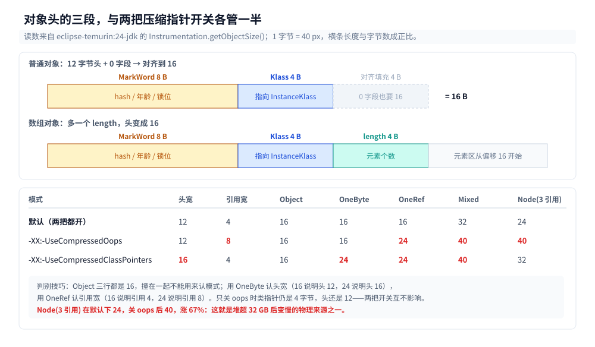
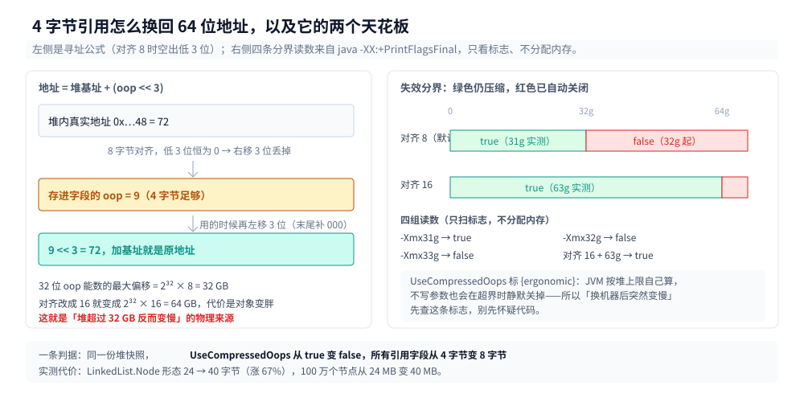
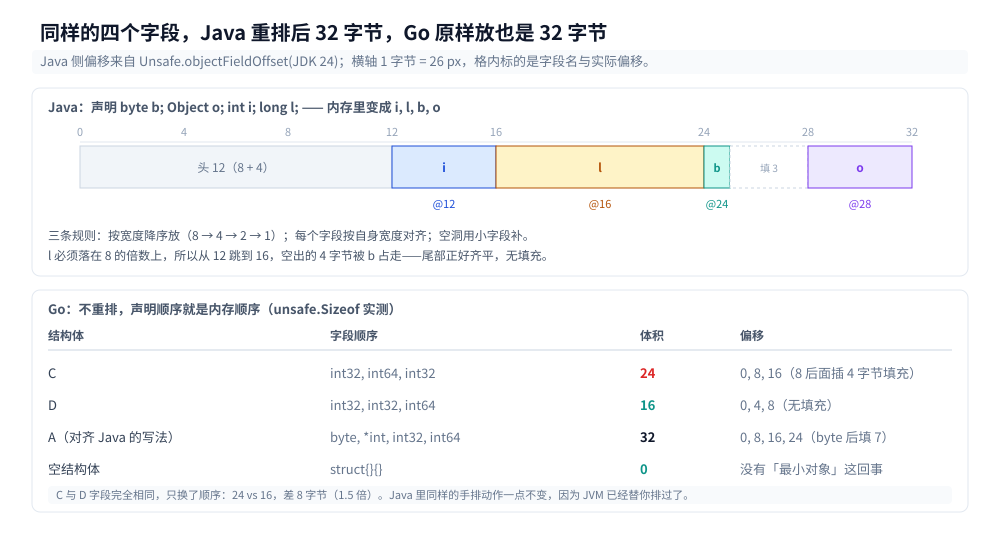
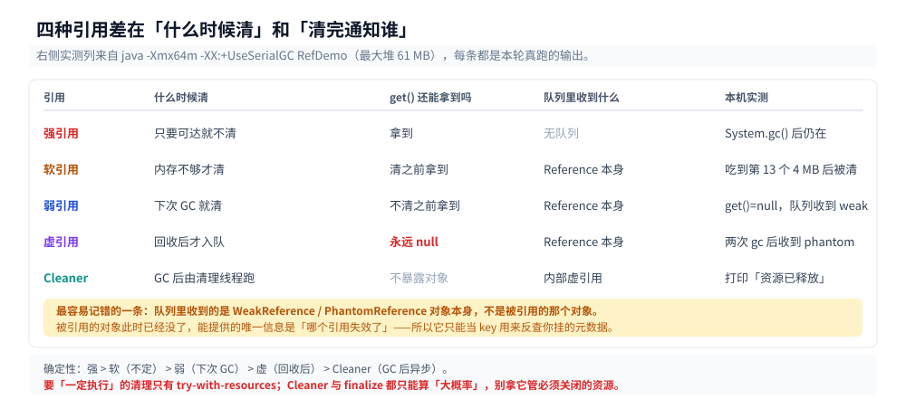

# 对象布局与引用类型

> 覆盖：一个 `new` 出来的对象在堆里到底占多少字节、这十几个字节由谁决定、字段为什么不按声明顺序排、数组头为什么多 4 字节、两把压缩指针开关分别省了什么、MarkWord 里哪些位真能读到、四种引用（强 / 软 / 弱 / 虚）与 `Cleaner` 在**回收时机**上的差别，以及 JDK 24 的紧凑对象头能把它压到多少。
>
> 不覆盖：分代与收集器见 [垃圾回收原理与收集器.md](垃圾回收原理与收集器.md)、GC 日志见 [GC调优与日志.md](GC调优与日志.md)；对象头里的**锁位**怎么变化见 [锁与AQS.md](../并发/锁与AQS.md)；`.class` 文件格式与 `getfield` 指令见 [类文件与字节码.md](类文件与字节码.md)；堆外内存与 `mmap` 见 [堆外内存与内存映射.md](堆外内存与内存映射.md)。
>
> 内容整理自个人学习笔记，素材见 [素材清单](../../../素材清单.md)。
>
> 实测口径：`eclipse-temurin:24-jdk`（24.0.2+12，linux/amd64，容器 4 CPU，默认堆与默认 `UseCompressedOops`）。对象体积用自写 `-javaagent` 挂 `Instrumentation.getObjectSize()` 量，字段偏移用 `sun.misc.Unsafe.objectFieldOffset()` 量，MarkWord 用 `Unsafe.getLong(o, 0)` 读；引用实验用 `-Xmx64m -XX:+UseSerialGC`。Go 对照在 `golang:1.26-alpine` 下 `go run`。

---

## 一、`new Object()` 为什么占 16 字节？

**本节要点**：一个**没有任何字段**的对象也要吃掉 16 字节——12 字节的头部加 4 字节对齐填充。这 12 字节里，8 字节是 MarkWord，4 字节是指向类元数据的指针。

### 1.1 从零：先写一个能量对象体积的 agent

JVM 不提供「这个对象多大」的公开 API，唯一可靠的口子是 `java.lang.instrument`。它必须**在 `main` 之前**挂上去，所以只能走 `-javaagent`。

```java
// SizeAgent.java
import java.lang.instrument.Instrumentation;

public class SizeAgent {
    static Instrumentation inst;

    public static void premain(String arg, Instrumentation i) {
        inst = i;                          // premain 在 main 之前被调用
    }

    public static long size(Object o) {
        return inst.getObjectSize(o);      // 只算这个对象自身，不含它引用的对象
    }
}
```

清单文件 `agent.mf` 一行就够，打 jar 时用 `cfm` 把清单塞进去：

```text
Premain-Class: SizeAgent
```

```bash
javac Layout.java SizeAgent.java
jar cfm size-agent.jar agent.mf SizeAgent.class
java -javaagent:size-agent.jar Layout
```

被量的那批类都写成静态内部类，一个类只放一种字段组合：

```java
static class Empty {}                      // 一个字段都没有
static class OneInt { int i; }
static class OneLong { long l; }
static class OneRef { Object o; }
static class OneByte { byte b; }
static class Mixed { long l; int i; byte b; Object o; }
static class MixedReordered { byte b; Object o; int i; long l; }
```

读数是这样的：

| 类 | 字段 | 实测体积 |
|---|---|---|
| `Object` | 无 | **16 B** |
| `Empty` | 无 | **16 B** |
| `OneInt` | `int` | 16 B |
| `OneRef` | `Object` 引用 | 16 B |
| `OneByte` | `byte` | 16 B |
| `OneLong` | `long` | 24 B |
| `ByteLong` | `byte` + `long` | 24 B |
| `LongByte` | `long` + `byte` | 24 B |
| `Mixed` | `long` + `int` + `byte` + 引用 | 32 B |
| `MixedReordered` | `byte` + 引用 + `int` + `long` | 32 B |
| `SubInt` | 父类 `int` + 子类 `int` | 24 B |
| `IntAndRef` | `int` + 引用 | 24 B |

⭐ 先记住两条反直觉的：`OneByte` 和 `Object` **一样大**（都是 16）；`Mixed` 换了声明顺序**一点没变**（都是 32）。

### 1.2 16 字节拆开：12 字节的头 + 0 字段 + 4 字节对齐

`Empty` 一个字段都没有，却要 16 字节，因为它有头。64 位 HotSpot 在**开启压缩类指针**时，对象头是 12 字节：

| 段 | 宽度 | 存什么 |
|---|---|---|
| MarkWord | 8 B | hash、GC 年龄、锁状态——每个对象都要可变，所以给足 8 字节 |
| Klass 指针 | 4 B | 指向方法区里的 `InstanceKlass`，`getClass()` 与虚方法分派靠它 |
| （数组才有）length | 4 B | 元素个数，见第四节 |

12 不是 8 的倍数，所以再加 4 字节填充凑到 16——**最小对象 16 字节，其中真正的数据是 0 字节**。



图中上半是默认模式下的三段头部，下半是两把压缩指针开关各自的管辖范围；右侧一列是本机实测的边界读数，可以看到「关 oops 头仍是 12 字节、只关类指针头才变 16 字节」。

### 1.3 对齐不是浪费，是必须

对象起点必须 8 字节对齐（`ObjectAlignmentInBytes = 8`，`-XX:+PrintFlagsFinal` 实测），这条约束来自三处：

- 压缩指针用「偏移量 ÷ 8」编码，不对齐就没法除以 8；
- `long` / `double` 字段要求 8 字节对齐，对象起点不对齐就得插更多填充；
- 缓存行搬运用对齐后的地址做 `movdqa` 一类指令。

代价可以量化。`byte[9]` 与 `byte[16]` 实测**都是 32 字节**（16 头 + 9 或 16，都凑到 32），也就是说 9 字节的数组有 7 字节是纯填充。`byte[0]` 是 16 字节——一个空数组也要 16 字节的头。

批量场景更直观：分配 400 万个 `Empty`，存活对象实测占 **80,418,720 字节**，减去 `Object[4000000]` 数组自身的 16,000,016 字节，每个对象 **≈16.1 字节**。400 万个「什么都没有」吃掉 64 MB。

对齐粒度是可调的（`-XX:ObjectAlignmentInBytes=16`），但**调大只会让所有对象变胖**：

| 类 | 对齐 8（默认） | 对齐 16 |
|---|---|---|
| `Object` / `Empty` / `OneInt` / `OneRef` / `OneByte` | 16 | 16 |
| `OneLong` | 24 | **32** |
| `SubInt`（两个 `int`） | 24 | **32** |
| `IntAndRef`（`int` + 引用） | 24 | **32** |
| `LinkedList.Node` 形态 | 24 | **32** |
| `Mixed` | 32 | 32 |

`OneLong` 从 24 涨到 32：头 12 + 填充 4 + 8 = 24 已经够，但对齐 16 要求总长是 16 的倍数。**调大对齐的唯一理由是给压缩指针换更大的寻址范围**（见 2.2），不是省内存。

---

## 二、两把开关分别管头的哪一半？

**本节要点**：`UseCompressedOops` 管**普通引用字段**（4↔8 字节），`UseCompressedClassPointers` 管**头里的 Klass 指针**（4↔8 字节）。两者独立：关掉前者不会让头变大，只会让每个引用字段变大。

### 2.1 三种指针模式的实测对照

同一个 `Layout` 程序，只改 JVM 参数，读数变成三组：

| 类 | 默认（都压缩） | `-XX:-UseCompressedOops` | `-XX:-UseCompressedClassPointers` |
|---|---|---|---|
| `Object` | 16 | 16 | 16 |
| `OneByte` | 16 | 16 | **24** |
| `OneInt` | 16 | 16 | **24** |
| `OneRef` | 16 | **24** | **24** |
| `Mixed` | 32 | **40** | **40** |
| `LinkedList.Node` 形态（3 个引用） | 24 | **40** | **32** |
| `HashMap.Node` 形态（1 个 `int` + 3 个引用） | 32 | **40** | **32** |

三列对应三种头部 + 三种引用宽度：

| 模式 | 头 | 引用字段 |
|---|---|---|
| 默认 | 12（8 + 4） | 4 |
| `-XX:-UseCompressedOops` | 12（8 + 4，类指针没关） | 8 |
| `-XX:-UseCompressedClassPointers` | 16（8 + 8） | 4 |

`Object` 三列都是 16：默认 12 + 0 → 16，另两种 16 + 0 → 16，恰好撞在一起，别用它判别模式。**用 `OneByte` 判别头宽**（16 说明头是 12，24 说明头是 16），**用 `OneRef` 判别引用宽**。

### 2.2 压缩指针到底换到了什么

一个 4 字节的数最大 2³² ≈ 4G，可堆能开到几百 G。做法是把引用当成**偏移量除以 8**：`真实地址 = 基址 + (引用 << 3)`。8 字节对齐正好空出 3 个低位，32 位就能寻址 32 GB（2³² × 8）。

这是「拿对齐换位宽」：代价是**堆超过 32 GB 时压缩指针自动失效**（`UseCompressedOops` 是 `{ergonomic}`，由 JVM 自己算），届时每个引用字段翻倍、对象变大、缓存命中率下降——这就是「堆开到 32 GB 以上反而变慢」那条经验的物理来源之一。

分界点可以直接用 `-XX:+PrintFlagsFinal` 扫出来，不用真的分配内存：

```text
-Xmx31g                        -> UseCompressedOops = true   {ergonomic}
-Xmx32g                        -> UseCompressedOops = false  {default}
-Xmx33g                        -> UseCompressedOops = false  {default}
-XX:ObjectAlignmentInBytes=16 -Xmx63g -> true   {ergonomic}
-XX:ObjectAlignmentInBytes=16 -Xmx64g -> false  {default}
```

⭐ 这张表把「对齐」和「压缩」的换算关系摆明了：**对齐 8 换成 32 位偏移，能覆盖 32 GB；对齐 16 能覆盖 64 GB**。所以 `ObjectAlignmentInBytes=16` 不是「省内存的旋钮」，而是「想让 32~64 GB 的堆继续用 4 字节引用」时才开的旋钮——代价见 1.3，每个对象都可能变胖 8 字节。



图中左边是 4 字节偏移怎么换回真实地址（低 3 位永远为 0，所以能省掉），右边是本机扫出的四组分界读数；两条水平虚线分别是 32 GB 与 64 GB 的天花板。

### 2.3 为什么默认是开的

因为它省的不是一点点。`LinkedList.Node` 形态（3 个引用）24 → 40，涨 67%；100 万个这样的节点从 24 MB 变 40 MB。而 32 GB 以下的堆是小到中型服务的常态，所以 HotSpot 直接按堆大小自动打开。

---

## 三、字段为什么不按我写的顺序排？

**本节要点**：HotSpot 按**宽度降序**重排字段，把小字段塞进大字段留下的空洞里。所以声明顺序几乎不影响体积，`Mixed` 与 `MixedReordered` 都是 32 字节。

### 3.1 从零：用 Unsafe 读偏移

体积只告诉你「多大」，偏移才告诉你「怎么排的」。`Unsafe.objectFieldOffset()` 是唯一不经反射包装、直接给出字节偏移的口子：

```java
Field f = Unsafe.class.getDeclaredField("theUnsafe");
f.setAccessible(true);
U = (Unsafe) f.get(null);

System.out.println(U.objectFieldOffset(Mixed.class.getDeclaredField("i")));
```

⚠️ JDK 24 上这条路已经进入「倒计时」：编译时打 `Unsafe is internal proprietary API and may be removed in a future release`，运行时还会在 stderr 打 `A terminally deprecated method in sun.misc.Unsafe has been called` 并点名调用方。本篇用它只是**为了量偏移**，生产代码里的替代路线是 `VarHandle`（读字段）与 `MemorySegment`（堆外内存）。

`Mixed` 的声明顺序是 `byte b; Object o; int i; long l;`，实测偏移：

| 字段 | 声明位置 | 实际偏移 |
|---|---|---|
| `i`（`int`） | 第 3 个 | **12** |
| `l`（`long`） | 第 4 个 | **16** |
| `b`（`byte`） | 第 1 个 | **24** |
| `o`（引用） | 第 2 个 | **28** |

声明顺序 `b, o, i, l`，内存顺序 `i, l, b, o`。`Small{b1, b2, s}` 更直白：`s` 在 12，`b1` 在 14，`b2` 在 15——`short` 抢到了头后面的第一个位置，两个 `byte` 排在它后面。



图中把 `Mixed` 的 32 字节按偏移画成一条横轴，标出哪几格是数据、哪几格是填充；右侧是 Go 的同一组字段，顺序原样保留，所以同样的字段反而更占地方。

### 3.2 三条排布规则

把上面的读数归纳成可复用的三条：

1. **按宽度降序放**：`long` / `double`（8）→ 引用与 `int` / `float`（4）→ `short` / `char`（2）→ `byte` / `boolean`（1）。JVM 内部按「宽松度」给字段排位，宽的先占。
2. **每个字段按自身宽度对齐**：`long` 的偏移必须是 8 的倍数，`int` 与引用是 4 的倍数，`short` 是 2。
3. **空洞用更小的字段补**：`long` 前面若空了 4 字节（头是 12），`byte` 就搬进 12 这个位置——所以 `Mixed` 的 `b` 在 24 而不是 13。

`Mixed` 的完整推演：头占 0~12 → 先放 `long`，得跳到 16（12~16 空 4 字节）→ `l` 在 16~24 → `int` 在 24~28 → 引用在 28~32 → `byte` 塞回 12 那个空洞 → 总计 32，无尾部填充。

### 3.3 推论一：手动重排字段在 Java 里没有收益

C / C++ 里「按宽度降序写结构体」是标准做法，Java 里无效——因为 JVM 已经替你排了。`Mixed`（`long,int,byte,ref`）与 `MixedReordered`（`byte,ref,int,long`）实测都是 32 字节，一个字节都没省。

⚠️ 这条只在「字段集合相同」时成立。真正能省字节的动作是**减少引用字段、把 `Integer` 换成 `int`**——`IntAndRef` 24 字节里有 8 字节是两个 4 字节数字，换成一个 `long` 再加一个 `int` 也还是 24。**唯一稳的省法是减字段**。

### 3.4 推论二：Go 相反，顺序真的决定大小

同一组字段在 Go 里（`golang:1.26-alpine`，`unsafe.Sizeof` / `unsafe.Offsetof` 实测）：

| 结构体 | 字段顺序 | 体积 | 偏移 |
|---|---|---|---|
| `A` | `byte, *int, int32, int64` | **32** | `B=0, O=8, I=16, L=24` |
| `B` | `int64, int32, *int, byte` | **32** | `L=0, I=8, O=16, B=24` |
| `C` | `int32, int64, int32` | **24** | — |
| `D` | `int32, int32, int64` | **16** | — |

Go **不重排**，所以 `C` 与 `D` 差 8 字节（24 vs 16，1.5 倍）——把两个 `int32` 写在一起就省下来了。另外 Go 的空结构体 `struct{}{}` 是 **0 字节**，没有「最小对象 16 字节」这回事。

⭐⭐ **同一个问题两种文化**：Java 把「怎么排」交给 JVM，开发者写什么都一样；Go 把「怎么排」留给开发者，写错就多占 50%。从 Go 过来写 Java 时，**别把 C 的结构体排布经验带过来，也别指望它在 Java 里生效**。

---

## 四、数组头为什么多出 4 字节？

**本节要点**：数组对象比普通对象多一个 `length` 字段，所以数组头是 16 字节。`arrayBaseOffset` 恒为 16 就是这个原因——它同时把「头有多长」和「第一个元素从哪开始」一次告诉了你。

### 4.1 base 与 scale 的实测

```java
System.out.println(U.arrayBaseOffset(int[].class) + " " + U.arrayIndexScale(int[].class));
```

| 数组类型 | base（第一个元素偏移） | scale（元素宽度） |
|---|---|---|
| `int[]` | 16 | 4 |
| `Object[]` | 16 | 4 |
| `long[]` | 16 | 8 |

`base` 三个都是 16，`scale` 跟着元素类型变。这也顺手证明了引用在数组里同样是 4 字节（`Object[]` 的 scale 是 4 而不是 8）。

⚠️ `base = 16` 是**默认模式**的读数，别当常量背。把两把开关都关掉（`-XX:-UseCompressedOops -XX:-UseCompressedClassPointers`）之后：

```text
addressSize=8
int[]    base=20 scale=4
Object[] base=24 scale=8
```

`int[]` 的 20 = 头 16 + `length` 4；`Object[]` 的 24 是因为元素变成 8 字节，元素区要对齐到 8，20 后面那段被跳过了。所以完整公式是「头宽 + `length` 4，再按元素宽度向上取整」，16 只是默认参数下的特例。

顺带一个副作用：这个组合下 JVM 会打印 `[warning][cds] Unable to use shared archive.`——**CDS（类数据共享）失效**，因为共享归档是在特定指针模式下生成的。做基准测试时如果看到这行，说明启动时间已经不比平时，别拿它跟默认参数比启动。

### 4.2 那 4 字节存的是什么

存元素个数，位置在 12~16。它不能省：

- `arraylength` 指令要 O(1) 拿到它，不能去问 Klass；
- 每次 `a[i]` 都要做边界检查（`i < length`），不能多一次内存跳转；
- GC 遍历数组要知道扫多少个元素；
- `Object[]` 的每一个元素都得被当成引用去标记，长度决定标记几次。

### 4.3 一条能背下来的算式

```text
数组体积 = 16（头） + 元素宽度 × 元素个数，再向上取整到 8 的倍数
```

实测逐条对上：

| 数组 | 算式 | 实测 |
|---|---|---|
| `int[0]` | 16 + 0 | 16 |
| `int[1]` | 16 + 4 = 20 → 24 | 24 |
| `int[10]` | 16 + 40 = 56 | 56 |
| `int[100]` | 16 + 400 = 416 | 416 |
| `int[100000]` | 16 + 400,000 = 400,016 | 400,016 |
| `long[1]` | 16 + 8 = 24 | 24 |
| `Object[100000]` | 16 + 4 × 100,000 | 400,016 |
| `byte[9]` | 16 + 9 = 25 → 32 | 32 |

`int[100000]` 与 `Object[100000]` 体积**完全相同**（400,016）——`Integer` 对象本身另算 16 字节一个，数组里只存 4 字节的引用/数值。这正是「`int[]` 存 100 万个 `int` 要 4 MB，`ArrayList<Integer>` 要 4 MB + 16 MB」的来源（见 [集合容器.md](../集合容器.md)）。

---

## 五、MarkWord 里的哪些位真的能读到？

**本节要点**：`identityHashCode` 落在 MarkWord 的第 11~41 位（本机 5/5 命中）、GC 年龄在第 3 位、锁状态在最低 2 位。但**用 `Unsafe` 读并发状态读到的是某一瞬间的快照**，不同线程看到的可能不一样。

### 5.1 hashCode 落在第 11~41 位

```java
Object o = new Object();
int h = System.identityHashCode(o);   // 先算，才会写进 MarkWord
long m = U.getLong(o, 0L);
System.out.printf("0x%08x  0x%016x  match11=%b  match8=%b%n",
        h, m, (int) ((m >> 11) & 0x7FFFFFFFL) == h, (int) ((m >> 8) & 0x7FFFFFFFL) == h);
```

五个对象实测（每个都是新对象）：

```text
h=0x2f0e140b  mark=0x0000017870a05801  mark>>11匹配=true  mark>>8匹配=false
h=0x08efb846  mark=0x000000477dc23001  mark>>11匹配=true  mark>>8匹配=false
h=0x2a84aee7  mark=0x0000015425773801  mark>>11匹配=true  mark>>8匹配=false
h=0x0a09ee92  mark=0x000000504f749001  mark>>11匹配=true  mark>>8匹配=false
h=0x30f39991  mark=0x000001879ccc8801  mark>>11匹配=true  mark>>8匹配=false
```

5 个全中，且 `>>8` 全不中——说明本机这个构建里 hash 的起点是第 11 位（第 0~1 位锁、第 2 位偏向标记、第 3~6 位年龄、第 7~10 位空）。⚠️ 这个偏移**随 JDK 版本变**，不同版本算出的位宽不同，别把 `>>11` 当常量写进生产代码，只当作读源码时的验证手段。

⭐ 顺带一个语义：`hashCode` 只在第一次被调用时**算出来并写进 MarkWord**，之后不再变。所以「空对象头」是 `0x…0001`，调过一次 `identityHashCode` 之后才有那串数——这也是为什么分布式对象存储、`HashMap` 之外的场景里「对象 hash 稳定」是件好事。

### 5.2 年龄在第 3 位，晋升后归零

```java
Object survivor = new Object();
long prev = U.getLong(survivor, 0L);   // 0x0000000000000001
// 每轮塞 40 MB 再清空，逼出 Minor GC
```

`-Xmx64m -XX:+UseSerialGC` 实测：

```text
初始       MarkWord=0x0000000000000001
第 1 轮后  MarkWord=0x0000000000000009 ｜ 与初始的差异位=3
第 2 轮后  MarkWord=0x0000000000000001 ｜ 与初始的差异位=3
第 3 轮后  MarkWord=0x0000000000000001 ｜ 与初始的差异位=无
```

- 第 1 轮：熬过一次 Minor GC，年龄 +1 → `0x…09`（bit 3 变 1）；
- 第 2 轮：这个对象被晋升到老年代，**年龄位被清零**（`0x…01`）；
- 之后不再变——老年代里没有「年龄」这个概念。

这就是「晋升阈值」的真实形态：`-XX:MaxTenuringThreshold` 是**上限**，实际阈值由 `UseAdaptiveSizePolicy` 按 Survivor 占用动态算，所以本例在第 2 轮就晋升了，而不是默认的 15 轮。

### 5.3 锁位：别用 Unsafe 去读

未加锁时 MarkWord 是 `0x…0001`，最低 2 位 `01` 就是「未锁定」。加锁期间：

```text
锁外=0x0000000000000001 低4位=0001
锁内=0x0000000000000000 低4位=0000
释放后=0x0000000000000001 低4位=0001
```

持锁线程自己读是 `0x0`，另起一个线程去读同一个对象得到的是 `0xffffffffffffffff`（低 2 位 `11`）——**两个线程读到的不是同一个值**。这不是 bug，是「读 MarkWord 就是读一个正在被改写的字段」，没有任何同步语义。

⚠️ 所以：**MarkWord 的低位只能当「有变化」的证据，不能当「现在是什么状态」的判据**。锁状态机的完整语义（偏向 → 轻量 → 重量）见 [锁与AQS.md](../并发/锁与AQS.md)，那里用的是 `synchronized` 的**外部行为**（`jstack` 里的 `BLOCKED` / `WAITING`）而不是内部位。

---

## 六、四种引用在回收时机上差在哪？

**本节要点**：强引用只要还能顺着 GC Roots 走到就不动；软引用「内存不够才清」；弱引用「下次 GC 就清」；虚引用「清了才通知你，且永远拿不到对象」。**引用队列里收到的是 `Reference` 对象本身，不是被引用的对象**。

### 6.1 从零：64 MB 堆里跑一遍

```java
static final ReferenceQueue<Object> QUEUE = new ReferenceQueue<>();
static final List<byte[]> HOLD = new ArrayList<>();
```

四种引用各来一次，`System.gc()` 之后看 `get()` 与队列：

```java
// 1. 强引用
Object strong = new byte[1 << 20];
System.gc();
System.out.println("[强] System.gc() 后 strong 还在？ " + (strong != null));

// 2. 弱引用
Object w = new Object();
WeakReference<Object> weak = new WeakReference<>(w, QUEUE);
w = null;                                             // 去掉唯一的强引用
System.gc();
Object fromWeak = poll();
System.out.println("[弱] GC 后 get()=" + weak.get()
        + " ｜ 队列收到的是 weak 本身=" + (fromWeak == weak));

// 4. 虚引用
Object p = new Object();
PhantomReference<Object> phantom = new PhantomReference<>(p, QUEUE);
p = null;
System.gc(); System.gc();
Object fromPhantom = poll();
System.out.println("[虚] get()=" + phantom.get()
        + " ｜ 队列收到的是 phantom 本身=" + (fromPhantom == phantom));
```

`java -Xmx64m -XX:+UseSerialGC RefDemo` 的完整输出：

```text
最大堆 = 61 MB
[强] System.gc() 后 strong 还在？ true
[弱] GC 后 get()=null ｜ 队列收到的是 weak 本身=true
[软] 分配前 get() 长度=8388608
[软] 又吃掉 13 × 4MB 后 get()=null（已清）
[虚] get()=null ｜ 队列收到的是 phantom 本身=true
[Cleaner] 资源已释放
```



图中按「GC 会不会清」与「清完有没有通知」两个维度排开五条路；右侧是本机 61 MB 堆下的实测结果，软引用那一条要吃到第 13 个 4 MB 才被清。

⚠️ 这段代码有两个必须写对的细节，写错会得出完全相反的结论：

1. **`poll()` 之前要等**：清理是 `ReferenceHandler` 线程异步做的，`System.gc()` 返回时对象已死但引用还没入队。本机实测约 **200 ms** 才稳定入队，所以代码里 `poll()` 先 `Thread.sleep(200)`。少了这一步，会误报「没收到通知」。
2. **判据要写 `polled == weak`**：`ReferenceQueue` 是一个队列，弱引用那条通知没取走时，虚引用那次 `poll()` 拿到的其实是**上一个**引用。第一版就是因为这个把「虚引用收到了」判成了 true，其实收到的是 weak。

### 6.2 强 / 软：清不清取决于「还够不够」

强引用是最常见的那个，`strong` 变量本身就是一个 GC Root 可达路径，`System.gc()` 也叫不动它。

软引用（`SoftReference`）的语义是「**内存充足时等价于强引用，内存吃紧时才清**」。实测：先放一个 8 MB 的软引用，然后一路 `new byte[4MB]` 加到 `HOLD` 里，吃到第 **13** 个 4 MB（累计约 52 MB，逼近 61 MB 的堆）时软引用被清。

这个「13」不是规范值，是 HotSpot 的启发式：软引用清理时机由 `SoftRefLRUPolicyMSPerMB`（默认 1000）按「空闲堆 MB 数 × 1000 ms」估算，**从没被访问过的软引用最先被清**。所以软引用适合做**缓存**，不适合做**必需数据**——你永远不知道它什么时候消失。

### 6.3 弱 / 虚：清完通知谁

弱引用（`WeakReference`）是「下次 GC 就清」，不管内存够不够。实测 `get()` 直接变 `null`。

关键细节在这句：

```text
队列收到的是 weak 本身=true
```

`ReferenceQueue.poll()` 返回的是 **`WeakReference` 对象**，不是它引用的那个对象——被引用的对象已经没了，队列里能给的只有「哪个引用失效了」这条信息。所以标准用法是拿 `WeakReference` 当 `Map` 的 key 去反查自己挂的元数据：

```java
// 伪代码：WeakHashMap 的核心
Reference<?> ref = QUEUE.remove();
metaMap.remove(ref);            // 用 Reference 本身当 key
```

虚引用（`PhantomReference`）更极端：`get()` **永远返回 `null`**（规范禁止通过虚引用「复活」对象），它唯一的用途就是「对象已被回收」这条通知。所以虚引用**必须**配引用队列使用，单独一个虚引用没有任何意义。实测要调两次 `System.gc()` 才收到通知——第一次标记，第二次才入队。

### 6.4 `Cleaner` 为什么能替代 `finalize`

```java
Cleaner cleaner = Cleaner.create();
byte[] big = new byte[1 << 20];
cleaner.register(big, () -> System.out.println("[Cleaner] 资源已释放"));
big = null;
System.gc();
```

实测输出 `[Cleaner] 资源已释放`。它内部就是一个虚引用 + 一个专门跑清理逻辑的线程（`Cleaner-0`），所以：

- 清理动作**不在 GC 线程里跑**（`finalize` 是在 Finalizer 线程里跑，还拖慢 GC）；
- 不会让对象多活一轮（`finalize` 会让对象至少多熬一次 GC）；
- 异常不会静默吞掉（`finalize` 里的异常直接丢弃）。

⚠️ 但 `Cleaner` 依然**不确定**——它只在 GC 之后被触发。`DirectByteBuffer` 靠它释放堆外内存（见 [堆外内存与内存映射.md](堆外内存与内存映射.md)），所以「`-Xmx` 很大、堆外吃满」时可能迟迟不释放。确定性的清理只有 `try-with-resources`。

---

## 七、一个开关让头从 12 字节变 8 字节，值不值得开？

**本节要点**：JDK 24 的紧凑对象头（JEP 450）把 MarkWord 与 Klass 指针压进 8 字节，`Empty` 从 16 降到 8、`HashMap.Node` 从 32 降到 24。它是实验特性，默认关闭。

### 7.1 实测体积

```bash
java -XX:+UnlockExperimentalVMOptions -XX:+UseCompactObjectHeaders \
     -javaagent:size-agent.jar Layout
```

| 类 | 默认 | 紧凑头 | 变化 |
|---|---|---|---|
| `Object` / `Empty` | 16 | **8** | −50% |
| `OneInt` | 16 | 16 | 0 |
| `OneLong` | 24 | **16** | −33% |
| `OneRef` | 16 | 16 | 0 |
| `Mixed` | 32 | 32 | 0 |
| `LinkedList.Node` 形态 | 24 | 24 | 0 |
| `HashMap.Node` 形态 | 32 | **24** | −25% |
| `int[1]` | 24 | **16** | −33% |

规律很清楚：**字段少的对象收益最大，字段多的被字段本身摊平**。头从 12 压到 8，省下的 4 字节在「已经需要 32 字节」的对象上直接被尾部填充吃掉了。

### 7.2 为什么默认还是关的

`-XX:+PrintFlagsFinal` 实测 `UseCompactObjectHeaders = false {experimental}`。原因不在体积，在**兼容性**：头只有 8 字节，MarkWord 与 Klass 指针要挤在一起，锁状态、hash、年龄的编码全部改变，任何直接读对象头的 JNI 代码、agent、序列化库都可能踩空。

⚠️ 本篇只报**体积读数**，不涉及紧凑头下锁语义的变化——那是另一条独立的验证线。生产上要用它，先确认全部 agent 与 native 库都不碰对象头。

---

## 应用场景

| 场景 | 用到的结论 | 具体表现 |
|---|---|---|
| 容器选型 | 第二节、第四节 | `ArrayList` 每元素 4 字节（引用），`LinkedList` 每个节点 24 字节；100 万元素差 20 MB 以上 |
| 大对象缓存 | 第一节 | 每个 `Empty` 16 字节，用 `Object` 当哨兵值占位，100 万个就是 16 MB |
| 堆大小估算 | 第二节 | 关掉压缩指针或堆超 32 GB，引用字段翻倍，同样的对象图占用涨 30%~60% |
| 缓存失效设计 | 第六节 | 本地缓存用 `WeakHashMap`（key 弱引用）避免泄漏；内存敏感缓存用 `SoftReference` |
| 堆外资源释放 | 第六节、第七节 | `DirectByteBuffer` 依赖 `Cleaner`，释放时机不确定，大堆 + 小堆外时容易攒住 |
| 序列化 / 反序列化 | 第一节、第五节 | 头不参与序列化，但 `identityHashCode` 与对象地址无关，跨进程不能当 ID |

## 具体使用：按什么顺序查一个对象的体积

```text
① 这个类有多少字段？各是什么类型？          → 按第三节三条规则手算一版
② 有没有引用字段？堆多大？                  → 决定引用是 4 还是 8 字节（第二节）
③ 是不是数组？                              → 头多 4 字节（第四节）
④ 手算结果与 getObjectSize 对不上？          → 用 Unsafe 打偏移，看填充插在哪
⑤ 要算「整体占用」而不是单个对象？            → 单个 × 个数 + 容器自身的数组
```

四条命令：

```bash
# 1. 直接量单对象体积
java -javaagent:size-agent.jar -cp size-agent.jar:. YourMain

# 2. 看当前 JVM 的指针模式（判断你的环境是哪种）
java -XX:+PrintFlagsFinal -version | grep -E 'UseCompressedOops|UseCompressedClassPointers|ObjectAlignmentInBytes'

# 3. 看字段真实偏移（需 --add-opens）
java --add-opens java.base/java.lang=ALL-UNNAMED Offsets

# 4. 看对象在堆里的分布（需要 jmap，接 GC调优与日志.md 第七节）
jmap -histo:live <pid> | head -20
```

⚠️ 两个坑：`getObjectSize()` **不含**它引用的对象（算 `HashMap` 只给你 48 字节，不给你那 100 万个 `Node`）；`jmap -histo` 给的是**类维度的实例数与总字节**，反推单对象体积时要减去数组与填充误差。

## 延伸追问

- **为什么 `Integer` 是 16 字节而 `Long` 是 24？** → 两者都是「头 12 + 一个值」，但 `int` 只要 4 字节（16 正好），`long` 要 8 字节且必须 8 对齐（12→16 插 4 字节填充），所以 24。缓存里的 `Integer.valueOf(1)` 若是 `[-128,127]` 范围内的值，拿到的都是同一个对象，测体积时别被这个骗了。
- **`String("")` 和 `String("hello")` 为什么都是 24 字节？** → `String` 里存的是 `byte[] value` 引用（4 字节）+ `int hash`（4）+ `byte coder`（1）+ `boolean hashIsZero`（1），正好 22 → 24。字符本身在数组里，数组再单独占 16 + n 字节，所以「字符串长度变了但 `String` 对象不变大」。
- **`HashMap` 空实例为什么是 48 字节？** → 它自己 4 个整型/浮点（`size` / `modCount` / `threshold` / `loadFactor`）加 2 个引用（`table` / `entrySet`），再加**从 `AbstractMap` 继承的 `keySet` / `values`**——继承的字段也算进布局。
- **能不能用 `Unsafe` 改一个 `final` 字段？** → JDK 17 起 `Field.setAccessible` 对 `final` 已受限，`Unsafe` 的 `objectFieldOffset` + `putObject` 仍能改，但 JIT 可能已经把这个字段当常量内联，改了也读不到新值。不要在生产用。
- **对象头里的 Klass 指针为什么不能省？** → `getClass()`、`instanceof`、虚方法分派、`synchronized` 的锁归属全靠它。省掉它就得在对象旁边另存一份类型信息，反而更贵——紧凑对象头也只是把它压窄，没有去掉。
- **为什么 `byte[]` 的 `scale` 是 1 而 `Object[]` 是 4？** → `scale` 就是元素宽度，`byte` 1 字节、引用 4 字节（压缩后）。`base` 与 `scale` 加起来才是完整的寻址公式：`地址 = base + i × scale`。
- **「对象一定在堆上」吗？** → 不一定。逃逸分析（`-XX:+DoEscapeAnalysis`，默认开）会把不逃逸的对象**打散到栈上或直接消除**，`new` 的次数与堆的分配次数不是一回事。用 `-XX:+PrintEliminateAllocations` 能看到被消除的分配。
- **JDK 24 的紧凑头开了以后锁还能用吗？** → 能不能用不是本篇的结论。本篇只验证了体积；锁的验证要单独跑一遍并发压测，且必须确认没有 agent / JNI 读对象头。

## 关联

- **上游/总纲**：[java/README.md](../README.md) — Java 目录的运行时主线，本篇在「装上 → 住在哪 → 怎么清」之后的「长什么样」
- **上游/前置**：[类文件与字节码.md](类文件与字节码.md) — 字段描述符与 `getfield` / `putfield` 操作的就是本篇这套偏移
- **下游机制**：[垃圾回收原理与收集器.md](垃圾回收原理与收集器.md) — TLAB 分配、晋升与年龄位怎么被 GC 改写
- **下游机制**：[锁与AQS.md](../并发/锁与AQS.md) — 对象头低位的锁状态机与 Monitor 的关系
- **对照/互补**：[集合容器.md](../集合容器.md) — 本篇的每对象成本直接决定 `ArrayList` 与 `LinkedList` 的内存账
- **对照/互补**：[堆外内存与内存映射.md](堆外内存与内存映射.md) — 堆内对象靠 `Cleaner` 触发堆外释放的那条链路
- **对照/互补**：[从源码到main.md](../../go/运行时/从源码到main.md) — Go 侧的二进制与运行时布局，与 Java「头 + 字段重排」互为反面
- **应用**：[线上问题排查.md](线上问题排查.md) — `jmap -histo` 的实例数乘以本篇的单对象体积，才是真实内存账
