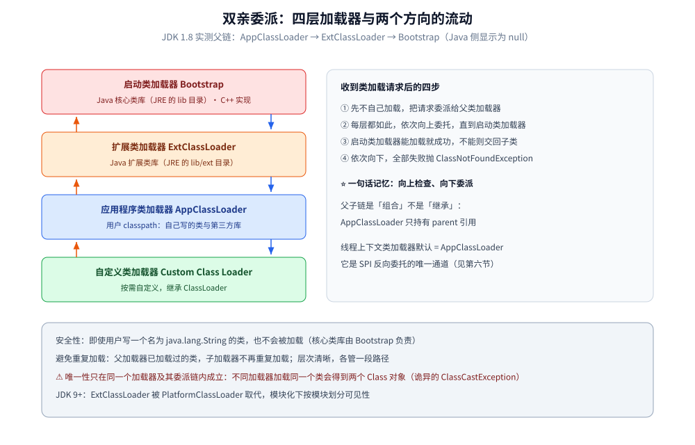
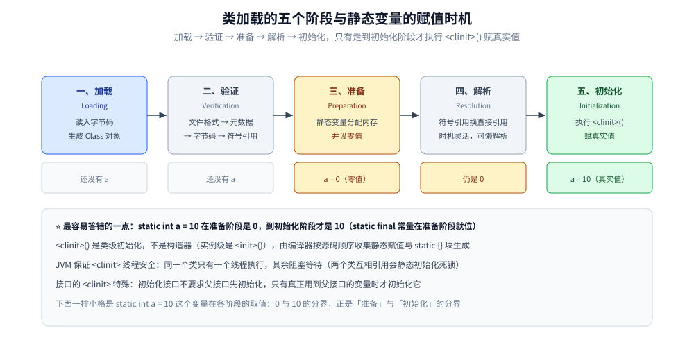
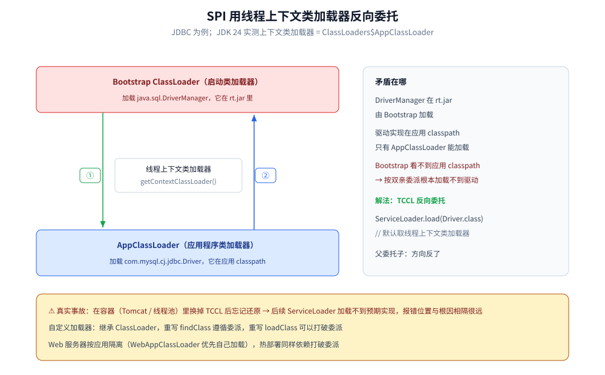

# 类加载机制

> 覆盖：类加载器的四个层次与 JDK 9 之后的平台类加载器、双亲委派的流程与边界、类加载五个阶段与初始化时机（哪些引用触发、哪些不触发）、打破委派的 SPI 场景，以及「类找不到 / 类冲突 / 类版本不对」三类线上问题的排查手段。
> 不覆盖：运行时常量池与符号引用在运行时的位置见 [运行时数据区与栈帧.md](运行时数据区与栈帧.md)；class 文件的字节布局与常量池结构见 [类文件与字节码.md](类文件与字节码.md)；方法区 / 元空间与类卸载见 [垃圾回收原理与收集器.md](垃圾回收原理与收集器.md)。
>
> 内容整理自个人学习笔记，素材见 [素材清单](../../../素材清单.md)。
> 实测口径：容器 `java-lab`，`eclipse-temurin:24-jdk`（24.0.2+12，linux/amd64），源码 `.workbuddy/tmp/exp/java/loader/`（`CL.java` 加载器链与初始化时机、`LDR.java` 双加载器与打破委派、`spi/` SPI 演示）；`javac -Xlint:all` 无 error 无 warning，`java -cp out CL` / `java -cp . LDR` 各跑通 1 次。⚠️ `-verbose:class` 的 777 是一个含 `SPI` 演示类的单次读数，不作性能依据。

---

## 一、从零：一行 `Child.VALUE` 唤醒了几件事？

**本节要点**：一句访问静态字段的代码，背后是「**找到字节码 → 校验并准备 → 跑 `<clinit>`**」三件事；前两件由**加载器 + 链接**负责，第三件才是「静态变量真的有值」。想清这三件事的分工，本篇后面每一节就都落在这三步里。

### 1.1 先看现象

`Child extends Parent`，父子各带一个会打印的 `static {}` 块，子类另有一个编译期常量与一个运行期静态变量；`main` 依次访问四样东西，实测输出是：

```text
    [Parent <clinit> 执行]
B1 通过子类名访问父类静态字段 Child.VALUE = 10
B2 读取编译期常量 Child.COMPILE_CONST = 20
    [Child  <clinit> 执行]
B3 读取装箱常量 Child.BOXED_CONST = 20
B4 new 一个数组 Child[2]
   数组长度 = 2

=== B5 读取运行期静态变量 Child.runtimeValue ===
B5 Child.runtimeValue = 30
```

⭐ 三段输出对应三个反直觉点：**只访问 `Child.VALUE` 时初始化的是 `Parent` 而不是 `Child`**；**读编译期常量 `COMPILE_CONST` 一声不响**；**到 `BOXED_CONST`（装箱常量）才第一次看见 `Child` 的 `<clinit>`**。

### 1.2 三件事分别是谁干的

| 步骤 | 干什么 | 谁负责 | 详见 |
|---|---|---|---|
| ⭐ **找**：把 `.class` 字节读进来，生成 `Class` 对象 | 决定「同一个名字能不能变成同一个 `Class`」 | **类加载器 + 双亲委派** | [第二节](#二类加载器有哪些各自负责加载什么)、[第三节](#三双亲委派机制的工作原理是什么) |
| **查**：验证字节码、给静态变量分配内存并设零值、把符号引用换成直接引用 | 决定「能不能安全执行」 | 链接三阶段（验证 / 准备 / 解析） | [第五节](#五类加载的五个阶段分别做了什么) |
| ⭐ **唤醒**：执行 `<clinit>()`，静态变量拿到真实值 | 决定「`static` 块什么时候跑」 | 初始化的 8 种触发 / 不触发情形 | [第六节](#六类初始化的时机哪些引用会触发哪些不会) |

### 1.3 现场就能验证的三个结论

- **同一个类名可以存在两份**：用两个独立的加载器各加载一次 `Widget`，得到两个 `Class`，`k1 == k2` 为 `false`，强转报 `Cannot cast Widget to Widget`（第八节）。
- **`static int a = 10` 在「准备」阶段是 0**：到「初始化」才是 10——所以「静态变量什么时候有值」的准确答案是「初始化阶段」（第五节）。
- **编译期常量根本不碰这个类**：`ldc` 直接把 `20` 折叠进调用方常量池（第六节 6.4 的 `javap` 原文）。

---

## 二、类加载器有哪些？各自负责加载什么？

**本节要点**：JDK 9 之前是「启动 / 扩展 / 应用 + 自定义」四层，JDK 9 之后扩展加载器被**平台类加载器**取代；`String.class.getClassLoader()` 返回 `null` 不是「没人加载」，而是 Bootstrap 用 C++ 实现、Java 侧没有对象可返回。

在 Java 中，类加载器是用来把 Java 类加载到 JVM 中的组件。按层次分为：

| 类加载器 | 实现语言 | 负责加载 |
|---|---|---|
| **启动类加载器**（Bootstrap ClassLoader） | C++ | 最顶层，Java 核心类库（如 `java.lang` 包下的类），JDK 9 之后是 `java.base` 等系统模块 |
| **平台类加载器**（Platform ClassLoader） | Java | JDK 9 之前叫**扩展类加载器**（ExtClassLoader，加载 `lib/ext`）；之后加载 `java.se` 等平台模块 |
| **应用程序类加载器**（Application ClassLoader） | Java | 也叫系统类加载器，用户类路径（`classpath`）下的类，即自己写的类和第三方库 |
| **自定义类加载器**（Custom Class Loader） | Java | 按需自定义，继承 `ClassLoader` 类 |

### 2.1 实测：加载器层级与上下文类加载器

```java
System.out.println("String 的加载器 = " + String.class.getClassLoader());
System.out.println("本类的加载器    = " + CL.class.getClassLoader());
System.out.println("平台类加载器    = " + ClassLoader.getPlatformClassLoader());
System.out.println("系统类加载器    = " + ClassLoader.getSystemClassLoader());
System.out.println("TCCL            = " + Thread.currentThread().getContextClassLoader());
ClassLoader cl = CL.class.getClassLoader();
while (cl != null) {
    System.out.println("  父链: " + cl + "  (parent=" + cl.getParent() + ")");
    cl = cl.getParent();
}
```

JDK 24 实测输出：

```text
String 的加载器            = null
本类的加载器               = jdk.internal.loader.ClassLoaders$AppClassLoader@502f3a78
平台类加载器               = jdk.internal.loader.ClassLoaders$PlatformClassLoader@1dbd16a6
系统类加载器               = jdk.internal.loader.ClassLoaders$AppClassLoader@502f3a78
TCCL                       = jdk.internal.loader.ClassLoaders$AppClassLoader@502f3a78
  父链: ...ClassLoaders$AppClassLoader@502f3a78  (parent=...ClassLoaders$PlatformClassLoader@1dbd16a6)
  父链: ...ClassLoaders$PlatformClassLoader@1dbd16a6  (parent=null)
```

⭐ 三个可以直接引用的细节：

- **`String.class.getClassLoader()` 返回 `null`**——不是「没有加载器」，而是 Bootstrap 由 JVM 用 C++ 实现，在 Java 侧没有对应的对象可返回。
- **父子链是「组合」不是「继承」**——`AppClassLoader` 并不是 `PlatformClassLoader` 的子类，而是持有 `parent` 引用（这也是「双亲委派」而不是「父子继承」的原因）。JDK 8 上这三级叫 `AppClassLoader → ExtClassLoader → null`，JDK 9 起换成 `AppClassLoader → PlatformClassLoader → null`，**类名从 `sun.misc.Launcher$*` 变成 `jdk.internal.loader.ClassLoaders$*`**。
- **线程上下文类加载器默认就是 AppClassLoader**，它是 SPI 场景下「父加载器反向委托子加载器」的唯一通道（见第七节）。

---

## 三、双亲委派机制的工作原理是什么？

**本节要点**：流程只有一句话——「**先向上问，再向下试**」；关键在「委派」和「加载」是两个动作，父加载器加载失败不算终止，只是把机会交回子加载器。

双亲委派的工作过程可以概括为「**先委托，后自己加载**」：

1. 当一个类加载器收到类加载请求时，它首先不会自己去尝试加载这个类，而是把这个请求**委派给父类加载器**去完成。
2. 每一层的类加载器都是如此，**依次向上委托**，直到到达启动类加载器。
3. 启动类加载器会尝试加载这个类，如果能加载则加载成功；如果不能加载，就会把加载任务**交回子类加载器**，让子类加载器去尝试加载。
4. 依次向下，直到有类加载器成功加载该类，或者所有类加载器都尝试过仍无法加载，此时抛出 `ClassNotFoundException`。

> ⭐ 一句话记忆：**向上检查、向下委派**——先一路往上问「你能不能加载」，都不行再由上往下逐级尝试自己加载。



左侧四层就是实测的父加载器链（`AppClassLoader → PlatformClassLoader → Bootstrap`），向上箭头是「委派」，向下箭头是「父加载不了才轮到自己」；右侧四条对应本节的四个步骤。

---

## 四、双亲委派有什么优点？

**本节要点**：三个优点里只有「安全性」是无条件的；「避免重复加载 / 保证唯一性」必须加限定——**它只保证同一个加载器及其委派链内唯一**，跨加载器就是两份。

| 优点 | 说明 |
|---|---|
| **安全性** | 可以防止恶意代码替换 Java 的核心类库。核心类库由启动类加载器加载，即使用户编写了一个名为 `java.lang.String` 的类，也不会被加载 |
| **避免类的重复加载** | 父类加载器已加载过某个类时，子类加载器无需重复加载，保证类在 JVM 中的唯一性 |
| **层次结构清晰** | 不同层次的类加载器负责不同范围的类加载，管理更清晰有序 |

⚠️ 「保证唯一性」这句话有边界：它只保证**同一个加载器（及其委派链）内唯一**。**不同加载器加载同一个类，会得到两个不同的 `Class` 对象**——这正是「诡异的 `ClassCastException`」的来源（见第八节）。

---

## 五、类加载的五个阶段分别做了什么？

**本节要点**：五个阶段里，**「准备」只给静态变量设零值、「初始化」才赋真实值**——这是全篇最容易答错的一点；`<clinit>()` 与构造器 `<init>()` 是两回事，前者由 JVM 保证线程安全。

一个类从字节码到能用，要经过五个阶段：

| 阶段 | 做什么 | 关键细节 |
| --- | --- | --- |
| **加载（Loading）** | 把字节码读进内存，生成 `Class` 对象 | 来源可以是 class 文件、JAR、网络、动态代理生成 |
| **验证（Verification）** | 校验字节码是否合法、安全 | 文件格式 → 元数据 → 字节码 → 符号引用，四层校验 |
| **准备（Preparation）** | 为**静态变量**分配内存并设**零值** | ⭐ `static int a = 10` 在这一步 `a = 0`；`static final` 常量值此时就位（编译期已确定） |
| **解析（Resolution）** | 把常量池的**符号引用**替换为**直接引用** | 时机灵活：可懒解析（首次使用时） |
| **初始化（Initialization）** | 执行 `<clinit>()`，赋**真实值** | ⭐ 到这一步 `a` 才等于 10；`<clinit>` 由编译器收集所有静态变量赋值与 `static {}` 块按源码顺序生成 |

⭐⭐ **最容易答错的一点**：`static int a = 10` 在**准备阶段是 0**，到**初始化阶段才是 10**。所以「静态变量什么时候有值」的准确答案是「初始化阶段」。

另外两条：

- **`<clinit>()` 不是构造器**：构造器是 `<init>()`（实例级），`<clinit>()` 是类级初始化，由 JVM 保证**线程安全**（多线程同时初始化同一个类时，只有一个线程执行 `<clinit>`，其余阻塞等待）。
- **接口的 `<clinit>` 特殊**：接口初始化时不要求父接口先初始化（只有真正用到父接口中的变量时才初始化它），与类不同。



五个方块是五个阶段（每块里是表中的「做什么」），下面一排小格给出 `static int a = 10` 里 `a` 的取值——0 与 10 的分界正在「准备」与「初始化」之间，也就是本节最容易答错的那一点。

---

## 六、类初始化的时机：哪些引用会触发、哪些不会？

**本节要点**：判据只有一条——**有没有真正「用到这个类自己」**：子类名访问父类字段只初始化父类、编译期常量已折叠进调用方、数组只是壳子，这三类都不算用到。

这是「类加载」最实用的一节——**线上「类没被初始化」的诡异问题基本都出在这里**。

### 6.1 会触发的五种（主动引用）

| 场景 | 示例 |
| --- | --- |
| `new` 一个对象 / 读写静态字段 / 调用静态方法 | `new Child()`、`Child.runtimeValue` |
| 反射调用 | `Class.forName("Child")` |
| 初始化子类时**先初始化父类** | `new Child()` 会先跑 `Parent.<clinit>` |
| 虚拟机启动时的主类 | 含 `main()` 的类 |
| `MethodHandle` / `invokedynamic` 解析到该类的静态成员时 | Lambda 绑定的目标类 |

### 6.2 **不会**触发的三种（被动引用）

| 场景 | 为什么不会触发 |
| --- | --- |
| 通过**子类名**访问**父类**的静态字段 | 只有真正声明该字段的类才被初始化 |
| 访问**编译期常量**（`static final` + 字面量） | 常量在**编译期已折叠进调用方的常量池**，运行时不涉及该类 |
| 定义该类的**数组** | 数组由 JVM 直接创建，元素类的初始化被推迟到真正使用元素时 |

### 6.3 实测证据

被测代码设计（顺序很关键）：子类 `Child extends Parent`，父子各带一个打印语句的 `static {}` 块；子类另有编译期常量 `COMPILE_CONST`、**装箱常量** `BOXED_CONST`（`static final Integer`）与运行期静态变量 `runtimeValue`。

```java
System.out.println("B1 Child.VALUE = " + Child.VALUE);
System.out.println("B2 Child.COMPILE_CONST = " + Child.COMPILE_CONST);
System.out.println("B3 Child.BOXED_CONST   = " + Child.BOXED_CONST);
Child[] arr = new Child[2];
System.out.println("B4 数组长度 = " + arr.length);
System.out.println("B5 Child.runtimeValue  = " + Child.runtimeValue);
```

JDK 24 实测输出（原样保留缩进）：

```text
    [Parent <clinit> 执行]
B1 通过子类名访问父类静态字段 Child.VALUE = 10
B2 读取编译期常量 Child.COMPILE_CONST = 20
    [Child  <clinit> 执行]
B3 读取装箱常量 Child.BOXED_CONST = 20
B4 new 一个数组 Child[2]
   数组长度 = 2

=== B5 读取运行期静态变量 Child.runtimeValue ===
B5 Child.runtimeValue = 30
```

逐行读：

| 行 | 看到什么 | 说明 |
|---|---|---|
| B1 前 | `[Parent <clinit>]` | 通过子类名访问父类字段 → **只初始化父类**，`Child` 没动静 |
| B2 | 没有任何 `<clinit>` | 编译期常量不触发任何初始化 |
| B3 前 | `[Child <clinit>]` | ⭐ **装箱常量不是编译期常量**（`Integer` 要 new），所以触发了子类初始化 |
| B4 | 仍没有输出 | 只定义数组不初始化元素类 |
| B5 | 无新输出 | 子类已在 B3 初始化过，`<clinit>` 只跑一次 |

### 6.4 常量为什么不需要初始化：`javap` 给出的铁证

`COMPILE_CONST` 是 `static final int COMPILE_CONST = 20;`，看调用方（`CL.main`）的字节码，两条相邻指令一对比就清楚了：

```bash
javap -c -p CL | grep -E "COMPILE_CONST|BOXED_CONST"
```

```text
159: ldc       #80   // String B2 读取编译期常量 Child.COMPILE_CONST = 20
167: getstatic #82   // Field CL$Child.BOXED_CONST:Ljava/lang/Integer;
```

⭐ **编译期常量那一行是 `ldc`——`"…= 20"` 整段被折叠成了一个字符串常量**，连运行时拼接都没发生，更不会去读 `Child` 的字段；而装箱常量是 `getstatic`，**必须真的去访问 `Child` 的静态字段**，于是触发 `<clinit>`。

⚠️ **反面案例**：把 `static final int` 换成 `static final Integer`、或值是方法调用 / 随机数（`static final long NOW = System.currentTimeMillis()`），**常量折叠就不成立**，读取时会正常触发类初始化。

---

## 七、哪些情况会破坏双亲委派？

**本节要点**：破坏委派的动机只有一个——**父加载器看不到子加载器可见的实现类**；标准解法是线程上下文类加载器（TCCL），代价是「谁换了 TCCL 又不还原」会变成很难定位的事故。

虽然双亲委派机制有很多优点，但在某些特殊场景下需要打破它：

- **Java Web 应用服务器**：为了实现类的隔离和热部署等功能，需要自定义类加载器并打破双亲委派机制。
- 典型例子还包括 **SPI 机制**（如 JDBC 驱动加载）、**OSGi** 等，它们需要父类加载器反向委托子类加载器去加载实现类。

### 7.1 SPI 为什么必须打破委派

以 JDBC 为例，矛盾在于：

- `java.sql.DriverManager` 在 **`java.base` / `java.sql` 模块**里，由 **Bootstrap / 平台加载器**加载；
- 各数据库的驱动实现（`com.mysql.cj.jdbc.Driver`）在**应用 classpath** 里，只有 **AppClassLoader** 能加载；
- 上层加载器看不到应用 classpath，**按双亲委派它根本加载不到驱动实现**。

解法是 **线程上下文类加载器（TCCL）**：

```java
// ServiceLoader.load(service) 内部取的就是 TCCL
ServiceLoader<Driver> loader = ServiceLoader.load(Driver.class);
```

### 7.2 实测：换掉 TCCL，实现类就跟着换

用自定义接口 `Greeter` 演示（不依赖 MySQL 驱动）：`GreeterB` 与它的 `META-INF/services/Greeter` 只存在于 `spib/` 目录，不在应用 classpath 上。

```java
System.out.println("默认 TCCL   → " + firstGreeter());
ClassLoader saved = Thread.currentThread().getContextClassLoader();
URLClassLoader alt = new URLClassLoader(
        new URL[]{Paths.get("spib").toUri().toURL()}, saved);
Thread.currentThread().setContextClassLoader(alt);
System.out.println("换掉 TCCL 后 → " + firstGreeter());
Thread.currentThread().setContextClassLoader(saved);
System.out.println("TCCL 还原后  → " + firstGreeter());
```

JDK 24 实测输出：

```text
默认 TCCL 找到的实现 = 没有找到实现
换掉 TCCL 后的实现   = B  (实现类 GreeterB <- URLClassLoader)
TCCL 还原后的实现    = 没有找到实现
```

⭐ 这就是「破坏双亲委派」的字面含义：**换个线程上的加载器，父加载器（Bootstrap）就能拿到子加载器（URLClassLoader）可见的实现**——方向与委派相反，所以叫「反向委托」。

⚠️ 由此产生一个真实事故场景：**在容器（Tomcat / 线程池）里换掉 TCCL 后忘记还原**，会导致后续 `ServiceLoader` 加载不到预期实现，且报错位置与根因相隔很远。上面的实测也证明了这一点：还原前后行为会翻转。



绿色箭头是「父（Bootstrap）反向委托子（App）」——方向与双亲委派相反；蓝色箭头是驱动 `Class` 交回 `DriverManager`。右侧面板列出矛盾的来源，也就是上层加载器看不到应用 classpath。

---

## 八、类加载问题的排查手段

**本节要点**：三类报错先分诊（找不到 / 加载过但失败 / 版本不对），再用 `-verbose:class` 看「谁加载了它、加载了几次」；⭐ 同一个类被两个加载器各加载一份时，报错会荒谬到 `Cannot cast Widget to Widget`。

双亲委派相关的线上问题，表现都是「类找不到 / 类冲突 / 类版本不对」，先按下面的表分诊：

| 异常 | 含义 | 常见根因 |
|---|---|---|
| `ClassNotFoundException` | **编译期就依赖**，运行期在 classpath 里找不到 | 依赖没打进包、`Class.forName` 写错类名 |
| `NoClassDefFoundError` | 编译时在、运行时不在了（或首次加载已失败） | 静态初始化抛错、依赖冲突导致加载失败后不再重试 |
| `LinkageError` / `NoSuchMethodError` | 类加载到了，但**版本对不上** | 同一个类被两个 classpath 各加载了一份（父加载器与子加载器各一份） |

### 8.1 实测：同名类的两份 `Class`

```java
try (URLClassLoader c1 = new URLClassLoader(new URL[]{url}, null);
     URLClassLoader c2 = new URLClassLoader(new URL[]{url}, null)) {
    Class<?> k1 = c1.loadClass("Widget");
    Class<?> k2 = c2.loadClass("Widget");
    System.out.println("k1 == k2 ? " + (k1 == k2));
    Object o1 = k1.getDeclaredConstructor().newInstance();
    System.out.println("k2.isInstance(o1) = " + k2.isInstance(o1));
    k1.cast(k2.getDeclaredConstructor().newInstance());
}
```

JDK 24 实测输出：

```text
k1 = class Widget  加载器 = java.net.URLClassLoader@6b95977
k2 = class Widget  加载器 = java.net.URLClassLoader@7e9e5f8a
k1 == k2 ? false
k2.isInstance(k1 造出来的对象) = false
强转报错: Cannot cast Widget to Widget
```

⭐ **`Cannot cast Widget to Widget`** 是这类问题最好认的签名：类名一样、`Class` 对象不同，`instanceof` 必然为 `false`。常见于「容器 + 插件热部署 + 自写加载器」的组合。

### 8.2 实测：不委派就连自己的类都找不到

自定义加载器把 parent 设成**平台类加载器**（而不是 AppClassLoader），并且只对 `Widget` 走自己的 `loadClass`：

```text
custom 加载的 Widget 加载器 = LDR$NoDelegation
k3 == 系统类路径那份 ? false
custom.loadClass("CL") 报错: java.lang.ClassNotFoundException: CL
```

⚠️ 这一行报错正是「委派」存在的原因：`CL` 在应用 classpath 上，平台加载器看不到它；**只有把请求交回子加载器（App）才找得到**。

### 8.3 常用命令与开关

```bash
java -verbose:class ...                           # 每个类由哪个加载器加载（定位重复加载）
java -Xlog:class+load=info -cp out CL | head       # JDK 9+ 的统一日志写法，等价上一行
jcmd <pid> VM.class_hierarchy <类名>               # 看某个类的加载器层级
jcmd <pid> GC.class_histogram | head               # 哪些类实例最多（含动态代理类）
-XX:+TraceClassLoading -XX:+TraceClassUnloading    # 加载/卸载全过程
```

实测 `-verbose:class` 的输出格式（JDK 24）：

```text
[0.022s][info][class,load] java.lang.Object source: shared objects file
[0.051s][info][class,load] CL source: file:/w/.workbuddy/tmp/exp/java/loader/out/
```

`source:` 后面就是「从哪儿读的」——**同一个类名出现两行、`source` 不同，就是重复加载**；本次运行共 777 行 `class,load`。

---

## 九、应用场景

**本节要点**：类加载器真正解决的是「隔离」和「替换实现」两类需求；凡是出现这两个需求的系统（容器、插件、SPI、热部署）都在用它，代价是同一个类可能有多份。

类加载器是「隔离」与「替换实现」这两类需求的底层手段，下面这些系统都在用它：

| 场景 | 用加载器解决什么 | 典型做法 |
|---|---|---|
| **Web 容器（Tomcat / Jetty）** | 同一个 Tomcat 里两个应用依赖不同版本的同一个库 | 每个应用一个 `WebappClassLoader`，**先自己后父**（打破委派） |
| **Spring Boot 可执行 jar** | `BOOT-INF/lib` 里的嵌套 jar 不是一个目录，标准加载器读不了 | `LaunchedURLClassLoader` 直接读嵌套 jar 条目 |
| **SPI / JDBC / SLF4J** | 上层（JDK）代码要加载下层（应用）提供的实现 | 线程上下文类加载器反向委托（第七节实测） |
| **OSGi / 插件平台** | 每个插件独立依赖、可单独安装卸载 | 每个 bundle 一个加载器 + 显式的包导入导出规则 |
| **热部署 / 热修复** | 不重启替换类 | 新建加载器加载新版本类（旧实例仍指向旧 `Class`） |
| **规则引擎 / 脚本** | 用户上传的代码要能加载、也能卸载 | 每次加载一个新加载器，丢弃后整体可回收 |

⚠️ 这些场景有一个共同代价：**同一个类在系统里可能出现多份**，跨加载器传对象必须走「两边都可见的父加载器里的类型」，否则就是第八节那个 `Cannot cast Widget to Widget`。

---

## 十、具体使用

**本节要点**：自定义加载器只重写一个方法——**遵循委派就重写 `findClass`，要打破就重写 `loadClass`**；写完必须处理「字节从哪儿来」和「什么时候能被卸载」两件事。

### 10.1 自定义加载器：两种形态

```java
// 形态一：遵循委派 —— 只管"父加载器都没找到之后"怎么找
static class DirLoader extends ClassLoader {
    private final Path dir;

    DirLoader(Path dir) {
        super(ClassLoader.getSystemClassLoader());   // parent = AppClassLoader
        this.dir = dir;
    }

    @Override
    protected Class<?> findClass(String name) throws ClassNotFoundException {
        try {
            byte[] b = Files.readAllBytes(dir.resolve(name.replace('.', '/') + ".class"));
            return defineClass(name, b, 0, b.length);   // 注意：不要自己调 resolveClass
        } catch (IOException e) {
            throw new ClassNotFoundException(name, e);
        }
    }
}
```

```java
// 形态二：打破委派 —— 连父加载器都不问，直接用自己那份
static class FirstLoader extends ClassLoader {
    private final Path dir;

    FirstLoader(Path dir) {
        super(ClassLoader.getPlatformClassLoader());
        this.dir = dir;
    }

    @Override
    protected Class<?> loadClass(String name, boolean resolve) throws ClassNotFoundException {
        if (!name.startsWith("com.example.plugin.")) {
            return super.loadClass(name, resolve);       // 其余类交回父加载器
        }
        Class<?> c = findLoadedClass(name);
        if (c == null) {
            c = findClass(name);                        // 只查自己的目录，不问父
        }
        if (resolve) {
            resolveClass(c);
        }
        return c;
    }

    @Override
    protected Class<?> findClass(String name) throws ClassNotFoundException {
        try {
            byte[] b = Files.readAllBytes(dir.resolve(name.replace('.', '/') + ".class"));
            return defineClass(name, b, 0, b.length);
        } catch (IOException e) {
            throw new ClassNotFoundException(name, e);
        }
    }
}
```

⚠️ **打破委派时白名单一定要窄**：只对插件自己的包名不委派，`java.*`、公共依赖仍交回父加载器——否则第八节 8.2 那个 `ClassNotFoundException: CL` 就会出现在你身上。

### 10.2 类卸载的前提

类能被卸载的条件，三个同时满足：

| 条件 | 说明 |
|---|---|
| 该类的所有实例都不可达 | 实例被回收 |
| 该类的 `Class` 对象不可达 | 没有任何地方引用它 |
| 该类的加载器不可达 | ⭐ 只丢弃实例不够，**必须连加载器一起丢弃** |

⚠️ 所以「热部署泄漏」的典型形态是：新加载器建好了、旧加载器还被一个线程 / 静态字段 / `ThreadLocal` 引用着 → 整个类的元数据留在元空间，表现为**元空间只涨不降**（排查见 [垃圾回收原理与收集器.md](垃圾回收原理与收集器.md) 与 [GC调优与日志.md](GC调优与日志.md)）。

### 10.3 排查三步

```bash
# ① 谁加载了它？出现两行就是重复
java -Xlog:class+load=info -cp app.jar Main | grep "com.example.Foo"

# ② 这个类的加载器层级是什么（需要进程还活着）
jcmd <pid> VM.class_hierarchy com.example.Foo

# ③ 是哪个 jar 带进来的（静态查，不依赖进程）
unzip -l app.jar | grep -i "foo" ; ls lib/ | grep -i foo
```

判读顺序是「**先确认是不是两份 → 再确认两份分别来自哪 → 最后才动依赖**」；反过来先调依赖版本，经常调不动，因为问题不在版本而在重复。

---

## 延伸追问

- **为什么要打破双亲委派？** → 父加载器加载不到子加载器可见的实现类（如 SPI 场景：上层模块里的 `ServiceLoader` 需要应用 classpath 上的驱动实现），需要线程上下文类加载器反向委托；实测换掉 TCCL 后取到的实现类会跟着变（第七节 7.2）。
- **如何自定义一个类加载器？** → 继承 `ClassLoader`，重写 `findClass`（遵循委派）或 `loadClass`（可打破委派）；打破时白名单要窄，否则连自己的类都找不到（第八节 8.2、第十节 10.1）。
- **同一个类被两个不同加载器加载会怎样？** → 会产生两个不同的 `Class` 对象，`instanceof` 与强制类型转换都会失败，报错原文是 `Cannot cast Widget to Widget`（第八节 8.1）。
- **Tomcat 为什么要用多个类加载器？** → 各 Web 应用依赖版本可能冲突，需要按应用隔离（`WebappClassLoader` 优先自己加载，打破委派）。
- **类加载的「准备」和「初始化」有什么区别？** → 准备阶段为静态变量分配内存并设**零值**（`static int a = 10` 此时是 0），初始化阶段执行 `<clinit>()` 才赋**真实值**；`static final` 的编译期常量在准备阶段就已是最终值。
- **哪三种情况不会触发类初始化？** → ①通过子类名访问父类的静态字段（只初始化声明字段的类）②访问编译期常量（已折叠进调用方常量池，`javap` 看到的是 `ldc`）③定义该类的数组（元素类初始化被推迟）。注意 `static final Integer` **不是**编译期常量，会触发初始化。
- **`<clinit>()` 是线程安全的吗？** → 是。JVM 保证同一个类只有一个线程执行 `<clinit>`，其余线程阻塞等待；这也是经典「静态初始化死锁」的来源（两个类互相在 `<clinit>` 里引用对方）。
- **JDK 9 之后类加载器有什么变化？** → 扩展类加载器被**平台类加载器**取代（实测 JDK 24 打印 `ClassLoaders$PlatformClassLoader`），类加载按模块划分可见性。
- **类什么时候能被卸载？** → 实例、`Class` 对象、它的加载器三者全部不可达；所以热部署要连加载器一起丢，只丢实例会表现为元空间只涨不降（第十节 10.2）。

---

## 关联

- **上游/总纲**：[README.md](README.md) — 运行时 12 篇的分工表、五组读序与篇间依赖（本篇位次 ②；两条主线的入口与横切篇目在 [java/README.md](../README.md)）
- **对照/互补**：[运行时数据区与栈帧.md](运行时数据区与栈帧.md) — 运行时常量池、符号引用与动态链接的解析
- **对照/互补**：[类文件与字节码.md](类文件与字节码.md) — 被加载的那份字节码本身长什么样
- **下游机制**：[垃圾回收原理与收集器.md](垃圾回收原理与收集器.md) — 方法区 / 元空间与类卸载（类加载的反向过程）
- **下游机制**：[GC调优与日志.md](GC调优与日志.md) — 元空间只涨不降时怎么确认是热部署泄漏
- **对照/互补**：[程序启动流程.md](../../go/运行时/程序启动流程.md) — 另一种语言的启动与初始化顺序
- **运维/配置**：[资源限制与运维.md](../../../06-工程实践/部署/docker/资源限制与运维.md) — 元空间膨胀导致的容器内存问题

> 反向引用（本篇被下列文档引到）：[GC基础算法.md](../../../02-计算机基础/垃圾回收/GC基础算法.md)
