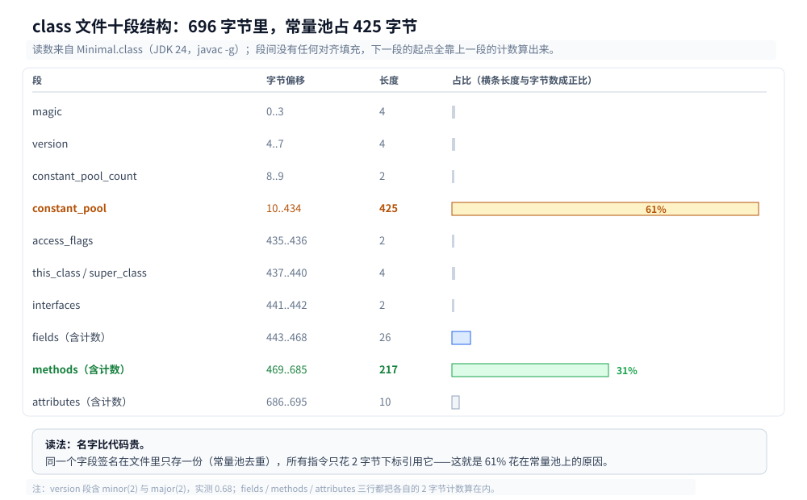
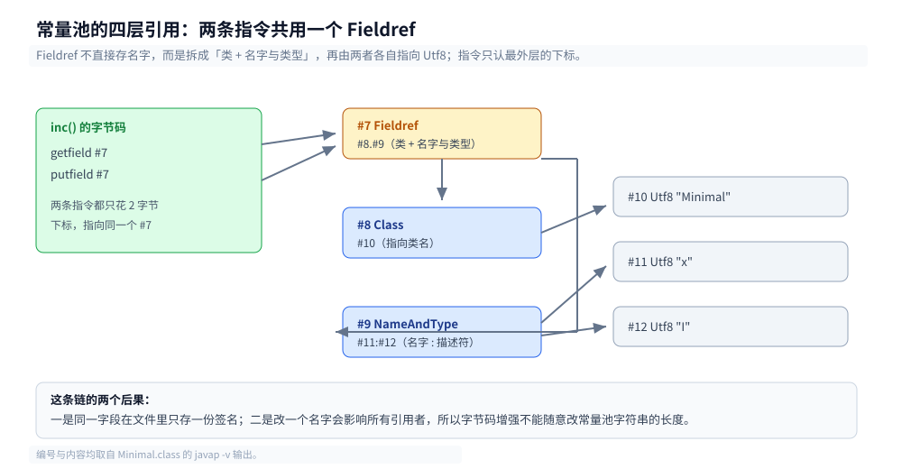
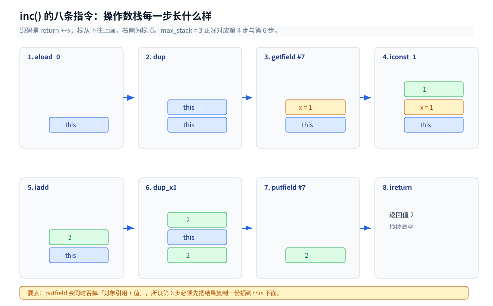
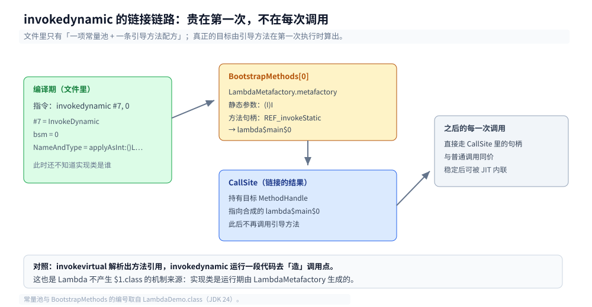

# 类文件与字节码

> 覆盖：`.java` 编译出来的 `.class` 到底长什么样（十段结构、常量池、字段与方法表、属性表）、`javap` 怎么读、字节码为什么是栈式的、分支与栈映射帧怎么配合验证、`invokedynamic` 在文件里的形态，以及运行时改写字节码的两个入口与一次不用 ASM 的实测改写。
>
> 不覆盖：类加载的五个阶段与双亲委派见 [类加载机制.md](类加载机制.md)；栈帧的运行时形态与五种 `invoke` 指令的动态分派见 [运行时数据区与栈帧.md](运行时数据区与栈帧.md)；操作数栈怎么被 JIT 映射到寄存器见 [JIT与执行引擎.md](JIT与执行引擎.md)；对象在堆里的排布见 [对象布局与引用类型.md](对象布局与引用类型.md)。
>
> 内容整理自个人学习笔记，素材见 [素材清单](../../../素材清单.md)。
>
> 实测口径：`eclipse-temurin:24-jdk`（24.0.2+12，linux/amd64，容器 4 CPU）。文中 `Minimal.class` 的 696 字节、45 个常量池条目、各段偏移与指令字节均来自容器内 `javac` + 自写解析脚本实跑；版本号用 `javac --release 8/11/17/21/24` 交叉验证；`-javaagent` 一节真编译、真运行并核对输出。

---

## 一、一个 `.class` 文件里到底有什么？

**本节要点**：`.class` 不是「编译后的代码」，而是一张**带索引的表**——指令不直接引用名字，只引用常量池的下标。这个设计决定了后面所有「能不能改字节码」的边界。

### 1.1 从零：让程序读自己的头

先不急着看 `javap`。一个类可以把自己的 `.class` 当普通文件读出来，前 10 个字节的布局是写死的：

```java
import java.io.InputStream;

public class SelfRead {
    public static void main(String[] args) throws Exception {
        try (InputStream in = SelfRead.class.getResourceAsStream("SelfRead.class")) {
            byte[] b = in.readAllBytes();
            int major = ((b[6] & 0xff) << 8) | (b[7] & 0xff);
            int minor = ((b[4] & 0xff) << 8) | (b[5] & 0xff);
            int cp = ((b[8] & 0xff) << 8) | (b[9] & 0xff);
            System.out.printf("size=%d magic=%02x%02x%02x%02x version=%d.%d cp_count=%d%n",
                    b.length, b[0], b[1], b[2], b[3], major, minor, cp);
        }
    }
}
```

容器里的输出：

```text
size=1266 magic=cafebabe version=68.0 cp_count=69
```

四件事一次读齐：魔数 `0xCAFEBABE`、主次版本号（68.0 对应 JDK 24）、常量池条目数（69 表示索引 `1..68`）、整个文件多大。所有多字节整数都是**大端**（big-endian），没有任何对齐填充——这是「字节码文件可以逐字节解析」的前提。

### 1.2 十段结构：按实测偏移看

换一个更小的类，把每一段的起止偏移算出来：

```java
public class Minimal {
    private static final String NAME = "cf";
    private int x = 1;

    public int inc() {
        return ++x;
    }

    public static void main(String[] args) {
        System.out.println(new Minimal().inc());
    }
}
```

`javac -g Minimal.java` 得到 696 字节，用自写解析脚本按规范逐段推进，输出如下：

| 段 | 长度 | `Minimal.class` 实测 | 里面是什么 |
|---|---|---|---|
| `magic` | 4 | offset 0，`0xCAFEBABE` | 固定魔数，识别「这是不是 class 文件」 |
| `minor_version` / `major_version` | 2+2 | offset 4，`0.68` | 主版本 68 = JDK 24 |
| `constant_pool_count` | 2 | offset 8，46 | 索引 `1..45`（0 号保留） |
| `constant_pool[]` | 变长 | offset 10..434，**425 字节** | 占全文件 61%，所有名字与描述符都在这 |
| `access_flags` | 2 | offset 435，`0x0021` | `ACC_PUBLIC` + `ACC_SUPER` |
| `this_class` / `super_class` | 2+2 | `#8` / `#2` | 指向常量池里的 `Class` 项 |
| `interfaces_count` / `interfaces[]` | 2+2n | offset 441，0 项 | 实现的接口 |
| `fields_count` / `fields[]` | 2+变长 | offset 443 计数，数据 445..468 | `NAME` 与 `x`，24 字节 |
| `methods_count` / `methods[]` | 2+变长 | offset 469 计数，数据 471..685 | 构造器、`inc`、`main`，215 字节 |
| `attributes_count` / `attributes[]` | 2+变长 | offset 686 计数，数据 688..695 | `SourceFile` |



这张表最值得记住的不是十段的名字，而是**比例**：45 个常量池条目吃掉 425 字节，三个方法加起来才 200 多字节。类文件里「名字」比「代码」贵，这也是为什么常量池要做成去重索引。

⚠️ 两个读文件时的坑：

- **`private` 成员默认不打印**：`javap -v` 默认隐藏 `private` 字段与方法，加 `-p`（`javap -p -v`）才看得到，否则会以为字段丢了；
- **`interfaces` 与 `fields` 之间没有对齐**：所有段紧挨着，长度靠前一段的计数算出来——少读一个字节，后面全错位。

### 1.3 常量池：45 项里 29 项是 `Utf8`

常量池是「变长项 + 1 字节 tag」的数组。`Minimal.class` 的 45 项按 tag 统计：

| tag | 名称 | 项数 | 存什么 |
|---|---|---|---|
| 1 | `Utf8` | 29 | 类名、方法名、描述符、字符串字面量 |
| 12 | `NameAndType` | 5 | 「名字 + 描述符」的组合 |
| 10 | `Methodref` | 4 | 类 + `NameAndType` |
| 7 | `Class` | 4 | 指向一个 `Utf8` 类名 |
| 9 | `Fieldref` | 2 | 类 + `NameAndType` |
| 8 | `String` | 1 | 指向 `Utf8`，即字面量 `"cf"` |

其余常用 tag：`3 Integer`、`5 Long`（占**两个**槽位）、`6 Double`（同样两槽）、`11 InterfaceMethodref`、`15 MethodHandle`、`16 MethodType`、`18 InvokeDynamic`。注意 `Long` / `Double` 占两槽是规范写死的，写解析器时容易漏。

之所以要「索引 + 去重」，看 `inc()` 就明白：`getfield` 和 `putfield` 都指向同一个 `#7`，而 `#7` 又拆成 `#8`（类）与 `#9`（名字 + 类型），再各自指向 `Utf8`：

```text
#7  = Fieldref      #8.#9     // Minimal.x:I
#8  = Class         #10       // Minimal
#9  = NameAndType   #11:#12   // x:I
#10 = Utf8          Minimal
#11 = Utf8          x
#12 = Utf8          I
```



这条链说明两件事：**同一个字段在文件里只存一份签名**，所有引用它的指令都只花 2 字节下标；反过来，**改一个名字会影响所有引用者**，所以字节码增强不能随便改常量池的字符串长度（见 4.2）。

### 1.4 字段与方法：一条字段 16 字节

字段表与方发表的结构一样，都是 `access_flags(2) + name_index(2) + descriptor_index(2) + attributes_count(2) + attributes[]`。差别在属性：

```text
private static final java.lang.String NAME;
  descriptor: Ljava/lang/String;
  flags: (0x001a) ACC_PRIVATE, ACC_STATIC, ACC_FINAL
  ConstantValue: String cf

private int x;
  descriptor: I
  flags: (0x0002) ACC_PRIVATE
```

- `NAME` 有 `ConstantValue` 属性（2 字节名索引 + 4 字节长度 + 2 字节常量索引 = 8 字节），所以一条占 16 字节；
- `x` 没有属性，只占 8 字节；
- 两条合计 24 字节，正好对上 1.2 里 `fields` 数据区 445..468 的长度。

方法表里真正装指令的是 `Code` 属性：

| `Code` 字段 | `inc()` 的值 | 含义 |
|---|---|---|
| `max_stack` | 3 | 操作数栈最大深度，验证器与解释器都按它分配 |
| `max_locals` | 1 | 局部变量槽数（实例方法的 0 号是 `this`） |
| `code_length` | 12 | 字节码字节数 |
| `code[]` | 12 字节 | 见 2.1 |
| `exception_table` | 0 项 | `try-catch` 才非空 |
| `attributes` | 2 项 | `LineNumberTable`、`LocalVariableTable`（`-g` 才有） |

---

## 二、字节码为什么是「栈式」的？

**本节要点**：JVM 的指令集只有「压栈、弹栈、对栈顶做运算」三种动作，没有寄存器编号。所以 `++x` 会编译出 `dup` 与 `dup_x1` 这种看起来多余的指令——它们全是为了**把值留在栈上**。

### 2.1 `inc()` 的八条指令与栈变化

`return ++x` 的完整字节码（`javap -c -p`）：

```text
0: aload_0        // 压 this
1: dup            // 复制栈顶 this
2: getfield  #7   // 弹出 this，压入 x 的值
5: iconst_1       // 压 1
6: iadd           // 弹出两值相加，压回结果
7: dup_x1         // 复制结果并插到 this 下面
8: putfield  #7   // 弹出 this 与结果，写回字段
11: ireturn       // 栈顶即返回值
```

对应的原始字节（从 `Code` 属性里抠出来的 12 字节）：

```text
2a 59 b4 00 07 04 60 5a b5 00 07 ac
```

| 字节 | 指令 | 操作数 |
|---|---|---|
| `2a` | `aload_0` | 无（0 号局部变量隐含在操作码里） |
| `59` | `dup` | 无 |
| `b4 00 07` | `getfield` | 2 字节常量池下标 `#7` |
| `04` | `iconst_1` | 无（1 隐含） |
| `60` | `iadd` | 无 |
| `5a` | `dup_x1` | 无 |
| `b5 00 07` | `putfield` | 2 字节常量池下标 `#7` |
| `ac` | `ireturn` | 无 |



为什么是 `dup` 加 `dup_x1` 而不是别的组合？因为 `++x` 既要**写回字段**又要**作为表达式值返回**，而 `putfield` 会把「对象引用 + 值」一起弹掉。所以先用 `dup` 留一份 `this`，算完后用 `dup_x1` 把结果复制一份插到 `this` 下方，`putfield` 消费掉下面那对，栈顶还剩返回值。

对照：`x = 1` 的初始化（构造器里）只有 `aload_0 / iconst_1 / putfield #7`，没有 `dup`——它不需要返回值。

### 2.2 指令编码：1 字节操作码 + 变长操作数

JVM 指令是**变长**的，但操作码固定 1 字节。同一段代码里能一次看全四种形态：

```text
b2 00 0d              getstatic     #13    // 2 字节下标
bb 00 08              new           #8     // 2 字节下标
59                    dup                  // 无操作数
b7 00 13              invokespecial #19    // 2 字节下标
b6 00 14              invokevirtual #20    // 2 字节下标
b6 00 18              invokevirtual #24    // 2 字节下标
b1                    return               // 无操作数
```

有两个 `invoke` 指令**不止 2 字节**，这是读字节码时最容易算错长度的地方：

| 指令 | 操作码 | 操作数 | 多出来的字节 |
|---|---|---|---|
| `invokeinterface` | `0xb9` | 下标(2) + **count** + 0 | `count` 是参数槽数（含接收者），后面补 1 个 0 |
| `invokedynamic` | `0xba` | 下标(2) + 0 + 0 | 两个 0 是规范要求的占位 |

`invokeinterface` 那个 `count` 就是既有篇目里「`invokeinterface #21, 3` 后面为什么跟着 3」的来源（`calc(int,int)` 加 `this` 共 3 槽），分派语义详见 [运行时数据区与栈帧.md](运行时数据区与栈帧.md) 第三节。

### 2.3 局部变量槽：`this` 也占一个

`javap` 打印的 `args_size` 直接给出参数占用的槽数：

| 方法 | `max_locals` | `args_size` | 0 号槽 |
|---|---|---|---|
| `Minimal()`（实例） | 1 | 1 | `this` |
| `inc()`（实例） | 1 | 1 | `this`，字段 `x` 不在局部变量表 |
| `main(String[])`（静态） | 1 | 1 | `args`（静态方法没有 `this`） |

两条规则：**`long` / `double` 占两个槽**；**实例方法永远多一个 `this`**。所以一个 `void f(long a, int b)` 的实例方法 `max_locals` 是 `1 + 2 + 1 = 4`，`args_size` 也是 4。

### 2.4 分支与 `StackMapTable`：验证器凭什么不回溯

有分支的方法会多一个 `StackMapTable` 属性。看这个循环：

```java
static int classify(int n) {
    if (n < 0) return -1;
    int sum = 0;
    for (int i = 0; i < n; i++) sum += i;
    return sum;
}
```

字节码 27 字节，三个跳转目标分别是 6（走 else）、10（循环头）、25（循环出口）：

```text
 0: iload_0
 1: ifge          6      // n >= 0 跳到 6
 4: iconst_m1
 5: ireturn
 6: iconst_0
 7: istore_1             // sum = 0
 8: iconst_0
 9: istore_2             // i = 0
10: iload_2
11: iload_0
12: if_icmpge     25
15: iload_1
16: iload_2
17: iadd
18: istore_1
19: iinc          2, 1
22: goto          10
25: iload_1
26: ireturn
```

`javap -v` 随后打印：

```text
StackMapTable: number_of_entries = 3
  frame_type = 6   /* same */
  frame_type = 253 /* append */
    offset_delta = 3
    locals = [ int, int ]
  frame_type = 250 /* chop */
    offset_delta = 14
```

三个 `offset_delta` 从上一个帧累加，正好落在 **6、10、25**——就是三个跳转目标。规范要求：**class 版本 51（JDK 7）起必须提供 `StackMapTable`**，版本 50 只是允许退回旧的类型推断验证器；有了帧，验证器只需在跳转目标处核对类型，不必从头模拟一遍数据流。这也是「改了字节码却忘了改 `StackMapTable`」会直接抛 `VerifyError` 的原因。

---

## 三、`invokedynamic` 在文件里长什么样？

**本节要点**：所谓「动态」发生在**第一次执行时的链接阶段**，不是每次调用都查表。文件里它只有两样东西：常量池的一项 `InvokeDynamic`，和类属性里的一条 `BootstrapMethods` 配方。

### 3.1 一项常量池 + 一条引导方法

一个 Lambda 的调用点：

```java
IntUnaryOperator twice = x -> x * 2;
```

`javap -c -v` 里能同时看到三层：

```text
0: invokedynamic #7,  0   // InvokeDynamic #0:applyAsInt:()Ljava/util/function/IntUnaryOperator;

Constant pool:
  #44 = MethodHandle  6:#45   // REF_invokeStatic LambdaDemo.lambda$main$0:(I)I
  #45 = Methodref     #33.#46 // LambdaDemo.lambda$main$0:(I)I

BootstrapMethods:
  0: #47 REF_invokeStatic java/lang/invoke/LambdaMetafactory.metafactory:(...)
    Method arguments:
      #43 (I)I
```

- `invokedynamic #7` 的 2 字节下标指向常量池 `#7`（`InvokeDynamic` 项），该项里存的是 **`bootstrap_method_attr_index = 0`** 与 `NameAndType`；
- 类属性 `BootstrapMethods` 的第 0 条给出**引导方法**（`LambdaMetafactory.metafactory`）加静态参数 `(I)I`；
- 引导方法的返回值是一个 `CallSite`，`CallSite` 里挂着真正的 `MethodHandle`（指向合成的 `lambda$main$0`）。

字符串拼接同理，只是引导方法换成 `StringConcatFactory.makeConcatWithConstants`，静态参数是一段「配方」字符串 `\u0001\u0001`（`\u0001` 是占位符）。



读图时盯住箭头的触发时机：只有第一条箭头发生在「第一次执行」，后两条一旦链接完成就不再重复，所以稳态开销与普通调用相同。

### 3.2 链接只发生一次

`invokedynamic` 的成本结构与 `invokevirtual` 完全不同：

| | `invokevirtual` | `invokedynamic` |
|---|---|---|
| 解析时机 | 第一次执行时解析出方法引用 | 第一次执行时**运行引导方法**，得到 `CallSite` |
| 之后的调用 | 按接收者实际类型查 vtable | 直接调 `CallSite` 里的 `MethodHandle` |
| 能否被 JIT 内联 | 能（有类型 profile） | 能（`CallSite` 稳定后按常量折叠） |
| 谁决定目标 | 类继承关系 | 引导方法（可返回不同实现） |

所以 `invokedynamic` 不是「每次调用都慢」，而是「第一次链接贵一点」。Lambda 之所以用它，是因为**编译期根本不知道要实现成哪个类**——`LambdaMetafactory` 在运行期生成；这也是「Lambda 不产生 `$1.class`」的机制来源，Lambda 的调用形态见 [运行时数据区与栈帧.md](运行时数据区与栈帧.md) 3.2。

### 3.3 JDK 9 之后连字符串拼接也改用它

```text
#29 = InvokeDynamic  #0:#30  // #0:makeConcatWithConstants:(ILjava/lang/String;)Ljava/lang/String;
#30 = NameAndType    #31:#32 // makeConcatWithConstants:(ILjava/lang/String;)Ljava/lang/String;
#60 = MethodHandle   6:#61   // REF_invokeStatic java/lang/invoke/StringConcatFactory.makeConcatWithConstants:(...)
```

JDK 8 的 `"n=" + 42` 会生成 `new StringBuilder / append / toString` 三条调用；JDK 9 起换成一条 `invokedynamic`，好处是：**中间不再产生 `StringBuilder` 对象**，常量部分编码进配方，由运行期选择最优的拼接策略。这也解释了为什么同一个 `+` 表达式在 JDK 8 与 17 上反编译出来的字节码不一样。

---

## 四、谁在运行时改写字节码？

**本节要点**：运行时改字节码只有两个入口——`java.lang.instrument`（agent）与自定义 `ClassLoader`。它们拿到的都是「已经按 class 文件格式解析出来的字节数组」，改完仍要满足索引与长度约束。

### 4.1 两个挂载点

| 入口 | 时机 | 能改什么 | 典型使用者 |
|---|---|---|---|
| `premain` | JVM 启动、`main` 之前 | 之后加载的**所有**类 | APM agent、JaCoCo |
| `agentmain` | 进程已运行，attach 上去 | `retransform` 已加载的类 | Arthas、动态诊断工具 |

`retransform` 有硬限制：**不能增删字段或方法、不能改父类、不能改已加载类的签名**，只能改方法体与常量池里等长的内容（`Instrumentation.isRetransformClassesSupported` / `isModifiableClass` 可查）。

### 4.2 实测：不用 ASM 也能改

`Greet` 打印一句字面量：

```java
public class Greet {
    public static void main(String[] args) {
        System.out.println("hello classfile");
    }
}
```

agent 在 `premain` 里注册一个 `ClassFileTransformer`，只做一件事：在目标类的字节里找到 `hello` 这 5 个字节，原地换成 `HELLO`：

```java
import java.lang.instrument.ClassFileTransformer;
import java.lang.instrument.Instrumentation;
import java.security.ProtectionDomain;

public class RewriteAgent {
    public static void premain(String arg, Instrumentation inst) {
        String target = arg == null ? "hello" : arg;
        byte[] from = target.getBytes();
        byte[] to = target.toUpperCase().getBytes();
        inst.addTransformer(new ClassFileTransformer() {
            @Override
            public byte[] transform(ClassLoader l, String name, Class<?> c,
                                    ProtectionDomain pd, byte[] buf) {
                if (name == null || !name.equals("Greet")) return null;
                for (int i = 0; i + from.length <= buf.length; i++) {
                    boolean hit = true;
                    for (int j = 0; j < from.length; j++) {
                        if (buf[i + j] != from[j]) { hit = false; break; }
                    }
                    if (hit) { System.arraycopy(to, 0, buf, i, to.length); break; }
                }
                return buf;
            }
        });
    }
}
```

打包与运行：

```text
$ jar cfm agent.jar agent.mf RewriteAgent.class 'RewriteAgent$1.class'
$ java Greet
hello classfile
$ java -javaagent:agent.jar=hello Greet
HELLO classfile
```

同一个类、同一份字节，只是常量池里那个 `Utf8` 被换掉了。这个实验刻意选了**等长替换**：一旦长度变化，`Utf8` 项后面的所有字节都要后移，而常量池里每个引用只存下标、不存长度——偏移一错，整个文件作废。真实的字节码框架（ASM）之所以要「读一遍结构再写一遍」，就是为了替你重算这些偏移。

⚠️ 边界：在上面直接原地修改传入的 `buf` 数组，**不属于 `ClassFileTransformer` 的规范承诺**——规范只说返回的数组会被当作类的新字节，没说入参数组可以改。这里能生效是因为当前 JVM 实现允许，换版本或换成 `retransform` 路径就可能失效；生产级改写应新建数组返回，并注意 `transform` 会被多线程并发调用。

### 4.3 ASM / ByteBuddy / CGLIB 的分工

| 工具 | 抽象层次 | 怎么工作 | 代价 |
|---|---|---|---|
| ASM | 指令级 | `ClassReader` 解析成事件流，`ClassWriter` 重写；可只改一个方法 | 快、包小，但写法繁琐，要手算栈帧 |
| ByteBuddy | 类型级 | 在 ASM 上包一层，用「拦截器 + 匹配器」声明改哪儿 | 好写，依赖较大，复杂场景仍要懂字节码 |
| CGLIB | 子类代理 | 生成目标类的子类，覆写方法插回调 | 不能代理 `final` 类/方法；JDK 17+ 需 `--add-opens` |

Spring AOP 的两种代理正好对应：JDK 动态代理（接口）与 CGLIB（无接口），选型见 [Spring-boot核心.md](../Spring-boot核心.md)；Mockito 生成 mock、MyBatis 生成 Mapper 实现，走的也是「运行期生成/改写类」这条路。

### 4.4 Arthas `watch` 落在哪一步

`watch` / `trace` 能打印方法入参和返回值，靠的就是 `agentmain` + `retransform`：把目标方法的 `Code` 改写成「先调监控逻辑、再执行原逻辑」。它受 4.1 的限制，所以**不能给类加字段**，也解释了为什么 Arthas 的某些命令要求先 `stop` 再重连。命令侧的用法见 [线上问题排查.md](线上问题排查.md)。

---

## 应用场景

| 场景 | 谁在改字节码 | 改哪一段 | 说明 |
|---|---|---|---|
| APM / 链路追踪 | agent（`premain`） | 方法入口与出口插桩 | SkyWalking 的 Java agent 就是打包好的 `-javaagent`，见 [接入Skywalking.md](../可观测性/接入Skywalking.md) |
| 覆盖率统计 | JaCoCo agent | 方法体里插入探针 | 探针写到一个 `.exec` 文件，离线/在线两种模式 |
| 热修复 / 动态诊断 | Arthas（`agentmain`） | 方法体、常量池等长内容 | `watch` / `trace` / `jad`；不能加字段 |
| AOP 与代理 | Spring / CGLIB / ByteBuddy | 生成子类或实现类 | 声明式事务、`@Async`、Mockito mock |
| ORM 映射 | MyBatis / Hibernate | 生成 Mapper 实现 / 增强实体 | 运行期生成类，不落盘 |
| 编译期生成 | Lombok / MapStruct | 改的是**编译期的 AST** | 与运行期改写无关，别混为一谈 |
| 跨语言编译 | Kotlin / Scala / Groovy | 直接产出符合规范的 `.class` | 只要版本号兼容，JVM 不关心源码语言 |

## 具体使用

**运行环境**：`eclipse-temurin:24-jdk`（24.0.2+12，linux/amd64，容器 4 CPU）。工作目录 `.workbuddy/tmp/exp/java/classfile/`（不入库）。

**程序一：读自己的头**（1.1）

```text
javac SelfRead.java && java SelfRead
size=1266 magic=cafebabe version=68.0 cp_count=69
```

**程序二：十段偏移**（1.2）

自写解析脚本按规范逐段推进，不依赖 `javap`；脚本同时验证了「解析到的总长度 == 文件长度」（696 == 696），这是判断解析器写对没写对的最快办法。

```text
python parse_class.py Minimal.class
```

**程序三：版本号对照**（1.2 的版本表）

```text
for r in 8 11 17 21 24; do javac --release $r -d rel$r Greet.java; done
--release  8 -> major 52 minor 0 size 419
--release 11 -> major 55 minor 0 size 419
--release 17 -> major 61 minor 0 size 419
--release 21 -> major 65 minor 0 size 419
--release 24 -> major 68 minor 0 size 419
```

同一份源码、同一个 `javac`，只改 `--release`，产物版本号就跟着变、体积一模一样——说明**版本号只影响文件头与可用的指令/属性，不影响编译结果本身**。

**程序四：字节码与栈映射帧**（2.1、2.4）

```text
javac -g Branch.java
javap -c -v Branch.class
```

**程序五：agent 改写**（4.2）

```text
javac Greet.java RewriteAgent.java
jar cfm agent.jar agent.mf RewriteAgent.class 'RewriteAgent$1.class'
java -javaagent:agent.jar=hello Greet
```

| 命令 | 用来看什么 |
|---|---|
| `javap -c -p X` | 指令 + 栈深度 + 局部变量槽 |
| `javap -p -v X` | 常量池、属性表、`StackMapTable`（`-p` 不能省） |
| `javap -v X \| grep major` | 版本号，排查 `UnsupportedClassVersionError` |
| `jar cfm a.jar a.mf A.class` | 打 agent 包，`manifest` 里写 `Premain-Class` |

## 延伸追问

- **`javap -v` 为什么看不到私有字段？** → 默认只打印 `public` / `protected` 成员，加 `-p` 才显示全部；这不是文件里没有，是展示层的默认值。
- **为什么常量池要索引，不直接存字符串？** → 去重 + 定长引用：一条指令引用常量只花 2 字节，改一处签名不用改所有指令；代价是文件不能随意增删字节（4.2）。
- **`Long` / `Double` 为什么占两个常量池槽？** → 规范为了让所有项都能用「单槽假设」的下标直接寻址，`Long` / `Double` 占两槽后下一个可用索引跳一格；写解析器时漏掉会整体错位。
- **`StackMapTable` 能省掉吗？** → 不能。class 版本 ≥51（JDK 7）时验证器按帧做类型检查，缺帧或帧写错直接 `VerifyError`（版本 50 还能退回旧的类型推断验证器）；`-noverify` 在 JDK 13 起已被标记废弃。
- **`invokeinterface` 后面的 `count` 有什么用？** → 让 JVM 在解析前就能校验参数槽数是否匹配；`invokedynamic` 后面两个 0 是规范占位，为将来扩展留的。
- **同一个 `.class` 能在低版本 JVM 上跑吗？** → 不能，高版本号会直接抛 `UnsupportedClassVersionError`；反过来可以，但要用 `--release` 而不是 `-source/-target`，后者只改版本号、仍可能引用新 API。
- **agent 能改一个正在运行的类吗？** → 只能 `retransform`，且不能增删字段/方法、不能改父类；要加字段只能重新定义类（`redefineClasses` 同样不允许）。
- **字节码增强会不会拖慢 JIT？** → 改完的类仍会正常编译，但插桩会让方法变大、超过内联阈值就失去内联机会；这也是 APM 高开销的常见来源（见 [JIT与执行引擎.md](JIT与执行引擎.md)）。

## 关联

- **上游/总纲**：[java/README.md](../README.md) — Java 目录的两条主线与本篇在运行时线中的位置
- **下游机制**：[类加载机制.md](类加载机制.md) — 字节流进来之后，五个阶段怎么校验、双亲委派怎么找类
- **下游机制**：[运行时数据区与栈帧.md](运行时数据区与栈帧.md) — 栈帧的运行时形态与五种 `invoke` 指令的分派语义
- **下游机制**：[JIT与执行引擎.md](JIT与执行引擎.md) — 这些字节码怎么被解释、被编译成本地码
- **下游机制**：[对象布局与引用类型.md](对象布局与引用类型.md) — `getfield` / `putfield` 操作的那个对象在堆里怎么排
- **应用**：[接入Skywalking.md](../可观测性/接入Skywalking.md) — agent 形态的字节码增强在链路追踪里的落地
- **应用**：[线上问题排查.md](线上问题排查.md) — Arthas 的 `watch` / `trace` 与 `retransform` 的关系
- **对照/互补**：[从源码到main.md](../../go/运行时/从源码到main.md) — Go 侧「源码到可执行文件」的构建链，与 Java「源码到 class 再到 JIT」的两段式对照
