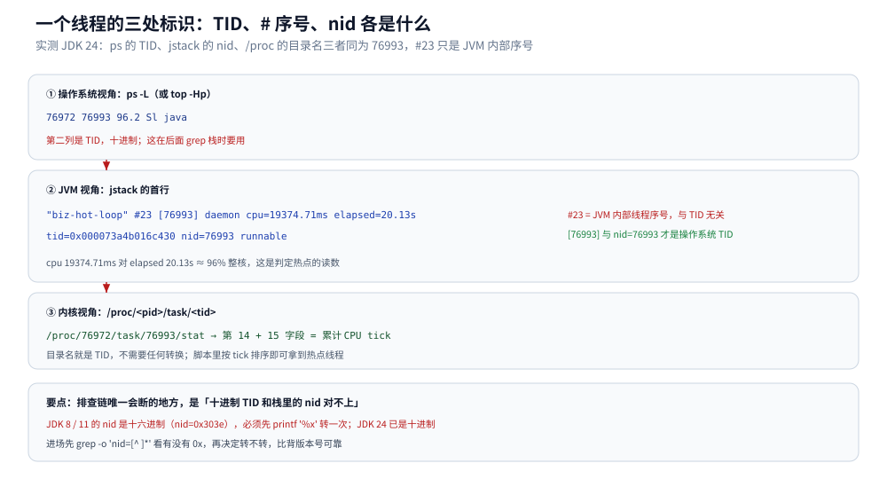

# 线上问题排查

> 覆盖：从零走一遍 Java 服务的现场排查——先用三步把「哪个线程在吃 CPU」和「它在跑哪一行」对上，再读线程状态分布判断是死锁、锁竞争还是池打满，最后用 `jcmd` / `jstat` 补内存与 GC 的现场。附 Arthas 把这套动作自动化的命令对照。
>
> 不覆盖：GC 日志逐字段解读与参数调优见 [GC调优与日志.md](GC调优与日志.md)；`jcmd` / JFR 产物的深度用法见 [JFR与诊断工具.md](JFR与诊断工具.md)；死锁与并发缺陷的代码级复现见 [死锁与并发缺陷诊断.md](../并发编程/死锁与并发缺陷诊断.md)；栈帧结构见 [运行时数据区与栈帧.md](运行时数据区与栈帧.md)；Linux 侧四步下钻（CPU / 内存 / 磁盘 / 网络）见 [性能排查.md](../../../02-计算机基础/linux/性能排查.md)。
>
> 内容整理自个人学习笔记，素材见 [素材清单](../../../素材清单.md)。
>
> 实测口径：容器 `java-lab`，`eclipse-temurin:24-jdk`（24.0.2+12，linux/amd64，4 CPU）。被测进程源码 `.workbuddy/tmp/exp/java/diag/PROC.java`：一个空转烧 CPU 的 `biz-hot-loop`、一对 `T1-L1-then-L2` / `T2-L2-then-L1` 死锁、一个持锁 10 分钟的 `biz-slow-holder` 加 20 个等同一把锁的 `pool-worker-*`。本篇引用的 `jstack` / `jstat` / `/proc` 输出全部来自这次实跑。⚠️ Arthas 段未实测：容器里没有 `curl`/`wget`，`arthas-boot.jar` 拉不下来，命令与作用按官方文档列出。

---

## 一、从零：一次排查要回答哪三个问题？

**本节要点**：线上排查不是「把所有工具跑一遍」，而是按三个问题分三条路——**CPU 高吗？内存涨吗？调用卡住了吗？** 三条路各自的第一步命令不同，但都要落到「哪个线程 → 哪一行代码」。

### 1.1 三十秒判断走哪条路

```bash
jps -l                                  # ① 先确认进程在不在、主类是哪个
ps -L -o pid,tid,pcpu,stat,comm -p <pid> --sort=-pcpu | head -6
free -m; cat /proc/<pid>/status | grep -E 'VmRSS|Threads'
```

三条路的判据：

| 症状 | 先看什么 | 命令入口 | 典型结论 |
|---|---|---|---|
| 接口变慢、CPU 打满 | 哪个线程在烧 CPU | `ps -L` / `top -Hp` → `jstack` | 死循环、正则回溯、序列化大对象、GC 线程本身 |
| 内存慢慢涨、最后 OOM | RSS 与堆的使用曲线 | `jstat -gcutil` → `jcmd GC.heap_info` → `jmap -histo` | 泄漏（对象不释放）或堆外（见 [堆外内存与内存映射.md](堆外内存与内存映射.md)） |
| 请求都卡住、CPU 不高 | 线程状态分布 | `jstack` + 状态计数 | 死锁、锁竞争、下游超时、线程池打满 |

### 1.2 三条路最终都收敛到「线程 + 行号」

无论走哪条路，终点都是同一件事：**把操作系统看到的线程，和 JVM 里那份 Java 栈对上**。这个「对上」的动作只有一步——识别线程 ID 的进制。实测一台 JDK 24：

```text
# 进程 76972，按 CPU 累计 tick 排序
1258 76993        ← biz-hot-loop
7    76974        ← 主线程
1    76989
0    ...          ← 其余线程

# 同一个线程在 jstack 里的样子
"biz-hot-loop" #23 [76993] daemon prio=5 os_prio=0 cpu=19374.71ms elapsed=20.13s tid=0x000073a4b016c430 nid=76993 runnable
```

`#23` 是 JVM 内部的线程序号，`[76993]` 是操作系统线程 ID，`nid=76993` 也是它——**在 JDK 24 上 `nid` 与 `/proc/<pid>/task/<tid>` 的目录名逐字相同**。所以老版本那套「`printf '%x'` 转十六进制」在这里不需要了。⚠️ JDK 8 / 11 那一代打的是十六进制（`nid=0x303e`），先 `grep -o 'nid=[^ ]*'` 看有没有 `0x` 再决定要不要转。

## 二、CPU 高怎么定位到代码行？

**本节要点**：四步固定动作——找进程、找线程、转 ID（或确认不用转）、抓栈比对。**一次抓栈不算数**，连抓 3 次都停在同一行才是真凶。

### 2.1 四步固定动作

```bash
jps -l                                    # ① 找进程
ps -L -o pid,tid,pcpu,comm -p <pid> --sort=-pcpu | head   # ② 找线程（top -Hp <pid> 等价）
printf '%x\n' <tid>                       # ③ 仅老版本需要：十进制 → 十六进制
jstack <pid> > /tmp/stack.txt
grep -A 10 'nid=76993' /tmp/stack.txt     # ④ 抓栈比对（JDK 24 直接填十进制）
```

实测第四步的输出：

```text
"biz-hot-loop" #23 [76993] daemon prio=5 os_prio=0 cpu=19374.71ms elapsed=20.13s tid=0x... nid=76993 runnable
   java.lang.Thread.State: RUNNABLE
	at PROC.lambda$main$0(PROC.java:12)
	at PROC$$Lambda/0x000073a43b000a18.run(Unknown Source)
	at java.lang.Thread.runWith(java.base@24.0.2/Thread.java:1460)
```

`cpu=19374.71ms` 对 `elapsed=20.13s`，即这个线程 20 秒里烧了 19.4 秒 CPU，几乎整核跑满。`at PROC.lambda$main$0(PROC.java:12)` 直接给出行号，这一行就是空转循环。

### 2.2 为什么必须连抓 3 次

一次抓栈可能抓到「刚好路过」的方法（比如刚好在内联后的某个分支里）。同一线程 3 次都停在同一个业务方法，才是持续热点：

```bash
for i in 1 2 3; do jstack <pid> > s$i.txt; sleep 2; done
for i in 1 2 3; do grep -A 3 'nid=76993' s$i.txt | tail -3; done
```

### 2.3 看到的栈是「JVM 优化后」的栈

上面那份栈只有 4 帧，且中间夹着 `PROC$$Lambda/...run(Unknown Source)`。原因有两个：lambda 被编译成了合成的 `run` 方法；热点方法被内联后，**栈帧会省略内联进去的帧**。所以「栈里没有出问题的方法」不等于它没执行——要看最内层那一帧的行号，并用 `-XX:+PrintInlining` 之类的参数另行确认（见 [JIT与执行引擎.md](JIT与执行引擎.md)）。

## 三、线程状态分布能告诉你什么？

**本节要点**：`jstack` 输出全量状态计数，一眼就能分类：**大量 `BLOCKED` = 抢同一把锁**、**大量 `WAITING (on object monitor)` 在池里 = 池打满或下游慢**、**`TIMED_WAITING` 扎堆 = 都在等超时**。实测这个混合场景的状态分布是 22 个 `BLOCKED`。

### 3.1 一条命令出分布

```bash
jstack <pid> | grep -o 'java.lang.Thread.State: [A-Z]*' | sort | uniq -c | sort -rn
```

```text
  22 java.lang.Thread.State: BLOCKED
   9 java.lang.Thread.State: RUNNABLE
   3 java.lang.Thread.State: TIMED_WAITING
   1 java.lang.Thread.State: WAITING
```

对应到场景里：22 个 `BLOCKED` = 2 个死锁线程 + 20 个 `pool-worker-*` 等同一把锁；9 个 `RUNNABLE` = 烧 CPU 的 `biz-hot-loop` 加 JVM 自身线程；3 个 `TIMED_WAITING` = JFR / 监控类的定时线程。

### 3.2 三种「卡住」的区分

| 状态 | 含义 | 典型原因 | 下一步 |
|---|---|---|---|
| `BLOCKED` | 等**内置锁**（`synchronized`） | 锁竞争、死锁 | 看 `waiting to lock <0x…>` 的地址是谁持有 |
| `WAITING (on object monitor)` | 主动 `wait()` | 条件队列等待 | 看谁该 `notify`、为什么不 notify |
| `WAITING (parking)` | `LockSupport.park` / AQS | 等锁、等 `Future` | 看 `parking to wait for <0x…>` 是什么对象 |
| `TIMED_WAITING (sleeping)` | `sleep` | 定时任务、退避 | 扎堆说明下游慢或退避参数过小 |

### 3.3 死锁会被自动点名

`jstack` 自带死锁检测，命中就打一整段：

```text
Found one Java-level deadlock:
=============================
"T1-L1-then-L2":
  waiting to lock monitor 0x000073a400001b50 (object 0x00000000a9117660, a java.lang.Object),
  which is held by "T2-L2-then-L1"

"T2-L2-then-L1":
  waiting to lock monitor 0x000073a404000f30 (object 0x00000000a9117650, a java.lang.Object),
  which is held by "T1-L1-then-L2"

Java stack information for the threads listed above:
===================================================
"T1-L1-then-L2":
	at PROC.lambda$main$1(PROC.java:20)
	- waiting to lock <0x00000000a9117660> (a java.lang.Object)
	- locked <0x00000000a9117650> (a java.lang.Object)
```

两段信息缺一不可：上半段是**环**（谁等谁、谁持有），下半段是**行号**（`PROC.java:20` 与 `PROC.java:26`）。只看到 `BLOCKED` 不等于死锁，必须看到这个环才算。

### 3.4 锁竞争：地址对得上就是同一把锁

大量线程卡在同一个地址，说明它们在抢同一把锁：

```text
"pool-worker-3" #30 [77000] ... waiting for monitor entry  [0x...]
   java.lang.Thread.State: BLOCKED (on object monitor)
	at PROC.lambda$main$4(PROC.java:40)
	- waiting to lock <0x00000000a9117670> (a java.lang.Object)
```

20 个 `pool-worker-*` 的 `waiting to lock` 都是 `0x00000000a9117670`，而 `biz-slow-holder` 用 `locked <0x00000000a9117670>` 持着它。**一个地址把「谁堵住了谁」全部串起来**——这就是为什么排查锁问题不需要猜代码，只需要 `grep` 这个十六进制地址。



图里三处标识指着同一个线程：`ps -L` 与 `/proc/<pid>/task` 用的是十进制 TID，`jstack` 的 `#23` 是 JVM 内部序号（与 TID 无关），`nid` 才是可以和 TID 对上的那个。老版本把 `nid` 打成十六进制，这一步就成了整个排查链上最容易断的地方。

## 四、内存与 GC 的现场怎么看？

**本节要点**：**先看趋势，再看构成，最后才抓快照**。`jstat` 每秒一拍看趋势，`jcmd GC.heap_info` 看构成，`jmap -histo` 看对象排行；`jmap -dump` 会 STW，非必要不做。

### 4.1 jstat 看趋势

```bash
jstat -gcutil <pid> 1000 3        # 每秒 1 次，共 3 次
```

```text
  S0     S1     E      O      M     CCS    YGC     YGCT    FGC    FGCT    CGC     CGCT     GCT
    -      -  10.71   0.00      -      -      0     0.000     0     0.000     0     0.000   0.000
    -      -  10.71   0.00      -      -      0     0.000     0     0.000     0     0.000   0.000
    -      -  10.71   0.00      -      -      0     0.000     0     0.000     0     0.000   0.000
```

三点读法：

1. **`S0` / `S1` 是 `-`**：G1 不再用传统的两块 survivor 计数，这几个字段就没有意义了；换 Parallel / CMS 会打出数字。别把 `-` 当成「异常」。
2. **`CGC` / `CGCT` 是 G1 特有的并发周期**：它们不为零不代表卡顿，要看 `GCT` 与停顿日志。
3. **`E`（Eden 使用率）稳定在 10.71% 不动**：这个进程几乎不分配对象。反过来，如果 `E` 每秒归零、`YGC` 每秒涨，就是典型的「分配速率过高」。

### 4.2 构成与对象排行

```bash
jcmd <pid> GC.heap_info            # 堆各区容量与使用量，比 jstat 更直观
jmap -histo:live <pid> | head -30   # ⚠️ :live 会触发 Full GC；不带 :live 不触发但含垃圾
```

判据：`GC.heap_info` 里老年代占用持续上涨且 `FGC` 后不回落 → 泄漏；`jmap -histo` 头部是业务 DTO 且数量持续增长 → 顺着这个类找持有链（`jmap -dump` + MAT 分析支配树）。

## 五、Arthas：把上面几节自动化

**本节要点**：`thread -n` 就是「按 CPU 排序 + 抓栈」的自动化，`thread -b` 是「找阻塞源」的自动化，`trace` 把方法内部逐层耗时打出来。⚠️ 本机未实测（容器无下载工具）。

```bash
curl -O https://arthas.aliyun.com/arthas-boot.jar && java -jar arthas-boot.jar
```

| 命令 | 等价于手工做什么 | 何时用 |
|---|---|---|
| `dashboard` | `jstat` + 线程概览 + 内存一屏 | 进场第一眼 |
| `thread -n 3` | `ps -L` 排序 + `jstack` + `grep nid` 全流程 | CPU 高，找热点线程 |
| `thread -b` | 遍历所有 `BLOCKED` 找持锁者 | 卡住，找阻塞源 |
| `trace <class> <method>` | 无等价手工命令（要 `-XX:+PrintInlining` 之类） | 接口慢，定位到方法内某一行 |
| `watch <class> <method> '{params, returnObj}'` | 加日志再发版 | 参数/返回值异常，不想改代码 |
| `heapdump /tmp/h.hprof` | `jmap -dump:format=b,file=...` | 内存问题需离线分析 |

三个前提：目标 JVM 能被 attach（同用户、同容器）；版本匹配（Arthas 对很新的 JDK 可能不支持）；`trace` / `watch` 会**增强字节码**，对性能有影响，只在排障窗口用。

**本节要点**：四类线上现象（CPU 打满、假死、内存涨、GC 频繁）各自只需要两三个指标就能分诊；先定位是哪一类，再动手。

| 场景 | 只看哪几个指标 | 落到哪个命令 |
|---|---|---|
| 接口 P99 突然翻倍、CPU 打满 | 单线程 CPU 占比 + 栈顶行号 | `ps -L` → `jstack` → `grep nid` |
| 服务「假死」，所有请求超时 | `BLOCKED` 数量 + 持锁者地址 | `jstack` 状态分布 + 死锁段 |
| 内存缓慢上涨、几小时后 OOM | `O` 区曲线 + `FGC` 后是否回落 | `jstat -gcutil` → `jcmd GC.heap_info` |
| 堆很稳但进程被 OOM Killer 杀掉 | RSS 与堆的差值 | `/proc/<pid>/status` + 直接内存池（见 [堆外内存与内存映射.md](堆外内存与内存映射.md)） |
| 线程数暴涨 | `Threads:` 计数与 `pool-*` 数量 | `jstack` 按名前缀计数 |
| 本项目内 | [性能排查.md](../../../02-计算机基础/linux/性能排查.md) 的四步下钻 | 先定位到进程，再回到本篇定位到行 |

## 七、具体使用

**本节要点**：把上面的命令按「进场顺序」固化成一段可直接粘的脚本，并给出三个读数的判据。

### 7.1 进场脚本

```bash
P=<pid>; TS=$(date +%Y%m%d-%H%M%S); OUT=/tmp/diag-$TS; mkdir -p $OUT
jps -l                                   > $OUT/jps.txt
ps -L -o pid,tid,pcpu,stat,comm -p $P --sort=-pcpu | head -20 > $OUT/threads.txt
cat /proc/$P/status | grep -E 'VmRSS|VmSize|Threads'          > $OUT/mem.txt
jstack -l $P                             > $OUT/stack1.txt
jstack -l $P                             > $OUT/stack2.txt   # 隔 2 秒再抓一次
jcmd $P GC.heap_info                     > $OUT/heap.txt
jstat -gcutil $P 1000 5                  > $OUT/jstat.txt
jcmd $P VM.system_properties | head -40  > $OUT/props.txt     # 版本、启动参数
echo "输出目录：$OUT"
```

这条脚本的顺序是有讲究的：**先拿轻量的（`ps` / `/proc`），再拿重的（`jstack -l` / `jcmd`）**，因为 `jstack -l` 会短暂进入安全点，而 `jmap -dump` 这类 STW 操作根本不该进第一轮。

### 7.2 三条读数判据

| 读数 | 正常 | 异常信号 |
|---|---|---|
| 单线程 CPU 占整核比例 | 空转线程接近 100%，业务线程通常 < 30% | 某业务线程稳定 90%+ → 死循环 / 大计算 |
| `BLOCKED` 占比 | 个位数 | 超过 30% 且集中在同一地址 → 锁竞争或死锁 |
| `FGC` 次数 | 几小时内个位数 | 每分钟多次且 `FGCT` 累计上升 → 老年代不够或泄漏 |

## 延伸追问

- **为什么 `jstack` 里 grep 十进制 TID 有时查不到？** → 老版本 `nid` 打十六进制（`0x303e`），而 `ps -L` / `/proc/<pid>/task` 给的是十进制；JDK 24 实测 `nid` 已经是十进制、与 TID 逐字相同。先 `grep -o 'nid=[^ ]*'` 看一眼有没有 `0x`，再决定要不要 `printf '%x'`。
- **一次抓栈为什么不够？** → 线程可能只是「刚好路过」某个方法；同一线程连抓 3 次停在同一行才是真凶。热点方法还会被内联，栈里省略中间帧，所以要看最内层行号。
- **`jstack -l` 里的 `-l` 是什么？** → 额外打印 `java.util.concurrent` 的 ownable synchronizer 信息（`ReentrantLock`、AQS 的等待队列）。查 `LockSupport.park` 卡在哪必须加它，否则只看到 `parking to wait for` 而没有持有者。
- **`BLOCKED` 和 `WAITING` 有什么不同？** → `BLOCKED` 是等内置锁（`synchronized`）且**不消耗 CPU**；`WAITING` 是主动 `wait()` / `park()`。前者查锁竞争，后者查等待链条（第三节）。
- **`jmap -dump` 能随便打吗？** → 不能，它 STW 且和堆大小成正比；先用 `-histo` / `jcmd GC.heap_info` 缩小范围，确需快照再评估停顿时长与磁盘空间。
- **虚拟线程的栈在哪？** → `jstack` 默认不列虚拟线程，要用 `jcmd <pid> Thread.dump_to_file -format=json` 拿结构化转储；平台线程的排查路径不变。见 [虚拟线程.md](../并发编程/虚拟线程.md)。
- **容器里 `top` 看不到宿主机进程怎么办？** → 在容器内 `ps -L` 只看得到本容器的进程，这正是需要的；要跨容器看，得在宿主机按 `docker top <container>` 或 `/proc/<容器 pid>/task`。
- **为什么 `jstat` 的 `S0` / `S1` 是 `-`？** → 那是 G1 默认收集器；它不按两块 survivor 计数，换回 Parallel 才会打出数字。同样 `M` / `CCS` 在部分版本也打 `-`，不代表元空间异常。

## 关联

- **上游/总纲**：[性能排查.md](../../../02-计算机基础/linux/性能排查.md) — Linux 侧的四步下钻与 CPU / 内存 / 磁盘 / 网络指标
- **下游机制**：[GC调优与日志.md](GC调优与日志.md) — GC 日志、`jstat` / `jcmd` / `jmap` 的读数与参数调优
- **下游机制**：[运行时数据区与栈帧.md](运行时数据区与栈帧.md) — 栈帧结构，`jstack` 输出里每一帧对应什么
- **下游机制**：[JFR与诊断工具.md](JFR与诊断工具.md) — JFR 与 `jcmd` 的深度用法，比手工抓栈更完整的时间线
- **对照/互补**：[死锁与并发缺陷诊断.md](../并发编程/死锁与并发缺陷诊断.md) — 死锁 / 活锁 / 饥饿的代码级复现与转储读法
- **对照/互补**：[线程池.md](../并发编程/线程池.md) — 线程池打满时为什么栈里大量 `WAITING`
- **对照/互补**：[pprof性能分析.md](../../go/运行时/pprof性能分析.md) — Go 侧同一件事用 `pprof` 做
> 反向引用（本篇被下列文档引到）：[JIT与执行引擎.md](JIT与执行引擎.md)、[JVM启动与参数体系.md](JVM启动与参数体系.md)、[Unsafe与内存布局.md](Unsafe与内存布局.md)、[对象布局与引用类型.md](对象布局与引用类型.md)、[类文件与字节码.md](类文件与字节码.md)
