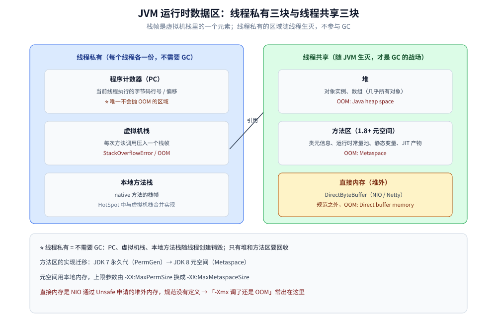
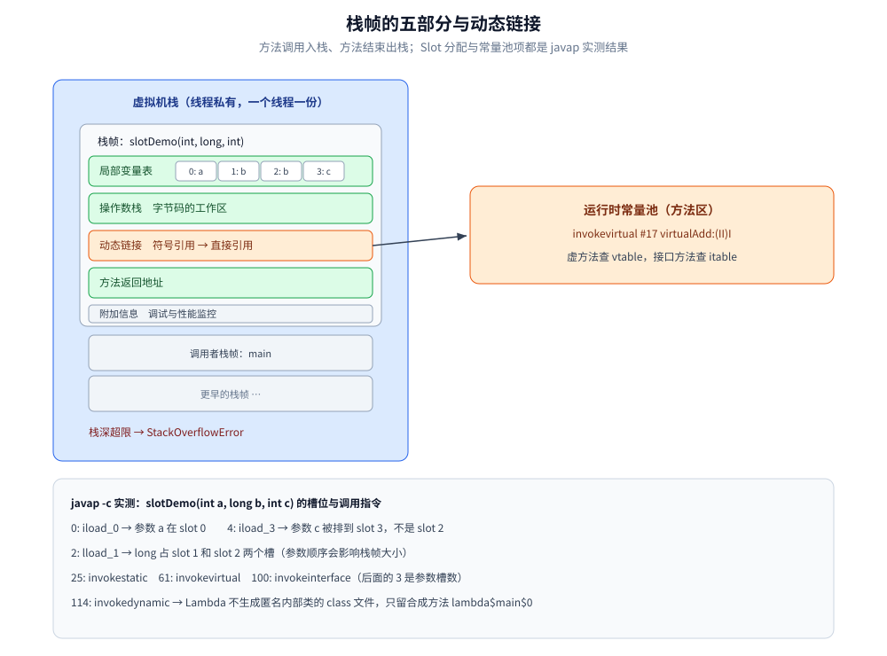
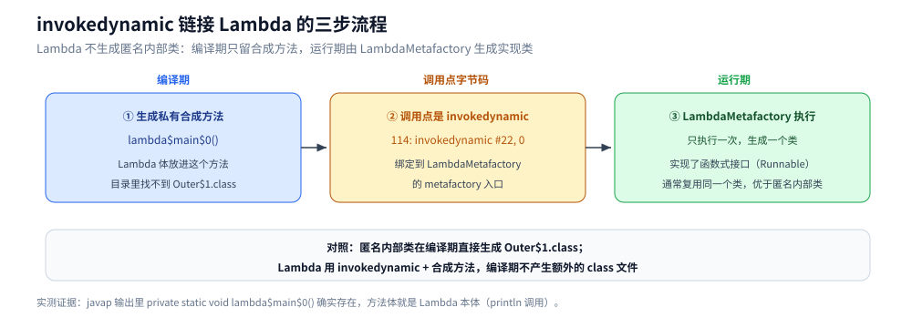

# 运行时数据区与栈帧

> 覆盖：JVM 运行时数据区的六个区域（哪些线程私有、各自会抛什么异常）、栈帧的五个组成部分与动态链接的角色、局部变量表的 Slot 分配、字节码里五种方法调用指令的实际形态，以及 `-Xss` 与最大递归深度之间那个「不线性」的实测结论。
> 不覆盖：堆内的对象生命周期与回收见 [垃圾回收原理与收集器.md](垃圾回收原理与收集器.md)；类加载与运行时常量池的写入时机见 [类加载机制.md](类加载机制.md)；堆外内存（`DirectByteBuffer`）的释放路径见 [堆外内存与内存映射.md](堆外内存与内存映射.md)。
>
> 内容整理自个人学习笔记，素材见 [素材清单](../../../素材清单.md)。
> 实测口径：容器 `java-lab`，`eclipse-temurin:24-jdk`（24.0.2+12，linux/amd64），源码 `.workbuddy/tmp/exp/java/runtime/RF.java`；`javap -c -p` 的输出原样贴出，`-Xss` 五档各跑 JIT 3 次 + `-Xint` 1 次。⚠️ 递归深度本身是**不稳定读数**（第五节就是讲它为什么不稳），只按趋势引用，不把单个数字当结论。

---

## 一、从零：一次方法调用，JVM 里多了什么？

**本节要点**：一次 `slotDemo(1, 2L, 3)` 背后只发生三件事——**在线程私有的一块内存上压进一个栈帧、把三个参数按槽位摆进局部变量表、执行完弹栈**；栈帧不是对象，它不受 GC 管，也不在堆里。

### 1.1 先看一个方法在字节码里长什么样

```java
static long slotDemo(int a, long b, int c) {
    return a + b + c;
}
```

`javap -c -p RF` 实测输出：

```text
static long slotDemo(int, long, int);
  Code:
     0: iload_0        // 参数 a → slot 0
     1: i2l
     2: lload_1        // 参数 b（long）→ slot 1，占 1 和 2 两个槽
     3: ladd
     4: iload_3        // 参数 c → slot 3 ⭐ 不是 2，因为 long 占了两个
     5: i2l
     6: ladd
     7: lreturn
```

⭐ 三个参数只用两行字节码就能看出全部结构：`iload_0 / lload_1 / iload_3` 是**局部变量表按下标取值**，`i2l / ladd` 是**操作数栈上的运算**，`lreturn` 是**出栈返回**。

### 1.2 这次调用动到了哪几个区

| 现象 | 落在哪个区 | 线程私有？ | 详见 |
|---|---|---|---|
| 方法调用一次，就压一个栈帧 | 虚拟机栈 | ✅ 私有 | [第二节](#二运行时数据区的六个区域怎么分)、[第三节](#三栈帧由哪五部分组成) |
| `iload_0` 这一步 | 栈帧里的局部变量表 | ✅ | [第三节 3.2](#32-局部变量表的-slot-分配javap-实证) |
| `ladd` 这一步 | 栈帧里的操作数栈 | ✅ | [第三节](#三栈帧由哪五部分组成) |
| `invokevirtual` 才知道调哪个实现 | 动态链接 → 运行时常量池 + vtable | 常量池共享 | [第四节](#四字节码里的五种方法调用指令差在哪) |
| 每多一个线程，就多一整块栈 | `线程数 × -Xss` | — | [第五节](#五-xss-与最大栈深为什么结果不是线性的) |

### 1.3 三个反直觉点

- **程序计数器是唯一不会抛 OOM 的区域**：它只存一个偏移量，大小固定。
- **栈溢出与 `-Xss` 不成比例**：`-Xss` 翻倍，递归深度并不稳定翻倍（第五节实测：`-Xint` 下才近似线性）。
- **栈帧不在堆上**：规范只说「线程私有」，HotSpot 的实现是**线程私有的一块本地内存**，所以它既不参与 GC，也不被堆 dump 看到。

---

## 二、运行时数据区的六个区域怎么分？

**本节要点**：判据只有一条——**随线程生灭还是随 JVM 生灭**；前者不进 GC，后者才是 GC 与 OOM 的战场，而直接内存连 JVM 规范都没定义。

「运行时数据区」和「栈帧」是两级概念：**栈帧是虚拟机栈里的一个元素**。先把全景列清楚，再往下钻。

| 区域 | 线程归属 | 存什么 | 生命周期 | 会抛什么异常 |
| --- | --- | --- | --- | --- |
| **程序计数器**（PC） | 线程私有 | 当前线程执行的字节码行号 / 偏移 | 随线程创建销毁 | ⭐ 唯一**不会**抛 OOM 的区域 |
| **虚拟机栈** | 线程私有 | **栈帧**（每次方法调用一个） | 随线程 | `StackOverflowError`（栈深超限）/ OOM |
| **本地方法栈** | 线程私有 | `native` 方法的栈帧（HotSpot 中与虚拟机栈合并实现） | 随线程 | 同上 |
| **堆** | 共享 | 对象实例、数组（几乎所有对象都在这） | 随 JVM | `OOM: Java heap space` |
| **方法区**（1.8+ 元空间） | 共享 | 类元信息、运行时常量池、静态变量、JIT 编译产物 | 随 JVM | `OOM: Metaspace` |
| **直接内存**（堆外） | 共享 | `DirectByteBuffer`（NIO / Netty） | 随 JVM | `OOM: Direct buffer memory` |

⭐ 三个高频考点：

- **线程私有 = 不需要 GC**：PC、虚拟机栈、本地方法栈随线程生灭，不存在「回收」问题；堆与方法区才是 GC 的战场。
- **方法区的实现迁移**：JDK 7 的永久代（PermGen）在 **JDK 8 被元空间（Metaspace）取代**——元空间用的是**本地内存**，不再受 `-XX:MaxPermSize` 限制，改为 `-XX:MaxMetaspaceSize`。
- **直接内存不在 JVM 规范里**：它是 NIO 通过 `Unsafe` 申请的堆外内存，JVM 规范没有定义，所以「`-Xmx` 调了还是 OOM」的经典场景就出在这里。



左边三块随线程生灭（所以不进 GC），右边三块随 JVM 生灭（GC 与 OOM 的战场）；中间那条线表示栈上的引用指向堆里的对象实例。

---

## 三、栈帧由哪五部分组成？

**本节要点**：五部分里只有两个是「数据」（局部变量表、操作数栈），另外三个是「元信息」——其中**动态链接**是 Java 多态能在运行期才确定实现的落点。

**栈帧（Stack Frame）** 是方法调用与方法执行的基本单位，随方法调用入栈、随方法结束出栈，其结构为：

| 组成部分 | 作用 |
|---|---|
| **局部变量表** | 存放方法参数与方法内定义的局部变量（以变量槽 Slot 为单位，`long`/`double` 占 2 个 Slot） |
| **操作数栈** | 字节码指令的工作区，入栈/出栈完成运算（如 `iadd` 弹出两个 int 相加再压回） |
| **动态链接** | 指向**运行时常量池**中该栈帧所属方法的引用，支持运行期把符号引用解析为直接引用 |
| **方法返回地址** | 记录方法退出后应返回的位置（正常返回为调用者 PC 的下一条指令；异常返回靠异常表） |
| **附加信息** | 调试、性能监控所需的额外信息（如局部变量作用域表） |

### 3.1 为什么需要动态链接

- 编译期无法确定所有方法的直接引用（多态、虚方法调用），只能先记录符号引用；
- 运行期通过动态链接把符号引用转为直接引用，多态方法调用则查**虚方法表（vtable）**/接口方法表（itable）完成分派；
- 这也解释了「编译期确定不了调哪个实现，运行期才能确定」这一 Java 多态的实现基础。

### 3.2 局部变量表的 Slot 分配（javap 实证）

还是第一节那个 `slotDemo(int a, long b, int c)`，`javap -c` 的关键三行：

```text
0: iload_0        // 参数 a → slot 0
2: lload_1        // 参数 b（long）→ slot 1，占 1 和 2 两个槽
4: iload_3        // 参数 c → slot 3 ⭐ 不是 2，因为 long 占了两个
```

⭐ **`iload_3` 就是「long 占两个 Slot」的直接证据**：参数 `c` 被排到 slot 3 而不是 slot 2。这条规则的实际影响是——**参数顺序会影响栈帧大小**（把 `long`/`double` 排在一起能减少槽浪费），而且**变量出作用域后 Slot 可以被复用**（所以「`for` 循环里定义的大对象」不一定比循环外更占内存，看编译器是否复用槽位）。

### 3.3 一次调用的栈变化



一个栈帧从上到下就是表中五部分，`局部变量表` 那行的 0/1/2/3 就是实测槽位（slot 1 与 2 同属那个 `long`）；橙色那条线表示动态链接指向运行时常量池。

---

## 四、字节码里的五种方法调用指令差在哪？

**本节要点**：「向上转型后调用的是子类实现」在字节码层面就是**换了一条 `invoke` 指令**：`invokestatic` / `invokespecial` 编译期定死，`invokevirtual` / `invokeinterface` 运行期查表，`invokedynamic` 由引导方法在运行期决定。

| 指令 | 何时生成 | 分派方式 | 典型场景 |
| --- | --- | --- | --- |
| `invokestatic` | 调用**静态方法** | 编译期确定（不涉及对象） | 工具类方法、`main()` |
| `invokespecial` | 调用**构造器**、`private` 方法、`super` 方法 | 编译期确定（静态绑定） | `new` 对象、`super()`、私有方法 |
| `invokevirtual` | 调用**实例方法**（非 private、非接口） | ⭐ **运行期查 vtable**（动态分派） | 普通方法调用 |
| `invokeinterface` | 通过**接口引用**调用方法 | ⭐ **运行期查 itable**（动态分派） | 面向接口编程的所有调用 |
| `invokedynamic` | 运行期**动态确定调用目标** | 由 `BootstrapMethod` 决定 | Lambda、方法引用、`String` 拼接（JDK 9+） |

### 4.1 实测：同一段代码里五条指令都出现

被测代码的五个调用点分别是静态方法、实例方法、接口方法、构造器与 Lambda（`RF.java`）：

```java
static int staticAdd(int a, int b) { return a + b; }         // → invokestatic
public int virtualAdd(int a, int b) { return a * b; }         // → invokevirtual
interface Calc { int calc(int a, int b); }                     // → invokeinterface
Calc calc = (a, b) -> a + b;                                   // → invokedynamic
Runnable r = () -> System.out.println("lambda 本体");           // → invokedynamic
```

`javap -c -p RF` 的实际输出（截取关键几行）：

```text
24: invokestatic  #59                 // Method staticAdd:(II)I
                    ⭐ 静态方法：编译期就定死了调用目标

49: invokevirtual #65                 // Method virtualAdd:(II)I
                    ⭐ 实例方法：运行期按对象的实际类型查 vtable

74: invokeinterface #73,  3           // InterfaceMethod RF$Calc.calc:(II)I
                    ⭐ 接口方法：运行期查 itable；注意后面多了个参数 3

60: invokedynamic #69,  0             // InvokeDynamic #4:calc:()LRF$Calc;
                    ⭐ 运行时由 LambdaMetafactory 生成实现

39: invokespecial #64                 // Method "<init>":()V
                    ⭐ 构造器：编译期已确定（不存在多态）
```

⚠️ **`invokeinterface` 后面那个 `3` 不是普通参数**：它是「调用时传入的参数槽数（含接收者）」，`calc(int, int)` 加上接收者 `this` 共 3 个槽——这是接口调用比虚调用多做一次参数校验的表现，也是它历史上**性能略低于 `invokevirtual` 的原因**（现代 JIT 靠类型 profile + 内联缓存已基本抹平差距）。

### 4.2 `invokedynamic` 与 Lambda 的关系

Lambda 表达式**不生成匿名内部类**，而是：

1. 编译器生成一个**私有合成方法**（如 `lambda$demo$0`），把 Lambda 体放进去；
2. 调用点使用 `invokedynamic` 指令，绑定到 `LambdaMetafactory.metafactory`；
3. 运行时由 `LambdaMetafactory` 执行一次，生成一个实现了函数式接口的类（通常复用同一个类，性能优于匿名内部类）。

实测证据——合成方法确实存在，而目录里**没有** `RF$1.class`：

```text
private static int lambda$demo$0(int, int);
private static void lambda$demo$1();
```

```bash
ls out/ | grep 'RF\$'
# RF$Calc.class   ← 只有接口本身（它是个嵌套类），没有 RF$1.class
```



三块从左到右对应编译期 → 调用点字节码 → 运行期；底部灰框是与匿名内部类（编译期直接生成 `Outer$1.class`）的对照。

> ⭐ 所以「Lambda 和匿名内部类的区别」在字节码层面是**有实测依据的**：Lambda 用的是 `invokedynamic` + 合成方法（不产生额外的 `.class` 文件），匿名内部类则是编译期直接生成 `Outer$1.class`。另外 JDK 9+ 的字符串拼接（`+`）也走 `invokedynamic`（`makeConcatWithConstants`），本机 `javap` 里处处都是这条指令。

---

## 五、`-Xss` 与最大栈深：为什么结果不是线性的？

**本节要点**：`-Xss` 只决定**栈的容量**，不决定「能递归多深」——深度还取决于每帧多大，而每帧多大取决于**这一刻这个方法有没有被 JIT 编译**，所以开 JIT 后同一参数多次跑出的深度能差一倍。

同一段「无限递归」代码（`recurse()` 自调用并计数），改 `-Xss` 观察 `StackOverflowError` 触发时的深度。JDK 24 实测（JIT 档每档跑 3 次，`-Xint` 各跑 1 次）：

| `-Xss` | 默认（开 JIT）三次读数 | `-Xint`（纯解释） |
| --- | --- | --- |
| 256k | 3644 / 1795 / 1795 | 1795 |
| 512k | 9410 / 7567 / 4774 | 4774 |
| 1m | 24471 / 22179 / 10732 | 10732 |
| 2m | 48110 / 48319 / 44040 | 22648 |
| 4m | 100302 / 217335 / 100378 | 46479 |

⭐⭐ 两个反直觉的结论：

1. **`-Xint` 下深度与 `-Xss` 严格线性**（1795 → 4774 → 10732 → 22648 → 46479，每档约 2.1~2.6 倍）——因为解释执行时每帧大小固定。
2. **开了 JIT 后整体更深、但极不稳定**：`-Xss4m` 三次跑出 100302 / 217335 / 100378，最大最小差 **2.2 倍**；而且 `-Xss256k` 的第一次 3644 与后两次 1795 不同，说明**连「有没有被编译」都在变**。原因有两条：①JIT 编译后的栈帧比解释器帧**小**（所以能递归更深）②**哪些方法已被编译、何时触发编译是不确定的**。

> ⚠️ **实践含义**：不要把「递归深度」当成可以精确计算的量，也不要指望「本机测出来的安全深度」在别的机器上同样成立。控制栈溢出只能靠**改迭代 + 限制递归深度上限**，`-Xss` 只是把爆炸点往后推。

### 5.1 复现现场

```java
static int depth = 0;

static void recurse() {
    depth++;
    recurse();
}

public static void main(String[] args) {
    try {
        recurse();
    } catch (StackOverflowError e) {
        System.out.println("StackOverflowError 触发深度 = " + depth);
    }
}
```

```bash
javac -d out RF.java
java -Xss1m -cp out RF depth          # JIT 档，跑三次看波动
java -Xint -Xss1m -cp out RF depth    # 解释档，跑两次应一致
```

---

## 六、内存异常怎么分诊？

**本节要点**：`StackOverflowError` 与 `OOM` 是两种病——前者是「一个线程要的栈太深」，后者是「某个内存区域不够了」；分诊靠**报错原文里的区域名**，后面五个区域各对应一句话。

栈帧属于虚拟机栈，但生产上出问题的往往是**堆与堆外**。把「报什么错 → 先怀疑谁 → 用什么看 → 调哪个参数」固定成一张表：

| 报错 | 典型原因 | 先看什么 | 相关参数 |
|---|---|---|---|
| `StackOverflowError` | 递归没有出口、单帧过大 | `jstack` 看重复的递归栈 | `-Xss`（线程栈大小） |
| `OOM: Java heap space` | 对象存活过多 / 内存泄漏 | `-XX:+HeapDumpOnOutOfMemoryError` + MAT 看支配树 | `-Xms` / `-Xmx` |
| `OOM: Metaspace` | 动态生成类过多（CGLIB、反射、热部署） | `jcmd <pid> GC.class_stats`、`-verbose:class` | `-XX:MaxMetaspaceSize` |
| `OOM: Direct buffer memory` | 堆外 NIO / Netty 未释放 | `-XX:NativeMemoryTracking=detail` + `jcmd <pid> VM.native_memory` | `-XX:MaxDirectMemorySize` |
| `OOM: unable to create native thread` | 线程数触顶（`ulimit -u` 或内存不足） | `jstack` 数线程、`ulimit -u`、`cat /proc/sys/kernel/threads-max` | 改线程池模型，而非加内存 |

> ⭐ 一句话区分：**`StackOverflowError` 是「一个线程要的栈太深」，`OOM` 是「某个内存区域不够了」**——前者调 `-Xss` 或改迭代，后者要靠 dump 分析存活对象，加内存往往只是推迟爆炸时间。

⚠️ **堆外的隐蔽性**：`-Xmx4g` 的容器被 OOM Killer 杀掉、`top` 里 RSS 远超 4g，多半是**直接内存 + Metaspace + 线程栈**之和超出了容器限额。排查顺序：`NativeMemoryTracking` 看各区域占用 → 确认 cgroup 限额 → 再决定调哪个参数（逐项账单见 [堆外内存与内存映射.md](堆外内存与内存映射.md)）。

---

## 七、应用场景

**本节要点**：这六个区域的价值不在「背下来」，而在**每个区域都有一组专属的观测手段与调参旋钮**；认错区域就会选错工具（拿 heap dump 查栈溢出一定查不到）。

| 场景 | 涉及哪个区 | 该用什么手段 |
|---|---|---|
| 容器里 JVM 被 OOMKilled，但堆监控正常 | 直接内存 / Metaspace / 线程栈 | `NativeMemoryTracking` + cgroup 限额（[堆外内存与内存映射.md](堆外内存与内存映射.md)） |
| 线程数上不去，`unable to create native thread` | 虚拟机栈（每线程一份） | 数线程、算 `线程数 × -Xss`（[线程池.md](../并发编程/线程池.md)） |
| 定位「哪个方法在栈顶」 | 虚拟机栈 + 栈帧 | `jstack` / `jcmd Thread.dump_to_file`（[线上问题排查.md](线上问题排查.md)） |
| 判断一次调用是静态绑定还是动态分派 | 动态链接 + vtable / itable | `javap -c` 看 `invoke*` 指令 |
| 分析 JIT 是否消除了某次调用 | 方法区（Code Cache） | `-XX:+PrintCompilation`、JFR 的编译事件（[JIT与执行引擎.md](JIT与执行引擎.md)） |
| 类元信息只涨不降 | 方法区（元空间） | `jcmd GC.class_stats`、`-verbose:class`（[类加载机制.md](类加载机制.md)） |

---

## 八、具体使用

**本节要点**：三件最常用的事——**看清一个方法的栈帧**（`javap`）、**估算一个线程的成本**（`-Xss` × 线程数）、**把栈溢出改成有界**；三件都不依赖运行时工具，纯静态就能做。

### 8.1 看清一个方法的栈帧

```bash
javac -g -d out RF.java                # -g 保留局部变量名，否则只有 slot 号
javap -c -p -cp out RF | sed -n '/slotDemo/,/^$/p'
javap -v -cp out RF | grep -A5 "LineNumberTable"   # 行号表：异常栈里的行号来自它
```

⚠️ 不加 `-g` 时 `javap` 只能给出 `iload_0` 这种下标；加了 `-g` 才有 `LocalVariableTable` 把 slot 映射回变量名。

### 8.2 估算一个线程的栈成本

| 项 | 怎么算 | 现实数字 |
|---|---|---|
| 栈本身 | `线程数 × -Xss` | 1000 线程 × 1 MB ≈ **1 GB** 虚拟地址（⚠️ 是预留，不是驻留） |
| 栈的实际驻留 | 只算真正用到的页 | 通常远小于 `-Xss`，但**深度递归的线程会真的吃满** |
| 一个线程的总账 | 栈 + 线程对象 + TLAB + 本地栈 | 经验值 1 MB 量级，容器 sizing 按 1 MB/线程留 |

```bash
java -Xss512k -XX:+PrintFlagsFinal -version | grep -i "ThreadStackSize"
jcmd <pid> Thread.print | grep -c '^"'        # 当前线程数
```

### 8.3 把栈溢出改成有界

```java
// 反例：深度由输入决定，输入一大就 SOE，而且 SOE 是 Error，很容易被 catch (Exception) 漏掉
static long sum(List<Integer> xs) {
    return xs.isEmpty() ? 0 : xs.get(0) + sum(xs.subList(1, xs.size()));
}

// 正例一：改迭代
static long sumIter(List<Integer> xs) {
    long s = 0;
    for (int x : xs) {
        s += x;
    }
    return s;
}

// 正例二：递归必须留，就显式限深，把不可控的 Error 变成可控的异常
static long sumBounded(List<Integer> xs, int depth) {
    if (depth > 1000) {
        throw new IllegalArgumentException("递归超过 1000 层，请改迭代");
    }
    return xs.isEmpty() ? 0 : xs.get(0) + sumBounded(xs.subList(1, xs.size()), depth + 1);
}
```

⚠️ **不要把 `-Xss` 当解法**：第五节实测已经说明深度不稳定，调大只是把爆炸点往后推；真正的解法是把「深度」变成代码里显式的边界。

---

## 延伸追问

- **JVM 运行时数据区有哪些？哪些线程私有？** → 私有：程序计数器、虚拟机栈、本地方法栈；共享：堆、方法区（元空间）。另有规范之外的**直接内存**。栈帧属于虚拟机栈。
- **`StackOverflowError` 和 OOM 有什么区别？** → 前者是单线程请求的**栈深**超限（典型是递归没出口），后者是堆/元空间/直接内存不够；治前者靠改迭代或调 `-Xss`，治后者要靠分析对象存活。
- **局部变量表为什么要按 Slot 而不是按变量算？** → Slot 是最小存储单位（32 位），`long`/`double` 占两个；按 Slot 算能让编译期就确定栈帧大小，也允许变量出作用域后 Slot 被复用。实测：`slotDemo(int, long, int)` 的第三个参数是 `iload_3` 而非 `iload_2`。
- **`invokevirtual` 和 `invokeinterface` 有什么区别？** → 前者查**虚方法表（vtable）**，后者查**接口方法表（itable）**；`invokeinterface` 额外带参数槽数做校验（实测字节码里是 `invokeinterface #73, 3`），历史上更慢，现代 JIT 已基本抹平。二者的共同点是**都靠运行期动态分派**，这也是多态的实现方式。
- **Lambda 和匿名内部类在字节码层面有什么不同？** → Lambda 用 `invokedynamic` + 私有合成方法（实测 `lambda$demo$0` / `lambda$demo$1`），**编译期不生成 `RF$1.class`**；匿名内部类会生成 `Outer$1.class`。
- **为什么同一个 `-Xss` 下递归深度不稳定？** → JIT 编译后的栈帧小于解释器帧，而「何时编译哪些方法」不确定，所以深度会浮动（实测 `-Xss4m` 三次：100302 / 217335 / 100378）；`-Xint` 下深度与 `-Xss` 近似线性（1795 → 46479）。
- **栈帧分配在堆上吗？** → 规范上属于线程私有的虚拟机栈；HotSpot 的实现里它是**线程私有的一块堆外内存**，不参与 GC 堆的回收。
- **为什么说「多态靠动态链接 + vtable」？** → 编译期只留下方法的**符号引用**，运行期由动态链接解析；虚方法还要查虚方法表（itable/vtable）才能确定调哪个实现（见 [类加载机制.md](类加载机制.md)）。
- **`-Xss` 调大能解决递归问题吗？** → 不能。它只延后爆炸点，而且深度不稳定（第五节）；解法是改迭代或显式限深（第八节 8.3）。

---

## 关联

- **上游/总纲**：[README.md](README.md) — 运行时 12 篇的分工表、五组读序与篇间依赖（本篇位次 ③；两条主线的入口在 [java/README.md](../README.md)）
- **对照/互补**：[垃圾回收原理与收集器.md](垃圾回收原理与收集器.md) — 堆侧的对象生命周期与收集算法
- **对照/互补**：[类加载机制.md](类加载机制.md) — 运行时常量池、符号引用解析时机与类加载五阶段
- **对照/互补**：[堆外内存与内存映射.md](堆外内存与内存映射.md) — 直接内存那一块的逐项账单
- **下游机制**：[JIT与执行引擎.md](JIT与执行引擎.md) — 为什么编译后的栈帧更小、为什么编译时机不确定
- **对照/互补**：[Stream流实战.md](../Stream流实战.md) — Lambda 与函数式接口的实战用法
- **运维/配置**：[资源限制与运维.md](../../../06-工程实践/部署/docker/资源限制与运维.md) — 容器内存限额与 JVM 参数的配合（堆外内存导致的 OOMKilled）
- **下游机制**：[线程池.md](../并发编程/线程池.md) — 每个线程一个 JVM 栈，这是线程池不能无限扩线程的根本约束
- **下游机制**：[锁与AQS.md](../并发编程/锁与AQS.md) — 轻量级锁的「锁记录」正是分配在线程栈上

> 反向引用（本篇被下列文档引到）：[函数调用与栈.md](../../go/类型与语法/函数调用与栈.md)、[JMM与内存屏障.md](../并发编程/JMM与内存屏障.md)、[线程基础与生命周期.md](../并发编程/线程基础与生命周期.md)、[虚拟线程.md](../并发编程/虚拟线程.md)、[Unsafe与内存布局.md](Unsafe与内存布局.md)、[类文件与字节码.md](类文件与字节码.md)、[线上问题排查.md](线上问题排查.md)、[DFS与BFS遍历.md](../../../02-计算机基础/算法/图论算法/图的遍历/DFS与BFS遍历.md)、[DFS深度优先遍历.md](../../../02-计算机基础/算法/图论算法/图的遍历/DFS深度优先遍历.md)、[机器码、字节码与opcode.md](../../../02-计算机基础/编译原理/机器码、字节码与opcode.md)、[Java实现.md](../../../04-架构与系统/系统设计/弹幕系统/Java实现.md)
