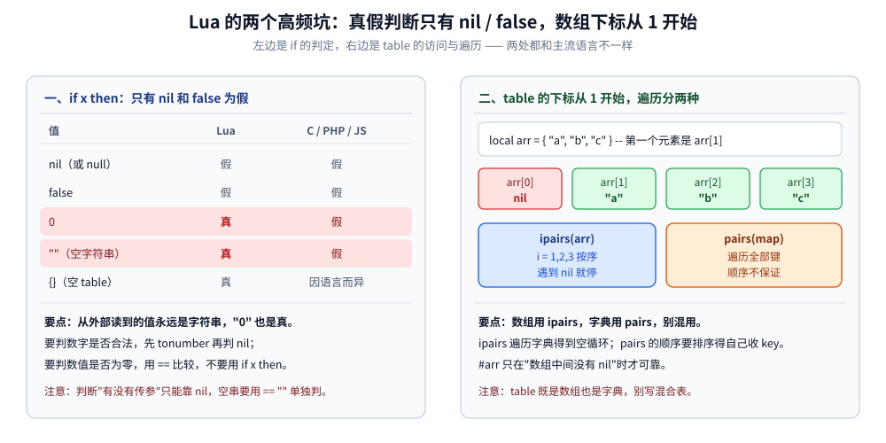

# Lua 语法够用版

> 覆盖：写网关脚本真正用得到的 **Lua 5.1 / LuaJIT 子集**——`local` 军规、真值判断只有 `nil` / `false`、table 与两种遍历、字符串拼接、函数与多返回值、模块、`pcall` 错误处理，以及七个和主流语言不一样、第一次写必踩的点。
>
> 不覆盖：`ngx.*` 的 API、执行阶段与 OpenResty 的部署用法见 [OpenResty.md](../../03-数据与中间件/中间件/网关与代理/OpenResty.md)；Lua 解释器内部的表实现与 GC 机制不在本篇。
>
> ⚠️ 本篇代码**未实跑**：本机没有 OpenResty / LuaJIT，也没有独立的 Lua 解释器；语义以 Lua 5.1 参考手册与 LuaJIT 文档为准，凡是有版本差异的地方逐处标注。
>
> 内容整理自个人学习笔记，素材见 [素材清单](../../素材清单.md)。

---

## 一、为什么 `local` 是第一条军规？

**本节要点**：不写 `local` 的变量进全局表 `_G`——在单机脚本里这只是"不整洁"，在**被所有请求共享的运行时**里就是**跨请求污染**。

```lua
-- ❌ 不写 local：变量进全局表 _G
count = 0

-- ✅ 写 local：局部变量，作用域到当前块
local count = 0
```

三个理由，按严重程度排：

1. **`_G` 是进程级的**——Web 服务器里所有请求共用同一个 Lua 虚拟机，不写 `local` 就是"一个用户的请求改掉了另一个用户的数据"；
2. **访问全局变量要走一次哈希查找**，`local` 是寄存器访问，在热点路径上差距明显；
3. **惯用法是把常用函数先本地化**，省掉每次调用的表查找：

```lua
-- ✅ 模块顶部把常用函数拿到 local
local tonumber = tonumber
local format   = string.format
local concat   = table.concat
```

⚠️ `local` 的作用域到**当前块**结束，不是到文件结束——写在 `if` / `for` 里的 `local` 出了块就没了：

```lua
if ok then
    local msg = "只有这个 if 块里可见"
end
print(msg)          -- nil：msg 出了块就没了
```

## 二、为什么 `if 0` 和 `if ""` 都是真？

**本节要点**：Lua 的真值表只有两个假值——**`nil` 和 `false`**。`0`、`""`、空 table 全是真。这是从 C / PHP / JS 过来的人**最先踩、也最难自查**的一个坑。

```lua
if 0 then     print("0 为真")  end   -- ✅ 会打印
if "" then    print("空串为真") end  -- ✅ 会打印
if nil then   print("不会打印") end   -- 不会打印
if false then print("不会打印") end   -- 不会打印
```

对照其它语言：C / PHP / JS 里 `0` 和 `""` 通常是假，Lua 里**不是**。所以从外部读进来的值（**永远是字符串或 `nil`**）必须显式转换，判断也要换写法：

```lua
-- ⚠️ 参数永远以字符串形式进来；缺失时是 nil
local uid = tonumber(arg_uid)                -- "123" → 123；nil / 非数字 → nil
if not uid then
    return "参数缺失或非法"
end
if uid == 0 then                             -- ⚠️ 用 == 比较，不要用 if uid then
    -- 0 走这里
end
```

## 三、table 怎么同时当数组、字典和对象用？

**本节要点**：Lua 只有一种复合结构——table。数组、字典、对象、模块都是它，**没有独立的"数组类型"**，所以下标规则和遍历方式都得自己记清。

```lua
local arr = { "a", "b", "c" }            -- 数组：下标从 1 开始（不是 0！）
local map = { name = "go", ver = 1.26 }  -- 字典
local mix = { "x", "y", key = "v" }      -- 混合（不推荐）

print(arr[1])      -- "a"；arr[0] 是 nil，不是第一个元素
print(#arr)        -- 3，`#` 取长度（对"含 nil 的数组"不可靠）
print(map.name)    -- 等价于 map["name"]
```

遍历有两种，**别混用**：

```lua
for i, v in ipairs(arr) do      -- ⭐ 数组用 ipairs：从 1 开始、遇到 nil 就停
    print(i, v)
end

for k, v in pairs(map) do       -- ⭐ 字典用 pairs：遍历所有键，⚠️ 顺序不确定
    print(k, v)
end
```

需要按 key 排序时，先收 key 再排：

```lua
local keys = {}
for k in pairs(map) do keys[#keys + 1] = k end
table.sort(keys)                 -- 不加比较函数 = 按字符串升序
for _, k in ipairs(keys) do print(k, map[k]) end
```

⚠️ 三个常见错误：`ipairs` 遍历字典会得到**空循环**（字典没有 1、2、3 这样的连续下标）；`pairs` 的顺序**不保证**；`#t` 在表中间有 `nil` 时结果**未定义**。



这张图值得记住的是左右两栏的对照关系：左栏里 `0` 和空串是**真**（与 C / PHP / JS 相反），右栏里 `arr[0]` 恒为 **nil**（与 C 系语言相反）——两处都是"下标/真值语义和直觉不同"，而不是语法写错。

## 四、为什么字符串拼接连不上 `+`？

**本节要点**：拼串只有 `..` 一个运算符；`+` 是算术运算，遇到非数字字符串直接报错。Lua **没有内置 split**，要自己用 `gmatch` 切。

```lua
local name = "world"
print("hello " .. name)          -- ✅ .. 拼接
-- print("hello " + name)        -- ❌ 报错（+ 是算术运算）

-- 数字与字符串会自动转换（这点像 PHP）
print("1" + 1)                   -- 2

-- 常用函数
local s = "a,b,c"
local parts = {}                 -- ⭐ 手写 split（Lua 没有内置 split）
for piece in s:gmatch("[^,]+") do
    parts[#parts + 1] = piece
end
print(#parts)                    -- 3
print(string.format("%.2f%%", 12.345))   -- 12.35%
print(("abc"):upper())           -- ABC（字符串也能用 ':' 调方法）
```

⚠️ 两个细节：`..` 在长循环里会不断分配新字符串，**大量拼串用 `table.concat`**；`#` 取的是字节数不是字符数，中文在 UTF-8 下占 3 字节。

## 五、函数、闭包和多返回值有什么讲究？

**本节要点**：函数是一等公民，多返回值是常态而不是特例——`pcall`、`table.sort` 的比较函数、`string.gsub` 都依赖这个特性；闭包则用来做"每次调用独立的状态"。

```lua
-- 函数是一等公民；多返回值是常态
local function divmod(a, b)
    return math.floor(a / b), a % b     -- 返回两个值
end
local q, r = divmod(7, 2)               -- q=3, r=1

-- 闭包：每次调用 make_counter 都得到一份独立的 n
local function make_counter()
    local n = 0
    return function() n = n + 1; return n end
end
local c1, c2 = make_counter(), make_counter()
c1(); c1(); print(c2())                 -- 2 和 1，两份状态互不影响
```

⭐ 一个实用惯用法——**用 `and` / `or` 当三元表达式**（短路求值）：

```lua
local timeout = tonumber(arg_timeout) or 3      -- 默认值：nil 时取 3
-- ⚠️ 注意陷阱：如果候选值是 false，or 会跳过它（与"默认值"直觉不符）
```

⚠️ 多返回值只在**表达式末尾**展开：`f(g())` 会把 `g` 的全部返回值传给 `f`，但 `f(g(), 1)` 只取 `g` 的第一个返回值。

## 六、模块为什么必须 `return` 一个 table？

**本节要点**：`require` 取的是模块文件**最后 `return` 的那个值**——不 `return` 就拿到 `true`，所有函数都取不到。这是"文件写好了但调用报 attempt to index a boolean value"的唯一根因。

```lua
-- lua/auth.lua
local _M = {}

function _M.verify(token)
    if not token or token == "" then
        return false, "empty token"
    end
    return true, nil
end

return _M          -- ⭐ 模块必须返回一个值（惯例是 table）
```

```lua
-- 使用方（放在文件顶部，不要在函数里反复 require）
local auth = require("auth")
local ok, err = auth.verify(token)
```

⚠️ **`require` 只在第一次真正加载并编译**（结果缓存在 `package.loaded`），但**在函数里反复写 `require` 仍有查表开销** → 提到模块顶部。模块路径由 `package.path` 决定，LuaJIT 下通常配成 `./?.lua;` 再加默认路径。

## 七、出错了怎么兜住？

**本节要点**：Lua 没有 try/catch，运行时错误的表现是**抛异常**；`pcall` 把它转成"返回值"，`error` 主动抛，`assert` 是带消息的 `error`。

```lua
-- pcall：捕获运行时错误，不让它向上冒
local ok, res = pcall(function()
    return do_something_risky()
end)
if not ok then
    print("failed: " .. tostring(res))
    return
end

-- error：主动抛出（第二参数 2 表示把错误位置指向调用方，而不是 error 所在行）
if not valid then
    error("invalid config", 2)
end

-- assert：条件为假就 error，常用于"失败即崩"的启动检查
assert(type(config) == "table", "config must be a table")
```

⚠️ 两个区别要清楚：

| 写法 | 效果 |
|---|---|
| `return` | 只结束**当前函数**，调用方接着执行 |
| `error("msg")` | **抛异常**，没有 `pcall` 兜住就一路向上冒到解释器 |
| `assert(cond, "msg")` | 条件为假时等价于 `error("msg")` |

> 在 OpenResty 里，"结束整个请求"是另一套语义（`ngx.exit`），与 `return` 的区别见 [OpenResty.md](../../03-数据与中间件/中间件/网关与代理/OpenResty.md) 第三节。

## 八、应用场景

**本节要点**：这套子集的落地场景高度集中——**凡是用 Lua 做"嵌入式脚本"的地方**，几乎都是同一份 5.1 语法加不同的宿主 API。

| 场景 | 用到的语法点 | 宿主提供什么 |
|---|---|---|
| Nginx 里写网关脚本 | 全部七节 | `ngx.*` 请求 / 响应 / 共享字典 / cosocket |
| Redis 的 `EVAL` 脚本 | `local`、table、`for`、`pcall` | `redis.call` / `KEYS` / `ARGV`，且**禁 `require`、禁全局变量** |
| 游戏 / 插件系统的配置脚本 | table、模块、闭包 | 宿主注入的配置对象 |
| 限流 / 去重的原子脚本 | 只有计算，无 I/O | Redis 的单线程执行保证原子性 |

⚠️ Redis 场景的坑与 OpenResty 不同：Redis 的 Lua **不能 `require`**、**不能创建全局变量**（5.1 沙箱会报错），且脚本内不能有非确定性命令——三者是它保证"主从重放一致"的前提。具体脚本见 [限流算法.md](../../04-架构与系统/分布式/稳定性/限流算法.md) 第 9.1 节。

## 延伸追问

- **Lua 5.1 和 5.3 / LuaJIT 差在哪？** → 5.1 没有整数类型（所有数字都是 double）、没有 `//` 整除、没有位运算符（`&` / `|` 是 5.3 才有的），`goto` 也是 5.2 才有。LuaJIT 实现的是 5.1 语义 + 一批扩展（`ffi`、`bit`），所以**按 5.1 写最安全**。
- **`#t` 为什么"不可靠"？** → 它返回的是"边界"，当表中间有 `nil`（形成空洞）时，边界不确定，不同实现可能给出不同结果。要稳定长度就自己维护一个计数器。
- **`nil` 和 `false` 有什么实务区别？** → 在 `if` 里没区别，但**存进 table 时的行为完全不同**：`t.x = nil` 等于删除这个键，而 `t.x = false` 是"这个键存在，值是 false"。共享字典、配置表里用 `false` 表示"显式关闭"时必须注意这点。
- **为什么 `pairs` 顺序不稳定？** → 它遍历的是哈希部分，顺序取决于哈希实现与插入历史。同一份数据在不同次运行里也可能不同；需要稳定输出就得显式排序。
- **`string.format` 和 `..` 该用哪个？** → 少量拼接用 `..` 更直观；循环里拼大量片段用 `table.concat`；需要补零、对齐、百分比这类格式化才用 `string.format`。
- **模块里为什么要用 `_M` 这个变量名？** → 纯惯例（module 的缩写），没有语法含义。真正有约束的只有一条：文件最后必须把模块表 `return` 出去。

## 关联

- **下游实现**：[OpenResty.md](../../03-数据与中间件/中间件/网关与代理/OpenResty.md) — 把这套语法接到 `ngx.*` 上：执行阶段、API 速查、六个能力的落位
- **下游实现**：[Nginx配置语义.md](../../02-计算机基础/网络/代理与网关/Nginx配置语义.md) — 脚本之外的那半：`location` / `proxy_pass` / `rewrite` / `limit_req` 的配置语义
- **算法与原理**：[限流算法.md](../../04-架构与系统/分布式/稳定性/限流算法.md) — Redis + Lua 的原子计数脚本与跨机限流
