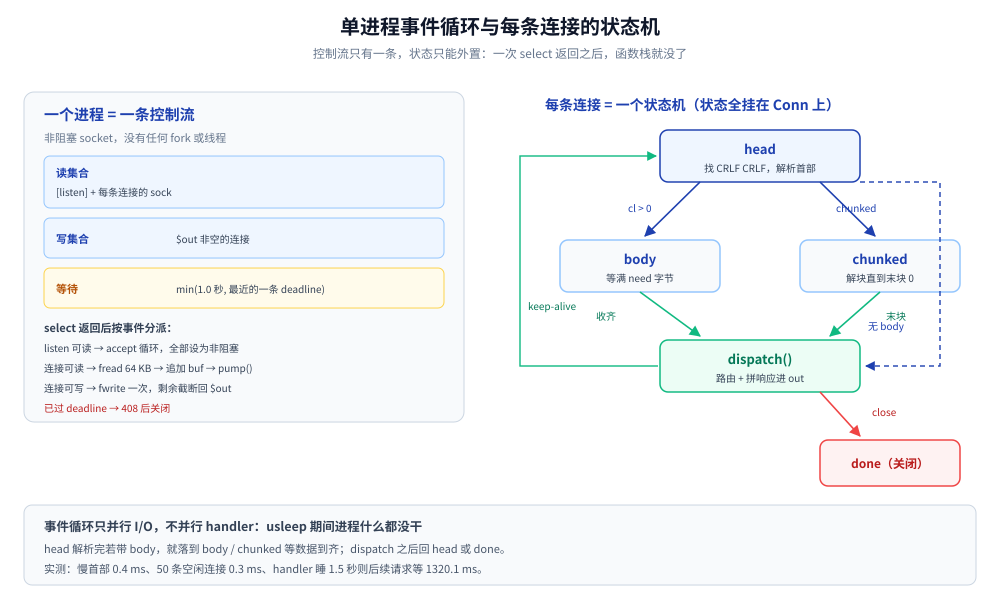
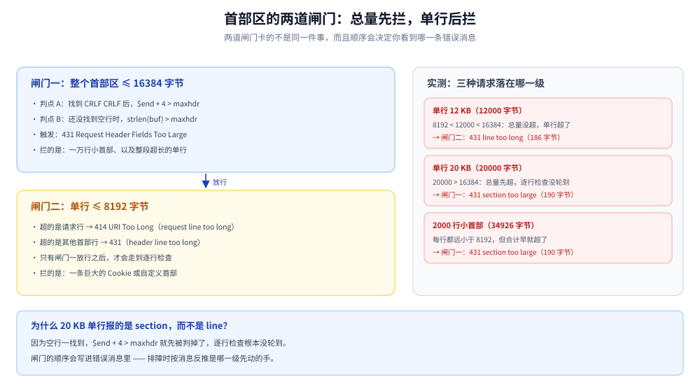
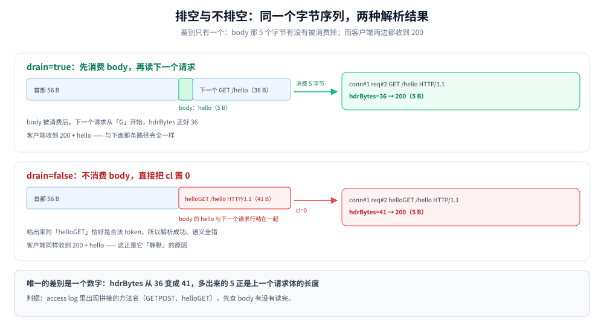

# 从零实现 HTTP 服务端（PHP）

> 用 PHP 从零写一个**常驻进程**的 HTTP/1.1 服务端：不 `composer require` 任何东西、不用 php-fpm、
> 也不用 Swoole / Workerman，从 `stream_socket_server` 起手，自己解析请求行与首部、自己处理三种请求体定界、
> 自己拼响应、自己维护 keep-alive 循环。
>
> 「常驻」在这里是个具体的技术约束：`php:8.0-cli` 默认不带 `pcntl` 与 `sockets` 扩展
> （实测 `php -m` 只有 `openssl`、`posix` 等，没有这两个），fork 与 `socket_set_option` 都用不了。
> 所以服务端是**单进程 + 非阻塞 socket + `stream_select` 事件循环**。这个约束反而把问题讲得更清楚：
> 没有协程、没有线程，**每条连接的状态只能自己存**——一次 `select` 返回之后，函数栈就没了。
>
> 目的不是造轮子，而是把 php-fpm 与 `php -S` 替你挡掉的东西一件件摊开：哪些字节必须解析、哪些形状必须拒绝、
> 哪些顺序错了会静默失效。每一处判断都有实测对照——同一个请求同时打给手写实现和 `php -S`（PHP 内置开发服务器），
> 看两边在什么地方选了不同的边。
>
> 内容整理自个人学习笔记。代码在容器 `php:8.0-cli`（PHP 8.0.30 CLI NTS，Debian 11 bullseye，4 核）内
> `php -l` 通过并真跑，客户端为 `curl 7.74.0` 与自写探针；**实测版本 6 个程序 1164 行**
> （共用解析层 246 + 服务端 380 + 探针 303 + 抓包 49 + 对照组 46 + 压测 140），另有 4 个实验脚本 231 行，
> 全部随本篇发布在同目录 `httpdemo/` 下，clone 后可直接复现全部读数。读数散在第三节（两道首部闸门）、
> 第六节（排空、串味与事件循环边界）与第七节（与 `php -S` 的对照）；命令见文末「使用」。
>
> ⚠️ 本篇只做 **HTTP/1.1**。HTTP/2 的帧层、HPACK 与流控见
> [HTTP1.1与HTTP2的区别.md](../../02-计算机基础/网络/应用层/HTTP1.1与HTTP2的区别.md) 与
> [HTTP2机制.md](../../03-数据与中间件/中间件/RPC框架/gRPC/HTTP2机制.md)。
>
> ⭐ **与 Go 版的分工**：[从零实现HTTP服务端（Go）](../go/网络编程/从零实现HTTP服务端.md) 讲同一套协议判断
> 在「一条连接一个 goroutine」下的写法；本篇讲这些判断在「一个进程一条事件循环」下要多出哪些东西——
> 状态外置、写缓冲、绝对截止时间。两篇的协议判断逐条对齐，差异集中在第六节与第八节。

---

## 一、一个 HTTP 服务端最少要解析哪几段字节？

**本节要点**：HTTP/1.1 的报文是**文本行 + CRLF** 堆起来的，**没有长度前缀**。所以服务端要做的第一件事不是「取请求」，而是在字节流上**找到报文边界**。

### 1.1 先把线上字节原样打出来

`raw/raw.php` 什么都不解析：`stream_socket_accept` 之后只 `fread` 一次，把读到的字节按十六进制 dump 出来，然后关连接：

```php
// raw/raw.php：读完一次就打印，不做任何解析
$c = stream_socket_accept($srv, 30, $peer);
$buf = fread($c, 65536);
printf("===== conn#%d from %s  read=%d =====\n", $i, $peer, strlen((string) $buf));
echo hexdump((string) $buf);
fclose($c);
```

用 `curl` 打它：

```text
===== conn#1 from 127.0.0.1:33262  read=83 =====
00000000  47 45 54 20 2f 68 65 6c  6c 6f 20 48 54 54 50 2f  |GET /hello HTTP/|
00000010  31 2e 31 0d 0a 48 6f 73  74 3a 20 31 32 37 2e 30  |1.1..Host: 127.0|
00000020  2e 30 2e 31 3a 39 30 30  31 0d 0a 55 73 65 72 2d  |.0.1:9001..User-|
00000030  41 67 65 6e 74 3a 20 63  75 72 6c 2f 37 2e 37 34  |Agent: curl/7.74|
00000040  2e 30 0d 0a 41 63 63 65  70 74 3a 20 2a 2f 2a 0d  |.0..Accept: */*.|
00000050  0a 0d 0a                                          |...|
```

`0d 0a` 就是 CRLF，出现了 5 次；最后 `0d 0a 0d 0a` 连着两组，是**空行**，标记首部结束。逐段数一遍：

| 段 | 内容 | 字节数 |
|---|---|---|
| 请求行 | `GET /hello HTTP/1.1` + CRLF | 21 |
| 首部 | `Host: 127.0.0.1:9001`(22) + `User-Agent: curl/7.74.0`(25) + `Accept: */*`(13) | 60 |
| 空行 | CRLF | 2 |
| 合计 | — | **83** |

⭐ 这段字节把整件事讲完了：**请求是「行」组成的，行以 CRLF 结束，首部区以空行结束**。没有长度前缀、没有魔数、没有帧头。所谓「解析 HTTP」，就是在字节流上按这个规则切。

### 1.2 一次 `fread` 拿到的不是一个请求

上面那次 `fread` 正好拿到了一个完整请求，最容易让人误以为「一次读 = 一个请求」。同一个程序、只换发送方，读数就变了：

```text
===== conn#2 from 127.0.0.1:33272  read=108 =====
00000000  47 45 54 20 2f 68 65 6c  6c 6f 20 48 54 54 50 2f  |GET /hello HTTP/|
00000010  31 2e 31 0d 0a 48 6f 73  74 3a 20 70 72 6f 62 65  |1.1..Host: probe|
00000020  0d 0a 0d 0a 47 45 54 20  2f 68 65 6c 6c 6f 20 48  |....GET /hello H|
00000030  54 54 50 2f 31 2e 31 0d  0a 48 6f 73 74 3a 20 70  |TTP/1.1..Host: p|
00000040  72 6f 62 65 0d 0a 0d 0a  47 45 54 20 2f 68 65 6c  |robe....GET /hel|
00000050  6c 6f 20 48 54 54 50 2f  31 2e 31 0d 0a 48 6f 73  |lo HTTP/1.1..Hos|
00000060  74 3a 20 70 72 6f 62 65  0d 0a 0d 0a              |t: probe....|

===== conn#3 from 127.0.0.1:33282  read=20 =====
00000000  47 45 54 20 2f 68 65 6c  6c 6f 20 48 54 54 50 2f  |GET /hello HTTP/|
00000010  31 2e 31 0d                                       |1.1.|
```

三个读数放在一起，就是 TCP 字节流的全部不确定性：

| 次 | 字节数 | 里面是什么 | 形态 |
|---|---|---|---|
| conn#1 | **83** | 恰好一个完整请求 | 一请求一读 |
| conn#2 | **108** | **三个**完整请求（36 × 3） | 粘包 |
| conn#3 | **20** | **半个**请求，断在 `HTTP/1.1\r` 中间 | 半包 |

conn#2 是探针连写三个请求；conn#3 是同一个请求分两次写、中间隔 200ms。**两次都是完全合法的 TCP 交付**——内核不关心你的报文边界。

### 1.3 所以核心是一个「在流上找边界」的状态机


上图三栏的差别不在服务端代码，而在发送方：83 是 `curl` 发一个请求的正常形态；108 与 20 是同一个探针只改「写几次、隔多久」得到的两种极端。也就是说，读回来什么取决于对端怎么切，而不取决于你想收什么。

结论有两条，后面每一节都建立在它们上面：

- **请求边界只能从内容里找**：首部区看空行（`\r\n\r\n`），请求体看 `Content-Length` 或 chunked 的末块（`0\r\n\r\n`）。
- **状态必须跨读保留**：读到半个首部时不能丢，要等下一次可读事件继续拼。

⭐ PHP 版还要多一条，这是它与 Go 版最根本的差别：**状态必须外置成字段**。Go 的 `for` 循环写在一条连接的 goroutine 里，`bufio.Reader` 与局部变量天然跨 `Read` 存活；这里的 `pump()` 每次返回后栈就没了，所以「读到哪了」只能挂在连接对象上：

```php
// 一次 select 之后函数栈就没了；这些字段就是「原本该留在栈上的局部变量」
final class Conn
{
    public $sock;
    public string $buf = '';       // 还没消费的字节（跨 read 保留）
    public string $out = '';       // 还没写出去的响应（跨 write 保留）
    public string $state = 'head'; // head | body | chunked | done
    public int $need = 0;          // body 还差多少字节
    public array $req = [];        // 正在拼的请求（body 还没到齐）
    public float $deadline = 0.0;  // 绝对截止时间，不是「空闲多久」
}
```



上面这张图是整篇的骨架：左边是**唯一的控制流**（`stream_select` 收拢全部可读可写事件），右边是**每条连接自己的状态机**。控制流不记得任何东西，所以状态必须画在连接上；`head` 解析完若带 body，就落到 `body` 或 `chunked` 等数据到齐，`dispatch` 之后再回到 `head`（keep-alive）或 `done`（关闭）。第三节到第六节讲的都是这个状态机的某一条边。

---

## 二、请求行怎么拆，哪些写法必须拒绝？

**本节要点**：PHP 没有 `SplitN`，但 `explode(' ', $line)` 会**保留空串**——加上「段数必须是 3、且没有空段」正好得到严格行为。换成 `preg_split('/\s+/')` 就等于默许了一批畸形请求。

### 2.1 三段：method、target、version

```php
// 请求行：method SP request-target SP HTTP-version
$parts = explode(' ', $requestLine);
if (count($parts) !== 3 || in_array('', $parts, true)) {
    throw new HttpError(400, 'malformed request line');
}
[$method, $target, $proto] = $parts;
```

拆完是三件事，一件都不能省：

| 校验 | 判据 | 不校验的后果 |
|---|---|---|
| method 是 token | `preg_match('/^[!#$%&\'*+\-.^_`\|~0-9A-Za-z]+$/', $m)` | `G@T /` 这类畸形值进到路由，方法匹配永远不命中 |
| version 形如 `HTTP/x.y` | `#^HTTP/(\d)\.(\d)$#` | 按 `minor` 判连接语义时读到 0，静默变成「按 1.0 处理」 |
| 版本是 1.x | `$major === 1` | 0.9 的请求没有首部区，按 1.1 解析会一直等到超时 |

⭐ token 字符集**排除**的东西比包含的更重要：空格、冒号、逗号、括号、斜杠都不在 token 里。请求行靠空格分段、首部靠冒号分名值，正是同一条约束的两面。

### 2.2 为什么不用 `preg_split('/\s+/')`

`\s+` 把**任意连续空白**当一个分隔符，于是下面这些都能「拆出三段」：

```text
GET  /hello HTTP/1.1        <- 中间两个空格
GET	/hello HTTP/1.1        <- 用 tab 分隔
```

它们都不是合法请求行（RFC 9112 要求单个 SP）。实测两边对照：

| 请求行 | mini（`explode` + 段数校验） | `php -S` |
|---|---|---|
| `GET  /hello HTTP/1.1`（两个空格） | **400** `malformed request line`（168 字节） | **200** + `hello`（160 字节） |
| `GET\t/hello HTTP/1.1`（tab） | **400** `malformed request line`（168 字节） | — |

⭐ 这里有个取舍值得说清：**严格拒绝 ⊂ 宽容接受**。`php -S` 在这件事上是宽容的（上表第一行它直接 200），因为它要面对浏览器、老旧客户端和各种中间设备。手写实现按 RFC 严格来更容易讲清规则，但接入真实流量前要先想清楚：你能不能承受「某个客户端就是因为多打了一个空格而被 400」。

### 2.3 `request-target` 有三种形态，都要认

| 形态 | 例子 | 谁发的 |
|---|---|---|
| origin-form | `/hello?x=1` | 直连的普通客户端 |
| absolute-form | `http://probe/hello` | **正向代理**转发的请求 |
| asterisk-form | `*` | `OPTIONS *` |

只处理 origin-form 的服务端，一旦被放到代理后面就会全线 404——因为代理转发的是 absolute-form。所以拆 target 时要先剥掉 `scheme://authority`：

```php
$path = $target;
$schemeAt = strpos($path, '://');
if ($schemeAt !== false) {
    $rest = substr($path, $schemeAt + 3);
    $slash = strpos($rest, '/');
    $path = $slash === false ? '/' : substr($rest, $slash);
}
$q = strpos($path, '?');
if ($q !== false) {
    $query = substr($path, $q + 1);
    $path = substr($path, 0, $q);
}
```

实测两种：`GET http://probe/hello HTTP/1.1` 解析成 `/hello`，200 + `hello`（145 字节）；`OPTIONS * HTTP/1.1` 解析通过但路由不认，404（167 字节）。后者说明**解析层与路由层的边界**：`*` 是合法的 request-target，只是本实现没有为它注册处理。

⚠️ 这里刻意**没有做 URL 解码**。`%2F` 要不要解成 `/`、`..%2f` 要不要规范化，是**代理与应用必须取得一致**的事——两边不一致就是路径穿越。这条属于 [Nginx配置语义.md](../../02-计算机基础/网络/代理与网关/Nginx配置语义.md) 与反向代理的范围，本篇不碰。

### 2.4 三种必须当场拒绝的形状

```php
if (!is_token($method)) {
    throw new HttpError(400, 'method is not a token');
}
if (!preg_match('#^HTTP/(\d)\.(\d)$#', $proto, $m)) {
    throw new HttpError(400, 'malformed HTTP version');
}
if ((int) $m[1] !== 1) {
    throw new HttpError(400, 'only HTTP/1.x is supported');
}
```

实测三条都是 400，但消息不同，正好可以拿来做日志断言：

| 请求行 | 响应 | 正文 |
|---|---|---|
| `G@T /hello HTTP/1.1` | 400（167 字节） | `method is not a token` |
| `GET /hello HTTP/1.x` | 400（168 字节） | `malformed HTTP version` |
| `GET /hello HTTP/2.0` | 400（172 字节） | `only HTTP/1.x is supported` |

正则那一条看着随意，实际在防一类具体的畸形：`HTTP/1.x`、`HTTP/`、`HTTP/1` 都会被它拒绝。如果用 `explode('.', $proto)` 再 `(int)` 取值，`HTTP/1.x` 会得到 `minor = 0`——请求被当成 HTTP/1.0 处理，连接语义全错。

---

## 三、首部区为什么要「循环读 + 两道闸门」？

**本节要点**：首部区的终止条件是**空行**，这是唯一可靠的信号；而「读到空行为止」意味着**长度由对端决定**——所以必须有上限，而且要有**两道**：单行上限与总量上限，它们卡的不是同一件事。

### 3.1 在缓冲里找 `\r\n\r\n`

PHP 没有 `bufio.Reader`，缓冲得自己维护。每读到一段就拼进连接自己的缓冲，然后交给 `pump()`：

```php
$c->buf .= $data;   // fread 到的字节先拼进这条连接的缓冲
pump($c);           // pump 里找边界，找不到就返回，等下一次可读事件
```

```php
$end = strpos($c->buf, "\r\n\r\n");     // 首部结束：唯一的终止信号
if ($end === false) {
    if (strlen($c->buf) > $opt['maxhdr']) {
        send_error($c, 431, 'header section too large');
    }
    return;                              // 半个首部：什么都不做，等下次
}
$head = substr($c->buf, 0, $end + 4);
$c->buf = substr($c->buf, $end + 4);     // 剩下的可能是下一个请求（pipelining）
$lines = explode("\r\n", substr($head, 0, -4));
```

两个代价要说在前面：`substr` 会发生拷贝，`strpos` 每次从头扫。首部上限 16 KB 时这两项都可以忽略；真要做成通用服务器，得改成「记住上次扫到哪」并配环形缓冲。

**裸 LF 的坑（实测抓到的第一个 bug）**。第一版只检测 `"\n\n"`，用来抓「首部用裸 LF 结尾」。这漏得掉夹在中间的裸 LF：

```text
# 修好之前
---- raw request (50 bytes) ----
GET /hello HTTP/1.1\r\nHost: probe\nX-Injected: 1\r\n\r\n
---- response (145 bytes, closed=false) ----
HTTP/1.1 200 OK
...
conn#2 req#1 GET /hello HTTP/1.1 cl=-1 chunked=false close=false hdrBytes=50
```

那个 `\n` 被当成了 `Host` 值的一部分（值只裁首尾 OWS），请求照样 200。改法是把判据从「找 `\n\n`」换成「**每一个 `\n` 的前一字节必须是 `\r`**」，并且只扫首部区（`$end + 4` 之前），不碰 body：

```php
$limit = $end === false ? strlen($c->buf) : $end + 4;
$eol = strpos($c->buf, "\n");
while ($eol !== false && $eol < $limit) {
    if ($eol === 0 || $c->buf[$eol - 1] !== "\r") {
        send_error($c, 400, 'bare LF line ending');
        return;
    }
    $eol = strpos($c->buf, "\n", $eol + 1);
}
```

修好之后三种位置一律 400 `bare LF line ending`（165 字节）：裸 LF 只出现在请求行、夹在首部中间、或者用作首部结尾。

⚠️ 为什么这个洞值得单列：它不改变状态码，只改变**这个字节属于谁**。前端按裸 LF 断句、后端把 `\n` 当值的一部分，两边对「第一个首部在哪结束」的判断就不一样——这正是请求走私的形状之一，与 Go 版第七节 7.2 讲的是同一件事。

### 3.2 同名首部必须 `append`，不能覆盖

```php
$headers[strtolower($name)][] = $value;   // 不是 $headers[strtolower($name)] = $value
```

HTTP 允许同一个名字出现多次，而且**合并语义不一样**：

| 首部 | 多次出现时 | 合并成一行可以吗 |
|---|---|---|
| `Set-Cookie` | 每个都是独立的一条 | 不行，合并后 Cookie 值里的逗号无法区分 |
| `Cookie` | 用 `; ` 连接 | 可以 |
| `Accept` / `Cache-Control` | 用 `, ` 连接 | 可以 |
| `Content-Length` | 值必须完全相同，否则拒绝 | 见第四节 |

所以内部表示只能是「小写名 → 值的数组」，合并成单值是在**取用**时按各自规则做，不能在解析时做。`has_token()` 就是这个原则的最小例子——`Connection` 的值是逗号列表，必须切开逐项比较：

```php
function has_token(array $headers, string $name, string $token): bool
{
    foreach ($headers[$name] ?? [] as $value) {
        foreach (explode(',', $value) as $item) {
            if (strcasecmp(trim($item), $token) === 0) {
                return true;
            }
        }
    }
    return false;
}
```

### 3.3 两道闸门：单行与总量

实测三条，恰好把两道闸门都打到了：

| 请求 | 大小 | mini 的响应 | 哪道闸门先动的手 |
|---|---|---|---|
| 单行 12 KB 首部 | 12000 字节 | 431 `header line too long`（186 字节） | 单行（`MAX_LINE` 8192） |
| 单行 20 KB 首部 | 20000 字节 | 431 `header section too large`（190 字节） | 总量（`MAX_HEADER` 16384） |
| 2000 行小首部 | 34926 字节 | 431 `header section too large`（190 字节） | 总量 |

⭐ 第二行报的是 section 不是 line，这是**判序**决定的：`\r\n\r\n` 一旦找到，`$end + 4 > maxhdr` 先被判掉，逐行检查根本没轮到。两条都是 431，但日志里的措辞能告诉你哪道闸门先动的手——要让它报 `line too long`，就得把单行检查提到总量之前，代价是「一万行小首部」会被逐行扫一遍（每行都不超限），最后仍要靠总量兜底。



上图把两道闸门画成先后两级：左路是「累计超过 16 KB」，它连「还找不到空行」的半截首部也算在内；右路才是逐行的 8192 字节上限。20 KB 的单行之所以报 section，是因为它在第一级就被拦下了——**闸门的顺序会写进错误消息里**，排障时要按消息反推是哪一级。

`php -S` 的门槛要高得多，而且到顶之后**不回状态码**：

| 首部大小 | mini（16 KB） | `php -S` |
|---|---|---|
| 12 KB | 431 `header line too long` | 200（160 字节） |
| 20 KB | 431 `header section too large` | 200 |
| 34.9 KB（2000 行） | 431 | 200 |
| 81920 字节 | — | 200（160 字节） |
| 81921 字节 | — | **0 字节，直接断开** |
| 1.1 MB | 431 | 0 字节 |

⚠️ 最后两行值得记住：`php -S` 的边界精确落在 81920 / 81921 之间，越过之后既不回 431 也不回 400，而是把连接一关，客户端读到 0 字节。这种失败在监控里表现为「空响应」而不是 4xx，排查时不要只盯着状态码分布。

### 3.4 慢速首部：守的不是「慢」，是「不结束」

上面两道闸门都假设首部区总会结束。但攻击者可以一个字节一个字节地发，让首部区永远不结束——这就是 Slowloris。防御手段不是限制大小，而是**限制时间**。

PHP 这里有个必须分清的区别：`stream_set_timeout()` 与 `default_socket_timeout`（实测 60 秒）都是**空闲超时**，每次 `fread` 有进展就重新计时。1 字节 / 800ms 的滴灌永远不会触发它们。所以要用连接上的绝对时间戳：

```php
$c->deadline = microtime(true) + READ_HEADER_TO;   // 连接建立时记一次
// select 的等待时间取「最近的那个截止时刻」
$left = $c->deadline - microtime(true);
$wait = min($wait, max(0.01, $left));
// 判的是「现在是否过了那个时刻」，不是「多久没数据」
if (microtime(true) > $c->deadline) {
    send_error($c, 408, 'timeout while reading headers');
}
```

实测（每 800ms 发 1 字节，截止 5 秒）：

```text
---- slow header: 1 byte / 800ms (46 bytes) ----
[php] fwrite(): Send of 1 bytes failed with errno=32 Broken pipe
[php] write failed at byte 8
[php] fwrite(): Send of 38 bytes failed with errno=32 Broken pipe
---- response (179 bytes, closed=true) ----
HTTP/1.1 408 Request Timeout
Content-Length: 30

timeout while reading headers
```

⭐ 注意 `Broken pipe`：服务端在 5 秒到点时**已经关了连接并回了 408**，客户端在那一瞬间还在往里写。这个报错是防御**生效**的证据，不是故障。第 8 个字节大约在 5.6 秒——比 5 秒的截止稍晚，因为滴灌间隔是 800ms，判超时发生在下一次可读事件上。

⚠️ 这里还有一层 PHP 特有的背景：CLI 下 `max_execution_time = 0`（实测 `php -i`），常驻循环**没有任何「兜底超时」**。fpm 至少还有 `request_terminate_timeout` 这类外部刀；常驻进程里所有时间限制都得自己算。

### 3.5 为什么不支持 obs-fold（续行）

老版 RFC 2616 允许首部值折行，续行以空格或 tab 开头：

```text
X-Long: first part
 second part
```

RFC 7230 已把它标记为废弃；RFC 9112 §5.2 给收件方两条路：**拒绝（400）**，或**把每个折行替换成一个空格**再解释字段值。两条路都行，唯独不能按原样保留——`200 OK` 里那个空格到底是折行还是新首部，不同实现判断不一致，而转发链上两边不一致就是请求走私的另一条路径。

本篇走第一条路：

```php
if ($line[0] === ' ' || $line[0] === "\t") {
    throw new HttpError(400, 'obsolete line folding');
}
```

实测 `X-Long: a` + 折行 ` b` 得到 400 `obsolete line folding`（167 字节）。看起来「不够兼容」，但兼容的成本是**接受一个歧义**，不值得。

---

## 四、请求体有多长：三种定界的判序错一次就放走走私

**本节要点**：请求体没有「结束标记」，长度只能由首部声明。三种声明方式里，**`Transfer-Encoding` 与 `Content-Length` 同时出现必须直接拒绝**——而且这条判断必须在解析 `Content-Length` 的数值之前。

### 4.1 三种定界

| 声明 | 长度怎么算 | 结束标志 |
|---|---|---|
| `Content-Length: N` | 已知，N 字节 | 读满 N 字节 |
| `Transfer-Encoding: chunked` | 未知，分块 | 尺寸为 `0` 的末块 + trailer 空行 |
| 两者都没有 | **0** | 请求没有 body |

第三种经常被误解：一个 `POST` 如果既没有 CL 也没有 TE，body 长度就是 **0**，不是「读到连接关闭」。这是 HTTP 与「裸 TCP 靠关闭定界」最大的区别——**请求不能靠关闭定界**，因为关了就没法发下一个请求了。

### 4.2 判序：为什么「两者同给」必须先判

```php
$hasTE = isset($headers['transfer-encoding']);
$hasCL = isset($headers['content-length']);
if ($hasTE && $hasCL) {
    // 两者同给是请求走私的经典入口，RFC 7230 §3.3.3 要求当错误处理
    throw new HttpError(400, 'Transfer-Encoding with Content-Length');
}
if ($hasTE) { /* ... 只接受 chunked ... */ }
if ($hasCL) { /* ... 校验并解析成整数 ... */ }
```

⭐ 这里的判序在 PHP 版里反而更容易写对：首部是先全部收进 `$headers` 再解析语义的，`$hasTE` / `$hasCL` 判的是「这个名字在不在」，不依赖任何还没算出来的长度。Go 版第一版踩的坑是「先判 TE，而 `ContentLength` 还是 -1」——那个坑在这里不存在，原因不是 PHP 更好，而是**判断依据换成了存在性，而不是解析后的值**。

实测同一条走私形状打两个服务：

| 实例 | 响应 | 说明 |
|---|---|---|
| mini | **400**（183 字节）`Transfer-Encoding with Content-Length` | 直接拒绝 |
| `php -S` | **200**（216 字节）`cl=5 chunked=true bytes=5` | 两个首部都留着，读了 5 字节 |

⚠️ `php -S` 这一行值得盯住：它的 `$_SERVER` 里同时有 `CONTENT_LENGTH=5` 和 `HTTP_TRANSFER_ENCODING=chunked`，body 读了 5 字节。谁按 CL 理解、谁按 chunked 理解，两份消息、两个长度——这就是走私成立的条件。

### 4.3 chunked 的四段结构

chunked 的报文不是「一整块」，而是若干块拼起来的：

```text
5\r\n             <- 块 1：尺寸（十六进制）
hello\r\n         <- 块 1 数据 + CRLF（⚠️ 这个 CRLF 不属于数据）
6\r\n             <- 块 2
 world\r\n
0\r\n             <- 末块：尺寸 0
\r\n              <- trailer 区结束（这里没有 trailer 首部，直接空行）
```

解码器要处理的四个细节：

| 细节 | 处理 | 漏掉的后果 |
|---|---|---|
| 尺寸是 **16 进制** | `(int) hexdec($line)` | 把 `a` 当十进制，解出 0 或报错 |
| 尺寸后可跟 `;name=value` | 先按 `;` 截断 | 解析失败，或把扩展当尺寸 |
| 每块数据后有一个 **CRLF** | 读完这块要吃掉它 | **下一块的尺寸解析错位**，全盘乱掉 |
| 末块后有 trailer 首部 | 读到空行为止 | 把 trailer 当成下一个请求的开头 |

第三行最容易漏，因为它不在数据里、也不在尺寸里，而是「两者之间」：

```php
$size = (int) hexdec($line);
$p = $eol + 2;                       // 跳过尺寸行
if ($size === 0) {                   // 末块：后面是 trailer，读到空行为止
    $end = strpos($buf, "\r\n", $p);
    if ($end === false) {
        return null;                 // 还没收全
    }
    $consumed = $end + 2;
    return $body;
}
if ($len < $p + $size + 2) {
    return null;                     // 数据还没到齐
}
$body .= substr($buf, $p, $size);
$p += $size;
if (substr($buf, $p, 2) !== "\r\n") {
    $consumed = -1;                  // 数据后不是 CRLF：格式非法
    return null;
}
```

`try_chunked()` 用返回值表达三态：`null` 且 `$consumed = 0` 表示还没收全、`$consumed = -1` 表示格式非法、返回字符串表示解完。这个约定比「返回 false / 抛异常 / 返回空串」混着用更不容易写错。

实测两块（`5 hello` + `6 " world"`）：

```text
---- chunked request (90 bytes) ----
---- response (210 bytes, closed=false) ----
HTTP/1.1 200 OK
Content-Length: 69
Connection: keep-alive

method=POST path=/echo query= cl=-1 chunked=true bytes=11
hello world
```

`cl=-1 chunked=true bytes=11`——11 = 5 + 6，两块都解出来了，而且中间那个空格没丢。

⚠️ 实现上的取舍：这里不是流式解码，而是「缓冲里凑齐一块就解一块」，最后把整个 body 拼成字符串再交给 handler。好处是代码短、状态少；代价是 body 全在内存里，且 `substr` 会复制。真实实现要设 body 上限并改成按块回调——本篇的探针最大只发几十字节，所以没做。

### 4.4 `Content-Length` 自身的三种畸形

```php
$values = $headers['content-length'];
foreach (array_slice($values, 1) as $value) {
    if ($value !== $values[0]) {                 // ① 多个 CL 且值不同
        throw new HttpError(400, 'conflicting Content-Length');
    }
}
if (!preg_match('/^\d+$/', $values[0])) {        // ② 非十进制、③ 负数
    throw new HttpError(400, 'Content-Length is not a decimal number');
}
$contentLength = (int) $values[0];
```

实测三条：

| 畸形 | 请求大小 | 响应 | 正文 |
|---|---|---|---|
| `CL: 5` + `CL: 6` | 79 字节 | 400（172 字节） | `conflicting Content-Length` |
| `Content-Length: 0x5` | 62 字节 | 400（184 字节） | `Content-Length is not a decimal number` |
| `Content-Length: -1` | 56 字节 | 400（184 字节） | 同上 |

| 畸形 | 为什么要拒 |
|---|---|
| 多个 `Content-Length` 值不同 | 前后端各取一个 → 走私 |
| 非十进制 | 有的解析成 5，有的报错 |
| 负数 | `-1` 在不少实现里是「长度未知」的哨兵值，会把「已知长度」变成「读到 EOF」 |

⚠️ 负数与非十进制在本实现里共用同一条消息，因为判据都是 `/^\d+$/`。Go 版能分开报，是因为 `strconv.ParseInt` 的错误类型不同；这里没分，属于取舍——排障时看请求原文更快。

### 4.5 body 状态机与 `$c->need`

PHP 没有 `io.LimitReader`，所以「还差多少」是连接上的一个整数：

```php
if ($c->state === 'body') {
    if (strlen($c->buf) < $c->need) {
        return;                                  // body 没到齐，等下一次可读
    }
    $body = substr($c->buf, 0, $c->need);
    $c->buf = substr($c->buf, $c->need);         // 后面可能紧跟下一个请求
    dispatch($c, $c->req, $body);
    continue;                                    // 缓冲里可能还有完整请求
}
```

这里最容易写错的不是解析，而是**收尾**：`dispatch()` 之后必须把 `state` 归位到 `head`、`need` 归零、`deadline` 重设。漏一样，下一条 keep-alive 请求就会用上一条的残留值——症状是「偶发 400」或「第二条请求永远等不到超时」。这也是事件循环版比 goroutine 版更容易出错的地方：Go 里这些值随循环体自然失效，这里得手工清。

---

## 五、响应要怎么拼才算合法？

**本节要点**：响应首部里有**一样东西不能用 `Content-Length` 表达**——「有没有 body」。`HEAD`、`204`、`304` 三种情况都带长度声明却**不能写 body**，靠的是一条约定：方法或状态码自己说明「别读」。

### 5.1 五件套

```php
function build_response(array $req, int $status, string $body, bool $keepAlive): string
{
    $headOnly = $req['method'] === 'HEAD' || $status === 204 || $status === 304;
    $out  = sprintf("%s %d %s\r\n", $req['proto'], $status, reason_phrase($status));
    $out .= 'Date: ' . gmdate('D, d M Y H:i:s') . " GMT\r\n";
    $out .= "Content-Type: text/plain; charset=utf-8\r\n";
    $out .= 'Content-Length: ' . strlen($body) . "\r\n";
    $out .= $keepAlive ? "Connection: keep-alive\r\n" : "Connection: close\r\n";
    $out .= "\r\n";
    return $headOnly ? $out : $out . $body;
}
```

实测一个 200 响应的全文（145 字节）：

```text
---- get request (36 bytes) ----
GET /hello HTTP/1.1\r\n
Host: probe\r\n
\r\n
---- response (145 bytes, closed=false) ----
HTTP/1.1 200 OK\r\n
Date: Sun, 25 Oct 2026 05:33:51 GMT\r\n
Content-Type: text/plain; charset=utf-8\r\n
Content-Length: 5\r\n
Connection: keep-alive\r\n
\r\n
hello
```

| 首部 | 必需性 | 写错的后果 |
|---|---|---|
| 状态行 | 必需 | 版本回错（对 1.0 客户端回 1.1）会让老客户端解析失败 |
| `Date` | 强烈建议 | 缓存与日志的时间基准；⚠️ 必须是 IMF-fixdate、GMT、两位日期 |
| `Content-Type` | 有 body 时必需 | 客户端靠它决定怎么解，缺了就只能猜 |
| `Content-Length` | 三种定界选一种 | 与 body 实际长度不符 → 客户端一直等或读到下一个响应 |
| `Connection` | 可选 | 1.1 默认持久；但**要关连接必须显式写 `close`** |

⚠️ `Date` 这里用 `gmdate()` 而不是 `date()`：后者取的是 PHP 的默认时区，容器里恰好是 UTC，换台机器就不是了。`gmdate('D, d M Y H:i:s')` 已经给出了 IMF-fixdate 的主体，补上 `" GMT"` 即可——格式是 RFC 定的，不是 PHP 定的。

### 5.2 三个特例：`HEAD`、`204`、`304`

`HEAD` 的语义是「要首部，不要 body」：响应**必须带与 `GET` 完全相同的 `Content-Length`**，但**一个字都不能发**。实测：

```text
---- head request (37 bytes) ----
---- response (140 bytes, closed=false) ----
HTTP/1.1 200 OK
Date: Sun, 25 Oct 2026 05:33:51 GMT
Content-Type: text/plain; charset=utf-8
Content-Length: 5
Connection: keep-alive

```

140 字节 = 145 − 5，body 一个字节都没发，但 `Content-Length: 5` 还在。⚠️ 客户端如果按 `Content-Length` 去读 `HEAD` 的响应，就会一直等到超时——本篇的探针第一版就犯了这个错。

| 状态码 / 方法 | 实测字节数 | 有 `Content-Length` | 有 body |
|---|---|---|---|
| `GET` 200 | 145 | 有（5） | 有 |
| `HEAD` 200 | 140 | **有（与 GET 一致）** | **无** |
| `204 No Content` | 148 | 有（0，合法但多余） | 无 |
| `304 Not Modified` | 150 | 有（0，合法但多余） | 无 |

这张表的共同点是：**「消息结束」信号与「有没有 body」是两件独立的事**。`Content-Length` 说的是「如果这是 GET，body 会有多长」，不是「后面跟着多长」。

### 5.3 首部与 body 拼成一个字符串再写

`build_response()` 返回的是完整响应字符串，写出去是事件循环的事：

```php
$written = @fwrite($c->sock, $c->out);
if ($written === false) {
    close_conn($c, $conns);          // 对端已关，直接回收
    continue;
}
if ($written > 0) {
    $c->out = substr($c->out, $written);   // ⚠️ 非阻塞 socket 可能只写一部分
}
```

⭐ 这两行是 Go 版「`bufio.Writer` 必须 `Flush`」的等价物。那里漏 `Flush` 的症状是「日志显示已响应、客户端在等」；这里对应的两个错误症状相似：**忘了把有 `$out` 的连接放进写集合**，或者**写了但不截断 `$out`**（同一条响应被重复写）。两种错都不会报错，只会表现成客户端读到多余的字节或者等不到数据。

⚠️ 代价也要说清：整条响应在内存里至少两份（`$out` 与 `substr` 的残片）。本例响应都在 250 字节以内，可以忽略；真实实现要做流式写、写队列上限和慢客户端处理（对端不读时 `$out` 会一直涨——这正是「响应体速率」类问题，本篇没做）。

---

## 六、keep-alive 循环里最容易漏的一步是什么？

**本节要点**：读下一个请求之前，**必须把上一个请求的 body 从流里消费干净**。漏了不会报错——残留字节会与下一个请求行粘在一起，而粘出来的畸形方法名往往恰好是合法 token，于是「解析成功、语义全错」。

### 6.1 结构：一个 `while` 套在连接上

```php
while (true) {
    if ($c->state === 'head') {
        // 找 \r\n\r\n → 解析请求行与首部 → 判定 body 定界
        // 没有 body：dispatch() 之后 state 回到 head，continue
        // 有 body：state 切到 body / chunked，continue
        continue;
    }
    if ($c->state === 'body') {
        // 够 need 字节：切出 body → dispatch() → continue
        // 不够：return，等下一次可读事件
    }
    if ($c->state === 'chunked') {
        // try_chunked() 解完一块 → dispatch() → continue
        // 没解完：return
    }
    return;
}
```

⭐ 与 Go 版的差别在这里最清楚：Go 的 `for` 写在「一条连接一个 goroutine」里，走到 `io.ReadAll(req.Body)` 就阻塞，栈天然保留；PHP 的 `while` 是**把缓冲里已有的字节尽量处理完**，处理不完就返回，等 `select` 说这条 socket 又可读。所以同一个循环既能处理一个完整请求，也能连处理三个（pipelining）——但「处理到哪了」必须全在 `Conn` 上。

### 6.2 实测：不排空会发生什么

服务端有个 `-drain false` 开关，故意跳过消费 body 那一步，然后用完全相同的字节打两个实例：

```text
POST /hello HTTP/1.1\r\nHost: probe\r\nContent-Length: 5\r\n\r\nhelloGET /hello HTTP/1.1\r\nHost: probe\r\n\r\n
```

| 实例 | 第二个请求解析成 | `hdrBytes` | 客户端收到 |
|---|---|---|---|
| `-drain true`（正常） | `GET /hello` | **36** | `200 OK` + `hello` |
| `-drain false`（漏排空） | **`helloGET /hello`** | **41** | `200 OK` + `hello` |

服务端日志原文：

```text
# 正常
conn#1 req#1 POST /hello HTTP/1.1 cl=5 chunked=false close=false hdrBytes=56
conn#1 req#2 GET /hello HTTP/1.1 cl=-1 chunked=false close=false hdrBytes=36

# 漏排空
conn#1 req#1 POST /hello HTTP/1.1 cl=0 chunked=false close=false hdrBytes=56
conn#1 req#2 helloGET /hello HTTP/1.1 cl=0 chunked=false close=false hdrBytes=41
```

⭐ 注意三点，它们一起构成了「静默」：**① 客户端拿到的响应完全正常**（`/hello` 还是匹配上了）；**② 没有日志级别上的异常**（两条都是普通 access log）；**③ 唯一的差别是一个数字——`hdrBytes` 从 36 变成 41，多出来的 5 正是上一个请求体的长度**。顺带一眼：漏排空时第一条的 `cl` 也从 5 变成了 0，因为实现里是直接把 `cl` 归零来模拟「没消费」。



上面这张图把两条路径并排放，差别只有一个：body 那 5 个字节有没有被消费掉。右边那条路径上，「hello」与「GET」粘成的 `helloGET` 通过了 token 校验，于是错误被推迟到下游——路由不命中、鉴权拿不到方法、审计日志里出现一个不存在的方法名。

**判据**：如果你在 access log 里的方法名看到拼接痕迹（`GETPOST`、`helloGET`），几乎可以确定是某处的 body 没读完。

### 6.3 连接语义：1.0 与 1.1 的默认值相反

```php
$close = $minor >= 1
    ? has_token($headers, 'connection', 'close')          // 1.1：默认持久
    : !has_token($headers, 'connection', 'keep-alive');   // 1.0：默认关闭
```

两个易错点：

- **`Connection` 的值是逗号列表**，可能是 `keep-alive, Upgrade`，必须切开逐项比（见 3.2 的 `has_token()`）。
- **`HTTP/1.0 + Connection: keep-alive` 是合法的**，服务端可以同意。实测：

| 请求 | 响应字节数 | 状态行 | `Connection` |
|---|---|---|---|
| `HTTP/1.0`，不给 `Connection` | 140 | `HTTP/1.0 200 OK` | `close` |
| `HTTP/1.0` + `Connection: keep-alive` | 145 | `HTTP/1.0 200 OK` | `keep-alive` |
| `HTTP/1.1` + `Connection: close` | 140 | `HTTP/1.1 200 OK` | `close` |

⚠️ 状态行里的版本回的是 `$req['proto']`，不是写死的 `HTTP/1.1`。对一个 1.0 客户端回 1.1 的响应，某些老实现会直接断开。

### 6.4 pipelining：一次收到三个请求，就得回三个响应

conn#2 那次 108 字节里是三个完整请求。服务端不需要特殊处理——**循环处理三次就自然回三个响应**，只要每个响应都带正确的 `Content-Length`，客户端就能按顺序切开。实测：

```text
---- pipe request (108 bytes) ----
---- response (435 bytes, closed=false) ----
HTTP/1.1 200 OK
...
helloHTTP/1.1 200 OK
...
helloHTTP/1.1 200 OK
...
hello
```

435 = 145 × 3，三个响应首尾相接。对照 `php -S`：同样的 108 字节打过去，它回了 **0 字节并把连接关掉**（`Invalid request (Malformed HTTP request)` 出现在它的日志里）——因为它把「一次读到多个请求」当成了畸形。

⭐ pipelining 有个隐含约束：**响应必须按请求顺序返回**。本实现里还有一个更硬的约束——一旦某个响应是 `Connection: close`，`dispatch()` 就会置 `closeAfterWrite` 并返回，缓冲里剩下的请求不会再处理，随连接关闭一起丢掉。这是对的：客户端已经被告知不会再有下一个响应了。

### 6.5 事件循环的边界：只并行 I/O，不并行 handler

这是 PHP 这一版最需要实测才能讲清的部分。三个场景，客户端都是同一个探针：

| 场景 | mini | `php -S` |
|---|---|---|
| 一个慢客户端只发半个首部并挂住 2 秒，另一个正常请求 | **0.4 ms** | 7.9 ms |
| 一个 handler 里 `usleep(1500ms)`，另一个正常请求 | **1320.1 ms** | 1313.4 ms |
| 先挂 50 条空闲 keep-alive 连接，再发一个正常请求 | **0.3 ms** | — |

⭐ 这三行把「事件循环」讲完了：

- 第 1、3 行：**等待 I/O 的连接互不阻塞**。半个首部和 50 条空闲连接都不会占住控制流，因为 `stream_select` 只是在等「谁有数据」，没数据就跳过。
- 第 2 行：**handler 本身还是串行**。探针在 sleeper 之后 0.2 秒发出，却等了约 1.3 秒才拿到响应——1320.1 ms ≈ 1500 ms 减去已经过去的 200 ms，余下的差是探针自己的连接与解析开销。`usleep()` 期间进程什么都没干，事件循环停摆。
- `php -S` 的表现完全一样（1313.4 ms），因为它也是单进程：I/O 用 poll 多路复用，请求处理仍是一条一条来。所以「`php -S` 能并发」只在 I/O 等待这个意义上成立，别指望它并行 handler。

⚠️ 旁证：第 1 行 `php -S` 的 7.9 ms 比 mini 的 0.4 ms 高一个量级，但同样是毫秒级——说明它也把半个首部的连接放在一边等，没有傻等它发完。这是「静态文件服务器 + 开发服务器」的常见结构，不是实现缺陷。

---

## 七、手写实现与 `php -S` 差在哪几处？

**本节要点**：同一个请求同时打给两个实现，十项里**八项选了不同的边、两项一致**。这些分歧不是「谁对谁错」，而是 `php -S` 作为**开发服务器**在兼容性、简洁性上的取舍——知道它选了哪边，才知道哪些行为不能拿它当参照。

### 7.1 十项对照

| # | 场景 | mini | `php -S` | 说明 |
|---|---|---|---|---|
| 1 | 200 响应首部 | `Content-Length: 5` + 显式 `keep-alive`（145 字节） | **无 `Content-Length`、`Connection: close`**（160 字节），另有 `Host: probe` 与 `X-Powered-By` | 定界方式不同 |
| 2 | `HEAD` | 140 字节，`Content-Length: 5` | 155 字节，**无 `Content-Length`** | 一个算得出，一个没算 |
| 3 | 404 | 167 字节，`keep-alive` | 181 字节，`close` | 首部差异同上 |
| 4 | 裸 LF | **400** | **200** | 严格 vs 宽容 |
| 5 | 12 KB / 20 KB / 34.9 KB 首部 | **431** | **200** | 门槛不同 |
| 6 | 81921 字节首部 | 431 | **0 字节断开** | 上限在这 |
| 7 | `TE` + `CL` 同给 | **400** | **200**（`cl=5 chunked=true bytes=5`） | 拒绝 vs 接受 |
| 8 | chunked 两块 | 200 `bytes=11` | 200 `bytes=11` | 一致 |
| 9 | pipelining 三个 | 435 字节（三个响应） | **0 字节关闭** | 支持 vs 不支持 |
| 10 | 半包（分两次写） | 200 | 200 | 一致 |

两个 200 的原文，差别集中在首部区：

```text
# mini
HTTP/1.1 200 OK
Date: Sun, 25 Oct 2026 05:33:51 GMT
Content-Type: text/plain; charset=utf-8
Content-Length: 5
Connection: keep-alive

# php -S
HTTP/1.1 200 OK
Host: probe
Date: Sun, 25 Oct 2026 05:34:09 GMT
Connection: close
X-Powered-By: PHP/8.0.30
Content-Type: text/plain; charset=utf-8
```

⚠️ 注意 `php -S` 把请求里的 `Host` **回显到了响应首部**。这不是 HTTP 规范要求的，也不该出现在生产服务端——但它是 PHP 8.0.30 内置服务器的实测行为，用 `curl` 换一个 Host 打过去也会原样出现在响应里。如果你拿 `php -S` 的响应做任何自动化断言，这条会先让断言失败。

### 7.2 为什么 `php -S` 接受裸 LF

RFC 9112 §2.2 允许收件方「识别单个 LF 并忽略前面的 CR」。所以这**不是违规**，而是规范留的兼容余地。`php -S` 走的是宽容那条：`GET /hello HTTP/1.1\nHost: probe\n\n` 打过去回 200 + `hello`（160 字节），而 mini 回 400（165 字节）。

⭐ 代价是**歧义面变大**：收件方既然能接受 `\n`，「一行到底在哪结束」就有了多个答案。在**代理**场景里，如果前端收 `\n`、后端只认 `\r\n`，同一个字节流在两边会被切成不同的消息——这正是请求走私的一类成因。所以：

- **应用服务端**：宽容一点没坏处（`php -S` 的选择）。
- **代理 / 网关**：必须与上下游**约定同一套**行结束规则，或干脆按 RFC 严格拒绝（本篇的选择，见 3.1）。

### 7.3 为什么 `php -S` 接受 `TE` + `CL`

RFC 9112 §6.3 给了两条路：「`Transfer-Encoding` 覆盖 `Content-Length`」和「这种消息可能被用于走私，**应当**拒绝」。`php -S` 选了前者的变体——它没有丢掉 CL，而是两个都留着，同时按 CL 读了 5 字节，`$_SERVER` 里两个值都在：

```text
method=POST path=/echo query= cl=5 chunked=true bytes=5
hello
```

⚠️ 关键约束：如果这台服务是**代理**，转发前**必须删掉 `Content-Length`**，否则下游可能按 CL 处理，而上游按 chunked 处理——两份消息、两个长度，走私成立。手写实现选「直接拒绝」的理由很简单：**这个服务端不承担兼容历史客户端的责任**，拒绝是更小的攻击面。要把它放到代理后面，就得改成「以 TE 为准 + 删除 CL」，并与上下游保持一致。

### 7.4 吞吐：差多少？

同一台容器（4 核、无 CPU 配额）里，客户端与服务端同机，各跑 5 轮交替。`php -S` 恒回 `Connection: close`，所以只能测「逐请求重连」；mini 两种都测：

| 并发 | 实例 | 5 轮 QPS | 中位数 |
|---|---|---|---|
| 8 | mini keep-alive | 8178 / 15677 / 16342 / 14743 / 20592 | 15 677 |
| 8 | mini 逐请求重连 | 3587 / 4465 / 7480 / 5376 / 6330 | 5 376 |
| 8 | `php -S` 逐请求重连 | 97 / 94 / 100 / 94 / 105 | 97 |
| 4 | mini keep-alive | 19009 / 15671 / 16361 / 17510 / 7781 | 16 361 |
| 4 | mini 逐请求重连 | 3407 / 7558 / 7217 / 8045 / 7803 | 7 558 |
| 4 | `php -S` 逐请求重连 | 90 / 87 / 90 / 91 / 88 | 90 |

⚠️ **这组数不能用来给语言排名**，理由有三条：① 客户端与服务端在同一容器里抢同一批核，同一行的 `min` 到 `max` 相差 2.5 倍（mini keep-alive 8 并发那行最明显）；② `php -S` 那三行同时混了两个变量——**连接复用**与**每请求上下文重建**，本机读数只能说明合并后的差距，拆不开；③ 并发数变化时趋势并不完全一致（4 并发时 keep-alive 与 8 并发基本持平）。

本机能支持的结论只有两条：

> **① 常驻事件循环省掉的不是「解析时间」，而是每请求的建连与 SAPI 初始化**——同是逐请求重连，mini 5 376 对 `php -S` 97，差距在这两件事上。
> **② keep-alive 的收益与连接建立成本同阶**：mini 自己跟自己比，8 并发下 15 677 对 5 376。

⚠️ 未实测：多核利用率（单进程压不出 4 核）、真实业务 handler 占比、TLS、跨机网络、响应体很大的场景。要拿可信的数字，应把客户端放到另一台机、服务端独占容器、用 `wrk` 固定连接数与时长。

### 7.5 一句话：`php -S` 是开发服务器

单进程、逐请求 `close`、无 `Content-Length`、首部超限直接断连、不支持 pipelining——这些行为放在生产里每一条都会出问题，但它本来就不是为此设计的。用它做对照的价值在于：**它把「一个能跑的 HTTP 服务器最少要做什么」演示了一遍，同时也把「不做会怎样」留在了外面**。

---

## 八、什么时候该自己写、什么时候绝对不该？

**本节要点**：判断标准不是「能不能写出来」——1164 行就能跑通——而是**你能不能承担那些没写进来的部分**。下面三档从「不要写」排到「值得写」，最后一档专门说 PHP 特有的成本。

### 8.1 不该自己写（九成场景）

| 场景 | 为什么 |
|---|---|
| 普通业务 API | php-fpm + nginx 或 Swoole / RoadRunner 已经解决了进程管理、TLS、超时分级、优雅重启 |
| 需要 TLS / HTTP/2 | 要接 OpenSSL 握手、ALPN、h2 帧层与 HPACK——这是另一个数量级的工作量 |
| 需要经受公网流量 | 本篇故意没做的：请求体速率限制、慢速 body 攻击、连接数上限、超时分级、trailer、`Expect: 100-continue`、请求体大小上限，每一个都是事故入口 |
| 需要反向代理 | nginx / Envoy 已处理 hop-by-hop 头、XFF、`Upgrade` 透传 |

### 8.2 值得自己写（少数场景）

| 场景 | 为什么 |
|---|---|
| **教学 / 排障** | 知道 431 是哪道闸门触发的、`helloGET` 是怎么来的，比记住结论有用 |
| **CLI 内嵌端点** | 一个 console 命令里临时开个端口做健康检查或回调接收，不想为此起 fpm |
| **协议子集 / 特殊定界** | 只支持 `GET` 的探针端点、只处理一种 chunked 变体的采集器 |
| **要做「非标准」行为** | 比如故意接受某种畸形请求以兼容遗留设备——用现成服务器反而要先绕过它的校验 |

### 8.3 PHP 特有的四笔成本

这一节是本篇与 Go 版差别最大的地方：Go 的 `net/http` 把这些都藏起来了，Go 手写版也只需要一个 goroutine；PHP 手写版得逐条自己兜。

| 成本 | 具体表现 | 本实现怎么处理 |
|---|---|---|
| **吃不满多核** | 没有 `pcntl`，单进程；容器 4 核，压测时只有一个核在跑 | 不做处理。要并行只能换 Swoole / RoadRunner，或多开进程（还需要 `sockets` 扩展做 `SO_REUSEPORT`） |
| **没有「请求结束」这个回收点** | fpm 一个请求结束，内存与句柄全回收；常驻循环里少 `unset` 一个连接对象，连接与 fd 就泄漏 | 每个关闭路径都 `fclose` + `unset($conns[$id])` |
| **没有兜底超时** | CLI 下 `max_execution_time = 0`，`default_socket_timeout = 60` 是空闲语义 | 自己维护绝对 `deadline`，见 3.4 |
| **没有用户态调度** | PHP 8.0 是同步执行模型，`usleep` 就是真睡；Fiber 要 8.1+，且只解决切换不解决 I/O | 接受 handler 串行，见 6.5 |

⚠️ 第二条尤其值得展开：在 fpm 里，「请求结束」是语言运行时给你的回收点——局部变量、连接、文件句柄都会跟着请求生命周期结束。常驻进程没有这个点，**每一条资源路径都要自己写关闭分支**。本实现里连接除了正常 `close`，还有「对端断开」「写失败」「超时」「协议错误」四条关闭路径，少写一条就是一处泄漏。

### 8.4 中间地带：网关与代理的 HTTP 层

真正常见的落点是这里：**不自己解析，但要理解每一个判断**。因为网关要做的正是「在现成服务器的选择之上再加一层策略」：

| 网关要处理的 | 对应本篇哪一节 | nginx 侧的对应指令 |
|---|---|---|
| 首部大小上限按租户收紧 | 3.3 两道闸门 | `large_client_header_buffers` |
| 慢速攻击防护 | 3.4 绝对截止时间 | `client_header_timeout` |
| 拒绝走私形态 | 4.2 TE + CL | 无直接开关，需在应用侧查 |
| 响应体改写 / 压缩 | 5.1 五件套 | `sub_filter` / `gzip` |
| 连接复用与空闲回收 | 六节 | `keepalive_timeout` |

⭐ 判据可以简化成一句：**如果你的改动能在 PHP 应用层或 nginx 配置里表达，就别碰解析层**。需要碰解析层的场景，通常也会连带需要处理 8.1 里那一整列。

---

## 使用：怎么跑起来

**本节要点**：6 个程序、4 个脚本，全部在容器里真跑。服务端不依赖任何第三方库，`php -l` 与启动都不需要网络。

### 文件结构

源码随本篇一起发布，就在同目录的 `httpdemo/` 下（PHP 共 1164 行，脚本 231 行）：

```text
01-编程语言/php/httpdemo/
├── lib/http.php        # 共用解析层：报文头、三种定界、响应拼装、路由（246 行）
├── mini/mini.php       # ① 常驻服务端：非阻塞 + stream_select 事件循环（380 行）
├── std/router.php      # ② 同样路由的 php -S 版，做对照（46 行）
├── probe/probe.php     # ③ 手工构造请求字节的探针，容器里没有 nc（303 行）
├── bench/bench.php     # ④ keep-alive / 逐请求重连 压测客户端（140 行）
├── raw/raw.php         # ⑤ 只读一次 + hexdump，看清线上字节（49 行）
├── run_probe.sh        # 协议行为实验：定界、两道闸门、keep-alive、pipelining、半包、慢首部
├── run_cmp.sh          # 同一批请求分别打 mini 与 php -S，逐项对照
├── run_edge.sh         # 排空 / 不排空、handler 阻塞、50 条空闲连接
├── run_bench.sh        # 5 轮交替压测（8 / 4 并发）
└── .gitignore          # 忽略 logs/
```

`logs/`（实验日志）是运行后生成的，已被 `.gitignore` 排除——**要发布的是源码与脚本，不是日志**。

### 起服务

先起一个常驻容器（`sleep infinity` 让容器活着，服务端靠 `docker exec` 进去起，方便反复重启）：

```bash
MSYS_NO_PATHCONV=1 docker run -d --name php-http-lab \
  -v D:/www/dev-notes:/w -w /w/01-编程语言/php/httpdemo \
  php:8.0-cli sleep infinity
```

重复实验时容器还在，用 `docker start php-http-lab` 即可（脚本只停服务端进程，不停容器）。

`php -S` 与 `php mini/mini.php` 都在容器内的 `/w/01-编程语言/php/httpdemo` 下执行。挂载与工作目录固定的写法：

```bash
MSYS_NO_PATHCONV=1 docker exec -it php-http-lab sh -c \
  'cd /w/01-编程语言/php/httpdemo && php mini/mini.php -addr 127.0.0.1:9002'
```

服务端参数（值用空格分隔，不支持 `-log=false` 这种写法）：

```bash
# 常驻服务端，详细日志（默认 -log true）
php mini/mini.php -addr 127.0.0.1:9002 -maxhdr 16384
# 对照用的 php -S
php -S 127.0.0.1:9003 std/router.php
# 故意不排空请求体（第六节 6.2 的实验）
php mini/mini.php -addr 127.0.0.1:9005 -drain false
# 压测用的安静实例
php mini/mini.php -addr 127.0.0.1:9010 -log false
```

### 四组实验

四个脚本都 `cd` 到 `httpdemo/` 后执行，同样在容器内跑：

```bash
sh run_probe.sh   # 13 组：三种定界、首部超限、keep-alive、pipelining、半包、慢速首部
sh run_cmp.sh     # 同一请求分别打 9002 与 9003，逐项对比
sh run_edge.sh    # 排空与串味、慢首部与 handler 阻塞、50 条空闲连接
sh run_bench.sh   # 5 轮 × 8 / 4 并发压测
```

四个脚本开头都会先清掉上一轮可能残留的服务端进程（按 `/proc/*/comm` 与命令行匹配 `mini.php` / `router.php`），否则端口被旧实例占着，读数会打到旧代码上。

### 探针的用法

容器里没有 `nc`，`curl` 又表达不了「分两次发」「用裸 LF」「首部 20 KB」，所以探针是自己写的：

```bash
php probe/probe.php -addr 127.0.0.1:9002 -mode get                 # 普通 GET
php probe/probe.php -addr 127.0.0.1:9002 -mode chunked             # 两块 chunked
php probe/probe.php -addr 127.0.0.1:9002 -mode tecl                # TE + CL 同给
php probe/probe.php -addr 127.0.0.1:9002 -mode lf                  # 裸 LF
php probe/probe.php -addr 127.0.0.1:9002 -mode huge -size 12000    # 单行 12 KB
php probe/probe.php -addr 127.0.0.1:9002 -mode many -n 2000        # 2000 行小首部
php probe/probe.php -addr 127.0.0.1:9002 -mode split -split 20 \
  -data "GET /hello HTTP/1.1\r\nHost: probe\r\n\r\n"               # 半包
php probe/probe.php -addr 127.0.0.1:9002 -mode pipe -n 3           # 一次发三个请求
php probe/probe.php -addr 127.0.0.1:9002 -mode timeout             # 慢速首部
```

`-data` 里写 `\r\n` 字面量，探针用 `stripcslashes()` 还原成真实字节——这样命令行里能直接看出报文的形状。

### 实测环境与未测项

| 项 | 值 |
|---|---|
| 运行时 | `php:8.0-cli`，PHP 8.0.30 CLI NTS，Debian 11（bullseye） |
| 容器 | Docker 29.7.2，4 核（`nproc` = 4），无 CPU 配额 |
| 扩展 | 有 `openssl`、`posix`；**无 `pcntl`、无 `sockets`**（`php -m` 实测） |
| ini | `max_execution_time = 0`、`memory_limit = 128M`、`default_socket_timeout = 60` |
| 客户端 | `curl 7.74.0` + 自写探针 |
| 静态检查 | 6 个文件全部 `php -l` 无语法错误 |

⚠️ **未实测**：fork / 多进程模型（缺 `pcntl`）、`SO_REUSEPORT` 多 listener（缺 `sockets`）、TLS、HTTP/2 与 h2c、`Expect: 100-continue`、请求体速率限制、非空 trailer、跨机网络下的性能、真实业务 handler 占比下的吞吐。

⚠️ 超时设为 5 秒（`READ_HEADER_TO`），若改成 30 秒需重跑实测，不要直接引用本节的读数。

---

## 延伸追问

- **为什么不用 `stream_set_timeout()` 做 Slowloris 防御？** → 它是**空闲超时**：每次读有进展就重新计时，滴灌永远触发不了。Slowloris 要防的是「首部区一直不结束」，只能用连接上的绝对截止时间。
- **`stream_select()` 的单次等待上限为什么是 1 秒？** → 目的是让循环至少每秒醒一次，处理「没有 I/O 但已到期」的连接。等待时间取 `min(1.0, 最近 deadline)`，所以有连接快到期时会提前醒。
- **为什么不用 `fread()` 一次读满整个首部？** → 非阻塞 socket 上一次 `fread` 能拿多少由内核决定，拿到的可能是一个请求、三个请求或者半个请求（1.2 的三个读数）。只能「读到什么算什么，攒在缓冲里找边界」。
- **`fwrite()` 为什么可能只写一部分？** → 非阻塞模式下，发送缓冲满了就只写进去一部分并返回字节数。所以写路径必须截断 `$out` 等下次可写事件，不能假定「写一次就写完」。
- **为什么响应要整个拼成字符串？** → 因为首部与 body 的顺序不可回退：一旦开始写 body 就没法补首部。整串拼好再写，等价于 Go 里「首部拼进 `bufio.Writer`、最后一次 `Flush`」。代价是内存里至少两份，大响应要改成流式。
- **`Connection: close` 之后还能不能继续收？** → 不能。服务端写完响应就该关闭；客户端看到 `close` 也不该复用。实测见 6.3。
- **`Content-Length` 会不会和实际 body 长度不一致？** → 会。声明 10 实发 5：服务端会一直等剩下 5 字节（直到超时）；声明 5 实发 10：多出的 5 字节会被当成下一个请求的开头——**这正是 6.2 那个 `helloGET` 的另一种成因**。
- **`HEAD` 请求的 `Content-Length` 到底该不该有？** → 该有，且必须与同一 URI 的 `GET` 一致。它的用途是让客户端在**不下载内容**的前提下知道大小与是否变化。`curl -I` 就是靠这个工作的。
- **手写实现要不要支持 `Expect: 100-continue`？** → 要，如果客户端会发大 body。客户端先发 `Expect: 100-continue` 等确认，服务端要先回一行 `HTTP/1.1 100 Continue\r\n\r\n` 再读 body；不回的话客户端会等约 1 秒再硬发。本篇没实现——`100-continue` 是「先于最终响应的一条中间响应」，控制流比看起来复杂。
- **为什么不能靠「读到 EOF」定界请求体？** → 因为 keep-alive 下连接不关。请求只能靠 `CL` / `chunked` 定界；只有**响应**在既无 `CL` 也无 `chunked` 时才用「关闭连接」定界——`php -S` 的每个响应都属于这一类。

## 关联

- [从零实现HTTP服务端（Go）](../go/网络编程/从零实现HTTP服务端.md) — **同一套协议判断的 goroutine 版**：一条连接一个协程、`bufio.Reader` 保留读位置；本篇是它在单进程事件循环下的写法
- [HTTP服务端与优雅关停.md](../go/网络编程/HTTP服务端与优雅关停.md) — **上一层的工程用法**：五个超时、中间件、`Shutdown` 排空
- [net包与TCP-UDP编程.md](../go/网络编程/net包与TCP-UDP编程.md) — **下一层**：粘包的三种解法、`bufio.Scanner` 上限、deadline 报错原文
- [用户态内核态与一次IO的内存路径.md](../../02-计算机基础/操作系统/用户态内核态与一次IO的内存路径.md) — `fread` / `fwrite` 背后那次 copy 与 syscall，解释了 5.3 里为什么写缓冲要自己管
- [Nginx配置语义.md](../../02-计算机基础/网络/代理与网关/Nginx配置语义.md) — 反过来：本篇的两道闸门与超时，在 nginx 里是哪几个指令
- [HTTP1.1与HTTP2的区别.md](../../02-计算机基础/网络/应用层/HTTP1.1与HTTP2的区别.md) — **版本差异的唯一详解源**：三种定界、请求走私、队头阻塞的两层边界
- [HTTP2机制.md](../../03-数据与中间件/中间件/RPC框架/gRPC/HTTP2机制.md) — 帧层与 HPACK 的字节级机制
- [接入Skywalking.md](接入Skywalking.md) — 同目录：PHP 进程内的链路追踪接入，常驻进程与 fpm 的探针差异也在那里
- [素材清单.md](../../素材清单.md) — 素材来源登记
