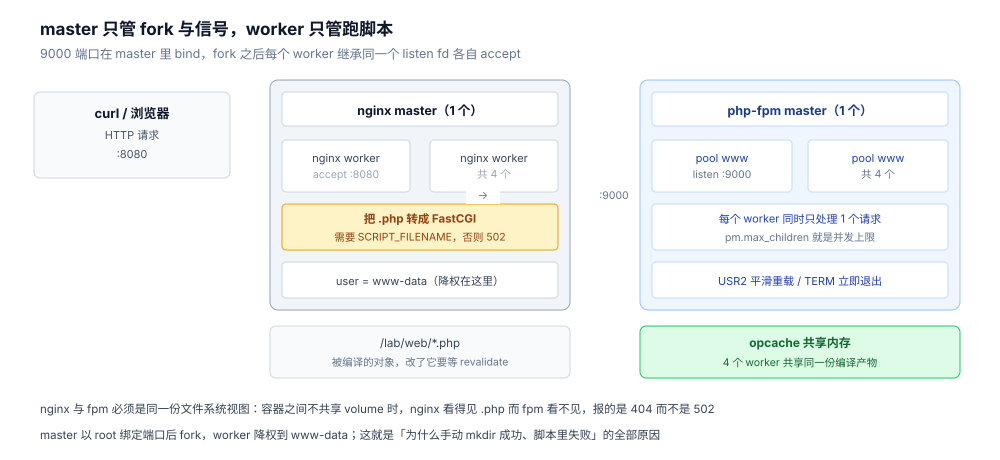
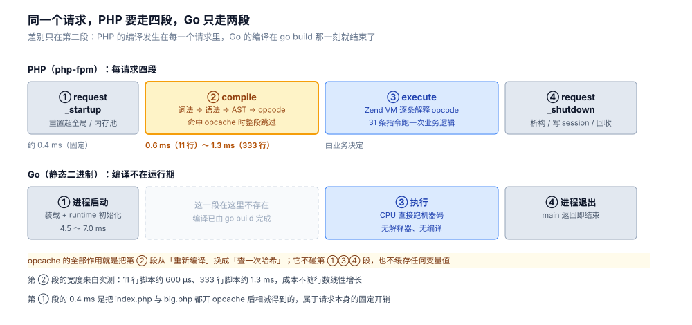
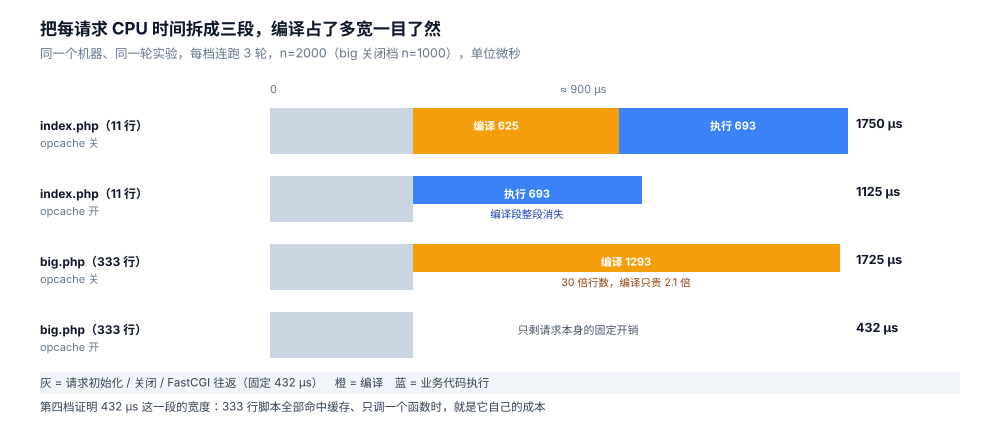

# PHP 程序在物理机上的执行链路

> 一条 `curl` 打到一个 PHP 服务上，从 `php-fpm` 被内核装载，到你的 `index.php` 里第一行业务代码开始跑，中间有四段：**进程被装载 → 请求进来 → 源码被编译成 opcode → Zend VM 执行**。这篇按这四段走一遍，每一步都有本机读数。
>
> 与同目录另两篇的分工：[从零实现HTTP服务端.md](从零实现HTTP服务端.md) 讲「PHP 怎么写一个服务端」，[接入Skywalking.md](接入Skywalking.md) 讲「PHP 怎么上报链路」，本篇讲「PHP 进程怎么跑起来、每请求做了什么」。本篇是链路篇，口吻是陈述式而非面试题式，与那两篇的体例差异是有意的。
>
> 素材来源：本机 Docker 实测，镜像 `php:8.0-fpm`（PHP 8.0.30 / Debian bullseye），宿主 4 核，容器无 CPU 配额。

---

## 一、从零：一条请求跑通的最小闭环

**本节要点**：PHP 不能像 Go 一样直接 `./binary` 跑起来对外服务。要跑通一条请求，最少需要四个部件，缺一个都只能看到 502。

### 1.1 四个部件各干什么

| 部件 | 角色 | 没有它会怎样 |
|---|---|---|
| `php-fpm` master | 读配置、绑端口、fork 并看管 worker | 没人监听 9000 |
| `php-fpm` worker | 真正执行你的脚本的进程 | 连接被接受但没人处理 |
| Web 服务器（nginx） | 收 HTTP、按扩展名判断交给谁、把响应写回 | 浏览器连不上，或只能拿到静态文件 |
| 你的 `.php` 文件 | 被编译、被执行的对象 | worker 起来但没东西可跑 |

FPM 说的是 **FastCGI** 协议，不是 HTTP。所以 `curl 127.0.0.1:9000` 什么也拿不到——那是个二进制协议端口。必须有一个会说 HTTP 的进程在它前面。

### 1.2 最短配置

nginx 侧只需要一个 `location` 把 `.php` 转成 FastCGI：

```nginx
server {
    listen 8080;
    root /lab/web;
    index index.php;

    location ~ \.php$ {
        fastcgi_pass 127.0.0.1:9000;
        include fastcgi_params;
        fastcgi_param SCRIPT_FILENAME $document_root$fastcgi_script_name;
    }
}
```

`SCRIPT_FILENAME` 这一行不能省。FPM 不会拼路径，它只认这个变量——省掉它，FPM 会报 `Primary script unknown`，nginx 侧看到的是 502。这是 PHP 部署里最常见的一个 502。

FPM 侧只需要三行（`www.conf`）：

```ini
listen = 127.0.0.1:9000
pm = static
pm.max_children = 4
```

`pm = static` 是**为了测量**才改的，官方镜像默认 `pm = dynamic`（起步 2 个、按需扩），前几十个请求会因为 fork 抖动而让读数发散。生产环境按内存与并发选，第 2.3 节给判据。

启动：

```bash
php-fpm -F &          # -F 前台，避免容器里 daemonize 后 pid 文件写不出来
nginx -g 'daemon off;' &
```

### 1.3 跑起来看到什么

进程树（`ps` 在 `php:8.0-fpm` 里没装，读 `/proc`）：

```text
1517 <- 0     : php-fpm: master process (/usr/local/etc/php-fpm.conf)
1523 <- 1517  : php-fpm: pool www
1524 <- 1517  : php-fpm: pool www
1525 <- 0     : nginx: master process nginx -g daemon off;
1531 <- 1525  : nginx: worker process        （共 4 个，按核数自动开）
```

端口：

```text
LISTEN 0 511  0.0.0.0:8080  0.0.0.0:*
LISTEN 0 511        *:9000        *:*
```

注意 9000 是 `*:9000` 而不是 `127.0.0.1:9000`——官方镜像的 `www.conf` 里 `listen` 默认可能是 `9000`（无地址），绑到了全部接口。**放在只有内网的容器里没问题，但如果容器端口对外映射，这就是一个未授权的 RCE 入口**：任何能连到 9000 的人都可以构造 FastCGI 请求执行任意 `.php`。

### 1.4 三个「配了却没生效」的默认值

这一步比跑通更值得记，因为三个都是静默的：

**① 根本没有 php.ini。** 官方镜像不带 `php.ini`：

```text
Configuration File (php.ini) Path: /usr/local/etc/php
Loaded Configuration File:         (none)
Scan for additional .ini files in: /usr/local/etc/php/conf.d
```

`(none)` 意味着所有 `php.ini` 级别的默认值都在生效，你写的任何「应该改 php.ini」的想法都不会生效。要改只能往 `/usr/local/etc/php/conf.d/` 里丢 `.ini` 文件。

**② `opcache.so` 就在那儿，但没加载。** 扩展目录里明明有：

```text
/usr/local/lib/php/extensions/no-debug-non-zts-20200930/opcache.so
```

可 `php -m` 的输出里没有 `Zend OPcache`。原因是 OPcache 是 zend extension，必须显式声明：

```ini
zend_extension=opcache.so
```

**这一行写不写，就是「每请求重编译」和「每请求查表」的全部区别**——HTML 里 `php -m` 没有它，你所有关于 opcache 的调优参数都是空谈，而进程不会报任何错。

**③ `opcache.enable_cli = Off` 是默认值。** 用 `php -r` 或 `php script.php` 测 opcache 行为时，看到的是关闭状态；即使你写了 `opcache.enable=On` 也一样。CLI 要单独开 `-d opcache.enable_cli=1`。这条会造成「我在命令行测出来没加速」的误判。

---

## 二、原理：php-fpm 为什么要分 master 和 worker

**本节要点**：master 不执行任何业务代码，它只做四件事；worker 不做任何管理决策，它只管跑脚本。分开的理由是「权限」和「稳定性」，不是性能。



读法：注意 9000 端口的 bind 发生在 master、accept 发生在 worker——fork 之后子进程继承同一个 listen fd，所以 4 个 worker 不需要抢端口，也不需要 `SO_REUSEPORT`。右下角那块绿色是 4 个 worker 唯一共享的东西。

### 2.1 master 只做四件事

1. **读配置并校验**：`php-fpm -t` 就是干这个。
2. **绑定监听端口**：绑定发生在 fork 之前，所以 worker 继承已 bind 的 fd，不需要抢端口，也不需要 `SO_REUSEPORT`。
3. **fork / 回收 worker**：worker 异常退出（段错误、超时被杀）时由 master 补一个。
4. **接收信号**：`USR2` 平滑重载、`QUIT` 优雅退出、`TERM` 立即退出。

master 通常是 root（要 bind 低端口），worker 降权到 `www-data`：

```text
user  = www-data
group = www-data
```

这是**唯一**一个 PHP 侧的权限边界。业务代码能碰到的所有文件权限，都以 `www-data` 为准——「为什么 `mkdir` 报 permission denied 而 root 手动跑就没事」，答案在这里。

### 2.2 worker 里没有「线程」这个概念

PHP-FPM 是**多进程**模型，一个 worker 同一时刻只处理一个请求。所以：

- 一个 worker 里的静态变量、全局变量、连接池，都是**进程内状态**，请求结束后由 `php_request_shutdown` 清掉。这就是为什么 PHP 里「单例」只在单次请求内有效，跨请求不共享。
- 想跨请求共享，只有三条路：opcache（编译产物）、APCu（用户数据，进程内共享但多 worker 不共享）、外部存储（Redis / MySQL）。
- `pm.max_children` 就是并发上限。超过就排队（连 nginx 的 `fastcgi_connect_timeout` 之后报 504）。

### 2.3 `pm = static` 与 `pm = dynamic` 怎么选

| 模式 | 行为 | 适用 |
|---|---|---|
| `static` | 启动即 fork 满 `max_children` 个，不增不减 | 内存确定、流量平稳；读数可复现 |
| `dynamic` | 起步 `start_servers`，按 `min/max_spare_servers` 扩缩 | 流量波动大、内存紧张 |
| `ondemand` | 有请求才 fork，闲置一段时间后销毁 | 极低频的内部工具 |

`dynamic` 的代价是「扩容那一刻的 fork 抖动」。本轮实测里，`dynamic`（起步 2 个）在 c=20 的并发下 RPS 落在 557~1851 之间，同一份配置、同一个脚本，波动 3 倍多；改成 `static` 固定 4 个之后才稳定下来。所以**做任何 PHP 性能测量，先把 `pm` 改成 `static`**，否则你测的是 fork 的抖动。

---

## 三、原理：一次请求的四个阶段

**本节要点**：PHP 的执行模型是「每个请求从源码开始」。opcache 优化的不是「执行」，而是「跳过编译」。

### 3.1 四个阶段

```text
请求进来
  │
  ├─ ① php_request_startup    重置超全局变量、会话、输出缓冲、内存池
  │
  ├─ ② compile                词法 → 语法 → AST → opcode
  │      ├─ opcache 命中 → 直接取已缓存的 opcode
  │      └─ opcache 未命中 → 走完整编译，结果写进共享内存
  │
  ├─ ③ execute                Zend VM 逐条执行 opcode
  │
  └─ ④ php_request_shutdown   调析构、写 session、释放请求内存、回收资源
```

第 ①④ 两段是**请求级初始化和清理**，每个请求都要付；第 ②③ 是编译和执行。

对比 Go：Go 的「编译」在 `go build` 那一刻就完成了，进程启动后只有第 ③ 段。**PHP 把「编译」搬进了每个请求**——这是它最大的结构差异，也是 opcache 存在的全部理由。



读法：上下两行对齐着看，第 ① 和第 ③ 段是两边都有的，第 ② 段只在上面那行存在。opcache 的作用就是把上面那行的黄色块换成一次哈希查找，它不会让蓝色块变窄。

### 3.2 编译产物长什么样：opcode

打开 opcode dump，让编译结果自己说话：

```bash
php -d opcache.enable_cli=1 -d opcache.opt_debug_level=0x10000 index.php
```

对一个 11 行的脚本（一个 `fib` 函数 + 一次 `printf`）：

```text
$_main:
     ; (lines=15, args=0, vars=1, tmps=7)
     ; (before optimizer)
     ; /lab/web/index.php:1-10
0000 T1 = FETCH_IS (global) string("_GET")
0001 T2 = FETCH_DIM_IS T1 string("n")
0002 T3 = COALESCE T2 0004
0003 T3 = QM_ASSIGN int(20)
0004 T4 = CAST (long) T3
0005 ASSIGN CV0($n) T4
0006 INIT_FCALL 3 128 string("printf")
0007 SEND_VAL string("fib(%d)=%d
") 1
0008 SEND_VAR CV0($n) 2
0009 INIT_FCALL 1 208 string("fib")
0010 SEND_VAR CV0($n) 1
0011 V6 = DO_UCALL
0012 SEND_VAR V6 3
0013 DO_ICALL
0014 RETURN int(1)
```

底数是 4 位的序号、左边是操作码助记符（`FETCH_IS` / `ASSIGN` / `INIT_FCALL` / `SEND_VAR` / `DO_ICALL`）、右边是操作数。这不是机器码，也不是字节码——它是**Zend VM 的指令集**，每条都对应 `Zend/zend_vm_def.h` 里的一个处理函数。

⭐ 「为什么它不叫字节码」的完整对照（同一段 `fib` 的机器码 49 字节 / 字节码 23 字节 / opcode 19 条，三种形态各被谁消费、可移植性边界在哪）见 [机器码、字节码与opcode.md](../../02-计算机基础/编译原理/机器码、字节码与opcode.md)。

体积对照（同一台机器，`opt_debug_level=0x10000` 优化前）：

| 脚本 | 行数 | 字节数 | opcode 条数 |
|---|---|---|---|
| `index.php` | 11 | 约 300 | **34**（`$_main` 15 + `fib` 19） |
| `big.php`（脚本生成，30 个函数） | 333 | 17,367 | **2,556** |

再打开优化器（`0x20000`），`index.php` 的 34 条变成 **31** 条——优化器删掉了 3 条冗余操作。这就是「编译」这个动作确实在发生的直接证据：如果只是查表，不会有 34 → 31 的变化。

### 3.3 第 ③ 段：Zend VM 执行

31 条 opcode 被逐条解释执行。`SEND_VAR` / `DO_ICALL` 这类调用的开销是「查函数表 + 压栈 + 跳转」，比原生 `call` 指令贵一个数量级。

这可以用同一个递归基准量出来（`fib(32)`，与 Go / Java 同规模）：

| 执行方式 | `fib(32)` 耗时 |
|---|---|
| PHP 8.0，opcode 缓存 + Zend VM | 211.3 ~ 240.3 ms |
| PHP 8.0，加 tracing JIT | 76.1 ~ 88.4 ms |

开了 JIT 之后快 **2.7 ~ 3.0 倍**。但即使开着 JIT，它仍然是 211 ms 那个量级的三分之一——而 Go 的 AOT 编译版本是 **15.9 ~ 16.6 ms**，Java 的 JIT 版本是 **11.0 ~ 13.5 ms**。三条路线的横向对比放在 [AOT、JIT与解释执行.md](../../02-计算机基础/编译原理/AOT、JIT与解释执行.md)，这里只留一个位置感。

### 3.4 opcache 缓存的是什么

它缓存的**只有编译产物**：opcode 数组、字面量、类/函数表、`interned string`。它不缓存：

- 你的变量值（那是 APCu 的活）
- 数据库连接（请求结束时已关）
- 任何「运行过一次之后的状态」

所以一个常见误解要拆掉：**「开了 opcache，对象就不用重复构造了」是错的**。每个请求仍然要 `new`、仍然要连库、仍然要跑业务逻辑。opcache 省掉的只是第 ② 段。

---

## 四、使用一：opcache 到底省了什么

**本节要点**：省的是「编译」这一段，绝对值约 600 µs ~ 1.4 ms；用 RPS 测不出来，用每请求 CPU 时间可以。

### 4.1 为什么不用 RPS 测

`ab` 在同一个容器里跑，和 4 个 `php-fpm` worker 抢那 4 个核。实测同一档配置连跑三轮：

```text
opcache 开：1207.61 / 1482.05 / 1132.33 req/s
opcache 关： 557.52 /  890.39 /  767.38 req/s
```

方向是对的（开比关快），但单轮波动 30% 以上，测不出「编译占多少」。**吞吐量在这里是个放大器，不是温度计。**

可靠的办法是读 `/proc/<worker>/stat` 的 `utime+stime` 差值：

```bash
cpu() {  # 4 个 worker 的累计 CPU jiffies
  t=0
  for p in /proc/[0-9]*; do
    c=$(tr "\0" " " < $p/cmdline 2>/dev/null)
    case "$c" in "php-fpm: pool"*) t=$((t + $(awk '{print $14+$15}' $p/stat)));; esac
  done
  echo $t
}
a=$(cpu); ab -n 2000 -c 4 -q 'http://127.0.0.1:8080/index.php?n=20' >/dev/null; b=$(cpu)
echo "$(( (b-a)*10000/2000 )) us/请求"   # USER_HZ=100，即 1 jiffy = 10 ms
```

它只统计 FPM 自己的 CPU 时间，跟 `ab` 抢不抢 CPU 无关。三轮之间读数稳定在 ±5% 以内。

### 4.2 四档读数

| 脚本 | opcache | 每请求 CPU | 说明 |
|---|---|---|---|
| `index.php`（11 行，含 `fib(20)` 计算） | 关 | **1700 ~ 1795 µs** | 编译 + 执行 |
| `index.php` | 开 | **1045 ~ 1205 µs** | 只执行 |
| `big.php`（333 行，只调 1 个函数） | 开 | **410 ~ 455 µs** | 几乎全是请求开销 |
| `big.php` | 关 | **1610 ~ 1840 µs** | 编译 + 极少量执行 |

把四个数拆开看，三项成本就分出来了：



读法：灰色那一段四行都一样宽，说明「请求本身的成本」与脚本无关。真正随 opcache 开关变化的是橙色块。第四行只剩灰色，因为它既是 333 行的脚本、又全部命中缓存、还只调一个函数——三段里两段被消掉了。

- **请求本身的开销**（启动 + 关闭 + FastCGI 往返）：**约 410 ~ 455 µs**，这一档降不下去，是固定成本。
- **编译 11 行脚本**：`1700 - 1125 ≈` **600 µs**（用开/关两档的中位相减）。
- **编译 333 行脚本**：`1725 - 432 ≈` **1.3 ms**。

### 4.3 编译成本不按行数线性增长

11 行 → 600 µs，333 行（30 倍行数）→ 1.3 ms（2.2 倍）。差的这 30 倍里，大部分是**固定开销**：初始化 lexer/parser、建符号表、申请编译期内存池。真正的「逐行解析」只占小头。

这个结论有实用价值：**不要用「我的框架有几千行，所以 opcache 收益巨大」来估算**。收益的大头在「有没有 opcache」这一刀，不在「文件多大」。

反过来说，**几百行的小接口**同样值得开 opcache——600 µs 对 400 µs 的请求开销来说，是翻倍的差距。

---

## 五、使用二：改代码不生效的两个窗口

**本节要点**：`validate_timestamps=1` 时改代码要等 `revalidate_freq` 秒；`=0` 时永远不生效，只能 reload。两个都是静默的。

### 5.1 `validate_timestamps=1`：有 2 秒窗口

默认 `opcache.validate_timestamps=1`、`revalidate_freq=2`。实测：请求一次拿到 `fib(5)=5`，然后改文件，从改动那一刻起每 250 ms 打一次：

```text
t=0.2s -> fib(5)=5
t=0.5s -> fib(5)=5
...
t=1.8s -> fib(5)=5
t=2.0s -> PATCHED marker      ← 第 9 次请求才变
t=2.2s -> PATCHED marker
```

**8 次请求全是旧结果，第 2.0 秒那次才换。** 这里有个精确的对应：`revalidate_freq=2` 意味着 opcache 每 2 秒才检查一次文件的 `mtime`，两次检查之间的请求全部走缓存。

线上表现就是「我明明发了新版本，为什么还是旧逻辑」。这不是部署失败，是这 2 秒。

### 5.2 `validate_timestamps=0`：永远不生效

生产环境常把 `validate_timestamps` 关掉省掉那次 `stat`。实测改成 0 之后，改文件后 0.5 / 1 / 3 / 6 秒各请求一次，**全部返回旧结果**。

只有 `kill -USR2 <master-pid>`（平滑重载）之后，才立刻变成新结果：

```text
+0.5s: fib(5)=5
+1s:   fib(5)=5
+3s:   fib(5)=5
+6s:   fib(5)=5
--- 发送 USR2 reload 之后 ---
reload 后: PATCHED marker
```

`USR2` 让 master 重新 fork worker，新 worker 的 opcache 共享内存是空的（严格说是重新初始化），所以缓存失效。这就是所有 PHP 部署脚本里那句 `systemctl reload php-fpm` 的真正作用。

### 5.3 三种刷新方式的代价

| 方式 | 命令 | 中断 | 适用 |
|---|---|---|---|
| 等它自己失效 | 无 | 无 | `validate_timestamps=1`，`revalidate_freq` 内可接受 |
| 平滑重载 | `kill -USR2 <master>` | 正在处理的请求会跑完，新请求由新 worker 接 | 常规发布 |
| 强制重启 | `kill -TERM <master>` + 重启 | 全部中断 | 改了 `php.ini` / 装扩展 |
| 只清缓存 | `opcache_reset()` 打进一个 web 请求 | 瞬时 | 应急，但要先能访问到那个脚本 |

注意：`opcache_reset()` 只清当前 worker 能看到的缓存（共享内存是全体共享的，所以一次就够），但**改了 `php.ini` 必须重启**——ini 是在进程启动时读的，`USR2` 不重新读 ini。

---

## 六、与 Go 侧对照：它是动态链接的

**本节要点**：`php-fpm` 是一个普通的 C 程序，走的是 [从可执行文件到第一条指令.md](../../02-计算机基础/编译原理/从可执行文件到第一条指令.md) 里那条「有 `PT_INTERP`」的路。这条路上 `LD_*` 环境变量全都生效，而 Go 静态程序那条路全都无效。

```text
/usr/local/sbin/php-fpm: ELF 64-bit LSB pie executable, x86-64,
  dynamically linked, interpreter /lib64/ld-linux-x86-64.so.2, stripped
```

- `ldd` 列出 **49 行**依赖（`libc`、`libssl`、`libxml2`、`libzip`……）
- `LD_DEBUG=libs php -v` 输出 **512 行**——动态链接器逐个报「找哪个库、从哪个路径加载」
- 对照 Go 静态程序：`LD_DEBUG=libs ./hello_go_static` 输出 **1 行**，因为那个二进制根本没有解释器，`LD_*` 是 loader 的功能，loader 不在场

这条差别在运维上有直接后果：**php-fpm 镜像换基础系统（glibc → musl）时会直接起不来**，报 `not found`，而文件明明在那儿。原因和 `PT_INTERP` 指向一个不存在的路径完全一样。

---

## 七、排障：现象到原因

**本节要点**：PHP 侧的故障几乎都能归到「进程模型」「编译缓存」「权限」三处，按这个顺序查比翻日志快。

| 现象 | 先查什么 | 常见原因 |
|---|---|---|
| 502 Bad Gateway | `ss -ltn \| grep 9000` | FPM 没起 / 监听地址与 nginx 的 `fastcgi_pass` 不一致 |
| 502 且 FPM 日志有 `Primary script unknown` | nginx 配置里有没有 `SCRIPT_FILENAME` | 少了这行，FPM 不知道要跑哪个文件 |
| 404 而不是 502 | `root` 与 `SCRIPT_FILENAME` 是否指向同一路径 | nginx 与 FPM 看到的文件系统不同（容器未共享 volume） |
| 改了代码没变化 | `opcache_get_status()` 的 `validate_timestamps` | 5.1 / 5.2 的两个窗口 |
| `php -m` 里没有 opcache | `php --ini` 的 `Additional .ini files` | `zend_extension=opcache.so` 没写 |
| 命令行测 opcache 没效果 | `opcache.enable_cli` | 默认 Off |
| 上传/写文件报 permission denied | `user` / `group` in `www.conf` | worker 是 `www-data`，不是 root |
| 并发一上来就 504 | `pm.max_children` 与单 worker 内存 | 队列排满，nginx 等超时 |
| 内存随运行时间涨 | 单个 worker 的 RSS × `max_children` | `static` 模式下 `max_children` 直接决定总内存 |

一条最有用的命令：**把 `php-fpm` 的 pool status 打开**，看 `active processes` / `listen queue`：

```ini
pm.status_path = /fpm-status
```

然后 nginx 里把 `/fpm-status` 也 `fastcgi_pass` 到同一个池。`listen queue` 一旦不为 0，就是 `max_children` 不够——这个数比任何监控都直接。

---

## 八、校验口径

> ✅ 实测（`php:8.0-fpm`，PHP 8.0.30 / Debian bullseye，容器 4 核无配额；nginx 1.18.0 同容器）：

- 进程树、端口、`php --ini`、`php -m`、`opcache.so` 路径：直接读 `/proc` 与 `php -i`，一次采集。
- opcode dump：`php -d opcache.enable_cli=1 -d opcache.opt_debug_level=0x10000|0x20000 <file>`，条数为正则 `^[0-9]{4} ` 的匹配数。
- 每请求 CPU：读 4 个 worker 的 `/proc/<pid>/stat` 第 14+15 字段差值，`USER_HZ=100`；每档连跑 3 轮，n=2000（`big.php` 关闭档 n=1000）。
- opcache 时效窗口：改动文件后用 `curl` 每 250 ms 打一次，记录第一次出现新结果的时间点；`validate_timestamps=0` 组额外测 `kill -USR2`。
- `fib(32)`：CLI 下同一份脚本，7 次取区间；JIT 参数 `opcache.jit=tracing` + `opcache.jit_buffer_size=64M`。

⚠️ **未实测 / 边界**：

- 没有测真实框架（Laravel/ThinkPHP）的编译成本。`big.php` 是脚本生成的结构化样本（30 个函数、333 行），只用来证明「成本不随行数线性增长」，不代表任何具体框架。
- 没有测 `pm.max_children` 与内存的对应关系（需要压到 OOM 才有意义）。
- 没有测 Windows / macOS 宿主直跑 FPM 的情形——FPM 在 Windows 上不可用。
- 网络与磁盘都是容器内 loopback，不代表跨机调用。
- `ab` 与 FPM 同容器，RPS 一栏的绝对值不可用（见 4.1），只保留方向。

---

## 延伸追问

- **为什么 FPM 宁可开几十个进程，也不用线程？** 因为 PHP 运行时里大量状态是「进程级全局」的（`EG`、`CG`、资源表），要支持多线程就得全部改成线程局部，那是 ZTS 构建，代价是每个扩展都要跟着改、且性能普遍下降 5~10%。多进程换掉了「共享」，也换掉了「锁」——代价是内存不共享，所以 opcache 必须放在进程外的共享内存里。
- **opcache 的共享内存写满了会怎样？** `opcache_get_status()` 里有两个计数器：`oom_restarts` 与 `hash_restarts`。前者是「内存不够，整个缓存被清空重来」，后者是「哈希表满了，重建」。两者都不为 0 就意味着缓存正在反复失效，实际命中率会远低于 `opcache_hit_rate` 报的那个数字。本轮实验里两者都是 0，因为只缓存了 2~3 个脚本。
- **`max_children` 到底开多少？** 判据只有一条：单 worker 的 RSS × `max_children` 必须小于容器内存上限，且留出 20% 给内核页缓存。`static` 模式下这个乘积是常驻的，`dynamic` 模式下是上限。所以「按 CPU 核数开」是错的，PHP 的 worker 是 IO 密集型，核数只能作为下限。
- **为什么改了 `php.ini` 之后 `USR2` 不生效？** 因为 `USR2` 只是让 master 重新 fork worker，而 `php.ini` 是**进程启动时**读的。`USR2` 之后的新 worker 仍然继承 master 的环境（master 自己没重启）。要重新读 ini 必须 `TERM` 掉 master 再启动。

---

## 关联

- [从可执行文件到第一条指令.md](../../02-计算机基础/编译原理/从可执行文件到第一条指令.md) — **上游**。`php-fpm` 这个 C 二进制怎么被内核装载起来，第 6 节只给了结论。
- [从零实现HTTP服务端.md](从零实现HTTP服务端.md) — **互补**。那篇讲 HTTP 报文怎么拆、怎么拼，本篇从「报文被 nginx 转成 FastCGI」之后接起，两者首尾相接。
- [接入Skywalking.md](接入Skywalking.md) — **下游**。进程与请求的生命周期搞清之后，再看数据从哪一段跑出去。
- [AOT、JIT与解释执行.md](../../02-计算机基础/编译原理/AOT、JIT与解释执行.md) — **总纲·对照**。本篇第 3.3 节那两组 `fib(32)` 读数，在那篇里与 Go、Java 放在一起比较。
- [从源码到main.md](../../01-编程语言/go/运行时/从源码到main.md) — **横向对照**。Go 侧「编译在构建期」那一路的完整链路。
