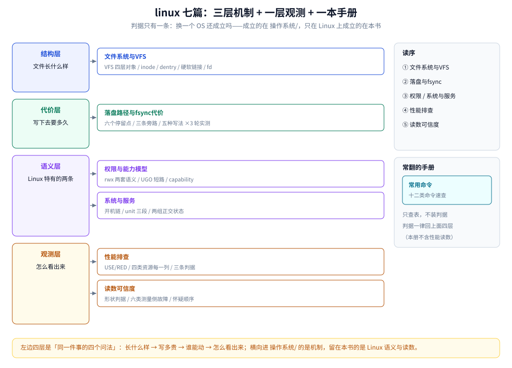

# Linux

> 覆盖：**Linux 特有的那部分语义，以及在 Linux 上怎么观察、怎么敲**——文件系统与 VFS（inode / dentry / fd / 挂载 / 软硬链接）、一次 `write` 到落盘的路径与 `fsync` 的实测代价、`rwx` 与 capability 两套权限语义、开机链与 systemd、资源排查方法论与每一列的判读、读数可不可信、命令速查。
>
> 不覆盖：**换一个 OS 仍然成立的通用内核机制**——虚拟内存与页缓存、进程与线程模型、调度与时间片、中断、信号、两态之分与六段缓冲、零拷贝、I/O 多路复用，全部在 [README.md](../操作系统/README.md)。组件参数与调优在 `03-数据与中间件/`。
>
> 当前 **7 篇散篇 + 36 篇书籍子目录**。三个子目录按书章节走，只写操作步骤，机制一律指回散篇与 `操作系统/`。
>
> 内容整理自个人学习笔记，素材见 [素材清单](../../素材清单.md)。

---

## 一、本目录与「操作系统/」怎么分？

**本节要点**：判据只有一条——**这条结论换一个 OS 还成立吗**。成立且原因在内核里 → `操作系统/`；只在 Linux 上成立（某个 `/proc` 文件这么读、某个 syscall 是这个语义、某个文件系统这么做）→ 本目录。

| 归本目录 | 归 `操作系统/` | 为什么会混 |
|---|---|---|
| `inode` / `dentry` / `fd` 在 VFS 里怎么挂在一起、`ext4` 与 `XFS` 差在哪、`df` 与 `du` 为什么对不上 | 「写成功不等于落盘」的语义、页缓存在整条 I/O 栈上的位置 | 一个是 Linux 的实现，一个是任何 OS 都有的写回语义 |
| `ps` / `top` / `vmstat` / `iostat` 每一列什么意思、`/proc` 哪个文件读 | 时间片多长、切换单价多少、调度类怎么叠 | 一个是读数，一个是读数背后的机制 |
| `free` 显示「几乎用完」是好事、`cached` 不等于泄漏 | Page Cache 与六段缓冲在内存里长什么样 | 同一份内存，两种问法 |
| `sched_setscheduler` 的语义、`ulimit` 与 cgroup 限额怎么设 | 抢占靠时钟中断、时间片用完谁来收回 CPU | 前者只在 Linux 上成立，后者任何 OS 都成立 |
| `fsync` 在本机 overlayfs 上到底多贵（五种写法 ×3 轮） | 为什么 `fsync` 的耗时主体是「等设备」而不是「拷数据」 | 读数归这里，账归那边 |
| `uid 0` 走的是 capability 旁路、容器里只剩 14 个位 | 「特权」本身就是个抽象概念，任何 OS 都有 | 前者是 Linux 的落地，后者是概念 |

⭐ **反向也要认**：判据不是「谁更原理」，而是「**换一个 OS 还成立吗**」。判据变严的直接后果就是——原先挂在本目录的三篇机制篇已迁走，见第三节。

## 二、七篇的分工：四层 + 一本手册

**本节要点**：本目录对外最重要的不是「有几篇」，而是**哪几篇在给别的目录供货**。下表第三列是认领声明：被它供货的目录，只在需要自己那层结论时才重写，机制一律指回这里或 `操作系统/`。

图里左边四层是「同一件事的四个问法」：长什么样 → 写多贵 → 谁能动 → 怎么看出来。四层之外还有一本 `常用命令.md`，它只查表、不装判据，任何判据一律回上面四层取。右边「读序」一栏是本节的第 1 到第 5 步，自上而下。

| 篇目 | 层 | 对外供给（谁在引它） |
|---|---|---|
| [文件系统与VFS.md](文件系统与VFS.md) | **结构层** ⭐ | VFS 四层对象、inode 存什么不存什么、dentry 与 dcache、fd 是数组下标、目录本身是一张表、硬链接与软链接、ext4 / XFS / Btrfs 的结构差异；跨数据结构 / 算法 / 存储 / 容器四族引用 |
| [落盘路径与fsync代价.md](落盘路径与fsync代价.md) | **代价层 + 唯一自产实测** ⭐ | 一次 `write` 的六个停留点、三条旁路（`fsync` / `O_DIRECT` / `mmap`）、五种写法 ×3 轮的实测账（4 KB 的 `write` 2.6~4.0 µs 对 `+fsync` 1825~2062 µs，差约 500 倍）、组提交与窗口期；被 ES translog / MySQL / 容器可写层引用 |
| [权限与能力模型.md](权限与能力模型.md) | **语义层** | 同一个 `rwx` 对文件与目录为什么是两回事、UGO 短路判定不叠加、`umask`、SUID / SGID / 粘滞位、`uid 0` 与 capability、低端口与 `ip_unprivileged_port_start`、ACL 与 `sudo`；六组 A/B 实测 |
| [系统与服务.md](系统与服务.md) | **语义层** | 开机链五层与 target 挂载、`active` 与 `enabled` 两组正交状态、unit 三段六个别扭项、依赖与顺序的区别、资源限制与日志、「服务起不来的七种原因」；1 号进程信号契约的两次容器实测 |
| [性能排查.md](性能排查.md) | **观测层** | USE / RED 方法论、四步下钻顺序、`uptime` / `vmstat` / `top` / `iostat` / `ss` 每一列的判读、四类资源各三条判据、命令与判据的对应表；跨 9 族 27 篇引用 |
| [读数可信度.md](读数可信度.md) | **观测层** ⭐ | 数字自相矛盾时的怀疑顺序（先测量侧 → 再看形状 → 最后才动被测系统）、测量侧六类故障、形状判据与四项结论口径；被所有引了实测数字的篇目引用 |
| [常用命令.md](常用命令.md) | 手册 | 十二类命令速查，只做查表，不含判据、不含读数 |

⚠️ **三条边界纪律**，写新篇时容易破：

1. **机制只写一份**。`文件系统与VFS.md` 已经写了 inode 与 VFS 四层，`鸟哥基础学习篇/02-文件系统与XFS.md` 只在「怎么格式化、怎么扩容」这个语境下用它，不再解释 inode 是什么。
2. **读数必须带口径**。`落盘路径与fsync代价.md` 那组读数标了 overlayfs + WSL2 内核 6.18 与三轮，**绝对耗时不能跨机器搬**，只能比同一台机器上五种写法的相对关系。口径本身怎么写，见 [读数可信度.md](读数可信度.md) 5.3。
3. **命令与判据分家**。`常用命令.md` 只回答「敲哪条」，「读到什么算异常」一律回 [性能排查.md](性能排查.md) 或对应机制篇——否则同一条阈值会在两处各写一遍，迟早对不上。

## 三、已迁出本目录的三篇

判据收紧后，这三篇的内容 80% 以上换到 BSD / Windows 仍成立，已迁入 [README.md](../操作系统/README.md)，文件名同时改准：

| 原位置 | 现位置 | 迁走的原因 |
|---|---|---|
| `linux/进程与线程.md` | [进程与线程模型.md](../操作系统/进程与线程模型.md) | PCB、五状态、并发与并行、多对一 / 一对一 / 多对多映射——全是通用 OS 内容；它真正 Linux 特有的部分（`ps -eLf`、`LWP`、`ulimit -u`）本就是命令，该留在本目录 |
| `linux/内存管理.md` | [虚拟内存与页缓存.md](../操作系统/虚拟内存与页缓存.md) | 虚拟内存、页表与 TLB、缺页、伙伴系统与 Slab、Page Cache 与 kswapd、swap——同样是通用机制；TLB 那笔实测账本来就与 [调度与时间片.md](../操作系统/调度与时间片.md) 4.3 是同一份 |
| `linux/零拷贝.md` | [零拷贝.md](../操作系统/零拷贝.md) | 纯机制篇（85% 篇幅讲五种路径的拷贝账），被 9 个目录族引用 |

⭐ **这三篇的迁出理由是同一条**：判据是「换 OS 还成立吗」，不是「谁先写」。

## 四、三个书籍子目录

**本节要点**：这三块是**按书章节**整理的，不参与上面的四层划分，读它们是为了补系统面的广度；判据、口径与实测一律不在里面，引用时要回到散篇。

| 子目录 | 篇数 | 覆盖 | 入口 |
|---|---|---|---|
| `深入理解Nginx/` | 15 | 01-编译安装与配置 / 02-进程模型与基础架构 / 03-事件驱动与epoll / 04-HTTP框架执行流程 / 05-内存管理与数据结构 / 06-HTTP模块开发入门 / 07-配置解析与请求上下文 / 08-upstream与子请求 / 09-HTTP过滤模块 / 10-HTTP变量机制 / 11-HTTP3与QUIC支持 / 13-njs模块与动态脚本 / 14-OpenResty生态 / 15-Tengine生态 / 16-模块开发实战 | [README.md](深入理解Nginx/README.md) |
| `鸟哥基础学习篇/` | 10 | 01-安装与磁盘分区 / 02-文件系统与XFS / 03-用户与权限 / 04-Shell与脚本 / 05-服务与systemd / 06-网络配置与nmcli / 07-日志与journalctl / 08-软件包管理 / 09-备份与恢复 / 10-系统管理综合 | [README.md](鸟哥基础学习篇/README.md) |
| `鸟哥服务器架设篇/` | 11 | 01-虚拟化与云系统搭建 / 02-主机安全与SELinux / 03-网络基础与规划 / 04-防火墙与NAT / 05-SSH远程连接 / 06-DHCP与NTP / 07-DNS服务器 / 08-WWW服务器 / 09-文件共享服务 / 10-邮件服务器 / 11-容器化衔接 | [README.md](鸟哥服务器架设篇/README.md) |

⚠️ 三本册里最容易被重复写的是 **`鸟哥基础学习篇/03-用户与权限.md` 与 `05-服务与systemd.md`**：前者只留「命令怎么用、`/etc/passwd` 什么格式」，`rwx` 的两套语义与能力模型在 [权限与能力模型.md](权限与能力模型.md)；后者只留「怎么配一台机器」，开机链与 unit 的判定在 [系统与服务.md](系统与服务.md)。

## 五、读序

**本节要点**：先建立「一个字节怎么落到磁盘上」的路径感，再按你现在要解决的问题挑一篇，不要顺着目录往下读。

1. **[文件系统与VFS.md](文件系统与VFS.md)** —— 先建立「一个路径打开之后内核手里有几个对象」的结构感：fd → `file` → `inode` → `dentry` → `super_block`。它是后三篇共同的坐标系。
2. **[落盘路径与fsync代价.md](落盘路径与fsync代价.md)** —— 接着看写下去有多贵：六个停留点、三条旁路、五种写法的实测账。
3. **[权限与能力模型.md](权限与能力模型.md)** —— 换到「谁能动这个对象」：`rwx` 的两套语义、UGO 短路、capability。
4. **[系统与服务.md](系统与服务.md)** —— 再换到「开机之后谁把它拉起来」：开机链、unit、两组正交状态、起不来怎么查。
5. **[性能排查.md](性能排查.md)** —— 前四篇是机制与语义，这一篇是**把机制翻译成读数**：哪个计数涨了说明哪条路径出问题。
6. **[读数可信度.md](读数可信度.md)** —— 读数的上一层：这些数字本身可不可信，什么时候该怀疑测量方法而不是系统。
7. **[常用命令.md](常用命令.md)** —— 纯查表，随时翻。

⚠️ 与 `操作系统/` 的交叉读法：`操作系统/` 负责「为什么」，本目录负责「**Linux 上怎么看出来**」。同一个现象在两边的落点不同——机制在 [调度与时间片.md](../操作系统/调度与时间片.md) 3.1~3.3，读数在 [性能排查.md](性能排查.md) 3.2。

---

## 关联

- [README.md](../操作系统/README.md) — 通用机制的九篇：两态之分与六段缓冲、I/O 多路复用、零拷贝、进程创建、调度、中断、信号、进程与线程模型、虚拟内存与页缓存
- [虚拟内存与页缓存.md](../操作系统/虚拟内存与页缓存.md) — 页表、缺页、Page Cache 与回收；与 [落盘路径与fsync代价.md](落盘路径与fsync代价.md) 是「内存那一段」与「设备那一段」的分工
- [零拷贝.md](../操作系统/零拷贝.md) — 已迁出本目录：五种实现路径的拷贝账与选型
- [进程与线程模型.md](../操作系统/进程与线程模型.md) — 已迁出本目录：状态机、PCB 与三种线程映射
- [README.md](../网络/README.md) — `ss` / `ss -s` 的连接状态分布与 TCP 状态机在那一侧
- [README.md](../../01-编程语言/go/README.md) — Go 侧引用本目录的三处：`MemStats` vs RSS、协程与线程成本、`io.Copy` 的能力探测
- [目录.md](../../目录.md) — 全仓知识点索引
