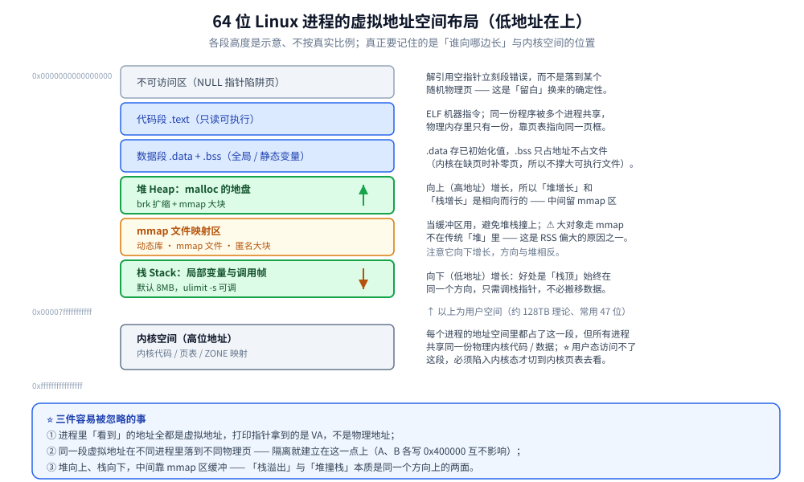
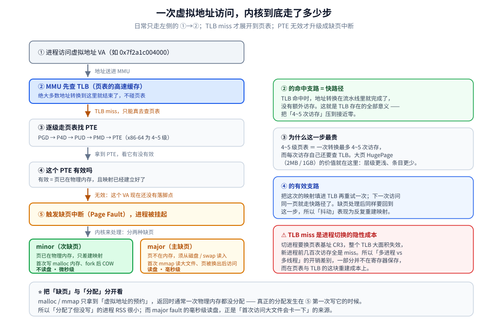
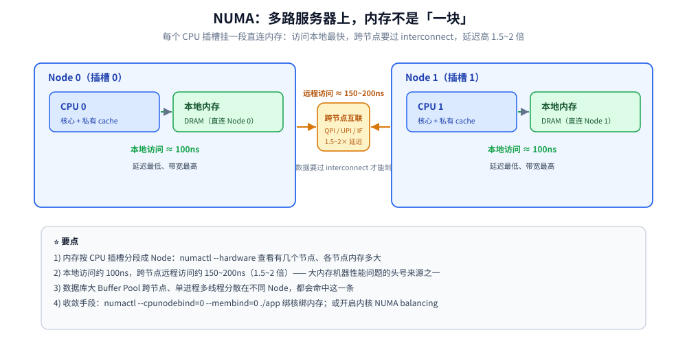

# Linux 内存管理

> 覆盖：虚拟内存与地址空间布局、overcommit 超售策略、mmap 与进程间共享内存、分页 / 页表 / TLB 与 HugePage、缺页中断、伙伴系统与 Slab、内存规整、NUMA、swap、Page Cache 与 `free` 的正确解读、脏页回写水位、kswapd 与 LRU 回收，以及容器内存限额的查看口径。
> 不覆盖：Go 侧的 `MemStats` vs RSS 见 [trace与运行时指标.md](../../01-编程语言/go/运行时/trace与运行时指标.md)，文件映射与缓冲写见 [零拷贝.md](../../01-编程语言/go/运行时/零拷贝.md)；JVM 堆内 / 堆外见 [堆外内存与内存映射.md](../../01-编程语言/java/运行时/堆外内存与内存映射.md)；Page Cache 与文件落盘的衔接见 [文件系统与IO.md](文件系统与IO.md)；Go 用户态分配器见 [内存分配器.md](../../01-编程语言/go/运行时/内存分配器.md)。
>
> 内容整理自个人学习笔记，素材见 [素材清单](../../素材清单.md)。

---

## 一、虚拟内存与地址空间是怎么组织的？

**本节要点**：内核把物理内存抽象成**每个进程独享的虚拟地址空间**（隔离 + 简化链接 + 超售），再用**多级页表 + TLB** 做转换、用**缺页中断**按需分配物理页；内核自己则用**伙伴系统**管整页、用 **Slab** 管小对象。

本篇讲 **Linux 内核**这一层：如何把物理内存抽象成地址空间、如何分配回收、如何把文件落到磁盘。它与 [内存分配器.md](../../01-编程语言/go/运行时/内存分配器.md) 是**不同层次**：Go 的 mheap/mcentral/mcache 是**用户态进程内部**的二次分配器，其「页」是**虚拟地址**，最终仍要通过内核的伙伴系统 + 缺页中断才能拿到物理页。

### 1.1 虚拟内存 vs 物理内存

| | 虚拟内存（进程视角） | 物理内存（硬件视角） |
|---|---|---|
| 谁能看到 / 地址 | 只有进程自己（`mm_struct` / 页表）；**虚拟地址 VA**，需经 MMU 转换 | 内核统一管理；真实 DRAM 单元 |
| 大小 / 连续性 | 64 位理论 128TB（内核常用 47 位）；**看起来连续** | 由内存条决定；可不连续，甚至暂时不在内存里 |

**为什么每个进程都要有独立地址空间**：<br/>
- ① **隔离**——A、B 进程访问同一个 `0x400000` 落到不同物理页，互不可见互不破坏；
- ② **简化链接**——所有程序都能从同一固定地址开始链接（叠加 ASLR 做随机化）；
- ③ **超售与延迟分配**——`malloc` 只「预约」地址，真正用时才分配物理页，总量可超过物理内存；
- ④ 支持内存映射文件与共享内存。

⭐ 进程里「看到」的地址**全都是虚拟地址**，打印指针拿到的是 VA 而非物理地址。

### 1.2 内核允许「超售」到什么程度？overcommit 三档

延迟分配能成立，是因为内核默认允许进程申请的**虚拟内存总量超过物理内存**——但超售有开关，`vm.overcommit_memory` 有三档：

| 取值 | 行为 | 适用 |
|---|---|---|
| **0**（默认，启发式） | 按启发式算法估算，拒绝「明显过分」的申请，其余放行 | 通用服务器 |
| **1**（总是允许） | 从不拒绝 `malloc`，直到真正写时才分配物理页 | 依赖「写了才 OOM」的场景；⚠️ 容易触发 OOM Killer |
| **2**（严格检查） | 按 `CommitLimit`（≈ swap + 物理内存 × `overcommit_ratio`）限制已承诺总量 | 需要「申请时就失败」的场景 |

⭐ 三条判据：

- **模式 0 / 1 下，`malloc` 返回成功不代表物理内存够用** —— 真正的失败点在首次写入（触发 OOM Killer 发 `SIGKILL`），而不是 `malloc` 那一刻。这也解释了为什么「分配 8GB 成功、写一半被杀」。
- **`fork` 的成本与超售模式绑定**：`fork` 后虚拟内存瞬时翻倍，模式 2 下可能直接被拒；模式 0 / 1 下靠 **COW** 延迟复制，真正膨胀的只是「被写过的那部分」。
- **Redis 的经典教训**：模式 1 下 `fork` 做 RDB 快照，一旦有大量写触发 COW，物理内存会显著膨胀 → OOM Killer 可能杀掉主进程。所以 Redis 生产建议设 `vm.overcommit_memory=1`（避免 `fork` 被拒），⚠️ 但同时必须留够内存余量。

### 1.3 地址空间布局（文字版）

64 位 Linux 用户进程，**低地址 → 高地址**：

```text
0x0000000000000000
  ├─ 不可访问区（NULL 指针陷阱页）
  ├─ 代码段 text        ELF 机器指令，只读可执行
  ├─ 数据段 data + BSS  已初始化 / 未初始化的全局静态变量
  ├─ 堆 Heap       ─── 向上增长（brk / mmap），malloc 的地盘
  ├─ 文件映射区 mmap ── 向下增长：动态库、mmap 文件、匿名大块内存
  ├─ 栈 Stack      ─── 向下增长：局部变量、调用帧（默认 8MB，ulimit -s）
0x00007fffffffffff ──（其下为环境变量 / argv；再往上是非规范地址空洞）
0xffff800000000000 ── 内核空间：内核代码/页表/ZONE 映射
0xffffffffffffffff     ⭐ 用户态不可见、访问即段错误
```

- **堆与栈相向生长**，中间的 mmap 区是缓冲区，避免两者撞上。
- ⭐ **内核空间在每个进程地址空间里都占一份高位地址**，但所有进程共享同一份物理内核代码/数据，只有陷入内核态才能访问；大对象走 `mmap` 不在传统「堆」里——这也是 RSS 偏大的原因之一。



图注：堆与文件映射区相向生长、栈向下增长，三者之间的空隙就是「大对象走 `mmap` 不进传统堆」的原因；高地址那一段内核空间每个进程都占，但共享同一份物理内核代码。

### 1.4 mmap：把文件 / 匿名内存映射进地址空间

`mmap` 把一个**文件**或**一段匿名内存**直接映射进进程地址空间，之后读写就像操作普通内存，省掉 `read` / `write` 的那次用户态拷贝。

| 标志 | 语义 | 关键差异 |
|---|---|---|
| **`MAP_SHARED`** | 修改写回文件，或与映射同一文件的其他进程共享 | 多进程共享、会落盘 |
| **`MAP_PRIVATE`** | 修改触发 **COW**，不写回 | 只读共享文件、写时私有副本 |
| **匿名 mmap**（`MAP_ANONYMOUS`） | 不映射文件，映射一段 0 填充的内存 | `malloc` 的大块、Go 的 arena / span 走这条 |

| 场景 | 用 mmap 的收益 | ⚠️ 代价 |
|---|---|---|
| 大文件随机读写 | 省掉「`read` / `write` + 一次用户态拷贝」，按需缺页加载 | 缺页中断开销、脏页回写时机不可控 |
| 多进程共享内存 | 天然共享，不需要显式 IPC 拷贝 | 必须配 `MAP_SHARED` |
| 零拷贝发送 | 数据不落用户态 | 见 [零拷贝.md](../操作系统/零拷贝.md) |

⭐ **与 RSS 的关系**：mmap 的页在**被访问时**才通过**缺页中断**分配物理页，并**直接计入 RSS** —— 这就是「Go 进程 RSS 远大于 `HeapAlloc`」「Java `MappedByteBuffer` 占很大内存」的物理原因。

⭐ **进程间共享内存的三条路**（「应用场景」里共享内存的具体机制）：

- **`shmget` / `shmat`**（System V IPC）：老派，可用 `IPC_RMID` 标记删除后仍被打开方持有，较持久；
- **`shm_open` + `mmap`**（POSIX）：更现代，落在 `/dev/shm`，用 fd 语义；
- **`memfd_create`**（Linux 3.17+）：匿名的内存文件描述符，不需要文件系统路径，最干净，也是容器里「内存文件」的常用形态。

Go / Java 的共享内存库大多走 `memfd` 或 `shm_open`。

### 1.5 分页、页表与 TLB

| 概念 | 说明 |
|---|---|
| **页 Page / 页框** | 内核管理内存的**最小单位**，通常 **4KB**（大页 HugePage 为 2MB / 1GB）；物理内存中同样大小的 4KB 块称页框 |
| **页表** | 记录 VA → PA 的多级表（x86-64 为 **4~5 级**：PGD→P4D→PUD→PMD→PTE） |
| ⭐ **TLB** | **页表的高速缓存**，命中则地址转换一次完成 |

⭐ **TLB 为什么关键**：4 级页表意味着一次转换可能需 **4~5 次访存**，TLB 把开销压到接近零。⚠️ **但「切进程就整表刷 TLB」在本机不成立**——实测 `dTLB-load-misses` 占比跨进程 9.6% vs 跨线程 8.5%，只差 1.1 个百分点，因为 PCID 让 TLB 项能跨进程存活（[调度与时间片.md](../操作系统/调度与时间片.md) 4.3）。大页（HugePage）的核心价值是**减少 TLB 条目数**，这一条不受影响。

⭐ **大页（HugePage）分两类，别混**：

| | **显式大页（静态，hugetlbfs）** | **透明大页（THP）** |
|---|---|---|
| 配置 | 启动时预留（`hugepages=N`）或运行时写 `/proc/sys/vm/nr_hugepages` | 内核自动决定何时用，`/sys/kernel/mm/transparent_hugepage/enabled` 默认 `always` |
| 页大小 | 2MB / 1GB | 2MB |
| 谁在用 | **数据库显式要**（Oracle、MySQL 8.0+ 的 `large_pages`） | 大部分应用**无意中**用上 |
| 优点 | 减少 TLB 条目、地址转换层级更浅，确定性强 | 免配置、自动生效 |
| ⚠️ 代价 | 预留后其他进程不能用，容易浪费 | **`khugepaged` 后台扫描 / 合并造成抖动**；分配大页还可能触发内存规整 |

⭐ 判据：**数据库 / 延迟敏感服务 → 关 THP、按需显式开大页；通用服务 → 保留默认 THP 即可**。

### 1.6 缺页中断（Page Fault）

进程访问了「页表项无效」的虚拟地址 → CPU 触发缺页异常 → 内核处理。

| 类型 | 触发原因 | 读盘 | 代价 |
|---|---|---|---|
| ⭐ **minor fault**（次缺页） | 页**已在物理内存**，只是没建映射：首次写 `malloc` 的内存、`fork` 后写共享页（COW） | ❌ | 微秒级 |
| ⭐ **major fault**（主缺页） | 页**不在物理内存**，须从磁盘/swap/文件读入：首次 mmap 读大文件、匿名页被换出后再访问 | ✅ | 毫秒级 |



图注：TLB 命中是快路径，miss 之后才走多级页表；只有页表项无效才会触发缺页 —— minor fault 只建映射，major fault 才真的要读盘。

### 1.7 内核分配：伙伴系统 + Slab/Slub

| 层次 | 解决什么 | 机制 |
|---|---|---|
| ⭐ **伙伴系统 Buddy** | **外部碎片**：空闲总量够，但没有足够大的**连续**块 | 以 **2^order 个连续页**为单位管理（order 0~10，即 1~1024 页）；分配时找不到合适的就**把大块对半分裂**，释放时若「伙伴」也空闲就**合并回大块** |
| ⭐ **Slab / Slub** | **内部碎片 + 小对象效率**：内核里大量 `task_struct`、`inode`、`dentry` 这种几十~几百字节的小对象，给一整页太浪费 | 从伙伴系统批发若干页，切成**同规格的对象缓存池**；释放后**不清零、不归还**，留池里复用 |

⭐ 一句话记：**Buddy 管「批发整页」（页级、消外部碎片），Slab 管「零售小件」（字节级、消内部碎片）**。

⭐ **碎片严重时的兜底：内存规整（compaction）**。伙伴系统只能合并**相邻**的空闲块；当碎片严重到连一个 2MB 大页都分不出来时，内核用 **compaction** 把**可移动页**迁走、把空闲块**挤到一起**，再用伙伴系统分配大块。⚠️ **透明大页的分配就依赖它**（这也是 THP 有时引发延迟抖动的一环）。观察：`cat /proc/buddyinfo` 看各 order 的空闲块数量 —— **一旦高阶 order 全是 0，说明碎片已经很严重**。

### 1.8 NUMA：多路服务器上，内存不是「一块」

**NUMA（Non-Uniform Memory Access）**：多路（多插槽）服务器上，每个 CPU 插槽挂一段**直连的本地内存**；访问本地内存快（约 100ns），访问其他插槽的内存要跨 interconnect，慢 1.5~2 倍。

| 概念 | 说明 |
|---|---|
| **Node（节点）** | 一个 CPU + 它直连的内存，`numactl --hardware` 查看 |
| **本地 / 远程访问** | 本地延迟低；远程延迟高 1.5~2 倍 |
| **NUMA balancing** | 内核自动把页迁到「正在使用它的 CPU」所在节点 |
| **绑核 / 绑内存** | `numactl --cpunodebind=0 --membind=0 ./app` 把进程钉在节点 0 |

⭐ 为什么服务端要注意：

- **数据库**：大 Buffer Pool 被跨节点访问，带宽与延迟同时变差；
- **高并发服务**：单进程的多个线程分散在不同 Node 上，访问内存的延迟不一致；
- **排查 / 优化**：`numastat`、`numactl --hardware` 看内存分布，用绑核绑内存或开启内核 **NUMA balancing** 收敛。



图注：多路服务器里内存按节点分段，CPU 访问本地节点最快；跨节点的远程访问要过 interconnect，延迟高 1.5~2 倍 —— 这是大内存机器性能问题的头号来源之一。

### 1.9 swap

swap 是**磁盘上的一块空间**（分区或文件），作物理内存的溢出区：内存紧张时把不活跃的匿名页换出。

| 项 | 说明 |
|---|---|
| 作用 | ① 让「总用量 > 物理内存」成为可能；② 把长期不用的匿名页挪走，给 Page Cache 和活跃数据腾地方 |
| ⚠️ **swappiness** | `vm.swappiness`（0~100）：回收时**更倾向回收匿名页还是页缓存**。默认 60；设 **1** = 尽量不 swap、优先回收页缓存 |
| 谁能被换出 | 只有**匿名页**（堆、栈等无文件背景的页）；有文件背景的页直接丢弃/回写即可，无需 swap |

⚠️ **swap 打开的代价**：磁盘比内存慢 **3~4 个数量级**，热点页一旦被换出，延迟**数量级恶化**，且表现为**周期性抖动、极难定位**；换入换出还占 IO，容易雪崩，故**数据库、延迟敏感服务通常设 `swappiness=1` 或直接 `swapoff`**。⚠️ 但**完全关掉 swap**，内存打满时会直接触发 OOM Killer **杀进程**，而它选谁未必符合预期——留一点 swap 相当于给运维留缓冲时间。

## 二、Page Cache、kswapd 与 LRU 回收是怎么工作的？

**本节要点**：空闲内存一律拿去做**页缓存**，所以 `free` 小是好事；判断内存是否吃紧只看 ⭐ **`available`** 与 **swap 是否增长**。回收由 **kswapd 异步**做，压到 min 水位就转成**直接回收（同步阻塞）**，再不够才 OOM。

### 2.1 Page Cache 与 Buffer Cache 的关系

| | **Page Cache（页缓存）** | **Buffer Cache（块缓冲）** |
|---|---|---|
| 缓存对象与场景 | **文件内容**，以**页（4KB）** 为单位；普通文件的 `read/write` | **块设备的裸块**，以**块（512B/1KB/4KB）**为单位；读写裸设备与**文件系统元数据**（超级块、位图、间接块） |
| 关系 | ⚠️ **现代 Linux（2.4+）二者已统一**，它是统合后的主体 | 已并入 Page Cache（一页切成若干 `buffer_head`），**不再有两份独立缓存**；`free` 里二者合称 `buff/cache` |

⭐ 一句话：历史上 Cache 缓存**文件内容**、Buffer 缓存**块设备裸块**，两者独立；现在 Buffer Cache 已并入 Page Cache，`buff` 主要体现**块设备元数据**缓存，量通常远小于 `cache`。

⭐ Page Cache 的另一个关键用途是「**让数据不落用户态**」：`sendfile` / `splice` 这些零拷贝路径，本质就是让数据在**页缓存与 socket 缓冲区**之间直接搬运、跳过用户态。详细路径与失效边界见 [零拷贝.md](../操作系统/零拷贝.md)。

### 2.2 为什么 `free` 显示「几乎用完」其实是好事

| 字段 | 含义 |
|---|---|
| `total` / `used` | 物理内存总量 / 已用量；`free` = **完全空闲、一点没用**的内存 |
| ⭐ `buff/cache` | 页缓存 + 块缓存，⚠️ **可回收，不算真正被「占用」** |
| ⭐ `available` | **真正该看的指标**：≈ free + 大部分可回收缓存，即还能给新进程用多少 |

```bash
$ free -h
              total        used        free      shared  buff/cache   available
Mem:           15Gi        11Gi       0.5Gi       1.0Gi       4.0Gi        3.4Gi
                            ↑ 别看 free      ↑ 可回收      ↑ 看这个
```

**原理**：内存不用也是浪费。Linux 的哲学是**空闲内存一律拿去做页缓存**，进程需要时再回收。所以 `free` 小、`buff/cache` 大 = **系统把闲置资源用起来了 = 好事**。⚠️ 判断内存是否吃紧，**只看 `available` 和 swap 是否增长**，不要看 `free`。

### 2.3 回收机制：kswapd、直接回收与 LRU

| 机制 | 触发时机 | 特点 |
|---|---|---|
| ⭐ **kswapd（后台回收）** | 内核线程，空闲页低于 **low 水位**时被唤醒，回收到 **high 水位**止 | **异步、不阻塞业务**；健康系统应只看到它工作 |
| ⭐ **直接回收 direct reclaim** | 分配时空闲页低于 **min 水位**，来不及等 kswapd | **同步阻塞**，当前进程自己回收，⚠️ 表现为**请求延迟尖刺** |
| **OOM Killer** | 直接回收也拿不到页 | 按 `oom_score` **挑一个进程杀掉**（通常挑占用最大、最不重要的） |

三个水位（`min` / `low` / `high`，见 `/proc/zoneinfo`）就是这套机制的门槛。可回收页挂在**活跃 active / 非活跃 inactive** 两条 LRU 链表上，**只从 inactive 尾部回收**：`新页 → inactive 头 →（再被访问）→ active →（久未访问降级）→ inactive 尾 → 回收`。

| 页类型 | 可回收 | 回收方式 |
|---|---|---|
| 干净文件页（未修改） | ✅ | **直接丢弃**，下次读盘即可（最快）⭐ 回收优先选它：代价最低 |
| 脏文件页（写了没回写） | ✅ | 先 **writeback 回写磁盘**再丢弃 |
| 匿名页（堆/栈） | ✅（有 swap） | 写入 swap 后释放 |
| 内核 slab / 页表 / 内核栈 / `mlock` / hugetlb | ❌ | — |

⭐ **脏页回写的两个水位**（决定 `write` 什么时候被迫同步等磁盘）：

| 参数 | 默认 | 触发什么 |
|---|---|---|
| `vm.dirty_background_ratio` | 10% | 超过 → 后台 `writeback` 线程开始刷脏页（**异步**） |
| `vm.dirty_ratio` | 20% | 超过 → **发起 `write` 的进程被迫同步刷脏页**，`write` 直接变慢 |

⚠️ 「日志突然变慢」的经典场景就在这里：**写入速率超过回写速率**，脏页比例击穿 `dirty_ratio` 后，`write` 从「写进页缓存即返回」退化成**同步等待磁盘**，表现为周期性的写入延迟尖刺（落盘链路见 [文件系统与IO.md](文件系统与IO.md)）。

### 2.4 ⚠️「cached 很大」不等于内存泄漏

| 观察项 | 判读 |
|---|---|
| `available` 是否还很大 | 是 → 完全正常，缓存随时可让出 |
| swap 是否**持续增长** | 是 → 真的在往外换，内存确实紧张 |
| `vmstat 1` 的 `si/so` | 长期**非 0** → 正在换入换出，⚠️ 有问题 |
| 单进程 RSS 是否**单调上涨不回落** | ⭐ 这才是泄漏的判据——**看进程，不看全局**；全局 `cached` 大只是**特性** |

## 三、应用场景

**本节要点**：内核这一层的机制，最终都落在「某个系统为什么这样配、这样慢」上 —— 数据库调 `O_DIRECT`、缓存系统赌 Page Cache、容器被 cgroup 杀掉，根子都在下面这张表里。

| 场景 | 用到内核内存的哪一块 | 为什么值得注意 |
|---|---|---|
| 数据库（InnoDB） | 自建 Buffer Pool + `O_DIRECT` 绕开 Page Cache | 两套缓存叠加会造成「双缓存」，所以刷盘方式与 `swappiness` 要一起调，详见 [参数调优.md](../../03-数据与中间件/数据存储/关系型/MySQL/参数调优.md) 与 [日志与持久化.md](../../03-数据与中间件/数据存储/关系型/MySQL/日志与持久化.md) |
| 缓存中间件（Redis 等） | 依赖 RSS 与 fork 的 COW 行为 | fork 后写触发 COW、页表复制都会推高 RSS，抢占式淘汰与内存碎片直接决定命中率，详见 [缓存淘汰算法.md](../../03-数据与中间件/数据存储/缓存/缓存淘汰算法.md) |
| 搜索引擎（ES） | 段文件走 Page Cache 加速检索 | 检索快慢常常取决于操作系统缓存而不是 JVM 堆，详见 [写入流程.md](../../03-数据与中间件/数据存储/搜索与分析/Elasticsearch/写入流程.md) |
| 消息队列（Kafka） | 顺序写 + 页缓存，读优先命中缓存 | 生产路径不落用户态、消费走 sendfile，详见 [核心概念与架构.md](../../03-数据与中间件/中间件/消息队列/Kafka/核心概念与架构.md) |
| 容器 / K8s | cgroup `memory.max` 触发容器内 OOM Killer | 「宿主机还剩几十 GB、容器却被杀」就是这一条，详见 [资源限制与运维.md](../../06-工程实践/部署/docker/资源限制与运维.md) |
| 运行时（Go / JVM） | RSS 与「堆指标」的口径差 | 两份指标对不上时先分清口径再谈泄漏，详见 [trace与运行时指标.md](../../01-编程语言/go/运行时/trace与运行时指标.md) 与 [堆外内存与内存映射.md](../../01-编程语言/java/运行时/堆外内存与内存映射.md) |
| 大内存机器（多路 CPU） | NUMA：内存按 CPU 插槽分段成 Node | 跨节点访问延迟高 1.5~2 倍，大 Buffer Pool 与单进程多线程最吃亏；用 `numactl` 绑核绑内存收敛 |
| 数据库 / 延迟敏感服务 | 显式大页 vs 透明大页 THP | 大页减少 TLB 条目、延迟更稳；⚠️ 这类服务常关 THP，详见 [参数调优.md](../../03-数据与中间件/数据存储/关系型/MySQL/参数调优.md) 与 [堆外内存与内存映射.md](../../01-编程语言/java/运行时/堆外内存与内存映射.md) |
| 服务上线前的容量规划 | swap 与 `swappiness` 的取舍 | 关掉 swap 会把「变慢」换成「被杀」，详见 [01-安装与磁盘分区.md](鸟哥基础学习篇/01-安装与磁盘分区.md) |

## 四、具体使用

**本节要点**：日常只有两件事 —— 用 `free` / `vmstat` **分清「缓存占用」与「真紧张」**，以及在容器里用 **cgroup 文件**而不是 `free` 判断自己的限额。

### 4.1 内存状态速查命令

```bash
free -h                     # ⭐ 只看 available，不看 free
vmstat 1                    # si/so 长期非 0 = 正在换入换出
vmstat -s                   # 累计统计（页缓存、swap、缺页）
sar -r 1                    # 内存使用率历史（%memused / %commit）
cat /proc/meminfo           # 原始字段（MemAvailable / Dirty / Cached）
cat /proc/zoneinfo          # ⭐ 三个水位 min / low / high
cat /proc/<pid>/status      # VmRSS / VmSwap（单进程口径）
ps -o pid,rss,vsz,cmd -p <pid>   # RSS 是物理占用，VSZ 是虚拟占用
cat /proc/<pid>/smaps       # ⭐ 匿名映射段（mmap 的大块内存在这里）
grep -E 'pgmajfault|pswpin|pswpout' /proc/vmstat   # 主缺页与换页计数
```

| 命令 | 看什么 |
|---|---|
| ⭐ `free -h` | 内存总览，**看 `available` 而不是 `free`** |
| `vmstat 1` / `vmstat -s` | `si/so`（swap 换入换出）、`bi/bo`、`cs` / 内存与缺页的**累计统计** |
| `sar -r 1` | 内存使用率历史，`%memused` / `%commit` |
| `/proc/meminfo` | `MemAvailable`（可用）、`Dirty`（待回写）、`Cached` |
| `/proc/zoneinfo` | ⭐ `min` / `low` / `high` 水位，判断是否已进直接回收 |

### 4.2 容器里的内存限额怎么看

**本节要点**：⚠️ **容器里 `free` 看到的是宿主机内存** —— 老内核下 `free` / `/proc/meminfo` 不做 cgroup 感知；判断自身用量要直接读 cgroup 文件。

| 坑 | 说明 |
|---|---|
| ⚠️ **容器被杀往往是超过自己的 limit，而非宿主机内存不足** | cgroup 的 `memory.max` 一旦触及，**该容器内进程被 OOM Killer 选中**，即使宿主机还有几十 GB 空闲。表现：`exit code 137`、`dmesg` 里 `Memory cgroup out of memory` |
| ⚠️ **容器内 `free` 看到的是宿主机内存** | ⚠️ **经典坑**：`free` / `/proc/meminfo` 在老内核（cgroup v1 未适配）**不做 cgroup 感知**。判断自身用量要看 `/sys/fs/cgroup/memory.max`（v2；v1 为 `memory.limit_in_bytes`）与 `memory.current`（v1 为 `memory.usage_in_bytes`） |
| **Go / JVM 不感知 cgroup（旧版本）** | Go < 1.19 的 `GOMAXPROCS` 与 GC 目标按宿主机算，在容器里「胆子太大」易被杀，可用 `automaxprocs`；JDK 8u191+/11+ 才默认开 `UseContainerSupport`。⭐ **`GOMEMLIMIT`（Go 1.19+）**是软限制，接近时 GC 更激进，**主动避免被 cgroup 杀**，建议设为 limit 的 80%~90% |

```bash
cat /sys/fs/cgroup/memory.max       # cgroup v2：本容器上限
cat /sys/fs/cgroup/memory.current   # cgroup v2：当前用量
cat /sys/fs/cgroup/memory.peak      # 历史峰值（判断有没有贴着 limit 跑）
grep -i 'oom' /sys/fs/cgroup/memory.events   # oom 计数是否非 0
```

### 4.3 内核内存策略查看与设置（overcommit / 大页 / NUMA）

**本节要点**：这几个开关属于「**改一次、影响全局**」的系统级配置，先在测试机确认行为再上生产。

```bash
# ① overcommit：当前档位与承诺上限
sysctl vm.overcommit_memory vm.overcommit_ratio
grep -E 'CommitLimit|Committed_AS' /proc/meminfo    # 模式 2 下看「已承诺 / 承诺上限」

# ② 脏页回写水位
sysctl vm.dirty_ratio vm.dirty_background_ratio
grep -E '^Dirty|^Writeback' /proc/meminfo            # 当前脏页 / 正在回写的量

# ③ 大页：显式 vs 透明
grep -E 'HugePages_Total|HugePages_Free|Hugepagesize' /proc/meminfo
cat /sys/kernel/mm/transparent_hugepage/enabled      # [always] madvise never
cat /sys/kernel/mm/transparent_hugepage/defrag

# ④ 碎片与 NUMA
cat /proc/buddyinfo                                  # ⭐ 各 order 空闲块；高阶全 0 = 碎片严重
numactl --hardware                                   # 有几个 Node、各多大、节点间距离矩阵
numastat -p <pid>                                    # 某进程的内存落在哪些节点

# ⑤ 设置（示例，需 root）
sysctl -w vm.overcommit_memory=1                     # Redis 等依赖 fork 的场景常用
echo never > /sys/kernel/mm/transparent_hugepage/enabled   # 数据库常关 THP
numactl --cpunodebind=0 --membind=0 ./app            # 绑核 + 绑内存
```

| 操作 | 口令 | 适用 / ⚠️ |
|---|---|---|
| 看超售档位 | `sysctl vm.overcommit_memory` | 0 启发式 / 1 总是允许 / 2 严格 |
| 设 `overcommit_memory=1` | `sysctl -w` | 让 Redis `fork` 做 RDB 不被拒；⚠️ 必须留够内存余量 |
| 调脏页水位 | `sysctl vm.dirty_ratio` | 调低可缓解「日志突然变慢」，代价是回写更频繁 |
| 关透明大页 | `echo never > .../transparent_hugepage/enabled` | 数据库 / 延迟敏感服务 |
| 看内存碎片 | `cat /proc/buddyinfo` | 高阶 order 全 0 → 触发 compaction 或调小大页需求 |
| 绑核绑内存 | `numactl --cpunodebind=N --membind=N ./app` | 多路服务器、数据库 |

---

## 延伸追问

- **虚拟内存有什么用？** → 隔离（每进程独立地址空间）、简化链接与加载、**超售 + 延迟分配**（malloc 不立刻拿物理页）、支持内存映射文件与共享内存。核心是 **「让进程以为自己独占一整块连续内存」**（见 1.1）。
- ⭐ **既然能超售，内核什么时候决定不再给？** → 由 `vm.overcommit_memory` 决定：**0** 启发式（默认）、**1** 总是允许、**2** 严格按 `CommitLimit` 检查。⭐ 模式 0 / 1 下 `malloc` 返回成功**不代表**内存够用，真正的失败点在首次写入（见 1.2）。
- **mmap 与 `read` / `write` 的取舍是什么？** → mmap 省掉一次用户态拷贝、按需缺页加载，适合大文件随机读写与多进程共享；⚠️ 代价是缺页中断开销、脏页回写时机不可控，且映射页**直接计入 RSS**（见 1.4）。
- **页表与 TLB 是什么？为什么需要 TLB？** → 页表是 VA→PA 的多级映射表（x86-64 4~5 级）；TLB 是**页表的高速缓存**。多级页表意味着一次转换要多次访存，TLB 命中则一次完成，⭐ **TLB miss 是进程切换的一项隐性成本**（**实测只占 1.1 个百分点的差距，不是主因**，见 1.5），大页可减少 TLB 条目数。
- **大页（HugePage）该不该开？** → 分**显式大页**（数据库显式要、确定性强，但预留会浪费）与**透明大页 THP**（默认开、免配置，但 `khugepaged` 有抖动）。⭐ 数据库 / 延迟敏感服务 → 关 THP、按需显式开（见 1.5）。
- **缺页中断有哪两种？** → **minor fault**：页已在物理内存、只是没建映射（首次写 malloc 的内存、COW），不读盘；**major fault**：页不在内存，须从磁盘/swap 读入，代价高 3 个数量级（见 1.6）。
- **伙伴系统和 Slab 分别解决什么问题？** → 伙伴系统按 2^order 连续页管理、分裂与合并，**解决外部碎片**；Slab/Slub 把页切成同规格对象池，**解决内部碎片并加速小对象分配**。类比：Buddy 批发整页，Slab 零售小件（见 1.7）。
- **碎片严重到连大页都分不出来怎么办？** → **内存规整（compaction）** 把可移动页迁走、把空闲块挤到一起再分配；⭐ 透明大页的分配就依赖它。用 `cat /proc/buddyinfo` 看各 order 空闲块，高阶 order 全 0 即碎片严重（见 1.7）。
- ⭐ **NUMA 对服务有什么影响？** → 多路机器上内存按节点分段，**跨节点访问延迟高 1.5~2 倍**；数据库大 Buffer Pool、单进程多线程分散在不同 Node 最吃亏。排查用 `numactl --hardware` / `numastat`，优化用绑核绑内存或 NUMA balancing（见 1.8）。
- ⭐ **buffer 和 cache 有什么区别？** → 历史上 Cache 缓存**文件内容**（以页为单位）、Buffer 缓存**块设备裸块**；⚠️ **现代 Linux 两者已统一**，Buffer Cache 并入 Page Cache，`free` 里 `buff` 主要体现块设备元数据缓存（见 2.1）。
- ⭐ **为什么 `free` 显示内存用完了但系统不卡？** → 空闲内存被内核拿来做了 **Page Cache**，⚠️ **这部分随时可回收**。要看 `available` 而非 `free`；只有 `available` 很小、swap 持续增长、`si/so` 长期非 0 才是真紧张（见 2.2）。
- **为什么申请了内存却没被真正占用？** → 延迟分配（overcommit）：`malloc` / `mmap` 只拿到虚拟地址，首次**写入**才触发 minor fault 分配物理页。所以「虚拟内存很大、RSS 很小」是正常的，`VIRT` 不等于真实占用（见 1.2）。
- **`write` 什么时候会被迫同步等磁盘？** → 脏页比例超过 `vm.dirty_ratio`（默认 20%）时，发起 `write` 的进程被迫同步回写；写入速率超过回写速率就会击穿它，表现为「日志突然变慢」（见 2.3）。
- **`swappiness` 设成 0 就完全不 swap 了吗？** → 不完全是。0 只是**尽量**避免换出匿名页，在内存极度紧张时仍可能换；要彻底不换得 `swapoff`，代价是内存打满时直接 OOM（见 1.9）。

## 关联

- **上游/总纲**：[文件系统与IO.md](文件系统与IO.md) — Page Cache 的另一半：文件系统与落盘
- **对照/互补**：[零拷贝.md](../操作系统/零拷贝.md) — Page Cache 直接作为搬运源（`sendfile` / `splice` 跳过用户态）
- **对照/互补**：[进程与线程.md](进程与线程.md) — 地址空间与上下文切换（TLB 失效的成本在这里）
- **对照/互补**：[性能排查.md](性能排查.md) — CPU/内存/IO 的排查套路
- **对照/互补**：[trace与运行时指标.md](../../01-编程语言/go/运行时/trace与运行时指标.md) — Go 侧 `MemStats` 与 RSS 的三层口径
- **对照/互补**：[零拷贝.md](../../01-编程语言/go/运行时/零拷贝.md) — Go 侧缓冲写与 `syscall.Mmap` 的落盘边界
- **对照/互补**：[堆外内存与内存映射.md](../../01-编程语言/java/运行时/堆外内存与内存映射.md) — JVM 侧：堆外内存与「RSS > Xmx」
- **对照/互补**：[资源限制与运维.md](../../06-工程实践/部署/docker/资源限制与运维.md) — cgroup 内存限制与容器内 free 的坑
- **对照/互补**：[01-安装与磁盘分区.md](鸟哥基础学习篇/01-安装与磁盘分区.md) — swap 分区与 LVM 的规划

> 反向引用（本篇被下列文档引到）：[内存分配器.md](../../01-编程语言/go/运行时/内存分配器.md)、[内存逃逸.md](../../01-编程语言/go/运行时/内存逃逸.md)、[01-编译安装与配置.md](深入理解Nginx/01-编译安装与配置.md)、[05-内存管理与数据结构.md](深入理解Nginx/05-内存管理与数据结构.md)、[02-文件系统与XFS.md](鸟哥基础学习篇/02-文件系统与XFS.md)、[07-日志与journalctl.md](鸟哥基础学习篇/07-日志与journalctl.md)、[10-系统管理综合.md](鸟哥基础学习篇/10-系统管理综合.md)、[用户态内核态与一次IO的内存路径.md](../操作系统/用户态内核态与一次IO的内存路径.md)、[参数调优.md](../../03-数据与中间件/数据存储/关系型/MySQL/参数调优.md)、[写入流程.md](../../03-数据与中间件/数据存储/搜索与分析/Elasticsearch/写入流程.md)、[缓存淘汰算法.md](../../03-数据与中间件/数据存储/缓存/缓存淘汰算法.md)
