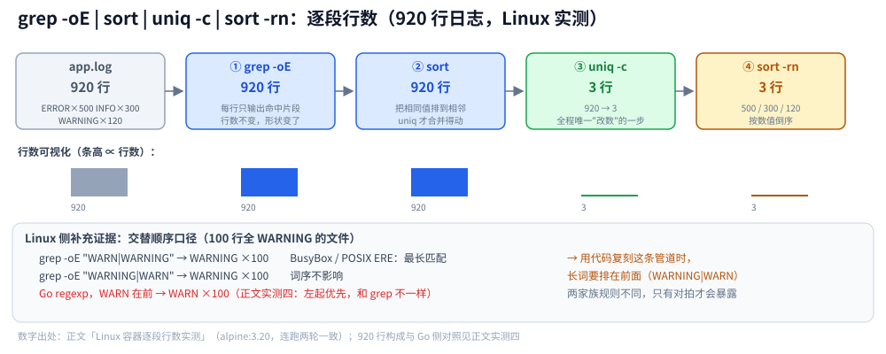
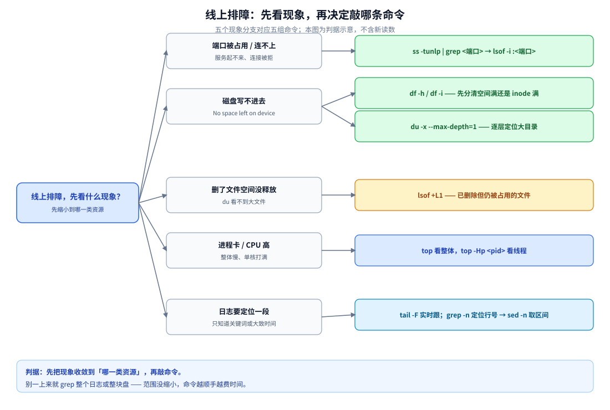

# Linux 常用命令

> 按「文件与目录 → 文本处理与统计 → 查找与定位 → 进程与端口 → 日志与实时跟踪 → 权限与用户 → 磁盘与系统信息 → 网络 → 打包压缩与传输」九类收录日常命令，末尾给高频组合场景。
>
> 内容整理自个人学习笔记，素材见 [素材清单](../../素材清单.md)。本文件只收录**命令与参数**：背后的**原理**见 [文件系统与IO.md](文件系统与IO.md)、[内存管理.md](内存管理.md)、[进程与线程.md](进程与线程.md)；**排查场景与指标判读**见 [性能排查.md](性能排查.md)；**同一批操作在语言里怎么写**见 [子进程与外部命令.md](../../01-编程语言/go/工程实践/子进程与外部命令.md)（Go）与 [子进程与外部命令.md](../../01-编程语言/java/工程实践/子进程与外部命令.md)（Java）。

---

## 一、文件与目录

```bash
ls -alh                     # -a 含隐藏、-l 详情、-h 人类可读
ls -lt | head               # 按修改时间倒序（找最近改动的文件）
cd / pwd                    # 切换 / 显示当前目录
mkdir -p a/b/c              # ⭐ 递归创建，幂等（已存在不报错）
cp -r src/ dst/             # -r 递归；⚠️ cp -a 才是保留权限与时间的完整复制
mv old new                  # 移动 / 重命名
rm -rf dir/                 # ⚠️ 不可恢复；-i 交互确认、-f 强制
touch f.txt                 # 建空文件 / 更新 mtime
ln target link              # 硬链接
ln -s target link           # ⭐ 软链接（符号链接），可跨文件系统
stat file                   # inode、Links、三个时间戳、块大小
du -sh dir/                 # 目录总占用（-s 汇总、-h 可读）
du -sh * | sort -rh | head -20     # ⭐ 逐层找大目录
df -h                       # 文件系统空间
df -i                       # ⭐ inode 使用率（空间没满却写不进去的真凶）
```

| 命令 | 关键点 |
|---|---|
| `mkdir -p a/b/c` | ⭐ **幂等**：中间缺失层自动补、已存在不报错，脚本里可放心重复执行 |
| `ln` vs `ln -s` | 硬链接共享 inode、不能跨文件系统、不能指向目录；软链接是独立文件，本身占一个 inode |
| `du -sh` vs `df -h` | `du` 从目录递归统计、能跨多个文件系统；`df` 看挂载点容量。⚠️ 有进程持有已删文件时 `df` 满而 `du` 看不到 |
| `df -i` | ⭐ 海量小文件把 **inode** 耗尽时，`df -h` 还有空间却报 `No space left on device` |

## 二、文本处理与统计

```bash
cat f.txt                   # 全文输出（小文件）
less f.txt                  # ⭐ 分页查看大文件（/ 搜索、G 到末尾）
head -n 20 f.txt            # 前 20 行
tail -n 20 f.txt            # 后 20 行
tail -f app.log             # ⭐ 实时跟踪（日志用 -F，文件轮转后能跟上）
grep -n "ERROR" f.txt       # -n 显示行号
grep -i "error" f.txt       # -i 忽略大小写
grep -rn "关键词" src/       # -r 递归、-n 行号（找代码里的引用）
grep -v "DEBUG" f.txt       # -v 反向匹配（排除）
grep -oE "ERROR|WARN" f.txt # ⭐ -o 只输出匹配片段、-E 扩展正则
grep -c "ERROR" f.txt       # 统计匹配行数
sort f.txt                  # 字典序
sort -rn                    # ⭐ 按数值倒序（-n 数值、-r 逆序）
uniq -c                     # ⭐ 去重并计数（⚠️ 只合并**相邻**重复行，前置 sort）
cut -d':' -f1 /etc/passwd   # 按分隔符取列
awk '{print $1}' f.txt      # 按空白取列（$0 整行、NF 列数、NR 行号）
sed -n '10,20p' f.txt       # 打印第 10~20 行
sed -i 's/old/new/g' f.txt  # ⚠️ 原地修改（先备份或先 dry-run）
wc -l f.txt                 # 行数（-c 字节数、-w 词数）
tr 'a-z' 'A-Z' < f.txt      # 字符替换 / 删除（-d）
xargs -n1 cmd               # 把标准输入拼成命令行参数
```

| 命令 | 关键点 |
|---|---|
| `grep -o` | 只输出**匹配到的内容**（每行一个）；不加它会把整行算进去，无法计数 |
| `sort` → `uniq -c` | ⭐ `uniq` 只能合并**相邻**重复行，**去掉前置 `sort` 这条管道就错了** |
| `sort -rn` | 按数值倒序，让出现最多的排最前 |
| `tail -F` | 比 `-f` 多一层「文件被轮转 / 重建后重新打开」，日志场景用 `-F` |

**这条管道的逐段行为**（Linux 容器实测，Docker `alpine:3.20`，BusyBox v1.36.1 的 grep/sort/uniq；复刻 920 行日志：ERROR 500 / INFO 300 / WARNING 120，每行恰好一个关键词；同脚本连跑两轮结果逐项一致）：

```bash
grep -oE "ERROR|INFO|WARNING" app.log | sort | uniq -c | sort -rn
```

```text
原始 app.log                                 920 行
① grep -oE "ERROR|INFO|WARNING"     →  920 行（每行只命中 1 个：行数不变，形状变了）
② sort                              →  920 行（行数不变：把相同值排到相邻）
③ uniq -c                           →    3 行（920 压成 3：全程只有这一步"改数"）
④ sort -rn                          →  500 ERROR / 300 INFO / 120 WARNING
```

一眼能看出两件事：**行数只在第 ③ 步变**，前三步都是「改形不改数」；而 ③ 能压成 3 行，全靠 ② 把重复排到相邻（`uniq` 只合并相邻重复行）——**去掉 ② 这条管道就错了**。另附一项 Linux 侧证据：100 行全 `WARNING` 的文件，BusyBox `grep -oE "WARN|WARNING"` 与 `"WARNING|WARN"` 两种词序**都命中 `WARNING`×100**（POSIX ERE 取最长匹配，与 Go / Java 的「左起优先」不同）。



图注：四个阶段里只有 `uniq -c` 改变行数，前三步都在「改形不改数」；底部一行是「`WARN|WARNING` 谁在前」在两套正则规则下的差异，Linux 侧结果一致、Go/Java 侧会不同。

## 三、查找与定位

```bash
find . -name "*.log"                    # 按名字找（大小写不敏感用 -iname）
find . -type f -size +100M              # 大于 100MB 的普通文件
find . -mtime +7 -name "*.log"          # 7 天前修改过的
find . -type f -name "*.tmp" -delete    # ⚠️ 先去掉 -delete 确认清单，再执行
find . -name "*.go" -exec grep -l "TODO" {} +   # 找到后批量处理（+ 比 \; 高效）
locate nginx.conf                       # 走预建索引，快但不实时（updatedb 更新）
which python3                           # 命令落在哪个可执行文件
whereis python3                         # 二进制 + 手册 + 源码位置
type ll                                 # 是别名、内置还是外部命令
```

| 命令 | 关键点 |
|---|---|
| `find -exec … {} +` | ⭐ 一次把多个文件拼给命令，比 `\;` 每个文件起一次进程高效 |
| `find -delete` | ⚠️ 破坏性，先跑不带 `-delete` 的版本看清单 |
| `find` 的排除 | `-not -path "*/node_modules/*"` 比事后 grep 更省事 |
| `locate` | 查的是数据库快照，刚建的文件可能查不到；`which` 查的是 `PATH` 里的可执行文件 |

## 四、进程与端口

```bash
ps aux                       # 全量进程（BSD 风格，CPU/MEM 占比直观）
ps -ef                       # 全量进程（System V 风格，PPID 直观）
ps -eLf                      # ⭐ 展开到线程（NLWP 是线程数）
pstree -p <pid>              # 进程 / 线程树
top / top -Hp <pid>          # 整体 / ⭐ 线程级 CPU
kill -l                      # 列出所有信号
kill -TERM <pid>             # 15：可被捕获，给应用优雅退出的机会
kill -KILL <pid>             # 9：内核直接回收，应用没有清理机会
kill -HUP <pid>              # 1：常被守护进程用作「重载配置」
pkill -f "python app.py"     # 按命令行匹配杀进程（⚠️ 先 pgrep -af 确认）
ss -tunlp | grep 3306        # ⭐ 看端口占用（-t TCP、-u UDP、-n 数字、-l LISTEN、-p 进程）
lsof -i :3306                # 哪个进程占着这个端口
lsof -p <pid>                # 某进程打开的所有 fd
lsof +L1                     # ⭐ 已删除但仍被占用的文件（deleted 标记）
nohup cmd > out.log 2>&1 &   # 后台运行且不随终端退出
jobs / fg / bg               # 作业控制
```

| 命令 | 关键点 |
|---|---|
| `netstat -tunlp` / `ss -tunlp` | ⭐ `ss` 是 netstat 的现代替代，更快；`-p` 看别人的进程需要 `sudo` |
| Docker 映射的端口 | ⚠️ 宿主看到的是 `docker-proxy`，真实进程要**进容器再看** |
| `lsof +L1` | ⭐ 日志切割 `rm app.log` 后进程仍往旧 fd 写，磁盘涨满但 `du` 看不到文件 |
| `kill -9` vs `-15` | 先 `-15` 给它 flush 的机会，`-9` 只在前者无效时用 |

## 五、日志与实时跟踪

```bash
tail -F app.log                          # ⭐ 实时跟踪，文件轮转后能跟上
tail -n 1000 app.log | grep ERROR        # 先取尾再过滤
grep -n "起止关键词" app.log              # 定位行号
sed -n '1200,1350p' app.log              # ⭐ 按行号取一段（配合上一条）
awk '/开始时间/,/结束时间/' app.log        # 按关键词区间取
grep -c "ERROR" app.log                  # 统计数量
journalctl -u myapp -f                   # ⭐ systemd 服务日志实时跟踪
journalctl -u myapp --since "1 hour ago" # 按时间范围
journalctl -k | grep -i oom              # 内核日志里找 OOM
dmesg -T | tail -50                      # 内核环形缓冲（-T 人类可读时间）
```

| 命令 | 关键点 |
|---|---|
| `tail -F` vs `-f` | ⭐ `-F` 在文件被轮转 / 重建后重新打开，日志场景优先 |
| `journalctl -u` | systemd 服务日志的入口；`-p err` 只看错误级别、`-b` 只看本次启动 |
| 超大文件 | ⚠️ 别直接 `tail -n 100000`，会拖住终端；先 `grep -n` 定位行号再 `sed -n` |
| 时间范围 | 时间格式规整时可直接用 `awk` 做字符串比较，比逐行 parse 更快 |

## 六、权限与用户

```bash
chmod 755 f / chmod u+x f        # 数字 / 符号两种写法
chown user:group f               # 改属主（-R 递归）
chgrp group f                    # 只改属组
umask                            # 查看 / 设置默认权限掩码
id / whoami                      # 当前用户与属组
who / w / last                   # 在线用户 / 最近登录
su - user                        # 切换用户（- 走登录 shell）
sudo cmd                         # 以 root 执行（sudo -i 进交互式 root shell）
passwd user                      # 改密码
useradd / usermod / userdel      # 用户管理（-aG 追加属组，⚠️ 别漏 -a 否则覆盖属组）
groups user                      # 用户属于哪些组
```

| 命令 | 关键点 |
|---|---|
| `chmod` 数字 | 4=r、2=w、1=x；`755`=(rwxr-xr-x)、`644`=(rw-r--r--)、`600`=(rw-------) |
| `chmod u+x` | 符号法按「谁(u/g/o/a) + 动作(+/-/=) + 权限」表达，比记数字直观 |
| `umask` | ⭐ **默认权限 = 目标权限 & ~umask**；022 让新文件是 644、目录是 755 |
| `usermod -aG` | ⚠️ 漏掉 `-a` 会**覆盖**原有附加组，是加组时最常见的误操作 |

## 七、磁盘与系统信息

```bash
df -h / df -i                    # 空间 / inode
lsblk / blkid                    # 块设备树 / 文件系统与 UUID
mount / findmnt                  # 挂载点与挂载选项
du -x --max-depth=1 /var         # ⭐ -x 不跨文件系统，逐层定位大目录
free -h                          # ⭐ 内存总览，看 available 不看 free
vmstat 1                         # r/b、si/so、bi/bo、in/cs、us/sy/id/wa/st
uptime                           # 平均负载（1/5/15 分钟）
uname -a                         # 内核版本与架构
lscpu / nproc                    # CPU 信息 / 逻辑核数
cat /etc/os-release              # 发行版信息
lsb_release -a                   # 发行版（不是每个系统都装了）
date / timedatectl               # 系统时间与时区
dmesg -T                         # 内核日志
```

| 命令 | 关键点 |
|---|---|
| `free -h` | ⭐ 看 `available` 而不是 `free`；`buff/cache` 可回收，判读见 [内存管理.md](内存管理.md) 2.2 |
| `du -x` | ⭐ 不跨文件系统，避免把挂载进来的另一块盘算进去 |
| `uptime` | 平均负载 ≠ CPU 使用率，它统计的是**可运行 + 不可中断睡眠**的进程数（见 [性能排查.md](性能排查.md) 2.1） |
| `vmstat` | 六类计数的总览；`si/so` 长期非 0 说明在换页 |

## 八、网络

```bash
ip addr / ip a                   # ⭐ 网卡与 IP（iproute2，替代 ifconfig）
ip route / ip r                  # 路由表
ping -c 4 host                   # 连通性与 RTT
curl -I https://example.com      # ⭐ 只看响应头
curl -o out.bin URL              # 下载到文件（-O 用远端文件名）
curl -x http://proxy:8080 URL    # 走代理（--noproxy '*' 强制绕过）
wget -c URL                      # 断点续传下载
ss -s                            # ⭐ 连接数总览
ss -ant | awk '{print $1}' | sort | uniq -c | sort -rn    # 连接状态分布
ss -ant state close-wait | head  # 直接筛 CLOSE_WAIT
netstat -s                       # 协议级统计（重传 / 丢包）
sar -n DEV 1 / sar -n TCP,ETCP 1 # 网卡流量 / TCP 重传
traceroute host                  # 逐跳路由
dig / nslookup example.com       # DNS 解析
tcpdump -i eth0 -nn host 10.0.0.1 and port 8080 -c 100    # ⭐ 先限定 host/port
```

| 命令 | 关键点 |
|---|---|
| `ip` 取代 `ifconfig` | 老发行版仍可用 `ifconfig`，新系统优先 `ip`（iproute2） |
| `curl -I` vs `-i` | `-I` 只发 HEAD 看响应头；`-i` 发 GET 并把响应头一起打印 |
| 代理 | ⭐ 本机有代理时，判真实连通性要加 `--noproxy '*'`，否则连的是本地代理 |
| `tcpdump` | ⚠️ 必须限定 `host` / `port` / `-c` 包数，否则会把机器抓垮（见 [抓包实战.md](../网络/观测与排障/抓包实战.md)） |

## 九、打包、压缩与传输

```bash
tar -czvf a.tar.gz dir/          # 打包 + gzip（c 建包、z gzip、v 显示、f 文件名）
tar -xzvf a.tar.gz -C /tmp/      # 解包到指定目录（-C）
tar -tzvf a.tar.gz               # ⭐ 只看内容不解包
tar -xzvf a.tar.gz path/in/arc   # 只解出其中一个文件
gzip f / gunzip f.gz             # 单文件压缩 / 解压
zip -r a.zip dir/ / unzip a.zip  # zip 格式（跨平台友好）
scp file user@host:/path/        # 远程拷贝
rsync -avz --delete src/ host:/dst/   # ⭐ 增量同步（--delete 让目标与源一致，⚠️ 会删目标多余文件）
scp -P 2222 file host:/path      # ⚠️ scp 的端口是 -P，ssh 是 -p
```

| 命令 | 关键点 |
|---|---|
| `tar` 参数序 | 传统写法 `-czvf` 里 `f` 必须在最后（紧跟文件名）；不带 `-` 的老写法 `czvf` 也可 |
| `tar -C` | ⭐ 解到指定目录，避免污染当前目录 |
| `rsync --delete` | ⚠️ 会让目标和源**完全一致**（删掉目标里多余的文件），同步前先 `--dry-run` |
| `scp` vs `rsync` | 一次性小文件用 `scp`；大目录、增量、断点用 `rsync` |

## 十、高频组合场景

| 场景 | 命令 |
|---|---|
| 查端口被谁占用 | `ss -tunlp \| grep <端口>` → `lsof -i :<端口>` |
| 找占空间最大的目录 | `du -x --max-depth=1 / \| sort -rh \| head -20` |
| 磁盘没满却写不进去 | `df -i` → `du -sh *` 找海量小文件 |
| 空间没释放 | `lsof +L1`（已删但仍被占用的文件） |
| 统计日志关键词 | `grep -oE "ERROR\|WARN" app.log \| sort \| uniq -c \| sort -rn`（见第二节） |
| 实时盯日志 | `tail -F app.log` |
| 看某进程开了哪些文件 | `lsof -p <pid>` |
| 抓包定位 | `tcpdump -i eth0 -nn host <ip> and port <port> -c 100` |
| 找最近改动的文件 | `find . -type f -mtime -1 -printf '%T+ %p\n' \| sort -r` |
| 按行号取日志片段 | `grep -n "<起点>" app.log` → `sed -n 'a,bp' app.log` |

### 10.1 从现象到命令：先收敛到哪一类资源

上表按场景列命令，实际排障时**先判断现象属于哪一类资源**更省时间：端口 / 连接 → `ss -tunlp`；磁盘写不进 → `df -h` 与 `df -i` 先分清空间还是 inode；删了文件空间没释放 → `lsof +L1`；进程卡 → `top` 再看线程；日志定位 → `tail -F` / `grep -n` / `sed -n`。

⭐ 两条最容易走错的：**磁盘写不进不等于空间满**（`df -i` 才看 inode）；**`du` 看不到不代表没占**（文件被删但 fd 未关，只能 `lsof +L1`）。



图怎么读：左列是根节点（先看现象），中列是五类现象，右列是每组现象对应的命令链；底部一行是判据 —— **先把范围收敛到一类资源，再敲命令**。

## 延伸追问

- **端口被占用怎么定位？** → `ss -lntp` 拿 PID → `ps -ef` 确认进程；⚠️ Docker 映射出来的端口，宿主看到的是 `docker-proxy`，真实进程要**再进容器看**（见第四节）。
- **`grep` 和 `rg` 差在哪？** → `rg` 默认读 `.gitignore`、自动并行、跳过二进制文件，大仓库快一个量级；但**线上往往没有 rg**，排障还是得靠 grep。
- **怎么只看日志里某段时间？** → 先 `grep -n` 定位起止行号，再 `sed -n 'a,bp'`；时间格式规整时可以直接用 `awk` 比字符串。⚠️ 超大文件别直接 `tail -n 100000`，会拖住终端（见第五节）。
- **`kill -9` 和 `kill -15` 怎么选？** → 15（SIGTERM）可被捕获、给应用优雅退出的机会；9（SIGKILL）内核直接回收、应用**没有机会**清理，只在 15 无效时用（见第四节）。
- **命令退出码怎么判？** → 0 成功；126 不可执行、127 找不到命令、**128+n = 被信号 n 终止**（137 = SIGKILL、143 = SIGTERM）；脚本里配合 `set -e` 与 `$?`。
- **为什么管道里别写 `cat file | grep x`？** → 多一个进程与一次上下文切换；`grep x file` 直接传文件更省，日志量大时差距明显。同类的还有 `ls | grep`，能用 `find` 就别拼管道。
- **GNU 与 BusyBox 的差异在哪最容易踩？** → 正则引擎（GNU/POSIX ERE 取最长匹配、Go/Java 左起优先，见第二节）、`sort` 稳定性、`ps` 参数族；容器里多是 BusyBox，脚本别依赖 GNU 专有参数。
- **`ss` 和 `netstat` 该用哪个？** → 新系统优先 `ss`（更快、信息更全）；`netstat` 在精简镜像里常被裁掉，脚本兼容性反而 `ss` 好。

## 关联

- **上游/总纲**：[性能排查.md](性能排查.md) — 这些命令在排查套路里的位置
- **上游/总纲**：[文件系统与IO.md](文件系统与IO.md) — 磁盘、inode 与空间未释放的原理
- **上游/总纲**：[进程与线程.md](进程与线程.md) — `ps` / `top` / `kill` 背后的进程模型
- **对照/互补**：[子进程与外部命令.md](../../01-编程语言/go/工程实践/子进程与外部命令.md) — 同样这些操作在 Go 里怎么写
- **对照/互补**：[子进程与外部命令.md](../../01-编程语言/java/工程实践/子进程与外部命令.md) — Java 侧的对应写法
- **对照/互补**：[04-Shell与脚本.md](鸟哥基础学习篇/04-Shell与脚本.md) — 这些命令在 Shell 与脚本里的组合用法
- **运维/配置**：[07-日志与journalctl.md](鸟哥基础学习篇/07-日志与journalctl.md) — journalctl 的过滤与持久化
> 反向引用（本篇被下列文档引到）：[03-用户与权限.md](鸟哥基础学习篇/03-用户与权限.md)、[06-网络配置与nmcli.md](鸟哥基础学习篇/06-网络配置与nmcli.md)、[05-SSH远程连接.md](鸟哥服务器架设篇/05-SSH远程连接.md)、[TCP四次挥手.md](../网络/传输层/tcp/TCP四次挥手.md)、[Git命令与使用场景.md](../../06-工程实践/版本控制/Git命令与使用场景.md)
