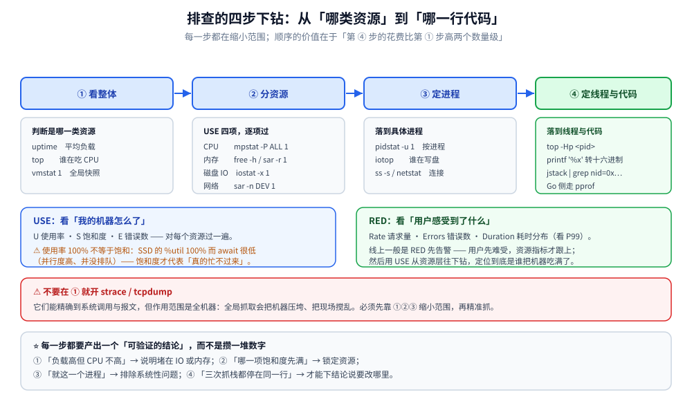
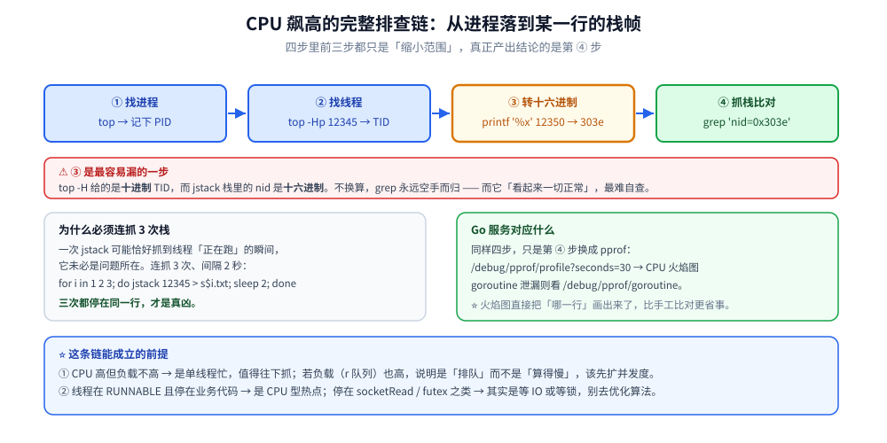

# Linux 性能排查

> 覆盖：USE / RED 方法论与四步下钻顺序、平均负载与三条定方向命令的判读、CPU / 内存 / 磁盘 / 网络四类资源每一列在说什么、以及压测数字的可信度判据。
> 不覆盖：Go 服务侧的 pprof 排查见 [pprof性能分析.md](../../01-编程语言/go/运行时/pprof性能分析.md)、GODEBUG 与 trace 见 [runtime调试与trace.md](../../01-编程语言/go/运行时/runtime调试与trace.md)；Java 侧的 `jstack` / Arthas 见 [线上问题排查.md](../../01-编程语言/java/运行时/线上问题排查.md)；日常命令速查见 [常用命令.md](常用命令.md)；Page Cache 与 OOM 的内核机制见 [内存管理.md](内存管理.md)；inode 与空间未释放的成因见 [文件系统与IO.md](文件系统与IO.md)。
>
> 内容整理自个人学习笔记，素材见 [素材清单](../../素材清单.md)。第七节的压测读数引自自研网关项目的 `docs/性能压测报告.md`。

---

## 一、线上性能问题的排查方法论是什么？

**本节要点**：性能排查最大的坑是「凭感觉调」——先改配置、再重启，问题消失了但不知道为什么。正确顺序是**先量化指标 → 再分层定位 → 最后才是改动**。

### 1.1 USE 方法：适用于资源类（CPU / 内存 / 磁盘 / 网卡）

对每个资源依次问三个问题（Brendan Gregg 提出）：

| 维度 | 含义 | 典型指标 |
|---|---|---|
| **U**tilization 使用率 | 资源有多忙（时间占比） | CPU 使用率、磁盘 `%util`、网卡带宽占用 |
| **S**aturation 饱和度 | 排队有多长（超额申请的量） | 运行队列长度、平均负载、`await`、swap 使用量 |
| **E**rrors 错误数 | 出错事件 | 网络重传、TCP 丢包、IO 错误、`dmesg` 里的 OOM |

⚠️ **使用率 100% 不等于饱和**，饱和度才代表「真的忙不过来，请求在排队」。典型例子：SSD 的 `%util` 100% 但 `await` 很低，只是并行度高、并没有排队（见五）。

### 1.2 RED 方法：适用于服务类（接口 / 微服务）

| 维度 | 含义 |
|---|---|
| **R**ate 请求量 | 每秒请求数（QPS） |
| **E**rrors 错误数 | 每秒失败数（区分 4xx/5xx/超时） |
| **D**uration 耗时 | 每个请求的耗时分布（**看 P99，不要只看平均值**） |

> USE 看「我的机器怎么了」，RED 看「我的用户感受到了什么」。线上一般是 RED 指标先告警，再用 USE 往下钻到资源层。

### 1.3 分层排查顺序

| 步骤 | 做什么 | 用什么 |
|---|---|---|
| ① 看整体 | 判断是哪一类资源出问题 | `uptime` / `top` / `vmstat` |
| ② 分资源 | CPU、内存、磁盘 IO、网络四选一（用 USE 逐项过） | `mpstat` / `free` / `iostat` / `sar -n` |
| ③ 定进程 | 找出是哪个进程 | `pidstat` / `iotop` / `ss` |
| ④ 定线程与代码 | 定位到具体线程和代码行 | `top -Hp` + `jstack`、`pprof` |

⚠️ **不要在第①步就开 `strace` / `tcpdump`**——它们是精确定位工具，全局抓取会把机器压垮，必须先缩小范围再抓。



图注：右侧 USE 面向资源（CPU/内存/磁盘/网卡逐项过 U/S/E），左侧 RED 面向服务（Rate/Errors/Duration）；两者不是二选一，而是「RED 先告警、USE 往下钻到资源」的接力关系。

## 二、怎么用三条命令先定方向？

**本节要点**：`uptime` 给平均负载、`top` 给整体与进程、`vmstat` 给六类系统计数——三条命令先把「是哪一类资源」定下来，再决定往下钻哪个工具。

```bash
uptime          # 平均负载
top             # 整体资源 + 进程占用（htop 更好看）
vmstat 1        # 每秒采样：进程、内存、swap、IO、系统、CPU
```

### 2.1 `uptime` 与平均负载

```bash
$ uptime
 14:32:10 up 30 days,  4:12,  3 users,  load average: 4.20, 3.85, 2.10
```

> **平均负载 = 单位时间内，处于「可运行状态（R）」+「不可中断睡眠状态（D）」的进程平均数**（三个值分别是 1 / 5 / 15 分钟）

⚠️ 两个易错点：① 平均负载**不是** CPU 使用率，它统计的是进程数，**包含等 IO（D 状态）和等锁的进程**；② 判断标准要看 **CPU 核数**：`nproc` 为 4 时，负载 4 表示刚好跑满，负载 8 表示有一半在排队。

### 2.2 负载高但 CPU 使用率低 = 什么情况

| 现象 | 说明 |
|---|---|
| **负载高 + `wa` 高** | 大量进程阻塞在 **磁盘 IO**（D 状态） |
| **负载高 + `sy` 高 / 上下文切换多** | 线程数过多或**锁竞争激烈**，进程在疯狂被调度却干不了活 |
| **负载高 + CPU 空闲 + `st` 高** | **虚拟机被宿主机抢走了 CPU**（`st` = steal time） |

排查口诀：**负载高先看 `wa`，`wa` 高走 IO 排查；`wa` 低而 `sy` 高，走上下文切换排查。**

### 2.3 `vmstat 1` 各列速读

```bash
$ vmstat 1
procs -----------memory---------- ---swap-- -----io---- -system-- ------cpu-----
 r  b   swpd   free   buff  cache   si   so    bi    bo   in   cs us sy id wa st
 4  2      0 204800 102400 1536000    0    0   200  1500 3200 8500 30 15 40 15  0
```

| 列 | 含义 | 关注点 |
|---|---|---|
| `r` | **运行队列长度**（正在跑 + 等 CPU） | 持续 > CPU 核数 = CPU 饱和 |
| `b` | **不可中断睡眠**（等 IO）的进程数 | `b` 高 = IO 有瓶颈 |
| `si/so` | swap 换入 / 换出（KB/s） | 非 0 = 内存不足开始换页，性能会雪崩 |
| `bi/bo` | 块设备读 / 写（块/s） | 配合 `iostat` 看 |
| `in` | 每秒中断数 | 突增可能是网卡 / 硬件问题 |
| `cs` | **每秒上下文切换次数** | 见三「上下文切换」 |
| `us/sy/id/wa/st` | CPU 时间占比 | 见三 |

## 三、CPU 飙高怎么排查？

**本节要点**：先分清 `us` 高还是 `sy` 高（用户态 vs 内核态），再用 `mpstat -P ALL` 看是不是**单核打满**，最后才落到「定线程 → 抓栈」。

### 3.1 CPU 各列含义（`top` 第三行 / `mpstat`）

| 列 | 含义 |
|---|---|
| `us` | **用户态**（应用程序）占用 |
| `sy` | **内核态**（系统调用、上下文切换、中断处理）占用 |
| `ni` | 被 `nice` 调整过优先级的进程占用 |
| `id` | **空闲** |
| `wa` | ⚠️ **iowait**——CPU 空闲但**有进程在等 IO** 的时间占比 |
| `hi` / `si` | 硬中断 / 软中断（网卡收发包、`ksoftirqd` 走 `si`） |
| `st` | ⚠️ **steal**——虚拟机想用 CPU 但**被宿主机（其他租户）占用**的时间 |

⚠️ **`wa` 高的真相**：CPU 其实很闲，只是进程在等 IO，**瓶颈在磁盘 / 网络，不在 CPU**，升级 CPU 毫无用处。
⚠️ **`st` 高的处理**：这是**宿主机超卖**（其他租户抢 CPU），本机改不了，只能迁移 / 扩容。

### 3.2 上下文切换

| 类型 | 含义 | 说明什么问题 |
|---|---|---|
| **自愿切换**（`cswch/s`） | 进程**主动让出** CPU（等 IO、等锁、`sleep`） | 多 = 大量 IO 或**锁竞争** |
| **非自愿切换**（`nvcswch/s`） | 时间片用完**被强制抢占** | 多 = **CPU 是真的不够用**（线程数 > 核数） |

> 经验值：`cs` 超过**几万 / 秒**就要警惕；切换本身要保存 / 恢复寄存器、冲刷 TLB 和 cache，是纯损耗。分不清是哪一类时看 [进程与线程.md](进程与线程.md) 1.5 的切换机制。

### 3.3 单核打满怎么一眼看出来

⚠️ 单核打满常见于：**单线程死循环、GC 单线程、绑核不合理**；`mpstat -P ALL 1` 一列一列看过去就能分辨「整体高」还是「某一核满而其余闲」。判据与命令见第九节。

## 四、内存问题怎么排查？

**本节要点**：先把 `free` 的字段读对（**看 `available` 不看 `free`**），再分清是「缓存占用」还是「真的紧张」；OOM Killer 杀的不一定是罪魁，而是 `oom_score` 最大的那个。

### 4.1 `free` 输出解读

```bash
$ free -h
              total        used        free      shared  buff/cache   available
Mem:           7.7G        3.1G        512M        200M        4.1G        4.0G
Swap:          2.0G        300M        1.7G
```

| 字段 | 含义 |
|---|---|
| `free` | ⚠️ **完全没被使用的内存**，通常很小，看着像「内存不够」其实是假象 |
| `buff/cache` | **buffer（块设备缓存）+ cache（文件页缓存）**，内存紧张时可被回收 |
| `available` | ⭐ **真正可用的内存** = `free` + 可回收的 `buff/cache`，**看这个判断内存是否够** |

> **buffer 与 cache 的区别**：`buffer` 是**块设备的读写缓冲**（写磁盘前的暂存，偏元数据 / 裸块）；`cache` 是**文件系统的页缓存**（读文件后缓存的内容，加速下次读）。⚠️ 现代 Linux 两者已统一到 Page Cache，机制见 [内存管理.md](内存管理.md) 2.1。

### 4.2 OOM Killer

> 内存耗尽时，内核按 **`oom_score`**（主要看进程占用内存比例 + `/proc/<pid>/oom_score_adj`）挑一个进程**直接 kill -9**，没有商量的余地。

日志里能看到 `Killed process 12345 (java) total-vm:... anon-rss:...`，⚠️ **被 kill 的往往不是「罪魁」而是「个头最大的那个」**，MySQL / Java 经常背锅。容器场景判「是不是踩了自己的 limit」要读 cgroup 文件，见 [内存管理.md](内存管理.md) 4.2。

### 4.3 内存泄漏怎么判断

| 现象 | 结论 |
|---|---|
| RSS **持续单调增长**，且 Full GC / 手动回收后不回落 | 泄漏嫌疑 |
| RSS 涨到某个平台后稳定 | 只是缓存预热，**不是泄漏** |
| `si/so` 长期非 0、swap 使用率上升 | **内存不足**，性能会断崖式下降 |

⚠️ **swap 使用率高意味着什么**：进程的热点数据被换出到磁盘，一次访问从**纳秒级变成毫秒级**，表现为「机器没死但慢得要命」。此时应查内存占用大头，**不要简单调大 swap 掩盖问题**。

## 五、磁盘与 I/O 瓶颈怎么排查？

**本节要点**：`%util` 高**不等于**磁盘饱和（SSD / RAID 能并行处理请求）；判「真的在排队」要看 **`await` 与队列长度 `aqu-sz`**。另外两类「空间有却写不进去」几乎总是 **inode 耗尽**或**文件已删但仍被进程持有**。

### 5.1 `iostat` 关键列

| 列 | 含义 |
|---|---|
| `r/s` + `w/s` | 每秒读写请求数（**IOPS**） |
| `rkB/s` + `wkB/s` | 每秒读写吞吐量 |
| `r_await` / `w_await` | ⭐ 读 / 写请求的**平均等待时间（ms）**，含排队 + 服务时间 |
| `await` | 总的平均等待时间 |
| `svctm` | 设备**服务时间**（⚠️ 新版本 sysstat 已废弃，不可信） |
| `%util` | 设备**有 IO 请求在处理的**时间占比 |

⚠️ **坑：`%util` 高 ≠ 磁盘饱和**。`%util` 只统计「设备是否忙碌」的时间，**SSD 和 RAID 能并行处理多个请求**，因此 `%util` 轻松到 100% 但 `await` 只有 2ms——**并没有排队**。

⭐ **判断磁盘是否真的饱和，看 `await` 和队列长度（`aqu-sz`）**：机械盘 `await > 20ms`、SSD `await > 几 ms` 且 `aqu-sz` 持续大于 1，才算排队了。

### 5.2 磁盘满 / inode 满 / 空间未释放

⚠️ **典型坑：文件已删但空间没释放**——进程还持有已删除文件的 fd，磁盘块不会被释放（日志切割 `rm app.log` 后进程仍往旧 fd 写，磁盘一路涨满但 `du` 看不到文件）。三类「空间有却写不进去」的成因见 [文件系统与IO.md](文件系统与IO.md) 4.2，命令见第九节。

## 六、网络问题怎么排查？

**本节要点**：先看**重传率**（> 1% 就要查），再看**连接状态分布**——`CLOSE_WAIT` 堆积是**应用没关连接**（调内核参数没用），`TIME_WAIT` 多是主动关闭方的正常状态。

### 6.1 流量与重传

| 指标 | 健康参考 |
|---|---|
| 重传率（`retrans/s` ÷ `seg/s`） | ⭐ **> 1% 就要查**（丢包、链路拥塞、对端处理慢） |
| 连接数 | 突增可能是**攻击、重试风暴、下游不可用导致堆积** |
| 带宽 / 包量 | 接近网卡上限 = 瓶颈 |

### 6.2 连接状态分布

| 状态堆积 | 原因 |
|---|---|
| ⚠️ **CLOSE_WAIT** | **被动关闭方没调 `close()`** → 应用有 bug（HTTP 连接池未释放、`defer resp.Body.Close()` 漏写）。**这是应用问题，调内核参数没用** |
| **TIME_WAIT** | 主动关闭方的正常状态（2MSL）。量大时可开 `tcp_tw_reuse`、用长连接 / 连接池，**一般不需处理** |
| **SYN_RECV** | SYN 洪泛或半连接队列被打满 |

## 七、压测数字不可信怎么办？

**本节要点**：上面几节讲的是「怎么测出真相」。这一节讲**反过来**的事——**压测工具本身也会成为被测对象**。数字自相矛盾时，先怀疑测量方法，再怀疑被压的系统。

### 7.1 一个真实案例：每请求新建连接 → 端口打满

给自研网关做压测时，脚本最初**每个请求新建一条 TCP 连接**（虽然带了 `Connection: keep-alive` 头，但连接用完就 `close()`——头部与实际行为不符）。连打几万次之后，Windows 的临时端口（默认约 1.6 万个）连同 `TIME_WAIT` 一起被打满，于是出现**自相矛盾**的数字：

```text
（修复前，同一配置、同一路径 /limited、c=20）三次: 297 / 486 / 432 RPS
（修复前，并发扫描 /slow?ms=5）c=40 → 15 RPS，而 c=80 → 589 RPS   ← 明显不是网关的行为
```

**修复**：每个 worker 持有一条长连接并复用，只在连接真的坏了时重连。修复后同一组合的数字立刻进入同一量级且稳定。

> 📎 数据引自自研网关项目的 `docs/性能压测报告.md` §2.1。这条记录的价值不在数字，而在它天然说明了一件事：**测量方法出错时，测出来的「系统行为」可以完全是假的**。

### 7.2 两条判据（先怀疑测量方法）

| 现象 | 结论 |
|---|---|
| **非单调**：并发越高越慢、再加并发又变快 | 测量方法有问题（典型是端口耗尽 / 客户端成为瓶颈） |
| 同一配置连跑三次**差一倍以上** | 测量方法有问题（连接未复用、无 warmup、外部负载干扰） |

⭐ 反过来也成立：**真实拐点通常是单调的**——吞吐先升后平、延迟随负载单调上升。出现「V 形」或「倒 V 形」，几乎总是测量侧的问题。

### 7.3 什么时候值得怀疑「系统真的有问题」

判据是**可解释性**：先把测量侧的疑点全部排除（连接复用、同机争抢、warmup、端口），剩下的数字如果仍然指向同一个拐点、且**多轮重跑都在同一个位置**，才轮到怀疑被测系统。

⚠️ 顺序反了会浪费大量时间：拿着一个假的拐点去改代码，改完数字「变好」了，其实只是测量噪声换了方向。

## 八、应用场景

**本节要点**：指标本身不难读，难的是「看到这个现象该往哪儿走」。下表把常见症状直接对到排查路径与本仓相篇目上。

| 现象 | 可能原因 | 先看什么 | 本仓参考 |
|---|---|---|---|
| **CPU 使用率高** | 死循环、正则回溯、频繁 GC、序列化热点 | `us` 高还是 `sy` 高 | Go 侧 [pprof性能分析.md](../../01-编程语言/go/运行时/pprof性能分析.md)、Java 侧 [线上问题排查.md](../../01-编程语言/java/运行时/线上问题排查.md) |
| **负载高但 CPU 低** | 大量进程等 IO / 等锁 / 虚拟机被抢 CPU | `vmstat` 的 `b`、`wa`、`st` | 2.2；磁盘侧 [文件系统与IO.md](文件系统与IO.md) |
| **响应慢（耗时涨）** | 下游慢、GC、锁竞争、swap、磁盘 IO 慢 | RED 的 Duration P99 | [内存管理.md](内存管理.md) 2.3（swap） |
| **OOM / 进程被杀** | 内存泄漏、堆太小、宿主机超卖 | `available`、swap、`dmesg` | [内存管理.md](内存管理.md) 4.2 |
| **磁盘写不进去（空间有）** | ⚠️ inode 耗尽、文件已删仍被占用 | `df -i` | [文件系统与IO.md](文件系统与IO.md) 4.2 |
| **磁盘 IO 慢** | 磁盘饱和、随机写多、RAID 卡电池故障 | `await`、`aqu-sz` | 5.1 |
| **连接数暴涨** | 重试风暴、爬虫 / 攻击、下游不可用堆积 | `ss -s`、重传率 | [IO多路复用.md](../网络/传输层/IO多路复用.md) |
| **CLOSE_WAIT 堆积** | ⚠️ 应用没关连接（连接池泄漏、漏 `Close()`） | `ss -ant state close-wait` | [常用命令.md](常用命令.md) |
| **网络丢包 / 超时** | 链路拥塞、网卡打满、半连接队列溢出 | 重传率、`sar -n DEV` | [抓包实战.md](../网络/观测与排障/抓包实战.md) |
| **goroutine / 线程数暴涨** | 协程泄漏、线程池无限增长、下游超时过长 | `/debug/vars`、`runtime.NumGoroutine()` | [协程泄漏与死锁.md](../../01-编程语言/go/并发编程/协程泄漏与死锁.md) |
| **容器里被杀，宿主机却很闲** | 踩了自己的 cgroup `memory.max` | `/sys/fs/cgroup/memory.events` | [资源限制与运维.md](../../06-工程实践/部署/docker/资源限制与运维.md) |

## 九、具体使用

**本节要点**：命令按「先定方向 → 四类资源 → 压测 → 语言侧入口」排；每条的关键参数在表里，具体现象与判据回到对应正文节。

### 9.1 先定方向

```bash
uptime                     # 1 / 5 / 15 分钟平均负载
top                        # 整体 + 进程（htop 更直观）
vmstat 1                   # 每秒采样：r/b、si/so、bi/bo、in/cs、us/sy/id/wa/st
nproc                      # ⭐ 核数——判断负载是否过载的基准
```

### 9.2 CPU

```bash
top -Hp <pid>              # 线程级 CPU（-H 展开线程）
mpstat -P ALL 1            # ⭐ 每颗 CPU 分别看 —— 判断是否单核打满、其他核闲置
pidstat -u 1 -p <pid>      # 进程级 CPU，可区分 %usr / %system / %guest
sar -q 1                   # 运行队列长度与负载历史（runq-sz、ldavg-1/5/15）
sar -u 1 3                 # 取样 3 次看 CPU 各列占比
vmstat 1                   # 看 cs 列
pidstat -w 1               # 每进程 cswch/s（自愿）与 nvcswch/s（非自愿）
pidstat -wt 1 -p <pid>     # 细化到线程
```

CPU 飙高的完整定位链（从进程到代码行）：

```bash
top                       # ① 找进程，记下 PID（假设 12345）
top -Hp 12345             # ② 找线程（-H 展开），记下 TID（假设 12350，十进制）
printf '%x\n' 12350       # ③ 转十六进制 → 303e（⚠️ 栈里 nid 是十六进制，最易忘）
jstack 12345 | grep -A 30 'nid=0x303e'    # ④ 抓线程栈并比对（Go 走 pprof）
```



图注：整条链的卡点在第 ③ 步——`top -Hp` 给十进制、`jstack` 的 `nid` 是十六进制，不转换就永远 grep 不到；Java 侧还建议连抓 3 次栈确认是同一行。

### 9.3 内存

```bash
free -h                    # ⭐ 只看 available，不看 free
vmstat 1                   # si/so 长期非 0 = 正在换入换出
sar -r 1                   # 系统级趋势（%memused / %commit）
pidstat -r 1 -p <pid>      # 进程级 RSS 变化
pmap -x <pid>              # ⭐ 进程内存映射明细，看是哪一段在涨（堆？mmap？共享库）
watch -n 5 'ps -o rss= -p <pid>'    # 持续观察 RSS
dmesg | grep -i 'out of memory'     # OOM 最直接的证据
journalctl -k | grep -i oom         # systemd 系统的内核日志入口
cat /proc/<pid>/oom_score           # 某进程的 OOM 打分
echo 3 > /proc/sys/vm/drop_caches   # ⚠️ 仅调试用：手动回收页缓存，生产慎用（会造成 IO 抖动）
```

### 9.4 磁盘与 I/O

```bash
iostat -x 1                # -x 扩展统计，看 await / aqu-sz / %util
iostat -x -d /dev/vda 1    # 只看某块设备
iotop -o                   # 只看真正在做 IO 的进程（需要 root / CONFIG_TASKSTATS）
pidstat -d 1               # 每进程 kB_rd/s、kB_wr/s、iodelay
lsof -p <pid>              # 这个进程到底在读写哪些文件
df -h                      # 块空间（No space left on device）
df -i                      # ⚠️ inode —— 空间没满但写不进去，八成是 inode 耗尽
du -sh * | sort -rh | head -20      # 逐层找大目录
lsof | grep deleted        # ⭐ 或 lsof +L1：已删除但仍被占用的文件
```

> ⚠️ 空间未释放的处置：重启该进程，或 `> /proc/<pid>/fd/<fdnum>` 截断（确认安全再操作）。成因见 [文件系统与IO.md](文件系统与IO.md) 4.2。

### 9.5 网络

```bash
ss -s                      # ⭐ 连接数总览（总 socket、TCP 各状态分布）
netstat -s                 # 协议级统计：重传、丢包、监听队列溢出
sar -n DEV 1               # 每个网卡的 rxkB/s、txkB/s、pps
sar -n TCP,ETCP 1          # ⭐ active/s passive/s、retrans/s（重传）、isegerr/s
iftop -i eth0              # 实时看「谁在跟谁通信、占多少带宽」
ss -ant | awk '{print $1}' | sort | uniq -c | sort -rn          # 连接状态分布
ss -ant state close-wait | head      # 直接筛 CLOSE_WAIT
tcpdump -i eth0 -nn host 10.0.0.1 and port 8080 -c 100          # ⚠️ 先限定 host/port，避免抓爆机器
tcpdump -i eth0 -nn -w /tmp/p.pcap port 3306                    # 存盘，事后分析
```

### 9.6 压测前的检查单

- [ ] **连接复用**了吗？客户端持长连接 vs 每请求新建——后者会打满临时端口并与 `TIME_WAIT` 叠加
- [ ] 压测机与**被压服务在同一台机器**吗？同机时两者抢 CPU，测到的是它们的**和**
- [ ] 压测机自己的 **CPU / 网卡**有没有先打满？否则压出来的是压测机的上限
- [ ] 有没有 **warmup**？连接池、缓存、JIT 都要预热
- [ ] 看的是 **p99 还是平均值**？平均值会掩盖长尾
- [ ] `TIME_WAIT` 有多少？本机空闲态实测 **21** 条、`ESTABLISHED` **48** 条；压测中若逼近万级，就是端口正在耗尽

### 9.7 语言侧入口

- Go 服务：`net/http/pprof` 端点、`-top` 与火焰图、`goroutine` 泄漏排查、`block` / `mutex` 采样开关，全部收在 [pprof性能分析.md](../../01-编程语言/go/运行时/pprof性能分析.md)；`GODEBUG` / `schedtrace` / `runtime/trace` 在 [runtime调试与trace.md](../../01-编程语言/go/运行时/runtime调试与trace.md)。
- Java 服务：`jps` → `top -Hp` → `printf '%x'` → `jstack` 的定位链与 Arthas，见 [线上问题排查.md](../../01-编程语言/java/运行时/线上问题排查.md)；`jstat` / `jcmd` / `jmap` 的内存与 GC 诊断见 [JVM与垃圾回收.md](../../01-编程语言/java/运行时/JVM与垃圾回收.md) 使用一节。

## 延伸追问

- **平均负载高但 CPU 使用率低，是什么原因？** → 负载统计的是 **R + D 状态进程数**，`D` 为**不可中断睡眠**（等磁盘 IO / 等锁），所以磁盘慢、NFS 卡死、锁竞争都会让负载升高而 CPU 空闲。排查：`vmstat 1` 看 `b` 与 `wa`，`b` 高走 `iostat -x`，`wa` 低而 `sy` 高走 `pidstat -w`（见 2.2）。
- **`free` 里 buffer 和 cache 有什么区别？`free` 很小却说内存够？** → buffer 是块设备缓冲、cache 是文件页缓存，**都能在内存紧张时回收**；`available = free + 可回收部分`，**要看 `available` 而不是 `free`**（见 4.1）。
- **iowait 高说明什么？** → CPU 空闲但**有进程在等 IO**，瓶颈在**磁盘 / 网络**，加 CPU 无用。需再查 `iostat -x` 的 `await` / `aqu-sz` 判断是真饱和还是并行度高（见 5.1）。
- **怎么排查 CPU 飙高的 Java 进程？** → `top` 找 PID → `top -Hp <pid>` 找 TID → **`printf '%x'` 转十六进制** → `jstack` 里 grep `nid=0x...`（连抓 3 次确认）→ 看栈顶方法。完整步骤见 [线上问题排查.md](../../01-编程语言/java/运行时/线上问题排查.md)。
- **`%util` 到 100% 是不是磁盘就饱和了？** → 不一定。`%util` 只表示「设备一直在处理请求」，**SSD/RAID 可并行**所以 100% 是常态；要看 **`await`（等待时长）和 `aqu-sz`（队列长度）** 才知是否真排队（见 5.1）。
- **磁盘空间没满但写不进去怎么办？** → ① **inode 耗尽**（`df -i`，海量小文件）；② **文件已删但仍被进程持有**（`lsof | grep deleted`，重启进程或截断 fd）；③ 磁盘配额（quota）或只读挂载。
- **CLOSE_WAIT 很多是什么原因？** → 被动关闭方**收到对端 FIN 但自己没发 FIN**，即**应用没调 `close()`**（连接池未释放、漏 `defer resp.Body.Close()`）。**这是应用 bug，调内核参数解决不了**；TIME_WAIT 多才是可调参的正常现象（见 6.2）。
- **系统开始用 swap 意味着什么？怎么处理？** → 物理内存不足，热点数据被换出，**延迟从纳秒级变毫秒级**，表现为「没死但极慢」。处理：查谁在吃内存（`pidstat -r`、`ps --sort=-rss`）并治理，**不要靠加大 swap 掩盖**，可调低 `vm.swappiness`（见 4.3）。
- **上下文切换多一定是坏事吗？怎么区分？** → 看 `pidstat -w`：**自愿切换多**（cswch）→ 等 IO / 等锁；**非自愿切换多**（nvcswch）→ CPU 核数不够、线程太多（见 3.2）。

## 关联

- **上游/总纲**：[内存管理.md](内存管理.md) — Page Cache、可用内存与 OOM 的内核侧解释
- **上游/总纲**：[文件系统与IO.md](文件系统与IO.md) — iostat / inode 满 / 空间未释放的成因
- **对照/互补**：[进程与线程.md](进程与线程.md) — 上下文切换与超订的机制
- **对照/互补**：[常用命令.md](常用命令.md) — 查端口、看连接、统计日志的命令细节
- **对照/互补**：[pprof性能分析.md](../../01-编程语言/go/运行时/pprof性能分析.md) — Go 服务侧的 profile 与火焰图
- **对照/互补**：[线上问题排查.md](../../01-编程语言/java/运行时/线上问题排查.md) — Java 服务侧的线程栈与 Arthas
- **运维/配置**：[07-日志与journalctl.md](鸟哥基础学习篇/07-日志与journalctl.md) — 排查时的日志入口与 journalctl 过滤
> 反向引用（本篇被下列文档引到）：[调试与IDE配置.md](../../01-编程语言/go/工程实践/调试与IDE配置.md)、[01-安装与磁盘分区.md](鸟哥基础学习篇/01-安装与磁盘分区.md)、[03-用户与权限.md](鸟哥基础学习篇/03-用户与权限.md)、[10-系统管理综合.md](鸟哥基础学习篇/10-系统管理综合.md)、[IO多路复用.md](../网络/传输层/IO多路复用.md)、[抓包实战.md](../网络/观测与排障/抓包实战.md)、[缓存运维与排查.md](../../03-数据与中间件/数据存储/缓存/缓存运维与排查.md)
