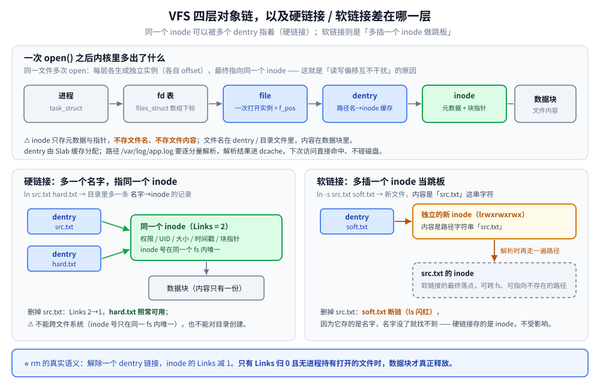

# Linux 文件系统与 I/O

> 覆盖：常见文件系统（ext4 / XFS / Btrfs）怎么选、inode 与软硬链接的语义、一次 `write` 到落盘的完整 I/O 栈，以及配套的速查命令与两个高频事故的处置。
> 不覆盖：内存侧的 Page Cache 与回收见 [内存管理.md](内存管理.md)；磁盘 / I/O 瓶颈的排查套路见 [性能排查.md](性能排查.md)；`mmap` / `sendfile` 在同一套 I/O 栈上的位置见 [零拷贝.md](../操作系统/零拷贝.md)。
>
> 内容整理自个人学习笔记，素材见 [素材清单](../../素材清单.md)。

---

## 一、常见文件系统有什么区别？inode 与软硬链接是什么？

**本节要点**：ext4 是通用默认、XFS 偏大文件与高并发、Btrfs 用 COW 换快照与校验和；inode 是文件的「身份证」，**不存文件名也不存内容**，而**软硬链接的差别全在 inode 是否同一个**。

### 1.1 VFS（虚拟文件系统）

**VFS 是内核的一层抽象**：对上给系统调用统一的 `open/read/write/close`，对下定义「文件系统必须实现的操作集」，让 ext4、XFS、NFS、procfs **共存于同一棵目录树**。四大对象：`super_block`（一个已挂载文件系统）、⭐ `inode`（一个文件的元数据）、⭐ `dentry`（「路径名 ↔ inode」的目录项）、`file`（一次打开的实例，含读写偏移 `f_pos`）。同一份文件多次 `open` 互不影响：每次生成独立的 `file`（各自 offset），但指向**同一个 inode**。

### 1.2 ext4 / XFS / Btrfs 对比 ⭐

| | **ext4** | **XFS** | **Btrfs** |
|---|---|---|---|
| 定位 | 最通用最稳的**默认选择** | **大文件 / 高并发**首选 | 写时复制（COW）的现代文件系统 |
| 日志 / 快照 / 校验和 | ✅ 有序日志，可关 / ❌ / ❌（仅元数据） | ✅ 元数据日志 / ❌ / ❌ | ❌ 靠 **COW + 校验和** / ✅ 原生快照 / ✅ 数据+元数据 |
| 最大文件 / fs | 16TB / 1EB | 8EB / 8EB | 16EB / 16EB |
| 在线扩容 / 缩容 | ✅ / ✅（缩容需卸载 resize） | ✅ / ❌ **不支持缩容** | ✅ / ✅ |
| 适用场景 | 通用服务器、根分区、**容器镜像层** | 大文件、视频/日志、**数据库**、并行 IO | 需要快照/压缩/多盘管理 |
| 成熟度 | 最高 | 高（RHEL 默认） | 较新，⚠️ RAID5/6 仍不推荐生产 |

### 1.3 inode

**inode = 文件的「身份证」**，存**元数据**，⚠️ **不存文件名、不存文件内容**。

| inode 存什么 | inode 不存什么 |
|---|---|
| 文件类型（普通/目录/设备/符号链接） | ❌ **文件名**（在 dentry / 目录文件里） |
| 权限 `rwxrwxrwx`、UID/GID、大小、**链接数 Links** | ❌ 文件内容（在数据块里） |
| 三个时间戳 `atime` / `mtime` / `ctime`；扩展属性、ACL | |
| ⭐ **数据块指针**（指向内容所在的数据块） | |

inode 里只有**有限几个直接指针**，大文件靠**间接块**逐级扩展（ext4 改用 extent），是「大文件随机写慢」的结构性原因之一。

```bash
df -i            # ⭐ 看 inode 使用率（不是磁盘空间）
stat app.log     # inode 号、Links、三个时间戳
```

⚠️ **inode 数量在格式化时就固定**，只能重新格式化才能改（**XFS 例外：动态分配 inode，不会耗尽**）。

### 1.4 dentry（目录项缓存）

**dentry 缓存的是「路径名 → inode」的映射**，避免每次访问都去磁盘逐层解析路径。`open("/var/log/app.log")` 需逐分量解析（`/`→`var`→`log`→`app.log`），每级都要读目录内容查 inode；结果缓存在 **dcache**，下次直接命中、**不碰磁盘**。dentry 由 **Slab 缓存**分配。硬链接 = **多个 dentry 指向同一 inode**。

### 1.5 硬链接 vs 软链接 ⭐

```bash
ln  src.txt  hard.txt     # 硬链接：多一个目录项指向同一 inode
ln -s src.txt soft.txt    # 软链接：新建「内容为目标路径字符串」的特殊文件
```

| | **硬链接** | **软链接（符号链接）** |
|---|---|---|
| inode | ⭐ **与源文件相同** | ⭐ **新的独立 inode** |
| 跨文件系统 | ❌ **不能**（inode 号只在同 fs 内唯一） | ✅ 可以，甚至可指向不存在的路径 |
| 删除源文件后 | ⚠️ **仍可用**（inode 还在，Links −1） | ⚠️ **失效**（断链，`ls` 闪红） |
| 能对目录创建 | ❌ **不能**（会形成环路，仅内核为 `.` `..` 创建） | ✅ 可以 |
| 本质 / `ls -l` | 目录里的**另一个名字**；普通文件，Links +1 | **存着路径字符串的小文件**；`lrwxrwxrwx` 显示 `-> src.txt` |

⭐ **删除文件的真正语义**：`rm` 是**解除一个 dentry 链接**，inode 的 `Links` 减 1；⚠️ **只有 Links 归 0 且无进程打开时，数据块才真正释放**。



图注：硬链接只是**多一个 dentry 指向同一 inode**（Links 计数 +1），软链接是**另起一个 inode**、内容是目标路径字符串 —— 这正是「删源文件后硬链接还在、软链接断链」的根本原因。

### 1.6 文件描述符（fd）

| 项 | 说明 |
|---|---|
| 本质 / 查看 | 进程 `files_struct` 里**数组的下标**，指向内核 `file` 对象；默认三个 `0/1/2`（stdin/out/err） |
| ⭐ `ulimit -n` | **单进程可打开 fd 数上限**（默认常 1024），高并发服务必须调大 |
| 查看命令 | `lsof -p <pid>`；`ls -l /proc/<pid>/fd`（文件/socket/管道都算 fd） |

⚠️ **fd 泄漏的表现**：① 报 `too many open files`（`EMFILE`）；② `lsof -p <pid> \| wc -l` 随时间**单调增长**；③ 大量连接停在 `CLOSE_WAIT`（对端关了本端没 close）。对策：`defer f.Close()` / try-with-resources 是底线，长连接服务要设 idle 超时主动关闭。

## 二、一次 write 到真正落盘经历了什么？

**本节要点**：`write()` 返回成功**不等于**数据落盘 —— 它只把数据拷进页缓存；要断电不丢，必须 `fsync` / `fdatasync`（`mmap` 用 `msync`）返回 0。数据库 WAL 靠的就是这条。

### 2.1 一次 `write()` 的路径

```bash
① 用户缓冲区（bufio.Writer / BufferedWriter，用户态内存）
      ↓ write(fd, buf, n)  系统调用陷入内核
② ⭐ 页缓存 Page Cache（内核态；拷到这里 write 就返回了）→ 页标记 dirty，异步回写
③ 块层 Generic Block Layer：合并/排序请求 → IO 调度（mq-deadline / kyber / bfq）
④ 设备驱动（SCSI / NVMe）  →  ⑤ 磁盘 / SSD
```

⚠️ **关键：`write()` 在第 ② 步就返回成功了**——数据只进了页缓存，还没到磁盘。

### 2.2 ⚠️ write 成功 ≠ 数据落盘

| 调用 | 作用 |
|---|---|
| ⭐ `fsync(fd)` | 该文件**所有脏页 + 元数据**（inode、大小、时间戳）**强制回写并等磁盘确认** |
| `fdatasync(fd)` | 只刷**数据**，不保证元数据（如 mtime），比 `fsync` 略快 |
| `sync()` / `sync` 命令 | 刷**整个系统**的脏页（生产慎用，会引发 IO 洪峰） |
| `msync(addr)` | 刷 **mmap 映射区**；`O_SYNC` = 每次 write 自动 fsync，⚠️ 慢很多 |

只有 `fsync` **返回 0**，数据才算「落盘」（断电不丢）。数据库 WAL 靠的就是它。

### 2.3 直接 IO 与 mmap

| | 说明 | 代价 / 风险 |
|---|---|---|
| ⭐ **O_DIRECT** | 打开时加此标志，**绕过页缓存**，直接在用户缓冲与设备间传输 | ⚠️ ① **必须自己保证对齐**（内存地址、长度、文件偏移都要按块对齐）；② 失去预读与缓存，**小随机 IO 变慢**；③ 与 Page Cache 并存可能不一致。适合**自带缓存的数据库**（MySQL 常用 `innodb_flush_method=O_DIRECT`） |
| ⭐ **mmap** | 把文件**映射成一段内存**，读写像操作字节数组，省掉 `read/write` 的**系统调用 + 一次用户/内核拷贝** | ✅ 零拷贝、随机访问友好、多进程共享天然可用；⚠️ 缺页中断开销（大文件首次访问抖动）、脏页回写**时机不可控**（需 `msync`）、**占 RSS**、32 位寻址受限 |


图注：`write` 的返回点在页缓存，真正落盘要看 `fsync` 是否返回 0；`O_DIRECT` 与 `mmap` 是绕过或复用页缓存的两条旁路，代价与适用面各不相同。图中只画了磁盘这一端 —— 网络那一端的缓冲（socket 收发队列）与它**并列**而不是它的下级，两者怎么共用同一块 DDR 见 [用户态内核态与一次IO的内存路径.md](../操作系统/用户态内核态与一次IO的内存路径.md)。

## 三、应用场景

**本节要点**：文件系统不是「装数据的容器」这么简单 —— 数据库拿它换持久化语义、消息队列拿它做顺序追加、容器拿它做镜像分层，选错文件系统或挂载选项会直接改变这些系统的行为。

| 场景 | 用到文件系统的哪一块 | 为什么值得注意 |
|---|---|---|
| 数据库（InnoDB） | `O_DIRECT` 绕过页缓存、redo log 用 `fsync` 换「不丢」 | 刷盘策略与文件系统缓存叠加会造成「双缓存」，落盘语义全压在 `fsync` 上，详见 [参数调优.md](../../03-数据与中间件/数据存储/关系型/MySQL/参数调优.md) 与 [日志与持久化.md](../../03-数据与中间件/数据存储/关系型/MySQL/日志与持久化.md) |
| 搜索引擎（ES） | 段文件写入 + 落盘后才可恢复 | refresh / flush 的持久化边界取决于段文件有没有真正落盘，详见 [写入流程.md](../../03-数据与中间件/数据存储/搜索与分析/Elasticsearch/写入流程.md) |
| 消息队列（Kafka） | 分区日志顺序追加、段滚动、稀疏索引落盘 | 顺序写把随机 IO 摊成顺序 IO，瓶颈从磁盘寻道转到页缓存与网卡，详见 [核心概念与架构.md](../../03-数据与中间件/中间件/消息队列/Kafka/核心概念与架构.md) |
| 对象存储 / 海量小文件 | inode 消耗、目录项膨胀 | 海量小对象先在容量上压垮 inode，再压垮 `du` 与备份，详见 [对象存储选型对比.md](../../03-数据与中间件/数据存储/对象存储/对象存储选型对比.md) |
| 静态文件服务（Nginx） | 大文件走 `sendfile`、挂载选项影响读放大 | `sendfile` / `tcp_nopush` 要配合大文件才有效，详见 [01-编译安装与配置.md](深入理解Nginx/01-编译安装与配置.md) |
| 容器镜像与可写层 | overlayfs 联合挂载叠在 ext4 / XFS 上，层只读 + 可写层 | 「镜像层复用、容器层独享」直接决定磁盘占用与 `docker diff` 能看见什么，详见 [网络与存储.md](../../06-工程实践/部署/docker/网络与存储.md) |
| 日志 / 大文件目录 | XFS 大文件与在线扩容、日志轮转 | 日志目录天然是大文件 + 高写入，扩容与缩容能力决定了运维动作，详见 [02-文件系统与XFS.md](鸟哥基础学习篇/02-文件系统与XFS.md) |
| 高并发服务 | fd 上限（`ulimit -n`）与连接数直接挂钩 | 连接数上不去常常是 fd 打满而不是端口不够，详见 [常用命令.md](常用命令.md) |

## 四、具体使用

**本节要点**：日常只用两类命令 —— **看状态**（`df` / `stat` / `lsof`）与**验证落盘**（`fsync` 语义、`O_DIRECT`、`> app.log` 截断）；两个高频事故（inode 耗尽、删了文件空间不回收）都能用这两类命令定位。

### 4.1 状态速查命令

```bash
# —— 空间与 inode ——
df -h ; df -i                  # 空间 / ⭐ inode 使用率
du -sh * ; du -x --max-depth=1 # 哪个目录占空间（-x 不跨文件系统）

# —— 文件与目录项 ——
stat app.log                   # inode 号、Links、三个时间戳
ln src.txt hard.txt ; ln -s src.txt soft.txt
lsblk ; blkid                  # 块设备树与文件系统类型
findmnt                        # 挂载点与挂载选项（noatime / discard）

# —— 打开的文件 ——
lsof -p <pid>                  # 某进程打开的所有 fd
lsof +L1                       # ⭐ 已删除但仍被占用的文件（deleted 标记）
ls -l /proc/<pid>/fd           # 文件 / socket / 管道都算 fd

# —— 落盘 ——
sync                           # 手动回写所有脏页（关机 / 拔盘前）
```

| 命令 | 看什么 |
|---|---|
| `df -h` / ⭐ `df -i` | 磁盘**空间** / ⭐ **inode** 使用率（「磁盘没满却写不进去」的元凶） |
| `du -sh *`、`du -x --max-depth=1` | 哪个目录占空间（`-x` 不跨文件系统） |
| `stat file` | inode 号、Links、**三个时间戳**、块大小 |
| `lsof -p <pid>`、`lsof +D /path` | 打开的 fd；⚠️ `+L1` 找**已删除但仍被占用**的文件 |
| `lsblk` / `blkid`、`mount` / `findmnt` | 块设备树与 fs 类型 / 挂载点与挂载选项（`noatime`、`discard`） |
| `sync` | 手动回写所有脏页（关机/拔盘前）；详细排查见 [性能排查.md](性能排查.md) |

### 4.2 两个高频事故的处置

**inode 耗尽：磁盘没满却写不进去**

```bash
df -h      # 空间还剩 40%  → 看起来没问题
df -i      # IUse% = 100%  → ⭐ 真凶
```

- 现象：`No space left on device`，但 `df -h` 还有空间；原因：**海量小文件**（日志碎片、缓存目录、容器镜像层、`/tmp`）。
- 定位：`for d in /*; do echo $(find $d -xdev -type f | wc -l) $d; done | sort -rn | head`；处理：清理小文件（⚠️ 目录内文件极多时 `rm -rf` 非常慢，可先 `mv` 走再慢慢删），根治是**重新格式化调大 inode 数**或改用 **XFS**（动态分配 inode）。

**删除文件后空间未释放**

`rm` 只是解除目录项。**只要有进程还持有该文件的 fd，数据块就不会释放**，`df` 也看不出空间回来。

```bash
lsof +L1                  # ⭐ 已删除但仍被占用的文件（deleted 标记）
lsof | grep -i deleted    # 同上，全量扫
> app.log                 # ⭐ 日志场景的正确做法：截断清空、保留 inode，进程无需重启
```

| 场景与处理 | 日志被 `rm` 但进程还在写 → ⚠️ 正确做法是 **`> app.log`（截断清空、保留 inode）**，进程无需重启；必须回收则停掉持有 fd 的进程或在程序里 `close`（容器内 `rm` 大日志，宿主机 `df` 不会降） |
|---|---|

---

## 延伸追问

- **inode 是什么、存什么？硬链接和软链接的区别？** → inode 存文件元数据（类型、权限、大小、**链接数**、时间戳、**数据块指针**），⚠️ 不存文件名与内容；硬链接**同 inode**、不能跨 fs、删源文件后仍可用、不能对目录创建，软链接是**独立 inode**、可跨 fs、源文件删除后失效、可对目录创建（见第一节）。
- ⭐ **`write()` 返回成功数据就落盘了吗？** → ❌ 没有。`write` 只把数据拷进**页缓存**就返回，页被标脏后由内核异步回写。必须调用 **`fsync` / `fdatasync`**（mmap 用 `msync`）并等其返回 0，才保证断电不丢（见第二节）。
- **为什么 `df -h` 还有空间却写不进去？** → inode 耗尽，用 `df -i` 看 `IUse%`；根因是海量小文件，根治要重新格式化调大 inode 数或改用 **XFS**（动态分配 inode）（见 4.2）。
- **`rm` 删了大文件，为什么 `df` 空间没回来？** → 只要还有进程持有该文件的 fd，数据块就不释放；该进程写的是已被 unlink 的 inode。定位用 `lsof +L1`；日志场景正确做法是 `> app.log` 截断而不是 `rm`（见 4.2）。
- **`noatime` 挂载选项解决什么问题？** → 默认每次读都会更新 atime、产生额外写；`noatime` 去掉这个写，对高读负载有明显收益；需要保留访问时间时用 `relatime`。

## 关联

- **上游/总纲**：[用户态内核态与一次IO的内存路径.md](../操作系统/用户态内核态与一次IO的内存路径.md) — 本篇只讲落盘这一端，那篇把 page cache 与 socket 队列放进同一张图，并说明两者是并列支路
- **上游/总纲**：[内存管理.md](内存管理.md) — Page Cache 与脏页回写
- **对照/互补**：[性能排查.md](性能排查.md) — iostat、inode 满、磁盘满的排查
- **对照/互补**：[零拷贝.md](../操作系统/零拷贝.md) — mmap / sendfile 在同一套 I/O 栈上的位置
- **对照/互补**：[02-文件系统与XFS.md](鸟哥基础学习篇/02-文件系统与XFS.md) — ext4 / XFS 的实操：格式化、挂载选项与在线扩容
- **对照/互补**：[常用命令.md](常用命令.md) — 端口与连接、日志统计等日常命令

> 反向引用（本篇被下列文档引到）：[零拷贝.md](../../01-编程语言/go/运行时/零拷贝.md)、[01-安装与磁盘分区.md](鸟哥基础学习篇/01-安装与磁盘分区.md)、[参数调优.md](../../03-数据与中间件/数据存储/关系型/MySQL/参数调优.md)、[写入流程.md](../../03-数据与中间件/数据存储/搜索与分析/Elasticsearch/写入流程.md)、[集群与运维.md](../../03-数据与中间件/数据存储/搜索与分析/Elasticsearch/集群与运维.md)、[网络与存储.md](../../06-工程实践/部署/docker/网络与存储.md)
