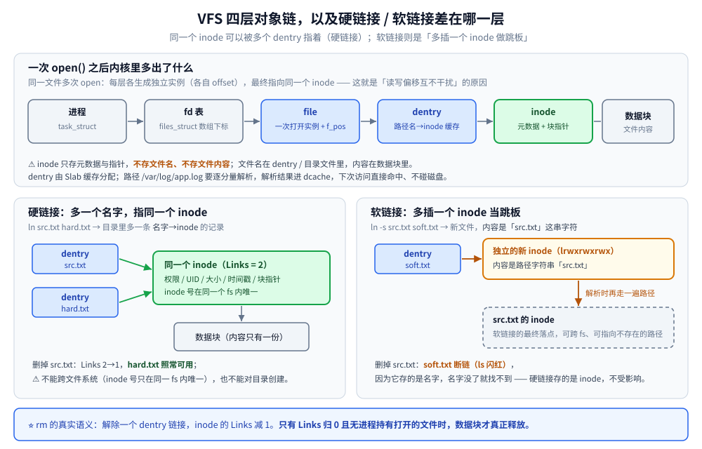
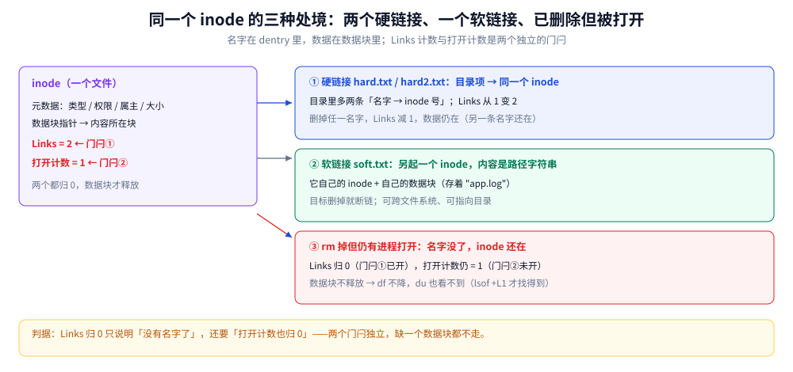

# 文件系统与 VFS

> 覆盖：VFS 的四层对象（`super_block` / `inode` / `dentry` / `file`）、路径是怎么被逐段解析成 inode 的、`inode` 与 `dentry` 各存什么、硬链接与软链接的本质差别、`fd` 与 `file` 对象的关系、`ext4` / `XFS` / `Btrfs` 的结构差异与选型判据，以及 inode 耗尽与「删了文件空间不还」这两类高频事故。
>
> 不覆盖：一次 `write` 到落盘的路径与 `fsync` 的实测代价见 [落盘路径与fsync代价.md](落盘路径与fsync代价.md)；Page Cache 与脏页回收见 [虚拟内存与页缓存.md](../操作系统/虚拟内存与页缓存.md)；`mmap` / `sendfile` 的拷贝账见 [零拷贝.md](../操作系统/零拷贝.md)；文件系统相关的指标怎么读见 [性能排查.md](性能排查.md)。
>
> 内容整理自个人学习笔记，素材见 [素材清单](../../素材清单.md)。本篇讲的是**结构语义**，几乎不带机器读数——结论都是内核行为，换一台机器、换一个文件系统实现也不变；唯一的实测在 5.2 / 5.3，用的是容器内可复现的 `df -i` / `lsof +L1` 行为，不含性能数据。落盘代价那笔账（`write` 与 `+fsync` 差约 500 倍）在 [落盘路径与fsync代价.md](落盘路径与fsync代价.md) 2.3。

---

## 一、一个路径打开之后，内核手里有几个对象？

**本节要点**：用户递给内核的是一个字符串 `"/var/log/app.log"`，内核还给用户的是一个**整数 fd**。中间这层转换里，内核手里有四种对象：`super_block`（哪块设备）、`inode`（哪个文件）、`dentry`（哪条路径）、`file`（哪次打开）。**名字、文件、这次打开**是三件不同的事，把它们分开是理解硬链接、`rm` 不还空间、`fd` 泄漏的起点。

### 1.1 起点：`open` 拿到的为什么是个整数

```c
int fd = open("/var/log/app.log", O_RDONLY);   // fd 通常是 3
```

`fd` 不是文件，也不是 inode，它只是**当前进程 `files_struct` 表里的一个下标**。`0/1/2` 预留给 stdin/out/err，所以第一次 `open` 通常拿到 3。这个下标指向的是一个 `struct file`——**「这一次打开」**，里面存的是**读写偏移 `f_pos`**、打开标志、引用计数。

由此可以直接推出两条日常现象：

| 现象 | 原因 |
|---|---|
| 同一进程 `open` 同一个文件两次，拿到两个不同的 fd | 两次打开 = 两个 `file` 对象，各自有独立的 `f_pos`，**互不影响偏移** |
| `fork` 之后父子进程共用一个 fd，会互相抢读位置 | `fork` 复制的是 `files_struct` 表项，父子指向**同一个 `file` 对象**，`f_pos` 是共享的 |

⭐ 判据：**要「各读各的」，就得各 `open` 一次，或者用 `pread` 显式带偏移**。这个区别在日志采集、多线程读同一文件时经常出事。

### 1.2 VFS：让四种文件系统长在同一棵树上

VFS（Virtual File System）是内核里的一层抽象，它只做两件事：

- **对上**给系统调用一套统一入口：不管底下是 ext4、XFS、NFS 还是 `procfs`，都是 `open` / `read` / `write` / `close`；
- **对下**定义「一个文件系统必须实现哪些操作」，各文件系统填自己的 `file_operations` / `inode_operations` 函数表。

所以 `/proc/cpuinfo`、`/dev/sda`、`/var/log/app.log` 能出现在同一棵树里、用同一套命令访问，**这件事本身就是 VFS 干的**：它们的「文件系统」完全不同（`procfs` / `devtmpfs` / `ext4`），但都被挂载进了同一个命名空间。

### 1.3 四层对象与它们的关系

| 对象 | 一个实例代表什么 | 生命周期 |
|---|---|---|
| `super_block` | **一个已挂载的文件系统**（一块设备或一次网络挂载） | 从 `mount` 到 `umount`，全局唯一 |
| ⭐ `inode` | **一个文件**（含目录、设备、符号链接）的全部元数据 | 从创建到最后一次 `unlink` 且无人打开 |
| ⭐ `dentry` | **一条「名字 → inode」的目录项**，也是路径解析的缓存单元 | 用完可回收（dcache），随时重建 |
| `file` | **一次打开**，含 `f_pos` 与打开标志 | 从 `open` 到最后一个 fd `close` |



图里上半部分是四层对象的包含关系：`super_block` 管着这一片 inode，`dentry` 把名字牵到 inode 上，`file` 把 fd 牵到 inode 上；下半部分是硬链接与软链接的对照——硬链接是**多一条 dentry 指向同一个 inode**，软链接是**新起一个 inode，里面存目标路径字符串**。这两句话就能解释「删了源文件，硬链接还在、软链接断掉」。

### 1.4 inode 存什么、不存什么

**inode 是文件的「身份证」，但它既不存名字也不存内容。**

| inode 里存什么 | inode 里不存什么 |
|---|---|
| 文件类型（普通 / 目录 / 设备 / 符号链接） | ❌ **文件名**（在 dentry 与目录文件里） |
| 权限位 `rwx`、UID / GID、大小、**链接数 `Links`** | ❌ **文件内容**（在数据块里，inode 只存指针） |
| 三个时间戳 `atime` / `mtime` / `ctime` | ❌ 路径（路径由 dentry 串起来） |
| ⭐ **数据块指针**（直接块 + 一级 / 二级 / 三级间接块；ext4 改用 extent） | |

⭐ 两条推论：

- **同一个文件可以有多个名字**——名字在 dentry 里，不在 inode 里。这是硬链接成立的前提。
- **「重命名」比「复制」便宜**——`mv` 在同一文件系统内只改 dentry 的名字指向，不动数据块；跨文件系统才会退化成「复制 + 删除」。这也解释了为什么跨盘 `mv` 一个大目录会卡很久。

```bash
df -i                 # ⭐ 看 inode 使用率（不是磁盘空间）
stat app.log          # inode 号、Links 计数、三个时间戳、块大小
```

⚠️ **ext4 的 inode 数在格式化时就固定**（`mkfs.ext4 -N` 可调，默认按容量比例算），耗尽后只能重格式化；**XFS 动态分配 inode**，不会因为「建了太多小文件」而耗尽。这是两者最实用的一条差别，见第三节。

### 1.5 dentry 与 dcache：路径解析为什么不是每次读盘

`open("/var/log/app.log")` 的内核侧动作是**逐分量解析**：

```text
"/"        → 查到根 inode
"var"      → 在 / 的目录数据里找名字 "var" → 拿到它的 inode
"log"      → 在 /var 的目录数据里找 "log"
"app.log"  → 在 /var/log 里找 "app.log"
```

每往下一层，都要**读一次目录文件的内容**去查名字。为了不让每次 `open` 都读盘，内核把「名字 → inode」的解析结果缓存在 **dcache** 里（`dentry` 对象本身由 Slab 分配）。命中 dcache 就完全不碰磁盘。

⭐ 三条推论：

- **第一次访问一个深路径会慢，之后快**——这是「冷启动慢、热了就好」在文件系统层的来源之一。
- **硬链接 = 多条 dentry 指向同一个 inode**，所以 `Links` 计数加 1 而 inode 不变。
- **dcache 可回收**：内存紧张时 dentry 会被回收，回收之后路径解析又要读盘，但**不影响正确性**——dentry 是缓存，不是事实。

### 1.6 fd 是什么：数组下标，不是 inode

| 项 | 说明 |
|---|---|
| 本质 | 进程 `files_struct` 里**数组的下标**，指向内核 `file` 对象，`file` 再指向 `inode` |
| 默认占用 | `0` stdin、`1` stdout、`2` stderr |
| ⭐ 上限 | `ulimit -n`（常见默认 1024），高并发服务必须调大 |
| 查看 | `ls -l /proc/<pid>/fd`（文件、socket、管道都算 fd）；`lsof -p <pid>` |

⚠️ **fd 泄漏的三条表现**：① 报 `too many open files`（`EMFILE`）；② `lsof -p <pid> | wc -l` 随时间**单调增长**；③ 大量连接停在 `CLOSE_WAIT`（对端关了、本端没 `close`）。底线对策是 `defer f.Close()` / `try-with-resources`，长连接服务还要设 idle 超时主动关。

⭐ **注意 `file` 与 `inode` 的层数**：`dup` 出来的两个 fd 指向**同一个 `file`**（共享 `f_pos`），而两次 `open` 出来的是**两个 `file`**（各自偏移）。Go 里 `os.File` 包的是 fd，Java 里 `FileDescriptor` 也是 fd——两层封装都不改变这个语义。

## 二、硬链接和软链接差在哪？`rm` 之后空间为什么不还？

**本节要点**：**名字不是文件**。硬链接是「给同一个 inode 多起一个名字」，软链接是「新建一个存着路径字符串的特殊文件」。`rm` 做的事只是**删掉一条名字**、把 inode 的 `Links` 减 1；**数据块要等到 `Links` 归 0 且没有进程还打开着它，才真正释放**——这正是「删了日志但 `df` 不降」的全部原因。

### 2.1 目录本身也是一张表

目录不是「容器」，它是一张**「名字 → inode 号」的表**（存在目录文件的数据块里）。所以：

- **删文件改的是目录**，不是文件。这就是为什么「文件是只读的，照样能删」——只要对**目录**有 `w` 权限。
- **目录的 `x` 是「能不能穿过它」**，`r` 是「能不能列出里面的名字」，两者分工严格，详见 [权限与能力模型.md](权限与能力模型.md) 第一节。

### 2.2 硬链接：多一条目录项，同一个 inode

```bash
ln  src.txt  hard.txt     # 硬链接：目录里多一条「hard.txt → 同一个 inode 号」
ln -s src.txt soft.txt    # 软链接：新建一个文件，内容是字符串 "src.txt"
```

| | **硬链接** | **软链接（符号链接）** |
|---|---|---|
| inode | ⭐ **与源文件同一个**（`ls -i` 可见同号） | ⭐ **独立的新 inode** |
| 跨文件系统 | ❌ 不能（inode 号只在同一文件系统内唯一） | ✅ 能，甚至能指向不存在的路径 |
| 删除源文件后 | ⚠️ **仍可用**（inode 还在，只是 `Links` 减 1） | ⚠️ **断链**（`ls` 里闪红，读取报 `No such file`） |
| 能否指向目录 | ❌ 不能（会形成环，只有内核对 `.` `..` 这么做） | ✅ 能 |
| `ls -l` 的样子 | 与普通文件无差别，只有 `Links` 计数变大 | `lrwxrwxrwx ... -> src.txt` |
| 本质 | 目录里的**另一个名字** | 一个**存路径字符串的小文件** |

### 2.3 三种「名字」的统一视角

把「硬链接 / 软链接 / 已删除但仍被打开」放在一张图里看，会立刻清楚：**它们都是「名字」与「文件」的三种不同关系**，而 `inode` 的 `Links` 计数与「打开计数」是两个独立的门闩。



图里左边是一个 inode（`Links=2`，且被 fd 打开着），右边三条支路分别是「硬链接 A / 硬链接 B」「软链接（自己另起一个 inode，内容是路径）」「已被 `rm` 掉的那条名字」。要读出的是**两个门闩相互独立**：`Links` 归 0 只表示「没有名字了」，还得「打开计数也归 0」，数据块才真正释放——这就是磁盘占用不降的直接原因。

### 2.4 `rm` 到底做了什么

```text
rm app.log
  ① 在目录里删掉 "app.log" 这条 dentry        → 名字没了
  ② 该 inode 的 Links 减 1
  ③ Links != 0                 → 什么都不发生（还有别的硬链接）
     Links == 0 且 有进程打开着 → inode 与数据块都不释放，等最后一个 fd 关闭
     Links == 0 且 无人打开     → 释放数据块，回收 inode
```

⭐ 所以「`rm` 了 10 GB 日志，`df` 一点没降」不是 bug，是**还有进程握着那个 fd**（典型是还在往里写的应用）。处置见 5.3。

## 三、ext4 / XFS / Btrfs 该选哪个？

**本节要点**：三者的差别不在「快慢」，而在**元数据怎么组织、能不能缩容、有没有校验和**。ext4 是通用默认；XFS 偏大文件与高并发、且**不能缩容**；Btrfs 用写时复制换来快照与校验和，代价是碎片化与 RAID5/6 的坑。

### 3.1 结构差异决定了能力边界

| | **ext4** | **XFS** | **Btrfs** |
|---|---|---|---|
| 元数据组织 | 块组 + 位图 + extent | **分配组（AG）**，多 AG 可并行；B+ 树索引空闲空间与 inode | **COW B 树**，元数据本身也是树 |
| inode 分配 | ⚠️ 格式化时固定总数 | ⭐ **动态分配**，不会耗尽 | 动态 |
| 日志 | 有序 / 写回 / 日志三种模式，只记元数据 | 只记元数据 | 无独立日志，靠 COW + 校验和 |
| 快照 | ❌ | ❌ | ✅ 原生子卷快照 |
| 数据校验和 | ❌ | ❌（只有元数据 CRC） | ✅ 数据 + 元数据 |
| 在线缩容 | ✅（卸载后 `resize2fs`） | ❌ **不支持缩容** | ✅ |
| 最大文件 / 文件系统 | 16 TB / 1 EB | 8 EB / 8 EB | 16 EB / 16 EB |

⭐ 三条读法：

- **「inode 会不会耗尽」是 ext4 与 XFS 最实用的一条差别**：容器镜像层、邮件队列、缓存目录这类海量小文件场景，ext4 会先耗尽 inode 而不是空间（见 5.2）。
- **「不能缩容」是 XFS 的硬约束**：分区规划时留的余量事后收不回来。给数据库、日志盘用 XFS 时要先把容量算对。
- **COW 不是免费的**：Btrfs 快照很香，但随机写会导致碎片化；RAID5/6 的 write hole 至今不推荐上生产。

### 3.2 选型判据

| 你的盘要干什么 | 选 | 理由 |
|---|---|---|
| 通用服务器根分区、容器镜像层 | **ext4** | 最稳、工具链最全、缩容可做 |
| 大文件顺序写（视频、日志、备份） | **XFS** | 分配组并行、大文件与并发 IO 表现好；RHEL 系默认 |
| 数据库数据盘 | **XFS**（或 ext4） | 大文件 + 直接 IO；⚠️ 注意不能缩容 |
| 需要快照 / 校验和 / 多盘管理 | **Btrfs** | 子卷快照、自愈；⚠️ 避开 RAID5/6 |
| 只读镜像 / 固件 | **squashfs / erofs** + overlay | 不在三选一之列，但容器与嵌入式常用 |

## 四、应用场景

**本节要点**：文件系统这一层的取舍会直接改写上层系统的行为——数据库拿挂载选项换延迟、消息队列拿顺序追加换吞吐、容器拿联合挂载换镜像复用。下表是「哪个系统在用这一层的哪个特性」。

| 场景 | 用到 VFS / 文件系统的哪一块 | 为什么值得注意 |
|---|---|---|
| 数据库（InnoDB） | `inode` 的 extent 布局、`O_DIRECT`、`noatime` 挂载选项 | 双缓存叠加会让「文件系统缓存 + Buffer Pool」互相踩，详见 [参数调优.md](../../03-数据与中间件/数据存储/关系型/MySQL/参数调优.md) |
| 消息队列（Kafka） | 分区目录结构、顺序追加写、段文件滚动 | 顺序写把随机 IO 摊成顺序，瓶颈从寻道转到页缓存与网卡，详见 [核心概念与架构.md](../../03-数据与中间件/中间件/消息队列/Kafka/核心概念与架构.md) |
| 搜索引擎（ES） | 段文件（segment）落盘与合并 | 段不可变、靠合并回收，磁盘占用与 `inode` 数都随段增长，详见 [写入流程.md](../../03-数据与中间件/数据存储/搜索与分析/Elasticsearch/写入流程.md) |
| 对象存储 / 海量小文件 | `inode` 消耗、目录项膨胀 | 海量小对象先在 `inode` 上压垮系统，再压垮 `du` 与备份，详见 [对象存储选型对比.md](../../03-数据与中间件/数据存储/对象存储/对象存储选型对比.md) |
| 容器镜像与可写层 | overlayfs 联合挂载叠在 ext4 / XFS 上 | 「镜像层只读 + 容器层可写」决定了 `docker diff` 能看见什么、磁盘怎么涨，详见 [网络与存储.md](../../06-工程实践/部署/docker/网络与存储.md) |
| 静态文件服务（Nginx） | 大文件读路径、挂载选项影响预读 | 大文件走 `sendfile` 才不经过用户态，详见 [01-编译安装与配置.md](深入理解Nginx/01-编译安装与配置.md) |
| 日志目录 | XFS 大文件 + 在线扩容、轮转 | 日志天然是大文件高写入，扩容能力决定运维动作，详见 [02-文件系统与XFS.md](鸟哥基础学习篇/02-文件系统与XFS.md) |
| 高并发服务 | `fd` 上限与连接数直接挂钩 | 连接上不去常常是 `ulimit -n` 打满，不是端口不够，见 [常用命令.md](常用命令.md) 第四节 |

## 五、具体使用

**本节要点**：日常只有两组动作——**看结构**（`df` / `df -i` / `stat` / `lsof`）与**处置三类事故**（inode 耗尽、空间不还、链接误用）。三类事故的共同点是：`df -h` 都看不出问题。

### 5.1 看结构：六条命令够用

```bash
df -h ; df -i                  # 空间 / ⭐ inode 使用率
du -x --max-depth=1 /var       # 哪个目录占空间（-x 不跨文件系统）
stat app.log                   # inode 号、Links、三个时间戳、块大小
ls -i app.log hard.txt         # ⭐ 看两个名字是否指向同一个 inode 号
findmnt                        # 挂载点与挂载选项（noatime / discard）
lsof -p <pid> ; lsof +L1       # 某进程的 fd / ⭐ 已删除但仍被占用的文件
```

| 命令 | 看什么 |
|---|---|
| `df -h` / ⭐ `df -i` | 容量 / ⭐ **inode 使用率**——「磁盘没满却写不进去」几乎都是后者 |
| `du -x` | 目录占用，`-x` 保证不跨文件系统（避免把挂进来的另一块盘算进去） |
| `stat` | `Inode`、`Links`、`Access/Modify/Change` 三个时间戳 |
| `ls -i` | ⭐ 两个名字的 inode 号是否相同——判硬链接最快的办法 |
| `findmnt` | 挂载选项：`noatime`（不更新访问时间）、`discard`（SSD 在线 TRIM） |
| `lsof +L1` | ⭐ 已删除但仍有进程打开的文件（`deleted` 标记） |

### 5.2 事故一：inode 耗尽——磁盘没满却写不进去

```bash
df -h      # 空间还剩 40%   → 看起来没问题
df -i      # IUse% = 100%   → ⭐ 真凶
```

- **现象**：报 `No space left on device`，但 `df -h` 还有空间。
- **原因**：海量小文件（日志碎片、session 文件、容器镜像层、`/tmp`）把 inode 吃光；**ext4 的 inode 数格式化时固定**，与剩余空间无关。
- **定位**：`for d in /*; do echo "$(find "$d" -xdev -type f | wc -l) $d"; done | sort -rn | head`
- **处置**：清理小文件（目录内文件极多时 `rm -rf` 极慢，可先 `mv` 整个目录到别的盘再慢删）；根治是**改用 XFS**（动态 inode）或重格式化时 `mkfs.ext4 -N` 调大。

### 5.3 事故二：删了文件空间不还

`rm` 只解除名字（2.4）。**只要还有进程持有该文件的 fd，数据块就不释放**，`df` 也不会降。

```bash
lsof +L1                  # ⭐ 已删除但仍被占用的文件
lsof | grep -i deleted    # 全量扫（慢）
> app.log                 # ⭐ 日志场景的正确做法：截断清空、保留 inode，进程无需重启
```

| 场景 | 处置 |
|---|---|
| 日志被 `rm` 但进程还在往旧 fd 写 | ⭐ 用 `> app.log` 截断（保留 inode），或 `truncate -s 0`；**不要 `rm`** |
| 必须回收 | 停掉持有 fd 的进程，或在程序里 `close`；容器内 `rm` 大日志，宿主机 `df` 不会降 |
| 已经 `rm` 了才想救 | `lsof +L1` 找到 fd，`> /proc/<pid>/fd/<n>` 截断（确认安全再操作） |

### 5.4 事故三：链接用错

```bash
ln -s /data/app/config.yaml /etc/app/config.yaml     # 常见：配置指到数据盘
ls -l /etc/app/config.yaml                            # 看到 -> 才是软链接
readlink -f /etc/app/config.yaml                      # ⭐ 追到最终真实路径
```

| 坑 | 后果 |
|---|---|
| 软链接用了**相对路径** | 相对的是「链接所在目录」，从别处访问会解析到别的地方 |
| 硬链接跨文件系统 | 直接报 `Invalid cross-device link` |
| 备份 / 打包工具不跟随软链接 | `tar` 默认存链接本身，恢复后目标可能不在 |
| 容器 bind mount 单文件 | 宿主机编辑器「保存」会重建 inode，容器里仍在写被替换掉的旧文件 ⚠️ 改配置要用原地写 |

---

## 延伸追问

- **VFS 的四个对象分别是什么？** → `super_block`（一个已挂载的文件系统）、`inode`（一个文件的元数据）、`dentry`（名字 → inode 的目录项，可缓存可回收）、`file`（一次打开，含偏移）。fd 是进程 fd 表的下标，指向 `file`（见 1.3）。
- **inode 存什么？为什么说它不存文件名？** → 存类型、权限、属主、大小、`Links`、三个时间戳、数据块指针；**名字在 dentry 与目录文件里**，所以同一个 inode 可以有多个名字（硬链接）（见 1.4）。
- **硬链接和软链接的区别？** → 硬链接**同 inode**、不能跨文件系统、不能指向目录、删源文件后仍可用；软链接**独立 inode**、内容是路径字符串、可跨文件系统、可指向目录、源文件删了就断（见 2.2）。
- **`rm` 删了大文件，为什么 `df` 空间没回来？** → 还有进程持有该文件的 fd，`Links` 归 0 但打开计数不为 0，数据块不释放。`lsof +L1` 定位；日志场景正确做法是 `> app.log` 截断而不是 `rm`（见 2.4、5.3）。
- **`df -h` 还有空间却写不进去？** → `df -i` 看 inode 使用率；根因是海量小文件，ext4 的 inode 数格式化时固定，根治要改 XFS 或重格式化时调大 `-N`（见 5.2）。
- **`mv` 为什么有时瞬间完成、有时卡很久？** → 同一文件系统内只改 dentry 的名字指向，不动数据；跨文件系统退化成「复制 + 删除」（见 1.4）。
- **`fork` 之后父子进程读同一个文件为什么会互相抢？** → `fork` 复制 fd 表项，父子指向**同一个 `file` 对象**，`f_pos` 共享；要各读各的必须各自 `open` 或用 `pread`（见 1.1）。
- **`noatime` 解决什么问题？** → 默认每次读都更新 `atime`，会额外产生元数据写；高读负载下用 `noatime` 去掉这笔写，需要保留访问时间时用 `relatime`。
- **为什么 ext4 的 inode 会耗尽而 XFS 不会？** → ext4 在 `mkfs` 时按容量比例预分配固定数量的 inode；XFS 用分配组动态分配 inode（见 1.4、3.1）。

## 关联

- **上游/总纲**：[落盘路径与fsync代价.md](落盘路径与fsync代价.md) — 本篇讲「文件长什么样」，那篇讲「写下去要多久」
- **上游/总纲**：[虚拟内存与页缓存.md](../操作系统/虚拟内存与页缓存.md) — Page Cache 是文件内容在内存里的那一半
- **上游/总纲**：[用户态内核态与一次IO的内存路径.md](../操作系统/用户态内核态与一次IO的内存路径.md) — 文件这一支与 socket 那一支怎么共用同一块内存
- **对照/互补**：[权限与能力模型.md](权限与能力模型.md) — 目录的 `w` 与 `x` 决定「能不能删、能不能进」
- **对照/互补**：[零拷贝.md](../操作系统/零拷贝.md) — `mmap` / `sendfile` 在同一套 VFS 接口上的位置
- **对照/互补**：[02-文件系统与XFS.md](鸟哥基础学习篇/02-文件系统与XFS.md) — 格式化、挂载选项与在线扩容的实操
- **运维/排查**：[性能排查.md](性能排查.md) — `df -i` 与 `lsof` 在排查套路里的位置
- **查表**：[常用命令.md](常用命令.md) — 文件与目录类的命令速查
