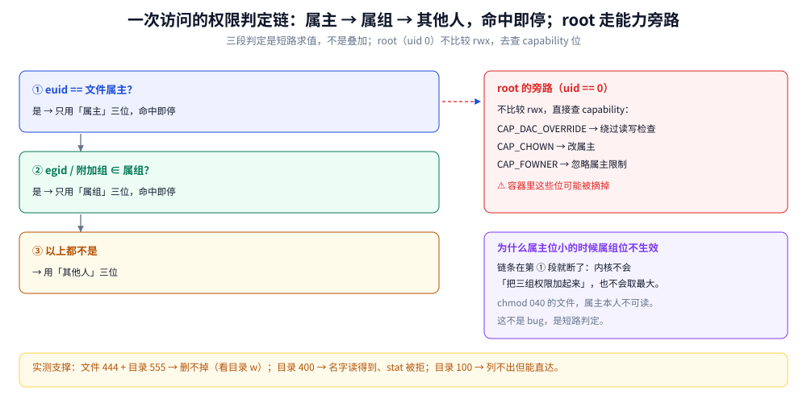

# 权限与能力模型

> 覆盖：`rwx` 对文件与目录的两套语义、UGO 的判定顺序、`umask` 怎么算出新建文件的权限、`SUID` / `SGID` / 粘滞位各自解决的具体难题、`uid 0` 与 capabilities 的关系（为什么容器里的 root 不是全权）、`ACL` 与 `sudo` 怎么做「单个用户 / 单条命令」的授权，以及一个服务账号的最小权限闭环。
>
> 不覆盖：进程的身份（`uid` / `gid` 怎么继承、`setuid` 族函数）见 [进程创建与退出.md](../操作系统/进程创建与退出.md)；`SELinux` / `AppArmor` 这类强制访问控制见 [02-主机安全与SELinux.md](鸟哥服务器架设篇/02-主机安全与SELinux.md)；服务以哪个用户运行见 [系统与服务.md](系统与服务.md) 第四节；命令速查见 [常用命令.md](常用命令.md) 第六节。
>
> 内容整理自个人学习笔记，素材见 [素材清单](../../素材清单.md)。本篇的结论**全部在容器内实跑过**（`alpine:3.20` / `python:3-alpine`，内核 6.18.54.1，容器内 `uid=0`）：六个实验的证据在第 1、2、3 节各自的表里，复现命令见第 6.4 节。`setcap` 那一组需先装 `libcap`（容器内 `apk add libcap` 通过），装完即跑通，见 3.4；`capsh` 未使用。

---

## 一、同一个 `rwx`，对文件和目录为什么是两回事？

**本节要点**：`r` / `w` / `x` 在文件和目录上是**三组完全不同的权限**。最容易踩的是这一条：**删不删得掉一个文件，看的是「目录」的 `w`，跟文件自己是不是只读毫无关系**。把这条想通，`/tmp` 的粘滞位、`chmod 444` 之后还能 `rm`、容器里 `rm` 大日志为什么磁盘不降，就都能自己推出来。

### 1.1 从「删一个只读文件」问起

直觉是「文件只读 ⇒ 删不掉」。实测相反：**文件 `444`、目录 `755`，删得掉**；**文件 `444`、目录 `555`，删不掉**。

| 目录 `d1` 的权限 | 文件 `d1/f` 的权限 | `bob` 执行 `rm d1/f` | 结果 |
|---|---|---|---|
| `dr-xr-xr-x`（555） | `-r--r--r--`（444） | `rm: can't remove '/t/d1/f': Permission denied` | 文件还在 |
| `drwxr-xr-x`（755） | `-r--r--r--`（444） | 无输出 | 文件被删 |

⭐ 原因是**删文件改的是目录**：`rm` 做的是「从目录这张『名字 → inode 号』的表里删掉一行」，所以它检查的是**目录的 `w`**。文件自己的 `w` 只约束「能不能改内容」，与「能不能删」无关。

这条推下去会得到一个反直觉但很有用的结论：**给目录 `w` 就等于把「删里面任何文件」的权力交出去了**，哪怕那些文件是别人的、是只读的。需要防这一点，才要粘滞位（2.3）。

### 1.2 目录的 `r` 与 `x`：一个列名字、一个能穿过

目录的 `r` 是「能不能读出这张表」、`x` 是「能不能穿过它去碰里面的东西」。两者可以单独存在，实测结果如下：

| 目录权限 | `ls d2`（列名字） | `cat d2/f`（读内容） |
|---|---|---|
| `dr--------`（400，只有 `r`） | 报 `ls: /t/d2/f: Permission denied`——**名字读到了，但 stat 每个条目要 `x`** | `cat: can't open '/t/d2/f': Permission denied` |
| `d--x------`（100，只有 `x`） | `ls: can't open '/t/d2': Permission denied`——**一个名字都读不到** | 成功（打印 `ok`） |

⭐ 判据：**知道文件名就能用 `x` 直达，不知道名字就要 `r`**。这条在运维上很实用——

- 「目录 `r` 无 `x`」时，`ls` 会打出 `Permission denied` 却**仍然把名字列了出来**（错误信息里就带着 `/t/d2/f`），说明名字已经读到了，卡在 `stat`。这算一种信息泄露，多租户目录要注意。
- 「目录 `x` 无 `r`」正是**只让程序访问、不让用户翻看**的形态（如 `/home/user/public` 的变体、某些 `www` 目录），不给 `r` 就没法 `ls` 出内容清单。

### 1.3 UGO 的判定顺序

一个进程访问文件时，内核**只走一条链、命中即停**，不会把三组权限加起来：

```text
① 进程 euid == 文件属主？        → 用「属主」那三位，命中就停
② 否则 进程 egid（或附加组）∈ 文件属组？ → 用「属组」那三位，命中就停
③ 否则                          → 用「其他人」那三位
④ root（uid 0）另有一条旁路：不比较这三位，直接查 capability（见第三节）
```

⚠️ 最容易踩的是第 ①、② 条的「命中即停」：**属主权限比属组权限小的时候，属组权限不生效**。`chmod 040 file`（属主无权限、属组可读）对属主本人**不可读**，这不是 bug。



图中左列是三段式判定（属主 / 属组 / 其他人），箭头自上而下、命中即停；右侧单独一条 root 旁路标出「不比较 rwx、直接查 capability」，底部标出 `DAC_OVERRIDE` 这个位就是「绕过 DAC 检查」的开关。要读出的是**为什么属主权限小时属组位不生效**——链条在前面就断了。

### 1.4 `umask`：新建时的减法

新建文件 / 目录时，内核先用**基准权限**（文件 `666`、目录 `777`），再**减去 `umask`**。实测三档：

| `umask` | 新建普通文件 | 新建目录 | 含义 |
|---|---|---|---|
| `022` | `644`（`rw-r--r--`） | `755`（`rwxr-xr-x`） | 同组与其他人都能读，只有属主能写 |
| `027` | `640`（`rw-r-----`） | `750`（`rwxr-x---`） | 其他人完全无权限（适合多租户机器） |
| `077` | `600`（`rw-------`） | `700`（`rwx------`） | 只属主可用（适合密钥目录） |

⚠️ 两个细节：① 文件基准是 `666`，**所以默认不带 `x`**——`chmod +x` 得自己做；② `umask` 是**进程属性**，写 `~/.bashrc` 只影响登录 shell，改系统默认要写 `/etc/profile` 或 `pam_umask`。

## 二、`SUID` / `SGID` / 粘滞位各自解决什么问题？

**本节要点**：这三个特殊位不是「高级技巧」，而是三个具体难题的答案——「普通用户怎么改自己的密码」「目录里新建的文件属组怎么统一」「公共目录里怎么防止互删」。理解它们要回到**「进程的身份 vs 文件的属主」**这个错位上。

### 2.1 `SUID`：`passwd` 为什么能改 `/etc/shadow`

`/etc/shadow` 权限是 `600 root:root`，普通用户连读都不行。但 `passwd` 命令能改自己的密码——因为 `/usr/bin/passwd` 带了 `SUID` 位：

```bash
$ ls -l /usr/bin/passwd
-rwsr-xr-x. 1 root root 32648 ... /usr/bin/passwd
   ↑ s 就是 SUID
```

⭐ 语义：**执行时把进程的 euid 换成文件属主的 uid**（这里是 0），于是进程以 root 身份跑，写完 shadow 再退出。**`SUID` 换的是身份，不是权限位。**

| 特殊位 | 对普通文件 | 对目录 |
|---|---|---|
| `SUID`（4） | 执行时 euid 变为**文件属主** | 无意义 |
| `SGID`（2） | 执行时 egid 变为**文件属组** | ⭐ 目录里新建的文件/子目录**继承目录的属组** |
| 粘滞位（1） | 无意义 | ⭐ 目录里的文件**只有属主 / 目录属主 / root 能删** |

### 2.2 `SGID`：让目录里新建的文件属组统一

协作目录的经典问题：`dev` 组的人各自建文件，文件属组会是各人的主组，别人反而改不了。解法是给**目录**加 `SGID`：

```bash
chgrp dev /srv/shared && chmod 2775 /srv/shared    # 2 就是 SGID
ls -ld /srv/shared                                  # drwxrwsr-x → 属组位上的 s
```

此后在 `/srv/shared` 里新建的文件，属组自动是 `dev`，且子目录也带 `SGID`（继续继承）。这比每次 `chgrp` 可靠得多。

### 2.3 粘滞位：`/tmp` 为什么删不掉别人的文件

`/tmp` 是 `1777`：谁都能建文件，但**删不掉别人的**。实测在容器内复现：

| `/tmp/shared` 的权限 | `alice` 删 `bob` 的文件 | 结果 |
|---|---|---|
| `drwxrwxrwt`（1777，带粘滞位） | `rm: can't remove '/t/shared/bob.txt': Operation not permitted` | 文件还在 |
| `drwxrwxrwx`（777，去掉粘滞位） | 无输出 | 文件被删 |

⭐ 粘滞位补的正是 1.1 那个缺口：目录 `w` 会连带给出「删任何文件」的权力，粘滞位把它收窄成「只能删自己的」。⚠️ 注意报错是 **`Operation not permitted`（`EPERM`）**，不是 `Permission denied`（`EACCES`）——排障时这个区别能帮你一眼判断是「粘滞位 / 不可变属性」还是「权限位不够」。

### 2.4 ⚠️ `SUID` 落在脚本上无效

实测：给一个 `#!/bin/sh` 脚本加 `4755`，`ls -l` **照样显示 `-rwsr-xr-x`**（位是真设上了），但以普通用户执行时 **`euid` 仍是 1001**，没有提权。

| 对象 | `ls -l` | 执行时 euid | 结论 |
|---|---|---|---|
| shell 脚本 + `chmod 4755`（实测） | `-rwsr-xr-x` | `1001`（调用者自己） | ⚠️ **内核不认脚本的 SUID** |
| 真正的 ELF 二进制 + `chmod 4755`（按内核语义，本机未构造提权二进制） | `-rwsr-xr-x` | 文件属主 | 生效 |

⭐ 原因是内核在 `binfmt_script` 这条路上**显式忽略**了 SUID 位（脚本可被任意用户改写，放开等于送 root）。所以「给脚本配 SUID 提权」这条思路从一开始就不成立——要提权只有三条路：编译成二进制、用 `sudo` 规则、或用 capabilities（3.4）。**`ls` 显示 `s` 不代表它生效**，这是 `SUID` 排障里最容易误判的一处。

## 三、`uid 0` 到底意味着什么？

**本节要点**：`root` 的特权不是一个布尔值，而是**一组 capability 位**。`uid 0` 只是「默认拥有全部位」的那个身份；一旦用 `CapabilityBoundingSet` / `--cap-drop` 把位摘掉，**uid 仍是 0，但很多事做不了**。容器里的 root 就是这种状态。

### 3.1 特权检查查的是 capability，不是 uid

内核对「能不能 `chown`」「能不能绑低端口」「能不能改系统时间」这些操作的检查，实际比的是**当前进程有没有对应的 capability 位**：

| capability | 管什么 | 典型场景 |
|---|---|---|
| `CAP_CHOWN` | 改文件属主 | `chown` 任意文件 |
| `CAP_DAC_OVERRIDE` | **绕过 rwx 检查** | root 读 `600` 的别人的文件靠它 |
| `CAP_SETUID` / `CAP_SETGID` | 切换 uid / gid | `su` / `sudo` 的底层 |
| `CAP_NET_BIND_SERVICE` | 绑 < 1024 端口 | Nginx 绑 80 |
| `CAP_NET_ADMIN` | 改网络配置、抓包配置 | `ip link` / `iptables` |
| `CAP_SYS_ADMIN` | 挂载、命名空间等一大票 | `mount`、容器运行时 |
| `CAP_SYS_TIME` | 改系统时钟 | `date -s`、`ntpdate` |

⭐ 所以「root 什么都能干」的准确说法是：**uid 0 在 `execve` 时默认拿到全部 permitted 位**。位被摘掉之后，uid 0 也会 `EPERM`。

### 3.2 容器里的 root 只有 14 个位

实测容器内 `/proc/self/status`（`uid=0`）：

```text
CapEff: 00000000a80425fb
CapBnd: 00000000a80425fb
```

把这 32 位解出来，**置位的只有 14 个**：

```text
CHOWN, DAC_OVERRIDE, FOWNER, FSETID, KILL, SETGID, SETUID, SETPCAP,
NET_BIND_SERVICE, NET_RAW, SYS_CHROOT, MKNOD, AUDIT_WRITE, SETFCAP
```

**没置位的**（挑几个关键的）：`SYS_ADMIN`、`NET_ADMIN`、`SYS_TIME`、`SYS_PTRACE`、`SYS_MODULE`、`DAC_READ_SEARCH`、`IPC_LOCK`。

⭐ 这正是 Docker 的默认 capability 集合。它解释了一堆「容器里明明是 root 却干不了」的现象：

| 现象 | 缺哪个位 |
|---|---|
| 容器里 `mount` 报 `Operation not permitted` | `SYS_ADMIN` |
| 容器里 `date -s` 改不了时间 | `SYS_TIME` |
| 容器里 `tcpdump` 抓不到别的网卡 | `NET_ADMIN`（`NET_RAW` 在有） |
| 容器里 `gdb` attach 不上进程 | `SYS_PTRACE` |

⚠️ **反过来说**：`--privileged` 不是「多给几个位」，而是**几乎给全 + 放开设备访问**，等于把这层隔离拆了。需要某个位时应该 `--cap-add` 单个，不要图省事上 `--privileged`。

### 3.3 低端口：为什么容器里非 root 也能绑 80

教科书说「< 1024 的端口要 root」。实测在容器里**不成立**，因为 Docker 把 `net.ipv4.ip_unprivileged_port_start` 设成了 `0`：

| `ip_unprivileged_port_start` | `root` 绑 80 | `nobody`（uid 65534）绑 80 | `nobody` 绑 8080 |
|---|---|---|---|
| `0`（Docker 默认） | OK | ⭐ **OK** | OK |
| `1024`（`--sysctl` 改回） | OK | `EACCES ([Errno 13] Permission denied)` | OK |

⭐ 三条读法：

- **判据不是「uid 是不是 0」，而是「`cap_net_bind_service` 有没有，或者 `port_start` 是不是 ≤ 端口号」**。
- 所以「容器里非 root 进程绑 80 失败」这种故障，先查 `port_start`，再去查 capability——把排查顺序搞反会白折腾。
- 反过来，**宿主机上这条经验仍然成立**：默认 `port_start=1024`，非 root 绑 80 会 `EACCES`。

### 3.4 从 `SUID` 迁到 capabilities

`SUID` 的问题是粒度太粗：给了就是「以那个用户的全权运行」。capabilities 可以只给**一个能力**：

```bash
# 只让这个二进制能绑低端口，其余仍是普通用户
sudo setcap cap_net_bind_service=ep /usr/sbin/nginx
getcap /usr/sbin/nginx
```

实测这一组是本篇最能说明「检查的是 capability 不是 uid」的证据：把 `port_start` 保持 `1024`（非 root 本不该能绑 80），只给 python 解释器加一个文件 capability：

| 状态 | `getcap` 输出 | `nobody`（uid 65534）绑 80 |
|---|---|---|
| 施加 `cap_net_bind_service=ep` | `/usr/local/bin/python3.14 cap_net_bind_service=ep` | ⭐ **OK** |
| `setcap -r` 撤销 | 空 | `EACCES ([Errno 13] Permission denied)` |

⭐ 同一 uid、同一 `port_start`，唯一变化是那一个位——**所以「能不能绑低端口」与「是不是 root」没有因果关系**，root 只是默认带着这个位。

| 路线 | 粒度 | 审计 | 适用 |
|---|---|---|---|
| `SUID root` | 整个 root 身份 | ⚠️ 差（谁执行都是 root） | 老程序、必须全套 root 的 |
| **文件 capability** | ⭐ 单个能力 | 较好（`getcap` 可查） | 绑低端口、改时钟这类单点需求 |
| `sudo` 规则 | ⭐ 单条命令 | 最好（有日志） | 运维操作、部署脚本 |

⚠️ **文件 capability 的坑**：它绑在**具体那个二进制文件的路径**上，包管理器一升级、解释器一换路径，位就丢了（升级后要重设）；而且给解释器（`python` / `node`）加 capability 等于**给所有脚本**加，安全上远不如只给专用的可执行文件。位含义以 `capabilities(7)` 为准。

## 四、要给「单个用户 / 单条命令」开权限怎么办？

**本节要点**：UGO 只有三档，现实里经常是「给某一个人开、给某一个组开」——那是 `ACL`；「让某个人能重启服务但不能干别的」——那是 `sudo` 规则。两者都比重置 `SUID` 或共享 root 密码安全。

### 4.1 `ACL`：给单个用户开权限

```bash
setfacl -m u:alice:rw /data/report.txt     # 给 alice 单独 rw
setfacl -m g:dev:rx  /data/tools           # 给 dev 组 rx
getfacl /data/report.txt                   # 查看（ls -l 的权限位末尾会多一个 +）
setfacl -d -m u:alice:rw /data/shared      # 默认 ACL：目录里新建的文件自动继承
```

| 细节 | 说明 |
|---|---|
| `mask` | ⭐ ACL 的**有效权限上限**，`getfacl` 里的 `mask::` 会限制所有 `user:` / `group:` 条目的实际生效值 |
| 判定顺序 | 属主 → ACL 的 `user` 条目 → 属组位与 `mask` → ACL 的 `group` 条目 → 其他人位 |
| `-d` 默认 ACL | 只对**目录**有意义，且**不回溯**已存在的文件 |
| 复制 | ⚠️ `cp` 默认不带 ACL，要 `cp -a` 或 `--preserve=all` |

### 4.2 `sudo`：给权限而不是给密码

```bash
sudo visudo            # ⚠️ 只能这样改，它带语法检查
```

```text
deploy  ALL=(ALL:ALL) NOPASSWD: /usr/bin/systemctl restart nginx
%dev    ALL=(ALL)      ALL
```

| 写法 | 含义 |
|---|---|
| `user ALL=(ALL) ALL` | 该用户可在任何主机以任何用户执行任何命令 |
| `%group ...` | `%` 前缀表示用户组 |
| `NOPASSWD:` | 免密码（适合脚本，⚠️ 风险更高） |
| 末列写具体命令 | ⭐ 最小权限 |

⚠️ **授权「具体命令」要按「能不能逃出去」判**：允许 `sudo vim` ≈ 给了 root（`:!sh`）；允许 `sudo systemctl restart x` 相对安全，但若该 unit 的 `ExecStart` 可写，同样能提权。

## 五、应用场景

**本节要点**：权限模型不是「配一次就完」的开关，它决定了服务能不能起来、日志能不能写、容器能不能跑。下表按「谁在什么场景下踩到哪一条」列。

| 场景 | 用到哪一条 | 为什么值得注意 |
|---|---|---|
| 服务以专用账号运行 | `useradd -r -s /sbin/nologin` + 目录属主 | nologin 让「密码泄露也登不进来」，见第 6 节闭环 |
| 上线后「服务起不来」 | 目录 `x` 缺失、文件属主不对、`umask` 导致配置不可读 | 90% 是权限，不是程序 bug，见 1.2、1.4 |
| 多租户 / 共享目录 | 粘滞位 + `SGID` | 防互删、统一属组，见 2.2、2.3 |
| 非 root 绑 80 | `NET_BIND_SERVICE` 或 `port_start` | ⚠️ 容器里默认已放开，判据先查 sysctl，见 3.3 |
| 容器安全加固 | `--cap-drop ALL` + 按需 `--cap-add` | 默认 14 位仍然偏宽，见 3.2 |
| K8s `securityContext` | `runAsUser` / `capabilities.drop` / `readOnlyRootFilesystem` | 同一套 capability 语义，只是由 kubelet 写入，见 [K8s部署流程.md](../../06-工程实践/部署/k8s/K8s部署流程.md) |
| 密钥 / 证书文件 | `600` + 属主为服务账号 + 目录 `700` | 见 1.4 的 `umask 077` |
| 免密部署 | `sudo` 规则限到单条命令 | ⚠️ 不要 `NOPASSWD: ALL`，见 4.2 |
| 审计「谁动过配置」 | `sudo` 日志 + `journalctl` | 比共享 root 密码可审计，见 [07-日志与journalctl.md](鸟哥基础学习篇/07-日志与journalctl.md) |

## 六、具体使用

**本节要点**：一个可照抄的闭环——**建服务账号 → 定目录归属 → 给协作方 ACL → 授权单条命令 → 逐条验证**。每一步都有可验证的判据，不靠「应该可以了」。

### 6.1 完整闭环

```bash
# ① 建服务账号（系统账号、无登录 shell、不建家目录）
useradd -r -s /sbin/nologin -M app

# ② 数据目录归 app，属组 dev 可读
mkdir -p /srv/app/data
chown -R app:dev /srv/app
chmod 750 /srv/app/data
chmod 2770 /srv/app/data          # 2 = SGID，新建文件继承 dev 属组

# ③ 给临时协作者 alice 只读（不改属主、不进组）
setfacl -m u:alice:r-x /srv/app/data
getfacl /srv/app/data

# ④ 只授权部署用户重启这一个服务
echo 'deploy ALL=(ALL) NOPASSWD: /usr/bin/systemctl restart app' > /etc/sudoers.d/app
chmod 440 /etc/sudoers.d/app
visudo -c                          # ⭐ 语法校验，改坏了会用不了 sudo

# ⑤ 验证
id app                             # 看到 nologin、uid < 1000
sudo -u deploy sudo -l             # 只列出那一条
sudo -u alice test -r /srv/app/data && echo "alice 可读"
sudo -u alice touch /srv/app/data/x 2>&1 | head -1   # 期望 Permission denied
```

| 判据 | 期望 |
|---|---|
| `id app` | `uid=... (app) gid=... groups=...` 且 shell 是 `nologin` |
| `getfacl` | 有 `user:alice:r-x` 条目，且 `mask::` 不窄于它 |
| `sudo -l` | 只有授权的那一条命令 |
| 越权测试 | 写操作必须被拒；⭐ **一定要跑一次「应该失败」的用例** |

### 6.2 排障：`Permission denied` 的四种来源

| 报错 / 现象 | 先查 | 说明 |
|---|---|---|
| `Permission denied`（`EACCES`） | `ls -ld` 目录的 `x`；`namei -l <path>` 看整条路径每一位 | ⭐ `namei -l` 一次列出路径上每段的权限，比逐层 `ls` 快 |
| `Operation not permitted`（`EPERM`） | 粘滞位、`chattr +i`、capability 缺失 | 与 `EACCES` 不是一回事，见 2.3 |
| 能读不能写 | 文件 `w`、目录 `w`（新建/删除）、`ro` 挂载 | 三个来源都可能 |
| root 也报错 | capability 被摘（容器）、只读文件系统、`SELinux` | 见 3.2 |

```bash
namei -l /srv/app/data/app.log     # ⭐ 逐段列出权限，一眼看出卡在哪一层
lsattr app.log                     # 查不可变属性（i 位）
grep Cap /proc/self/status         # 不装 libcap 也能看位（十六进制，见 3.2）
capsh --print                      # 需 libcap（apt install libcap2-bin / apk add libcap）
```

### 6.3 三个常见误配

| 误配 | 后果 | 正确做法 |
|---|---|---|
| `chmod -R 777` 求省事 | 任何进程都能改你的代码与配置 | 按「属主 rw、属组 r、其他人无」给，必要时用 ACL |
| `usermod -G` 漏了 `-a` | ⚠️ **覆盖**原有附加组，用户突然丢了 docker/sudo | 一律 `usermod -aG` |
| 给脚本配 `SUID` | 不生效（内核不认），误以为已提权 | 编译成二进制、`sudo` 规则或 capability，见 2.4 |

### 6.4 复现本篇的实测

六个实验都在同一个容器里跑完，无外部依赖（`adduser` / `chmod` / `stat` / `rm` 都是 BusyBox 自带）：

```bash
docker run --rm -v "$PWD/perm_lab.sh:/lab.sh:ro" alpine:3.20 sh /lab.sh
# 端口那一组要另跑：默认 vs --sysctl net.ipv4.ip_unprivileged_port_start=1024
docker run --rm --sysctl net.ipv4.ip_unprivileged_port_start=1024 \
  -v "$PWD/bind.py:/b.py:ro" python:3-alpine \
  sh -c 'su -s /bin/sh nobody -c "python /b.py 80"'
```

---

## 延伸追问

- **为什么文件是 `444` 还能被删？** → 删文件改的是**目录**（从「名字 → inode」表里删一行），检查的是目录的 `w`；文件的 `w` 只管内容。实测见 1.1。
- **目录的 `x` 到底管什么？** → 「能不能穿过它」：`cd` 进去、`stat` 里面的条目、访问已知名字的文件都要 `x`；只有 `r` 时能读到名字但 `stat` 会失败（1.2）。
- **`umask 022` 新建出来为什么是 `644` 和 `755`？** → 文件基准 `666`、目录基准 `777`，减去 `umask`；文件基准不含 `x`，所以默认没有执行位（1.4）。
- **`SUID` 给脚本为什么不生效？** → 内核的 `binfmt_script` 显式忽略脚本的 `SUID` 位（脚本可被改写，放开等于送 root）。`ls` 里显示 `s` 但 `euid` 不变（2.4）。
- **`/tmp` 为什么谁都建得、却删不掉别人的？** → 目录 `w` 本身允许删任何文件，粘滞位（`t`）把它收窄为「只能删自己的」。报错是 `EPERM` 而非 `EACCES`（2.3）。
- **容器里明明是 root，为什么 `mount` 不行？** → 容器默认只给 14 个 capability（`CapEff=00000000a80425fb`），没有 `SYS_ADMIN`。要就给 `--cap-add`，不要 `--privileged`（3.2）。
- **容器里非 root 为什么能绑 80？** → Docker 把 `ip_unprivileged_port_start` 设成 `0`；判据是「capability 或 `port_start`」，不是「uid 是不是 0」（3.3）。
- **`sudo` 和 `su` 的区别？** → `su` 是**切换身份**（要目标用户密码），`sudo` 是**以他人身份执行一条命令**（用自己密码、可按命令授权、有日志）。生产更推荐后者（4.2）。
- **`ACL` 的 `mask` 是什么？** → 有效权限的**上限**，会把 `group::` 与所有 `user:` / `group:` 条目的实际生效值一起截断；改 ACL 后 `ls -l` 权限位末尾的 `+` 表示该文件有 ACL（4.1）。
- **为什么服务账号要用 `nologin`？** → 服务账号只需要「拥有文件和进程」，不需要交互登录；`nologin` 让密码泄露也登不进来（6.1）。

## 关联

- **上游/总纲**：[系统与服务.md](系统与服务.md) — 服务以哪个用户跑（`User=` / `Group=`），起不来时权限排在哪一位
- **上游/总纲**：[文件系统与VFS.md](文件系统与VFS.md) — 目录「名字 → inode」的结构是 2.1 那条结论的来源
- **上游/总纲**：[进程创建与退出.md](../操作系统/进程创建与退出.md) — euid / egid 的继承与 `setuid` 族函数
- **对照/互补**：[02-主机安全与SELinux.md](鸟哥服务器架设篇/02-主机安全与SELinux.md) — DAC 之外的强制访问控制
- **对照/互补**：[容器原理.md](../../06-工程实践/部署/docker/容器原理.md) — namespace 与 capability 一起构成容器隔离
- **运维/排查**：[系统与服务.md](系统与服务.md) — 第八节的「203/EXEC」与「200/CHDIR」两种起不来，本质都是权限问题
- **查表**：[常用命令.md](常用命令.md) — `chmod` / `chown` / `id` / `sudo` 的参数速查
- **查表**：[03-用户与权限.md](鸟哥基础学习篇/03-用户与权限.md) — 账号文件与 `sudoers` 的实操步骤
