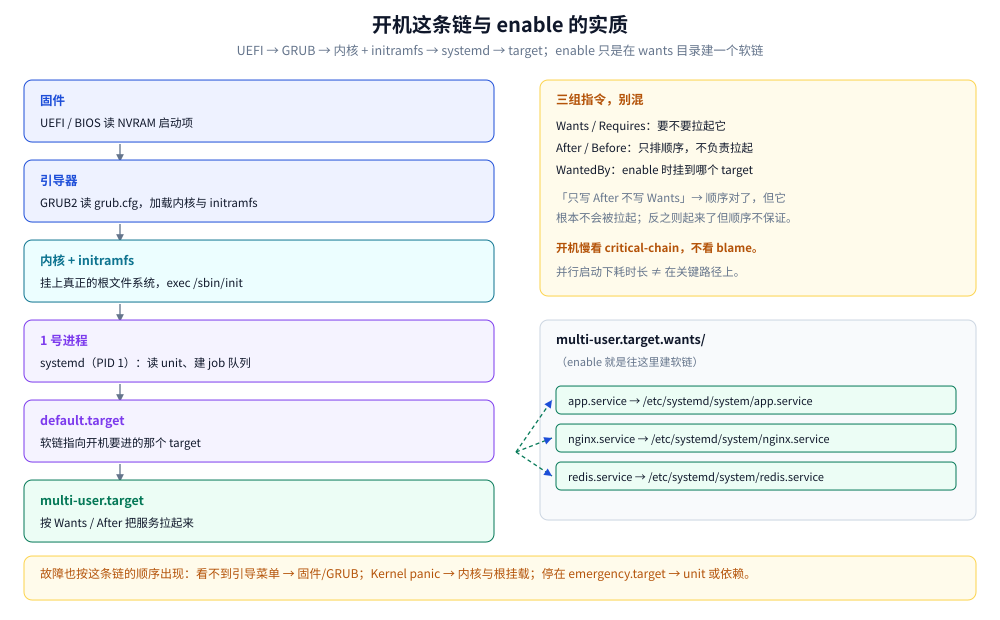
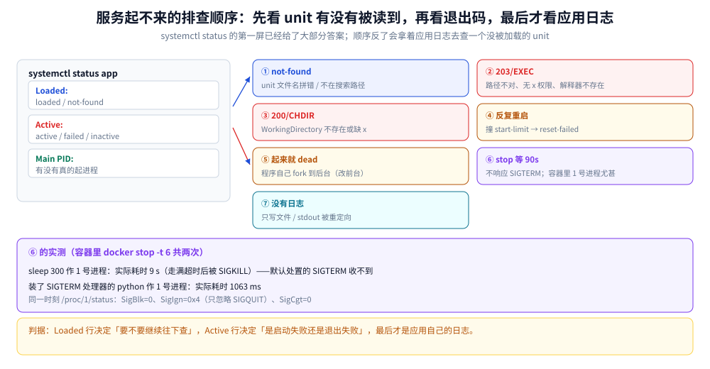

# 系统与服务

> 覆盖：从加电到「服务可用」这条链（UEFI → GRUB → initramfs → systemd → target → unit）、`systemd` 作为 1 号进程的契约（收孤儿、转信号、接日志）、service unit 的三段写法、`active` 与 `enabled` 两组正交状态、依赖与 target 的挂载关系、用 cgroup 给服务做资源限制、与 journald 的联动，以及「服务起不来」的七种原因。
>
> 不覆盖：unit 里 `User=` / `Group=` 背后的权限语义见 [权限与能力模型.md](权限与能力模型.md)；信号与进程状态（`SIGTERM` / `SIGKILL` / `SIGHUP`）的机制见 [进程与线程模型.md](../操作系统/进程与线程模型.md)；日志体系与轮转见 [07-日志与journalctl.md](鸟哥基础学习篇/07-日志与journalctl.md)；容器为什么一般不以 systemd 为 1 号进程见 [容器原理.md](../../06-工程实践/部署/docker/容器原理.md)；按书章节的操作步骤见 [05-服务与systemd.md](鸟哥基础学习篇/05-服务与systemd.md)。
>
> 内容整理自个人学习笔记。**基础框架**参考《鸟哥的 Linux 私房菜：基础学习篇（第四版）》「认识系统服务」相关章节的读后整理；cgroup v2、`Type=` 语义与 1 号进程契约基于 `systemd.unit(5)` / `systemd.service(5)`（systemd 250+）与内核文档独立整理。素材见 [素材清单](../../素材清单.md)。实测口径见第九节。

---

## 一、定位：这条链解决的是「开机之后谁把它拉起来」

**本节要点**：一个二进制要变成「开机就在、崩了自己起、日志有人收」的服务，中间隔着三层：**固件与引导**（找到内核）、**内核与 initramfs**（挂上真正的根）、**1 号进程与 target**（按依赖把服务拉起来）。本篇按这条链的顺序讲，因为**故障也按这条链的顺序出现**。

| 层 | 谁在干活 | 出错时的样子 |
|---|---|---|
| 固件 | UEFI / BIOS，读 NVRAM 里的启动项 | 连引导菜单都看不到，直接进 BIOS 或黑屏 |
| 引导器 | GRUB2，读 `/boot/grub2/grub.cfg` | 停在 `grub>` 提示符，或报 `error: file not found` |
| 内核 + initramfs | 内核解压后执行 `/init`（在内存盘里） | `Kernel panic` / `Unable to mount root fs` |
| 1 号进程 | `systemd`，从 `/etc/systemd/system` 等目录读 unit | 停在 `emergency.target`，或服务反复重启 |
| target | `multi-user.target` / `graphical.target` 等 | 系统起来了但某个服务没起（最轻的一种） |

⭐ 判据：**「机器能不能起来」和「服务能不能起来」是两条独立的问题**。前者看前四层，后者只看最后一层加 unit 文件本身。

## 二、前提：一个进程要能被 systemd 管住，得满足什么

**本节要点**：`systemd` 不管「进程内部怎么跑」，它只做三件事——**按 unit 拉起、盯着主进程、把它拉起重定向到 journald**。所以能被管住的前提只有两条：**前台运行**、**主进程别自己跑掉**。

| 前提 | 不满足时会发生什么 | 怎么改 |
|---|---|---|
| ⭐ **必须前台运行** | 程序自己 `fork` 到后台、父进程退出 → systemd 认为「主进程已退出」，服务被判 `failed`（或反复重启） | 去掉 daemonize（`-D` / `daemon off`），或写 `Type=forking` + `PIDFile=` |
| 主进程不要双重 fork | 同上，且 `PIDFile` 里的 pid 可能已经过期 | 用 `Type=simple` 的现代写法 |
| 日志写 stdout/stderr 即可 | 想收集日志却只写文件 → `journalctl -u` 里空空 | 交给 journald；要落文件用 `StandardOutput=append:/var/log/x.log` |
| 收到 `SIGTERM` 要能退 | 不退 → `stop` 等满 `TimeoutStopSec` 后被 `SIGKILL`，表现为「停服务要等 90 秒」 | 装 `SIGTERM` 处理器做优雅退出 |

⭐ 这里有一个**容易和容器混起来的点**：容器里的 1 号进程同样有「信号默认处置被忽略」的行为（内核只对 init 放过默认处置的信号），所以容器里 `docker stop` 常常等满超时。这件事在第八节给了实测读数，因为它是「服务停不下来」的最常见原因之一。

## 三、最小可运行：一个前台进程 + 一个 unit

**本节要点**：先跑通最小闭环——**前台进程 + 一个 unit + `enable --now`**，再谈依赖与限制。最小 unit 只需要三段：`[Unit]` 说身份、`[Service]` 说怎么跑、`[Install]` 说挂到哪个 target。

```ini
[Unit]
Description=My App
After=network-online.target
Wants=network-online.target

[Service]
Type=simple
User=app
Group=app
WorkingDirectory=/srv/app
ExecStart=/srv/app/bin/app --config /srv/app/config.yaml
ExecReload=/bin/kill -HUP $MAINPID
Restart=on-failure
RestartSec=3
MemoryMax=512M

[Install]
WantedBy=multi-user.target
```

```bash
sudo install -m 0644 app.service /etc/systemd/system/app.service
sudo systemctl daemon-reload          # ⚠️ 改完 unit 必须 reload
sudo systemctl enable --now app       # 设自启 + 立刻启动
systemctl status app                  # 看 loaded / active / enabled 三个词
journalctl -u app -n 50 --no-pager    # 该服务最近 50 行
```

| 判据 | 期望 |
|---|---|
| `status` 第一行 | `● app.service - My App` 且 `Loaded: loaded (...; enabled; ...)` |
| `status` 第三行 | `Active: active (running)` |
| `journalctl -u app` | 能看到应用自己的启动日志（说明 stdout 被接走了） |
| `systemctl is-active` / `is-enabled` | 两个都是 `active` / `enabled`（脚本里用它判断） |

## 四、部署：unit 三段里六个别扭项

**本节要点**：unit 的写法不难，难在六个「写错了不报错、但行为不对」的项。下面按「出错后果」排序。

| 项 | 写对了是什么样 | 写错了的后果 |
|---|---|---|
| ⭐ `Type=` | 前台进程 `simple`；自己 fork 的 `forking` + `PIDFile=`；跑完即退 `oneshot` | 判成 `failed` 或 `activating` 卡住 |
| ⭐ `ExecStart=` | **绝对路径**、不带 shell 特性 | 用 `~` / 环境变量 / 管道 → 启动失败，报 `No such file` |
| `After=` / `Wants=` | `After` 只管**顺序**，`Wants` 管**要不要拉** | 只写 `After=` 不会去拉依赖；只写 `Wants=` 不保证顺序 |
| `Restart=` | `on-failure`（非 0 退出才重启）或 `always` | ⚠️ `on-failure` 对被信号杀死也生效，但正常退出 0 不重启 |
| `RestartSec=` | 3~5 秒，配合 `StartLimitBurst` | 太短会撞上 start-limit，服务进 `failed` 且不再重试 |
| `WantedBy=` | `multi-user.target` | 写错 target → `enable` 建了软链但开机不拉 |

⚠️ **`ExecStart` 必须是绝对路径且不做 shell 展开**：`ExecStart=/bin/sh -c "..."` 可以，但那样 shell 成了主进程，信号转发与退出码都会变形。要环境变量就写 `Environment=` / `EnvironmentFile=`。

⚠️ **`daemon-reload` 不是可选项**：systemd 缓存了 unit 的解析结果，改完文件**必须** `daemon-reload`；只 `restart` 不会重读。同理，`/etc/systemd/system/app.service.d/*.conf` 这类 drop-in 会覆盖主文件，`systemctl cat app` 才能看到**最终生效**的内容。

## 五、使用一：`active` 与 `enabled` 是两组正交状态

**本节要点**：`start/stop` 管**这一次运行**，`enable/disable` 管**下次开机**。两者互不推导，四种组合都合法——「重启后没起来」永远是 `enabled` 的问题，「现在不干活」才是 `active` 的问题。

| 状态组合 | 含义 | 典型场景 |
|---|---|---|
| `active` + `enabled` | 正在跑，且开机会起 | 正常的生产服务 |
| `active` + `disabled` | 正在跑，但重启后不会起 | 手工启动的调试实例 ⚠️ 容易忘了 enable |
| `inactive` + `enabled` | 没在跑，但开机会起 | 刚 `enable` 完还没 `start`；或崩了没重拉 |
| `inactive` + `disabled` | 都没开 | 停机维护 |

```bash
systemctl is-active app ; systemctl is-enabled app     # 脚本里判断用这两条
systemctl list-units --type=service --state=running     # 正在跑的
systemctl list-unit-files --state=enabled               # 开机会起的
systemctl cat app                                       # ⭐ unit 最终生效内容（含 drop-in）
systemctl show app -p MemoryMax -p Restart -p ExecStart # 实际落成的值
```

⚠️ `systemctl status` 的输出里 `Loaded:` 那一行的 `enabled` / `disabled` 是**开机自启**，`Active:` 那一行才是**当前状态**。排障时看错行会得出相反结论。

## 六、使用二：依赖、target 与开机这条链

**本节要点**：`enable` 的实质是**在 target 的 `wants` 目录下建一个软链接**；开机时 systemd 从 `default.target` 出发，按 `Wants` / `Requires` 把 unit 拉进一个 job 队列，再按 `After` / `Before` 排先后。所以「顺序」与「是否拉起」是两件事，分别由两组指令控制。



图中自上而下是 UEFI → GRUB → 内核 + initramfs → `systemd`（PID 1）→ `default.target` → `multi-user.target`，右侧展开 `multi-user.target.wants/` 目录里被 `enable` 出来的软链接。要读出的是：**`enable` 没有改任何配置，它只是在那个目录里建了一个指向 unit 文件的软链**——所以「删掉软链就等于 disable」，`disable` 也不会影响当前正在跑的进程。

| 指令 | 管什么 | 一句话 |
|---|---|---|
| `Wants=` | 要不要拉起（弱依赖，失败不阻塞） | 「顺便也起它」 |
| `Requires=` | 要不要拉起（强依赖，失败则本 unit 失败） | 「它不起我也别起」 |
| `After=` / `Before=` | **只管顺序**，不负责拉起 | 「等它之后再起」 |
| `BindsTo=` | 强绑定，对方停我也停 | 少用，容易连环失败 |

```bash
systemctl get-default                              # 当前 default.target
systemctl list-dependencies multi-user.target       # 这个 target 会拉哪些 unit
systemctl list-dependencies --reverse app           # 谁依赖 app
systemd-analyze blame | head -20                   # 开机各 unit 耗时（谁拖慢开机）
systemd-analyze critical-chain                     # ⭐ 关键路径：真正卡住开机的那条链
```

⭐ **排查开机慢只看 `critical-chain`**：`blame` 列的是「谁耗时长」，但并行启动下耗时长不一定是关键路径；`critical-chain` 才是「删掉/优化它才能提前」的那几个。

## 七、使用三：资源限制与日志

**本节要点**：`CPUQuota` / `MemoryMax` 这些指令最终都落到 **cgroup** 上，所以 `systemctl show` 能把它们读回来；日志则统一进 journald，`journalctl -u` 就是「这个服务的日志」。

```ini
[Service]
CPUQuota=150%            # 最多用 1.5 个核
MemoryMax=512M           # 硬上限，超了被 cgroup OOM 杀
MemoryHigh=400M          # 软上限，超了开始回收（先慢后杀）
IOWeight=100             # 相对 IO 权重
TasksMax=200             # 进程/线程数上限
```

```bash
systemctl show app -p MemoryMax -p CPUQuotaPerSecUSec -p TasksMax   # 落成了什么值
systemd-cgtop                                   # 按 cgroup 看 CPU/内存（像 top）
systemd-cgls                                    # cgroup 层级树
journalctl -u app -f                            # 实时跟踪
journalctl -u app --since "10 min ago" -p err   # 时间 + 级别过滤
journalctl -b -u app                            # 本次开机以来
```

| 坑 | 说明 |
|---|---|
| ⚠️ cgroup v1 与 v2 语义不同 | v1 各子系统独立挂载、一个进程可在多个层级；v2 单一层级。容器侧影响最大（Docker / K8s 的 `cgroupDriver` 要配 `systemd`） |
| ⚠️ `MemoryMax` 到了是**杀进程**，不是变慢 | 与 JVM / Go 的堆上限是两回事，应用侧还要自己设 `-Xmx` / `GOMEMLIMIT` |
| ⚠️ 服务日志进了 journald 但没落盘 | 默认可能只存内存（`Storage=auto` 且 `/var/log/journal` 不存在），重启即丢 |

## 八、排查：服务起不来的七种原因

**本节要点**：`systemctl status` 的第一屏基本已经给了答案——`Loaded` 行看 unit 有没有被读到，`Active` 行看退出码与信号，`Process` / `Main PID` 行看进程有没有真起来。按这张表逐条排，比反复重启快。

| # | 现象 / 报错 | 原因 | 处置 |
|---|---|---|---|
| ① | `Loaded: not-found` | unit 文件名拼错，或没在 `/etc/systemd/system` / `/usr/lib/systemd/system` 里 | `systemctl list-unit-files \| grep 名字` |
| ② | `status=203/EXEC` | `ExecStart` 路径不对、没有执行权限、shebang 的解释器不存在 | `ls -l` 那个绝对路径；⚠️ 权限见 [权限与能力模型.md](权限与能力模型.md) 1.2 |
| ③ | `status=200/CHDIR` | `WorkingDirectory=` 不存在或不可进（目录缺 `x`） | 同上，`namei -l <目录>` 逐段看 |
| ④ | 反复重启，`Start request repeated too quickly` | 起得太快撞上 start-limit | `systemctl reset-failed app`，再查真正的启动错误 |
| ⑤ | 起来了但立刻 `inactive (dead)`，退出码 0 | 程序自己 fork 到后台，systemd 认为主进程结束 | 改前台运行，或用 `Type=forking` + `PIDFile=` |
| ⑥ | `stop` 要等 90 秒 | 进程不响应 `SIGTERM`，等满 `TimeoutStopSec` 才 `SIGKILL` | 装 `SIGTERM` 处理器；临时 `systemctl kill -s KILL app` |
| ⑦ | `journalctl -u` 里没有应用日志 | 应用只写自己的文件，或 stdout 被重定向走了 | 改为写 stdout；或配 `StandardOutput=` |

第 ⑥ 条在容器里能稳定复现，读数如下（两次都是 `docker stop -t 6`，即最多等 6 秒）：

| 容器里的 1 号进程 | `/proc/1/comm` | `docker stop` 实际耗时 | 结论 |
|---|---|---|---|
| `sleep 300`（信号用**默认处置**） | `sleep` | **9 s**（走满超时后 `SIGKILL`） | ⚠️ 默认处置的 `SIGTERM` 对 1 号进程**不生效** |
| 装了 `SIGTERM` 处理器的 python | `python` | **1063 ms** | 装了处理器就能正常退 |

同一时刻 `/proc/1/status` 里的三个位：`SigBlk: 0`、`SigIgn: 0x4`（只忽略 `SIGQUIT`）、`SigCgt: 0`——**`SIGTERM` 不在被忽略或阻塞的集合里，却仍然没送进去**。原因是内核单独对 init 做了处理：**处置为默认的信号不会投递给 1 号进程**（只有装了处理器、或来自祖先命名空间的信号才会）。这就是「服务停不下来」在容器里最隐蔽的一层。



图中左列是 `systemctl status` 的三行输出（`Loaded` / `Active` / `Main PID`），每一行向右分出两到三条支路，落到表里的七种原因上；底部一行是判据——**先看 `Loaded` 判断 unit 有没有被读到，再看 `Active` 的退出码，最后才看应用日志**。顺序反了会拿着应用日志去查一个根本没被加载的 unit。

## 九、校验口径

| 内容 | 状态 | 说明 |
|---|---|---|
| 开机链（UEFI → GRUB → initramfs → systemd → target） | **未实测** | 需要能重启的真机 / 虚拟机；容器里没有 systemd，`/run/systemd/system` 不存在、`systemctl` / `journalctl` 全部 not found（与 [05-服务与systemd.md](鸟哥基础学习篇/05-服务与systemd.md) 篇首记录的同一现象） |
| unit 三段与 `systemctl` 命令 | **只写不跑** | 落地骨架；指令含义与默认值以 `systemd.unit(5)` / `systemd.service(5)`（systemd 250+）为准，配置里的数值是示例 |
| `CPUQuota` / `MemoryMax` 落到 cgroup | **只写不跑** | 语义与容器侧一致（同一套 cgroup），容器里的验证在 [资源限制与运维.md](../../06-工程实践/部署/docker/资源限制与运维.md) |
| 1 号进程信号契约（第八节两张表） | ⭐ **真跑** | `alpine:3.20` + `python:3-alpine`，内核 6.18.54.1；读数：`sleep` 作 1 号进程 `stop` 走满 9 s，装了处理器的 python 1063 ms；`SigBlk=0` / `SigIgn=0x4` / `SigCgt=0` |
| `docker stop` 的耗时 | **真跑** | 计时含 `docker` 客户端往返，两次都取 `-t 6`，只能看「是否走满超时」这个二值结论，不当作精确时延 |

---

## 延伸追问

- **`systemctl` 和 `service` 有什么区别？** → `service` 是 SysVinit 时代的前端，现代发行版通常把它转到 `systemctl`，但行为不完全等价（例如不认 `enable`）。要拿到并行启动、依赖声明、日志联动、cgroup 限制，必须用 `systemctl`。
- **怎么让服务崩溃后自动重启？** → `Restart=on-failure`（或 `always`）+ `RestartSec=`。⚠️ 短时间反复失败会撞 start-limit 进 `failed`，要 `systemctl reset-failed`；正常退出码 0 时 `on-failure` 不触发。
- **改了 unit 为什么没生效？** → 忘了 `systemctl daemon-reload`；或者改的是主文件、生效的是 `app.service.d/*.conf` 这类 drop-in（`systemctl cat` 看最终内容）。
- **`enabled` 了为什么重启后没起来？** → `enable` 只在 target 的 `wants` 目录建软链；如果 `WantedBy=` 写的 target 不是开机进的 target，或者 unit 在 `failed` 状态被 start-limit 挡住，都不会起。用 `systemctl list-dependencies multi-user.target` 确认它在列表里。
- **`status=203/EXEC` 是什么？** → 执行失败：路径不存在、没有 `x` 权限、shebang 的解释器不存在、或文件系统是 `noexec`。先 `ls -l` 那个绝对路径，再 `namei -l` 逐段看目录权限。
- **为什么 `stop` 要等 90 秒？** → 进程不响应 `SIGTERM`，systemd 等满 `TimeoutStopSec` 才 `SIGKILL`。容器里更常见：1 号进程对**默认处置**的信号天然收不到（第八节实测 9 s vs 1063 ms）。
- **容器里为什么一般不用 systemd 做 1 号进程？** → 容器只需要「一个前台进程」，而 systemd 假设自己管整机（cgroup 根、dbus、日志、设备）；在容器里跑 systemd 要 `--privileged` 或大量额外挂载，得不偿失。容器里「1 号进程的职责」由 `tini` / `dumb-init` 这类小工具承担。
- **`systemd-analyze blame` 和 `critical-chain` 该看哪个？** → 排「开机慢」看 `critical-chain`（关键路径）；`blame` 只说明谁耗时长，并行启动下耗时长不等于在关键路径上。
- **cgroup v1 和 v2 的差别对使用者有什么影响？** → v2 是单一层级、一个进程只属于一个 cgroup，管控一致；对容器影响最大（Docker / K8s 的资源限制实现与 `cgroupDriver` 配置）。

## 关联

- **上游/总纲**：[进程与线程模型.md](../操作系统/进程与线程模型.md) — 1 号进程、僵尸进程的回收、信号语义
- **上游/总纲**：[权限与能力模型.md](权限与能力模型.md) — `User=` / `Group=` 与「服务起不来」的权限面
- **对照/互补**：[05-服务与systemd.md](鸟哥基础学习篇/05-服务与systemd.md) — 按书章节的操作步骤与 unit 模板
- **对照/互补**：[10-系统管理综合.md](鸟哥基础学习篇/10-系统管理综合.md) — 例行运维里的服务检查项
- **对照/互补**：[11-容器化衔接.md](鸟哥服务器架设篇/11-容器化衔接.md) — 容器与宿主机服务管理的边界
- **下游机制**：[07-日志与journalctl.md](鸟哥基础学习篇/07-日志与journalctl.md) — 日志的持久化、轮转与检索
- **运维/配置**：[资源限制与运维.md](../../06-工程实践/部署/docker/资源限制与运维.md) — 同一套 cgroup 在容器侧的用法
- **运维/配置**：[K8s部署流程.md](../../06-工程实践/部署/k8s/K8s部署流程.md) — requests / limits 与 cgroup 的对应
- **运维/排查**：[性能排查.md](性能排查.md) — 服务在跑但慢，与「起不来」是两条排查线
