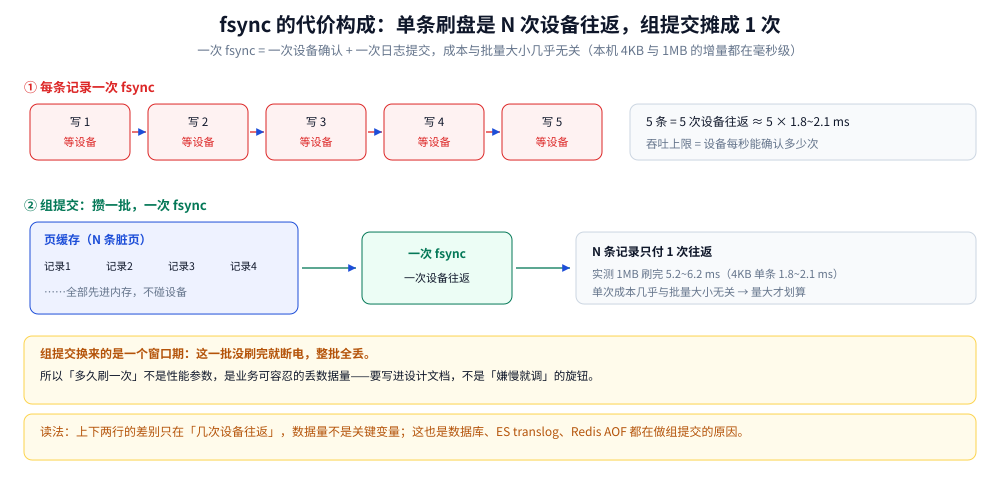

# 落盘路径与 fsync 代价

> 覆盖：一次 `write` 从用户缓冲区到磁盘的六个停留点、`write` 为什么在页缓存就返回、`fsync` / `fdatasync` / `msync` / `sync` / `O_DIRECT` 五条路径的语义差别、这五种写法在本机的实测账（4 KB 与 1 MB 各三轮）、组提交为什么能把「等设备」摊薄，以及怎么验证「数据真的落盘了」。
>
> 不覆盖：文件系统的结构（VFS、inode、dentry、链接）见 [文件系统与VFS.md](文件系统与VFS.md)；Page Cache 与脏页回收水位见 [虚拟内存与页缓存.md](../操作系统/虚拟内存与页缓存.md)；`sendfile` / `splice` 这类不经过用户态的搬运见 [零拷贝.md](../操作系统/零拷贝.md)；I/O 指标怎么读见 [性能排查.md](性能排查.md)。
>
> 内容整理自个人学习笔记，素材见 [素材清单](../../素材清单.md)。第 2.1 节的表是**实测读数**：在 `golang:1.26-bookworm` 容器内（`/tmp` 为 overlayfs，宿主 WSL2 内核 6.18）连跑 3 轮，同一文件反复 `pwrite` 同一段数据、按次均摊。⚠️ **绝对耗时不可外推到裸盘**（Docker Desktop 的 I/O 要穿两层），只能看同一台机器上五种写法的相对关系。

---

## 一、`write()` 返回成功时，数据到底在哪？

**本节要点**：`write` 返回 `n` 只说明**数据进了页缓存**，不说明它到了磁盘。要断电不丢，必须等 `fsync`（或 `fdatasync`）**返回 0**。这条语义是所有数据库 WAL、消息队列刷盘策略的地基。

### 1.1 一次 `write` 的六个停留点

```text
① 用户缓冲区（bufio.Writer / BufferedWriter，用户态堆里的字节数组）
      ↓ write(fd, buf, n)  系统调用陷入内核
② 页缓存 Page Cache（内核态内存；⭐ 拷到这里 write 就返回了）→ 页被标 dirty
③ 块层 Generic Block Layer：合并、排序请求 → IO 调度（mq-deadline / kyber / bfq）
④ 设备驱动（SCSI / NVMe 队列）
⑤ 磁盘 / SSD 的控制器缓存（易失，⚠️ 这一层也可能丢）
⑥ 盘片 / NAND 介质（到这里才真正不丢）
```

⚠️ **关键在 ②**：`write` 在页缓存这一步就返回成功，后面的 ③④⑤⑥ 由内核异步推进。

| 停留点 | 断电会不会丢 | 谁负责推进 |
|---|---|---|
| ① 用户缓冲 | 丢 | 应用自己 `flush` |
| ② 页缓存 | **丢**（内存易失） | 内核异步回写 / 应用 `fsync` |
| ③④ 块层与队列 | 丢 | 内核 |
| ⑤ 盘控制器缓存 | ⚠️ **可能丢**（除非开了 write cache 保护 / FUA） | 设备 |
| ⑥ 介质 | 不丢 | — |

⭐ 第 ⑤ 行是很多人漏掉的一层：**`fsync` 只保证「交给设备并要求它确认」**，如果盘自己的写缓存没开保护、又没被要求 `FLUSH CACHE`，断电仍可能丢。企业盘的 BBWC / 电容保护解决的就是这一层。

### 1.2 三条旁路：改的是「绕开谁」


图中从左到右是用户缓冲 → 页缓存 → 块层 → 设备四段，`write` 的返回点画在页缓存那一格；下面三条支路分别标出 `+fsync`（在页缓存之后加一道「等设备确认」）、`O_DIRECT`（跳过页缓存直达设备）、`mmap`（把页缓存映射进用户地址空间）。要读出的结论是：**三条路绕过的是不同的层，谁也没绕过「设备确认」这一步**。

| 调用 | 语义 | 它绕开了什么 | 代价 |
|---|---|---|---|
| ⭐ `fsync(fd)` | 该文件**所有脏页 + 元数据**（inode、大小、mtime）强制回写并**等设备确认** | 什么也没绕开 | 一次设备往返 + 一次日志提交 |
| `fdatasync(fd)` | 只刷**数据**，元数据只在「影响读取」时才刷 | 省掉元数据那次提交 | 比 `fsync` 便宜三分之一到一半（见 2.1） |
| `sync()` / `sync` 命令 | 刷**整个系统**的脏页 | — | ⚠️ 会引发 IO 洪峰，生产慎用 |
| `msync(addr)` | 刷 **mmap 映射区** | — | 与 `fsync` 同量级 |
| `O_SYNC` / `O_DSYNC` 打开 | 每次 `write` **自动**做一次 fsync | — | ⚠️ 慢很多，等于把组提交能力丢掉 |
| ⭐ `O_DIRECT` 打开 | **绕过页缓存**，在用户缓冲与设备之间直传 | 页缓存（②） | ⚠️ 必须自己保证对齐（地址、长度、偏移都按块）；失去预读与缓存，小随机读变慢 |
| `mmap` 映射 | 把文件页**映射进用户地址空间**，读写像操作数组 | `read` / `write` 两次拷贝与系统调用 | ⚠️ 缺页开销、回写时机不可控（要 `msync`）、占 RSS |

⭐ **`O_DIRECT` 与 `mmap` 不是同一类**：前者是「不要缓存」，后者是「把缓存借给用户用」。自带缓存的数据库（InnoDB 的 Buffer Pool）才适合 `O_DIRECT`——它不需要第二份缓存；而「读大文件、随机访问、多进程共享」适合 `mmap`。

## 二、`fsync` 到底多贵？

**本节要点**：`fsync` 的耗时**主体是等设备**，不是拷数据——4 KB 与 1 MB 的 `fsync` 增量都在毫秒级，数据量涨 256 倍而耗时只涨约 3 倍。所以「每写一条就 fsync」的吞吐上限由**设备往返次数**决定，与每次写多大关系不大；要提吞吐只能**组提交**。

### 2.1 一组实测：五种写法 × 3 轮

同一文件反复 `pwrite` 同一段数据、按次均摊（3 轮独立运行；`/tmp` 为 overlayfs，容器 `golang:1.26-bookworm`，宿主 WSL2 内核 6.18）：

| 4 KB 操作 | 第 1 轮 | 第 2 轮 | 第 3 轮 |
|---|---|---|---|
| `write`（仅进页缓存） | 4.0 µs | 3.6 µs | 2.6 µs |
| `write` + `fsync` | 1825.2 µs | 1872.3 µs | 2062.4 µs |
| `write` + `fdatasync` | 1139.6 µs | 1075.8 µs | 1260.2 µs |
| `fsync`（没有新脏数据） | 339.0 µs | 162.6 µs | 232.9 µs |
| `write` + `O_DIRECT`（无 `fsync`） | 406.9 µs | 229.2 µs | 299.9 µs |

| 1 MB 操作 | 第 1 轮 | 第 2 轮 | 第 3 轮 |
|---|---|---|---|
| `write`（仅进页缓存） | 112.4 µs | 78.7 µs | 83.2 µs |
| `write` + `fsync` | 6226.4 µs | 5155.8 µs | 5151.0 µs |
| `write` + `fdatasync` | 3644.7 µs | 3321.3 µs | 3755.3 µs |
| `write` + `O_DIRECT`（无 `fsync`） | 4293.2 µs | 3853.9 µs | 3883.2 µs |

### 2.2 四条读法

1. **`write` 与落盘差三个数量级**：4 KB 进页缓存 2.6–4.0 µs，加上 `fsync` 变成 1.8–2.1 ms，差约 **500 倍**；1 MB 写 78.7–112.4 µs（折合 9–13 GB/s，就是内存拷贝速度），加 `fsync` 到 5.2–6.2 ms。所谓「写很快」只对内存成立。
2. **`fsync` 的主体是「等设备」**：4 KB 与 1 MB 的增量都在毫秒级，数据量涨 256 倍而耗时只涨约 3 倍——**一次设备确认（含文件系统日志提交）本身就是这个量级**。
3. **`fdatasync` 便宜三分之一到一半**（1139.6–1260.2 对 1825.2–2062.4 µs）：省掉的是元数据那次提交。追加写日志这种「数据对就行、mtime 无所谓」的场景用它就够。
4. **`fsync` 空刷也不免费**（162.6–339.0 µs），`O_DIRECT` 则把「等设备」搬进了 `write` 本身（229.2–406.9 µs，与 `fsync` 同量级）——**它绕过的只是页缓存，绕不过设备**。

### 2.3 组提交：把 N 次等设备摊成 1 次

既然一次 `fsync` 的成本是「一次设备往返」，那**每秒能刷多少次就约等于设备的 IOPS 上限**，与每批多大无关。于是所有要求「不丢」的系统都做同一件事：**攒一批再刷一次**。



图上半部分是一条记录一次 `fsync`：N 条记录 = N 次设备往返，横轴是时间、每格一次往返；下半部分是组提交：N 条记录先进页缓存，一次 `fsync` 只做一次往返。右下角的读数是本节实测——4 KB 单条 1.8–2.1 ms，而 1 MB 一次刷完的总增量只有 5.2–6.2 ms，**单次成本几乎与批量大小无关**。

| 系统 | 组提交的形态 | 源码 / 参数里的样子 |
|---|---|---|
| InnoDB | redo log 攒到 `innodb_flush_log_at_trx_commit=2`（每秒刷）或组提交 | `innodb_flush_log_at_timeout` |
| Kafka | 不用 `fsync` 换吞吐，靠**多副本**兜底 | `flush.messages` / `log.flush.interval.messages` |
| Redis AOF | `appendfsync everysec`：每秒一次 | `appendfsync always` 才逐条 |
| PostgreSQL | `commit_delay` + `synchronous_commit` | 组提交由 WAL writer 统一做 |
| RocksDB | `WriteOptions.sync=false` + WAL 组提交 | `manual_wal_flush` |

⚠️ **组提交换来的是「窗口期」**：一批没刷完时断电，这一批全丢。所以「多久刷一次」不是性能参数，而是**业务可容忍的丢数据量**——这一点必须写进设计文档，不能当成「嫌慢就调」的旋钮。

### 2.4 口径警告

⚠️ **本表只能比同一台机器上的相对关系**：overlayfs + WSL2 的绝对耗时明显高于裸 NVMe（Docker Desktop 的 I/O 要穿过两层）。换盘、换文件系统、换云盘（尤其是网络盘，一次往返从 0.1 ms 变 1 ms 以上）都要重测，**不能把毫秒数直接搬进容量规划**。

## 三、应用场景

**本节要点**：`fsync` 的语义与代价决定了四类系统的核心取舍——数据库用它换持久化、消息队列用它换吞吐（或干脆不用）、文件服务用它换一致性、容器用它解释「为什么写日志会卡」。

| 场景 | 用哪条路径 / 哪个语义 | 为什么值得注意 |
|---|---|---|
| 数据库（InnoDB） | redo log 用 `fsync` 换「不丢」，数据页用 `O_DIRECT` 绕开双缓存 | 刷盘策略与文件系统缓存叠加会互相踩，详见 [参数调优.md](../../03-数据与中间件/数据存储/关系型/MySQL/参数调优.md) 与 [日志与持久化.md](../../03-数据与中间件/数据存储/关系型/MySQL/日志与持久化.md) |
| 搜索引擎（ES） | translog 的 `fsync` 频率决定「丢多少」 | `index.translog.durability` 从 `request` 改成 `async` 就是拿丢数据换吞吐，详见 [写入流程.md](../../03-数据与中间件/数据存储/搜索与分析/Elasticsearch/写入流程.md) |
| 消息队列（Kafka） | 不逐条 `fsync`，靠副本与顺序写 | 顺序写把随机 IO 摊成顺序；可靠性由 ISR 副本提供，不是由 `fsync`，详见 [核心概念与架构.md](../../03-数据与中间件/中间件/消息队列/Kafka/核心概念与架构.md) |
| 缓存 / KV（Redis AOF） | `appendfsync everysec` 每秒一次 | `always` 会把吞吐压到设备 IOPS 量级；`everysec` 的代价是最多丢 1 秒 |
| 容器可写层 | overlayfs 上的 `fsync` 要穿两层，且写时复制会放大 | 容器里写日志比裸机慢，`docker diff` 能看见的正是可写层，详见 [网络与存储.md](../../06-工程实践/部署/docker/网络与存储.md) |
| 静态文件服务（Nginx） | 大文件读走 `sendfile`，不碰用户态 | `sendfile` / `tcp_nopush` 只对大文件有效，详见 [01-编译安装与配置.md](深入理解Nginx/01-编译安装与配置.md) |
| 日志采集 | 追加写 + 定期 `fsync`，不能每条一刷 | 每条一刷的吞吐上限是设备往返次数（2.1），一个服务就能打满盘 |
| 备份 / 归档 | 写完 `fsync` 再 `rename` | `rename` 是原子的，但**必须先刷数据**，否则崩溃后可能看到「名字有了、内容空」 |

## 四、具体使用

**本节要点**：两件事——**验证落盘**（`fsync` 返回值才是判据，不是 `write` 的返回值）与**量自己的盘**（同一份代码在本机跑一遍，比抄别人的数字可靠）。

### 4.1 怎么确认真的落盘

```bash
sync                        # 手动刷全部脏页（关机 / 拔盘前）
grep -E '^Dirty|^Writeback' /proc/meminfo   # 还有多少脏页没落
cat /proc/<pid>/io          # write_bytes / cancelled_write_bytes（进程级）
```

| 判据 | 说明 |
|---|---|
| `fsync` 返回 0 | ⭐ 唯一可靠的「已落盘」信号（`write` 返回 n 不算） |
| 崩溃后文件内容完整 | 需要「先 `fsync` 数据、再 `rename` 名字」的顺序，否则可能看到空文件 |
| `dirty` 长时间高 | 回写跟不上写入，见 [虚拟内存与页缓存.md](../操作系统/虚拟内存与页缓存.md) 2.3 |

```go
f, _ := os.OpenFile("a.log", os.O_CREATE|os.O_WRONLY|os.O_APPEND, 0644)
defer f.Close()
n, err := f.Write(buf)   // ⚠️ 这里返回成功，数据只在页缓存
_ = n
if err := f.Sync(); err != nil {   // ⭐ 到这里才算落盘
    return err
}
```

### 4.2 怎么量自己的盘

同一份探针在本机跑，比抄数字可靠得多。最小骨架是「同一文件 `pwrite` 同一段 + 按次均摊 + 连跑 3 轮」：

```c
for (int r = 0; r < N; r++) {
    t0 = now_ns();
    pwrite(fd, buf, len, 0);        /* 只进页缓存 */
    t1 = now_ns();
    pwrite(fd, buf, len, 0);
    fsync(fd);                      /* 等设备确认 */
    t2 = now_ns();
    /* 记 (t1-t0)/N 与 (t2-t1)/N，不要只记总时长 */
}
```

| 要做对的事 | 为什么 |
|---|---|
| 每轮独立进程 / 独立文件 | 缓存预热会让第二轮快一个数量级 |
| 连跑 3 轮并报告波动 | 单轮读数会被后台 IO 与其他容器干扰 |
| 区分「进页缓存」与「等设备」两段 | 两段差 2–3 个数量级，混在一起就没有信息 |
| 记录文件系统与挂载点 | overlayfs / ext4 / 网络盘的同一段代码能差 10 倍 |

---

## 延伸追问

- ⭐ **`write()` 返回成功，数据就落盘了吗？** → ❌ 没有。`write` 只把数据拷进**页缓存**就返回，页被标脏后由内核异步回写。必须 `fsync` / `fdatasync`（mmap 用 `msync`）**返回 0**，才保证断电不丢（见 1.1）。
- **`fsync` 为什么这么慢，能批量做吗？** → 一次 `fsync` = 一次设备确认 + 一次文件系统日志提交，4 KB 与 1 MB 的增量都在毫秒级，**与写多少关系不大**（见 2.1）。所以吞吐上限由设备往返次数决定，做法是**组提交**；`fdatasync` 省掉元数据提交，实测便宜三分之一到一半。
- **`fdatasync` 和 `fsync` 该用哪个？** → 追加写日志、只关心数据内容的场景用 `fdatasync`；需要保证**文件大小 / mtime 也一致**（如「写完改名」的原子替换）必须 `fsync`（见 1.2）。
- **`O_DIRECT` 的代价是什么？** → 必须自己保证内存地址、长度、文件偏移都按块对齐；失去页缓存的预读与合并，小随机 IO 反而更慢；与页缓存并存还可能读到不一致的数据。适合自带缓存的数据库（见 1.2）。
- **`fsync` 返回 0 就绝对不丢吗？** → 还要看盘自己的写缓存：如果设备缓存没开保护、又没被要求 flush，断电仍可能丢那一层（1.1 的第 ⑤ 站）。
- **为什么 Kafka 不逐条 `fsync` 也敢说不丢？** → 它把可靠性放在**多副本**上（ISR），单机刷盘交给操作系统批量回写，换的是吞吐；单机 `fsync` 只有一份数据时才有意义（见 2.3）。
- **一块盘每秒能刷多少次？** → 由设备往返延迟决定：4 KB 每次 1.8–2.1 ms → 单线程约 500 次/秒；要更高必须组提交或换更快的盘（见 2.1、2.3）。

## 关联

- **上游/总纲**：[文件系统与VFS.md](文件系统与VFS.md) — 本篇讲「写下去要多久」，那篇讲「文件长什么样」（inode / dentry / 链接）
- **上游/总纲**：[虚拟内存与页缓存.md](../操作系统/虚拟内存与页缓存.md) — 页缓存与脏页回写水位（`dirty_ratio` 击穿时 `write` 被迫同步等磁盘）
- **对照/互补**：[零拷贝.md](../操作系统/零拷贝.md) — `write` 与 `sendfile` 的拷贝次数对照
- **对照/互补**：[用户态内核态与一次IO的内存路径.md](../操作系统/用户态内核态与一次IO的内存路径.md) — 文件这一支与 socket 那一支共用同一块 DDR
- **运维/排查**：[性能排查.md](性能排查.md) — `iostat` 的 `await` / `aqu-sz` 判「真的在排队」
- **对照/互补**：[02-文件系统与XFS.md](鸟哥基础学习篇/02-文件系统与XFS.md) — 挂载选项（`noatime` / `discard`）对写路径的影响
