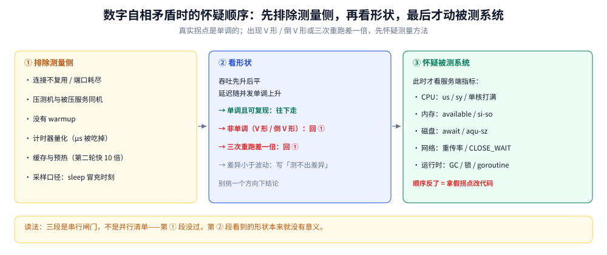

# 读数可信度

> 覆盖：一次压测 / 基准测出来的数字**什么时候不该信**——非单调与大幅波动的形状判据、测量侧六类故障（连接不复用、同机争抢、无 warmup、计时器量化、缓存预热、采样口径造假）、以及「什么时候才轮到怀疑被测系统」的三步顺序。
>
> 不覆盖：指标本身怎么读（CPU / 内存 / 磁盘 / 网络各列）见 [性能排查.md](性能排查.md)；具体命令见 [常用命令.md](常用命令.md) 第十节；Go 侧微基准的写法（`b.N` 与 `b.Loop` 的计时语义、两个「被编译器优化没了」的陷阱）见 [测试与Mock.md](../../01-编程语言/go/工程实践/测试与Mock.md) 第六节；`fsync` 那组读数的口径警告见 [落盘路径与fsync代价.md](落盘路径与fsync代价.md) 2.4。
>
> 内容整理自个人学习笔记，素材见 [素材清单](../../素材清单.md)。本篇的读数全部来自真实踩坑：第 1.1 节是自研网关压测的历史记录（引自 `docs/性能压测报告.md` §2.1），第 2.4 节是 SQLite 取数实验里的计时器量化（同一份探针在 Windows 上读到 0 / 52 µs / 544 µs 三种值），第 2.6 节是采样时刻表算反的那次。**这些数字的价值不在大小，而在它们都是「测量方法错了」留下的痕迹**。

---

## 一、数字自相矛盾时，先怀疑谁？

**本节要点**：先怀疑**测量方法**，再怀疑被测系统。判据是**形状**：真实系统的性能拐点是**单调**的（吞吐先升后平、延迟随负载单调上升），出现「V 形」「倒 V 形」或三次重跑差一倍，几乎总是测量侧的问题。

### 1.1 一个真实案例：每请求新建连接 → 临时端口打满

给自研网关做压测时，脚本最初**每个请求新建一条 TCP 连接**（虽然带了 `Connection: keep-alive` 请求头，但连接用完就 `close()`——头部与实际行为不符）。连打几万次之后，Windows 的临时端口（默认约 1.6 万个）连同 `TIME_WAIT` 一起被打满，于是得到自相矛盾的数字：

```text
（修复前，同一配置、同一路径 /limited、c=20）三次: 297 / 486 / 432 RPS
（修复前，并发扫描 /slow?ms=5）c=40 → 15 RPS，而 c=80 → 589 RPS   ← 明显不是网关的行为
```

**修复**：每个 worker 持有一条长连接并复用，只在连接真的坏了时重连。修复后同一组合的数字立刻进入同一量级且稳定。

⭐ 这组数字最值得记的不是数值，而是它**长什么样**：并发从 40 加到 80，吞吐涨了 39 倍——真实系统的拐点不会这样。**「加并发反而暴涨」只可能是测量侧换了瓶颈**（这里是端口从耗尽变成没耗尽）。

### 1.2 两条形状判据

| 现象 | 结论 |
|---|---|
| **非单调**：并发越高越慢、再加并发又变快 | 测量方法有问题（典型是端口耗尽、客户端先成了瓶颈） |
| 同一配置连跑三次**差一倍以上** | 测量方法有问题（连接未复用、无 warmup、外部负载干扰） |
| 同一配置连跑三次**差几个百分点** | 正常噪声，可以报中位数 + 波动范围 |
| 延迟 P99 随并发**单调**上升、吞吐先升后平 | ⭐ 这是真实拐点该有的形状 |

⭐ 反过来也成立：**真实拐点是单调的**。看到「V 形」或「倒 V 形」，先把测量侧排除掉，再谈系统。

### 1.3 为什么真实拐点一定单调

因为那三条曲线背后是同一件事的两面：并发上去 → 排队变长 → 延迟上升 → 吞吐触顶。**排队只会让等待变长，不会让等待变短**。所以：

- 吞吐随并发：**先近似线性、后走平**（拐点），极端情况下略降（切换与锁开销）；
- 延迟随并发：**单调上升**，拐点之后上翘；
- 只要出现「并发更高、延迟更低」，必然是**两组测量测的不是同一个东西**（典型：低并发时客户端没打满、高并发时反而打满了）。

## 二、测量侧的六类故障

**本节要点**：这六类故障的共同点是**它们都在被测系统之外**，所以从服务端指标上完全看不出异常——服务端只是「收到更少的请求」，它自己很健康。

### 2.1 连接不复用 / 临时端口耗尽

| 项 | 说明 |
|---|---|
| 成因 | 每个请求新建连接；`TIME_WAIT` 占用临时端口（默认约 1.6 万） |
| 表现 | 打一段时间后 RPS 断崖、报 `cannot assign requested address`；低并发反而比高并发快 |
| 判据 | `ss -s` / `netstat -s` 看 `TIME_WAIT` 数是否逼近万级；本机空闲态实测 **21** 条、`ESTABLISHED` **48** 条，压测中若到万级就是它 |
| 处置 | 客户端长连接池；`tcp_tw_reuse`（服务端无解，问题在客户端） |

### 2.2 同机争抢：压测机与被压服务在一台机器上

压测机自己的 CPU / 网卡先打满是常态——尤其在本机跑「客户端 + 服务端」时。测到的是**两者的和**，而且拐点位置由压测机决定。判据：压测期间 `mpstat -P ALL 1` 若客户端进程所在核已经 100%，数字只能当「本机同时跑两个进程时的上界」。

### 2.3 没有 warmup

连接池要建、JIT 要编译、缓存要预热、页缓存要读进来。**前三秒的数字通常不代表稳态**。做法：先跑够丢弃期（如 10% 时长或前 30 秒），再开始统计；Go 侧用 `-benchtime=5s -count=5` 而不是默认的 1 秒 1 次。

### 2.4 计时器量化：µs 级读数被毫秒粒度吃掉

这是最容易得出**反向结论**的一类。实测：在 Windows 上对同一条 SQLite 查询连跑五次，`time.Now()` 的差值分别是 **0 / 52 µs / 544 µs**——不是查询变快了，而是**计时器的粒度把它量化到了毫秒边界**。

| 现象 | 真相 |
|---|---|
| 单次测得的耗时在 `0`、`52 µs`、`544 µs` 之间跳 | 计时器量化，`0` 表示「小于一个粒度」 |
| 两个实现在单次测量下「差不多快」 | ⭐ 可能只是都落进了同一个量化桶 |
| 换成「N 次累计 ÷ N」后差距变成 611 倍 | 这才是真实差距（覆盖索引 108.7 µs vs 全表 66.4 ms） |

⭐ 判据：**当读数落在整百 ns / 整十 µs 的整齐倍数上，先怀疑计时器**。对策是**累计取平均**（N 次做一个循环，只取一次时间差），而不是「单次多测几次取最小」。

### 2.5 缓存与预热：第二轮快一个数量级

同一份代码跑两轮，第二轮往往快 10 倍——页缓存热了、分支预测器学了、JIT 编译完了。⚠️ 这会让「改前 / 改后」的对比彻底失真（改后的那一版总是后跑的）。做法：**交替跑（A/B/A/B）**，或者每轮都重启进程并清掉页缓存（`echo 3 > /proc/sys/vm/drop_caches`，⚠️ 仅测试机）。

### 2.6 采样口径造假：``sleep $t`` 里装的是「本次睡多久」

一个真实的口径错误：采样脚本写成 `for t in 5 10 20; do sleep $t; done`，然后标注「每隔 N 秒采一次」。实际上从第二轮起是**累加**的：第 1 次等 5 s、第 2 次再等 10 s（累计 15 s）、第 3 次再等 20 s（累计 35 s）。标成「15 秒一轮」会把结论整体算反。

⭐ 对策只有一条：**逐点打时间戳**（`date +%s`），或者显式累加偏移。别用「睡眠时长」冒充「时刻」。

## 三、什么时候才轮到怀疑被测系统？

**本节要点**：判据是**可解释性**。把测量侧的疑点全部排除后，如果剩下的数字仍然指向同一个拐点、且**多轮重跑都在同一个位置**，才轮到怀疑系统。



图中自左向右是三段：第一段列测量侧的六类故障（连接、同机、warmup、计时器、缓存、采样），第二段是形状判据（非单调 → 回第一段；单调且可复现 → 往下走），第三段才是「怀疑被测系统」。底部标出一句话：**顺序反了的代价是拿着假拐点去改代码，改完「变好」了，其实只是噪声换了方向**。

| 步骤 | 要排除的 | 通过了才往下走 |
|---|---|---|
| ① 排除测量侧 | 连接复用、同机争抢、warmup、计时器粒度、缓存预热、采样口径 | 六项都过 |
| ② 看形状 | 拐点单调、多轮重跑位置一致 | 是 |
| ③ 怀疑系统 | 此时才看服务端指标（CPU / IO / GC / 锁） | — |

⚠️ **顺序反了的代价**：拿着一个假的拐点去改代码，改完数字「变好」了，其实只是测量噪声换了方向——下次换个环境又坏，而你已经「证明」过改对了。

## 四、应用场景

**本节要点**：这套判据不只用于压测，凡是「用数字说服人」的场合都适用——技术选型对比、容量规划、线上容量评估、以及自己写微基准。

| 场景 | 哪一条在起作用 | 后果 |
|---|---|---|
| 压测报告 | 1.2 的形状判据 + 2.1 连接复用 | 报告里出现「加并发吞吐翻倍」这类数字，会被一眼看穿 |
| 选型对比（A vs B） | 2.3 warmup + 2.5 交替跑 | 总是后跑的那个吃亏，结论会反 |
| 容量规划 | 2.4 计时器量化 | µs 级差异被量化吃掉，误判「两个方案一样快」 |
| 线上容量评估 | 2.2 同机争抢 | 压测机与被压服务同机，测到的是两台机器的和 |
| 微基准（`go test -bench`） | 2.5 缓存效应 + 2.3 warmup | 默认 1 秒 1 次，噪声常大于差异 |
| 监控图看趋势 | 2.6 采样口径 | 「每隔 N 秒」算错，趋势整个反了 |
| 别人给的数字 | 全部 | ⭐ 只有带口径（机器、版本、轮次、波动）的数字才能引用 |

## 五、具体使用

**本节要点**：三张纸就够——**开测前的检查单**、**读结果时的形状判据表**、**写结论时必须附的四项口径**。

### 5.1 开测前的检查单

- [ ] **连接复用**了吗？客户端持长连接 vs 每请求新建（后者会打满临时端口并与 `TIME_WAIT` 叠加）
- [ ] 压测机与**被压服务在同一台机器**吗？同机时两者抢 CPU，测到的是它们的和
- [ ] 压测机自己的 **CPU / 网卡**有没有先打满？
- [ ] 有没有 **warmup**？连接池、缓存、JIT 都要预热
- [ ] 看的是 **P99 还是平均值**？平均值会掩盖长尾
- [ ] `TIME_WAIT` 有多少？本机空闲态 21 条；压测中逼近万级就是端口正在耗尽
- [ ] **计时粒度**够用吗？要测 µs 级差异就必须累计取平均（2.4）

### 5.2 读结果时的判据表

| 看到的形状 | 判断 | 下一步 |
|---|---|---|
| 吞吐先升后平、延迟单调上升 | ⭐ 真实拐点 | 记录拐点位置与当时的资源占用 |
| 吞吐非单调（V 形 / 倒 V 形） | 测量侧 | 回 2.1 ~ 2.6 逐条排 |
| 三次重跑差一倍 | 测量侧 | 查 warmup、连接复用、外部负载 |
| 两个方案差异小于波动范围 | **测不出差异** | 加大样本 / 换更细的计时方式 / 直接说「无显著差异」 |
| 读数落在整百 ns、整十 µs | 计时器量化 | 改累计取平均 |

### 5.3 写结论时必须附的四项口径

| 项 | 例 |
|---|---|
| **机器与虚拟化层** | 「WSL2 / 容器 overlayfs / 裸 NVMe」——同一段代码能差 10 倍 |
| **版本** | 运行时、内核、压测工具版本 |
| **轮次与波动** | 「3 轮，±8%」而不是「一次，1234 RPS」 |
| **能外推到哪** | 「只能比同机相对关系，绝对耗时不可搬」 |

⚠️ **少了第四项的结论最危险**：它看起来是事实，实际只在那一台机器成立。本仓所有带读数的篇都在引语里写了这一项，原因就在这里。

---

## 延伸追问

- **压测数字为什么会「加并发反而更快」？** → 测量侧换了瓶颈：低并发时客户端已经打满（端口耗尽 / 同机争抢），加并发反而绕开了那个瓶颈。真实系统的拐点不会这样（1.1、1.2）。
- **怎样一眼判断一组性能数字不可信？** → 看三条：非单调、三次重跑差一倍、缺少口径（机器 / 轮次 / 波动）。命中任一就先查测量侧（1.2、5.3）。
- **单次测量的 µs 数为什么不能信？** → 计时器有粒度，Windows 上实测同一条查询读出 0 / 52 µs / 544 µs 三种值；µs 级结论必须累计取平均（2.4）。
- **为什么改完代码「变快了」，过几天又慢回去？** → 很可能第一次是缓存预热 / 噪声方向变化造成的假改善。要用交替跑（A/B/A/B）排除顺序效应（2.5）。
- **`sleep 15` 循环采样为什么不能标「每隔 15 秒」？** → `sleep` 的参数是「本次睡多久」，累积起来是 5/15/35 秒。要标时刻就打时间戳（2.6）。
- **两个方案差 3% 该怎么写结论？** → 先看波动范围：波动 ±8% 时 3% 属于**测不出差异**，应直接写「无显著差异」，而不是挑一个方向下结论（5.2）。
- **同机压测能得出什么结论？** → 只能得「本机同时跑客户端与服务端时的上界」；要比两个服务端，必须换到两台机器或至少交替跑（2.2）。
- **为什么压测要看 P99 而不是平均？** → 平均值会把长尾摊平；拐点通常先在 P99 上出现，平均值还很好看（1.3、5.1）。

## 关联

- **上游/总纲**：[性能排查.md](性能排查.md) — 指标怎么读；本篇讲「读到的数字能不能信」
- **上游/总纲**：[落盘路径与fsync代价.md](落盘路径与fsync代价.md) — 一组带完整口径的实测该怎么写（2.4 是那条口径警告）
- **对照/互补**：[测试与Mock.md](../../01-编程语言/go/工程实践/测试与Mock.md) — Go 侧微基准的写法（第六节）与「三轮取区间、不跨进程比」的统计口径
- **对照/互补**：[pprof性能分析.md](../../01-编程语言/go/运行时/pprof性能分析.md) — 排查线上时采集的是真实流量，不存在压测机的问题
- **对照/互补**：[JFR与诊断工具.md](../../01-编程语言/java/运行时/JFR与诊断工具.md) — JVM 侧的采样与开销
- **运维/排查**：[常用命令.md](常用命令.md) — `ss -s` / `mpstat` / `iostat` 的参数速查
- **查表**：[抓包实战.md](../网络/观测与排障/抓包实战.md) — 抓包本身也会影响被测系统的吞吐
