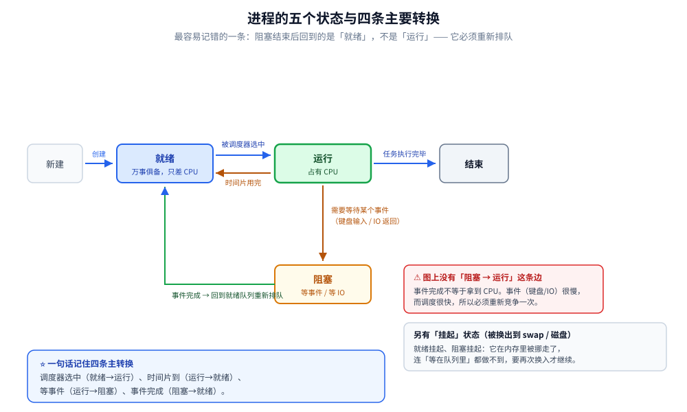
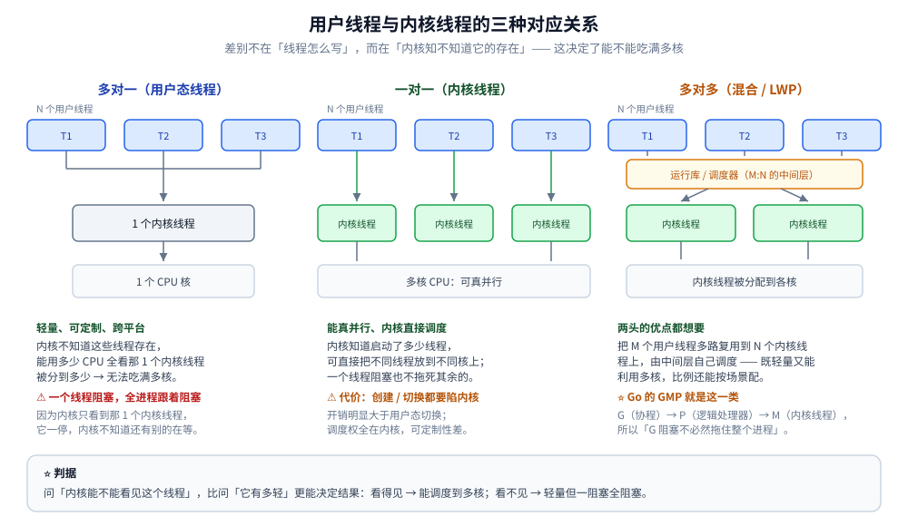

# Linux 进程与线程

> 覆盖：进程的定义与四个特点、PCB、并发与并行、五个状态与转换、就绪/阻塞队列与上下文切换；Linux 线程的三种对应关系（多对一 / 一对一 / 多对多）与三种实现方式（用户线程 / 内核线程 / LWP）；进程与线程的三段对照与多线程带来的问题。
> 不覆盖：Go 侧的创建成本实测、协程栈内存与超订扫描见 [协程与线程成本.md](../../01-编程语言/go/并发编程/协程与线程成本.md)；Java 侧的线程开销见 [线程与进程开销.md](../../01-编程语言/java/并发/线程与进程开销.md)；Go 调度器的结构（G/M/P）见 [GMP调度.md](../../01-编程语言/go/运行时/GMP调度.md)；上下文切换的观测命令见 [性能排查.md](性能排查.md)；进程之上的一层（守护进程与服务）见 [05-服务与systemd.md](鸟哥基础学习篇/05-服务与systemd.md)。
>
> 内容整理自个人学习笔记，素材见 [素材清单](../../素材清单.md)。

---

## 一、进程是什么？有哪些状态？

**本节要点**：进程 = 运行实例 + **资源分配的基本单位**；它由**程序段 + 数据 + PCB** 三部分组成，五个状态之间由「调度器选中 / 时间片用完 / 等事件 / 事件完成」四条边迁移。这一节是理解第三节「进程与线程的区别」的地基。

### 1.1 进程的定义

> **进程 = 应用程序运行的实例**，同时也是**操作系统进行资源分配的基本单位**。

**怎么理解「运行实例」**（按顺序推演）：

```text
写代码（人类可读）
   ↓ 编译（转成机器可读）
可执行二进制文件（应用程序）
   ↓ 执行
进程 ← 应用程序的运行实例
```

**为什么说是「资源分配的基本单位」**：

> 进程启动后，操作系统会为它**分配独立的内存空间**；进程活动时会**占用一定的 CPU**。

### 1.2 进程的四个特点

| 特点 | 说明 |
|---|---|
| **① 独立性** | **每个进程有独立的内存空间**，互不干扰——A 进程修改自己的内存**不会导致 B 进程异常** |
| **② 并发性** | 多个进程可同时运行，**通过时间片轮转实现并发**。⚠️ 注意：**进程是资源分配的基本单位，线程才是 CPU 调度的基本单位**；不特别说明时进程只有一个主线程，所以时间片轮转本质是**对线程的 CPU 时间片轮转**。**进程与线程是包含关系：进程包含一个或多个线程** |
| **③ 动态性** | 可**动态地创建、运行、暂停、终止**（点一下图标就启动，就是一个动态过程） |
| **④ 结构性** | 由三部分组成：**程序段**（代码）+ **数据**（变量等运行所需数据）+ **进程控制块 PCB** |

**PCB（进程控制块）**：内核中 `task_struct` 结构体实例化出来的对象，保存进程相关的全部信息——

| PCB 保存的内容 |
|---|
| 进程标识符（**PID**，用于标识 / 查找进程） |
| 进程状态、优先级 |
| 资源分配情况 |
| 程序计数器、寄存器等 **CPU 上下文** |

> **每个进程都有且只有一个 PCB 对象。**

### 1.3 理解「并发」与「并行」

**并发（单处理器）**：

> 一台机器只有一个处理器，但我们能同时开记事本、浏览器等一堆程序。为什么？因为**应用程序不是每时每刻都需要 CPU**——比如在记事本里打字属于 **IO 输入行为**，此时 **CPU 处于空闲**，可以交给其他任务。
>
> **本质：多个任务交替使用同一个 CPU**，让我们「感觉」能开大量应用。

**并行（多处理器）**：

> 有多个处理器、多个任务，**每个任务独占一个处理器同时执行**，这才是**真正的同时进行**，**充分利用多核优势**。

### 1.4 进程的五个状态与转换

| 转换 | 触发条件 |
|---|---|
| **就绪 → 运行** | 被调度器选中，分配到 CPU |
| **运行 → 就绪** | **时间片用完且任务未完成**，回到就绪队列等下一轮分配 |
| **运行 → 阻塞** | 需要**等待某个事件**（如等待键盘输入、等待 IO 返回） |
| **阻塞 → 就绪** | 事件完成。⚠️ **不是直接回到运行态**——而是回到就绪队列**等待下一次被调度**。原因：事件（键盘输入）很慢，而 CPU 调度相对快得多，所以需要重新排队 |
| **运行 → 结束** | 任务成功执行完毕 |

（另有**挂起状态**。）



图注：五状态之间只有四条主要迁移边——就绪↔运行由调度器与时间片驱动，运行→阻塞由等事件触发；⚠️ 阻塞态事件完成后回到**就绪队列**而不是直接占用 CPU。

### 1.5 进程控制与上下文切换

**两个队列**（与状态对应，通常用**链表**实现，便于插入删除）：

| 队列 | 内容 |
|---|---|
| **就绪队列** | 已就绪、等待 CPU 的进程 |
| **阻塞队列** | 正在等待事件的进程 |

> **单核机器只有一个运行指针；多核机器有多个**。进程就绪后进入就绪队列；运行时把 PCB 交给运行指针；遇到阻塞就移入阻塞队列；事件完成后再回到就绪队列等下一次调度。

**上下文切换（Context Switch）到底是什么**：

> CPU 时间片用完，当前进程**不能再继续执行**，需要把 CPU 交给其他进程。但当前进程**任务还没完成**，所以必须：

```text
① 保存当前进程的上下文（CPU 寄存器等）→ 写回它自己的 PCB
② 从下一个进程的 PCB 中加载上下文
③ 从上次被中断的位置继续执行
```

**为什么要保存上下文**：

> 因为交出 CPU 时进程**并没有完成任务**，必须把「当时执行到哪儿、寄存器是什么值」记下来，下次被调度时才能**还原当时的现场、继续往下跑**。

⭐ 切换的代价不只是存 / 取寄存器：进程切换要**换页表基址（CR3）**，会让 **TLB 与 CPU cache 大面积失效**，这部分隐性成本往往比保存寄存器更大——所以**进程切换比线程切换更贵**。TLB 与地址空间的机制见 [内存管理.md](内存管理.md) 1.5，切换次数的观测见 [性能排查.md](性能排查.md) 第三节。

## 二、Linux 线程是什么？三种实现方式有什么区别？

**本节要点**：核心是**「为什么 Linux 没有独立的线程概念」**——内核用 `clone` / `task_struct` 统一描述进程与线程、两者只是**共享资源不同**。三种实现方式（用户线程 / 内核线程 / LWP）的区别，本质是**用户线程与内核线程的映射关系不同**。

### 2.1 线程的定义与关系

> **线程 = CPU 调度的基本单位**，也是**操作系统能够进行运算调度的最小单位**；是**进程中的一个执行流程（执行单元）**。

**关系要点**：

- 一个进程**可以包含多个线程**；
- 这些线程**共享进程的资源**（内存、打开的文件等）；
- 但**每个线程有自己的上下文**：程序计数器、寄存器、**以及自己的栈空间**。

> **进程分配资源，线程执行计算**——进程要真正对数据进行计算和操作，是由它内部的线程去完成的。

### 2.2 用户线程与内核线程的三种对应关系

| 关系 | 说明 |
|---|---|
| **多对一** | 多个用户线程对应 1 个内核线程。内核**不知道**这些用户线程的存在，能用多少 CPU **取决于那 1 个内核线程被分配了多少** |
| **一对一** | 用户线程与内核线程一一对应。**内核知道启动了多少线程**，可以直接对线程进行调度 |
| **多对多** | 内核的**哪个 CPU 空闲，就把用户线程放到哪个 CPU 上执行**，**充分利用多核、提高并发性能**。**Go 的 GMP 模型就是这一类的典型**（多个 G 通过 P 协调到多个 M 上执行） |



图注：多对一时一个线程阻塞会拖死同进程的全部线程；一对一让内核直接调度（Java 的 `new Thread()` 就是这一格）；多对多是 Go 的 GMP 与 Java 21 虚拟线程的做法。

### 2.3 三种线程实现方式

#### ① 用户线程

**做法**：在**用户空间**实现，与内核无关——线程的创建、调度、回收、销毁**完全由用户态的线程库（以及开发者）管理**。→ 对应上面的「**多对一**」。

| | 说明 |
|---|---|
| **优点** | **轻量级**、**可定制性高**（完全由用户控制）、**跨平台** |
| **缺点** | **无法直接利用多核**；⚠️ **一个线程阻塞，会导致该进程内所有线程都被阻塞** |

**为什么「一个阻塞全阻塞」**：

> 用户空间里一个进程有多个用户线程，但**这个进程只对应一个内核线程**。内核线程**同一时刻只能执行其中一个线程的任务**——一旦某个线程阻塞，**内核线程也随之阻塞**，而此时内核根本不知道还有其他用户线程在等着执行（它看不到它们）。

#### ② 内核线程

**做法**：由**内核**创建和管理，用户线程与内核线程**一对一**。

| | 说明 |
|---|---|
| **优点** | **能充分利用多核**；内核**直接调度**线程，**并发性好**（不会因为一个线程阻塞而拖死全部） |
| **缺点** | 创建 / 切换**需要内核态参与，开销较大**；调度由内核决定，**灵活性和可定制性不如用户线程**（用户空间可能拿不到某些内核才有的资源） |

#### ③ 轻量级进程（LWP）

**定位**：**介于用户线程与内核线程之间**，说白了就是**综合两者的优点**。

- **LWP 与内核线程是 1:1 的关系**；
- 它在**用户线程与内核线程之间做了一个中间层**，由这个中间层去协调两者；
- **支持多种模式**：`1:1`（一个用户线程对一个 LWP）、`N:1`、`M:N`，甚至可以**组合使用**。

> **所以 LWP 的价值在于「可配置」**：根据应用场景选择不同的映射模式——要极致轻量就多路复用到少量 LWP，要充分利用多核就给每个用户线程配一个 LWP。

## 三、进程与线程有什么区别？

**本节要点**：这是一道容易被答得零散的题。按**三段式**讲不会漏：① 概念与关系 → ② 有进程为什么还需要线程 → ③ 多线程带来了哪些问题。

### 3.1 概念与关系

| | 进程 | 线程 |
|---|---|---|
| **定位** | **资源分配的基本单位** | **CPU 调度的基本单位**、进程内的**执行单元** |
| **资源** | 拥有独立的内存等资源 | **共享所属进程的资源** |

**核心关系**：**包含与被包含**——一个进程可包含多个线程。

**一个容易讲错的点（务必澄清）**：

> 操作系统**调度的是线程，不是进程**。我们平常说「进程调度」，是因为**默认情况下进程里有一个主线程**——即使你没有写多线程代码，进程内部也至少有一个线程。

### 3.2 为什么有进程还需要线程？

**从「痛点」反推**（这样讲比罗列优点更有说服力）：

| 为什么需要线程 | 说明 |
|---|---|
| **① 更轻量级** | 创建进程要**分配内存、文件、描述符**等；线程是在进程内部、**基于已分配给进程的资源**做再分配，**开销小得多** |
| **② 更高的资源利用率** | **进程无法直接利用多核**——要多核只能**创建多个进程**；线程可以让**多核被高效利用** |
| **③ 更高效的通信** | 线程**共享内存**，线程间通信只需要读写共享内存；而**进程之间相互独立**，进程间通信（IPC）要「调接口」，**成本高得多** |
| **④ 更好的响应、避免阻塞** | 并发 / 并行处理多个任务，其中**一个线程 IO 阻塞不会影响其他线程执行**。（⚠️ 注意：这与实现方式有关——**用户线程模式下，一个线程阻塞会影响其他线程**） |
| **⑤ 充分利用多核做并行计算** | **一个进程只能在一个 CPU 上运行**；多线程后，调度器**直接调度到线程**，可实现真正的并行 |

### 3.3 多线程带来的问题

> 多线程虽然带来好处，但**它不是只有优点**。关键在于：**内核和进程已经是一套完整的体系，而「用不用多线程」是开发者自己决定的**——**凡是人为决定的东西，就一定会带来人为因素导致的问题。**

| 问题 | 说明 |
|---|---|
| **① 竞态条件** | 多个线程对同一内存操作 → **结果不可预测**。必须加锁 / 信号量等同步机制，而**人为干预就可能出错**（该加锁的没加） |
| **② 死锁** | 某线程占用了临界区资源却**没有释放**（或释放过程出问题），其他线程访问不了 → **死锁或超时** |
| **③ 资源消耗** | **线程不是越多越好**：少了性能不够，多了性能反而变差。通常**线程数与 CPU 核心数相近**时性能最好——因为线程最终都要靠 CPU 执行，**CPU 不够时起再多线程也没用**。线程数远大于 CPU 数还会导致**频繁上下文切换，产生额外 CPU 开销** |
| **④ 线程安全问题** | 平时一个很简单的操作，在多线程环境下**可能报错或得到不可预测的结果**，详见 [线程安全与CSP.md](../../01-编程语言/go/并发编程/线程安全与CSP.md) |
| **⑤ 调试复杂性** | 单线程调试简单、流程清晰；多线程下问题**难以复现、难以定位** |

⚠️ 上表第 ③ 条「线程数与核心数相近时性能最好」的说法需要精确化：量下来成立的是「**到核数为止有加速、之后没有加速**」，而不是「超过就变慢」——**吞吐不一定掉，但延迟会变差、CPU 会浪费在切换上**。完整读数见 [协程与线程成本.md](../../01-编程语言/go/并发编程/协程与线程成本.md) 第三节与 [线程与进程开销.md](../../01-编程语言/java/并发/线程与进程开销.md) 第三节。

## 四、应用场景

**本节要点**：进程 / 线程模型不是一个抽象概念，它直接决定了每个服务**并发写在哪儿** —— Nginx 用多进程、Redis 用单线程、Java 用线程池、Go 用 goroutine，取舍都在下面这张表里。

| 系统 / 组件 | 用了哪种进程-线程模型 | 为什么值得注意 |
|---|---|---|
| **Nginx** | master 多进程 + 每个 worker 单线程事件循环 | worker 数通常取核数；worker 间靠共享内存通信，详见 [02-进程模型与基础架构.md](深入理解Nginx/02-进程模型与基础架构.md) |
| **Redis** | 单进程 + 单线程命令串行 | 命令天然无竞态；fork 出子进程做持久化时，写时复制（COW）会推高内存，详见 [内存管理.md](内存管理.md) 第三节 |
| **MySQL** | 每连接一个线程（one-thread-per-connection） | 连接数 ≠ 并发度；线程切换成本随连接数线性上升，详见 [参数调优.md](../../03-数据与中间件/数据存储/关系型/MySQL/参数调优.md) |
| **Java 服务** | 一对一内核线程 + 线程池 | 线程数按 CPU / IO 类型分别定，池是进程级单例，详见 [线程池.md](../../01-编程语言/java/并发/线程池.md) |
| **Go 服务** | M:N（goroutine 多路复用到内核线程） | 阻塞系统调用不拖死进程，详见 [GMP调度.md](../../01-编程语言/go/运行时/GMP调度.md) |
| **容器 / K8s** | 容器 = 被 namespace + cgroup 隔离的进程 | 「容器里的 1 号进程」就是进程模型本身，详见 [容器原理.md](../../06-工程实践/部署/docker/容器原理.md) |
| **守护进程与服务** | 进程之上的一层生命周期管理 | `SIGHUP` / `SIGTERM` 的语义直接来自进程模型，详见 [05-服务与systemd.md](鸟哥基础学习篇/05-服务与systemd.md) |
| **上下文切换的代价** | 进程切换 > 线程切换 > 协程切换 | 代价落在 TLB / cache 失效上，所以超订之后延迟会先坏，详见 [性能排查.md](性能排查.md) 第三节 |

## 五、具体使用

**本节要点**：日常只有三件事——**看清进程与线程**（`ps` / `top -Hp` / `pstree`）、**看切换与调动**（`pidstat -w` / `taskset` / `nice`）、**看资源上限与发信号**（`ulimit` / `kill`）。语言侧的成本实测见最后一小节。

### 5.1 查看进程与线程

```bash
ps aux                      # 全量快照（BSD 风格，CPU/MEM 占比直观）
ps -ef                      # 全量快照（System V 风格，PPID 直观）
ps -eLf                     # ⭐ 展开到线程（LWP 是线程 ID，NLWP 是线程数）
ps -o pid,ppid,stat,comm -p <pid>     # 只看某进程的关键字段
pstree -p <pid>             # ⭐ 进程 / 线程树（-p 带 PID）
top                         # 整体 + 进程（-H 展开线程，按 1 看每核）
top -Hp <pid>               # ⭐ 线程级 CPU 占用
cat /proc/<pid>/status      # Threads（线程数）/ VmRSS（物理内存）
ls /proc/<pid>/task         # ⭐ 每个线程一个目录（目录名即 TID）
```

| 命令 | 看什么 |
|---|---|
| `ps -eLf` | ⭐ `NLWP` = 线程数，一行一个线程；「进程数对了线程数不对」先看它 |
| `pstree -p` | 父子关系与线程层级，一眼看出谁 fork 了谁 |
| `top -Hp <pid>` | 哪个线程在吃 CPU（配合 `printf '%x'` 转十六进制后查栈） |

### 5.2 上下文切换与调度

```bash
pidstat -w 1                # 每进程 cswch/s（自愿）与 nvcswch/s（非自愿）
pidstat -wt 1 -p <pid>      # ⭐ 细化到线程
grep ctxt_switches /proc/<pid>/status    # 两个累计计数
taskset -c 0,1 <cmd>        # 绑核：只在 0、1 号 CPU 上跑
nice -n 10 <cmd>            # 以较低优先级启动
renice -n 5 -p <pid>        # 调整已运行进程的优先级
```

| 类型 | 含义 | 说明什么问题 |
|---|---|---|
| **自愿切换**（`cswch/s`） | 进程**主动让出** CPU（等 IO、等锁、`sleep`） | 多 = 大量 IO 或**锁竞争** |
| **非自愿切换**（`nvcswch/s`） | 时间片用完**被强制抢占** | 多 = **CPU 是真的不够用**（线程数 > 核数） |

### 5.3 资源上限与信号

```bash
ulimit -a                   # 当前 shell 的全部限制
ulimit -u                   # ⭐ 最大进程/线程数（打满后 fork 报 Resource temporarily unavailable）
ulimit -n                   # 最大 fd（连接数上不去常是这一条）
ulimit -s                   # 线程栈大小（内核线程按它预留地址空间）
nproc                       # 可用逻辑 CPU 数
kill -l                     # 信号列表
kill -TERM <pid>            # 15：可被捕获，给应用优雅退出的机会
kill -KILL <pid>            # 9：内核直接回收，应用没有清理机会
kill -HUP <pid>             # 1：常被守护进程用作「重载配置」
```

### 5.4 在语言里

- Go 侧把「进程 / 线程 / 协程创建成本」「协程栈内存」「超订扫描」量出来的代码与读数：见 [协程与线程成本.md](../../01-编程语言/go/并发编程/协程与线程成本.md)。
- Java 侧同一批实验（真内核线程超订、线程池、虚拟线程）：见 [线程与进程开销.md](../../01-编程语言/java/并发/线程与进程开销.md)。

## 延伸追问

- **进程切换的代价在哪里？** → **保存 / 恢复上下文 + 换页表基址导致的 TLB 与 cache 失效**，所以进程切换比线程切换更贵（见 1.5）。
- **僵尸进程和孤儿进程？** → 子进程已退出但父进程未回收（`wait`）→ 僵尸进程（占 PCB）；父进程先退出而子进程还在 → 孤儿进程被 init / 1 号进程收养。
- **`fork` 后发生什么？** → 复制父进程的 PCB，采用**写时复制（COW）**延迟复制内存页。
- **Go 的 goroutine 属于哪一种？** → **M:N（多对多）**：G（协程，用户态）通过 P 映射到 M（内核线程），阻塞的系统调用不会拖死整个进程（P 会被交给其他 M）。
- **线程栈和进程栈的区别？** → 每个线程有**独立的栈**（goroutine 初始栈仅 2KB 且可增长），但**共享堆**。
- **为什么线程切换比进程切换便宜？** → 线程切换**不需要切换地址空间**（同一进程内共享页表），只需切换寄存器和栈，**缓存 / TLB 命中率更高**。
- **线程数应该怎么定？** → 分场景：**CPU 密集型** ≈ 核数（或核数 +1）；**IO 密集型**可远大于核数（因为线程大部分时间在等 IO）。量化依据见 [协程与线程成本.md](../../01-编程语言/go/并发编程/协程与线程成本.md) 第三节。
- **协程比线程轻在哪？** → 用户态调度（不陷入内核）、**栈可动态增长**（初始很小）、切换只需保存少量寄存器，**不需要切换地址空间**。
- **进程间通信有哪些方式？** → 管道、消息队列、共享内存、信号量、Socket、信号。

## 关联

- **上游/总纲**：[内存管理.md](内存管理.md) — 地址空间、页表与 TLB（切换成本的一半在这里）
- **对照/互补**：[协程与线程成本.md](../../01-编程语言/go/并发编程/协程与线程成本.md) — Go 侧：创建成本、协程栈内存、GOMAXPROCS
- **对照/互补**：[线程与进程开销.md](../../01-编程语言/java/并发/线程与进程开销.md) — Java 侧：真内核线程超订与线程池
- **下游机制**：[GMP调度.md](../../01-编程语言/go/运行时/GMP调度.md) — 多对多模型在 Go 里的完整结构
- **下游机制**：[线程池.md](../../01-编程语言/java/并发/线程池.md) — 一对一模型在 Java 里的池化纪律
- **运维/排查**：[性能排查.md](性能排查.md) — 上下文切换与超订的观测
- **运维/排查**：[05-服务与systemd.md](鸟哥基础学习篇/05-服务与systemd.md) — 进程之上：服务与守护进程的生命周期管理
> 反向引用（本篇被下列文档引到）：[goroutine.md](../../01-编程语言/go/并发编程/goroutine.md)、[常用命令.md](常用命令.md)、[02-进程模型与基础架构.md](深入理解Nginx/02-进程模型与基础架构.md)、[容器原理.md](../../06-工程实践/部署/docker/容器原理.md)
