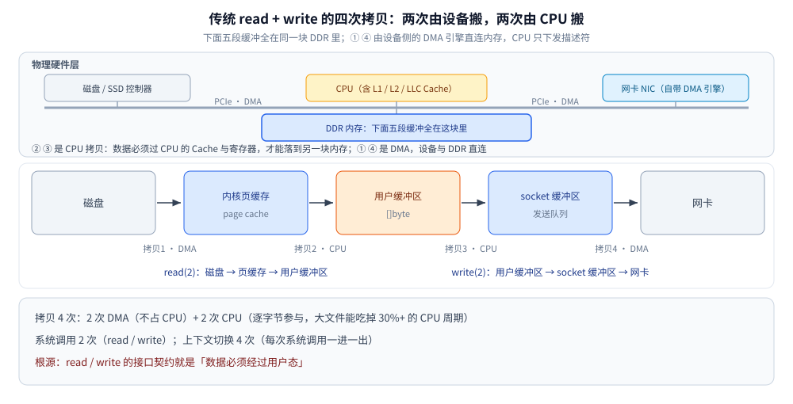
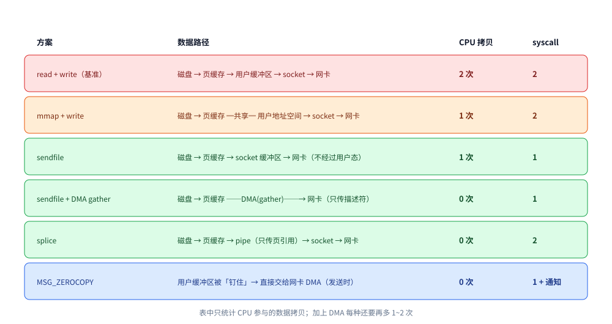
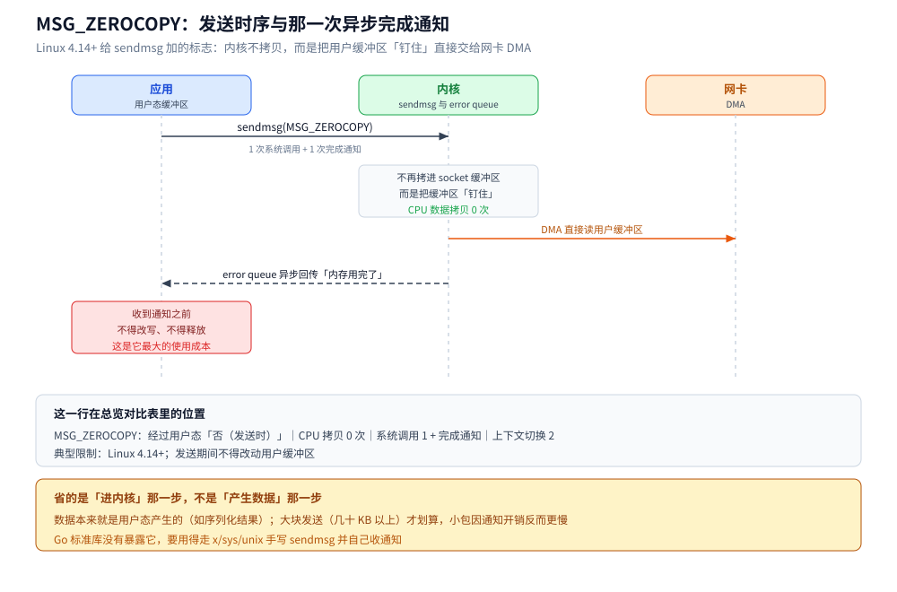

# 零拷贝

> 覆盖：零拷贝省掉了哪几次拷贝、五种实现路径（mmap / sendfile / SG-DMA / splice / MSG_ZEROCOPY）的取舍与选型，以及它在真实系统里的落点。
> 不覆盖：Linux I/O 栈的整体结构（VFS、page cache、一次 write 落盘）见 [文件系统与IO.md](文件系统与IO.md)；事件驱动与数据搬运的分工见 [IO多路复用.md](../网络/传输层/IO多路复用.md)；Go 标准库里零拷贝「自动生效 / 静默失效」的分界线见 [零拷贝.md](../../01-编程语言/go/运行时/零拷贝.md)。
>
> 内容整理自个人学习笔记，素材见 [素材清单](../../素材清单.md)。

---

## 一、零拷贝到底要解决什么问题？

**本节要点**：先把词还原成机制 —— 零拷贝是一种减少数据在内核态缓冲区与用户态缓冲区之间来回搬运的 I/O 优化技术，目标是把 CPU 从「纯粹搬数据」里解放出来。

### 1.1 一句话定义

零拷贝是一种**减少数据在内核态缓冲区与用户态缓冲区之间来回搬运**的 I/O 优化技术，目标是把 CPU 从「纯粹搬数据」里解放出来，**把省下的算力和内存带宽还给业务逻辑**。

### 1.2 它解决的是什么问题

一次再普通不过的「把文件读出来发到网络」，传统实现是这样的：

```text
                       read(2) 系统调用    write(2) 系统调用
磁盘 ──DMA──▶ 内核页缓存 ──CPU──▶ 用户缓冲区 ──CPU──▶ socket 缓冲区 ──DMA──▶ 网卡
```
⭐ **read()** 负责“页缓存 → 用户缓冲区”的 CPU 拷贝；**write()** 负责“用户缓冲区 → socket 缓冲区”的 CPU 拷贝。两端的 DMA 由内核和硬件异步完成，不占用用户代码。

| 开销 | 说明 |
|---|---|
| **CPU 拷贝 2 次** | 页缓存 → 用户缓冲区、用户缓冲区 → socket 缓冲区；都要 CPU 逐字节参与，**大文件传输能吃掉 30%+ 的 CPU 周期** |
| **系统调用 2 次** | `read` + `write`，每次都是一次「用户态 → 内核态 → 用户态」的上下文切换 |
| **内存带宽浪费** | 同一份数据在内存里搬了 4 次，page cache 副本还容易被反复换出换入 |
| **用户态纯属「过路」** | 应用既不改也不看数据（如文件下载），却硬要把它读进自己的地址空间 |

### 1.3 关键澄清：零拷贝 ≠ 零次拷贝

这里有一个常被混淆的点：

> **「零拷贝」消除的是「不必要的用户态拷贝」，DMA 拷贝依然存在。**
> 数据从磁盘到网卡，物理上必经 page cache 和 socket 缓冲区；哪怕 `MSG_ZEROCOPY`，数据也还得由网卡 DMA 读走。
> 更严谨的说法是 **「zero CPU copy」** —— **CPU 不再搬数据，只发指令**。

### 1.4 它不是为了「更快」，而是为了「同样的 CPU 做更多事」

- **收益巨大**：静态文件服务、对象存储下载 —— CPU 只发 `sendfile` 指令，吞吐受网卡/磁盘而非 CPU 限制；
- **收益明显**：反向代理 / TCP 转发、日志流式转发 —— 数据不落用户态，延迟与 CPU 双降；
- **收益几乎为零**：JSON 编解码、下单、风控 —— 瓶颈在业务逻辑，优化 I/O 等于没优化。

⭐ **这就是「什么时候不需要零拷贝」的判据**：先 profile，确认瓶颈在数据搬运本身，再谈零拷贝。在业务逻辑密集的服务里追零拷贝，是典型的过早优化。

### 1.5 延伸追问

- **零拷贝是操作系统层面的还是语言层面的？** → **内核提供能力，语言负责暴露**。`sendfile` / `splice` / `mmap` / `MSG_ZEROCOPY` 都是 Linux 系统调用；语言侧的价值在于把「自动分发」包进 `io.Copy` 这类接口（Go 侧见 [零拷贝.md](../../01-编程语言/go/运行时/零拷贝.md)）。
- **为什么说它天生适合「大文件 + 轻逻辑 + I/O 密集型」？** → 收益**正比于数据体积**、**反比于单位数据的业务处理量**。
- **一次拷贝到底算几「次」？** → **口径要说清**：算 DMA 是 4 次，只算 CPU 参与的是 2 次。常规表述是「**传统 read+write 是 4 次拷贝、2 次系统调用、2 次 CPU 拷贝**」。

---

## 二、传统 read + write 为什么是「四次拷贝、两次系统调用」？

**本节要点**：这是第三节所有方案的**基准线**。基准线画不出来，后面所有对比都是背的。

一次朴素写法（这里以 Go 为例，其他语言同理）：

```go
buf := make([]byte, 32*1024)
for {
    n, err := f.Read(buf)   // ① 系统调用：磁盘 → 用户缓冲区
    if n > 0 {
        conn.Write(buf[:n]) // ② 系统调用：用户缓冲区 → socket 缓冲区
    }
    if err != nil {
        break
    }
}
```

| 序号 | 拷贝 | 参与者 | 说明 |
|---|---|---|---|
| **1** | 磁盘 → 内核页缓存（page cache） | **DMA** | 不占 CPU，但数据先进内核 |
| **2** | 内核页缓存 → 用户缓冲区 | **CPU** | `read()` 返回前必须完成 |
| **3** | 用户缓冲区 → socket 发送缓冲区 | **CPU** | `write()` 的核心开销 |
| **4** | socket 缓冲区 → 网卡 | **DMA** | 不占 CPU |



**系统调用 2 次**（`read`、`write`）；**上下文切换 4 次**（每次系统调用一进一出）；**CPU 拷贝 2 次**。

### 2.1 为什么会这样设计，以及优化方向

`read` / `write` 的**接口契约就是「数据必须经过用户态」**：应用拿到的是自己地址空间里的 `[]byte`，内核不能假设「这个应用只是转发、不会改数据」。只要用这套 API，**拷贝就是接口语义的一部分，绕不开**。

既然根源是「数据非要经过用户态」，优化方向就两个：

1. **让用户态与内核态共享同一块内存** → `mmap` + `write`（少一次 CPU 拷贝，但用户态仍在链路里）；
2. **干脆让数据不经过用户态** → `sendfile` / `splice`（用户态只发指令，不碰数据）。

### 2.2 延伸追问

- **DMA 拷贝为什么不占 CPU？** → DMA 控制器直接在内设与内存之间搬数据，CPU 只下发描述符；所以「拷贝次数」和「CPU 开销」不是一回事。
- **`read` 会触发磁盘 IO 吗？** → 不一定。**页缓存命中时是纯内存操作**，这也是冷读/热读性能差异巨大的原因（零拷贝的加速比在热读时更明显）。
- **小文件用零拷贝有意义吗？** → 收益很小。`sendfile` 省的开销**正比于数据量**，KB 级响应里系统调用的固定成本占比更高。

---

## 三、零拷贝有哪些实现路径？各自的代价是什么？

**本节要点**：把「零拷贝」当成一个点会丢掉 Linux I/O 栈的层次感。这一节把五种路径摆在同一张表上，逐一看它们砍掉了哪几次 CPU 拷贝、又付出了什么代价。

### 3.1 总览对比表

| 方案 | 经过用户态 | **CPU 拷贝** | **系统调用** | **上下文切换** | 典型限制 |
|---|---|---|---|---|---|
| `read` + `write`（基准） | 是 | **2 次** | 2 | 4 | — |
| `mmap` + `write` | 是（共享映射） | **1 次** | 2 | 4 | 文件被截断/变更可能触发 `SIGBUS` |
| **`sendfile`** | **否** | **1 次** | 1 | **2** | 只能「文件 fd → socket fd」，中间无法加工数据 |
| **`sendfile` + DMA gather** | 否 | **0 次** | 1 | 2 | 需要网卡支持 **SG-DMA**（scatter-gather） |
| **`splice`** | 否 | **0 次** | 2 | 2 | 两个 fd 中**至少一个是 pipe**；仅 Linux |
| **`MSG_ZEROCOPY`** | 否（发送时） | 0 次 | 1 + 完成通知 | 2 | Linux 4.14+；发送期间不得改动用户缓冲区 |



> 表里的拷贝次数只统计 **CPU 参与的数据拷贝**，这样对比才有区分度；加上 DMA 每种再多 1~2 次。

### 3.2 `mmap` + `write`：让用户态与内核态共享页缓存

```text
磁盘 ──DMA──▶ 内核页缓存 ══(共享映射)══ 用户地址空间 ──CPU──▶ socket 缓冲区 ──DMA──▶ 网卡
```

- **省掉「页缓存 → 用户缓冲区」那一次 CPU 拷贝**，因为用户态读的就是页缓存本身；
- 但数据仍要由 CPU 从用户可见内存搬进 socket 缓冲区，**所以不是真零拷贝**，上下文切换仍是 4 次；
- 副作用：**用户态写入会直接改页缓存**，映射期间文件被其他进程截断会收到 `SIGBUS`。

### 3.3 `sendfile`：数据彻底不进用户态

```c
ssize_t sendfile(int out_fd, int in_fd, off_t *offset, size_t count);
// in_fd 必须是支持 mmap 的文件，out_fd 必须是 socket
```

- **用户态只发起一次系统调用、全程不接触数据**，上下文切换从 4 次降到 2 次；
- 代价是**数据对应用不可见**：不能加密、压缩、改内容、算摘要；
- 这就是「过 TLS 或 gzip 之后零拷贝必然失效」的原因——**数据必须回用户态加工**。

### 3.4 `sendfile` + DMA gather：真正意义上的零 CPU 拷贝

```text
磁盘 ──DMA──▶ 内核页缓存 ──DMA(gather)──▶ 网卡
```

- 网卡支持 SG-DMA 后，内核**不再把数据搬进 socket 缓冲区**，只把**描述符**（内存地址 + 长度）写进去，**CPU 一次数据拷贝都不做**；
- 需要硬件支持（Linux 2.4+ 内核 + SG-DMA 网卡），是「零拷贝」一词最本源的实现；
- 仍然**只能用于文件 → socket**。

### 3.5 `splice`：用内核管道做「数据搬运中转站」

```c
splice(fd_in, NULL, pipefd[1], NULL, len, SPLICE_F_MOVE);   // 文件 → 管道
splice(pipefd[0], NULL, fd_out, NULL, len, SPLICE_F_MOVE);  // 管道 → socket
```

- 中间通过**内核 pipe buffer 传递的是页引用而非数据副本**，**不经过用户态**；
- 因此是 **socket → socket 转发**（反向代理、隧道）的首选；
- 代价：**两端 fd 至少有一个必须是 pipe**，所以需要两次 `splice` 配对；Linux 特有。

### 3.6 `MSG_ZEROCOPY`：发送时借用用户态缓冲区

- Linux 4.14+ 给 `sendmsg` 加了该标志：内核**不再把用户缓冲区内容拷进 socket 缓冲区**，而是把它「钉住」直接交给网卡 DMA；
- 拷贝降到 0，但省的是「**进内核**」这一步（数据本来就是用户态产生的，如序列化结果）；
- 内核通过 **socket 的 error queue** 异步回传「内存用完了」的通知，**应用在收到通知前不得改写/释放该缓冲区**——这是它最大的使用成本；
- 大块发送（几十 KB 以上）才划算，小包因通知开销反而更慢；
- **Go 标准库没有暴露它**，要用得走 `x/sys/unix` 手写 `sendmsg` + 收通知。



图注：MSG_ZEROCOPY 省掉的是「用户缓冲区 → socket 缓冲区」那次 CPU 拷贝，代价是应用在收到 error queue 通知之前都不能改写那块缓冲区 —— 这也是它比 `sendfile` 更难用的地方，Go 标准库因此没有把它包出来。

### 3.7 选型口诀

| 需求 | 选它 |
|---|---|
| 文件下载 / 静态资源 | `sendfile` + SG-DMA |
| 纯 TCP 转发、代理 | `splice` |
| 只读大文件、随机访问 | `mmap` |
| 应用自己生成的大块数据往外发 | `MSG_ZEROCOPY` |
| 要加密 / 压缩 / 计算摘要 | **老老实实走用户态**，零拷贝帮不了你 |

### 3.8 延伸追问

- **`sendfile` 和 `splice` 怎么选？** → 一端是**文件**用 `sendfile`（一条系统调用，最简单）；一端是 **socket**（转发场景）用 `splice`。
- **为什么 `mmap` 不算真零拷贝？** → 它**仍保留一次 CPU 参与的数据搬运**（共享映射 → socket 缓冲区），只是砍掉了另一份用户态副本。
- **零拷贝的「不可用边界」？** → **只要数据需要被应用看到或改写**（加密、压缩、改内容、校验），就必须经过用户态，零拷贝立刻失效。

---

## 四、应用场景

**本节要点**：零拷贝的价值从来不是「它很快」，而是「在**大文件 + 轻逻辑 + I/O 密集**这类场景里，把 CPU 从搬数据中解放出来」。下面按「数据从哪到哪」列出真实系统中的落点。

| 场景 | 数据流向 | 用的方案 | 为什么值得                                                                                        |
|---|---|---|----------------------------------------------------------------------------------------------|
| 静态文件服务器 | 磁盘文件 → 客户端 | `sendfile`（+ SG-DMA） | 大文件、纯转发、不改内容 —— 零拷贝收益最大，详见 [04-HTTP框架执行流程.md](深入理解Nginx/04-HTTP框架执行流程.md) 第四节；Go 侧 `http.ServeFile` 的 `sendfile` 调用链见 [零拷贝.md](../../01-编程语言/go/运行时/零拷贝.md)（Go 篇）3.2 节 |
| 对象存储下载 / 上传回源 | 对象存储 → 客户端 / 客户端 → 对象存储 | `sendfile` / `splice` | 上传回源走 socket → socket；下载走文件 → socket，详见 [对象存储选型对比.md](../../03-数据与中间件/数据存储/对象存储/对象存储选型对比.md) 与 [文件存储与上传架构.md](../../04-架构与系统/系统设计/文件存储与上传架构.md) |
| 反向代理 / API 网关 | 上游 socket → 下游 socket | `splice` | 两端都是 socket，数据不落用户态；Nginx 默认走这条路，详见 [反向代理原理与实现.md](../网络/应用层/反向代理原理与实现.md) 与 [08-upstream与子请求.md](深入理解Nginx/08-upstream与子请求.md) |
| 消息队列消费投递 | 磁盘日志文件 → 消费者 socket | `sendfile` | Kafka 消费路径的经典用法（生产路径需要解析、走不了），详见 [核心概念与架构.md](../../03-数据与中间件/中间件/消息队列/Kafka/核心概念与架构.md) 第七节；RocketMQ 读路径为什么拿不到 `sendfile`（字节码取证）见 [核心概念与架构.md](../../03-数据与中间件/中间件/消息队列/RocketMQ/核心概念与架构.md)（RocketMQ 篇）第六节 6.1 |
| 日志采集 / 流式转发 | 本地文件 → 远端 socket | `sendfile` | 采集侧逻辑轻，瓶颈就在搬运，流式转发（不把大文件读进内存）见 [从零实现网关.md](../../01-编程语言/go/网络编程/从零实现网关.md) |
| 大文件归档 / 日志滚动 | 文件 → 文件 | `copy_file_range` | 全程在内核页缓存之间搬运，不产生用户态副本；Go 侧 `*os.File` 之间的快路径见 [零拷贝.md](../../01-编程语言/go/运行时/零拷贝.md)（Go 篇）3.1 节 |
| 缓存冷启动 / 数据预热 | 磁盘 → page cache | `mmap` / `readahead` | 让后续读取命中 page cache（不是「传输」零拷贝，而是「加载」零拷贝），page cache 的机制见 [内存管理.md](内存管理.md) 第二节 |
| TLS 加密传输 | 磁盘 → socket（加密） | ⚠️ 零拷贝失效 | 数据必须回用户态加密；除非启用内核 kTLS，握手与加密过程见 [HTTPS与TLS.md](../网络/应用层/HTTPS与TLS.md) 第三、四节 |

⭐ **判据**：只要数据在链路中不需要被应用看见或改写，就有零拷贝的机会；一旦要加密、压缩、改内容、算摘要，零拷贝立刻失效。**应用层要做的事越多，零拷贝的收益越小。**

---

## 延伸追问

- **零拷贝能解决「磁盘到磁盘」的拷贝吗？** → 能。`copy_file_range(2)` 让两次文件 IO 在同一内核路径完成（对应场景表里的「大文件归档」一行）。
- **`splice` 为什么要求一端是 pipe？** → pipe 是内核里**存放「页引用」的容器**，数据以页为单位在各环节之间**传递所有权**；没有 pipe 作中转，就无法在两个任意 fd 之间保证「不落地到用户态」。
- **零拷贝和「减少系统调用」是一回事吗？** → **不是**。两者是独立的两条优化轴：`mmap` + `write` 砍的是 CPU 拷贝、系统调用仍是 2 次；`sendfile` 同时砍 CPU 拷贝与系统调用；`MSG_ZEROCOPY` 砍的是「进内核」那次拷贝，但多了完成通知。
- **为什么 TLS 会让零拷贝失效？** → 加密必须在用户态完成（密钥不能交给内核），数据必须「回用户态一趟」；数据一旦回到用户态，`sendfile` 的「不进用户态」前提就不成立了。kTLS 把加密切到内核、是例外，但需要内核与硬件支持。
- **零拷贝和「内存映射文件」是一回事吗？** → **不是**。内存映射（`mmap`）只是让用户态与内核页缓存共享同一块内存，仍要走用户态把数据搬进 socket；它是零拷贝的一个组成部分，本身不是完整方案。

## 关联

- **上游/总纲**：[文件系统与IO.md](文件系统与IO.md) — mmap / sendfile 在同一套 I/O 栈上的位置（page cache、VFS、一次 write 落盘）
- **对照/互补**：[IO多路复用.md](../网络/传输层/IO多路复用.md) — 事件驱动与数据搬运的分工（`io_uring` 也不消除拷贝）
- **对照/互补**：[零拷贝.md](../../01-编程语言/go/运行时/零拷贝.md) — Go 侧：哪些写法自动走内核快路径、哪些静默失效
- **对照/互补**：[压缩算法.md](../算法/压缩算法.md) — 省 I/O 的两条路：少拷贝 vs 少传
- **对照/互补**：[TCP的Nagle与延迟确认.md](../网络/传输层/tcp/TCP的Nagle与延迟确认.md) — 减少拷贝与减少系统调用的另一条路
- **对照/互补**：[核心概念与架构.md](../../03-数据与中间件/中间件/消息队列/Kafka/核心概念与架构.md) — 零拷贝在 MQ 消费链路里的真实收益
> 反向引用（本篇被下列文档引到）：[内存管理.md](内存管理.md)
