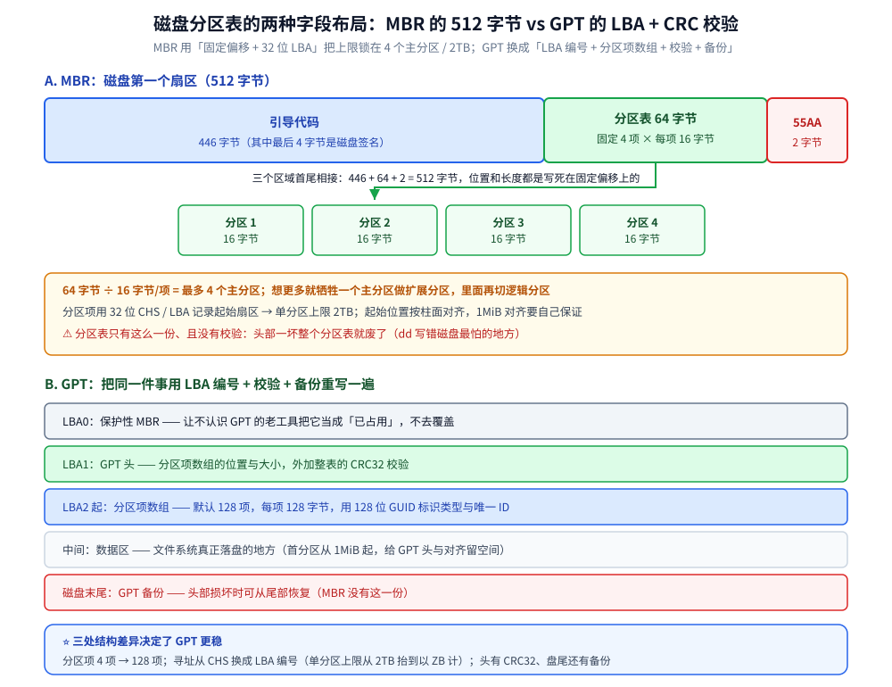

# 安装与磁盘分区

> 覆盖：装 CentOS 7 / Rocky Linux 9 之前的**主机规划**（用途 / 引导方式 / 磁盘大小），MBR 与 GPT 两种分区表的**存储结构与字段布局**，`fdisk` / `gdisk` / `parted` 三个分区工具的分工，挂载与 `/etc/fstab` 的六个字段，LVM 逻辑卷（PV → VG → LV）的创建 / 在线扩容 / 快照，软件 RAID 的级别取舍；含第四版新增的 **GPT 分割表与 LVM 实操**。
>
> 不覆盖：格式化、挂载选项与 XFS 备份还原见 [02-文件系统与XFS.md](02-文件系统与XFS.md)；LVM 快照与 RAID 为什么都不等于备份见 [09-备份与恢复.md](09-备份与恢复.md)；inode、I/O 栈与「删了不还空间」的原理见 [文件系统与IO.md](../文件系统与IO.md)；swap 与虚拟内存在「内存不足」时的行为见 [内存管理.md](../内存管理.md)。
>
> 内容整理自个人学习笔记。**基础框架**参考《鸟哥的 Linux 私房菜：基础学习篇（第四版）》相关章节（主机规划与磁盘分区、安装 CentOS 7.x）的读后整理；现代发行版（Rocky 9 / Ubuntu）差异基于官方文档独立整理。素材见 [素材清单](../../../素材清单.md)。
>
> 📎 **实测口径**：本篇**未做容器实测**——分区、LVM、RAID 都作用于**块设备**，在容器里跑等于动宿主磁盘，越出「只用自建容器与端口」的边界；因此全部命令块都是「**落地写法骨架，未单独编译 / 未执行**」。字段数值（512 / 446 / 64 / 16 / 4 / 128 / 32 位 / 2TB 等）取自上述书籍章节与 `parted` / `gdisk` / `util-linux` / `mdadm` 官方手册，**不是本机读数**。

---

## 一、安装前要规划什么？

**本节要点**：装机不是从按回车开始，而是从「这台机器要干什么」开始——需求决定分区方案与文件系统。

### 1.1 三件事先定下来

- **用途**：纯计算 / 数据库 / 容器宿主，对 `/var`、`/` 的容量诉求完全不同；
- **引导方式**：传统 BIOS + MBR，还是 UEFI + GPT（UEFI 必须有 EFI 分区）；
- **磁盘大小**：≤ 2TB 可以 MBR，> 2TB 必须 GPT。

### 1.2 分区方案的常见落地

| 挂载点 | 作用 | 为什么单独分 |
|--------|------|--------------|
| `/` | 根，所有未单独挂载的目录都落这 | 太小的根分区是最常见的「跑着跑着满了」 |
| `/home` | 用户数据 | 重装系统时可保留 |
| `/var` | 日志、数据库、容器数据 | 日志 / 数据暴涨时不会拖垮根分区 |
| `/boot` | 内核与引导 | 传统方案习惯单独分（现代 1G 足够） |
| `swap` | 交换分区 | 内存不足时的兜底；容器宿主可另作考量 |

⚠️ 现代做法更倾向于「**一个根分区 + LVM**」：把分区的事交给 LVM，扩容比重新分区方便得多。

### 1.3 文件系统选型

- **CentOS / RHEL 系默认 XFS**（大文件与并发更稳，但不支持缩容）；
- **Ubuntu / Debian 默认 ext4**（通用、稳、可缩容）；
- 容器镜像层多用 **overlay2**，与宿主文件系统是两回事。

---

## 二、MBR 与 GPT 差在哪？

**本节要点**：两者的差别不只是「能分几个区」——本质是分区表的**存储结构**不同，GPT 用校验和 + 备份解决了 MBR 的单点损坏。

### 2.1 MBR：512 字节的紧身衣

- 磁盘**第一个扇区**（512 字节）里：446 字节引导代码 + **64 字节分区表** + 2 字节结束标志 `55AA`；
- 64 字节 ÷ 16 字节/项 = **最多 4 个主分区**；想更多就牺牲一个主分区做**扩展分区**，里面再切逻辑分区；
- 分区表用 **CHS/LBA 32 位**记录起始扇区 → 单分区上限 **2TB**；
- ⚠️ 分区表只有一份、且没有校验，头部一坏整个分区表就废了（这是 `dd` 写错磁盘最怕的地方）。

### 2.2 GPT：用 LBA 编号 + CRC 校验重写一遍

- **LBA0** 放一份「保护性 MBR」（防止老工具误判为空盘而覆盖）；
- **LBA1** 是 GPT 头（含分区表位置、大小与 **CRC32 校验**）；
- 分区表默认 **128 项**（每项 128 字节，用 128 位 **GUID** 标识分区类型与唯一 ID）；
- 磁盘**末尾**保留一份 GPT 备份 → 头部损坏可从尾部恢复；
- 单分区上限以 **ZB** 计，实际受文件系统与内核限制。

### 2.3 怎么判断和转换

```bash
sudo parted -l                 # 看 Partition Table: gpt / msdos
sudo gdisk -l /dev/sdb         # GPT 专用查看
sudo fdisk -l /dev/sdb         # 输出里的 Disklabel type 字段
```

⚠️ **互转会清空分区表**（数据通常还在但极难恢复）：`mklabel` 一敲，旧分区表就没了，务必先备份。



---

## 三、分区工具怎么选？

**本节要点**：`fdisk` 管 MBR、`gdisk` 管 GPT、`parted` 两者都能管且适合脚本化——现代环境更常用 `parted`。

| 工具 | 分区表 | 交互方式 | 典型用途 |
|------|--------|----------|----------|
| `fdisk` | MBR（新版也认 GPT） | 交互菜单 | 老机器、小盘 |
| `gdisk` | GPT | 交互菜单 | GPT 精调（分区类型 GUID） |
| `parted` | MBR + GPT | 一条命令 | **脚本化、自动化装机** |

### 3.1 一次完整的分区（parted 非交互）

```bash
sudo parted -s /dev/sdb mklabel gpt
sudo parted -s /dev/sdb mkpart primary xfs 1MiB 100GiB
sudo parted -s /dev/sdb mkpart primary xfs 100GiB 100%
sudo parted -l
```

⚠️ 起始位置从 **1MiB** 开始（不要从 0），给 GPT 头和 4K 对齐留空间；`-s` 是脚本模式，不会二次确认。

### 3.2 什么时候要动分区「类型」

- LVM：把分区标成 `lvm`（`parted set 1 lvm on`）；
- RAID：标成 `raid`，`mdadm` 才会自动识别；
- EFI：标成 `esp`。

---

## 四、挂载与 /etc/fstab 怎么配？

**本节要点**：`mount` 是一次性的，`/etc/fstab` 才是开机生效的；写错 fstab 会让系统进不了正常启动。

### 4.1 手动挂载

```bash
sudo mount /dev/vg_data/lv_app /data          # 临时挂载
mount | grep /data                             # 看挂载参数
sudo umount /data                              # 卸载（别用挂载点正在被占用时硬卸）
```

### 4.2 fstab 的六个字段

```text
UUID=xxxx-xxxx  /data  xfs  defaults,noatime  0  0
#  ①设备           ②挂载点 ③类型 ④选项            ⑤dump ⑥fsck顺序
```

- **①设备**：⚠️ 用 `UUID=` 或 `LABEL=`，不要写 `/dev/sdb1`——盘符会随硬件变动漂移；
- **④选项**：`defaults`（rw,suid,dev,exec,auto,nouser,async）、`noatime`（不更新时间戳，减少写）、`nofail`（挂不上不阻塞启动）；
- **⑤dump**：几乎永远是 0；**⑥fsck**：根分区 1、其他 0（**XFS 不用 fsck 顺序**）。

### 4.3 排查：开机进了 emergency mode

```bash
sudo blkid                      # 拿分区的真实 UUID
sudo mount -a                   # 不改重启、先验一遍 fstab
sudo systemctl daemon-reload    # 改完 fstab 让它重读
```

⚠️ `mount -a` 报错就是 fstab 写错了；带 `nofail` 的分区挂不上只会警告，不影响启动。

---

## 五、LVM 逻辑卷怎么用？

**本节要点**：LVM 在「物理磁盘」和「文件系统」之间插了一层抽象，换来的是**在线扩容**与**快照**能力。

### 5.1 三层抽象

| 层 | 全称 | 一句话 |
|----|------|--------|
| PV | Physical Volume | 被 LVM 接管的物理分区 / 整盘（`pvcreate`） |
| VG | Volume Group | PV 的资源池，容量在此汇总（`vgcreate`） |
| LV | Logical Volume | 从 VG 切出来给文件系统用的「逻辑分区」（`lvcreate`） |

⭐ 一句话记住：**磁盘 → PV → 汇入 VG 池 → 切出 LV → 格式化 LV**。扩容时先扩 LV，再扩文件系统。

### 5.2 创建与在线扩容

```bash
sudo pvcreate /dev/sdb1
sudo vgcreate vg_data /dev/sdb1
sudo lvcreate -L 50G -n lv_app vg_data
sudo mkfs.xfs /dev/vg_data/lv_app

# 在线扩容：VG 有空间时，先扩 LV 再扩 XFS
sudo lvextend -L +20G /dev/vg_data/lv_app
sudo xfs_growfs /data          # ext4 用 resize2fs
```

⚠️ **扩容易、缩容难**：XFS 根本不支持缩容，ext4 缩容要卸载后操作。所以「扩了就别想缩」。

### 5.3 快照：写时复制（COW）

```bash
sudo lvcreate -L 10G -s -n lv_app_snap /dev/vg_data/lv_app   # -s 建快照
sudo lvs                                                     # 看 Data% 使用率
```

快照只记录「**被改动过的块**」：原卷写多少，快照就占多少；`Data%` 满了快照就失效。所以它是「给备份留一个静止视图」，**不是备份本身**（详见 [09-备份与恢复.md](09-备份与恢复.md)）。

---

## 六、软件 RAID 怎么搭？

**本节要点**：RAID 是「多盘拼成一个逻辑盘」的取舍——用冗余换可用性、或用并行换速度，但不能同时全要。

| 级别 | 最少盘 | 空间利用率 | 冗余 | 一句话 |
|------|--------|-----------|------|--------|
| RAID 0 | 2 | 100% | ❌ | 条带并行最快，坏一块全丢 |
| RAID 1 | 2 | 50% | ✅ | 镜像，读快写慢，抗单盘故障 |
| RAID 5 | 3 | (N-1)/N | ✅ | 单盘校验，写有惩罚（校验计算） |
| RAID 10 | 4 | 50% | ✅ | 先镜像再条带，数据库常用 |

```bash
sudo mdadm --create /dev/md0 --level=1 --raid-devices=2 /dev/sdb1 /dev/sdc1
cat /proc/mdstat                # 看 [UU]（两个都正常）与重建进度
sudo mdadm --detail /dev/md0
```

⚠️ RAID 是**可用性**手段，不是备份：误删、勒索病毒会同时命中所有盘。详见 [09-备份与恢复.md](09-备份与恢复.md)。

---

## 七、应用场景

**本节要点**：装机与分区在真实环境里很少出现在「写代码」阶段，而是集中在**上线、扩容、故障复盘**三个时刻；下面按「谁在什么场景下用到本篇哪一节」列出来。

| 落地场景 | 这里的哪一节在起作用 | 本仓相关篇目 |
|---|---|---|
| 物理机 / 虚拟机装系统 | 引导方式决定分区表：UEFI 必须有 EFI 分区，传统 BIOS + 大容量盘要补 `bios_grub` 分区（1.1、2.2） | 本篇第一、二节 |
| 数据库 / 中间件节点的容量规划 | 数据目录单独挂载、LVM 留出扩容余量；`/var` 与 `/` 分开，日志暴涨不拖垮根分区（1.2、5.2） | [参数调优.md](../../../03-数据与中间件/数据存储/关系型/MySQL/参数调优.md) |
| 容器宿主机的盘 | 数据卷最终落在宿主的哪个分区、overlay2 用哪块盘（1.3、4.2） | [网络与存储.md](../../../06-工程实践/部署/docker/网络与存储.md) |
| K8s 有状态负载 | PV / PVC 背后仍是块设备 + 文件系统，StorageClass 供给的就是这里的 LV（5.1） | [K8s部署流程.md](../../../06-工程实践/部署/k8s/K8s部署流程.md) |
| 「跑着跑着根分区满了」 | 当时没单独分 `/var`，或分了却没扩容；在线扩容走 5.2 | [07-日志与journalctl.md](07-日志与journalctl.md)、[性能排查.md](../性能排查.md) |
| 内存不足的兜底 | swap 分区 / swapfile 的取舍（1.2） | [内存管理.md](../内存管理.md) |
| 备份前的静止视图 | LVM 快照（COW）给备份留一个一致的时间点（5.3） | [09-备份与恢复.md](09-备份与恢复.md) |
| 单盘故障想扛住 | 软件 RAID 的级别取舍：空间利用率与冗余不能同时全要（六） | [09-备份与恢复.md](09-备份与恢复.md) |

⭐ **三条工程判据**：

1. **引导方式和分区表要一起定**：先确认 UEFI 还是 BIOS，再决定 GPT / MBR 与要不要 EFI / `bios_grub` 分区——这两件事在装完系统之后再改，代价是重装。
2. **fstab 用 UUID，容量交给 LVM**：盘符会随硬件与探测顺序漂移，而「容量不够」几乎一定会发生；UUID + LVM 同时把这两件事解掉（4.2、五）。
3. **RAID 与快照都不是备份**：它们解决的是「可用性」与「一致的时间点」，误删和勒索病毒会同时命中所有盘（六、5.3）。

## 八、具体使用

**本节要点**：把上面几步串成一条可复现的流水线——分区 → 建卷 → 格式化 → 写 fstab → 验证；但动手前先用只读命令把现状看清楚，别在错误的盘上开工。

> ⚠️ 本节命令全部是**落地写法骨架，未单独编译 / 未执行**——它们会改写宿主的块设备，不在容器里跑（原因见篇首 📎 口径行）。

### 8.1 动手前先看清楚（只读）

```bash
lsblk -f                      # 盘 → 分区 → 文件系统 → UUID 一屏看完（先认盘）
sudo parted -l                # 分区表类型（gpt / msdos）与各分区的起止位置
sudo blkid                    # 各分区的 UUID / LABEL，fstab 要用它
df -hT                        # 已挂载的文件系统类型与用量（根分区还剩多少）
sudo pvdisplay && sudo vgdisplay && sudo lvdisplay   # 现有 LVM 的 PV / VG / LV 结构
cat /proc/mdstat              # 现有 RAID 阵列与 [UU] 状态
```

⚠️ `lsblk -f` 里没有文件系统的那几行就是**还没格式化**的裸分区；`df` 里看不到的设备说明还没挂载。认盘这一步省掉，后面每条命令都在赌。

### 8.2 从裸盘到开机自动挂载（四步流水线）

```bash
# ① 分区（GPT）
sudo parted -s /dev/sdb mklabel gpt
sudo parted -s /dev/sdb mkpart primary xfs 1MiB 100%
sudo parted -s /dev/sdb set 1 lvm on

# ② LVM：建池、切卷、格式化
sudo pvcreate /dev/sdb1
sudo vgcreate vg_data /dev/sdb1
sudo lvcreate -l 100%FREE -n lv_data vg_data
sudo mkfs.xfs /dev/vg_data/lv_data

# ③ 取 UUID（fstab 要用它）
sudo blkid /dev/vg_data/lv_data

# ④ 写入 fstab（示例行）
# UUID=<上一步的 UUID>  /data  xfs  defaults,noatime,nofail  0  0

# ⑤ 建挂载点并验证
sudo mkdir -p /data
sudo mount -a
df -h /data
```

判据三条：**`mount -a` 无报错**、**`df -h` 能看到 `/data`**、**重启后仍在**（可临时 `systemctl daemon-reload` + 重新挂载验证）。

---

## 延伸追问

- **大于 2TB 的磁盘怎么分区？**
  → 必须用 **GPT**（MBR 的 32 位 LBA 上限是 2TB）。用 `parted` 或 `gdisk` 建表，再按普通流程分区；注意引导方式若仍是传统 BIOS，需要一个小的 BIOS boot 分区（`bios_grub`）。
- **GPT 和 MBR 怎么互转？**
  → `sudo parted /dev/sdb mklabel gpt`（或 `msdos`）即可，但**会清空分区表**。稳妥做法是备份数据后重建，或先 `sgdisk --backup` 备份 GPT 结构再操作。
- **LVM 快照怎么用？**
  → `lvcreate -s` 建快照，得到原卷的「静止视图」，用来做一致性备份（如 `xfsdump` / `tar` 拷快照而不拷在线原卷）。⚠️ 快照空间按原卷的改动量增长，`Data%` 到 100% 就失效，所以要么给足空间、要么备份完立即删除。
- **`/dev/sda` 和 `UUID` 该用哪个？**
  → 一律 `UUID`。`/dev/sdX` 的字母顺序取决于内核探测顺序，插拔磁盘、改 BIOS 顺序都可能变，fstab 里写 `/dev/sda1` 是经典事故源。

---

## 关联

- **下游机制**：[02-文件系统与XFS.md](02-文件系统与XFS.md) — 格式化、挂载选项与 XFS 扩容（本节的下一步）
- **对照/互补**：[09-备份与恢复.md](09-备份与恢复.md) — LVM 快照与 RAID 为什么都不是备份
- **下游机制**：[文件系统与IO.md](../文件系统与IO.md) — ext4 / XFS 的 inode 与 I/O 栈原理
- **对照/互补**：[内存管理.md](../内存管理.md) — swap 与虚拟内存在「内存不足」时的实际行为
- **运维/配置**：[07-日志与journalctl.md](07-日志与journalctl.md) — 日志暴涨撑满 `/var` 之后从哪查
- **运维/配置**：[性能排查.md](../性能排查.md) — 磁盘满 / I/O 高时的分层排查入口
- **运维/配置**：[参数调优.md](../../../03-数据与中间件/数据存储/关系型/MySQL/参数调优.md) — 数据库的数据目录该落在哪块盘、磁盘参数怎么配套
- **运维/配置**：[网络与存储.md](../../../06-工程实践/部署/docker/网络与存储.md) — 容器数据卷与宿主分区的对应
- **下游机制**：[K8s部署流程.md](../../../06-工程实践/部署/k8s/K8s部署流程.md) — PV / PVC 背后的块设备与文件系统
- **上游/总纲**：[README.md](README.md) — 本目录导读：版本坐标与阅读顺序
