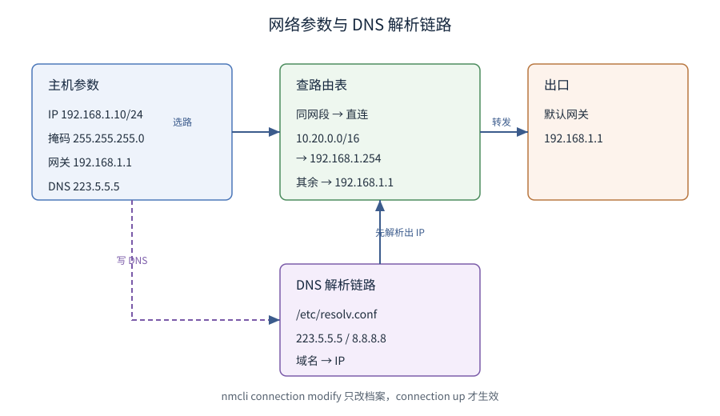

# 网络配置与nmcli

> 覆盖：一台主机联网的四样东西（IP / 子网掩码 / 默认网关 / DNS）与查看方式、`nmcli` 命令式配置网络、「设备」与「连接」的分工、路由决策与 DNS 的写入点、`firewalld` 开端口、三层网络排错；以及给新机器配一套静态网络的完整闭环。
>
> 不覆盖：域名解析的**协议原理**见 [DNS解析.md](../../网络/网络层与寻址/DNS解析.md)；一个包从应用到网卡的分层与流转见 [网络分层与数据包旅程.md](../../网络/网络分层与数据包旅程.md)；IP / 掩码 / 路由的**协议基础**见 [IP与路由基础.md](../../网络/网络层与寻址/IP与路由基础.md)；容器网络的命名空间、端口映射与镜像源见 [网络与存储.md](../../../06-工程实践/部署/docker/网络与存储.md) 与 [Docker网络与镜像源.md](../../../06-工程实践/部署/docker/Docker网络与镜像源.md)；服务器侧的网段规划与 NAT 见 [03-网络基础与规划.md](../鸟哥服务器架设篇/03-网络基础与规划.md) 与 [04-防火墙与NAT.md](../鸟哥服务器架设篇/04-防火墙与NAT.md)。
>
> 内容整理自个人学习笔记。**基础框架**参考《鸟哥的 Linux 私房菜：基础学习篇（第四版）》相关章节（基础系统设置与备份策略中的网络设置）的读后整理；nmcli / nftables / firewalld 的现代用法基于官方文档独立整理。素材见 [素材清单](../../../素材清单.md)。
>
> 📎 **实测口径**：本篇**全篇未做容器实测**——书里的网络配置作用于**宿主机**，改宿主机的 IP / 路由 / 防火墙会直接影响本机连通性（容器内改的只是容器自己的网络命名空间，验证不了宿主机行为），越出「只用自建容器与端口」的边界；因此全部命令块都是「**落地写法骨架，未单独编译 / 未执行**」。参数含义与默认值以 `nmcli(1)` / `ip-route(8)` / `firewall-cmd(1)` 官方手册为准，命令块里的地址（`192.168.1.x` / `223.5.5.5` 等）是示例取值，**不是本机读数**。

---

## 一、网络基础参数有哪些？

**本节要点**：一台主机联网只需四样东西——**IP、子网掩码、默认网关、DNS**；前三个决定「能不能通」，DNS 决定「能不能用域名通」。

| 参数 | 作用 | 典型值 |
|------|------|--------|
| IP | 主机地址 | `192.168.1.10/24` |
| 子网掩码 | 划分网络位与主机位 | `/24` = `255.255.255.0` |
| 默认网关 | 出本网段的出口 | `192.168.1.1` |
| DNS | 域名解析 | `223.5.5.5` |

```bash
ip addr show                 # 看 IP（取代 ifconfig）
ip route show                # 看路由表与默认网关
cat /etc/resolv.conf         # 看 DNS（⚠️ 可能被 NetworkManager 管理）
```

### 1.1 临时 vs 永久

- **临时**：`ip addr add` / `ip route add` 直接生效，**重启即丢**；
- **永久**：改 NetworkManager 连接（`nmcli` / `/etc/sysconfig/network-scripts/`），重启仍在。

⚠️ CentOS 7 / RHEL 8+ 默认由 **NetworkManager** 管理网络，手改 `ifcfg-*` 文件后要 `nmcli connection reload` 或重启服务，否则可能被覆盖。

---

## 二、nmcli 常用命令

**本节要点**：`nmcli` 三件事——看设备、看连接、改连接；「设备」是物理网卡，「连接」是配置档案，一个设备可挂多个连接。

```bash
nmcli device status                      # 设备与它当前挂的连接
nmcli connection show                    # 所有连接（配置档案）
nmcli connection show "ens33"            # 看某连接的详细参数

# 改：静态 IP（一条命令改多个属性）
sudo nmcli connection modify ens33 \
  ipv4.addresses 192.168.1.10/24 \
  ipv4.gateway 192.168.1.1 \
  ipv4.dns "223.5.5.5 8.8.8.8" \
  ipv4.method manual
sudo nmcli connection up ens33           # 让配置生效

# 改回 DHCP
sudo nmcli connection modify ens33 ipv4.method auto
```

| 命令 | 作用 |
|------|------|
| `nmcli con up/down <名>` | 启用 / 停用某连接 |
| `nmcli con mod <名> ...` | 改属性（`+` / `-` 前缀可增删列表项，如 `+ipv4.dns`） |
| `nmcli dev disconnect <设备>` | 断开设备 |
| `nmcli networking off/on` | 全局开关网络 |

⭐ 记住：`nmcli con mod` 只改「档案」，要 `nmcli con up` 才「生效」。

---

## 三、路由与 DNS 怎么配？

**本节要点**：默认网关管「出网段」，额外路由管「去特定网段走特定口」；DNS 在 NetworkManager 下由连接托管，`resolv.conf` 只是结果。

### 3.1 路由

```bash
ip route show
ip route get 8.8.8.8                    # 看内核会选哪条路
sudo ip route add 10.20.0.0/16 via 192.168.1.254   # 临时加一条
sudo ip route del 10.20.0.0/16                     # 删除
```

⚠️ `ip route add` 是**临时**的，重启即失；永久路由要在连接里加 `ipv4.routes`。

### 3.2 DNS

```bash
nmcli connection modify ens33 ipv4.dns "223.5.5.5"   # 永久
nmcli connection up ens33
cat /etc/resolv.conf                                  # 看实际生效的
```

- NetworkManager 会**生成** `/etc/resolv.conf`（常是 `resolv.conf` 软链或由 `systemd-resolved` 托管）；
- ⚠️ **手改 `/etc/resolv.conf` 可能被覆盖**：要永久生效就改连接配置，或用 `nmcli con mod ... ipv4.ignore-auto-dns yes`。
- DNS 解析的协议原理见 [DNS解析.md](../../网络/网络层与寻址/DNS解析.md)。



---

## 四、防火墙怎么开端口？

**本节要点**：现代发行版默认 `firewalld`（背后是 nftables / iptables），管控的是「**区域（zone）** 里允许哪些服务 / 端口」；CentOS 7 用 iptables 后端的 firewalld，Rocky 9 起是 nftables 后端。

```bash
sudo firewall-cmd --state                      # 是否运行
sudo firewall-cmd --get-default-zone           # 默认区域
sudo firewall-cmd --list-all                   # 当前区域的全部规则

# 开放端口 / 服务（--permanent 才是永久，需 reload）
sudo firewall-cmd --add-port=8080/tcp --permanent
sudo firewall-cmd --add-service=https --permanent
sudo firewall-cmd --reload
```

| 概念 | 说明 |
|------|------|
| zone | 按「信任程度」分组的规则集（`public` / `trusted` / `dmz`…） |
| service | 预定义的端口集合（`http` = 80、`https` = 443） |
| port | 直接开某个端口 |
| rich rule | 复杂规则（限来源 IP、限频率） |

⚠️ 忘了 `--permanent`：`firewall-cmd` 默认只改**运行时**规则，reload 或重启就没了。

---

## 五、网络排错从哪查起？

**本节要点**：按「能不能通 → 通到哪 → 谁在听」三层排查：`ping` 测连通、`traceroute` 看路径、`ss` 看本机监听与连接。

```bash
ping -c 3 192.168.1.1          # 网关通不通（L3）
ping -c 3 223.5.5.5            # 出网段通不通
traceroute 8.8.8.8             # 逐跳看路径断在哪

ss -tulnp                      # 本机在监听哪些 tcp/udp 端口、属哪个进程
ss -tan state established      # 已建立的连接
nmcli device status            # 网卡与连接状态
```

| 现象 | 先看 |
|------|------|
| 完全不通 | `ip addr`（有没有 IP）、`ip route`（有没有默认网关） |
| 通网关不通外网 | 默认网关、防火墙（出站）、NAT |
| 域名不通但 IP 通 | `cat /etc/resolv.conf`、`dig` 测解析 |
| 服务连不上 | `ss -tulnp` 看有没有监听、`firewall-cmd` 看端口开没开 |

⚠️ `ss` 里监听地址是 `127.0.0.1:8080` 时，只有本机能连；对外要监听 `0.0.0.0`。

---

## 六、应用场景

**本节要点**：网络配置是「让这台机器能被连上、也能连出去」的那一层——上线前的静态 IP 规划、容器与 K8s 的端口映射、防火墙放行都落在这一篇；下面按「谁在什么场景下用到本篇哪一节」列出来。

| 落地场景 | 这里的哪一节在起作用 | 本仓相关篇目 |
|---|---|---|
| 新机器上线配静态 IP / 网关 / DNS | 四样参数 + `nmcli connection modify`（一、二、七） | 本篇第一、二、七节 |
| 「域名不通但 IP 通」 | 解析链落在 `/etc/resolv.conf`，被 NM / `systemd-resolved` 托管（三、五） | [DNS解析.md](../../网络/网络层与寻址/DNS解析.md) |
| 跨网段访问走专用路由 | `ip route add ... via ...` 与连接里的 `ipv4.routes`（三、七） | [IP与路由基础.md](../../网络/网络层与寻址/IP与路由基础.md) |
| 端口对外不通 | `firewall-cmd --add-port` / `--add-service`，漏 `--permanent` 重启即丢（四） | [04-防火墙与NAT.md](../鸟哥服务器架设篇/04-防火墙与NAT.md)、[常用命令.md](../常用命令.md) |
| 本机连得上、外部连不上 | 监听地址是 `127.0.0.1` 还是 `0.0.0.0`（五） | [常用命令.md](../常用命令.md) |
| 容器端口映射不生效 | 宿主转发链与 `docker -p` 的对应关系（四、延伸追问） | [网络与存储.md](../../../06-工程实践/部署/docker/网络与存储.md)、[Docker网络与镜像源.md](../../../06-工程实践/部署/docker/Docker网络与镜像源.md) |
| K8s Service / Ingress 前的网络底座 | 节点网段、路由与 NAT 是集群网络的下层（三、四） | [K8s部署流程.md](../../../06-工程实践/部署/k8s/K8s部署流程.md) |
| 服务器侧的网段规划与 DHCP / DNS | NM 之外的规划层与 DHCP 下发（三、延伸追问） | [03-网络基础与规划.md](../鸟哥服务器架设篇/03-网络基础与规划.md)、[06-DHCP与NTP.md](../鸟哥服务器架设篇/06-DHCP与NTP.md) |

⭐ **三条工程判据**：

1. **「改档案」与「生效」是两步**：`nmcli connection modify` 只改配置档案，`nmcli connection up` 才真正改写内核里的地址 / 路由（二）。
2. **手改 `resolv.conf` / `ifcfg-*` 会被覆盖**：它们是 NetworkManager 的**产物**，要永久生效就改连接配置，或用 `ipv4.ignore-auto-dns yes` 挡住 DHCP 下发的 DNS（三）。
3. **防火墙默认只改运行时**：`firewall-cmd` 不带 `--permanent` 的规则 reload / 重启即丢，排查「昨天还好今天不通」时先看这一条（四）。

## 七、具体使用

**本节要点**：从查设备到验证连通的一条龙，改完不重启即生效；下面先给一组分层的只读排查命令，再给静态网络的完整落地骨架。

> ⚠️ 本节命令全部是**落地写法骨架，未单独编译 / 未执行**——网络配置作用于宿主机，容器内验证不了（实测与原因见篇首 📎 口径行）。

### 7.1 分层排查（只读）

```bash
ip -br addr show                       # 一眼看清每张网卡有没有 IP
ip route show                          # 默认网关与明细路由
ip route get 8.8.8.8                   # 内核会选哪条路出去（含源地址）
cat /etc/resolv.conf                   # 实际生效的 DNS（⚠️ 是 NM 生成的产物）
nmcli device status                    # 设备 / 连接状态一览
ss -tulnp                              # 本机在监听哪些端口、属哪个进程
sudo firewall-cmd --list-all           # 当前区域的放行规则
```

⚠️ 排查顺序固定为「有 IP → 有默认网关 → 网关能通 → DNS 能解 → 端口在听 → 防火墙放行」；跳步容易把 DNS 问题误判成网络不通。

### 7.2 给新机器配一套静态网络

```bash
# ① 找到设备名与当前连接
nmcli device status

# ② 配静态 IP
sudo nmcli connection modify ens33 \
  ipv4.method manual \
  ipv4.addresses 192.168.1.50/24 \
  ipv4.gateway 192.168.1.1 \
  ipv4.dns "223.5.5.5"
sudo nmcli connection up ens33

# ③ 开放服务端口（永久）
sudo firewall-cmd --add-service=https --permanent && sudo firewall-cmd --reload

# ④ 验证
ip addr show ens33
ip route show
ping -c 2 192.168.1.1
ss -tulnp | grep -E "443|80"
```

判据：`ip addr` 是目标 IP、`ip route` 有默认网关、`ping` 网关通、`ss` 能看到端口监听、外部 `firewall-cmd --list-all` 里出现 https。

---

## 延伸追问

- **nmcli 和直接改配置文件哪个好？**
  → 优先 `nmcli`。它是 NetworkManager 的**官方接口**，改完即写回配置并保持一致；手改 `/etc/sysconfig/network-scripts/ifcfg-*` 也能生效，但要记得触发重载，且容易被 NM 的其他操作覆盖。脚本化 / 远程批量场景尤其推荐 `nmcli`（一条命令、免交互）。
- **firewalld 和 iptables 的关系？**
  → `firewalld` 是**上层管理器**，`iptables` 是**下层的规则工具**（现代内核里两者最终都落到 **nftables**）。firewalld 把「区域 + 服务 + 端口」翻译成底层规则，还支持运行时/永久两套规则；直接用 `iptables` 就是裸写规则、无 zone 概念。⭐ 二选一即可，**不要两个同时管**，否则互相覆盖。
- **怎么临时加一条路由？**
  → `sudo ip route add 10.20.0.0/16 via 192.168.1.254 dev ens33`。临时路由重启即失；要永久就在 NM 连接里加 `ipv4.routes "10.20.0.0/16 192.168.1.254"` 再 `nmcli con up`。
- **改了 `/etc/resolv.conf` 为什么过一会儿又变回去？**
  → 它被 NetworkManager / `systemd-resolved` 托管，运行时会**重新生成**。永久 DNS 要在连接里配（`nmcli con mod ... ipv4.dns`），或设 `ipv4.ignore-auto-dns yes` 阻止 DHCP 下发的 DNS 覆盖你的配置。

---

## 关联

- **上游/总纲**：[README.md](README.md) — 本目录导读：版本坐标与阅读顺序
- **上游/总纲**：[IP与路由基础.md](../../网络/网络层与寻址/IP与路由基础.md) — IP / 掩码 / 网关 / 路由的协议基础
- **对照/互补**：[DNS解析.md](../../网络/网络层与寻址/DNS解析.md) — 域名解析的协议原理（本节的原理对照）
- **对照/互补**：[网络分层与数据包旅程.md](../../网络/网络分层与数据包旅程.md) — 一个包从应用到网卡的完整路径
- **下游机制**：[07-日志与journalctl.md](07-日志与journalctl.md) — 网络问题的日志从哪看
- **运维/配置**：[常用命令.md](../常用命令.md) — 查端口、看连接的命令速查
- **运维/配置**：[03-网络基础与规划.md](../鸟哥服务器架设篇/03-网络基础与规划.md) — 服务器侧的网段规划与 DHCP / DNS 落地
- **运维/配置**：[04-防火墙与NAT.md](../鸟哥服务器架设篇/04-防火墙与NAT.md) — 防火墙与 NAT 的服务器侧配置
- **运维/配置**：[网络与存储.md](../../../06-工程实践/部署/docker/网络与存储.md) — 容器端口映射与宿主网络栈
