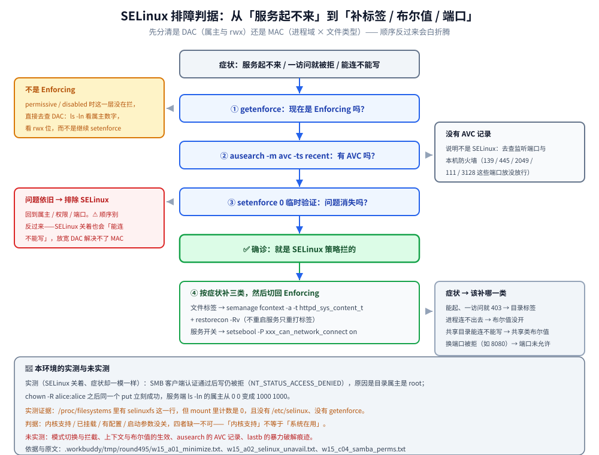

# 主机安全与SELinux

> 覆盖：最小化原则与更新策略、SELinux 的模式 / 上下文 / 布尔值、auditd 与登录痕迹审计，以及「服务起不来但日志没报错」时判断是不是 SELinux 的判据链。
>
> 不覆盖：网络层的访问控制（端口放行、NAT）见 [04-防火墙与NAT.md](04-防火墙与NAT.md)；SSH 的密钥登录与防暴力破解见 [05-SSH远程连接.md](05-SSH远程连接.md)；母机与虚拟机的边界见 [01-虚拟化与云系统搭建.md](01-虚拟化与云系统搭建.md)；SAMBA / NFS 的「能连不能写」完整场景见 [09-文件共享服务.md](09-文件共享服务.md)。
>
> 内容整理自个人学习笔记。**基础框架**参考鸟哥官网《服务器架设篇 - RockyLinux 9》相关章节（主机安全）的读后整理；SELinux、auditd 与登录审计命令基于官方文档独立整理。素材见 [素材清单](../../../素材清单.md)。
>
> 📎 **实测口径**：本篇的**暴露面盘点**在容器里实跑——用 `ss -tuln` 统计五种角色各自的监听条数（`2` / `6` / `5` / `24`），原文存证 `.workbuddy/tmp/round495/w15_a01_minimize.txt`、`w15_a04_listeners_compare.txt`；「SELinux 与 auditd 为什么在本环境测不了」也有原始输出（`w15_a02_selinux_unavail.txt`），「能连不能写」的对照取自 `w15_c04_samba_perms.txt`。**未实测**：SELinux 三种模式的切换与拦截、上下文与布尔值的实际生效、`ausearch` / `aureport` 的 AVC 记录、`lastb` 的暴力破解痕迹——本环境宿主内核没有启用 SELinux（`selinuxfs` 未挂载、无 `/etc/selinux`、无 `getenforce`），且不许改宿主内核。

---

## 一、为什么「少开一个东西」比装十件工具更重要？

**本节要点**：一部没经过保护就联上 Internet 的 Linux 主机，可能在数小时内被入侵或当成跳板——安全的第一步不是装工具，而是**关掉不用的东西**。

### 1.1 三件事

1. **最小化安装**：装系统时只选必要组件，少一个服务就少一个漏洞面；
2. **关停不需要的服务**：`systemctl disable --now <svc>`；
3. **只开放需要的端口**：对外暴露的端口越少越好（配合 [04-防火墙与NAT.md](04-防火墙与NAT.md)）。

```bash
ss -tulnp                                    # 本机在监听哪些端口、属哪个进程
systemctl list-unit-files --state=enabled    # 哪些服务开机自启
sudo firewall-cmd --list-all                 # 防火墙实际放开了什么
```

### 1.2 「少开」到底能少多少：一次暴露面盘点（实测）

📎 用同一套命令盘五种角色的监听面，差距很直观：

| 角色 | 监听条数 | 监听在哪些端口 | 说明 |
|------|----------|----------------|------|
| 极简容器（`alpine:3.21`） | `2` | `127.0.0.11:51047`(udp)、`127.0.0.11:44483`(tcp) | 两条都是容器内置 DNS，仅回环可达，**没有任何对外服务** |
| SAMBA 容器 | `6` | `139`、`445`（v4 / v6 各一组） | 一个共享服务带来的是一组端口 |
| Squid 容器 | `5` | `3128` + 回环 DNS + 两个动态 udp | 正向代理必须对外监听，暴露面天然更大 |
| NFS 服务端容器 | `24` | `111`、`2049` + 一串动态端口 | `rpcbind` 与 `mountd` 把端口数成倍放大 |

⭐ 这张表给出「最小化」的量化口径：**先数监听条数，再逐条问「这条是不是必须的」**。NFS 那 24 条里绝大多数不是 `2049`，而是 `mountd` / `statd` 挂在动态端口上——取值方式与限制手段见 [09-文件共享服务.md](09-文件共享服务.md)。

⚠️ 上表是**容器视角**，容器与宿主机不是同一层暴露面（容器里监听 `0.0.0.0:445`，宿主上是否可达还取决于端口映射与本机防火墙）。真正的判据要落在「宿主上实际可达的端口」，命令是宿主上的 `ss -tulnp` 与 `firewall-cmd --list-all`。

### 1.3 更新策略

```bash
sudo dnf check-update                  # 看有哪些更新
sudo dnf update -y                     # 全部更新
sudo dnf update --security -y          # ⭐ 只装安全更新（更稳）
```

⚠️ 生产环境别在不打招呼时「全部更新」——内核 / glibc 升级可能需要重启或影响兼容性；建议**安全更新自动化、功能性更新走变更流程**。

---

## 二、SELinux 管的是哪一层？

**本节要点**：传统权限（rwx）管「谁（用户）能对什么做什么」；SELinux 管「**进程（域）能对什么资源（类型）做什么**」，粒度更细、且默认拒绝。

| 维度 | 传统权限（DAC） | SELinux（MAC） |
|------|-----------------|----------------|
| 判据 | 进程的有效 uid / gid × 文件 rwx 位 | 进程的**域** × 文件的**类型** × 策略规则 |
| 谁定规则 | 属主自己 `chmod` / `chown` | 系统策略（管理员不能随手放开一条） |
| 默认姿态 | 没规则就放行 | **没规则就拒绝**，并记 AVC |
| 能管住谁 | 用户身份 | root 进程被劫持也要受约束（最小权限） |
| 有开关吗 | 一直在 | `enforcing` / `permissive` / `disabled` |

⭐ 一句话区分两者的授权模型：**DAC 是「属主说了算」，MAC 是「策略说了算」**。这也解释了为什么「`chmod 777` 之后服务还是起不来」——放宽的是 DAC，SELinux 那一层没动。

### 2.1 三种模式

| 模式 | 行为 | 用途 |
|------|------|------|
| `enforcing` | 拒绝并记录违规 | 生产推荐 |
| `permissive` | **只记录不拒绝** | 排障 / 调试策略 |
| `disabled` | 完全关闭 | ⚠️ 不推荐 |

```bash
getenforce                        # 看当前模式
sudo setenforce 0                 # 临时切 permissive（重启失效）
sestatus                          # 详细状态（含策略类型 targeted）
cat /etc/selinux/config           # 永久配置：SELINUX=enforcing|permissive|disabled（改完需重启）
```

📎 **本环境为什么测不了**：容器里 `/proc/filesystems` 有 `selinuxfs` 这一行（内核编译了支持），但 `mount | grep -ci selinux` 计数是 `0`——**没有挂载**；`ls /etc/selinux` 报 `No such file or directory`，`command -v getenforce` 也取不到（脚本打印 `NO_GETENFORCE`）。**「内核支持」与「系统在用」是两件事**，判据是 `selinuxfs` 挂没挂上、`/etc/selinux` 在不在。原文见 `.workbuddy/tmp/round495/w15_a02_selinux_unavail.txt`。

### 2.2 策略类型与它的代价

- **targeted**（Rocky / RHEL 默认）：只约束**被策略覆盖的目标进程**（httpd、sshd、samba 等），其余按 unconfined 跑——覆盖面小、误伤少；
- **mls / mcs**：多级 / 多类别安全，用于等保与多租户强隔离，配置与排障成本高得多；
- 运行代价主要花在**首次访问的标签检查与 AVC 记录**上，稳态开销通常远小于「关掉 SELinux 之后被利用」的代价——这是「不推荐 `disabled`」的量化理由。

---

## 三、上下文与布尔值：为什么「服务起不来但日志没报错」？

**本节要点**：SELinux 的日常操作只有两类——给**文件打标签**（context）、给**服务开开关**（boolean）；两者都能做到「不重启服务、只重打标签」。

```bash
ls -Z /var/www/html               # 看文件的安全上下文（type）
ps -eZ | grep nginx               # 看进程的域

# 给自定义目录打上正确的上下文（服务才能访问）
sudo semanage fcontext -a -t httpd_sys_content_t "/srv/web(/.*)?"
sudo restorecon -Rv /srv/web

getsebool -a | grep httpd         # 看与 httpd 相关的开关
sudo setsebool -P httpd_can_network_connect on   # -P 永久
```

| 症状 | 多半是 | 该干什么 |
|------|--------|----------|
| 服务能起、一访问就 403 / 权限拒绝 | 目录标签不对 | `semanage fcontext` + `restorecon -Rv` |
| 服务进程拒绝「连出去」（访问数据库 / 上游） | 布尔值没开 | `setsebool -P <svc>_can_network_connect on` |
| 共享目录能连不能写 | 共享类布尔值 / 目录标签 | `setsebool -P samba_export_all_rw on` 或打 `samba_share_t` |
| 换端口监听后被拒（如改监听 `8080`） | 端口未被允许 | `semanage port -a -t http_port_t -p tcp 8080` |

⭐ **判据链**：`getenforce` 在 enforcing → `ausearch -m avc -ts recent` 有 AVC → 临时 `setenforce 0` 问题消失 → **确认是 SELinux**，再按上表补标签 / 布尔值 / 端口，最后切回 `enforcing`。

⚠️ **先查文件属主与权限，再怀疑 SELinux**。本片实测过一个与 SELinux 无关、症状却完全一样的场景：SMB 客户端**认证已经通过**，写文件仍被拒（`NT_STATUS_ACCESS_DENIED`），原因是目录属主是 `root`、SMB 用户映射后没有写权限；`chown` 之后同一个 `put` 立刻成功，服务端 `ls -ln` 里的属主也从 `0 0` 变成 `1000 1000`。**SELinux 关着的时候也会「能连不能写」**，顺序反了会白折腾。原文见 `.workbuddy/tmp/round495/w15_c04_samba_perms.txt`。

把上面这些串成一条可执行的路线，就是下面这张决策树——**三个检查点各有一个「不是 SELinux」的出口**，出口处该转去查什么也标在图里：



⭐ 图里「症状 → 该补哪一类」那格是本节表格的浓缩版；左下角那条红色出口是**最容易被跳过的一步**——SELinux 关着也会「能连不能写」，先看属主数字比先怀疑策略省事得多。

---

## 四、谁动过我的机器：审计与登录痕迹怎么看？

**本节要点**：`auditd` 记录系统调用与安全事件，`last` / `lastb` 看登录；这两样是「有没有人动过我的机器」的证据来源。

```bash
sudo systemctl status auditd --no-pager
sudo ausearch -m avc -ts today          # 今天的 SELinux 拒绝
sudo aureport --auth                    # 认证事件汇总

last | head                             # 成功登录记录
sudo lastb | head                       # 失败登录（暴力破解痕迹）
sudo lastlog | grep -v "Never"          # 各账号最近一次登录
journalctl -u sshd --since "today" | grep -i "failed\|invalid" | head
```

| 关注点 | 线索 |
|--------|------|
| 暴力破解 | `lastb` 大量记录、sshd 日志成片 Failed password |
| 异常提权 | `aureport --auth` 里的 sudo / su 记录 |
| 策略拦截 | `ausearch -m avc` 的 AVC 记录 |
| 可疑账号 | `/etc/passwd` 里多出的 UID 0 账号 |

⭐ 两组命令分工不同：**`ausearch` / `aureport` 回答「内核挡了什么、谁提了权」**，**`last` / `lastb` / `lastlog` / `journalctl` 回答「谁登过、从哪登的」**。取证时两边要能对上同一条时间线，只看一边容易漏。

⚠️ 审计的价值在「**提前开**」：`auditd` 没运行时事件不留痕，事后补不回来。生产机应把它设为开机自启，并把 `aureport --auth` 纳入巡检；日志保留时长还受 `journald` 与 `/etc/logrotate.d/` 控制，查历史前先确认日志还在。

---

## 五、应用场景

**本节要点**：主机安全是架站的**前置动作**，四类场景用法不同。

| 场景 | 用到本篇的哪一部分 | 说明 |
|------|--------------------|------|
| 新机器上线（安全基线） | 第一节 + 第四节 | 最小化 + 关服务 + 开审计，落成一次可复现的检查 |
| 服务架设后访问被拒 | 第三节 | Nginx / SAMBA / 自定义目录的标签与布尔值，配合 [08-WWW服务器.md](08-WWW服务器.md)、[09-文件共享服务.md](09-文件共享服务.md) |
| 被入侵后的取证 | 第四节 | `aureport --auth` + `lastb` + sshd 日志拼时间线，配合 [05-SSH远程连接.md](05-SSH远程连接.md) 的加固 |
| 等保 / 合规检查 | 第二节 | 「SELinux 是否 enforcing」是常见检查项，`disabled` 通常直接判不合格 |

⚠️ 本篇管**主机层**；网络层的放行（开哪些端口、NAT 怎么改）在 [04-防火墙与NAT.md](04-防火墙与NAT.md) 篇。两者是「门禁」与「房间内规」的关系，互补而不重叠。

---

## 六、具体使用

**本节要点**：把「最小化 + SELinux + 审计」落成一次可复现的检查。

```bash
# ① 盘点暴露面
ss -tulnp
systemctl list-unit-files --state=enabled | head

# ② 确认 SELinux 开启（生产应为 enforcing）
getenforce
sestatus | head -5

# ③ 站点目录上下文（自定义路径时必做）
sudo semanage fcontext -a -t httpd_sys_content_t "/srv/web(/.*)?"
sudo restorecon -Rv /srv/web

# ④ 排障时看 AVC
sudo ausearch -m avc -ts recent

# ⑤ 检查可疑登录
sudo lastb | head
```

判据：`ss` 里没有意料之外的监听端口、`getenforce` 是 `Enforcing`、`ls -Z /srv/web` 是 `httpd_sys_content_t`、`ausearch` 无持续 AVC 告警。

📎 本机能跑通的是第 ① 步的**同族命令**（`ss -tuln` 的条数统计与逐条核对，见本篇 1.2 节的暴露面盘点）；第 ②~⑤ 步依赖启用了 SELinux 与 auditd 的宿主，本环境未实测——判据句里的 `Enforcing`、`httpd_sys_content_t` 是**目标状态**，不是本机读数。

---

## 延伸追问

- **SELinux 和防火墙有什么区别？**
  → 层次不同：**防火墙**管「网络包能不能进来 / 出去」（网络层，按端口 / 地址）；**SELinux** 管「进了本机的进程能访问哪些资源」（主机层，按进程域与文件类型）。二者互补——防火墙放行了 `80` 端口，若 nginx 的 domain 无权读某个文件，SELinux 仍会拒。
- **为什么建议 enforcing 而不是 disabled？**
  → `disabled` 意味着放弃一整层保护（也是「出事之后再想开」最麻烦的状态：重新开启要重打文件标签，`autorelabel` 耗时且有风险）。真遇到策略问题，用 `permissive` 先定位、再按需加策略 / 布尔值，最终回到 `enforcing`。
- **怎么快速判断一个问题是 SELinux 引起的？**
  → 三步：① `getenforce` 确认在 enforcing；② `sudo ausearch -m avc -ts recent` 或 `journalctl -t setroubleshoot` 找 AVC 记录；③ 临时 `sudo setenforce 0` 验证「问题是否消失」。⚠️ 验证完记得切回 enforcing，并把正确的上下文 / 布尔值补上。
- **`chmod 777` 为什么救不了被 SELinux 拦下的服务？**
  → 两者判的不是同一件事：`chmod` 改的是 DAC（属主视角的 rwx 位），SELinux 判的是 MAC（进程域 × 文件类型 × 策略）。放开了前者，后者照样拒绝——所以「权限已经 777 还是不行」时，下一步该看 `ls -Z` 与 AVC，而不是继续 `chmod`。
- **为什么「内核支持 SELinux」不等于「SELinux 在用」？**
  → 要真正生效需同时满足四件事：内核带支持（`/proc/filesystems` 里有 `selinuxfs`）、`selinuxfs` **已挂载**、`/etc/selinux` 下有策略与配置、启动参数没关掉它。本机实测的正是第一项为真、第二项为假的情形——四者缺一不可。

---

## 关联

- **上游/总纲**：[README.md](README.md) — 本目录导读：版本坐标与阅读顺序
- **上游/总纲**：[README.md](../鸟哥基础学习篇/README.md) — 基础学习篇：进程管理与权限模型，本篇权限判据的底层
- **运维/配置**：[01-虚拟化与云系统搭建.md](01-虚拟化与云系统搭建.md) — 母机与虚拟机的最小化与身份管理
- **对照/互补**：[04-防火墙与NAT.md](04-防火墙与NAT.md) — 网络层的访问控制（与本篇的主机层互补）
- **下游机制**：[09-文件共享服务.md](09-文件共享服务.md) — 「能连不能写」的两种成因：文件属主与 SELinux 布尔值
- **运维/配置**：[05-SSH远程连接.md](05-SSH远程连接.md) — 防暴力破解与密钥登录
> 反向引用（本篇被下列文档引到）：[08-WWW服务器.md](08-WWW服务器.md)、[09-文件共享服务.md](09-文件共享服务.md)、[10-邮件服务器.md](10-邮件服务器.md)
