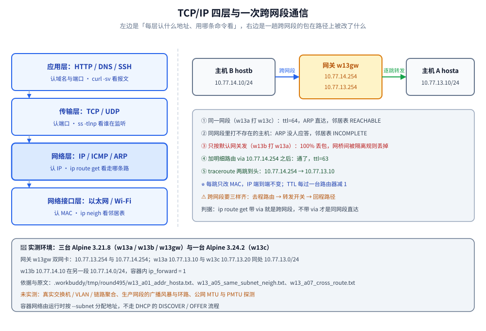

# 网络基础与规划

> 覆盖：协议分层、IP 与子网（CIDR 与划分）、路由与 ARP / ICMP、局域网规划，以及「两台主机能不能直接通信」的判据。
>
> 不覆盖：一个包逐层封装与地址改写的完整旅程见 [网络分层与数据包旅程.md](../../网络/网络分层与数据包旅程.md)；私有地址出网怎么做 NAT 见 [04-防火墙与NAT.md](04-防火墙与NAT.md)；地址自动分配见 [06-DHCP与NTP.md](06-DHCP与NTP.md)；主机名解析见 [07-DNS服务器.md](07-DNS服务器.md)。
>
> 内容整理自个人学习笔记。**基础框架**参考鸟哥官网《服务器架设篇 - RockyLinux 9》相关章节（网络基础）的读后整理；鸟哥在线版把网络基础压缩为一章，深度不减，本篇按原书的展开方式补齐；协议分层细节与 [网络分层与数据包旅程.md](../../网络/网络分层与数据包旅程.md) 对照阅读。素材见 [素材清单](../../../素材清单.md)。
>
> 📎 **实测口径**：本篇的**行为验证**在四台容器里实跑——主机 `w13a`（10.77.13.10/24，Alpine 3.21.8）与服务机 `w13c`（10.77.13.20/24，`python:3-alpine` 即 Alpine 3.24.2）同处 10.77.13.0/24，主机 `w13b`（10.77.14.10/24，Alpine 3.21.8）在另一段 10.77.14.0/24，网关 `w13gw`（Alpine 3.21.8）双网卡 10.77.13.254 / 10.77.14.254；地址、路由、ARP、ICMP 与子网计算用 `iproute2` 和 `python3` 的 `ipaddress` 取数，原文存证 `.workbuddy/tmp/round495/w13_a00_env.txt`（镜像与版本）、`w13_a01_addr_hosta.txt`、`w13_a05_same_subnet_neigh.txt`、`w13_a07_cross_route.txt`、`w13_a08_subnet_math.txt`。**未实测**：真实交换机 / VLAN / 堆叠与链路聚合、生产网段的广播风暴与环路、公网 MTU 与 PMTU 探测；四台容器同在一台宿主机的 docker 网桥之下，二层行为（ARP 广播、MAC 学习）只在「单网桥内」成立。

---

## 一、协议分层怎么理解？

**本节要点**：分层的本质是「**每层只解决一类问题、只和上下相邻层打交道**」；OSI 七层是教学模型，TCP/IP 四层是工程实际。

| OSI 七层 | TCP/IP 四层 | 关心什么 | 例子 |
|----------|-------------|----------|------|
| 应用 / 表示 / 会话 | 应用层 | 业务语义 | HTTP、DNS、SSH |
| 传输层 | 传输层 | 端到端可靠 / 不可靠 | TCP、UDP |
| 网络层 | 网络层 | 寻址与路由 | IP、ICMP、ARP |
| 数据链路 / 物理 | 网络接口层 | 同一链路内传输 | 以太网、Wi-Fi |

⭐ 排障时按层定位：`ping` 不通先看网络层，`curl` 报错但 `ping` 通看传输 / 应用层，`ss` 看不到监听看应用层。完整链路见 [网络分层与数据包旅程.md](../../网络/网络分层与数据包旅程.md)。

### 1.1 每一层认什么地址、用哪条命令看

每层都有自己「认」的标识：应用层认域名与端口、传输层认端口、网络层认 IP、网络接口层认 MAC。⭐ 记住这张对照表，排障时就知道该敲哪条命令：

| 层 | 认什么地址 | 取数命令 | 本机实测输出 |
|----|-----------|----------|--------------|
| 应用层 | 域名 / 端口 | `curl -sv` | `GET / HTTP/1.1`、`HTTP/1.1 200 OK` |
| 传输层 | 端口 | `ss -tlnp` | `LISTEN 0 5 0.0.0.0:80` |
| 网络层 | IP | `ip -4 addr`、`ip route` | `inet 10.77.13.10/24`、`default via 10.77.13.1` |
| 网络接口层 | MAC | `ip -d link`、`ip neigh` | `link/ether 3a:6b:60:88:49:ac` |

⚠️ 同一台机器上，MAC 只在**当前这一段链路**内有意义：包每过一台路由器就换一次源 / 目的 MAC，而 IP 从出发到抵达**始终不变**——这也是抓到包时「看 IP 判断谁在说话、看 MAC 判断这一跳是谁转发」的由来。



---

## 二、IP 与子网怎么算？

**本节要点**：子网掩码区分「网络位」与「主机位」；现代用 **CIDR**（`/24`）代替古老的 A/B/C 类划分。

| CIDR | 掩码 | 可用主机数 | 典型用途 |
|------|------|-----------|----------|
| `/24` | 255.255.255.0 | 254 | 普通局域网 |
| `/25` | 255.255.255.128 | 126 | 划半 |
| `/26` | 255.255.255.192 | 62 | 小型部门 |
| `/30` | 255.255.255.252 | 2 | 点对点链路 |

⭐ 算法：`/24` → 主机位 8 位 → `2^8 - 2 = 254`（减去网络号与广播地址）；`/26` → 主机位 6 位 → `2^6 - 2 = 62`。

| 私有地址段 | 范围 | 常见场景 |
|-----------|------|----------|
| 10.0.0.0/8 | 10.0.0.0 ~ 10.255.255.255 | 大型内网、云 VPC |
| 172.16.0.0/12 | 172.16.0.0 ~ 172.31.255.255 | 中型内网 |
| 192.168.0.0/16 | 192.168.0.0 ~ 192.168.255.255 | 家庭 / 小型办公 |

⚠️ 私有地址**不能在公网路由**，出网要经 **NAT** 转换（见 [04-防火墙与NAT.md](04-防火墙与NAT.md)）。

### 2.1 用 `ipaddress` 把「算」这件事验一遍

口算容易错，拿标准库对齐一遍最省事。本片在容器 `w13c` 里跑的就是下面这段：

```python
import ipaddress as ia

print('本实验两段：', ia.ip_network('10.77.13.0/24'), ia.ip_network('10.77.14.0/24'))
n = ia.ip_network('10.77.13.10/24', strict=False)
print('网络地址 / 广播 / 可用主机数：', n.network_address, n.broadcast_address, n.num_addresses - 2)

# 判同网段：拿地址去问「它在不在这个网段里」
print(ia.ip_address('10.77.13.10') in ia.ip_network('10.77.14.0/24'))   # False
print(ia.ip_address('10.77.13.10') in ia.ip_network('10.77.13.0/24'))   # True

# 划分：把 /24 切成 4 个 /26
for s in ia.ip_network('10.77.13.0/24').subnets(new_prefix=26):
    print(s, '可用', s.num_addresses - 2, '个地址', s.network_address, '~', s.broadcast_address)
```

实测输出：`10.77.13.10/24` 的网络地址是 `10.77.13.0`、广播是 `10.77.13.255`、可用 **254** 个；`10.77.13.10` 落在 `10.77.13.0/24` 里（True）、不落在 `10.77.14.0/24` 里（False）；切成 4 个 `/26` 后每段可用 **62** 个地址，分别是 `10.77.13.0 ~ 10.77.13.63`、`10.77.13.64 ~ 10.77.13.127`、`10.77.13.128 ~ 10.77.13.191`、`10.77.13.192 ~ 10.77.13.255`；掩码 `24` 的通配符是 `0.0.0.255`。原文见 `.workbuddy/tmp/round495/w13_a08_subnet_math.txt`。

---

## 三、路由、ARP 与 ICMP 各管什么？

**本节要点**：**路由表**决定「去哪个网段走哪个口」，**ARP** 把 IP 解析成 MAC（同一网段内），**ICMP** 是 `ping` / `traceroute` 用的控制协议。

```bash
ip route show                    # 路由表（default via ... 是默认网关）
ip route get 8.8.8.8             # 内核会选哪条路（含出口设备与源 IP）
ip neigh                         # ARP 邻居表（IP ↔ MAC）
```

- **同网段**：直接按目标 IP 经 ARP 找 MAC，链路层送达；
- **跨网段**：交给**默认网关**，由它逐跳转发；
- **ARP** 只在本网段内广播「谁是 x.x.x.x」；**ICMP** 承载 `echo request/reply` 与「目标不可达」等差错消息。

⚠️ 能 `ping` 通网关但 ping 不通外网 → 问题在网关之后（NAT、上游路由、对方防火墙）。

### 3.1 本机实测：同网段一次直达

从 `w13a` 打同段的 `w13c`：`ping -c 3 -W 2 10.77.13.20` 三次全通、`ttl=64`、往返 `0.095~0.225 ms`；紧接着 `ip neigh show dev eth0` 里出现 `10.77.13.20 lladdr 1a:26:70:4d:01:24 REACHABLE`——**同网段通信真的会先做一次 ARP 解析**，邻居表里的状态从 `REACHABLE` 也能看出这条 L2 路径是活的。反方向（`w13c` → `w13a`）同样 `ttl=64`。

打一个同网段根本不存在的主机 `10.77.13.99`：2 个包 100% 丢包（`ping` 退出码 1），邻居表里留下一条 `10.77.13.99 INCOMPLETE`——**「INCOMPLETE」就是 ARP 广播发出去、没人应答**的痕迹。原文见 `.workbuddy/tmp/round495/w13_a05_same_subnet_neigh.txt`、`w13_a06_same_subnet_reverse.txt`。

### 3.2 本机实测：跨网段先看内核选哪条路

从 `w13b`（10.77.14.10）打 `w13a`（10.77.13.10），三步走：

```bash
ip route get 10.77.13.10                       # ① 内核选路：via 10.77.14.1（docker 的默认网关）
ping -c 2 -W 2 10.77.13.10                     # ② 只按默认网关发 → 100% 丢包
ip route add 10.77.13.0/24 via 10.77.14.254    # ③ 加明细路由，把 w13gw 当路由器
ping -c 2 -W 2 10.77.13.10                     # ④ 再 ping → 通，ttl=63
```

④ 的输出是本篇最值钱的一行：`64 bytes from 10.77.13.10: seq=0 ttl=63`。同网段是 `ttl=64`，这里变 **63**，说明包**中间过了一台路由器**（`w13gw`）；`traceroute -n -w 2 -q 1 10.77.13.10` 也印证了这一点——第 1 跳 `10.77.14.254`、第 2 跳 `10.77.13.10`，两跳到头。

⭐ **为什么 ② 会 100% 丢包**：默认网关 `10.77.14.1` 是宿主机的 docker 网桥网关，宿主在 `FORWARD` 链上给每个网桥都挂了一条隔离规则，本机探到的是：

```text
-A DOCKER ! -i br-12cf71822553 -o br-12cf71822553 -j DROP
-A DOCKER ! -i br-85685cba82e7 -o br-85685cba82e7 -j DROP
```

含义是「**要出某个网桥、却不是从它进来的包，一律丢弃**」——`w13b` 的包想从 `w13net` 那个网桥出去，但它来自另一个网桥，于是被丢。改成把明细路由指向自己的路由器 `10.77.14.254`（在容器自己的 netns 里做三层转发）就绕开了宿主这条隔离规则。原文见 `.workbuddy/tmp/round495/w13_a07_cross_route.txt`、`w13_b01b_docker_isolation.txt`。

⚠️ 排障判据：`ip route get` 输出里带 `via <下一跳>` 就是跨网段、不带 `via` 就是同网段直连（出口设备直接给出）。跨网段不通时，按「**去程路由 → 转发开关 → 回程路径**」三样依次查——三样齐了包才回得来，缺哪样都表现为「100% 丢包」。

---

## 四、局域网怎么规划？

**本节要点**：规划的核心是「**先分段、再分配**」——按用途划网段、按角色定地址，并留出扩展余量。

| 要素 | 说明 |
|------|------|
| 网段划分 | 服务器段 / 办公段 / 管理段 / 访客段分开 |
| 交换机 | 接入层 + 汇聚层；VLAN 做二层隔离 |
| 地址分配 | 服务器用静态 / 保留，终端用 DHCP（见 [06-DHCP与NTP.md](06-DHCP与NTP.md)） |
| 冗余 | 双上行、堆叠、链路聚合 |

### 4.1 一张可用的规划表

| 用途 | 网段 | 网关 | 分配方式 |
|------|------|------|----------|
| 服务器 | 10.0.10.0/24 | 10.0.10.1 | 静态 / DHCP 保留 |
| 办公终端 | 10.0.20.0/23 | 10.0.20.1 | DHCP |
| 管理（带外 / BMC） | 10.0.30.0/24 | 10.0.30.1 | 静态 |
| 访客 / Wi-Fi | 10.0.40.0/24 | 10.0.40.1 | DHCP + 隔离 |

⭐ **VLAN 与网段一一对应**是最省心的做法：一个网段一个 VLAN、一个网关，子网隔离 = VLAN 隔离，排障时不用在脑子里做两套映射。

### 4.2 三条容易踩的规划线

- **容量按 `2^n - 2` 留余量**：`/24` 只有 254 个可用地址，看清楚「终端数 + 预留数」再定掩码，别等满了才划 `VLAN`；
- **网关地址别随手挑**：习惯上取该段第一个可用地址（`10.0.10.1`），并把 `.1` 段留给网络设备，后续加 VRRP / 双网关时不用改全网；
- **管理网段单独分**：带外管理（BMC / iDRAC）与业务网分开，业务网络被玩坏时还能进去救。

---

## 五、应用场景

这套分层 + 子网 + 路由的知识，落到工程里有几个几乎天天遇到的位置：

| 场景 | 用到的知识 | 具体表现 |
|------|-----------|----------|
| 云上 VPC / 子网规划 | CIDR 划分、路由表 | 一个 VPC 划多个子网，路由表决定子网能不能互访、经不经 NAT 网关出网 |
| K8s / 容器网络 | 网段不重叠、三层转发 | Pod CIDR 与节点网段撞车会导致「本机通、跨节点不通」，靠 `ip route get` 定位 |
| 多站点互联 | 私网段选型、静态路由 | 两端都用了 `192.168.1.0/24` 时要么改地址、要么做 NAT |
| 跨网段服务访问 | 明细路由 + 转发开关 | 应用服务器要访问数据库网段，缺的往往就是一条 `via 数据库网关` 的明细路由 |
| 排障 | 按层定位 + TTL 读数 | `ping` 通 / `curl` 不通先分层；`ttl` 少几跳就能判断中间过了几台路由器 |

⭐ 一个实用习惯：**先把图上的三段画出来（我这个段、对端段、中间是谁做路由），再动手敲命令**。本次实测里 `w13b` 之所以不通，就是「对端段没有明细路由」这一处；加上 `via 10.77.14.254` 之后所有症状一起消失。

---

## 六、具体使用

**本节要点**：两个最常用的动作——**判断两台主机能不能直接通信**，以及**在容器里把这套判断跑一遍**。

### 6.1 判断两台主机能不能直接通信

一个最常被问、也最容易算错的问题——先比「网络位是否相同」，再决定「直连还是走网关」。

```bash
# 主机 A：10.0.10.5/24  主机 B：10.0.10.200/24
# 网络位相与后都是 10.0.10.0 → 同网段 → 直接 ARP 通信

# 主机 A：10.0.10.5/24  主机 C：10.0.20.5/24
# 网络位不同 → 跨网段 → A 把包交给默认网关

# 用命令验证
ip route get 10.0.20.5      # 若显示 via <网关> 则跨网段
arping -c 2 10.0.10.200     # 同网段可用 arping 验证 L2 可达
```

判据：同网段时 `ip route get` 直接给出出口设备（无 `via`）；跨网段时输出里带 `via <网关 IP>`。

### 6.2 在容器里跑一遍（本机实测）

四台容器、两段地址、一个网关就是最小实验台（`docker network create --subnet 10.77.13.0/24` / `--subnet 10.77.14.0/24`，网关容器同时接两个网络）：

```bash
# 台面
#   w13a 10.77.13.10   w13c 10.77.13.20   （10.77.13.0/24）
#   w13b 10.77.14.10                      （10.77.14.0/24）
#   w13gw 10.77.13.254 · 10.77.14.254     （两段都在，ip_forward=1）

ip -4 addr show eth0                 # 看自己这一段
ip route                             # 默认网关是谁
ping -c 3 -W 2 10.77.13.20           # 同网段：通，ttl=64
ip neigh show dev eth0               # 邻居表：REACHABLE / INCOMPLETE 的含义
ip route get 10.77.13.10             # 跨网段：先看内核选哪条路
ip route add 10.77.13.0/24 via 10.77.14.254
ping -c 2 -W 2 10.77.13.10           # 跨网段：通，ttl=63（过 1 台路由器）
traceroute -n -w 2 -q 1 10.77.13.10  # 两跳：10.77.14.254 → 10.77.13.10
```

读到的结果：同网段 `ttl=64`、往返 `0.095~0.225 ms`、邻居表 `REACHABLE`；不存在的同段地址留下 `INCOMPLETE`；跨网段只走默认网关时 100% 丢包，补上明细路由后 `ttl=63`、`traceroute` 两跳到头。各段原文见 `.workbuddy/tmp/round495/w13_a01_addr_hosta.txt`、`w13_a02_addr_hostb.txt`、`w13_a04_addr_gw.txt`、`w13_a05_same_subnet_neigh.txt`、`w13_a07_cross_route.txt`。

---

## 延伸追问

- **跨子网通信为什么一定要经过网关？**
  → 因为二层（以太网）只在**同一广播域**内按 MAC 寻址，跨网段的目标 MAC 主机不知道、也无法直接广播询问。所以主机把包发给**默认网关**（网关的 MAC 是本网段可解析的），由网关做三层转发，逐跳送到目的地。
- **怎么判断两台主机是否在同一子网？**
  → 用各自掩码把两个 IP 分别做「与运算」，结果相同即同网段。例：`192.168.1.10/24` 与 `192.168.1.200/24` 都得 `192.168.1.0` → 同网段；`192.168.1.10/25` 与 `192.168.1.200/25` 分别是 `192.168.1.0` 与 `192.168.1.128` → 不同网段。
- **路由表和 ARP 表的关系？**
  → 它们解决不同问题：**路由表**回答「这个目标 IP 走哪个出口 / 下一跳」（L3），**ARP 表**回答「这个下一跳 IP 对应的 MAC 是多少」（L2）。流程是：查路由表得到下一跳 IP → 再查 ARP 表得到 MAC → 封帧发出；ARP 表里没有才发 ARP 请求。
- **TTL 除了防止环路还有什么用？**
  → 它是「数跳数」的标尺：本篇实测同一网段 `ttl=64`、经一台路由器 `ttl=63`，少 1 就说明中间过了一台设备；`traceroute` 正是靠**逐次递增 TTL**、收集沿途设备回发的 ICMP 超时消息来画出整条路径。
- **私网地址段怎么选？**
  → 容量优先用 `10.0.0.0/8`（云 VPC 默认用它，`/8` 里还能灵活切 `/16`、`/24`）；家庭 / 小办公 `192.168.0.0/16` 够用；**多站点互联最容易踩的是「两边用了同一个段」**——一旦重叠，要么改地址要么在上游做 NAT，越早定规划越省事。
- **容器里的 IP 是谁分配的？**
  → 本次实验的 `10.77.13.0/24` 与 `10.77.14.0/24` 是创建自定义网络时用 `--subnet` 指定的，由容器运行时的 IPAM 从这段里取地址，**不是** DHCP 的 `DISCOVER/OFFER` 那套流程；要观察 DHCP 的完整过程得自己起一个 DHCP 服务（见 [06-DHCP与NTP.md](06-DHCP与NTP.md)）。

---

## 关联

- **上游/总纲**：[README.md](README.md) — 本目录导读：版本坐标与阅读顺序
- **对照/互补**：[网络分层与数据包旅程.md](../../网络/网络分层与数据包旅程.md) — 一个包在每一层的封装与地址改写
- **下游机制**：[04-防火墙与NAT.md](04-防火墙与NAT.md) — 私有地址出网的 NAT 转换与端口转发
- **下游机制**：[06-DHCP与NTP.md](06-DHCP与NTP.md) — 地址自动分配
- **下游机制**：[07-DNS服务器.md](07-DNS服务器.md) — 主机名解析
- **运维/配置**：[05-SSH远程连接.md](05-SSH远程连接.md) — 跨网段登录与隧道

> 反向引用（本篇被下列文档引到）：[06-网络配置与nmcli.md](../鸟哥基础学习篇/06-网络配置与nmcli.md)、[01-虚拟化与云系统搭建.md](01-虚拟化与云系统搭建.md)、[IP与路由基础.md](../../网络/网络层与寻址/IP与路由基础.md)
