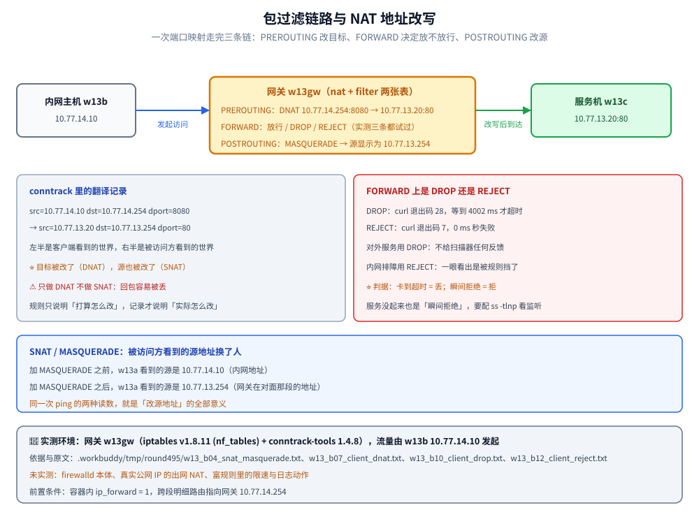

# 防火墙与NAT

> 覆盖：firewalld 的 zone / service / port 三层模型与富规则、SNAT / DNAT 与端口转发（含 `MASQUERADE` 与 `conntrack`）、以及「包到底有没有进来」的排错方法（`DROP` 与 `REJECT` 的差别）。
>
> 不覆盖：地址与路由基础（子网、默认网关、TTL）见 [03-网络基础与规划.md](03-网络基础与规划.md)；每一跳的地址改写原理见 [网络分层与数据包旅程.md](../../网络/网络分层与数据包旅程.md)；反代下怎么拿到真实源 IP 见 [客户端真实IP与可信代理.md](../../网络/应用层/客户端真实IP与可信代理.md)；容器网络模式与端口发布见 [网络与存储.md](../../../06-工程实践/部署/docker/网络与存储.md)。
>
> 内容整理自个人学习笔记。**基础框架**参考鸟哥官网《服务器架设篇 - RockyLinux 9》相关章节（防火墙与 NAT 服务器）的读后整理；firewalld 与 Docker 端口映射的关系基于官方文档独立整理。素材见 [素材清单](../../../素材清单.md)。
>
> 📎 **实测口径**：防火墙规则的**行为验证**在网关容器 `w13gw`（Alpine 3.21.8 + `iptables v1.8.11 (nf_tables)` + `conntrack-tools 1.4.8`）里实跑，流量由内网主机 `w13b`（10.77.14.10，Alpine 3.21.8）发起、目标是服务机 `w13c`（10.77.13.20:80，`python:3-alpine` 即 Alpine 3.24.2），`w13a`（10.77.13.10，Alpine 3.21.8）用来观察被 NAT 改写后的源地址；规则清单、`conntrack` 记录、`curl` 退出码与耗时各段原文存证 `.workbuddy/tmp/round495/w13_a00_env.txt`（镜像与版本）、`w13_b03_iptables_baseline.txt`、`w13_b04_snat_masquerade.txt`、`w13_b05c_after_snat.txt`、`w13_b07_client_dnat.txt`、`w13_b08_conntrack.txt`、`w13_b10_client_drop.txt`、`w13_b12_client_reject.txt`。**未实测**：`firewalld` 本体（Alpine 镜像里没有 `firewalld`，本篇的 zone / service / rich rule 只作命令示例与底层对照）、真实公网 IP 的出网 NAT、富规则里的限速与日志动作。

---

## 一、firewalld 的三层模型是怎么组织的？

**本节要点**：firewalld 不让你直接写规则，而是把规则组织成「**区域 zone 里允许哪些 service / port**」；默认区域通常是 `public`。

| 概念 | 含义 |
|------|------|
| zone | 按信任程度分组的规则集（`public` / `trusted` / `dmz` / `drop`…） |
| service | 预定义的端口集合（`http` = 80/tcp，`https` = 443/tcp） |
| port | 直接放行某个端口（`8080/tcp`） |
| rich rule | 复杂规则（限源 IP、限频率、限日志） |

```bash
sudo firewall-cmd --get-default-zone        # 默认区域
sudo firewall-cmd --list-all                # 当前区域全部规则
sudo firewall-cmd --get-active-zones        # 哪个接口属于哪个区域

# 放行服务 / 端口（--permanent 才永久，之后 reload）
sudo firewall-cmd --add-service=https --permanent
sudo firewall-cmd --add-port=8080/tcp --permanent
sudo firewall-cmd --reload
```

### 1.1 富规则

```bash
# 只允许 10.0.0.0/24 访问 3306
sudo firewall-cmd --permanent --add-rich-rule='rule family="ipv4" \
  source address="10.0.0.0/24" port port="3306" protocol="tcp" accept'
sudo firewall-cmd --reload
```

⚠️ **运行时 vs 永久**：不带 `--permanent` 只改运行时、reload 即丢；带 `--permanent` 要 `--reload` 才生效。改完用 `--list-all` 复核。

### 1.2 本机实测：`iptables` 命令其实落在 nftables 上

不装 `firewalld` 也能验证「底层到底是什么」。本片在网关容器里敲 `iptables -V` 得到：

```text
iptables v1.8.11 (nf_tables)
```

括号里的 `nf_tables` 就是答案：**现代发行版的 `iptables` 命令已经是 nftables 的前端**，`firewalld` 也是同一条路（把 zone / service / port 翻译成 nft 规则）。所以「firewalld 还是 iptables」在底层并不对立，⭐ 真正的纪律是**同一台机器只用一套管理器**，两边同时写会互相覆盖。原文见 `.workbuddy/tmp/round495/w13_b03_iptables_baseline.txt`。

## 二、NAT 服务器怎么做？

**本节要点**：NAT 改的是「包的地址」——**SNAT** 改源地址（内网出网），**DNAT** 改目标地址（外网访问内网服务，即端口转发）。

| 类型 | 改什么 | 方向 | 典型场景 |
|------|--------|------|----------|
| SNAT / MASQUERADE | 源 IP | 内网 → 外网 | 内网共享出口 |
| DNAT | 目标 IP + 端口 | 外网 → 内网 | 把公网 8080 转到内网 80 |

```bash
# ① 开启内核转发（NAT 服务器是路由器）
echo "net.ipv4.ip_forward = 1" | sudo tee /etc/sysctl.d/99-ipforward.conf
sudo sysctl --system

# ② SNAT：让 10.0.10.0/24 借本机出网（配合 firewalld 的 masquerade）
sudo firewall-cmd --permanent --zone=external --add-masquerade
sudo firewall-cmd --reload

# ③ DNAT：公网 8080 → 内网 10.0.10.20:80（端口转发）
sudo firewall-cmd --permanent --add-forward-port=\
  port=8080:proto=tcp:toport=80:toaddr=10.0.10.20
sudo firewall-cmd --reload
```

⭐ **DNAT 与端口转发本质是一回事**：把「目标地址 + 端口」改写成另一台主机 / 另一个端口，正是 DNAT 做的事。

### 2.1 本机实测：SNAT 把源地址换成了网关

先给网关加一条 `MASQUERADE`，再让内网主机 `w13b` 去 ping `w13a`，然后在 `w13a` 上看连接跟踪记录：

```bash
# 网关侧
iptables -t nat -A POSTROUTING -s 10.77.14.0/24 -d 10.77.13.0/24 -j MASQUERADE

# 被访问方看到的源地址（NAT 之前）
icmp 1 29 src=10.77.14.10 dst=10.77.13.10 type=8 code=0 ... src=10.77.13.10 dst=10.77.14.10 type=0 code=0

# 被访问方看到的源地址（NAT 之后）
icmp 1 29 src=10.77.13.254 dst=10.77.13.10 type=8 code=0 ... src=10.77.13.10 dst=10.77.13.254 type=0 code=0
```

⭐ 同一次 ping，`w13a` 眼里发起方的地址从 `10.77.14.10` 变成了 `10.77.13.254`（网关在对面那段的地址）——**这就是 SNAT 全部的意义**：让被访问方只看到网关、看不到内网主机，回程自然也就发回网关。原文见 `.workbuddy/tmp/round495/w13_b02c_before_snat.txt`、`w13_b05c_after_snat.txt`。

### 2.2 本机实测：DNAT 就是端口转发

在网关上把「内网口地址的 8080」映射到服务机的 80：

```bash
iptables -t nat -A PREROUTING -d 10.77.14.254 -p tcp --dport 8080 \
  -j DNAT --to-destination 10.77.13.20:80

# 内网主机发起访问
curl -sS -m 5 -o /dev/null -w '%{http_code} (%{time_total}s)\n' http://10.77.14.254:8080/
```

实测两条路径都返回同一个服务：走端口映射 `http://10.77.14.254:8080/` → `200 (0.015333s)`，直连 `http://10.77.13.20/` → `200 (0.002562s)`；网关的 `conntrack -L -p tcp` 里留下一条一目了然的翻译记录：

```text
tcp 6 119 TIME_WAIT src=10.77.14.10 dst=10.77.14.254 sport=40456 dport=8080
             src=10.77.13.20 dst=10.77.13.254 sport=80 dport=40456 [ASSURED]
```

冒号左边是客户端看到的世界、右边是被访问方看到的世界：**目标 `10.77.14.254:8080` 被改写成了 `10.77.13.20:80`**，而回程因为 SNAT 变成了 `10.77.13.254 → 10.77.14.10`。这里同时用到 DNAT（改目标）和 SNAT（改源），也就是常说的「端口转发要配一对」——只做 DNAT 时，被访问方的回包会按自己的默认网关走，很容易在半路被丢。原文见 `.workbuddy/tmp/round495/w13_b06_dnat_rule.txt`、`w13_b07_client_dnat.txt`、`w13_b08_conntrack.txt`。



---

## 三、防火墙排错：包到底进来了吗？

**本节要点**：排错要能区分「**没到**」「到了但被拒」「到了没服务听」三种情况——靠 counters、日志与抓包区分。

```bash
sudo firewall-cmd --list-all --zone=public     # 规则与（部分）计数
sudo firewall-cmd --set-log-denied=all         # ⭐ 记录被拒的包（排障专用，事后关掉）
journalctl -k -f | grep -i "DPT\|DROP"         # 看内核对被拒包的记录
```

| 现象 | 判断 | 下一步 |
|------|------|--------|
| 连不上、无任何日志 | 包没到或被上游丢 | 在上游 / 本机抓包（`ss`、`journalctl -k`） |
| 有 DROP 日志 | 到本机但被防火墙拒 | 放行端口 / 调整 zone |
| 无 DROP、本机也没监听 | 服务没起来或只听 127.0.0.1 | `ss -tulnp` 确认绑定地址 |

⚠️ 本机 `nc -vz 127.0.0.1 8080` 通、外部不通，多半是**服务只监听 127.0.0.1** 或**主机防火墙未放行**，与「网络不通」是两码事。

### 3.1 本机实测：`DROP` 与 `REJECT` 的表现完全不同

在 `FORWARD` 链最前面扣一条规则，再用同一条 `curl` 打同一个地址，结果差别极大：

```bash
# ① 丢包：什么都不回
iptables -I FORWARD 1 -p tcp -d 10.77.13.20 --dport 80 -j DROP
# 客户端：curl: (28) Connection timed out after 4002 milliseconds   → 退出码 28，耗时 4.002s

# ② 拒绝：立刻回一个 ICMP 端口不可达
iptables -R FORWARD 1 -p tcp -d 10.77.13.20 --dport 80 -j REJECT
# 客户端：curl: (7) Failed to connect to 10.77.14.254 port 8080 after 0 ms → 退出码 7，几乎瞬时
```

| 动作 | 客户端看到 | `curl` 退出码 | 耗时 | 什么时候用 |
|------|-----------|--------------|------|-----------|
| `DROP` | 一直等，最后超时 | 28 | 4002 ms | 对外服务：不给扫描器任何反馈 |
| `REJECT` | 立刻「连不上」 | 7 | 0 ms | 内网 / 自己排障：快速暴露「被规则挡了」 |

⭐ **判据**：外部访问「卡住直到超时」= 包被 `DROP`（或根本没到）；「瞬间拒绝」= 包到了并被 `REJECT`。这一条能把「防火墙问题」和「服务没起来」区分开——服务没起来时也是「瞬间拒绝」，但要配合 `ss -tulnp` 看本机有没有监听。原文见 `.workbuddy/tmp/round495/w13_b09_forward_drop.txt`、`w13_b10_client_drop.txt`、`w13_b11_forward_reject.txt`、`w13_b12_client_reject.txt`。

---

## 四、应用场景

| 场景 | 用到的机制 | 具体表现 |
|------|-----------|----------|
| 内网共享出口 | SNAT / `MASQUERADE` | 办公网借一台双网卡服务器出网，被访问方只看到出口地址 |
| 端口转发 / 发布服务 | DNAT | 把公网 `8080` 转到内网应用机的 `80`，或把数据库端口只暴露给跳板机 |
| 云上安全组 / 网络 ACL | zone + port 的等价物 | 本质就是「按方向 + 源 + 目标端口放行或拒绝」的规则集 |
| 容器端口发布 | DNAT + 宿主 `FORWARD` | `docker run -p` 就是在宿主写 DNAT 规则，可能绕过 `firewalld` |
| 排障 | counters + `conntrack` | 「包有没有到」看计数，「NAT 有没有生效」看 `conntrack` |

⚠️ 一个容易混的场景：**只做 DNAT 没做 SNAT** 时，来自内网自己网段的访问经常不通——因为被访问方把回包发给了自己的默认网关，绕开了 NAT 主机。同段访问更稳的做法是直接连真实地址，或把 SNAT 一起配上。

---

## 五、具体使用

### 5.1 开放一个对外服务并验证

**本节要点**：一条完整链路——放行端口 → 确认服务监听 → 从外部验证可达。

```bash
# ① 放行端口（永久）
sudo firewall-cmd --add-port=8080/tcp --permanent
sudo firewall-cmd --reload

# ② 确认服务监听在 0.0.0.0 而不是 127.0.0.1
ss -tulnp | grep 8080

# ③ 本机自测
curl -sS -o /dev/null -w "%{http_code}\n" http://127.0.0.1:8080/

# ④ 外部（另一台机）验证
nc -vz 10.0.10.20 8080
```

判据：`firewall-cmd --list-all` 里出现 `8080/tcp`、`ss` 显示监听 `0.0.0.0:8080`、本机 `curl` 返回 200/30x、外部 `nc` 显示 succeeded。

### 5.2 在容器里跑一遍（本机实测）

不装 `firewalld` 也能把 SNAT / DNAT / 排错三条线走通——`iptables` 命令与 nft 底层是同一套：

```bash
# 台面：w13b 10.77.14.10 与 w13c 10.77.13.20 分处两段，w13gw 双网卡做路由器/防火墙
iptables -S ; iptables -t nat -S          # 先看初始：filter 只有 3 条 ACCEPT policy
sysctl net.ipv4.ip_forward                # NAT 的前提：转发开关（= 1）

# SNAT：内网出网改源地址
iptables -t nat -A POSTROUTING -s 10.77.14.0/24 -d 10.77.13.0/24 -j MASQUERADE

# DNAT：端口转发
iptables -t nat -A PREROUTING -d 10.77.14.254 -p tcp --dport 8080 \
  -j DNAT --to-destination 10.77.13.20:80

# 看「翻译表」
conntrack -L -p tcp | head

# 排错：先 DROP 再 REJECT，对比客户端表现
iptables -I FORWARD 1 -p tcp -d 10.77.13.20 --dport 80 -j DROP
iptables -R FORWARD 1 -p tcp -d 10.77.13.20 --dport 80 -j REJECT
iptables -D FORWARD 1                     # 撤掉规则，恢复访问
```

读到的结果：初始 `filter` 表只有 `INPUT / FORWARD / OUTPUT` 三条 `ACCEPT` policy（本机 `nat` 表里那几条 `127.0.0.11` 的规则是容器运行时的内置 DNS 转发）；加 `MASQUERADE` 后 `w13a` 看到的源地址从 `10.77.14.10` 变成 `10.77.13.254`；加 DNAT 后 `curl http://10.77.14.254:8080/` 返回 `200`，`conntrack` 里能看到 `8080 → 80` 的翻译；`DROP` 时 `curl` 退出码 **28**、耗时 **4002 ms**，换 `REJECT` 后退出码 **7**、耗时 0 ms。各段原文见 `.workbuddy/tmp/round495/w13_b03_iptables_baseline.txt`、`w13_b04_snat_masquerade.txt`、`w13_b06_dnat_rule.txt`、`w13_b07_client_dnat.txt`、`w13_b13_unblock.txt`、`w13_b14_client_ok.txt`。

---

## 延伸追问

- **firewalld 和 iptables 的关系？**
  → `firewalld` 是**上层管理器**，`iptables` 是**下层规则工具**（现代内核里二者都落到 **nftables**）。firewalld 把「zone / service / port」翻译成底层规则，并维护「运行时 / 永久」两套状态；直接 `iptables` 就是裸写规则、无 zone。⭐ **二选一**，同时用会互相覆盖。
- **DNAT 和端口转发是一回事吗？**
  → 本质上是一回事：**端口转发就是 DNAT 的一种表达**（改目标地址 + 目标端口）。差别只在说法：说「端口转发」时强调「从 A 端口转到 B 服务」，说 DNAT 时强调「改写目标地址」。反向的 SNAT 才对应「内网出网改源地址」。
- **容器里的端口映射和主机防火墙冲突怎么办？**
  → Docker 默认会**自己写 iptables 规则并插在 filter 链前面**，可能绕过 firewalld 的 zone 规则 → 表现为「防火墙没放行但容器端口却可达」。处理办法：① 用 `firewall-cmd` 的 **`--add-forward-port`** / 在 `docker` zone 里放行；② 让 Docker 别动 iptables（`"iptables": false`，但需自行管理）；③ 只在 `127.0.0.1` 上发布端口（`-p 127.0.0.1:8080:80`），避免直接暴露。
- **排障时该用 `DROP` 还是 `REJECT`？**
  → 看给谁看：**对外**用 `DROP`（不回任何反馈，扫描器要等到超时，不告诉对方这里有主机）；**对内 / 排障**用 `REJECT`（立刻回 ICMP 端口不可达，客户端秒失败，一眼看出「被规则挡了」）。本篇实测两者耗时是 4002 ms 对 0 ms，差别就是这个。
- **为什么 NAT 一定要 `conntrack`？**
  → 因为 NAT 只在**第一个包**上做地址改写，之后每个包都得按同一条记录翻译回去，这就要靠连接跟踪表（`conntrack`）记住「谁和谁是一对」。所以查 NAT 是否生效，看 `conntrack -L` 比看规则本身更直接——规则只说明「打算怎么改」，记录才说明「实际怎么改的」。
- **只开转发不做 SNAT 会怎样？**
  → 去程能通、回程可能丢：被访问方看到的是**内网源地址**，它按自己的默认网关回包，如果那条路上没有到对方的明细路由，包就回不来（表现是「100% 丢包」）。配上 `MASQUERADE` 之后，被访问方只看到网关，回程天然朝着网关走。

---

## 关联

- **上游/总纲**：[README.md](README.md) — 本目录导读：版本坐标与阅读顺序
- **上游/总纲**：[03-网络基础与规划.md](03-网络基础与规划.md) — 私有地址出网与路由（NAT 的前提）
- **对照/互补**：[网络分层与数据包旅程.md](../../网络/网络分层与数据包旅程.md) — 每一跳的地址改写（DNAT 的原理对照）
- **下游机制**：[客户端真实IP与可信代理.md](../../网络/应用层/客户端真实IP与可信代理.md) — 反向代理下怎么拿到真实源 IP
- **运维/配置**：[网络与存储.md](../../../06-工程实践/部署/docker/网络与存储.md) — 容器网络模式与端口发布
- **运维/配置**：[05-SSH远程连接.md](05-SSH远程连接.md) — 只对管理网段放行 SSH

> 反向引用（本篇被下列文档引到）：[02-主机安全与SELinux.md](02-主机安全与SELinux.md)、[05-SSH远程连接.md](05-SSH远程连接.md)、[06-DHCP与NTP.md](06-DHCP与NTP.md)、[09-文件共享服务.md](09-文件共享服务.md)、[IP与路由基础.md](../../网络/网络层与寻址/IP与路由基础.md)
