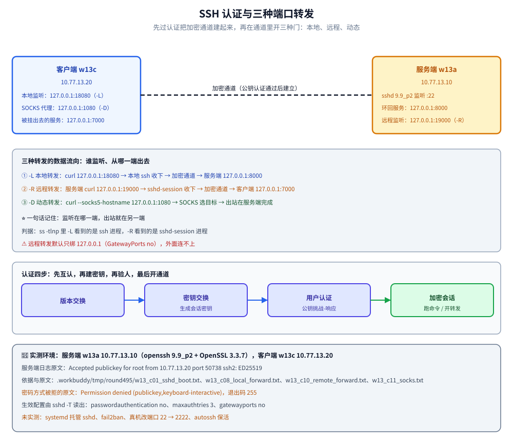

# SSH远程连接

> 覆盖：密钥认证与 SSHD 加固、三类端口转发（本地 `-L` / 远程 `-R` / 动态 `-D`）、`rsync` 走 SSH 做同步，以及「先确保密钥能登、再关密码」的上线顺序。
>
> 不覆盖：安全基线与失败登录检测见 [02-主机安全与SELinux.md](02-主机安全与SELinux.md)；SSH 只对管理网段放行的防火墙写法见 [04-防火墙与NAT.md](04-防火墙与NAT.md)；备份策略见 [09-备份与恢复.md](../鸟哥基础学习篇/09-备份与恢复.md)；查端口、看连接的命令速查见 [常用命令.md](../常用命令.md)。
>
> 内容整理自个人学习笔记。**基础框架**参考鸟哥官网《服务器架设篇 - RockyLinux 9》相关章节（SSH 服务）的读后整理；ssh / rsync 的现代用法基于官方文档独立整理。素材见 [素材清单](../../../素材清单.md)。
>
> 📎 **实测口径**：本篇的**行为验证**在两台容器里实跑——服务端 `w13a`（10.77.13.10，Alpine 3.21.8，`openssh 9.9_p2` + `OpenSSL 3.3.7`），客户端 `w13c`（10.77.13.20，`python:3-alpine` 即 Alpine 3.24.2，`openssh-client 10.3p1` + `rsync`）；两台机器在同一个网段里直连，服务端的**环回服务**（只监听 `127.0.0.1`）用来验证隧道是否真的「从服务端出网」。主机密钥与客户端密钥指纹、sshd 生效配置、三类转发的监听与 `curl` 结果、sshd 日志各段原文存证 `.workbuddy/tmp/round495/w13_a00_env.txt`（镜像与版本）、`w13_c01_sshd_boot.txt`、`w13_c02_hostkey.txt`、`w13_c03_client_keygen.txt`、`w13_c05_pubkey_ok.txt`、`w13_c08_local_forward.txt`、`w13_c10_remote_forward.txt`、`w13_c11_socks.txt`、`w13_c12_server_view.txt`、`w13_c13_rsync.txt`。**未实测**：`systemd` 托管 sshd 与 `systemctl restart`、`fail2ban`、`sshd` 的真机端口变更（22 → 2222）、`autossh` 保活。

---

## 一、SSH 基础：密码还是密钥？

**本节要点**：密钥认证不做「密码过网络」这件事——私钥不出本机、用**挑战-响应**证明身份，也因此能做免密与自动化。

```bash
# ① 本机生成密钥对（ed25519 更现代、更短）
ssh-keygen -t ed25519 -C "deploy@laptop"

# ② 把公钥装到服务器（推荐 ssh-copy-id）
ssh-copy-id deploy@10.0.10.20

# ③ 免密验证
ssh deploy@10.0.10.20 "hostname"
```

| 文件 | 在哪 | 作用 | 权限 |
|------|------|------|------|
| `~/.ssh/id_ed25519` | 客户端 | **私钥**（绝不外传） | 600 |
| `~/.ssh/id_ed25519.pub` | 客户端 | 公钥，拷到服务器 | 644 |
| `~/.ssh/authorized_keys` | 服务器 | 允许登录的公钥列表 | 600 |

⚠️ 权限不对 SSH 会**拒绝使用密钥**（`Permissions 0644 ... too open`）——`.ssh` 目录 700、私钥 600、authorized_keys 600。

### 1.1 本机实测：一对密钥长什么样

客户端（`w13c`）上生成密钥对，输出里能看到指纹、以及那把「随机艺术图」（用来肉眼比对有没有被换过）：

```text
$ ssh-keygen -t ed25519 -N '' -C w13-client -f /root/.ssh/id_ed25519
The key fingerprint is:
SHA256:8c/1CPX8kYTXbhSFnZoffGtzqXXhRqfoOxwJp5qfu6s w13-client
$ cat /root/.ssh/id_ed25519.pub
ssh-ed25519 AAAAC3NzaC1lZDI1NTE5AAAAIM75+FJ3VlW7WcTnjch0vBchpK0jeUxvMZ0Lnraa5Irl w13-client
```

服务端（`w13a`）那边用主机密钥生成 + 指纹确认，并把客户端的公钥装进 `authorized_keys`（实测权限就是 `.ssh` 目录 700、`authorized_keys` 600）：

```bash
ssh-keygen -A                                   # 生成主机密钥（服务端自己的一套，与用户密钥是两回事）
ssh-keygen -lf /etc/ssh/ssh_host_ed25519_key.pub
# 256 SHA256:xVep9Js07uT7tx3U/d8th0XgyqsSlxSFsM+d8W/iNzQ root@hosta (ED25519)
```

⭐ 一次登录要过两道密钥：**主机密钥**证明「我连到的服务器是真的」，**用户密钥**证明「我是谁」。客户端 `ssh-keyscan -t ed25519 10.77.13.10` 抓到的就是主机密钥，第一次连接时那句 `The authenticity of host ... can't be established` 问的也是它。原文见 `.workbuddy/tmp/round495/w13_c02_hostkey.txt`、`w13_c03_client_keygen.txt`、`w13_c03b_authorized_key.txt`。

---

## 二、SSHD 服务端怎么加固？

**本节要点**：`/etc/ssh/sshd_config` 里最该改的四项——**禁密码、禁 root 直登、限用户 / 来源、可换端口**；改完先 `sshd -t` 校验再重启。

```text
Port 2222                       # 非标准端口（减少自动化扫描噪音，不是安全屏障）
PermitRootLogin no              # 禁止 root 直接登录
PasswordAuthentication no       # ⭐ 只允许密钥登录
PubkeyAuthentication yes
AllowUsers deploy admin         # 只允许这些用户
AllowTcpForwarding no           # 不需要隧道就关掉
MaxAuthTries 3                  # 最大认证尝试次数
ClientAliveInterval 300         # 空闲断开
```

```bash
sudo sshd -t                              # ⚠️ 改完先校验语法，别直接重启把自己关在门外
sudo systemctl restart sshd
sudo journalctl -u sshd -n 20 --no-pager
```

⚠️ **改远端 sshd 配置时**：先另开一个 SSH 会话验证新配置能登录，再关掉当前会话——否则配错了就永久失联，只能走控制台。

### 2.1 本机实测：加固配置生效后的样子

本片要在容器里演示三类端口转发，所以实测用的配置是「**禁密码 + 禁 root 密码登录 + 开转发**」这一组：

```text
Port 22
PermitRootLogin prohibit-password
PasswordAuthentication no
PubkeyAuthentication yes
MaxAuthTries 3
LogLevel VERBOSE
AllowTcpForwarding yes
GatewayPorts no
```

`sshd -t` 校验通过后启动，`sshd -T` 打出生效配置（`sshd -T` 才是「真正生效的合并结果」，比肉眼看配置文件可靠）：

```text
port 22
maxauthtries 3
permitrootlogin without-password
pubkeyauthentication yes
passwordauthentication no
gatewayports no
allowtcpforwarding yes
loglevel VERBOSE
```

⭐ 一个容易踩的显示差异：配置文件里写 `prohibit-password`，`sshd -T` 会打印成 `without-password`——**两者是同一个值的两个名字**，不要以为没生效。⚠️ 另外「有没有被拒」要看客户端：只允许公钥时，用密码方式去连会直接得到 `Permission denied (publickey,keyboard-interactive)`（实测退出码 255），而用密钥是 `ssh_rc=0` 并回显 `hosta` / `uid=0(root)`。原文见 `.workbuddy/tmp/round495/w13_c01_sshd_boot.txt`、`w13_c04_password_refused.txt`、`w13_c05_pubkey_ok.txt`。

---

## 三、三类端口转发各自解决什么问题？

**本节要点**：SSH 隧道把流量**加密**后从 SSH 连接里穿过；三种模式按「谁连谁」区分。

| 模式 | 命令 | 场景 |
|------|------|------|
| 本地转发 `-L` | `ssh -L 8080:db.internal:3306 jump` | 把远端内网服务映射到本地端口 |
| 远程转发 `-R` | `ssh -R 9000:localhost:3000 jump` | 把本地服务暴露给远端 |
| 动态转发 `-D` | `ssh -D 1080 jump` | 建一个 SOCKS 代理，按需转发 |

```bash
# 本地转发：本地 13306 → 经跳板机 → 访问内网 MySQL 3306
ssh -N -L 13306:10.0.10.30:3306 deploy@jump.example.com
# 之后本地连 127.0.0.1:13306 就等于连到内网 MySQL

# 动态转发：本地 1080 起一个 SOCKS5 代理
ssh -N -D 1080 deploy@jump.example.com
```

⚠️ `-N` 表示「不执行远程命令，只做转发」；配合 `-f` 转后台。生产更推荐用 `autossh` 或 systemd unit 保活。

### 3.1 本机实测：本地转发 `-L`

服务端上故意起一个**只监听环回**的服务（`127.0.0.1:8000`），这样「隧道有没有真的走服务端」一眼可辨：从客户端直连 `10.77.13.10:8000` 是打不通的（`curl` 退出码 7），而套上 `-L` 之后同一条 `curl` 打本地端口却拿到了内容：

```bash
# 客户端
ssh -i /root/.ssh/id_ed25519 -o ExitOnForwardFailure=yes -f -N \
  -L 18080:127.0.0.1:8000 root@10.77.13.10

ss -tlnp | grep 18080          # LISTEN 127.0.0.1:18080  users:(("ssh",pid=278,...))
curl -sS http://127.0.0.1:18080/
# w13 loopback service on hosta
```

⭐ 判据：本地监听是 **`ssh` 进程**（不是目标服务），说明这条通道是 SSH 进程在本地代收、再从加密连接里送出去。原文见 `.workbuddy/tmp/round495/w13_c07_direct_8000.txt`、`w13_c08_local_forward.txt`。

### 3.2 本机实测：远程转发 `-R`

反方向：客户端自己的环回服务（`127.0.0.1:7000`）通过 `-R` 暴露到**服务端**，然后在服务端上 `curl 127.0.0.1:19000` 拿到了客户端的内容：

```bash
# 客户端：把「服务端的 19000」接到「我这里的 7000」
ssh -i /root/.ssh/id_ed25519 -o ExitOnForwardFailure=yes -f -N \
  -R 19000:127.0.0.1:7000 root@10.77.13.10

# 服务端
ss -tlnp | grep 19000          # LISTEN 127.0.0.1:19000  users:(("sshd-session",pid=376,...))
curl -sS http://127.0.0.1:19000/
# w13 service on hostc loopback
```

⭐ 注意监听者是 **`sshd-session`**、且只绑在 `127.0.0.1`——这是 `GatewayPorts no`（默认）的效果：远端转发默认**只对本机的环回开放**，别人连不上。要对外暴露得显式开 `GatewayPorts`，风险很大，务必配防火墙。原文见 `.workbuddy/tmp/round495/w13_c10_remote_forward.txt`、`w13_c12_server_view.txt`。

### 3.3 本机实测：动态转发 `-D`

`-D` 在本地挂一个 SOCKS5 代理，**出站由服务端发起**。这里用 `--socks5-hostname`（域名解析也交给代理）再打一次服务端的环回服务：

```bash
ssh -i /root/.ssh/id_ed25519 -o ExitOnForwardFailure=yes -f -N -D 127.0.0.1:1080 root@10.77.13.10
ss -tlnp | grep 1080                                  # LISTEN 127.0.0.1:1080
curl -sS --socks5-hostname 127.0.0.1:1080 http://127.0.0.1:8000/
# w13 loopback service on hosta
```

⭐ 这一条最能说明「出站在服务端」：`127.0.0.1:8000` 是**服务端**的环回地址，客户端本机根本没有这个服务，却拿到了它的内容。原文见 `.workbuddy/tmp/round495/w13_c11_socks.txt`。



---

## 四、rsync 为什么要走 SSH 做同步？

**本节要点**：`rsync` 默认就通过 SSH 传输，是「异地备援 + 增量同步」的常用组合；先 `--dry-run` 再执行。

```bash
# 本地 → 远端（增量）
rsync -avz --delete /srv/app/ deploy@10.0.10.20:/backup/app/

# 先干跑，看会传/删什么
rsync -avz --dry-run --delete /srv/app/ deploy@10.0.10.20:/backup/app/

# 指定端口与密钥
rsync -avz -e "ssh -p 2222 -i ~/.ssh/id_ed25519" /data/ deploy@10.0.10.20:/data/

# 限速（避免占满带宽）
rsync -avz --bwlimit=5000 /data/ deploy@10.0.10.20:/data/
```

⚠️ **源路径结尾的 `/`**：`rsync -a src/ dst/` 同步内容；`rsync -a src dst/` 会在 `dst` 下建 `src`。`--delete` 会删目标端多余文件，务必先 `--dry-run` 确认。

### 4.1 本机实测：`rsync -e ssh` 直接复用上面的密钥

```bash
rsync -e "ssh -i /root/.ssh/id_ed25519" -av /tmp/rsync_src.txt root@10.77.13.10:/tmp/
# sending incremental file list
# rsync_src.txt
# sent 129 bytes  received 35 bytes  328.00 bytes/sec
```

⭐ `-e` 后面就是完整的 `ssh` 命令行，所以**私钥、端口、跳板机参数全都复用**——这也是「用密钥登录打通之后，备份、发布、同步都跟着通了」的原因。原文见 `.workbuddy/tmp/round495/w13_c13_rsync.txt`。

---

## 五、应用场景

| 场景 | 用到的能力 | 具体表现 |
|------|-----------|----------|
| 服务器管理入口 | 密钥登录 + 加固 | 关密码、禁 root 直登，运维只走密钥与标准化用户 |
| 自动化发布 / CI | 免密 + `BatchMode` | 流水线用密钥拉代码、推产物，人不在场也能跑 |
| 访问内网数据库 / 中间件 | 本地转发 `-L` | 本地 `13306` → 跳板机 → 内网 MySQL，本机客户端照常连 `127.0.0.1` |
| 临时对外演示 | 远程转发 `-R` | 把本机服务临时挂到跳板机上，给同事看一眼 |
| 浏览 / 抓包 / 出网 | 动态转发 `-D` | 本地 SOCKS5 代理，出站走远端，`--socks5-hostname` 连解析也一起走 |
| 异地备援 | `rsync` over SSH | 增量同步 + `--delete` + 限速，配合密钥免密 |

⚠️ 隧道不是 VPN：它**按端口、按连接**工作，够用、轻量，但要覆盖整台机器的所有流量还是得用 VPN。

---

## 六、具体使用

### 6.1 给一台新服务器配密钥登录并加固

**本节要点**：先确保密钥能登，再关密码——顺序错了就会把自己锁在外面。

```bash
# ① 生成并上传公钥
ssh-keygen -t ed25519 -C "deploy@laptop"
ssh-copy-id deploy@10.0.10.20

# ② 验证密钥可登（关键一步，必须在关密码前成功）
ssh -o PreferredAuthentications=publickey deploy@10.0.10.20 "echo key-login-ok"

# ③ 加固 sshd（另开会话验证后再退出）
sudo sed -i "s/^#\?PasswordAuthentication .*/PasswordAuthentication no/" /etc/ssh/sshd_config
sudo sed -i "s/^#\?PermitRootLogin .*/PermitRootLogin no/" /etc/ssh/sshd_config
sudo sshd -t && sudo systemctl reload sshd

# ④ 复核：密码登录应被拒
ssh -o PreferredAuthentications=password deploy@10.0.10.20 true || echo "password login rejected"
```

判据：`PreferredAuthentications=publickey` 能登入；`password` 方式被拒；`sshd -t` 无语法错误；加固后原会话仍可操作（说明没把自己关在外面）。

### 6.2 在容器里跑一遍（本机实测）

容器里没有 `systemd`，所以直接前台起 `sshd -D`；密钥、加固、三类隧道、`rsync` 全套都能验证：

```bash
# 服务端（w13a 10.77.13.10）
ssh-keygen -A                                   # 生成主机密钥
sshd -t && /usr/sbin/sshd -e -D &               # 校验后前台启动
sshd -T | grep -Ei 'port|passwordauth|pubkeyauth|maxauthtries'   # 看生效配置

# 客户端（w13c 10.77.13.20）
ssh-keygen -t ed25519 -N '' -C w13-client -f /root/.ssh/id_ed25519
ssh -o PreferredAuthentications=password -o PubkeyAuthentication=no root@10.77.13.10 true
# → Permission denied (publickey,keyboard-interactive)，退出码 255
ssh -i /root/.ssh/id_ed25519 -o BatchMode=yes root@10.77.13.10 'hostname; id'
# → hosta / uid=0(root)

# 三类隧道
ssh -f -N -L 18080:127.0.0.1:8000 root@10.77.13.10    # 本地转发
ssh -f -N -R 19000:127.0.0.1:7000 root@10.77.13.10    # 远程转发
ssh -f -N -D 127.0.0.1:1080      root@10.77.13.10     # 动态转发
```

读到的结果：密码方式 255 被拒、公钥方式 `ssh_rc=0`；`-L` 让本地 `127.0.0.1:18080` 由 `ssh` 进程监听并拿到服务端环回服务的正文；`-R` 让服务端 `127.0.0.1:19000` 由 `sshd-session` 监听并拿到客户端的内容；`-D` 的 SOCKS5 代理把 `127.0.0.1:8000` 解析并连接在服务端完成；服务端 `sshd` 日志留下 `Accepted publickey for root from 10.77.13.20 port 50738 ssh2: ED25519 SHA256:8c/1CPX8kYTXbhSFnZoffGtzqXXhRqfoOxwJp5qfu6s`。各段原文见 `.workbuddy/tmp/round495/w13_c01_sshd_boot.txt`、`w13_c05_pubkey_ok.txt`、`w13_c08_local_forward.txt`、`w13_c10_remote_forward.txt`、`w13_c11_socks.txt`、`w13_c12_server_view.txt`。

---

## 延伸追问

- **密钥登录为什么更安全？**
  → 密码会在认证时被传（或哈希后传）到服务端，可被暴力猜、被弱口令攻破，且多机复用时一处泄露处处可用；密钥认证里**私钥从不离开本机**，服务端只有公钥，攻击者拿不到私钥就无法冒充。再配上 `Passphrase` + `ssh-agent` 兼顾安全与便利。
- **SSH 隧道和 VPN 的区别？**
  → SSH 隧道是**基于连接的、细粒度**的转发（某个端口 / 某个 SOCKS 代理），按需建立、无需额外服务端；VPN 是**网络层的整机隧道**（所有流量走 VPN 虚拟网卡），覆盖范围大但需要专门的 VPN 服务端与配置。临时救急用 SSH 隧道，长期 / 全局用 VPN。
- **怎么防止 SSH 暴力破解？**
  → 三层：① **关密码登录**（`PasswordAuthentication no`）——这一步就基本终结了暴力破解；② 限制来源（`AllowUsers`、防火墙只放行管理网段）与失败次数（`MaxAuthTries`）；③ 上 `fail2ban` 自动封禁高频失败 IP。⚠️ 换非标准端口只能减少扫描噪音，**不是**安全措施。
- **`PermitRootLogin` 该填 `no` 还是 `prohibit-password`？**
  → 能用普通用户登录就填 **`no`**（彻底禁 root 登录，运维走 `sudo`）；只能靠 root 应急时用 **`prohibit-password`**（禁密码登录 root、但允许密钥），本次实测就是这一档。判据不是看配置文件，而是看 `sshd -T` 的实际取值——它会显示成别名 `without-password`。
- **`-L` 和 `-R` 到底谁在「监听」？**
  → `-L` 由**本地**的 `ssh` 进程监听（`ss -tlnp` 里看到 `ssh`），流量从本地进、从服务端出；`-R` 由**服务端**的 `sshd-session` 监听（`ss -tlnp` 里看到 `sshd-session`），流量从服务端进、从本地出。⭐ 记住「**监听在哪一端、出站就在另一端**」，就不会把 `-L` 写成 `-R`。
- **远端转发默认为什么外面连不上？**
  → 因为 `sshd_config` 里默认 `GatewayPorts no`，`-R` 的监听只绑在服务端的 `127.0.0.1` 上（本次实测正是如此）。要让同网段的其他机器也能连，得显式开 `GatewayPorts`，并且**必须**配合防火墙限定来源——否则等于把一个内网服务挂到了公网可达的地址上。

---

## 关联

- **上游/总纲**：[README.md](README.md) — 本目录导读：版本坐标与阅读顺序
- **对照/互补**：[02-主机安全与SELinux.md](02-主机安全与SELinux.md) — 安全基线与失败登录检测
- **对照/互补**：[04-防火墙与NAT.md](04-防火墙与NAT.md) — 只对管理网段放行 SSH
- **下游机制**：[03-网络基础与规划.md](03-网络基础与规划.md) — 隧道两端的地址、路由与可达性
- **运维/配置**：[09-备份与恢复.md](../鸟哥基础学习篇/09-备份与恢复.md) — rsync 备份策略
- **运维/配置**：[常用命令.md](../常用命令.md) — 查端口、看连接的命令速查

> 反向引用（本篇被下列文档引到）：[09-文件共享服务.md](09-文件共享服务.md)、[10-邮件服务器.md](10-邮件服务器.md)
