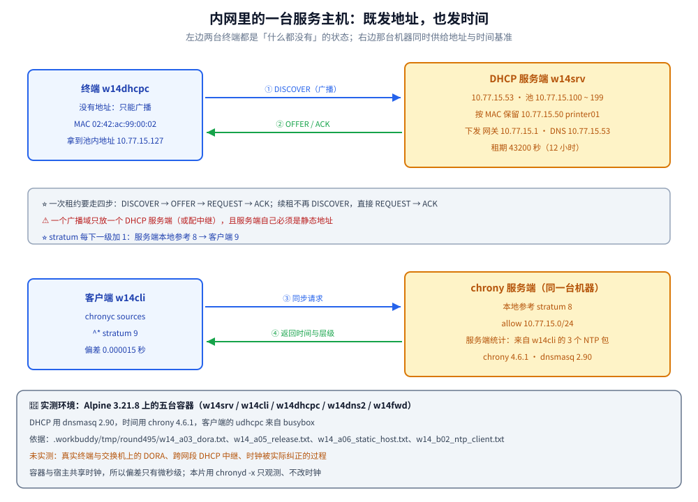

# DHCP 与 NTP

> 覆盖：DHCP 的四步交互与租约（地址池 / 按 MAC 保留 / 续租与释放）、客户端拿到的「地址 + 掩码 + 网关 + DNS」从哪来，以及 chrony 的层级、同步状态与时间漂移排查。
>
> 不覆盖：DHCP 报文的字段布局、选项编码与中继代理（option 82）等协议细节见 [DHCP.md](../../网络/DHCP.md)；DHCP 下发的 DNS 由谁来解析见 [07-DNS服务器.md](07-DNS服务器.md)；放行 udp/67、udp/68 与 udp/123 的做法见 [04-防火墙与NAT.md](04-防火墙与NAT.md)；地址段与掩码怎么规划见 [03-网络基础与规划.md](03-网络基础与规划.md)。
>
> 内容整理自个人学习笔记。**基础框架**参考鸟哥官网《服务器架设篇 - RockyLinux 9》相关章节（DHCP 与 NTP）的读后整理；协议交互细节与 [DHCP.md](../../网络/DHCP.md) 对照阅读。素材见 [素材清单](../../../素材清单.md)。
>
> 📎 **实测口径**：本篇的**行为验证**在容器里实跑——服务端 `w14srv`（10.77.15.53，Alpine 3.21.8 + dnsmasq 2.90 + chrony 4.6.1）、DHCP 客户端 `w14dhcpc`（10.77.15.60，固定 MAC `02:42:ac:99:00:02`）与时间客户端 `w14cli`（10.77.15.20）同处 docker 网桥 10.77.15.0/24；客户端先摘掉运行时给的静态地址，再用 busybox 的 `udhcpc` 走完整的 DISCOVER → OFFER → REQUEST → ACK，取址 / 续租 / 释放 / 按 MAC 保留各跑一次，原文存证 `.workbuddy/tmp/round495/w14_a03_dora.txt`、`w14_a04_renew.txt`、`w14_a05_release.txt`、`w14_a06_static_host.txt`、`w14_b02_ntp_client.txt`、`w14_b04_timezone.txt`。**未实测**：真实终端与交换机上的 DORA、跨网段的 DHCP 中继（relay）、DHCPv6 / SLAAC、时间被真正纠正的过程（容器与宿主共享时钟，本片用 `chronyd -x` 只观测偏差、不改时钟）、`timedatectl`（属 systemd，Alpine 容器里没有）。

---

## 一、DHCP 服务器怎么工作？

**本节要点**：客户端还没 IP，只能**广播**寻找服务器；四步交互 **DISCOVER → OFFER → REQUEST → ACK** 完成一次租约。

| 报文 | 方向 | 含义 |
|------|------|------|
| DISCOVER | 客户端广播 | 「谁是 DHCP 服务器？」 |
| OFFER | 服务器 → 客户端 | 「我可以给你这个地址」 |
| REQUEST | 客户端广播 | 「我要这个地址」（广播是为了告知其他服务器） |
| ACK | 服务器 → 客户端 | 「确认，租给你 N 秒」 |

```text
# /etc/dhcp/dhcpd.conf
subnet 10.0.20.0 netmask 255.255.255.0 {
  range 10.0.20.100 10.0.20.200;
  option routers 10.0.20.1;
  option domain-name-servers 10.0.10.53, 223.5.5.5;
  option domain-name "internal.example.com";
  default-lease-time 3600;
  max-lease-time 7200;
}

# 固定地址绑定（按 MAC）
host printer01 {
  hardware ethernet 52:54:00:aa:bb:cc;
  fixed-address 10.0.20.50;
}
```

```bash
sudo dnf install -y dhcp-server
sudo systemctl enable --now dhcpd
sudo journalctl -u dhcpd -f          # 看租约发放过程
```

⚠️ DHCP 服务器自身要有静态 IP；一个广播域里**只能有一个** DHCP 服务器（或做高可用 / 中继配合），否则会互相抢答。

### 1.1 一次租约里，两边各做了什么

四步交互背后是一条「谁先说话、谁能单播」的约束链：

| 步 | 客户端状态 | 为什么这么走 |
|----|-----------|--------------|
| DISCOVER | 还没有地址 | 没有源 IP、也不知道服务器在哪，只能广播到 `255.255.255.255` |
| OFFER | 收到「你要不要这个」 | 服务器从池里挑一个**空闲**地址，连同租期与各选项一起报过来 |
| REQUEST | 选定这一家 | 仍用广播，目的是**告知其他应答过的服务器**「这个地址已被我占用，请收回」 |
| ACK | 绑定生效 | 客户端按 ACK 里的选项配好地址 / 掩码 / 网关 / DNS，进入 BOUND |

⭐ 只有第一台服务器可能被「抢答」：REQUEST 广播就是为了把落选服务器的临时预留释放掉。

⭐ **跨网段**时靠**中继**：中继把客户端所在网段的信息（option 82，relay agent information）带给服务器，服务器据此挑对应池里的地址——所以一台 DHCP 服务器能给多个广播域供地址，前提是每个网段都有中继。报文中继的细节见 [DHCP.md](../../网络/DHCP.md)。

### 1.2 除地址之外还下发了什么

DHCP 不只是一个「发 IP」的服务，真正让终端「开箱即用」的是随地址一起下来的选项：

| 选项 | 作用 | 本片实测值 |
|------|------|-----------|
| 1 | 子网掩码 | `mask=24` |
| 3 | 默认网关 | `router=10.77.15.1` |
| 6 | DNS 服务器 | `dns=10.77.15.53` |
| 15 | 域名后缀 | `domain=internal.example.com` |
| 51 | 租期（秒） | `lease=43200` |
| 54 | 服务器标识 | `serverid=10.77.15.53` |
| 58 / 59 | 续租与重绑时刻（默认 50% / 87.5%） | 未显式下发，按默认比例算 |

⭐ **保留地址**（打印机、AP、监控设备这类「IP 不能变」的终端）有两种等价写法：`dhcpd` 侧就是上面模板里的 `host` 块；`dnsmasq` 侧写成 `dhcp-host=<MAC>,<IP>,<主机名>`。地址不在池里也行，服务器会先做一次占用探测再报出去。

⚠️ 实测里踩到一个「只在容器里出现」的坑：客户端拿到 `dns=10.77.15.53` 之后，busybox 的默认脚本没能改写 `/etc/resolv.conf`，输出 `mv: can't rename '/etc/resolv.conf.46': Resource busy`——因为这个文件在容器里是运行时挂载进来的。真实主机上这一步会把它写成 DHCP 下发的 nameserver，所以**判据要看「下发的选项值」而不是只看 resolv.conf**。

---

## 二、客户端与租约怎么看？

**本节要点**：客户端拿租约、续租、释放；服务器侧的租约文件记录「谁拿了什么地址、什么时候到期」。

```bash
# Linux 客户端（NetworkManager）
nmcli connection modify ens33 ipv4.method auto
nmcli connection up ens33
ip addr show ens33                       # 看拿到的地址

# 主动续租 / 释放
sudo nmcli connection down ens33 && sudo nmcli connection up ens33
```

```bash
# 服务器侧租约文件
cat /var/lib/dhcpd/dhcpd.leases         # 记录租约（绑定、起止时间、客户端标识）
```

| 客户端 | 配置方式 |
|--------|----------|
| Linux | `nmcli ... ipv4.method auto` 或改 `ifcfg-*` 的 `BOOTPROTO=dhcp` |
| Windows | 适配器属性里选「自动获得 IP」；`ipconfig /release` + `/renew` |

⚠️ 租约到期前客户端会自动续租（默认续租点是 50% 租期）；续租失败会重新 DISCOVER。

### 2.1 续租与释放发生在什么时候

拿到租约之后不是一直等着到期，中间有两个时刻点：

| 时刻 | 默认位置 | 动作 | 失败会怎样 |
|------|----------|------|-----------|
| T1 | 租期的 50% | **单播**找原来那台服务器续租 | 到 T2 再想办法 |
| T2 | 租期的 87.5% | **广播**问任何一台服务器 | 租期到就回 INIT，重新 DISCOVER |
| 到期 | 100% | 地址被服务器收回池子 | 客户端失去地址 |

主动释放也走同一条路：`udhcpc` 的 `kill -USR2 <pid>`、NetworkManager 的 `connection down`、Windows 的 `ipconfig /release`，都会发一条 **DHCPRELEASE**，服务器随即把地址还回池子。

⭐ 实测的续租就**没有 DISCOVER**：客户端直接 REQUEST → ACK，报文序列比首次取址短一半；释放之后服务器日志记下 `DHCPRELEASE(eth0) 10.77.15.127 02:42:ac:99:00:02`，租约文件从 1 行变成 0 行——**「地址被回收」在文件里是看得见的一行减法**。

### 2.2 租约文件里有什么

`dhcpd` 与 `dnsmasq` 都会把「谁拿了什么」落盘：`dhcpd` 在 `/var/lib/dhcpd/dhcpd.leases`，`dnsmasq` 默认在 `/var/lib/misc/dnsmasq.leases`。本片实测取到的两行（先动态池、后按 MAC 保留）：

```text
1792260676 02:42:ac:99:00:02 10.77.15.127 * 01:02:42:ac:99:00:02
1792260691 02:42:ac:99:00:02 10.77.15.50 printer01 01:02:42:ac:99:00:02
```

五个字段分别是：**到期时间戳**（`1792260676`）、**客户端标识**（按 MAC 生成的 `01:02:42:ac:99:00:02`）、**分配到的地址**、**主机名**（没绑定时是 `*`，命中保留时是 `printer01`）、**客户端真实 MAC**。⭐ 排障价值在于：地址冲突、终端换网段后拿不到旧地址、「某台设备到底还在不在线」，都可以先看这一行。

---

## 三、NTP 时间服务器怎么配？

**本节要点**：现代发行版用 **chrony**，它比老的 ntpd 更适应「网络时断时续、虚拟机时钟漂移」的场景；服务端 / 客户端都靠 `chrony.conf` 里的 `server` / `pool` 指定上游。

| 角色 | 配置要点 |
|------|----------|
| 客户端 | `server` / `pool` 指向上游 NTP，`iburst` 加速首次同步 |
| 服务端 | 允许内网客户端同步（`allow 10.0.0.0/8`），本地时钟作兜底（`local stratum 10`） |

```text
# /etc/chrony.conf（客户端）
pool 2.rocky.pool.ntp.org iburst
server ntp.aliyun.com iburst
driftfile /var/lib/chrony/drift
makestep 1.0 3            # 前 3 次同步允许直接跳变
rtcsync
```

```bash
sudo dnf install -y chrony
sudo systemctl enable --now chronyd

chronyc sources -v            # 看上游服务器与状态（^* = 当前同步源）
chronyc tracking              # 看本机与上游的偏差、是否已同步
timedatectl                   # NTP service: active 才算真正在同步
```

⭐ **层级（stratum）**：stratum 0 是原子钟 / GPS，stratum 1 直连基准，stratum 2 从 stratum 1 同步……层级越大离基准越远。

⚠️ **时间漂移**的排查顺序：`timedatectl` 看 NTP 是否 active → `chronyc sources` 看有没有可达上游 → 检查 UDP 123 是否被防火墙挡。

### 3.1 层级是怎么一层层数出来的

stratum 不是配置里写死的数字，而是「**离基准还有几跳**」：

| stratum | 是谁 | 本片实测 |
|---------|------|----------|
| 0 | 原子钟 / GPS 这类基准设备 | 没有接入 |
| 1 | 直接连着基准的服务器 | 没有接入 |
| 8 | 服务端把本机时钟声明为参考（`local stratum 8`） | 服务端自己的 `Stratum : 8` |
| 9 | 从 stratum 8 同步一台的客户端 | 客户端 `Stratum : 9` |
| 16 | 不可用（`chronyc sources` 里显示为 `?`） | — |

⭐ 所以「服务端 stratum 8、客户端 stratum 9」是一次可核对的加法：**客户端层级 = 上游层级 + 1**。生产环境里服务端自己会先向上游同步（那时候它的层级通常落在 2~4），`local` 只是「上游全不可达时别让整片内网失去时间」的兜底。

### 3.2 服务端与客户端各配什么

```text
# 服务端 /etc/chrony.conf
local stratum 8              # 没有上游时，把本机时钟当参考（层级 8）
allow 10.77.15.0/24          # 只允许这个网段来对时
driftfile /var/lib/chrony/drift
rtcsync                      # 定期把系统时间同步到硬件时钟
```

```text
# 客户端 /etc/chrony.conf
server 10.77.15.53 iburst    # 指向内网时间服务端，iburst 让首次同步更快
driftfile /var/lib/chrony/drift
makestep 1.0 3               # 前 3 次同步偏差超过 1 秒就直接跳变
rtcsync
```

⭐ 服务端与客户端**不是两套软件**：同一份 `chronyd`，`allow` 决定「我愿不愿意给别人供时」，`server` / `pool` 决定「我找谁对时」，两者可以同时存在。

### 3.3 实测：客户端怎么「选中」一台服务器

`chronyc sources` 的一行里，最要紧的是最左边两个字符：`^*` 表示「正在用它」，`^?` 表示「看得到但不可用」。本片实测输出（节选）：

```text
MS Name/IP address         Stratum Poll Reach LastRx Last sample
===============================================================================
^* w14srv.w14net                 8   6     7     2  -2216ns[  -15us] +/-   61us
```

读法：`Stratum 8` 是上游层级；`Reach 7` 是**八进制**的可达性寄存器（`7` = 最近 3 次轮询都答上了）；`Last sample` 是最近一次实测偏差（`-2216ns` 为调整后的值，方括号里为原始测量值）。再看本机状态（只摘录与判据相关的几行）：

```text
Reference ID    : 0A4D0F35 (w14srv.w14net)
Stratum         : 9
System time     : 0.000015257 seconds slow of NTP time
Last offset     : -0.000012812 seconds
Root delay      : 0.000120082 seconds
Leap status     : Normal
```

判据：**`^*` + `Leap status : Normal` + `System time` 在微秒 / 毫秒级**，才算真的同步上了；`chronyc waitsync` 返回 0 也是同一个意思。⚠️ Alpine 容器里没有 systemd，也就没有 `timedatectl`，这一层要用 `chronyc` 加 `date` 代替；RHEL / Debian 上才是 `timedatectl`。

---

## 四、时间为什么会漂移、怎么查？

**本节要点**：漂移有两个来源——**时钟源本身不准**（ppm 量级的频率偏差）和**没人纠正它**（上游不可达、端口被挡、服务没起）；排查顺序是先确认有没有上游，再看偏差多大。

| 漂移来源 | 表现 | 对应动作 |
|----------|------|----------|
| 晶振频率偏差 | 走时快 / 慢几个 ppm，几天差几秒 | 正常，长期偏差靠 `driftfile` 补偿 |
| 虚拟机时钟（宿主调度、暂停、快照恢复） | 时间突然落后一大截 | chrony 收敛更快，适合这类场景 |
| 上游不可达 / udp/123 被挡 | `chronyc sources` 里没有 `^*`，`Reach` 一直是 0 | 先放行 udp/123，再看 `allow` 是否包含来源网段 |
| 时区配错 | 时间「差了 8 小时」 | 时钟没问题，改的是显示时区 |

时区与时钟是两件事：本片实测同一时刻的三种写法——UTC `06:18:09`、`TZ=Asia/Shanghai` 下 `14:18:09`、`TZ=America/New_York` 下 `02:18:09`——**UTC 时钟没变，变的只是解释方式**。容器里往往连 `/etc/localtime` 都没有，时区靠 `TZ` 环境变量；同理「容器要不要装 NTP」也要先想清楚：容器与宿主共享时钟，宿主同步好了，容器一般不必再对时。

⭐ 排查顺序（照这个顺序走，不要一上来就 `chronyc makestep`）：

1. `timedatectl`（或容器里的 `command -v timedatectl`）确认时间服务在不在；
2. `chronyc sources -v` 看有没有 `^*`，`Reach` 是不是 0；
3. 网络侧确认 udp/123 通不通（`04-防火墙与NAT.md` 里的放行做法）；
4. `chronyc tracking` 看 `System time`、`Frequency`、`Root delay`，判断是「偏差大」还是「根本没有上游」。

⚠️ 偏差很大时要不要「跳」是另一件事：`makestep 1.0 3` 只在启动后的前 3 次同步里允许跳变，之后一律靠**逐步 slewing**（每次调一点点）把时间拉回来——因为跳变会让依赖时间递增的程序（数据库、日志序号）看到「时间倒流」。

---

## 五、应用场景

「发地址 + 发时间」这两件事，几乎每一层基础设施都绕不开：

| 场景 | 用到的知识 | 具体表现 |
|------|-----------|----------|
| 园区网 / 办公网终端 | 地址池 + 保留地址 | 终端免配置即插即用；打印机、AP、摄像头用保留地址固定在表里 |
| 服务器段的地址管理 | 静态 / 保留 + 租约文件 | 服务器一律静态或保留，租约文件留痕便于回溯「这个 IP 当时是谁」 |
| 虚拟化与云主机 | DHCP + 中继 + 元数据 | 实例首次开机靠 DHCP（或 cloud-init 走元数据服务）拿到地址与 DNS |
| 容器网络 | 一段地址 + 网关 + DNS 的心智模型 | docker / K8s 由运行时 IPAM 分配（不走 DORA），但「谁给我地址、网关和 DNS」的关系一样 |
| 内网统一供时 | chrony 服务端 + `allow` | 交换机、防火墙、数据库、应用机由一两台机器统一供时，日志时间线才对得齐 |
| 排障 | 租约文件 + `chronyc` | 地址冲突先查租约；「莫名」故障先查时间偏差（见 [延伸追问](#延伸追问)） |

⭐ 本片这台 `w14srv` 就是「一台机器同时供地址与时间」的最小形态：本目录 [03-网络基础与规划.md](03-网络基础与规划.md) 里规划的「服务器段静态、终端段 DHCP」，落地时正是这套服务；它下发的 DNS 又指向 [07-DNS服务器.md](07-DNS服务器.md) 里那台权威服务器。

---

## 六、具体使用

**本节要点**：一台网关型主机给内网同时供地址与时间；以及在容器里把这条链路完整跑一遍的读法。

### 6.1 给内网搭一套「地址 + 时间」服务

**本节要点**：一个网关型主机的典型职责——给终端发地址、给全内网提供时间基准。

```bash
# ① DHCP（服务器需静态 IP）
sudo dnf install -y dhcp-server
sudo vi /etc/dhcp/dhcpd.conf          # 按上文模板填 subnet / range / option
sudo systemctl enable --now dhcpd
sudo journalctl -u dhcpd -n 20 --no-pager

# ② NTP 服务端：同步上游 + 对内提供服务
sudo dnf install -y chrony
sudo vi /etc/chrony.conf              # 加上 allow 10.0.0.0/8 与 local stratum 10
sudo systemctl enable --now chronyd

# ③ 验证
sudo firewall-cmd --add-service=dhcp --permanent && sudo firewall-cmd --reload
sudo firewall-cmd --add-service=ntp  --permanent && sudo firewall-cmd --reload
chronyc tracking
cat /var/lib/dhcpd/dhcpd.leases | tail -20
```

判据：客户端能拿到 `range` 内的地址与正确网关 / DNS；客户端 `chronyc sources` 里该服务器可达、`timedatectl` 显示同步 active。

### 6.2 在容器里跑一遍（本机实测）

本片用五台容器搭同一套结构：`w14srv`（10.77.15.53，同时是 DHCP / 时间服务端）、`w14dhcpc`（10.77.15.60，DHCP 客户端）、`w14cli`（10.77.15.20，时间客户端），外加 [07-DNS服务器.md](07-DNS服务器.md) 用到的两台 DNS 容器。关键是让客户端**真的回到「没有地址」的状态**——先摘掉运行时给的静态地址，再走 DORA：

```bash
# 服务端：dnsmasq 只做 DHCP（port=0 关掉它自带的 DNS），并打开 DHCP 日志
cat > /etc/dnsmasq.d/dhcp.conf <<'EOF'
port=0
interface=eth0
dhcp-authoritative
dhcp-range=10.77.15.100,10.77.15.199,12h
dhcp-option=option:router,10.77.15.1
dhcp-option=option:dns-server,10.77.15.53
dhcp-option=option:domain-name,internal.example.com
dhcp-leasefile=/var/lib/misc/dnsmasq.leases
log-dhcp
EOF
dnsmasq -d -C /etc/dnsmasq.d/dhcp.conf &

# 客户端：先摘掉静态地址，再取址
ip addr del 10.77.15.60/24 dev eth0
udhcpc -i eth0 -f -v -t 5 -T 3
```

服务端同一时刻看到的四条报文，正是一张完整的 DORA 图：

```text
dnsmasq-dhcp: DHCP, IP range 10.77.15.100 -- 10.77.15.199, lease time 12h
dnsmasq-dhcp: 3506235004 DHCPDISCOVER(eth0) 02:42:ac:99:00:02
dnsmasq-dhcp: 3506235004 DHCPOFFER(eth0) 10.77.15.127 02:42:ac:99:00:02
dnsmasq-dhcp: 3506235004 DHCPREQUEST(eth0) 10.77.15.127 02:42:ac:99:00:02
dnsmasq-dhcp: 3506235004 DHCPACK(eth0) 10.77.15.127 02:42:ac:99:00:02
```

客户端侧拿到的四个参数与服务器下发的选项逐项对上：`ip=10.77.15.127 mask=24 router=10.77.15.1 dns=10.77.15.53 lease=43200 serverid=10.77.15.53 domain=internal.example.com`，路由里出现 `default via 10.77.15.1`。把 `dhcp-host=02:42:ac:99:00:02,10.77.15.50,printer01` 加进配置再取一次址，同一个客户端就稳定拿到池外的保留地址 `10.77.15.50`，ACK 行末尾还带上了主机名 `printer01`。时间侧则在 `w14cli` 上把 `server 10.77.15.53 iburst` 写进 `chrony.conf`，`chronyc sources -v` 出现 `^*`、`chronyc tracking` 显示 `Stratum : 9`、`System time : 0.000015257 seconds slow of NTP time`。



三段读数的原文见 `.workbuddy/tmp/round495/w14_a03_dora.txt`（DORA 与四个参数）、`w14_a06_static_host.txt`（保留地址）、`w14_b02_ntp_client.txt`（同步状态）。

---

## 延伸追问

- **DHCP 为什么要用广播？**
  → 因为在拿到地址**之前**，客户端还不知道自己该用哪个源 IP、也不知道服务器的 IP，无法单播——只能发到 `255.255.255.255`（或子网广播）让同广播域里的服务器听到。REQUEST 也用广播，是为了**告知其他可能应答过的服务器**「我已经选了这一家」。
- **时间不同步会引发什么问题？**
  → 一连串「看起来不相干」的故障：**TLS 证书校验失败**（「证书尚未生效 / 已过期」）、**日志时间线错乱**导致排查困难、**分布式系统选举 / 租约异常**（Raft、etcd、Redis 集群都依赖时钟）、**一次性口令（TOTP）失效**、**数据库主从延迟判断错误**。⚠️ 排查这类问题先 `timedatectl` 确认时间同步。
- **chrony 和 ntpd 的区别？**
  → `chrony` 是更现代的实现：**收敛更快**（首次同步可秒级）、**更适应断续网络与虚拟机时钟漂移**、配置简洁，已经是 RHEL / CentOS 8+ / Ubuntu 的默认。老 `ntpd` 仍在用，但新部署建议 chrony；⚠️ 两者不能同时在本机跑。
- **时间同步为什么是「慢慢纠正」而不是一次跳到位？**
  → 因为**时间必须单调**：一次跳变会让依赖时间递增的程序（数据库事务号、日志序号、带时间戳的签名）看到「时间倒流」。chrony 默认对运行中的系统用 **slewing**（每次调一点点，几毫秒量级），只在启动后前几次同步、偏差又很大时才用 `makestep` 直接跳——一旦服务已经稳定运行，跳变窗口就关掉了。本片实验观察到的是持续的微秒级偏差读数，正是「只观测、不动时钟」这条链路的读数。
- **服务端只写一句 `local stratum 8`，凭什么就能对内供时？**
  → 因为 `local` 把**本机时钟**声明成了一条参考源，层级指定为 8；它不追求「准到跟原子钟一样」，而是保证「上游全断了，内网所有机器仍然对**同一个**时间源」。这也是为什么它适合当兜底：只要大家一致，日志能对齐、证书不会误判；等上游恢复，chrony 会自动切回真正的时间源，层级随之下降。
- **租约文件为什么记「客户端标识」而不只记 MAC？**
  → 因为客户端可以**换网卡**（虚拟机重建、双网卡切换），也可以**声明自己的 client identifier**（DHCPv6 用 DUID、部分系统用主机名派生）。服务器按「客户端标识 + 网段」判断「这是不是同一个客户端要续租」，只按 MAC 认人时，换一次虚拟网卡就会拿到新地址、旧地址留在池里等过期。本片实测的两行租约里，标识字段 `01:02:42:ac:99:00:02` 就是「以 MAC 生成的客户端标识」。

---

## 关联

- **上游/总纲**：[README.md](README.md) — 本目录导读：版本坐标与阅读顺序
- **对照/互补**：[DHCP.md](../../网络/DHCP.md) — DHCP 协议交互与报文字段的原理对照
- **下游机制**：[07-DNS服务器.md](07-DNS服务器.md) — DHCP 下发的 DNS 由谁来解析
- **运维/配置**：[04-防火墙与NAT.md](04-防火墙与NAT.md) — 放行 DHCP（udp/67、68）与 NTP（udp/123）
- **运维/配置**：[03-网络基础与规划.md](03-网络基础与规划.md) — 地址段规划是 DHCP 的前提
