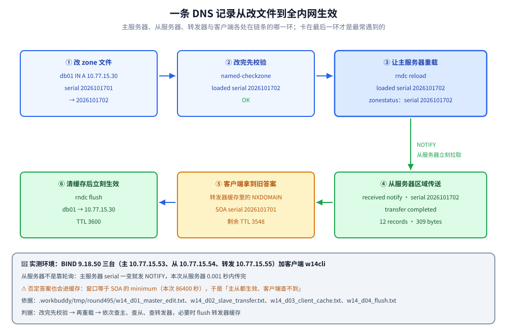

# DNS 服务器

> 覆盖：BIND 的两层配置（`named.conf` 与 zone 文件）、正反解析、主从区域传送、转发与缓存，以及 `dig` / `rndc` 排错和「改完一条记录、客户端为什么还没生效」。
>
> 不覆盖：域名层级委派、递归与迭代查询流程、报文标志位等协议原理见 [DNS解析.md](../../网络/网络层与寻址/DNS解析.md)；SPF / DKIM / DMARC 用到哪些 TXT 记录见 [10-邮件服务器.md](10-邮件服务器.md)；内网网段与反解析域的对应关系见 [03-网络基础与规划.md](03-网络基础与规划.md)。
>
> 内容整理自个人学习笔记。**基础框架**参考鸟哥官网《服务器架设篇 - RockyLinux 9》相关章节（DNS 服务器）的读后整理；BIND 9 的配置与工具用法基于官方文档独立整理。与 [DNS解析.md](../../网络/网络层与寻址/DNS解析.md) 形成「协议原理 ↔ 服务架设」的对照。素材见 [素材清单](../../../素材清单.md)。
>
> 📎 **实测口径**：本篇的**行为验证**在三台 BIND 9.18.50 容器（Alpine 3.21.8）加一台客户端上实跑——权威（主）`w14srv` 10.77.15.53、权威（从）`w14dns2` 10.77.15.54、转发 / 缓存 `w14fwd` 10.77.15.55、客户端 `w14cli` 10.77.15.20，同处 docker 网桥 10.77.15.0/24，域用 `internal.example.com`、反解析域用 `15.77.10.in-addr.arpa`；正反解析、五种返回码（`NOERROR` / `NXDOMAIN` / `SERVFAIL` / `REFUSED` / `TIMEOUT`）、AXFR 限制、缓存命中、以及「改一条记录 → 校验 → 重载 → NOTIFY → 从服务器传送 → 客户端缓存」全链路各跑一遍，原文存证 `.workbuddy/tmp/round495/w14_c01_master_conf.txt`、`w14_c03_slave_conf.txt`、`w14_c04_forwarder.txt`、`w14_c05_client_dig.txt`、`w14_d01_master_edit.txt`、`w14_d02_slave_transfer.txt`、`w14_d03_client_cache.txt`、`w14_d04_flush.txt`。**未实测**：DNSSEC 签名与验证（实验里显式 `dnssec-validation no`）、TSIG 之外的访问控制、`view` 视图与 split-horizon、`dig +trace` 从根追踪（实验只做域内验证）、Windows 客户端与 `ipconfig /flushdns`。

---

## 一、DNS 有哪些记录、谁在作答？

**本节要点**：DNS 是**分布式的层级数据库**——从根出发逐级委派，最终由权威服务器给出答案；解析过程就是「一路问下来 + 一路缓存」。

| 记录 | 作用 | 例 |
|------|------|-----|
| `A` / `AAAA` | 域名 → IPv4 / IPv6 | `web01 A 10.77.15.20` |
| `CNAME` | 别名 | `www CNAME web01` |
| `MX` | 邮件服务器 | `@ MX 10 mail` |
| `NS` | 该域的权威服务器 | `@ NS ns1` |
| `PTR` | IP → 域名（反解析） | `20 PTR web01.example.com.` |
| `TXT` | 任意文本（SPF / DKIM / 验证） | `@ TXT "v=spf1 ..."` |
| `SOA` | 本域的管理信息（序列号、刷新与缓存口径） | 见 [2.2](#22-zone-文件怎么写) |

⭐ 完整查询流程（递归 + 迭代）见 [DNS解析.md](../../网络/网络层与寻址/DNS解析.md)；本篇讲「怎么把这套服务**架**起来」。

### 1.1 正向与反向：两种方向，两套域

正向解析是「名字 → 地址」，反向解析是「地址 → 名字」，后者不是把前者的表倒过来查，而是另建一棵以 **`in-addr.arpa`** 为根的树：

| 方向 | 域怎么写 | 本片实测 |
|------|----------|----------|
| 正向 | 自己的域名 `internal.example.com` | `web01.internal.example.com. → 10.77.15.20` |
| 反向 | **网段倒写** + `in-addr.arpa` | `10.77.15.0/24` → `15.77.10.in-addr.arpa`，记录是 `20 PTR web01.internal.example.com.` |

⭐ 倒写的规则是「**先写主机位，再倒着写网段**」：`10.77.15.20` 在反解析域里是 `20.15.77.10.in-addr.arpa`，所以 zone 名是 `15.77.10.in-addr.arpa`、记录名只有 `20`。一个网段一个反解析域，写错整段反解析都不通（`dig -x` 直接 NXDOMAIN）。

### 1.2 同一台服务器可以扮演两种角色

这是配 BIND 之前必须分清的一件事——**权威**与**递归**是两种不同的活：

| 角色 | 手里有什么 | 该不该对内网之外的人开放 |
|------|-----------|--------------------------|
| 权威（`type master` / `slave`） | 该域的全部记录，答案带 `aa` 标志 | 只服务 `allow-query` 里的来源 |
| 递归 / 转发（`recursion yes` + `forwarders`） | 什么都不持有，只是替你去问、并缓存答案 | ⚠️ 只给内网，绝不能对公网开放 |

⭐ 判据：**同一台机器可以两种都干，但必须用 `allow-recursion` 把递归只留给自己的内网**。本片实测就是反例演示——从客户端向权威服务器 `10.77.15.53` 问一个公网名，得到的是 `status: REFUSED` 与 `WARNING: recursion requested but not available`，说明「不给你递归」这件事是可以被验证的，而不是口头约定。

---

## 二、BIND 怎么配？

**本节要点**：BIND 的配置分两层——`named.conf` 说「有哪些 zone、去哪个文件找」，`zone 文件` 写「这个域里有哪些记录」。

```bash
sudo dnf install -y bind bind-utils
sudo systemctl enable --now named
```

```text
# /etc/named.conf（节选）
options {
  listen-on port 53 { any; };
  allow-query     { 10.0.0.0/8; localhost; };   # ⚠️ 别对公网开放
  recursion yes;
  allow-recursion { 10.0.0.0/8; };              # ⭐ 递归只给内网
  allow-transfer  { 10.0.10.54; };              # ⭐ 区域传送只给从服务器
  forwarders { 223.5.5.5; };
  dnssec-validation no;
};

zone "internal.example.com" IN {
  type master;
  file "internal.example.com.zone";
};
zone "10.0.10.in-addr.arpa" IN {          # 反解析：网段倒写 + in-addr.arpa
  type master;
  file "10.0.10.rev";
};
```

```text
# /var/named/internal.example.com.zone
$TTL 3600
@   IN  SOA ns1.internal.example.com. admin.internal.example.com. (
        2026100401 ; serial ⭐ 改一次 +1，从服务器靠它判断要不要同步
        3600       ; refresh
        900        ; retry
        604800     ; expire
        86400 )    ; minimum
    IN  NS  ns1.internal.example.com.
ns1 IN  A   10.0.10.53
web01 IN A 10.0.10.20
www IN  CNAME web01
```

⚠️ zone 文件里写域名要注意**结尾的点**（`web01.example.com.` 才是全限定名）；少一个点会变成相对名，是经典事故。

### 2.1 named.conf 的骨架：三块就够

一份能跑的内网权威配置，真正必须写清楚的是三块：

| 块 | 管什么 | 本片实测取值 |
|----|--------|-------------|
| `options` | 监听、谁能问、递归给谁、区域传送给谁 | `allow-query { localhost; 10.77.15.0/24; }`、`allow-recursion { localhost; }`、`allow-transfer { localhost; 10.77.15.54; }` |
| `zone` | 每个域的类型、数据文件在哪 | `type master` + `file "/var/bind/zones/internal.example.com.zone"` |
| `include` + `controls` | `rndc` 的管理通道（本地环回 953 端口 + 密钥） | `include "/etc/bind/rndc.key";` |

⚠️ **发行版的路径不一样**，照抄配置文件时最容易在这里翻车：

| 发行版 | 主配置 | zone 文件目录 | 校验命令 |
|--------|--------|---------------|----------|
| RHEL / Rocky | `/etc/named.conf` | `/var/named` | `named-checkconf`、`named-checkzone` |
| Debian / Alpine | `/etc/bind/named.conf`（Alpine 包里另有 `named.conf.authoritative` 样例） | `/var/bind`（Alpine 自带 `var/bind/pri/`） | 同左 |

`options` 里的 `directory` 就是 zone 文件相对路径的基准目录，实测把它设成 `/var/bind` 后，zone 文件写在 `/var/bind/zones/` 下、`file` 写成绝对路径最不容易出错。

### 2.2 zone 文件怎么写

zone 文件的骨架是「一条 SOA + 一组 NS + 若干记录」，其中 SOA 的五个字段决定主从与缓存行为：

| 字段 | 本片实测值 | 管什么 |
|------|-----------|--------|
| serial（序列号） | `2026101701` | ⭐ **从服务器只认它**：变大就传送，没变就不动 |
| refresh | `3600` | 从服务器每隔多久问一次「有没有更新」 |
| retry | `900` | 传送失败后隔多久重试 |
| expire | `604800` | 一直联系不上主服务器时，多久后放弃这份数据 |
| minimum | `86400` | 否定答案（NXDOMAIN）最多能被缓存多久 |

⭐ 记录的三种写法都要会：**绝对名**写全限定名加点（`web01.internal.example.com.`）、**相对名**会自动拼 `$ORIGIN`（zone 名）和 `$TTL`、**同一名字下多行**可以省略名字（`www IN CNAME web01` 后面直接跟 `IN A ...`）。序列号推荐用「日期 + 序号」（`2026101701` = 2026-10-17 第 1 次改动），避免手工自增出错。

### 2.3 反解析域怎么写

反解析不是必须的（很多内网根本不配），但只要配了就要**两个域一起改**：正向加一条 A，反向加一条对应的 PTR。

```text
# /var/bind/zones/15.77.10.rev
$TTL 3600
@   IN  SOA ns1.internal.example.com. admin.internal.example.com. ( 2026101701 3600 900 604800 86400 )
    IN  NS  ns1.internal.example.com.
20  IN  PTR web01.internal.example.com.
25  IN  PTR mail.internal.example.com.
53  IN  PTR ns1.internal.example.com.
```

⭐ 实用判据：`dig -x 10.77.15.20` 能返回 `web01.internal.example.com.` 才算反解析对了；它查的是 `20.15.77.10.in-addr.arpa`，与正向那条 A 记录**没有自动关联**——写的地址与 PTR 不一致时会「正向对、反向错」。

### 2.4 改完先校验，再启动

```bash
named-checkconf                                              # 校验 named.conf 语法
named-checkzone internal.example.com /var/bind/zones/internal.example.com.zone
named-checkzone 15.77.10.in-addr.arpa /var/bind/zones/15.77.10.rev
```

实测输出正是「先校验」的价值：`named-checkzone` 会直接告诉你它解析到哪个序列号，和配置对不上时当场就暴露——

```text
zone internal.example.com/IN: loaded serial 2026101701
OK
```

⚠️ `named-checkconf` + `named-checkzone` 是**改完先跑**的习惯动作；改错 zone 文件会直接让该域解析全挂。实验里第一次就写错了 zone 文件路径，`named` 启动日志立刻报 `loading from master file ... failed: file not found`，解析全变 SERVFAIL。

---

## 三、主从与缓存怎么搭？

**本节要点**：主从靠 **区域传送**（AXFR 全量 / IXFR 增量）同步，从服务器用 `serial` 判断新旧；缓存 DNS 只替客户端递归查询、不持有权威数据。

```text
# 从服务器 /etc/named.conf
zone "internal.example.com" IN {
  type slave;
  masters { 10.0.10.53; };
  file "slaves/internal.example.com.zone";
};
```

```bash
sudo rndc reload                # 主服务器改完 zone 后重载
sudo rndc status                # 运行状态
sudo rndc notify                # 主动通知从服务器
sudo rndc zonestatus internal.example.com
```

| 类型 | 持有数据 | 用途 |
|------|----------|------|
| 权威（master / slave） | ✅ 该域的全部记录 | 内网域名解析 |
| 缓存 / 转发（forwarder） | ❌ 只缓存 | 给内网提供统一出口递归 |

⚠️ **限制区域传送**：只允许从服务器做 AXFR（`allow-transfer { 10.0.10.54; };`）——否则整个内网的域名清单可被外人一次拉走。

### 3.1 区域传送：从服务器怎么跟上

从服务器不是靠轮询，而是**两条腿走路**：

| 机制 | 谁发起 | 本片实测 |
|------|--------|----------|
| `refresh` 到期轮询 | 从服务器 | 每 `3600` 秒问一次「序列号变了没」 |
| **NOTIFY** 通知 | 主服务器 | `sending notifies (serial 2026101702)` |
| AXFR 全量传送 | 从服务器拉 | `Transfer completed: 1 messages, 12 records, 309 bytes, 0.001 secs` |
| IXFR 增量传送 | 从服务器拉 | 主服务器无 journal 时回退：`IXFR version not in journal, falling back to AXFR` |

⭐ 所以「改一条记录为什么从服务器立刻就知道了」的答案是：**主服务器发现序列号变大就主动 NOTIFY**，从服务器收到通知马上发起传送，不必等到 `refresh` 到期。实测里从通知到传送完成只用了 `0.001` 秒量级——`refresh` 只是「没收到通知时的兜底」。

⭐ **AXFR 与 IXFR 的判据**：AXFR 把整个域传一遍（记录少时无所谓），IXFR 只传差异（记录多时必须靠它）；主服务器没保存 journal 时会自动回退成 AXFR——日志里那句 `falling back to AXFR` 就是它在告诉你「这次是全量」。

### 3.2 转发与缓存

转发器什么数据都不持有，只做两件事：**替内网问出去**、**把答案缓存起来**。

```text
# 转发 / 缓存服务器 /etc/bind/named.conf
options {
  recursion yes;
  allow-recursion { localhost; 10.77.15.0/24; };
  forward only;                        # only = 只转发，不自己从根问
  forwarders { 10.77.15.53; };
};
```

同一台客户端连问两次，第二次的读数就是「缓存命中」的证据：

```text
web01.internal.example.com. 3600 IN	A	10.77.15.20      # 第一次：从上游拿到的原始 TTL
web01.internal.example.com. 3598 IN	A	10.77.15.20      # 2 秒后再问：TTL 递减，答案来自缓存
```

⭐ 缓存是「拿 TTL 换时间」：TTL 走到 0 之前，上游改了什么客户端都看不到（见 [6.2](#62-一条记录的完整发布流程本机实测)）。⚠️ `forward only` 的另一个后果是**上游出问题会原样传染**：本片实测把公网名转发给那台不提供递归的权威服务器，`forwarders` 返回 `status: SERVFAIL`——`SERVFAIL` 的本质就是「我替你去问了，但问到的是坏答案」。

### 3.3 三种角色的实测布局

| 角色 | 容器 / 地址 | 关键配置 |
|------|-------------|----------|
| 权威（主） | `w14srv` 10.77.15.53 | 两个 `type master` zone；`allow-recursion { localhost; }`；`allow-transfer { localhost; 10.77.15.54; }` |
| 权威（从） | `w14dns2` 10.77.15.54 | 两个 `type slave` zone + `masters { 10.77.15.53; }`；`recursion no` |
| 转发 / 缓存 | `w14fwd` 10.77.15.55 | `forward only; forwarders { 10.77.15.53; };` |

⭐ 从服务器的区域文件是它自己写盘的（`/var/bind/slaves/internal.example.com.zone`），所以**在从服务器上看文件时间戳就能确认传送发生过**；主服务器侧同一时刻的日志则是 `transfer of 'internal.example.com/IN': AXFR started (serial 2026101701)` 与 `AXFR ended: 1 messages, 11 records, 288 bytes`——一边给、一边收，两边的读数可以互相对账。

---

## 四、DNS 怎么排错？

**本节要点**：`dig` 是主力的查询与诊断工具，`rndc` 管服务状态；先「问对服务器」再「看返回码」。

```bash
dig @10.0.10.53 web01.internal.example.com A +short
dig @10.0.10.53 -x 10.0.10.20 +short           # 反解析
dig web01.internal.example.com +trace          # 从根开始逐级追踪
nslookup web01.internal.example.com 10.0.10.53
named-checkconf                                 # 校验 named.conf 语法
named-checkzone internal.example.com /var/named/internal.example.com.zone   # 校验 zone 文件
```

| 返回码 | 含义 | 常见原因 | 本片实测触发方式 |
|--------|------|----------|------------------|
| `NOERROR` | 成功 | — | `dig @10.77.15.53 web01.internal.example.com A` |
| `NXDOMAIN` | 域名不存在 | 记录没写 / 写错域 | 问一个没写过的名字 |
| `SERVFAIL` | 服务器失败 | zone 文件语法错、转发不可达 | 转发器把公网名转给不提供递归的上游 |
| `REFUSED` | 拒绝 | `allow-query` / `allow-recursion` 没包含你的来源 IP | 让权威服务器替客户端递归公网名 |
| `TIMEOUT` | 无响应 | 防火墙挡了 udp/53、服务没起 | 对着网桥网关这类不提供 DNS 的地址查 |

⚠️ 改配置的顺序固定为「改文件 → `named-checkconf` / `named-checkzone` → `rndc reload` → 看日志」；跳过校验直接重载的代价是**整个域**在下次加载时失效，而不是只有改动的那一条记录失效。

### 4.1 dig 的三个读数

`dig` 的输出很长，排错只看三处：

1. **状态与标志位**——`status: NOERROR` 看返回码；`flags:` 里 `qr` = 这是响应、`aa` = 这是**权威**答案（不是缓存来的）、`ra` = 这台服务器**愿意提供递归**、`rd` = 查询方希望递归。实测三种组合都是读数：权威服务器答内网名是 `flags: qr aa rd`（有 `aa`、**没有** `ra`，并跟一句 `WARNING: recursion requested but not available`）；转发器答名字是 `flags: qr rd ra`（有 `ra`、**没有** `aa`，因为答案是从上游缓存来的）；权威服务器被要求递归公网名时降到 `flags: qr rd`，状态变 `REFUSED`。
2. **`ANSWER` 段的 TTL 与记录**——`web01.internal.example.com. 3600 IN A 10.77.15.20`：TTL 是「还能信多久」，从缓存来的答案 TTL 一定是递减的（实测第二次 `3598`）。
3. **`AUTHORITY` 段**——即使没有答案也要看：NXDOMAIN 时这里会带上本域的 SOA 与 `minimum`，也就是「这个否定答案还能被缓存多久」（实测 `2026101701 ... 86400`，即 86400 秒）。

`rndc` 看服务侧：`rndc status` 给出 zone 总数（实测 `number of zones: 103 (100 automatic)`），`rndc zonestatus internal.example.com` 给出序列号与最近加载时间，是判断「主服务器到底有没有吃下刚才那次改动」最快的一眼。

### 4.2 故障速查

| 症状 | 先查什么 |
|------|----------|
| 客户端解析超时 | `ss -ulnp \| grep :53` 服务在不在；`firewall-cmd --list-services` 有没有放行 dns |
| 全部名字都 `REFUSED` | `allow-query` 是否包含来源网段 |
| 内网名 `SERVFAIL` | 主服务器日志里该 zone 有没有加载失败（`file not found` / 语法错）→ 立刻 `named-checkzone` |
| 公网名 `SERVFAIL` | 转发器的 `forwarders` 通不通、上游是否拒绝递归 |
| 客户端拿到的还是旧 IP | 缓存与 TTL：先 `dig` 主、再 `dig` 从、最后 `dig` 转发器，必要时 `rndc flush` |
| 反解析不通 | 反向域的 zone 名（网段倒写）与 PTR 记录名是否与地址对得上 |
| 从服务器没跟上 | 主服务器日志有没有 `sending notifies`；`allow-transfer` 是否包含从服务器 |

---

## 五、应用场景

一台内网 DNS 通常同时承担好几件事，理解它们的边界比记住配置更重要：

| 场景 | 用到的知识 | 具体表现 |
|------|-----------|----------|
| 内网域名解析 | 权威 zone + 正反解析 | 内网服务用名字互访，IP 变了只改一处；日志与监控里看到的是主机名 |
| 多域 / 业务隔离 | 一个 BIND 挂多个 zone | 每个业务一个子域、各自一个 zone 文件，互不影响 |
| 统一出口递归 | 转发 / 缓存 | 内网机只配一台 DNS，出口查询集中可控、可缓存、可审计 |
| 邮件域名校验 | `TXT` / `MX` 记录 | SPF / DKIM / DMARC 全靠 TXT，见 [10-邮件服务器.md](10-邮件服务器.md) |
| 服务发现 | 权威 zone 自动写记录 | 新节点上线时把 A 记录写进 zone 并递增序列号；容器环境里由 CoreDNS 之类的组件接替 |
| 排障 | `dig` + `rndc` + TTL | 「域名改了没生效」几乎都是 TTL 或否定缓存，不是服务没起 |

⭐ 与 DHCP 的配合见 [06-DHCP与NTP.md](06-DHCP与NTP.md)：DHCP 下发的 option 6 就是这个地址，终端拿到租约之后第一次解析内网名，问的正是本篇这台服务器——本片实测里 DHCP 客户端 `w14dhcpc` 拿到 `dns=10.77.15.53` 后，直接用 `nslookup web01.internal.example.com 10.77.15.53` 解析出了 `10.77.15.20`，两篇的链路在这里合上。

---

## 六、具体使用

**本节要点**：先把一台权威服务器架起来并验证，再走一遍「改一条记录后全内网什么时候能看到」的完整流程。

### 6.1 为内网域名搭一台权威 DNS

**本节要点**：从装包到「用 dig 验证内外解析」的一条龙。

```bash
# ① 装 BIND
sudo dnf install -y bind bind-utils

# ② 写 named.conf（zone）与 zone 文件（上文的模板）
#    /etc/named.conf、/var/named/internal.example.com.zone、/var/named/10.0.10.rev

# ③ 先校验，再启动
sudo named-checkconf
sudo named-checkzone internal.example.com /var/named/internal.example.com.zone
sudo systemctl enable --now named

# ④ 放行 53（对内网段）
sudo firewall-cmd --add-service=dns --permanent && sudo firewall-cmd --reload

# ⑤ 验证
dig @127.0.0.1 web01.internal.example.com +short
dig @127.0.0.1 -x 10.0.10.20 +short
```

判据：`named-checkconf` / `named-checkzone` 无输出（表示 OK）；`dig` 正解析返回 `10.0.10.20`、反解析返回 `web01.internal.example.com.`；`REFUSED` 说明来源未在 `allow-query`。

从服务器上多两步：写 `type slave` 的 zone 声明、启动后看日志里有没有 `received notify` 与 `transfer completed`（见 [3.1](#31-区域传送从服务器怎么跟上)）。

### 6.2 一条记录的完整发布流程（本机实测）

实验里给 `internal.example.com` 加一条 `db01 IN A 10.77.15.30`，同时把序列号从 `2026101701` 改成 `2026101702`，四步读数如下：

```text
# ① 主服务器：改完先校验，再重载
named-checkzone internal.example.com /var/bind/zones/internal.example.com.zone
zone internal.example.com/IN: loaded serial 2026101702
OK
rndc reload internal.example.com
zone internal.example.com/IN: loaded serial 2026101702
zone internal.example.com/IN: sending notifies (serial 2026101702)

# ② 从服务器：收到通知，立刻拉取
client @0x7db01b4b5400 10.77.15.53#38747: received notify for zone 'internal.example.com'
zone internal.example.com/IN: notify from 10.77.15.53#38747: serial 2026101702
zone internal.example.com/IN: Transfer started.
zone internal.example.com/IN: transferred serial 2026101702
transfer of 'internal.example.com/IN' from 10.77.15.53#53: Transfer status: success
transfer of 'internal.example.com/IN' from 10.77.15.53#53: Transfer completed: 1 messages, 12 records, 309 bytes, 0.001 secs (309000 bytes/sec) (serial 2026101702)
```

两台权威服务器都已经能答出新记录，但**客户端通过转发器问，拿到的还是缓存里的旧否定答案**：

```text
;; ->>HEADER<<- opcode: QUERY, status: NXDOMAIN
;db01.internal.example.com.	IN	A
internal.example.com.	3548	IN	SOA	ns1.internal.example.com. admin.internal.example.com. 2026101701 3600 900 604800 86400
```

注意 `AUTHORITY` 段里的 SOA 序列号还是 `2026101701`、TTL 已从 3600 掉到 `3548`——这就是「域名改了没生效」的真相：**缓存里的否定答案还没到期（窗口等于 SOA 的 minimum，本例 `86400` 秒），必须等它自然过期或由管理员清掉**。在转发器上执行 `rndc flush` 后再问一次，`status` 立刻变成 `NOERROR`、TTL 回到 `3600`。



⭐ 由此得出一条固定判据：**改完记录后依次查三处**——`dig @主` → `dig @从` → `dig @转发器`，哪一处不对就知道卡在哪一环；只有客户端这一环不对时，先想到 TTL 与否定缓存，而不是怀疑服务没起。全链路存证见 `.workbuddy/tmp/round495/w14_d01_master_edit.txt`、`w14_d02_slave_transfer.txt`、`w14_d03_client_cache.txt`、`w14_d04_flush.txt`。

---

## 延伸追问

- **区域传送为什么容易被滥用？**
  → 因为默认若不加 `allow-transfer`，任何能连上 53 端口的人都能发起 **AXFR** 把你整个域的记录**一次性拉走**——等于把内网主机名 / IP 清单拱手送人，直接为后续攻击提供地图。所以必须显式限制只让从服务器传。本片实测把这条差别测成了两个对比读数：从客户端 `dig @10.77.15.53 internal.example.com AXFR` 得到 `Transfer failed.`；而在主服务器上（本机在 `allow-transfer` 里）同一条命令把整份 zone 的记录逐行打印了出来。
- **缓存 DNS 和递归 DNS 是一回事吗？**
  → 常被混用但不完全等同：**递归**指「替你从根一路问到底」的能力，**缓存**指「把问过的答案存下来复用」。内网 **forwarder / caching DNS** 通常两者兼具：对客户端做递归（或转发给上游），并缓存结果。⭐ 关键安全点：**权威服务器不应对外提供递归**（否则会被利用做 DNS 放大攻击）。实测的 `REFUSED` 就是这条规则生效的样子。
- **内网 DNS 和公网 DNS 怎么共存？**
  → 两条路：① **分域**——内网域（如 `internal.example.com`）只在内网 BIND 上解析，公网域用公网权威；客户端 / 路由器把内网 DNS 内网域指向内网服务器、其余转发上游；② **同域 split-horizon（视图）**——BIND 的 `view` 按来源网段返回不同记录，内网解析到内网 IP、公网解析到公网 IP。本片用的是第 ① 种，只把内网域做成权威，其余交给转发器。
- **为什么「主从都生效了、客户端还是查不到」？**
  → 因为客户端的答案来自**缓存**而不是权威服务器：转发器把之前的 `NXDOMAIN`（否定答案）按 **SOA 的 `minimum`** 缓存了一整段时间，这期间无论上游怎么改，它都按「这个域名不存在」回答。三条解法：等 TTL 到期、把记录的 TTL / `minimum` 调小、或在缓存服务器上 `rndc flush`。⭐ 这也解释了为什么「新建域名后立刻查」最容易踩到——先问过的那个名字已经被否定缓存了。
- **SOA 里的 refresh / retry / expire 分别管什么？**
  → `refresh` 是「从服务器多久主动问一次有没有更新」（收到 NOTIFY 时会立刻问，所以它只是兜底）；`retry` 是「这次传送失败了，隔多久再试」；`expire` 是「一直联系不上主服务器，多久之后放弃这份数据、不再拿它对外回答」。⭐ 三个值一起决定了「主服务器长时间失联时，从服务器能独立撑多久」——`expire` 设得比 `refresh` 小会出事故。
- **反解析域能不能不建？**
  → 能不建，但要有代价意识：正向解析完全不受影响，很多内网环境确实只配正向。**缺失反解析的代价**是——日志与抓包里只剩 IP 难以对号、SSH 等服务的「反向校验」变慢或告警、邮件服务器常把「PTR 与 HELO 不一致」当成垃圾邮件的判据。所以对外提供服务的地址（邮件、Web）建议配上 PTR，纯内网终端可以不配。

---

## 关联

- **上游/总纲**：[README.md](README.md) — 本目录导读：版本坐标与阅读顺序
- **对照/互补**：[DNS解析.md](../../网络/网络层与寻址/DNS解析.md) — 查询流程、递归与迭代、缓存（原理层）
- **对照/互补**：[10-邮件服务器.md](10-邮件服务器.md) — SPF / DKIM / DMARC 都靠 TXT 记录
- **下游机制**：[06-DHCP与NTP.md](06-DHCP与NTP.md) — DHCP 下发的 DNS 指向这里
- **运维/配置**：[03-网络基础与规划.md](03-网络基础与规划.md) — 内网网段与反解析域的对应
