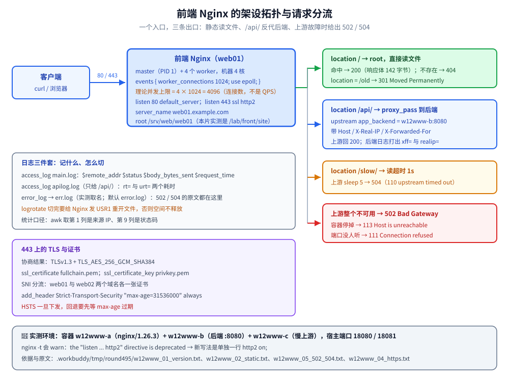

# WWW服务器

> 覆盖：HTTP 服务的**工作原理**（报文与状态码、协议版本演进、静态与动态的分界）、Apache 与 Nginx 的配置组织与虚拟主机、Nginx 的事件驱动并发模型、FastCGI / PHP-FPM 接入、HTTPS 证书与 SNI 分流、访问日志与分析、访问控制与限流，以及 502 / 504 一类上游故障的排查。
>
> 不覆盖：HTTP 语义与 TLS 握手的协议细节见 [HTTP与gRPC.md](../../网络/应用层/HTTP与gRPC.md) 与 [HTTPS与TLS.md](../../网络/应用层/HTTPS与TLS.md)；1.1 与 2 的差异见 [HTTP1.1与HTTP2的区别.md](../../网络/应用层/HTTP1.1与HTTP2的区别.md)、3 的传输细节见 [QUIC与HTTP3.md](../../网络/应用层/QUIC与HTTP3.md)；反向代理的通用原理见 [反向代理原理与实现.md](../../网络/应用层/反向代理原理与实现.md)；反代下怎么取真实 IP 见 [客户端真实IP与可信代理.md](../../网络/应用层/客户端真实IP与可信代理.md)；站点目录的 SELinux 上下文见 [02-主机安全与SELinux.md](02-主机安全与SELinux.md)。
>
> 内容整理自个人学习笔记。**基础框架**参考鸟哥官网《服务器架设篇 - RockyLinux 9》与《鸟哥的 Linux 私房菜：服务器架设篇（第三版修订）》相关章节的读后整理；Nginx 与证书自动化基于官方文档独立整理。素材见 [素材清单](../../../素材清单.md)。
>
> 📎 **实测口径**：本篇的**行为验证**在容器 `w12www-a`（官方 `nginx:1.26.3` 镜像，`nginx -V` 里 `built with OpenSSL 3.3.0`、**running** `3.3.3`，`TLS SNI support enabled`，带 `--with-http_v2_module` 与 `--with-http_v3_module`）里实跑，后端是 `w12www-b`（同为 nginx 1.26.3，监听 `:8080`），慢上游与探针跑在 `w12www-c`；静态、反代、TLS、协议协商、502 / 504 与日志各段原文存证 `.workbuddy/tmp/round495/w12www_01_version.txt`、`w12www_02_static.txt`、`w12www_03_proxy.txt`、`w12www_04_https.txt`、`w12www_05_502_504.txt`、`w12www_07_logs.txt`。**未实测**：certbot 对真实域名的签发与自动续期、HTTP/3（QUIC）真实链路、公网 CDN 与真实域名解析；时序类读数（`request_time`）只断言量级，不写严格单调。

---

## 一、HTTP 服务的基础是什么？

**本节要点**：一次请求就是「客户端发请求行 + 头 + 体，服务器回状态行 + 头 + 体」；**静态**内容直接读文件，**动态**内容交给后端程序。

### 1.1 一次请求与响应由哪些部分组成

请求报文的起始行是 `GET /api/orders HTTP/1.1`，响应报文的起始行是 `HTTP/1.1 200 OK`；两者都跟着若干 `字段名: 值` 形式的头、一个空行，空行之后才是可选的**消息体**。⭐ HTTP/1.1 把 **`Host`** 列为必需头，服务器靠它区分「同一个 IP:80 上到底要访问哪个站点」——这是**基于域名的虚拟主机**能成立的前提；HTTP/1.0 没有它，一个 IP 就只能挂一个站。

| 状态码段 | 含义 | 典型 |
|----------|------|------|
| 2xx | 成功 | `200 OK`、`206`（范围请求） |
| 3xx | 重定向 | `301`（永久）、`302`（临时） |
| 4xx | 客户端错误 | `403`（拒绝）、`404`（找不到）、`429`（限流） |
| 5xx | 服务端错误 | `502`（上游坏）、`503`（不可用）、`504`（上游超时） |

### 1.2 怎么用命令行快速验证

```bash
curl -sSI https://example.com | head        # 只看响应头
curl -sS -o /dev/null -w "%{http_code} %{time_total}s\n" https://example.com/
```

### 1.3 静态与动态怎么分

⭐ 静态内容（HTML / 图片 / 视频）由 Web 服务器直接返回；动态内容（PHP / Java / Go）经 **FastCGI / 反向代理**转给后端。

---

## 二、HTTP 协议版本经历了哪些演进？

**本节要点**：从 1.0 的「一请求一连接」到 1.1 的持久连接与 `Host`，再到 2 的二进制分帧多路复用、3 的跑在 UDP 之上的 QUIC；每一代都在解上一代的**连接开销**与**队头阻塞**。

### 2.1 1.0 与 1.1：持久连接和 `Host`

HTTP/1.0 默认「一个请求一个 TCP 连接」，每个资源都要重新握手；HTTP/1.1 默认 **`Connection: keep-alive`** 复用连接，并强制带 `Host` 头。代价是**应用层队头阻塞**：同一条连接上的请求要排队回应，浏览器只能靠「对同一域名开多条连接」来缓解。

### 2.2 2：二进制分帧与多路复用

HTTP/2 把报文拆成**二进制帧**（HEADERS / DATA …），用 stream id 标记归属，于是同一条 TCP 连接上可以**并发交错**多个请求——应用层队头阻塞消失，但 TCP 层丢包仍会拖住整条连接。它靠 **ALPN** 在 TLS 握手时协商，所以现实里几乎只跑在 HTTPS 上。

### 2.3 3：把传输层搬到 QUIC

HTTP/3 把传输层换成基于 UDP 的 QUIC：丢包只影响那一条流，连接建立与 TLS 握手也合并成更少的往返。⚠️ 它的部署门槛在 UDP——中间设备、防火墙、负载均衡都要放行，本机环境不具备验证条件。

| 版本 | 传输层 | 连接复用 | 关键改进 | 遗留问题 |
|------|--------|----------|----------|----------|
| 1.0 | TCP | 一请求一连接 | 无 | 连接开销大 |
| 1.1 | TCP | 默认持久连接 | `Host`、管道化、缓存头 | 应用层队头阻塞 |
| 2 | TCP + TLS | 单连接多路复用 | 二进制分帧、头部压缩 | TCP 层队头阻塞 |
| 3 | UDP + QUIC | 单连接多路复用 | 更少的握手往返、独立流 | UDP 放行与生态 |

本机（容器 `w12www-a`）的 `nginx -V` 里同时带 `--with-http_v2_module` 与 `--with-http_v3_module`，镜像里的 `curl 8.12.1` Features 里有 `HTTP2`；对 443 端口用 `-w '%{http_version}'` 读到的结果是 `http2 -> 200 2`，而显式 `--http1.1` 得到 `http1.1 -> 200 1.1`。⚠️ 1.26 上老写法会告警：

```text
[warn] the "listen ... http2" directive is deprecated, use the "http2" directive instead in /lab/front/nginx.conf:56
```

新写法是把 `http2 on;` 单独写一行。原文见 `.workbuddy/tmp/round495/w12www_01_version.txt` 与 `w12www_04b_http2.txt`。

---

## 三、Apache 怎么配？

**本节要点**：Apache 用「主配置 + 虚拟主机 + `.htaccess` + 模块（动态加载）」组织配置；`httpd -t` 校验、`systemctl reload` 生效。

### 3.1 虚拟主机怎么写

```text
# /etc/httpd/conf.d/vhost.conf（基于域名的虚拟主机）
<VirtualHost *:80>
  ServerName  web01.example.com
  DocumentRoot /srv/web/web01
  <Directory /srv/web/web01>
    Options -Indexes
    AllowOverride None
    Require all granted
  </Directory>
  ErrorLog  /var/log/httpd/web01-error.log
  CustomLog /var/log/httpd/web01-access.log combined
</VirtualHost>
```

```bash
sudo dnf install -y httpd
sudo systemctl enable --now httpd
sudo httpd -t                        # 语法检查
sudo apachectl -M | grep rewrite     # 看已加载模块
sudo systemctl reload httpd
```

### 3.2 MPM 怎么选？

Apache 的并发模型由 **MPM**（Multi-Processing Module）决定，`httpd -V` 里的 `Server MPM` 就是当前生效的那个：

| MPM | 模型 | 内存 | 适合 |
|-----|------|------|------|
| `prefork` | 一进程一请求 | 高 | 线程不安全的旧模块（如某些 `mod_php` 场景） |
| `worker` | 多进程 + 每进程多线程 | 中 | 常规并发、模块线程安全 |
| `event` | worker 之上再解耦 keep-alive 连接 | 低 | 现代默认，长连接多时省内存明显 |

⚠️ 切换 MPM 会牵动 `mod_php` 是否可用：`mod_php` 一般要求 `prefork`，所以「想要 `event` 又想跑 PHP」通常要改成 PHP-FPM（见第五节）。

### 3.3 三条工程约定

- **虚拟主机三种**：基于域名（`ServerName`）、基于端口（`*:8080`）、基于 IP；生产最常见是**基于域名**；
- **`.htaccess`** 是目录级配置：方便但**每次请求都要读盘、有性能开销**，生产建议 `AllowOverride None` 并把规则写进主配置；
- **模块管理**：`LoadModule` 动态加载（如 `mod_rewrite`、`mod_ssl`）。

---

## 四、Nginx 怎么配？

**本节要点**：Nginx 用 `server` / `location` 组织，**事件驱动**、高并发下内存占用低；`location` 的匹配优先级是配置正确与否的关键。

### 4.1 server 与 location 怎么写

```text
# /etc/nginx/conf.d/web01.conf
server {
  listen 80;
  server_name web01.example.com;
  root /srv/web/web01;

  location / {
    try_files $uri $uri/ =404;
  }
  location /api/ {
    proxy_pass http://10.0.10.30:8080/;
    proxy_set_header Host $host;
    proxy_set_header X-Real-IP $remote_addr;
    proxy_set_header X-Forwarded-For $proxy_add_x_forwarded_for;
  }
}
```

### 4.2 location 的匹配优先级

| `location` 写法 | 匹配规则 | 优先级 |
|-----------------|----------|--------|
| `= /path` | 精确匹配 | 最高 |
| `/path`（前缀） | 前缀匹配，取最长 | 中 |
| `^~ /path` | 前缀匹配且不再走正则 | 高于普通前缀 |
| `~ \.php$` | 正则（区分大小写） | 高于前缀 |
| `~* \.jpg$` | 正则（不区分大小写） | 同上 |

### 4.3 Nginx 的并发模型是怎样的

Nginx 是 master + worker：master 只做管理（读配置、拉起 worker），真正处理请求的是 **worker**，每个 worker 用一个线程跑**事件循环**（Linux 上就是 `epoll`）。所以「并发能力」约等于 `worker_processes × worker_connections`。

```text
# 本机配置（容器 w12www-a，机器 4 核）
worker_processes auto;        # 自动取 CPU 核数 → 起 4 个 worker
events {
  worker_connections 1024;    # 每个 worker 的连接数上限
  use epoll;
}
```

`ps -ef | grep nginx` 看到 **1 个 master + 4 个 worker**；按上面的配置算，连接数上限约 `4 × 1024 = 4096`（同时打开的连接数，不是 QPS）。⚠️ `worker_connections` 同时含**客户端连接**与**上游连接**两类，反代场景下双向占用，估算时要留余量。原文见 `.workbuddy/tmp/round495/w12www_01_version.txt`。

### 4.4 怎么校验与生效

```bash
sudo nginx -t                        # 语法检查
sudo systemctl reload nginx
```

⚠️ 反向代理要带上 `Host` / `X-Real-IP` / `X-Forwarded-For`，否则后端拿到的是代理的地址；怎么取真实 IP 见 [客户端真实IP与可信代理.md](../../网络/应用层/客户端真实IP与可信代理.md)。

---

## 五、静态站点怎么接 PHP-FPM / FastCGI？

**本节要点**：Nginx **自己不执行 PHP**，它把 `.php` 请求经 **FastCGI** 协议转给 PHP-FPM 进程池；两边靠一个 socket 对话，Nginx 只负责「把请求参数摆好、再把结果搬回来」。

### 5.1 FastCGI 与 CGI 有什么不同

CGI 是「一个请求 fork 一个进程、跑完即退」，进程创建开销大；FastCGI 是**常驻进程池**：进程启动后循环接请求，省掉反复 fork，还能做进程管理与平滑重启——PHP-FPM 就是它的实现。

### 5.2 Nginx 侧怎么写

```text
location ~ \.php$ {
  root /srv/web/web01;
  fastcgi_pass unix:/run/php-fpm/www.sock;
  include fastcgi_params;
  fastcgi_param SCRIPT_FILENAME $document_root$fastcgi_script_name;   # ⭐ 必须显式给
  fastcgi_param DOCUMENT_ROOT   $document_root;
}
```

### 5.3 三个经典坑

- ⭐ **`SCRIPT_FILENAME` 缺失**：FPM 收到了请求却不知道执行哪个文件，于是回 `File not found`（开了 `display_errors` 时会看到 `No input file specified`）；它**不在**默认的 `fastcgi_params` 里，必须自己写。
- **`$document_root` 与实际不符**：`root` 常写在 `server` 块、`fastcgi_param` 写在 `location` 块，以 `root` 的最终值为准；路径拼错同样落到 `File not found`。
- **`try_files` 与 `$uri` 抢道**：给 `.php` 的 `location` 再写 `try_files $uri =404` 时，`$uri` 是**改写后**的路径，要配合 `fastcgi_split_path_info` 才能正确处理 `/index.php/foo` 这类 PATH_INFO，否则参数会被吞掉。

---

## 六、HTTPS 怎么配、证书怎么来？

**本节要点**：HTTPS = HTTP over TLS；证书可用 Let’s Encrypt 免费签发并**自动续期**（90 天有效期），或用自签证书做内网测试。

### 6.1 用 certbot 自动签发与续期

```bash
# ① 用 certbot 申请并自动配置（Nginx）
sudo dnf install -y certbot python3-certbot-nginx
sudo certbot --nginx -d web01.example.com

# ② 验证自动续期（certbot 会装 systemd timer）
sudo certbot renew --dry-run
systemctl list-timers | grep certbot
```

证书装好后由 systemd timer 触发续期，务必用 `--dry-run` 先把续期链路跑一遍。

### 6.2 Nginx 侧的关键指令

```text
# Nginx 的 HTTPS 要点
server {
  listen 443 ssl http2;
  ssl_certificate     /etc/letsencrypt/live/web01.example.com/fullchain.pem;
  ssl_certificate_key /etc/letsencrypt/live/web01.example.com/privkey.pem;
  ssl_protocols TLSv1.2 TLSv1.3;      # ⚠️ 禁用过老的 TLS 1.0 / 1.1
  add_header Strict-Transport-Security "max-age=31536000" always;   # HSTS
}
```

### 6.3 自签证书怎么生成

内网 / 测试没有受信 CA 时，用 `openssl req -x509` 一条命令签发；关键是**把域名写进 `subjectAltName`**（现代浏览器只认 SAN，不再看 CN）：

```bash
openssl req -x509 -nodes -days 365 -newkey rsa:2048 \
  -keyout web01.key -out web01.crt \
  -subj '/CN=web01.example.com' \
  -addext 'subjectAltName=DNS:web01.example.com,IP:127.0.0.1'
```

签完读回确认：

```text
subject=CN=web01.example.com, O=w12lab
issuer=CN=web01.example.com, O=w12lab
X509v3 Subject Alternative Name:
    DNS:web01.example.com, IP Address:127.0.0.1
```

### 6.4 证书链、SNI 与会话复用

- **证书链要完整**：客户端只认「能被受信根串起来」的那条链，服务端要发**叶子 + 中间证书**（`fullchain.pem`），只发叶子会让部分客户端校验失败。
- **SNI**：TLS 握手时客户端用 SNI 扩展告诉服务器「我要访问哪个域名」，服务器据此选证书；`nginx -V` 里带 `TLS SNI support enabled` 才支持「一个 443 挂多张证书」。
- **会话复用**：`ssl_session_cache shared:SSL:10m;` 缓存会话、减少重复握手，量级够用即可，别为它牺牲内存。
- ⚠️ **自签证书**浏览器会告警，仅用于内网 / 测试；对外必须用受信 CA 的证书。

本机实测的握手结果是 `Protocol version: TLSv1.3`、`Ciphersuite: TLS_AES_256_GCM_SHA384`、`Server Temp Key: X25519, 253 bits`；自签证书的 `notAfter` 距签发 365 天，响应头里能看到 `Strict-Transport-Security: max-age=31536000`。原文见 `.workbuddy/tmp/round495/w12www_04_https.txt` 与 `w12www_06_cert.txt`。

---

## 七、虚拟主机怎么按 Host / SNI 分流？

**本节要点**：同一台机器上跑多站点有两种分流依据——明文 HTTP 看 **`Host` 头**，加密 HTTPS 在**握手阶段**就要定证书、只能靠 **SNI**；两者在 Nginx 里都落成多个 `server` 块。

### 7.1 明文 HTTP：按 Host 头分流

`server_name` 匹配 `Host` 头，命中哪个 `server` 块就用哪个 `root`；没有任何 `server_name` 命中时落到该端口的 **`default_server`**。⚠️ 不写 `default_server` 时 Nginx 用**配置文件里第一个** `server` 兜底，顺序一变行为就变，生产上要显式指定。

### 7.2 加密 HTTPS：按 SNI 分流

HTTPS 的 `Host` 头在 TLS 之后才出现，服务器在握手时还不知道客户端要哪个域名——这正是 **SNI** 要解决的。每个域名一个 `server` 块、各挂各的证书：

```text
server { listen 443 ssl; server_name web01.example.com; ssl_certificate /lab/front/certs/web01.crt; ssl_certificate_key /lab/front/certs/web01.key; }
server { listen 443 ssl; server_name web02.example.com; ssl_certificate /lab/front/certs/web02.crt; ssl_certificate_key /lab/front/certs/web02.key; }
```

本机实测：对 443（宿主 `18081`）带 `-servername web01.example.com` 拿到 `web01` 的证书；用 `curl --resolve web02.example.com:18081:127.0.0.1 https://web02.example.com:18081/` 则返回站点内容 `web02`——两个域名各命中各的证书与 `root`。原文见 `.workbuddy/tmp/round495/w12www_04_https.txt`。

### 7.3 证书对不上会怎样

⚠️ 用 IP 直连、或客户端不支持 SNI 时，服务器只能回**默认 `server` 的证书**，于是浏览器报「证书域名不匹配」。给每个 `server` 配上**覆盖到 IP / 别名**的 SAN，或单独设一个「兜底证书」的 `default_server`，都能缓解。

---

## 八、日志与分析怎么做？

**本节要点**：`access_log` 记录每个请求、`error_log` 记录问题；日志会无限增长，**必须切割 + 归档**。

### 8.1 日志记在哪、记什么

每个 `server`（或 `location`）可以各写一条 `access_log`，字段由 `log_format` 决定。默认 `combined` 关心的就是「谁、请求了什么、回了几多、多大、用的什么客户端」：

| 变量 | 含义（默认日志里的列） |
|------|------------------------|
| `$remote_addr` | 客户端地址（反代后面是代理的地址） |
| `$request` | 请求行（方法 + URI + 版本） |
| `$status` | 响应状态码 |
| `$body_bytes_sent` | 响应体字节数 |
| `$request_time` | Nginx 处理该请求的总耗时 |
| `$upstream_response_time` | 上游响应耗时（反代场景才有意义） |

错误日志的内容由 `error_log` 指令控制，分 `debug / info / notice / warn / error / crit` 级别，级别越低记的东西越多、磁盘与性能代价越大；生产常设 `warn`。

⚠️ **文件名口径**：镜像编译时的默认路径是 `/var/log/nginx/access.log` 与 `/var/log/nginx/error.log`（可看 `nginx -V` 里的 `--http-log-path` / `--error-log-path`）。本片实测把访问日志拆成 `main.log`（静态）与 `apilog.log`（`/api/`）、错误日志取名为 `err.log`；§8.2 与 §十 这类贴着实测写的命令按**实测名**写，§十二 的通用流程保留默认名。换机器时以自己 `nginx.conf` 里 `access_log` / `error_log` 指令的路径为准。

### 8.2 怎么统计

```bash
tail -f /var/log/nginx/main.log
tail -f /var/log/nginx/err.log

# 统计 TOP 来源 IP 与状态码分布
awk '{print $1}' /var/log/nginx/main.log | sort | uniq -c | sort -rn | head
awk '{print $9}' /var/log/nginx/main.log | sort | uniq -c | sort -rn | head

# 找 5xx
grep " 5[0-9][0-9] " /var/log/nginx/main.log | tail
```

本机把静态与反代分了两条日志：跑完一轮后 `main.log` 10 行、`apilog.log` 5 行；按第 1 列统计到 TOP 来源是 `7 127.0.0.1` 与 `3 10.77.12.1`，第 9 列（状态码）分布是 `7 200`、`1 504`、`1 404`、`1 301`。反代那条日志另记 `rt=`（`request_time`）与 `urt=`（`upstream_response_time`），接口命中时 `rt` 落在 `0.000~0.002`、`urt` 落在 `0.000~0.001`（四次读数）。原文见 `.workbuddy/tmp/round495/w12www_07_logs.txt` 与 `w12www_03_proxy.txt`。

### 8.3 怎么切割与归档

- Nginx 通过 `logrotate` 的 `USR1` 信号重开日志（`create` 模式）；
- Apache 用 `rotatelogs` 或 logrotate；
- ⚠️ 切割后若进程不重开文件，日志会继续写进被 rename 的旧文件、空间不释放——这是「打了日志但 `df` 不降」的常见原因。

---

## 九、访问控制与限流怎么配？

**本节要点**：四件事分四层——**谁能进**（`allow` / `deny`、`auth_basic`）、**进得多快**（`limit_req` / `limit_conn`）、**谁在盗链**（`valid_referers`）；前两件挡人，后一件挡流量。

### 9.1 按来源 IP 放行与拒绝

```text
location /admin/ {
  allow 10.77.12.0/24;
  deny  all;                     # ⭐ 顺序敏感：先 allow 再兜底 deny
}
```

⚠️ `allow` / `deny` 按**书写顺序**取第一条命中的规则，所以要「先放行具体网段、最后 `deny all`」；反过来写会让所有人都被拒。

### 9.2 基础认证 auth_basic

```bash
sudo htpasswd -c /etc/nginx/.htpasswd alice       # 建密码文件
```

```text
location /admin/ {
  auth_basic           "restricted";
  auth_basic_user_file /etc/nginx/.htpasswd;
}
```

### 9.3 限流与限连

```text
limit_req_zone  $binary_remote_addr zone=perip:10m rate=5r/s;    # 定义在 http 块
limit_conn_zone $binary_remote_addr zone=connip:10m;

server {
  location /api/ {
    limit_req  zone=perip burst=10 nodelay;
    limit_conn connip 20;
  }
}
```

⚠️ `limit_req` 超限时 Nginx 直接拒绝，返回的是**服务端错误**那一档、而不是客户端错误；要区分「限流拒绝」与「后端过载」，看 `err.log` 里有没有 `limiting requests` 的原文最稳。

### 9.4 防盗链

```text
location ~* \.(jpg|png|gif)$ {
  valid_referers none blocked server_names *.example.com;
  if ($invalid_referer) { return 403; }     # 来源不在白名单 → 403
}
```

---

## 十、上游故障与 4xx 怎么排查？

**本节要点**：5xx 里的 **502** 是「连不上上游」、**504** 是「连上了但上游不回」；两者都能在 `err.log` 里找到一句原文，先看原文再动手。

### 10.1 502 与 504 怎么分

```bash
grep -n 'upstream timed out' /var/log/nginx/err.log    # 504
grep -n 'connect() failed'   /var/log/nginx/err.log    # 502
```

实测两种情况：`/slow/` 指向一个 `sleep 5` 的慢上游、Nginx 侧 `proxy_read_timeout` 只给 1s，于是 `GET /slow/ -> 504`，五次实测耗时落在 `1.006~1.026s`，`err.log` 原文是 `upstream timed out (110: Operation timed out)`；把后端容器停掉再请求 `/api/` 得到 502，原文是 `connect() failed (113: Host is unreachable)`；而「主机在、端口上没人听」时原文变成 `connect() failed (111: Connection refused)`。

### 10.2 4xx 到底是谁拒的

4xx 属于**请求侧**问题，但发出拒绝的可能是 Nginx（自己 match 不到、被自己的规则拦住），也可能是后端（后端返回的 4xx 被原样带回）：

- **403**：目录既没索引又没首页、`deny` 命中、`valid_referers` 命中，或文件权限 / SELinux 上下文不对；
- **404**：`root` / `try_files` 找不到文件，或后端自己返回的 404；
- **限流拒绝**：`limit_req` / `limit_conn` 触发，看 `err.log` 里的 `limiting requests`。

### 10.3 一张速查表

| 症状 | 先查什么 |
|------|----------|
| 静态 404 | `root` 路径对不对、`try_files` 的最后一个参数写没写 |
| 反代 502 | `proxy_pass` 的地址 / 端口、后端进程是否在监听、`connect() failed` 的括号码 |
| 反代 504 | `proxy_read_timeout` / `proxy_connect_timeout`，上游是不是真慢 |
| 全站 403 | 目录权限、SELinux 上下文、`allow` / `deny` 的顺序 |
| 改了配置不生效 | 是否漏了 `nginx -t` 与 `reload`（`reload` 是平滑加载，不会断现有连接） |
| 日志不增长 / `df` 不降 | 切割后有没有给 Nginx 发 `USR1` 重开文件 |

---

## 十一、应用场景

**本节要点**：WWW 服务很少单独出现，它最常见的身份是「**统一入口**」——把静态、接口、证书、日志、限流都收在一层，后面挂应用与静态资源。

| 落地场景 | 这里的哪一节在起作用 | 本仓相关篇目 |
|---|---|---|
| 前后端分离的入口层 | Nginx 做静态 + `/api/` 反代，`location` 优先级决定谁接谁（四、七） | [反向代理原理与实现.md](../../网络/应用层/反向代理原理与实现.md) |
| 多域名 / 多站点托管 | 基于域名的虚拟主机 + SNI 一 IP 多证书（七） | [07-DNS服务器.md](07-DNS服务器.md) |
| HTTPS 合规 | 完整证书链 + HSTS + 关掉老 TLS（六） | [HTTPS与TLS.md](../../网络/应用层/HTTPS与TLS.md) |
| 协议升级到 2 / 3 | ALPN 协商、QUIC 与 UDP 放行（二） | [HTTP1.1与HTTP2的区别.md](../../网络/应用层/HTTP1.1与HTTP2的区别.md)、[QUIC与HTTP3.md](../../网络/应用层/QUIC与HTTP3.md) |
| 反代后取真实 IP | `X-Forwarded-For` 与可信代理链（四、十） | [客户端真实IP与可信代理.md](../../网络/应用层/客户端真实IP与可信代理.md) |
| 站点加固与排障 | `AllowOverride None`、目录权限与 SELinux 上下文（三、十） | [02-主机安全与SELinux.md](02-主机安全与SELinux.md) |
| 对外只放必要端口 | `firewall-cmd --add-service=http/https`（十二） | [04-防火墙与NAT.md](04-防火墙与NAT.md) |
| 把同一套站搬进容器 | 镜像里换掉 `root` 与 `proxy_pass` 的地址（十二） | [11-容器化衔接.md](11-容器化衔接.md) |

---

## 十二、具体使用

**本节要点**：静态站点 + `/api` 反代到后端 + HTTPS 的一条完整流程。



```bash
# ① 装并放行
sudo dnf install -y nginx
sudo firewall-cmd --add-service=http --add-service=https --permanent && sudo firewall-cmd --reload

# ② 静态根目录（注意 SELinux 上下文见 02 篇）
sudo mkdir -p /srv/web/web01 && echo "hello" | sudo tee /srv/web/web01/index.html
sudo chown -R nginx:nginx /srv/web/web01
sudo semanage fcontext -a -t httpd_sys_content_t "/srv/web(/.*)?" && sudo restorecon -Rv /srv/web

# ③ 写 server 配置（上文的模板）后
sudo nginx -t && sudo systemctl enable --now nginx

# ④ 验证
curl -sS -o /dev/null -w "static:%{http_code}\n" http://127.0.0.1/
curl -sS -o /dev/null -w "api:%{http_code}\n" http://127.0.0.1/api/
sudo tail -5 /var/log/nginx/access.log
```

判据：`nginx -t` 通过；`curl` 静态返回 `200`；`/api/` 反代到后端（后端日志能看到带 `X-Forwarded-For` 的请求）；`access.log` 有新行。

### 12.1 在容器里跑一遍（本机实测）

把上面的 Rocky 命令换成本机的容器版：前端 `w12www-a` 把 `18080 → 80`、`18081 → 443`，后端 `w12www-b` 监听 `:8080`，慢上游在 `w12www-c` 的 `:9001`，三个容器同在一个自建网络（子网 `10.77.12.0/24`）里：

```bash
curl -sS -o /dev/null -w 'GET / -> %{http_code}\n' http://127.0.0.1/            # 静态 → 200
curl -sS -o /dev/null -w 'GET /nope -> %{http_code}\n' http://127.0.0.1/nope    # → 404
curl -sSI http://127.0.0.1/old | head -1                                        # → 301 Moved Permanently
curl -sS http://127.0.0.1/api/                                                  # → backend ok
curl -sS -o /dev/null -w 'GET /slow/ -> %{http_code} in %{time_total}s\n' http://127.0.0.1/slow/   # → 504
```

读到的结果：静态命中 `200`、响应体 142 字节；`/nope` 给 `404`；`/old` 给 `301`；`/api/` 反代拿到后端的 `backend ok`，后端日志里记到 `xff="127.0.0.1" realip="127.0.0.1"`，说明 `X-Forwarded-For` / `X-Real-IP` 已经透传；慢上游连续五次都返回 `504`、耗时落在 `1.006~1.026s`。端口映射与各段原文见 `.workbuddy/tmp/round495/w12www_08_ports.txt`、`w12www_02_static.txt`、`w12www_03_proxy.txt`、`w12www_03b_be_log.txt`、`w12www_05_502_504.txt`、`w12www_09_504_runs.txt`。

---

## 延伸追问

- **Apache 和 Nginx 怎么选？**
  → **Nginx**：事件驱动、静态 / 反向代理 / 高并发场景内存占用低，现代前端 + 后端分离架构的首选；**Apache**：模块生态老练，`.htaccess` 与目录级配置灵活，传统 PHP 应用、需要大量第三方模块时仍有优势。⭐ 也常见「Nginx 做前端反代 + Apache / 应用服务器做后端」的组合。
- **虚拟主机有哪几种方式？**
  → 三种：**基于域名**（同一个 IP:80，按 `Host` 头区分，最常用）、**基于端口**（同一 IP 不同端口）、**基于 IP**（每站一个 IP）。现代 HTTPS 下主流是基于域名 + SNI，一个 IP 可承载大量证书不同的站点。
- **为什么 HTTPS 证书要自动续期？**
  → 因为 Let’s Encrypt 等免费证书有效期只有 **90 天**（设计上鼓励自动化），手工续期迟早会忘——到期那天站点直接证书失效告警。`certbot` 安装后自带 systemd timer / cron 自动续期，务必用 `certbot renew --dry-run` 验证续期链路是通的。
- **`proxy_pass` 后面带不带斜杠有什么区别？**
  → 带路径的 `proxy_pass http://backend/` 会用 location 匹配的那段**替换**掉请求 URI，不带路径的 `proxy_pass http://backend` 则**原样转发**完整 URI。`location /api/ { proxy_pass http://backend/; }` 会把 `/api/orders` 变成后端看到的 `/orders`；写成 `proxy_pass http://backend;` 后端看到的才是 `/api/orders`——这是「后端一直 404」的高频原因。
- **`reload` 和 `restart` 该用哪个？**
  → 改配置优先 `reload`：Nginx 收到 `HUP` 后**先起新 worker、再优雅退出旧 worker**，存量连接不受影响；`restart` 会整体停掉再拉起，期间丢连接。⚠️ 只有 `reload` 失败（如端口被占、socket 路径变了）才需要 `restart`。

---

## 关联

- **上游/总纲**：[README.md](README.md) — 本目录导读：版本坐标与阅读顺序
- **对照/互补**：[HTTP与gRPC.md](../../网络/应用层/HTTP与gRPC.md) — HTTP 语义与 gRPC 的对照
- **下游机制**：[HTTPS与TLS.md](../../网络/应用层/HTTPS与TLS.md) — 证书与 TLS 握手原理
- **下游机制**：[反向代理原理与实现.md](../../网络/应用层/反向代理原理与实现.md) — 反向代理的原理
- **运维/配置**：[客户端真实IP与可信代理.md](../../网络/应用层/客户端真实IP与可信代理.md) — 反代下取真实 IP
- **运维/配置**：[02-主机安全与SELinux.md](02-主机安全与SELinux.md) — 站点目录的 SELinux 上下文
- **对照/互补**：[10-邮件服务器.md](10-邮件服务器.md) — 同为「对外提供服务」的架设场景
> 反向引用（本篇被下列文档引到）：[10-邮件服务器.md](10-邮件服务器.md)、[11-容器化衔接.md](11-容器化衔接.md)
