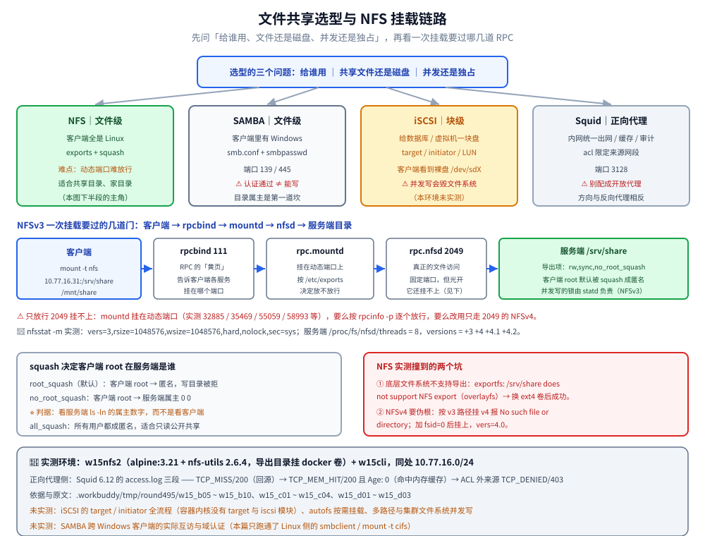

# 文件共享服务

> 覆盖：NFS、SAMBA、iSCSI、Proxy 四种共享方案——文件级还是块级、跨平台还是 Linux 专用、服务端与客户端两侧怎么配、权限映射（squash）与认证边界，以及按需求选型的判据。
>
> 不覆盖：端口放行与 NAT 改写在 [04-防火墙与NAT.md](04-防火墙与NAT.md) 篇；SELinux 布尔值与「能连不能写」的主机层成因在 [02-主机安全与SELinux.md](02-主机安全与SELinux.md) 篇；反向代理的完整原理在 [反向代理原理.md](../../网络/代理与网关/反向代理原理.md)。
>
> 内容整理自个人学习笔记。**基础框架**参考鸟哥官网《服务器架设篇 - RockyLinux 9》与《鸟哥的 Linux 私房菜：服务器架设篇（第三版修订）》相关章节的读后整理；iSCSI 与现代用法基于官方文档独立整理。素材见 [素材清单](../../../素材清单.md)。
>
> 📎 **实测口径**：本篇的**行为验证**在五台容器里实跑——服务端 `w15nfs2`（`alpine:3.21` + `nfs-utils 2.6.4`，导出目录挂 docker 卷）、SAMBA 服务端 `w15smb`（`samba 4.20.6`）、正向代理 `w15squid`（`squid 6.12`）、客户端 `w15cli`，四者同处 `10.77.16.0/24`；内核 `6.18.54.1-microsoft-standard-WSL2`。原文存证 `.workbuddy/tmp/round495/w15_b05`~`w15_b10`、`w15_c01`~`w15_c04`、`w15_d01`~`w15_d03`。**未实测**：iSCSI 的 target / initiator 全流程（容器内核没有 target 与 iscsi 模块，客户端也没有 `iscsiadm`，只有探到这一点的原始输出）、`autofs` 按需挂载、真实交换机上的多路径与集群文件系统并发写、SAMBA 跨 Windows 客户端的实际互访与域认证。

---

## 一、NFS：Linux 之间的文件共享怎么配？

**本节要点**：NFS 是**文件级**共享（客户端像访问本地目录一样访问远端）；配置分「服务端 `/etc/exports`」与「客户端 `mount`」两侧，且服务端不是单个进程，而是**一组 RPC 服务**。

```text
# /etc/exports（服务端）
/srv/share  10.0.20.0/24(rw,sync,no_root_squash)
/srv/ro     10.0.20.0/24(ro,sync)
```

```bash
sudo dnf install -y nfs-utils
sudo systemctl enable --now nfs-server
sudo exportfs -rav            # 重载 exports
sudo exportfs -v              # 看当前导出（含生效后的默认选项）

# 客户端
sudo mount -t nfs 10.0.10.30:/srv/share /mnt/share
```

| 选项 | 含义 |
|------|------|
| `rw` / `ro` | 读写 / 只读 |
| `sync` / `async` | 同步写（安全）/ 异步写（快） |
| `no_root_squash` | ⚠️ 客户端 root 在服务端仍是 root（默认 squash 成匿名） |
| `all_squash` | 所有用户都映射为匿名 |

### 1.1 服务端其实是四件事

NFSv3 时代，服务端由四个角色拼成，少一个客户端就挂不上：

| 角色 | 作用 | 端口 |
|------|------|------|
| `rpcbind` | RPC 的「黄页」，告诉客户端各服务在哪个端口 | `111`（tcp / udp，固定） |
| `rpc.nfsd` | 真正提供文件访问的内核态 NFS 服务 | `2049`（固定） |
| `rpc.mountd` | 处理 `mount` 请求，按 `/etc/exports` 授权 | 动态端口 |
| `rpc.statd` | 文件锁与 crash 恢复（NLM / NSM） | 动态端口 |

📎 实测的服务端注册表（`rpcinfo -p localhost`）：`100000`（portmapper）在 `111`、`100003`（nfs）在 `2049`，而 `100005`（mountd）与 `100021`（nlm）各自挂在一串**动态端口**上（`32885`、`35469`、`55059`、`58993` 等）。这正是 [02-主机安全与SELinux.md](02-主机安全与SELinux.md) 篇里「NFS 容器监听 24 条」的来源——**要放行 NFS，光开 2049 不够**。原文见 `.workbuddy/tmp/round495/w15_b05_nfs_volume_server.txt`。

⭐ 客户端侧的对应报错：如果只通了 `2049` 而 `mountd` 的端口被挡，症状是 `showmount` / `mount` 超时或 `Permission denied`，而 `ping` / `nc -z 2049` 都正常——排障时要按「111 → 动态端口 → 2049」的顺序查，别只盯 2049。

### 1.2 客户端挂载：三个最容易踩的点

```bash
showmount -e 10.0.10.30                                  # ① 先看服务端导出了什么
sudo mount -t nfs 10.0.10.30:/srv/share /mnt/share        # ② 挂载
nfsstat -m                                                # ③ 看这条挂载真实生效的选项
```

📎 实测的挂载选项（`nfsstat -m` 原文）：

```text
/mnt/share from 10.77.16.31:/srv/share
 Flags: rw,relatime,vers=3,rsize=1048576,wsize=1048576,namlen=255,hard,nolock,
        proto=tcp,timeo=600,retrans=2,sec=sys,mountaddr=10.77.16.31,mountvers=3
```

| 坑 | 症状 | 处理 |
|----|------|------|
| `rpc.statd` 没跑 | `mount.nfs: rpc.statd is not running but is required for remote locking`，随后 `Permission denied` | 起 `statd`，或（NFSv3 且不要锁时）用 `-o nolock` |
| 忘记 `exportfs -rav` | 改了 `/etc/exports` 但不生效 | 重载后再 `exportfs -v` 核对 |
| 硬挂载（`hard`）卡死 | 服务端掉线时进程 D 状态不可中断 | 交互场景可用 `-o soft,timeo=...`，但要接受数据风险 |

⭐ `nolock` 是实验环境的常用手段，但它**关掉的是 NFS 锁**——多客户端并发写同一文件时不再有锁保护，生产要权衡。本片实测的 `hard,nolock` 正是这条口径。

### 1.3 NFSv3 与 NFSv4 差在哪（实测）

| 维度 | NFSv3 | NFSv4 |
|------|-------|-------|
| 依赖 `rpcbind` / `mountd` | 必须（`111` + 动态端口） | 不需要，只走 `2049` |
| 导出路径 | 服务端真实路径（`/srv/share`） | 通过**伪根**（pseudo root）暴露 |
| 伪根要求 | 无 | 必须有 `fsid=0` 的导出项，且它所在文件系统要支持导出 |
| 状态与锁 | 另起 `statd` / `nlm` | 协议自带 |

📎 实测两步就走出了 v3 → v4 的差别：

```bash
# ① 直接按 v3 的路径去挂 v4：失败
mount -t nfs -o vers=4 10.77.16.31:/srv/share /mnt/v4
#   → mount.nfs: mounting 10.77.16.31:/srv/share failed,
#     reason given by server: No such file or directory

# ② 给出带 fsid=0 的伪根，再按「伪根下的相对路径」挂：成功
printf '/srv4 10.77.16.0/24(rw,sync,fsid=0,no_subtree_check,no_root_squash)\n' > /etc/exports
mount -t nfs -o vers=4 10.77.16.31:/ /mnt/v4      # 挂的是伪根
```

成功后的 `nfsstat -m` 是 `vers=4.0`，且访问 `10.77.16.31:/` 得到的是**伪根那一层目录**（里面才有 `share/`）；写进去的文件在服务端属主是 `0 0`（因为该导出带了 `no_root_squash`）。原文见 `.workbuddy/tmp/round495/w15_b08_nfs_v4_pseudoroot.txt`、`w15_b09_nfs_v4_loop.txt`。

⚠️ **容器里还有一层额外的坑**：Docker 容器的可写层是 **overlayfs**，直接导出会报 `exportfs: /srv/share does not support NFS export`（本片第一次尝试就是这么失败的）；把导出目录换成 **docker 卷**（底层是 `ext4`）后立刻成功——`exportfs -rav` 打出 `exporting 10.77.16.0/24:/srv/share`、退出码 `0`。**导出目录所在文件系统是否支持导出，比 `/etc/exports` 写对没有更靠前**。

### 1.4 权限映射：squash 家族才是共享目录的安全边界

客户端传来的 uid / gid 能不能在服务端生效，全看 squash：

| 选项 | 客户端 root 在服务端是 | 典型用途 |
|------|------------------------|----------|
| `root_squash`（默认） | 匿名（`nobody` / `65534`） | 生产默认，防「客户端 root = 服务端 root」 |
| `no_root_squash` | 就是 root（`0`） | 只给受控的批处理 / 备份机 |
| `all_squash` | 所有用户都成匿名 | 只读公开共享、上传目录 |

📎 实测同一台客户端、同一个 root 身份，两个导出结果相反：

```bash
# /srv/share 用默认 root_squash：客户端 root 写 → 被拒
echo 'written by root client' > /mnt/share/by-root.txt
#   → sh: can't create /mnt/share/by-root.txt: Permission denied

# /srv/nosquash 用 no_root_squash：同一操作 → 成功，服务端属主是 0 0
ls -ln /srv/nosquash
#   → -rw-r--r--    1 0        0               23 by-root.txt
```

⭐ 判据：**看服务端 `ls -ln` 的属主数字**。属主是 `0 0` 说明没被 squash；写入被拒则是 squash 生效后的正常结果（目录属主不是匿名用户）。原文见 `.workbuddy/tmp/round495/w15_b06_nfs_volume_client.txt`、`w15_b07_nfs_nosquash_v4.txt`。

⚠️ 生产**不要**用 `no_root_squash`；配合 [04-防火墙与NAT.md](04-防火墙与NAT.md) 只对内网段开放，并用 `autofs` 做按需挂载（本环境未实测 `autofs`）。

---

## 二、SAMBA：和 Windows 互通要注意什么？

**本节要点**：SAMBA 实现 SMB/CIFS 协议，让 Linux 与 Windows 互访共享；用户认证走 `smbpasswd`（与系统账号分离），而**认证通过不等于能写**。

```text
# /etc/samba/smb.conf（节选）
[global]
  workgroup = WORKGROUP
  security = user
  server min protocol = SMB2

[share]
  path = /srv/samba/share
  browseable = yes
  writable = yes
  valid users = alice, bob
  # 多个用户用逗号分隔；每个都要先用 smbpasswd 加进 SMB 用户库
```

```bash
sudo dnf install -y samba samba-client
sudo smbpasswd -a alice          # 设置 SMB 密码（≠ 系统密码）
sudo systemctl enable --now smb nmb
testparm                         # 校验 smb.conf
sudo firewall-cmd --add-service=samba --permanent && sudo firewall-cmd --reload
```

| 维度 | 说明 |
|------|------|
| 端口 | `445`（SMB over TCP，现代主用）+ `139`（NetBIOS over TCP，兼容旧客户端） |
| 用户库 | `smbpasswd` / `pdbedit -L` 管理，与 `/etc/passwd` 分离——系统里没有的用户不能开 SMB 账号 |
| 协议下限 | 现代环境建议 `server min protocol = SMB2`，关掉不安全的 SMB1 |
| 校验配置 | `testparm -s` 会把生效值（含默认值）打印出来，比对着 `smb.conf` 猜靠谱 |

📎 实测的 `testparm -s`：`Server role: ROLE_STANDALONE`、`security = USER`、`server min protocol = SMB2`、共享段生效为 `read only = No` + `valid users = alice`；`smbd` 起监听后 `ss` 上是 `0.0.0.0:139`、`0.0.0.0:445`，`pdbedit -L` 里是 `alice:1000`。原文见 `.workbuddy/tmp/round495/w15_c01_samba_server.txt`。

### 2.1 认证边界：三种身份走一遍（实测）

| 客户端动作 | 实测结果 | 含义 |
|------------|----------|------|
| `smbclient -L //host -N`（匿名列表） | `Anonymous login successful` + 列出 `share`、`IPC$` | 匿名**能看到共享名**（browseable = yes） |
| `smbclient //host/share -N -c ls`（匿名进共享） | `tree connect failed: NT_STATUS_ACCESS_DENIED` | 但**进不去共享**（`valid users = alice`） |
| `-U 'alice%Secret123'` | 列表与读写都成功 | 合法用户 |
| `-U 'alice%wrong'` | `session setup failed: NT_STATUS_LOGON_FAILURE` | 密码错的明确报错 |

⭐ 这四行合起来说明一件事：**「能列出共享」只是浏览权限，不是访问权限**。排查「客户说连不上」时，先分清卡在哪一步——列表成功但 `tree connect failed` 是**授权**问题，`LOGON_FAILURE` 是**认证**问题。

### 2.2 ⚠️ 认证过了还是不能写：两个最常见的成因

本片实测到了这个经典坑：认证通过、`put` 仍返回 `NT_STATUS_ACCESS_DENIED`。原因是**服务端目录属主**：

```bash
# 修之前：目录属主 root:root，SMB 用户映射后没有写权限
ls -ln /srv/samba/share     # → drwxr-xr-x  root root

# 修之后：把共享目录交给 SMB 用户
chown -R alice:alice /srv/samba/share && chmod 775 /srv/samba/share
# 同一个 put 立刻成功，服务端属主变成 1000
```

| 成因 | 判据 | 处理 |
|------|------|------|
| 文件系统属主 / 权限 | 服务端 `ls -ln` 里 SMB 用户对目录没有写位 | `chown` / `chmod`（本片实测路径） |
| SELinux 布尔值 | `getenforce` 为 enforcing 且 `ausearch -m avc` 有记录 | `setsebool -P samba_export_all_rw on` 或打 `samba_share_t`（见 [02-主机安全与SELinux.md](02-主机安全与SELinux.md)） |

📎 顺带实测了 **CIFS 挂载**这条路：`mount -t cifs //10.77.16.40/share /mnt/smb -o username=alice,password=Secret123` 成功，`df -h /mnt/smb` 显示容量来自服务端；修好属主后 `echo ... > /mnt/smb/via-cifs.txt` 写入成功，服务端 `ls -ln` 属主 `1000`。原文见 `.workbuddy/tmp/round495/w15_c02_samba_auth.txt`、`w15_c03_samba_cifs.txt`、`w15_c04_samba_perms.txt`。

---

## 三、iSCSI：块级存储和文件级差在哪？

**本节要点**：iSCSI 把远端存储**当作本地磁盘**（块级），客户端拿到的是 `/dev/sdX`，可以再格式化 / 做文件系统；适合集中存储、无盘启动、集群共享盘。

| 维度 | 文件级（NFS / SAMBA） | 块级（iSCSI） |
|------|----------------------|---------------|
| 客户端看到 | 目录 | 一块裸盘（`/dev/sdX`） |
| 文件系统在哪 | 服务端 | 客户端 |
| 谁管并发 | 服务端锁机制 | 客户端文件系统（**裸盘并发写会损坏**） |
| 适合 | 共享文件、家目录 | 数据库、集群盘、虚拟机镜像 |

```bash
# 服务端（target）：装 targetcli 后导出块设备
sudo dnf install -y targetcli
sudo targetcli   # 交互里：backstores/block create ...、iscsi/ create iqn.…、挂 lun、开 acl

# 客户端（initiator）
sudo dnf install -y iscsi-initiator-utils
sudo iscsiadm -m discovery -t sendtargets -p 10.0.10.30
sudo iscsiadm -m node -T <target-iqn> -p 10.0.10.30 -l   # 登录
lsblk                                                     # 看到新磁盘
```

| 概念 | 说明 |
|------|------|
| target | 服务端的「导出端」，一块 backstore + 一个 IQN 名 |
| initiator | 客户端的「连接端」，同样有 IQN 名，靠 ACL 授权 |
| LUN | 导出的逻辑单元，客户端看到就是一块盘 |

⚠️ 块级共享的**并发写风险**：多客户端同时挂同一块 iSCSI 盘会损坏文件系统——要么按集群文件系统（GFS2 / OCFS2），要么用集群管理保证同一时刻只有一个写入者。

📎 **本环境未实测的原因（有原始输出）**：`targetcli` 包能装上，但容器内核里 `grep -iE "target|iscsi" /proc/modules` 没有任何匹配，`/sys/kernel/config` 是空的，客户端也没有 `iscsiadm`——**target 与 initiator 两侧都缺内核模块支持**。原文见 `.workbuddy/tmp/round495/w15_b10_iscsi_unavail.txt`。

---

## 四、代理服务器站在哪一层？

**本节要点**：**正向代理**替**客户端**出网（缓存 / 控制上网），**反向代理**替**服务器**接请求（负载均衡 / 隐藏后端）；两者方向相反，位置不同。

| 类型 | 代表 | 作用 | 客户端要配置吗 |
|------|------|------|----------------|
| 正向代理 | Squid | 内网统一出口、缓存加速、上网审计 | 要（显式指向代理） |
| 反向代理 | Nginx / HAProxy | 负载均衡、TLS 终止、隐藏后端 | 不要（对客户端透明） |

```bash
sudo dnf install -y squid
sudo vi /etc/squid/squid.conf     # 定义 acl 与 http_access allow
sudo systemctl enable --now squid
sudo firewall-cmd --add-port=3128/tcp --permanent && sudo firewall-cmd --reload

# 客户端临时使用
export http_proxy=http://10.0.10.20:3128
```

### 4.1 缓存与 ACL：一次实测（MISS → HIT → DENIED）

📎 配置为「只允许 `10.77.16.80/32` 出网，其余 `deny all`」，同一个 URL 连打两次：

```bash
curl -x http://10.77.16.60:3128 http://10.77.16.50/     # 第一次
curl -x http://10.77.16.60:3128 http://10.77.16.50/     # 第二次
```

服务端 `access.log` 三行把三件事全说清了：

```text
1792222443.860  2 10.77.16.80 TCP_MISS/200   360 GET http://10.77.16.50/ - HIER_DIRECT/10.77.16.50
1792222443.977  0 10.77.16.80 TCP_MEM_HIT/200 369 GET http://10.77.16.50/ - HIER_NONE/-
1792222453.728  0 10.77.16.70 TCP_DENIED/403 3831 GET http://10.77.16.50/ - HIER_NONE/-
```

| 观察 | 读数 | 含义 |
|------|------|------|
| 第一次请求 | `TCP_MISS/200`、`t=0.003100` | 未命中缓存，回源取 |
| 第二次请求 | `TCP_MEM_HIT/200`、`t=0.000917`、响应头 `Age: 0` | 命中**内存缓存**，不再回源 |
| 直连对照 | `t=0.000567` | 同网段直连本来就快——代理的收益在**跨网 / 重复请求**，不是内网小文件 |
| 非 ACL 来源 | `TCP_DENIED/403`、`X-Squid-Error: ERR_ACCESS_DENIED` | 授权边界生效 |

⭐ 缓存命中与否看响应头与日志两个字段：响应头的 `Via: ... (squid/6.12)` 说明**经过代理**，`Age` 说明**来自缓存**；日志里的 `TCP_MISS` / `TCP_MEM_HIT` / `TCP_DENIED` 则是最终判定。原文见 `.workbuddy/tmp/round495/w15_d02_squid_proxy.txt`、`w15_d03_squid_acl_deny.txt`。

⚠️ 正向代理若配成「对所有人开放」，会成为**开放代理**被滥用（匿名跳板 / 爬虫）——务必用 `acl` 限定来源网段（本片实测的正是「ACL 之外的来源拿到 403」）。

---

## 五、四种方案怎么选？

**本节要点**：先回答三个问题——**给谁用**（Linux / Windows / 都要）、**共享的是文件还是磁盘**、**并发还是独占**，再选方案。

```text
需要共享 →
  客户端全是 Linux 且要目录  → NFS
  客户端有 Windows          → SAMBA
  要给虚拟机 / 数据库一块盘 → iSCSI
  只是内网统一出网 / 缓存   → Squid 正向代理
```

| 需求 | 首选 | 关键配置 | 主要风险 |
|------|------|----------|----------|
| Linux 之间共享目录 | NFS | `exports` + squash + 放行动态端口 | `no_root_squash` 滥用、动态端口难放行 |
| 与 Windows 互访 | SAMBA | `smb.conf` + `smbpasswd` + 目录属主 | 认证过了不能写、SMB1 未关 |
| 给数据库 / 虚拟机一块裸盘 | iSCSI | target / initiator + ACL | 多客户端并发写毁文件系统 |
| 统一出口 / 缓存 / 审计 | 正向代理 | ACL 限定来源 + 缓存目录 | 变成开放代理 |

选型之外，本篇实测读数最密集的是 NFS 这条链——把「选型判据」与「一次挂载要过的几道门、squash 在哪一层决定成败」合成一张图：



⭐ 图下半段的两格对应本篇第一节：左边是 squash 家族的判据（看服务端 `ls -ln` 的属主数字），右边是实测撞到的两个坑（overlayfs 不支持导出、NFSv4 要 `fsid=0` 伪根）——这两个坑都不是「配置写错」，而是**底层文件系统与协议版本**的问题。

---

## 六、应用场景

**本节要点**：同一个团队里，四种共享往往**并存**，各自服务不同的消费方。

| 场景 | 用到本篇的哪一部分 | 说明 |
|------|--------------------|------|
| 研发共享代码 / 数据盘 | NFS | 纯 Linux 环境，`autofs` 按需挂载，配合 [05-SSH远程连接.md](05-SSH远程连接.md) 的 `rsync` 同步 |
| 与 Windows 部门交换文件 | SAMBA | 客户端跨平台，注意目录属主与 SELinux 布尔值 |
| 虚拟化 / 数据库集中存储 | iSCSI | 块级语义，配合集群文件系统保证单一写入者 |
| 内网上网出口与审计 | Squid 正向代理 | 缓存 + ACL，配合 [04-防火墙与NAT.md](04-防火墙与NAT.md) 的出网策略 |
| 站点内容分发与 TLS 终止 | 反向代理 | 见 [反向代理原理.md](../../网络/代理与网关/反向代理原理.md) 与 [08-WWW服务器.md](08-WWW服务器.md) |

---

## 七、具体使用

**本节要点**：每种共享都有一条「最小验证」，跑完就知道通没通。

```bash
# ① NFS 最小验证
sudo exportfs -v                          # 服务端：确认导出（含 root_squash 等生效选项）
showmount -e 10.0.10.30                   # 客户端：确认能看到导出
sudo mount -t nfs 10.0.10.30:/srv/share /mnt/share && df -h /mnt/share
nfsstat -m                                # 看真实生效的 vers / rsize / nolock

# ② SAMBA 最小验证
testparm -s                               # 服务端：配置生效值
smbclient -L //10.0.10.40 -U 'alice%<pw>' # 客户端：列共享
smbclient //10.0.10.40/share -U 'alice%<pw>' -c 'ls; put /etc/hostname up.txt'

# ③ 正向代理最小验证
curl -x http://10.0.10.20:3128 -o /dev/null -w '%{http_code}\n' http://<站点>/
tail -3 /var/log/squid/access.log          # 看 MISS / HIT / DENIED
```

判据：`showmount -e` 能列出共享；挂载后 `df -h` 可见、`nfsstat -m` 的 `vers` 与预期一致；客户端写入的文件在服务端 `ls -ln` 属主符合 squash 策略；SAMBA 侧 `smbclient` 列表与读写都成功且服务端属主是预期的 SMB 用户；代理侧日志出现 `TCP_MISS` → `TCP_MEM_HIT`，ACL 外来源是 `TCP_DENIED`。

---

## 延伸追问

- **NFS 和 SAMBA 怎么选？**
  → 看客户端：**纯 Linux 环境用 NFS**（配置最简、性能好、原生支持 Unix 权限）；**要跟 Windows 互通用 SAMBA**（SMB 协议、Windows 原生支持、能做域认证）。两者也能共存于同一台服务器，各服务各自的一批客户端。
- **iSCSI 和 NAS 的区别？**
  → 抽象层不同：**NAS** 对外提供**文件级**访问（NFS / SMB，客户端看到目录，文件系统在存储端）；**iSCSI** 提供**块级**访问（客户端看到裸盘，自己建文件系统）。所以 NAS 更适合共享文档，iSCSI 更适合数据库 / 虚拟机这种需要裸盘语义的场景。
- **代理服务器和 NAT 有什么区别？**
  → 作用的层与可见性不同：**NAT** 在网络层改写地址（对应用透明，客户端不知道），多用于「内网共享出口」；**代理**在应用层中转请求（客户端需显式配置代理地址），能缓存内容、做审计与访问控制、甚至终止 TLS。NAT 只改地址，代理能看到并加工应用层内容。
- **NFS 只放行 `2049` 为什么连不上？**
  → 因为 NFSv3 还要 `111`（`rpcbind`）与 `mountd` 的动态端口参与「找到并授权挂载」这一步。要么按实际端口放行（`rpcinfo -p` 查），要么改用只走 `2049` 的 NFSv4；这也是容器里「NFS 监听 24 条」的由来。
- **`exportfs` 报 `does not support NFS export` 是什么问题？**
  → 不是 `/etc/exports` 写错，而是**导出目录所在的文件系统不支持导出**（本片实测：容器可写层是 overlayfs，换成 `ext4` 卷后立刻成功）。同理，NFSv4 的伪根也必须落在支持导出的文件系统上——「配置对不对」要排在「底层支不支持」之后。

---

## 关联

- **上游/总纲**：[README.md](README.md) — 本目录导读：版本坐标与阅读顺序
- **对照/互补**：[02-主机安全与SELinux.md](02-主机安全与SELinux.md) — SAMBA / NFS 的 SELinux 布尔值与「能连不能写」的主机层成因
- **运维/配置**：[04-防火墙与NAT.md](04-防火墙与NAT.md) — 共享服务的端口放行与 NAT
- **下游机制**：[反向代理原理.md](../../网络/代理与网关/反向代理原理.md) — 反向代理与正向代理的方向差别
- **运维/配置**：[05-SSH远程连接.md](05-SSH远程连接.md) — 另一种「取文件」的方式（`scp` / `rsync`）
