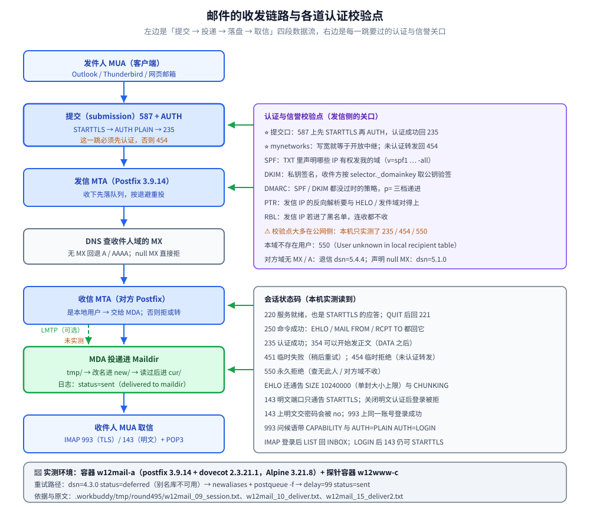

# 邮件服务器

> 覆盖：邮件系统各部件（MUA / MTA / MDA / MRA）的分工，一封邮件从提交到投递的完整链路（SMTP 会话状态码、MX 查找与回退、队列与重试），Postfix 的 `main.cf` / `master.cf` 与提交端口，Dovecot 的认证、邮箱位置与 TLS，Maildir 的目录形态与选型，以及 SPF / DKIM / DMARC 与 PTR 这几道「不被当垃圾邮件」的关口。
>
> 不覆盖：SMTP **协议本身**（命令-应答状态机、`EHLO` 能力协商、`STARTTLS` 后重发 `EHLO`、信封与头两套地址、`DATA` 段点透明性、逐收件人状态码）见 [SMTP.md](../../网络/应用层/SMTP.md)，本篇只讲服务端怎么装怎么配；SPF / DKIM / DMARC 依赖的 DNS 记录总述见 [07-DNS服务器.md](07-DNS服务器.md)；邮件目录的 SELinux 上下文见 [02-主机安全与SELinux.md](02-主机安全与SELinux.md)；服务器统一走密钥登录与端口收敛见 [05-SSH远程连接.md](05-SSH远程连接.md)；对外放行哪些端口的做法见 [04-防火墙与NAT.md](04-防火墙与NAT.md)。
>
> 内容整理自个人学习笔记。**基础框架**参考鸟哥官网《服务器架设篇 - RockyLinux 9》
> （2023-11-30 更新）相关章节（邮件服务器）的读后整理，**按主题归纳而非逐字摘录**。
>
> 素材见 [素材清单](../../../素材清单.md)。
>
> 📎 **实测口径**：本篇的**行为验证**在容器 `w12mail-a`（Alpine 3.21.8，`postfix 3.9.14` + `dovecot 2.3.21.1`，`OpenSSL 3.3.7`）里实跑，SMTP / IMAP 客户端探针跑在同网的另一容器 `w12www-c`；提交会话、投递与退信、队列重试、IMAP 登录各段原文存证 `.workbuddy/tmp/round495/w12mail_09_session.txt`、`w12mail_10_deliver.txt`、`w12mail_12_session2.txt`、`w12mail_15_deliver2.txt`。**未实测**：LMTP 投递（Alpine 的 dovecot 包不含 LMTP 二进制）、真实公网的 MX 投递与 PTR / RBL / DKIM 验签，以及隐式 TLS 的两个端口。

---

## 一、邮件系统由哪些部件组成？

**本节要点**：一封邮件从发件人 MUA 到收件人邮箱，要经过**发信 MTA → 收信 MTA → MDA → 邮箱**四段；SMTP 只管「投递」，IMAP / POP3 才是「取信」。

### 1.1 四个角色分工

| 部件 | 全称 | 干什么 | 常见软件 |
|------|------|--------|----------|
| MUA | Mail User Agent | 用户手里的邮件客户端 | Outlook / Thunderbird / 网页邮箱 |
| MTA | Mail Transfer Agent | 服务器之间用 SMTP 投递邮件 | Postfix / Sendmail / Exim |
| MDA | Mail Delivery Agent | 把收到的信投进用户邮箱目录 | Dovecot-LDA / Procmail |
| MRA | Mail Retrieval Agent | 让客户端用 IMAP / POP3 取信 | Dovecot |

### 1.2 一封邮件的旅程

```text
# 一封邮件的旅程
发件人 MUA
   │  SMTP（提交，常用 587 端口 + 认证）
   ▼
发信 MTA（Postfix）
   │  SMTP（服务器间投递，25 端口）+ DNS 查 MX 记录
   ▼
收信 MTA（对方 Postfix）
   │  交给 MDA 投递
   ▼
收件人邮箱（Maildir / mbox）
   ▲
   │  IMAP（143 / 993）或 POP3（110 / 995）
收件人 MUA
```

### 1.3 端口各管什么

| 端口 | 协议 | 用途 |
|------|------|------|
| 25 | SMTP | 服务器之间投递（**多数云厂商封锁**） |
| 587 | SMTP | 客户端提交发信（需认证，**推荐**） |
| 465 | SMTPS | SMTP over TLS（隐式加密） |
| 143 / 993 | IMAP | 收信，993 为 TLS |
| 110 / 995 | POP3 | 收信，995 为 TLS |

### 1.4 真正的难点是信誉，不是配置

⚠️ 自建邮件服务器的**最大坑不在配置，而在信誉**：云厂商封 25 端口、IP 没有 PTR 记录、域名没有 SPF / DKIM，发出去的邮件基本直接进垃圾箱。生产上「能发出去」比「能收进来」难得多。

---

## 二、一封邮件是怎么走完全程的？

**本节要点**：**提交**（客户端 → 服务器，走 587 并先认证）与**投递**（服务器 → 服务器，走 25 并查 MX）是两段不同的会话；每段都用三位状态码说话，看清码就知道卡在哪一步。

### 2.1 提交与投递是两段会话

发件人 MUA 用 **587** 把信交给本域 MTA，这一跳叫**提交**（submission），必须先认证（隐式 TLS 那一档见 1.3 的端口表）；本域 MTA 再按收件人域的 **MX 记录**，用 **25** 端口把信投给对方 MTA，这一跳叫**投递**（relay）。收件方 MTA 判「这是不是我本地的用户」：是，就交给 MDA 落进 Maildir；不是，就按策略拒收或继续转发。

### 2.2 会话里的状态码怎么读

| 状态码 | 含义 | 出现时机 |
|--------|------|----------|
| `220` | 服务就绪 / 准备开始 TLS | 一连上就收到；发出 `STARTTLS` 后的应答 |
| `250` | 命令成功 | `EHLO` / `MAIL FROM` / `RCPT TO` / `DATA` 结束后的「已收下」 |
| `235` | 认证成功 | 提交口 `AUTH` 通过 |
| `354` | 可以开始发正文 | `DATA` 之后，以单独一行 `.` 结束 |
| `221` | 再见 | `QUIT` 后正常关闭 |
| `451` | 临时失败（稍后重试） | 本地查表临时出错，如别名库不可用 |
| `454` | 临时拒绝 | 未认证客户端请求转发 |
| `550` | 永久拒绝 | 本地查无此人 / 对方域不收信 |

⭐ 记法：**2xx 是「继续」，3xx 是「按我说的继续」，4xx 是「稍后再来」，5xx 是「别再来了」**。本机实测的一段提交会话完整读到 `220 … ESMTP Postfix` → `EHLO` 回一串 `250` → `AUTH PLAIN` 回 `235 2.7.0` → `RCPT TO` 回 `250 2.1.5` → `DATA` 回 `354` → 以 `.` 结束后 `250 2.0.0 Ok: queued as …` → `221 2.0.0 Bye`。原文见 `.workbuddy/tmp/round495/w12mail_09_session.txt`。

### 2.3 MX 记录怎么查、查不到会怎样

给对方域发信前，本域 MTA 先查该域的 **MX** 记录；MX 不存在时按 RFC 回退到该域的 **A / AAAA** 记录（相当于「自己收自己」）。本机实验里 `nonexistent.invalid` 既无 MX 也无 A，投递以 `dsn=5.4.4`、原因 `Host or domain name not found` 退信；`example.net` 声明了 **null MX**（「我不收信」），则以 `dsn=5.1.0`、`Domain example.net does not accept mail (nullMX)` 退信——两者都是**硬失败**，不会无限重试。

### 2.4 队列与重试

投递不是「当场成功或当场放弃」：MTA 收到信先落**队列**，再由投递进程按退避参数**重试**；4xx 类临时失败留在队列里等下次，5xx 类直接退信。本机实验里因为别名库缺失，一封本地信先以 `dsn=4.3.0, status=deferred (alias database unavailable)` 进队列，`postqueue -f` 强制重投后变成 `delay=99 … status=sent (delivered to maildir)`——`delay` 涨到 `99` 就是它躺在队列里的时长。原文见 `.workbuddy/tmp/round495/w12mail_10_deliver.txt` 与 `w12mail_15_deliver2.txt`。

---

## 三、Postfix 怎么配？

**本节要点**：Postfix 是收投核心；`main.cf` 定「给谁投、投给谁」，`master.cf` 定「开哪些服务」；改完必须 `postfix check` + `postfix reload`。

### 3.1 装包与 main.cf

```bash
sudo dnf install -y postfix
sudo systemctl enable --now postfix
```

```text
# /etc/postfix/main.cf（节选）
myhostname = mail.example.com
mydomain   = example.com
myorigin   = $mydomain
inet_interfaces = all          # 监听所有网卡
mydestination = $myhostname, localhost.$mydomain, localhost   # ⭐ 只管这些域，才是「本地投递」
mynetworks = 127.0.0.0/8, 10.0.0.0/8    # 这些来源默认信任（不加认证也能发）
home_mailbox = Maildir/        # 邮箱格式：Maildir 比 mbox 更适合并发

# 对外发信走中转（云环境通常要）
relayhost = [smtp.example.net]:587
smtp_sasl_auth_enable = yes
smtp_sasl_password_maps = hash:/etc/postfix/sasl_passwd
smtp_tls_security_level = encrypt
```

⚠️ `mydestination` 写错是经典事故：把不该本地投递的域写进去（或漏写 `$myhostname`），会导致「发给自己的信被拒」或「本该转发的信被吞」。改完用 `postmap` 处理映射表、`postfix check` 校验，再 `systemctl reload postfix`。

### 3.2 master.cf 与提交端口

Postfix 的每个服务在 `master.cf` 里按「服务名 / 类型 / 私有 / 不信任 / chroot / 唤醒 / 进程上限 / 命令」八列定义；发行版默认就有 25 的 `smtp inet … smtpd` 与 587 的 `submission inet … smtpd`。本机用 `postconf -M/-P` 把 587 打开并叠加提交口专用参数：

```bash
sudo postconf -M 'submission/inet=submission inet n - n - - smtpd'
sudo postconf -P 'submission/inet/smtpd_tls_security_level=encrypt'
sudo postconf -P 'submission/inet/smtpd_sasl_auth_enable=yes'
sudo postconf -P 'submission/inet/smtpd_client_restrictions=permit_sasl_authenticated,reject'
sudo postconf -P 'submission/inet/smtpd_recipient_restrictions=permit_sasl_authenticated,reject'
```

⚠️ `postconf -P` 是**按服务名覆盖参数**、不是改 `main.cf`：这样 587 要求「先认证再收信」，25 保持原有策略，两条互不干扰。改完 `postfix check` 回 rc=0、`postfix reload` 生效。

### 3.3 mynetworks 与开放中继

⭐ **开放中继（open relay）是自建邮件服务器最危险的一种错**：凡是 `RCPT TO` 落在 `mynetworks` 里的来源，**不认证也能通过转发**；把这段写宽，服务器就成了垃圾邮件的跳板。本机实验把 `mynetworks` 收窄成 `127.0.0.0/8`，再让另一个容器 `w12www-c`（`10.77.12.3`，不在该段内）来试：

| 来源与请求 | 结果 |
|---|---|
| `10.77.12.3` 未认证，转发到外域 `bob@nonexistent.invalid` | `454 4.7.1 … Relay access denied` |
| `10.77.12.3` 未认证，发给本域不存在的用户 `nosuch@example.com` | `550 5.1.1 … User unknown in local recipient table` |
| `10.77.12.3` 未认证，发给本域已存在的 `alice@example.com` | `250 2.1.5 Ok` → `354` → `250 2.0.0 Ok: queued as …` |

也就是说，「转发外域」被 `mynetworks` 挡下、「发给本域」才放行；而 `postconf -d mynetworks` 读到的发行版默认值 `127.0.0.0/8 10.77.12.0/24 [::1]/128` 明显更宽——**默认值偏宽就接近开放中继**。原文见 `.workbuddy/tmp/round495/w12mail_12_session2.txt`。

---

## 四、Dovecot 怎么配？

**本节要点**：Dovecot 负责**取信**（IMAP / POP3）与**投递**（LDA / LMTP）；重点是把「认证」「邮箱位置」「TLS」三处配对上，否则客户端永远连不上。

### 4.1 装包与三个关键文件

```bash
sudo dnf install -y dovecot
sudo systemctl enable --now dovecot
```

```text
# /etc/dovecot/dovecot.conf（节选）
protocols = imap pop3 lmtp
listen = *, ::

# /etc/dovecot/conf.d/10-mail.conf
mail_location = maildir:~/Maildir      # ⭐ 必须与 Postfix 的 home_mailbox 一致

# /etc/dovecot/conf.d/10-auth.conf
disable_plaintext_auth = yes
auth_mechanisms = plain login

# /etc/dovecot/conf.d/10-ssl.conf
ssl = required
ssl_cert = </etc/pki/dovecot/certs/dovecot.pem
ssl_key  = </etc/pki/dovecot/private/dovecot.pem
```

### 4.2 IMAP / POP3 / LMTP 各管什么

| 组件 | 干什么 | 关键点 |
|------|--------|--------|
| IMAP | 邮件留在服务器、多端同步 | 默认 143，加密 993 |
| POP3 | 下载后本地保存 | 默认 110，加密 995 |
| LMTP | Postfix 把信交给 Dovecot 投递 | 保证「投递」与「索引」一致 |

### 4.3 认证来源：passdb / userdb

Dovecot 的认证拆成两条链：**passdb** 验密码、**userdb** 查这个用户的邮箱位置与 UID。本机 Alpine 包里默认既没有可用的用户清单、也没有配 `shadow`，于是第一次登录直接失败：

```text
a1 NO [AUTHENTICATIONFAILED] Authentication failed.
```

追加 `passdb { driver = shadow }` 与 `userdb { driver = passwd }`（即**用系统账号验密码**）之后，`993` 上 `a1 LOGIN alice …` 回 `a1 OK … Logged in`，`LIST` 回 `* LIST (\HasNoChildren) "." INBOX`。另一种常见做法是把虚拟用户写进独立的密码文件（`driver = passwd-file`），与系统账号体系解耦。原文见 `.workbuddy/tmp/round495/w12mail_08_dovecot_auth.txt`。

### 4.4 投递用 LMTP 还是本地投递？

Postfix 把信交给 Dovecot 有两条路：**本地投递**（Postfix 自己按 `home_mailbox` 把信写进 Maildir，Dovecot 只负责取信）或 **LMTP / LDA**（交给 Dovecot 投递，让「落盘」与「索引」一致）。后者要写 `mailbox_transport = lmtp:unix:private/dovecot-lmtp`，并在 Dovecot 侧开一个同名的 `unix_listener`。

⚠️ 本机实测时 **Alpine 3.21 的 dovecot 包不含 LMTP 二进制**（`/usr/libexec/dovecot/` 下只有 `imap` / `imap-login` / `dovecot-lda` 等，没有 `lmtp`），所以这段只作**配置示例**、未实测；真正跑通的是本地投递，日志里 `status=sent (delivered to maildir)`。

### 4.5 系统账号还是虚拟用户？

- **系统账号**：`useradd` 建账号、邮箱就是 `~/Maildir`，最省事；代价是「邮件账号 = 系统账号」，与 SSH 登录面重合，扩容与迁移都受系统用户表牵制。
- **虚拟用户**：邮箱与系统账号解耦，用户与密码存在数据库 / 密码文件里，`userdb` 再映射到统一存储路径；适合多域名、多租户，代价是要额外维护映射表。

⚠️ 最常见的坑是 `mail_location` 与 Postfix 的 `home_mailbox` **不一致**：两边各写各的目录，结果「信在服务器上，但客户端看不到」；SELinux 开着时还可能因安全上下文不对而静默丢信（见 [02-主机安全与SELinux.md](02-主机安全与SELinux.md)）。

---

## 五、邮箱格式怎么选、Maildir 目录长什么样？

**本节要点**：**mbox** 把所有信追加进一个文件、加锁竞争重；**Maildir** 一封一封存成独立文件，并发投递与多客户端都更稳，是现代发行版与 Dovecot 的默认推荐。

### 5.1 Maildir 的三个子目录

```text
~/Maildir/
├── tmp/     # 投递中的临时文件，写完再改名搬走
├── new/     # 新到、还没被客户端读过
└── cur/     # 已被读过（文件名后缀带 :2,<flags> 记录已读 / 已回复）
```

⭐ 投递语义是「**先写 `tmp/`、再改名进 `new/`**」——同一文件系统内的改名是原子的，所以客户端不会读到半截文件。本机实测：给 `alice` 投两封信后 `new/` 下正好 2 个文件，文件名形如 `1792211069.V5fIcc42aM846963.6fc99ae6cb27`（时间戳 + 进程 / 主机 + 序号），与「一封一个文件」完全对上。原文见 `.workbuddy/tmp/round495/w12mail_15_deliver2.txt`。

### 5.2 mbox 与 Maildir 怎么选

| 维度 | mbox | Maildir |
|------|------|---------|
| 存储 | 一个文件装所有信 | 一封一个文件 |
| 并发 | 需加锁，竞争重 | 无锁、天然并发 |
| 定位 / 删除 | 要扫描整个文件 | 直接按文件名 |
| 备份 | 单文件好搬 | 文件多，但可增量 |
| 适合 | 少量账号、工具链老 | 现代默认、多客户端 |

---

## 六、怎么防止别人冒名发信？

**本节要点**：三个层级的 DNS 记录——**SPF** 管「哪些 IP 有权发我的信」、**DKIM** 管「信没被篡改」、**DMARC** 管「上面两条失败了怎么办」；三者配合才能让大厂邮箱收下你的信。

### 6.1 三条记录各管一段

| 记录 | 类型 | 作用 | 放在哪 |
|------|------|------|--------|
| SPF | TXT | 声明合法发信 IP 段 | `example.com` 本身 |
| DKIM | TXT | 用私钥签名、公钥验签 | `<selector>._domainkey.example.com` |
| DMARC | TXT | 指定 SPF / DKIM 失败时的策略与报告地址 | `_dmarc.example.com` |

```text
# 三条记录长什么样（示例）
example.com.                    TXT "v=spf1 ip4:203.0.113.10 include:_spf.example.net -all"
default._domainkey.example.com. TXT "v=DKIM1; k=rsa; p=MIGfMA0GCSq..."
_dmarc.example.com.             TXT "v=DMARC1; p=quarantine; rua=mailto:dmarc@example.com"
```

```bash
# 验证三条记录是否生效
dig +short TXT example.com
dig +short TXT default._domainkey.example.com
dig +short TXT _dmarc.example.com

# 发一封测试信到 mail-tester.com，看 SPF / DKIM / DMARC 三项评分
```

### 6.2 PTR 与发信 IP 的信誉

⭐ 收件方除了看 SPF / DKIM / DMARC，还常做**反向解析（PTR）**：发信 IP 有没有对应的域名、这个域名跟 HELO / 信封发件人域对不对得上。云主机默认 IP 往往没有 PTR，于是「能收进来、发不出去」——这正是自建邮件的常见卡点。

⭐ 另一道关口是公共黑名单（**RBL / DNSBL**）：收件方拿发信 IP 去几个公共列表里查，一旦命中就在 SMTP 阶段直接拒收（回 `550`）甚至不建连；被误列时只能去对应列表申请移除。本机环境无法验证真实黑名单的收录与解除，本条只作原理说明。

### 6.3 DKIM 怎么落地

DKIM 是**私钥签名、公钥验签**：MTA 对选定的头与正文算哈希、用私钥签名后追加 `DKIM-Signature` 头；收件方按 `selector._domainkey.<域>` 取公钥验签。落地三步：生成密钥对 → 公钥进 DNS 的 TXT → MTA 配好签名算法与 selector。

### 6.4 DMARC 的三种策略

DMARC 规定「SPF / DKIM 都没过时怎么办」，`p=` 三档递进：

| `p=` | 策略 | 说明 |
|------|------|------|
| `none` | 只报告 | 不拦，先把 `rua=` 报告收起来观察 |
| `quarantine` | 隔离 | 送垃圾箱 |
| `reject` | 拒绝 | 直接不收 |

建议路径是 `none` → `quarantine` → `reject`，每档至少观察一个报告周期再收紧。

⚠️ **`-all` 与 `~all` 的区别**：`-all` 表示「不在列表里的 IP 一律硬拒」，`~all` 是「软拒（标记但收下）」——刚上线建议先用 `~all` 观察报告，确认无误再收紧成 `-all`，否则会误伤自己的正常发信渠道。

---

## 七、发信失败怎么排查？

**本节要点**：四个动作——`mailq` / `postqueue -p` 看队列里有什么、按 `status=` 与 `dsn=` 判断是退信还是重试、`postsuper` 处理卡住的信、`postconf` 调重试节奏。

### 7.1 队列里有什么

```bash
mailq                     # 等价于 postqueue -p，列出队列
postqueue -p
postqueue -f              # 强制重投一次
postsuper -d <queue-id>   # 删掉某一封
postsuper -d ALL          # 清空整个队列（谨慎）
```

本机实验里因为「别名库不可用」，队列一度留下一条 `(alias database unavailable)` 的信；`newaliases` 生成别名库（`/etc/postfix/aliases.lmdb`，12288 字节）后再 `postqueue -f`，队列清空、日志变成 `status=sent`。原文见 `.workbuddy/tmp/round495/w12mail_11_alias.txt` 与 `w12mail_15_deliver2.txt`。

### 7.2 重试参数

| 参数 | 作用 |
|------|------|
| `smtp_connect_timeout` | 连对方 25 端口的超时（调短，别让一个坏目标拖住投递进程） |
| `minimal_backoff_time` / `maximal_backoff_time` | 重试间隔的下限 / 上限 |
| `maximal_queue_lifetime` | 一封信在队列里最多躺多久，超了退信 |
| `bounce_queue_lifetime` | 退信本身的重试生命周期 |

### 7.3 排障速查表

| 症状 | 先查什么 |
|------|----------|
| 队列里堆着一堆信 | `mailq` 看括号里的原因；`status=deferred` 是重试中、`status=bounced` 已退信 |
| 客户端连不上 IMAP | 端口是否在听（`netstat -lnt`）、证书 / TLS 是否配对、`mail_location` 与 `home_mailbox` 是否一致 |
| 登录报 `AUTHENTICATIONFAILED` | `passdb` / `userdb` 配了没有、密码来源对不对 |
| 明文端口登录被拒 | 143 上 `disable_plaintext_auth = yes` 时的正常行为，改用 993 |
| 能收不能发 | `mynetworks` 是否过宽成开放中继、发信 IP 是否有 PTR、SPF / DKIM / DMARC 是否就位 |

---

## 八、应用场景

**本节要点**：邮件服务在现代架构里很少自己从零搭，更多是「内部系统要发通知」和「必须要能收发」两种诉求；下面按「谁在什么场景下用到本篇哪一节」列出来。

| 落地场景 | 这里的哪一节在起作用 | 本仓相关篇目 |
|---|---|---|
| 系统告警 / 通知发信 | 提交口走 587 + 认证，别把 25 暴露给业务（二、三） | [08-WWW服务器.md](08-WWW服务器.md) |
| 审计与找回密码类邮件 | 域名要有 SPF / DKIM / DMARC，否则进垃圾箱（六） | [07-DNS服务器.md](07-DNS服务器.md) |
| 内网自建收信 | Postfix 收投 + Dovecot 取信，两边邮箱路径必须一致（三、四） | [02-主机安全与SELinux.md](02-主机安全与SELinux.md) |
| 客户端多端同步 | 用 IMAP（993）而不是 POP3，邮件留在服务器（4.2） | [05-SSH远程连接.md](05-SSH远程连接.md) |
| 对外只开必要端口 | 提交 587、取信 993，25 按需申请（1.3） | [04-防火墙与NAT.md](04-防火墙与NAT.md) |
| 搬进容器 | 镜像里换掉 `myhostname` / 证书路径，数据卷挂 Maildir（九） | [11-容器化衔接.md](11-容器化衔接.md) |

---

## 九、具体使用

**本节要点**：从装包、配 Postfix / Dovecot、开防火墙到「客户端实测收发 + 检查三项认证」的完整链路。



从图里该读出的是：**同一个端口号在不同跳上含义不同**——587 只收「已认证的客户端提交」，25 才是服务器之间按 MX 投递；下面 ①~④ 的命令分别对应图上这几段，状态码则用来判断卡在哪一步。

```bash
# ① 装 Postfix + Dovecot
sudo dnf install -y postfix dovecot

# ② 配 main.cf / dovecot.conf（上文模板），两边邮箱路径必须一致
#    Postfix: home_mailbox = Maildir/
#    Dovecot: mail_location = maildir:~/Maildir

# ③ 建系统用户（邮件账号即系统账号，最简单）
sudo useradd -m alice
sudo passwd alice

# ④ 校验并启动
sudo postfix check
sudo systemctl enable --now postfix dovecot

# ⑤ 放行端口（对外收信还要 25，取信 993 / 995）
sudo firewall-cmd --add-service=smtp --add-service=imaps --permanent
sudo firewall-cmd --reload

# ⑥ 本地发一封测试信
echo "hello from mail01" | mail -s "test" alice@example.com
tail -f /var/log/maillog        # 看投递日志
```

判据：`/var/log/maillog` 里看到 `status=sent` 表示投递成功；用 `openssl s_client -connect mail01.example.com:993` 能完成 TLS 握手即 IMAP over TLS 通；三条 `dig` 都返回记录说明认证基础就绪。**「能发到公网且不落垃圾箱」还需公网 PTR + 良好发信信誉，本机环境无法验证，如实标注未实测。**

### 9.1 在容器里跑一遍（本机实测）

把上面的 Rocky 命令换成本机的容器版：Postfix + Dovecot 装在 `w12mail-a`，SMTP / IMAP 探针跑在同网的 `w12www-c`。按第 1.3 节的端口分工，本机实测到的监听端口是 25、587、143、993。

```bash
postfix check                       # rc=0，配置语法通过
postfix start                       # 起 25 / 587
dovecot                             # 起 143 / 993
netstat -lnt | grep -E ':25|:587|:143|:993'
```

发信侧的提交会话（节选，省略正文行与 `QUIT`；探针跑在 `w12www-c`）：

```text
S: 220 mail.example.com ESMTP Postfix
C: EHLO client.example.com
S: 250-mail.example.com
S: 250-PIPELINING
S: 250-SIZE 10240000
C: MAIL FROM:<alice@example.com>
S: 250 2.1.0 Ok
C: RCPT TO:<alice@example.com>
S: 250 2.1.5 Ok
C: DATA
S: 354 End data with <CR><LF>.<CR><LF>
S: 250 2.0.0 Ok: queued as CA100CC3EB
S: 221 2.0.0 Bye
```

收信侧 `new/` 下出现两封信、日志给出 `dsn=2.0.0, status=sent (delivered to maildir)`；IMAP 侧 `993` 的问候语是 `* OK [CAPABILITY IMAP4rev1 … AUTH=PLAIN AUTH=LOGIN] Dovecot ready.`，`a1 LOGIN` 后 `a1 OK … Logged in`、`a2 LIST` 回 `* LIST (\HasNoChildren) "." INBOX`。原文见 `.workbuddy/tmp/round495/w12mail_04_smtp.txt`、`w12mail_06_imaps.txt`、`w12mail_08_dovecot_auth.txt`、`w12mail_12_session2.txt`、`w12mail_15_deliver2.txt`。

---

## 延伸追问

- **为什么云厂商默认封 25 端口？**
  → 因为 25 端口是「服务器到服务器投递」的入口，最容易被垃圾邮件发送者利用——攻下一台云主机就能用它狂发垃圾邮件。所以云厂商默认封 25，只放行 587（带认证的客户端提交），并要求你申请解封。这是「信誉机制」的直接体现。
- **SMTP、IMAP、POP3 三者到底谁管什么？**
  → **SMTP 只管「送」**（发送和服务器间传递），**IMAP / POP3 只管「取」**（客户端把信读下来）。所以「发件」和「收件」是两套完全不同的协议与端口，配邮件服务器时要分别打通这两条链路，别再混为一谈。
- **Maildir 和 mbox 怎么选？**
  → **mbox** 把所有信写进一个文件，加锁竞争严重、并发差；**Maildir** 一封一个文件，天然适合并发投递与多客户端，是现代发行版与 Dovecot 的默认推荐。⚠️ 一旦选定，Postfix 与 Dovecot 两边的路径配置必须一致，切换格式要先迁移历史邮件。
- **为什么 143 明文端口登录会被拒？**
  → 因为 Dovecot 默认 `disable_plaintext_auth = yes`：非 TLS 连接上不许明文交密码。本机在 143 上发 `LOGIN` 收到 `* BAD [ALERT] Plaintext authentication not allowed without SSL/TLS…` 与 `a1 NO [PRIVACYREQUIRED] Plaintext authentication disallowed on non-secure (SSL/TLS) connections.`，而同一个账号在 `993` 上直接登录成功——这是**保护**，不是故障；要明文登录就把客户端切到 993。
- **队列里的信能直接删吗？**
  → 删之前先看它为什么留着：`mailq` 括号里写明原因（本机那次是 `alias database unavailable`），先修根因再 `postqueue -f` 重投；确实无望再 `postsuper -d <queue-id>`。⚠️ 4xx（`status=deferred`）是**还会重试**的信，直接删等于把「稍后会成功」的投递掐掉。

---

## 关联

- **上游/总纲**：[README.md](README.md) — 本目录导读：版本坐标与阅读顺序
- **对照/互补**：[07-DNS服务器.md](07-DNS服务器.md) — SPF / DKIM / DMARC 都是 DNS TXT 记录
- **对照/互补**：[08-WWW服务器.md](08-WWW服务器.md) — 同为「对外提供服务」的架设场景
- **下游机制**：[02-主机安全与SELinux.md](02-主机安全与SELinux.md) — 邮件目录的 SELinux 上下文很关键
- **运维/配置**：[05-SSH远程连接.md](05-SSH远程连接.md) — 服务器统一走密钥登录与端口收敛
- **运维/配置**：[04-防火墙与NAT.md](04-防火墙与NAT.md) — 对外只放行 smtp / imaps 的落地口径
- **运维/配置**：[11-容器化衔接.md](11-容器化衔接.md) — 把传统架设搬进容器
