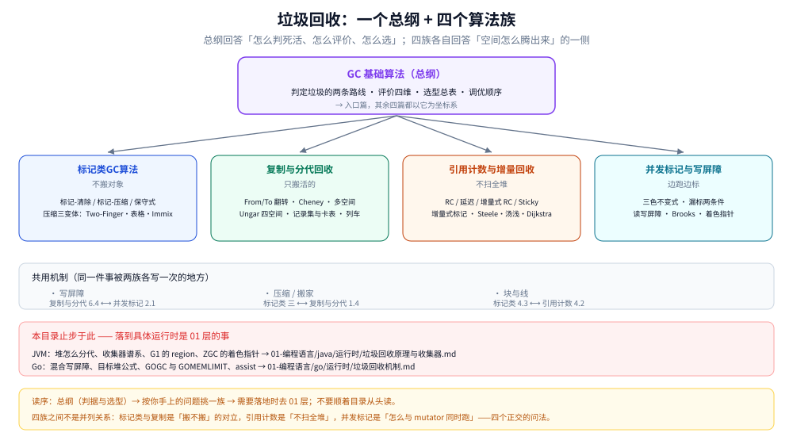

# 垃圾回收

> 覆盖：**语言无关的回收机制**——怎么判定一个对象是垃圾、空间怎么腾出来、代价记在谁头上。
> 一个总纲（判定路线 / 评价四维 / 选型 / 调优）加四个算法族（标记类 / 复制与分代 / 引用计数与增量 / 并发标记与屏障）。
>
> 不覆盖：**落到具体运行时的实现**——JVM 的堆布局与收集器谱系在 [垃圾回收原理与收集器.md](../../01-编程语言/java/运行时/垃圾回收原理与收集器.md)、日志与调参在 [GC调优与日志.md](../../01-编程语言/java/运行时/GC调优与日志.md)、Go 的混合写屏障与 GOGC 在 [垃圾回收机制.md](../../01-编程语言/go/运行时/垃圾回收机制.md)。
>
> 当前 **5 篇散篇**。素材为《垃圾回收的算法与实现》（中村成洋 / 相川光），整理自语雀笔记。

---

## 一、本目录与 01 层怎么分？

**本节要点**：判据只有一条——**这条结论换一个运行时还成立吗**。成立（换成 JVM、Go、V8 都对）→ 本目录；只在某个运行时上成立（`-XX:MaxGCPauseMillis` 怎么调、`GOGC` 怎么算）→ 01 层。

| 归本目录 | 归 01 层 | 为什么会混 |
|---|---|---|
| 「引用计数 vs 可达性分析」两条判定路线、循环引用为什么收不掉 | JVM 为什么最终选可达性分析、`finalize()` 的两次标记实测 | 前者是机制，后者是这个机制的选型理由 |
| 标记-清除 / 复制 / 压缩各自的三笔代价 | Serial Old 为什么是标记-压缩、G1 的 Full GC 为什么也收尾于它 | 一个是算法的账，一个是收集器的组合 |
| 三色不变式、漏标必须同时满足的两个条件 | G1 用 SATB、CMS 用增量更新的具体实现 | 前者任何并发收集器都成立 |
| 卡表 / 记录集 / 记忆集三档的粒度取舍 | HotSpot 的卡为什么是 512 字节、G1 的 Region 记忆集怎么建 | 一个是结构选型，一个是参数落地 |
| 安全点的必要性（根枚举必须停住全场） | `-Xlog:safepoint` 怎么读、到齐时间怎么优化 | 一个是「为什么必须停」，一个是「停了多久」 |
| 吞吐与暂停不可兼得这条主取舍 | 某个 JDK 版本上换五种收集器的实测曲线 | 前者是原理，后者是读数 |

⚠️ **两处最容易被重复写的**：`垃圾回收原理与收集器.md` 与 `垃圾回收机制.md` 的引语里都明确写了「算法层的通用原理见 [垃圾回收/]」——**这条边界是双向确认过的**，改任何一边都要回头看另一边。

## 二、五篇的分工：一个总纲 + 四个算法族

**本节要点**：这五篇不是并列的五篇，而是**一个入口加四个正交的问法**。四个族回答的不是「四个算法的过程」，而是「同一件事的四个侧问」。

图里从上到下三层：顶部是总纲（判定的两条路线、评价四维、选型总表、调优顺序）；中间四张卡片是四个算法族，箭头表示它们都以总纲为坐标系；再往下是「共用机制」带——**写屏障、压缩搬家、块与线这三件事各被两个族写了一次**，改动任一侧都要对另一侧。底部红线是与 01 层的分界，最下一行是读序。

| 篇目 | 它回答的那个问法 | 核心内容 |
|---|---|---|
| [GC基础算法.md](GC基础算法.md) | **怎么判死活、怎么评价、怎么选** | 引用计数与可达性分析两条路线（含三笔结构性代价、根集合的具体化）、四个评价维度、八种算法的选型总表、安全点、调优顺序、与 JVM / Go 收集器的映射 |
| [标记类GC算法.md](标记类GC算法.md) | **不搬动对象，怎么腾出空间** | 标记-清除（两趟、DFS 与 BFS、空闲链表与合并、两笔收益三笔代价）、四个毛病的对症招（多空闲链表 / BiBOP / 延迟清除 / 位图标记）、标记-压缩（Lisp2 三趟）、压缩三变体（Two-Finger / 表格 / Immix）、保守式 GC 与四条准确式化路线 |
| [复制与分代回收.md](复制与分代回收.md) | **只搬活的、只扫年轻的** | From/To 翻转与三指针（灰集合为什么免费）、Cheney 迭代与近似深度优先、多空间复制及其跨块循环垃圾的死角、Lisp2 与间接引用两条付费路线、Ungar 四空间、记录集为什么记源不记目标、卡表与页标记、列车垃圾回收 |
| [引用计数与增量回收.md](引用计数与增量回收.md) | **不扫全堆，也能判死活** | 计数器与三笔代价、环这个结构性盲区、四条「把账延迟」的路线（延迟 RC / 增量式 RC / Sticky 与 1 位 / 部分标记-清除）、增量式标记的三阶段、Steele / 汤浅 / Dijkstra 三条屏障路线的对照表、RC Immix |
| [并发标记与写屏障.md](并发标记与写屏障.md) | **收集器怎么与 mutator 同时跑** | 强三色与弱三色两条不变式、漏标必须同时凑齐的两个条件、浮动垃圾为什么必然、重新标记在两条路线上各扫什么、读屏障与写屏障的拦截点、Brooks 指针与着色指针的元数据位置 |

⚠️ **三条边界纪律**：

1. **算法只写一份**。`标记类GC算法.md` 已经写了标记-压缩的三趟，`复制与分代回收.md` 只在「复制自带压缩」这个语境下引用它，不再解释 Lisp2 是什么。
2. **屏障的完整谱系只在 `并发标记与写屏障.md`**。`复制与分代回收.md` 6.4 只用到「后屏障把卡标脏」这一种，`引用计数与增量回收.md` 3.6 只到 Steele / 汤浅 / Dijkstra 三条，**都不重述读屏障与着色指针**。
3. **落地一律指回 01 层**。本目录不给收集器参数、不给日志字段、不给调优命令的默认值——那些在 `垃圾回收原理与收集器.md` 与 `GC调优与日志.md`。

## 三、与相邻目录的三处接口

| 接口 | 本目录给什么 | 对面给什么 |
|---|---|---|
| [内存分配器.md](../../01-编程语言/go/运行时/内存分配器.md) | 「不压缩时碎片怎么缓解」的机制侧（BiBOP、块与线） | Go 的 mcache/mcentral/sizeclass 分层、span 与 sizeclass 的落地 |
| [内存逃逸.md](../../01-编程语言/go/运行时/内存逃逸.md) | 分配量为什么直接等于 GC 压力 | 逃逸分析怎么把对象留在栈上 |
| [复杂度分析.md](../算法/基础算法/复杂度分析.md) | 「阶段复杂度 × 堆大小 / 存活集大小」的分析对象 | 渐进符号与前导常数的一般方法 |

⭐ **一条容易被忽略的分界**：本目录里所有「成本正比于什么」的说法（复制看存活集、标记看活对象数、清除看堆总量），**都是复杂度层面的定性结论，不含本机读数**。要定量，得去 01 层或自己测。

## 四、读序

**本节要点**：先读总纲建立判据，再按手上的问题挑一族，**不要顺着目录从头读**——四族之间没有先后依赖，只有正交关系。

1. **[GC基础算法.md](GC基础算法.md)** —— 先建立「判定 → 腾空间 → 记账」这条主线的坐标系，并把八种算法的选型总表看成一张地图。
2. 按问题挑一族：
   - 想弄清「为什么不搬对象也能回收」→ [标记类GC算法.md](标记类GC算法.md)
   - 想弄清「新生代为什么都用复制」→ [复制与分代回收.md](复制与分代回收.md)
   - 想弄清「Swift / Python 那种即时回收怎么做的」→ [引用计数与增量回收.md](引用计数与增量回收.md)
   - 想弄清「STW 到底能不能消掉」→ [并发标记与写屏障.md](并发标记与写屏障.md)
3. 需要落到 JVM / Go 的具体收集器时，再回 [垃圾回收原理与收集器.md](../../01-编程语言/java/运行时/垃圾回收原理与收集器.md) 或 [垃圾回收机制.md](../../01-编程语言/go/运行时/垃圾回收机制.md)。

⚠️ 四族之间有三处强关联，读的时候别当孤立篇：

- **标记类 第三节（压缩）⟷ 复制与分代 1.4（复制的代价）**：两者都在回答「搬家要付什么钱」，一个原地挤、一个换空间。
- **复制与分代 6.4（写屏障标脏）⟷ 并发标记 2.x（屏障的完整谱系）**：前者是后者的一个特例。
- **引用计数 3.x（增量式标记）⟷ 并发标记 1.x（三色不变式）**：三色在两边都出现，但一边讲「怎么把 STW 切碎」、一边讲「切碎之后怎么保证不漏标」。

---

## 关联

- [README.md](../../01-编程语言/java/运行时/README.md) — JVM 运行时：堆布局、收集器谱系、GC 日志与调参
- [垃圾回收原理与收集器.md](../../01-编程语言/java/运行时/垃圾回收原理与收集器.md) — 本目录在 JVM 侧的落地（分代、region、SATB、着色指针）
- [垃圾回收机制.md](../../01-编程语言/go/运行时/垃圾回收机制.md) — 本目录在 Go 侧的落地（混合写屏障、不分代不压缩、GOGC）
- [内存分配器.md](../../01-编程语言/go/运行时/内存分配器.md) — 不压缩时靠什么缓解碎片
- [内存逃逸.md](../../01-编程语言/go/运行时/内存逃逸.md) — 分配量从哪来
- [CPU缓存与缓存行.md](../计算机底层原理/缓存与内存/CPU缓存与缓存行.md) — 「复制自带局部性」的硬件前提：存储层次的实测台阶
- [虚拟内存与页缓存.md](../操作系统/虚拟内存与页缓存.md) — 「内存不是一块」这件事在 OS 侧的展开
- [目录.md](../../目录.md) — 全仓知识点索引
