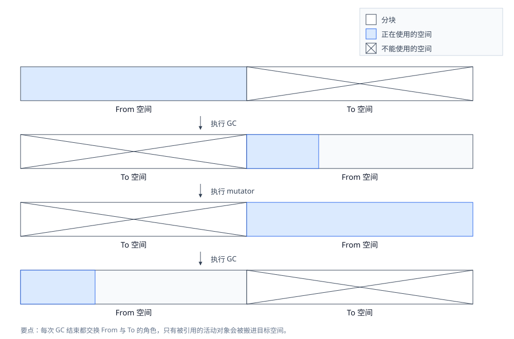
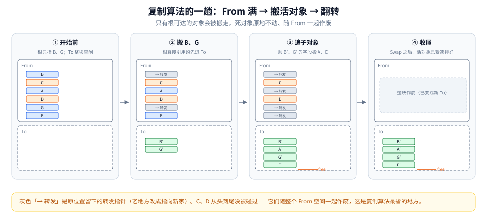
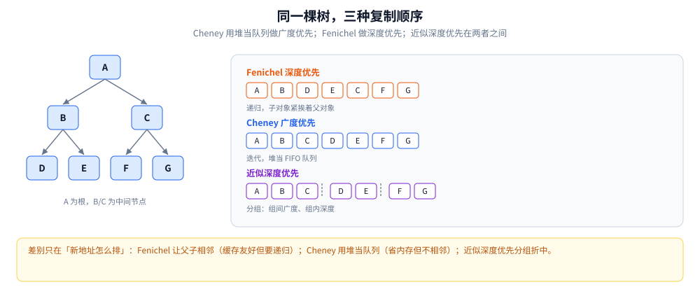
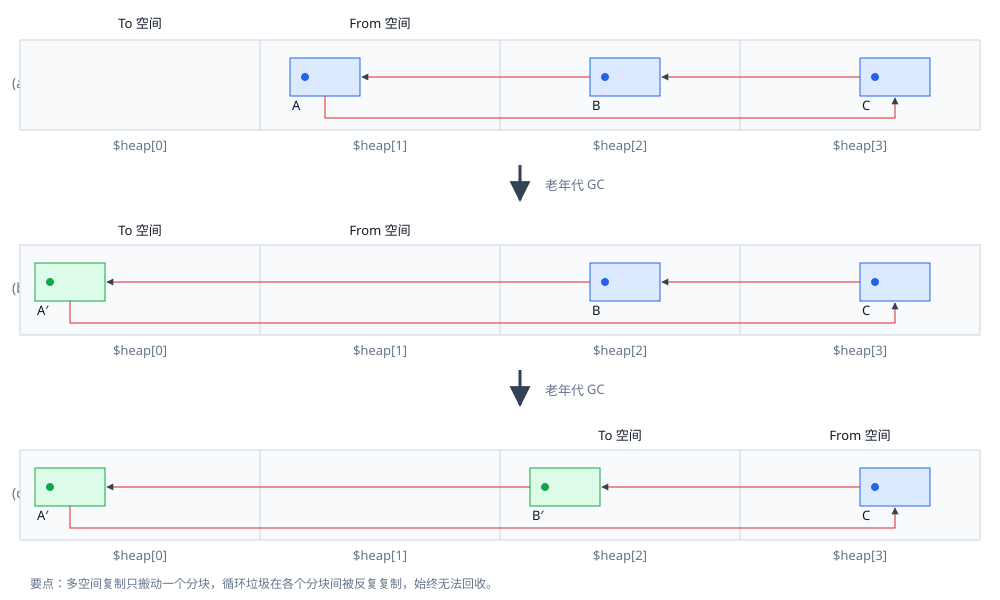
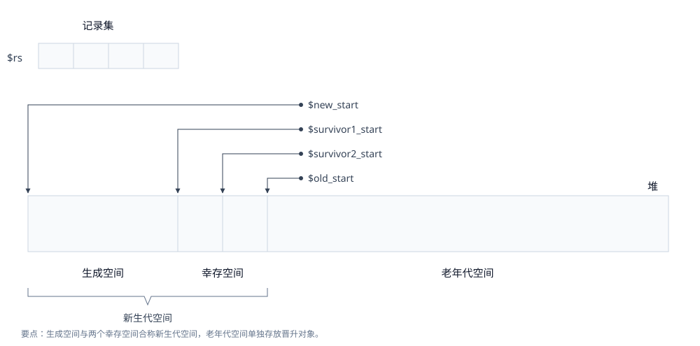
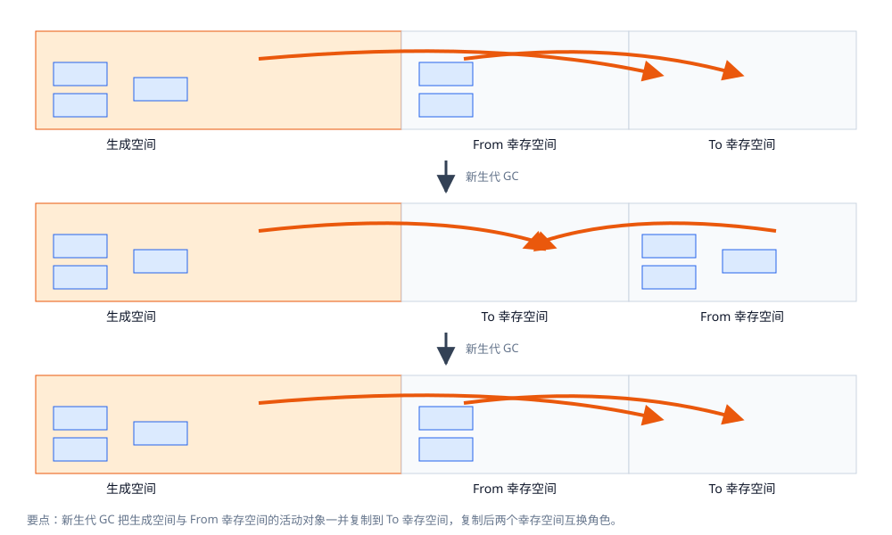
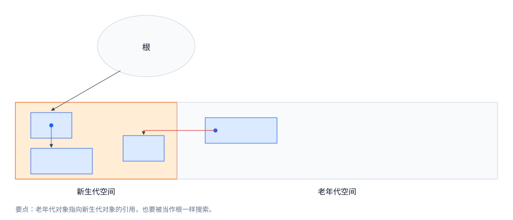
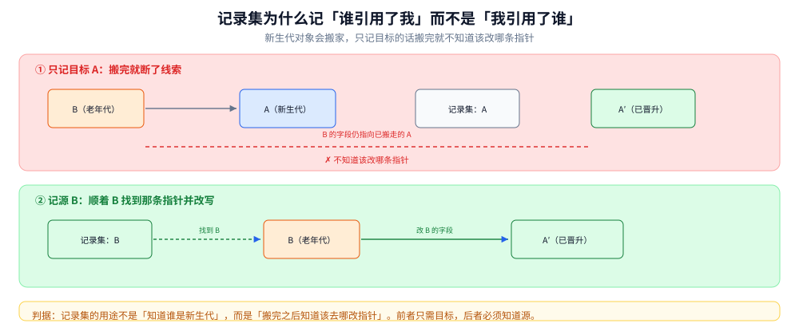
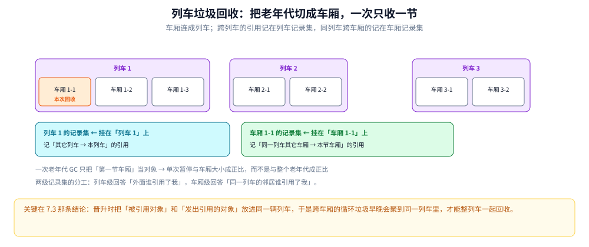

# 复制与分代回收

> 两条「只处理一部分对象」的路线：**复制**（只搬活的，死的整块丢掉）、**分代**（只扫年轻的，老的先不管）。
> 前者的代价是半个堆，后者的代价是跨代引用必须记账——记账结构（记录集 / 卡表 / 记忆集）是这一整条线的技术核心。
>
> 内容整理自语雀笔记，原书为《垃圾回收的算法与实现》（中村成洋 / 相川光）；评价维度与横向选型见 [GC基础算法.md](GC基础算法.md)。

## 一、只搬活对象，凭什么比「找垃圾」快？

GC 复制算法（Copying GC）由 Marvin L. Minsky 于 1963 年提出。说得简单点：只把某个空间里的活动对象复制到其他空间，把原空间里的所有对象全部回收。原空间称为 **From 空间**，粘贴复制对象的新空间称为 **To 空间**。

复制算法利用 From 空间进行分配。当 From 空间被完全占满时，GC 把活动对象全部复制到 To 空间；复制完成后交换两者的角色，GC 就结束了。**From 与 To 大小必须一致**——这是为了保证能把 From 空间中的所有活动对象都收纳进 To 空间。



复制算法把堆二等分为 From 与 To 两个空间，GC 时只把活动对象搬进 To 空间，随后交换两者的角色，未被使用的空间在图中用叉号表示。

### 1.1 一趟复制的四个状态



四个面板是同一趟 GC 的四个状态：根只直接引用 B、G；GC 开始时先把 B、G 搬进 To 空间，并在原位置留下**转发指针**；然后顺着 B′、G′ 的字段继续把 A、E 也搬过来；最后交换 From 与 To，活对象已经紧凑排在同一块里。

两个容易忽略的细节：

- **转发指针是必须的**。原始位置要打上「已复制」标记并留下指向新家的指针，否则同一个对象会被重复复制，且指向它的旧引用无从改写。
- **死对象从头到尾没被碰过**。C、D 从不参与任何一次复制，它们随整个 From 空间一起作废——**这才是复制算法省的地方**，省的不是「标记」，而是「探访死对象」。

书里强调要记住那张收尾图，原因也在这：活对象按 B′、A′、G′、E′ 的紧凑顺序排列，后面所有「压缩自带局部性」的论证都以它为样本。

### 1.2 三指针：灰集合为什么不用另存

半空间复制的实现只需要三个指针，**「待处理集合」就藏在空间布局里**：

```pseudocode
// 半空间复制(Cheney 形态): "未处理区"本身就是灰集合
to_start = to = from_end          // to..free 是 to 空间中已分配区
free     = to_start               // 分配指针(bump pointer)
for (scan = to_start; scan < free; scan = scan + size(obj)) {
    obj = object_at(scan)         // [to_start, free) 区间 = 灰色待扫对象
    for each reference field f of obj {
        if *f ∈ from_space {
            if already_forwarded(*f)  *f = forwarding(*f)
            else {
                new = (*f 复制到 free 端, free 前移)
                (*f 原地留 forwarding 指向 new)
                *f  = new               // 复制即改写, 一遍完成
            }
        }
    }
}
// 循环结束: [to_start, scan) 已处理(黑), [scan, free) 待处理(灰), 白色不在此空间
```

- **为什么灰集合免费**：新复制来的对象天然「自身在场、子引用未追」——正是灰的定义。用空间布局代替显式队列，这是 Cheney 把堆当队列用的精髓。
- **为什么必须一路追下去**：复制一个对象只解决了「它自己在哪」，它字段里指向 From 空间的引用还悬着；追进去改写，直到闭包收敛。等价说法：复制是**把可达集从根开始重新排一遍**，漏追一层就是悬垂指针。
- **对象地址必变**：新地址 = 分配指针推进的位置，由遍历顺序决定。因此**一切引用入口**（根、对象字段、栈上/寄存器里的裸指针）都必须被找出来改写。找不到它们的系统（保守式，见 [标记类GC算法.md](标记类GC算法.md) 第五节）就只能配「不承诺搬家」的算法，或者走间接引用。

### 1.3 它凭什么快：成本正比于存活集

GC 标记-清除消耗的吞吐量，是「搜索活动对象（标记）」加「搜索整体堆（清除）」之和。复制算法**只搜索并复制活动对象**，所以跟一般的标记-清除相比能在更短时间内完成 GC。

**堆越大，差距越明显**：标记-清除的清除阶段耗时不断增加，而复制算法的消耗始终与活动对象数量成正比——它跟堆总量没有直接关系。

三条附带的收益：

- **分配极快**：不使用空闲链表。分块是一整块连续内存，只要它不小于申请大小，移动 `$free` 指针就能分配。对比标记-清除要遍历空闲链表（最坏情况走到底）。
- **不会碎片化**：每次 GC 都顺带做了压缩，所以能安排「分块允许范围内」任意大小的对象。
- **与缓存兼容**：有引用关系的对象被安排在堆里相近的位置（B′ 引用 A′、G′ 引用 E′，就按这个顺序排），mutator 访问更快——**复制自带压缩，压缩自带局部性**。

### 1.4 三笔代价

**① 堆使用效率低下。** 把堆二等分，通常只能用一半。相比能使用整个堆的算法，这是重大缺陷。

**② 不兼容保守式 GC。** 标记-清除不用移动对象，所以能和保守式共存；复制必须移动对象、重写指针，因此天然不相容。

**③ 递归调用函数。** 书中这一版算法在复制某个对象时要递归复制它的子对象，每次复制都要调用函数，这份额外负担不容忽视——迭代算法比递归执行得更快。而且每次递归都消耗栈，**还有栈溢出的可能**。下一节就是为消除这一条而生的。

---

## 二、递归复制会爆栈，有没有不用递归的写法？

### 2.1 Cheney：把堆当队列，迭代代替递归

C. J. Cheney 于 1970 年提出。相比 Fenichel 与 Yochelson 的版本，Cheney 的复制算法**不是递归，而是迭代**。

两者的搜索顺序也不同：Fenichel 与 Yochelson 用**深度优先**，Cheney 用**广度优先**。广度优先需要先进先出（FIFO）的队列——把待搜索对象保持在队列中，一边取出一边搜索。

**收益**：迭代代替递归，抑制了函数调用的额外负担和栈的消耗。**特别是拿堆本身当队列，省去了用于搜索的内存空间**，这一点是它最精妙的地方。

### 2.2 代价：引用关系不再相邻

Fenichel 版本里，有引用关系的对象是**相邻**的，所以能充分利用缓存。而在 Cheney 版本里，有引用关系的对象——也就是 G′ 和 E′、B′ 和 A′——**并不相邻**。

所以不能说 Cheney 兼容缓存，只能说它比标记-清除和引用计数好一些而已。



同一棵树给出三种排法：Fenichel 深度优先让父子相邻（缓存友好但要递归）；Cheney 广度优先用堆当 FIFO 队列（省内存但父子不相邻）；近似深度优先按组切分，组间用广度、组内用深度，是两者的折中。

### 2.3 近似深度优先：两者之间的折中

「近似深度优先搜索方法」的思路是**分组**：把根的直接子对象连同它们的子树切成若干组，组与组之间按广度推进，组内则按深度连续复制。同一组内的对象因此仍然相邻，既保住了部分局部性，又不必递归。

这条折中线的意义在于：**「顺序」和「内存」在复制算法里是一对硬取舍**——要父子相邻就得递归（吃栈），要省栈就得牺牲相邻性。

---

## 三、只用半个堆太浪费，能不能只腾一小块？

### 3.1 多空间复制：N 等分，只腾 1/N

复制算法最大的缺点是只能用半个堆——因为它把整个堆分成两半，每次都要腾出一半。

**多空间复制**把堆 N 等分，对其中 2 块执行复制算法，对剩下的（N−2）块执行标记-清除，也就是把两种算法组合起来用。

**收益**：不再二等分，而是分成更多块，从而更有效地利用堆。以往的复制算法只能用半个堆，多空间复制**只需要空出一个分块**，不能使用的只有 1/N。

**代价**：执行复制的只有 N 等分中的两块，剩下的（N−2）块跑的是标记-清除——于是标记-清除固有的问题（分配耗时、分块碎片化）全都回来了。

### 3.2 它治不了跨块循环垃圾



用多空间复制执行老年代 GC 时一次只搬动一个分块，A、B、C 构成的循环垃圾被分块之间的引用反复搬来搬去，始终无法回收。

具体过程：对象群 A 到 C 形成循环垃圾。把 `$heap[1]` 当 From、`$heap[0]` 当 To 执行多空间复制——虽然 A 本来是垃圾，但因为它被其他块引用了，所以会被当成活动对象复制到 `heap[0]` 去；B、C 也会按顺序被复制过去。

**只要循环垃圾跨了复数个块，多空间复制就只能把「已经成为垃圾的对象群」部分移动，于是再怎么重复执行 GC，也回收不掉这样的垃圾。**

这条局限非常关键，它是后面列车垃圾回收要解决的问题（见 7.3）。

---

## 四、搬完家，指针怎么办？两条付费路线

复制必然改地址，于是「谁付改指针的钱」成了必须选的一边。

| 维度 | Lisp2：前向指针 + 全量更新 | 间接引用：不更新旧引用 |
| --- | --- | --- |
| 旧位置存什么 | 被移走对象的头部留 forwarding 指针（本书要求所有字段都是指针型才放得下，Two-Finger 用域回收缓解了这点） | 句柄表 / 间接 cell 保持地址稳定，对象随便搬 |
| 引用修正 | 复制时顺便改写（如 1.2 的伪代码），或事后再扫一遍全堆（Lisp2 的三步） | 无需修正，旧引用经一跳自动生效 |
| 访问代价 | 修正完成后与不搬家算法无异 | **每次访问多一次跳转**（load 句柄 + load 对象），缓存与寄存器压力上升 |
| 与保守式共存 | 不能（不知道哪是指针） | 能（根只指向稳定的句柄） |
| 代表思路 | Serial / ParNew / G1 的 Evacuation（常见描述，细节以版本文档为准） | Handle 体系；双跳转（to-space 对象再经原位置转发）作为省一遍扫描的变体 |

一句话：**搬家必留 forwarding，区别只在于是谁、在何时、为多少引用付改写的钱**——Lisp2 让 GC 付（一遍扫全堆改引用），间接引用让 mutator 付（每次访问多一跳）。这两条付费路线贯穿了后面并发整理的所有设计。

---

## 五、既然大多数对象朝生夕死，为什么还要扫全堆？

### 5.1 两条假说与一条隐含观察

分代垃圾回收（Generational GC）在对象中导入「年龄」的概念，通过优先回收容易成为垃圾的对象来提高效率。

人们从大量程序里总结出一条经验：「大部分对象在生成后马上就变成了垃圾，很少有对象能活得很久。」分代利用这条经验，让经历过一次 GC 后活下来的对象年龄为 1 岁。

| 假说 | 内容 | 推出什么 |
| --- | --- | --- |
| 弱分代假说 | 绝大多数对象朝生夕死 | 新生代只扫年轻对象就有活可干 |
| 强分代假说 | 熬过越多轮 GC 的对象越难死 | 老年代可以放心少动 |
| 隐含的第三条 | **跨代引用稀少** | 卡表 / 记忆集才划得来 |

第三条最容易漏：**它不成立时（老对象疯狂指向新对象），分代就退化成每次 minor GC 都近乎扫全堆**，优势清零。整个第六节都在为这条隐含假说付账。

### 5.2 Ungar 的四个空间



Ungar 的分代堆一共用 4 个空间：**生成空间**、**2 个大小相等的幸存空间**、**老年代空间**，分别用 `$new_start`、`$survivor1_start`、`$survivor2_start`、`$old_start` 引用其开头。生成空间加幸存空间合称**新生代空间**：新生代对象分配在新生代空间，老年代对象分配在老年代空间。Ungar 论文里把这四者的大小分别设成 **140 KB、28 KB、28 KB 和 940 KB**。

此外还要准备一个和堆不同的数组——**记录集**（remembered set），设为 `$rs`。

**生成空间**是分配对象的空间。它满了就启动新生代 GC，把生成空间中的所有活动对象复制走，道理与复制算法一样，目标空间是幸存空间。

**2 个幸存空间**很像复制算法里的 From / To：平时只用其中一个。每次新生代 GC，活动对象被复制到另一个幸存空间去。正在用的叫 From 幸存空间，没用的叫 To 幸存空间。

不过新生代 GC 也必须复制生成空间里的对象：**生成空间和 From 幸存空间这两个空间里的活动对象都会被复制到 To 幸存空间**。这就是新生代 GC。

只有从一定次数的新生代 GC 中存活下来的对象才会**晋升**——被复制到老年代空间去。

### 5.3 新生代 GC 的复制路径



新生代 GC 把生成空间与 From 幸存空间里的活动对象一起复制到 To 幸存空间，复制完成后两个幸存空间的角色互换。

**幸存空间满了怎么办**：普通的复制算法把空间二等分，即使 From 里的对象都还活着，也确保能把它们收纳到 To 里。但 Ungar 的分代里，To 幸存空间必须同时收纳 From 幸存空间**和**生成空间的活动对象——前者和后者的总大小比 To 幸存空间大，所以活动对象一多就装不下。

发生这种情况时，稳妥起见**只能把老年代空间作为复制的目标空间**。当然，频繁发生的话，分代的优点就淡化了。

### 5.4 老年代指向新生代：必须当根处理



执行新生代 GC 时有一点必须注意：**必须考虑从老年代空间到新生代空间的引用**。新生代对象不只会被根和新生代空间引用，也可能被老年代对象引用。因此除了一般 GC 里的根，还要把**从老年代空间的引用当作根**（像根一样的东西）来处理。

这里就是分代的软肋：分代的优点是只把回收重点放在新生代对象上以缩减时间；但**一考虑从老年代对象的引用，结果还是要搜索堆中的所有对象**，优势被大幅削减。

所以第五节和第六节的结论串起来是：**分代的收益取决于「跨代引用是否真的稀少」，而它不是靠假设成立的，是靠记账结构维持的。**

通过新生代 GC 得到晋升的对象把老年代空间占满后，就要执行老年代 GC。老年代 GC 没什么难的，它只用标记-清除（见 [标记类GC算法.md](标记类GC算法.md)）。

---

## 六、跨代引用怎么记账才划得来？

### 6.1 记录集：为什么记「源」而不是「目标」

记录集用于**高效地寻找从老年代对象到新生代对象的引用**：新生代 GC 时把它看成根，进行搜索，以发现指向新生代空间的指针。



图中上下两半是同一个场景的两种记法。若记录集只记被引用的目标 A，那么 A 晋升成 A′ 之后，**记录集就没有线索去把 B 的指针改写过去**——上半部分那条红虚线就是这个困境。改成记「发出引用的对象 B」之后，就能顺着 B 找到引用目标、把指针更新到晋升后的 A′ 上，指针因此可以顺利改写。

一句话判据：**记录集的用途不是「知道谁是新生代」，而是「搬完之后知道该去哪改指针」。** 前者只需要目标，后者必须知道源。

### 6.2 卡片标记：0.1% 的位表


**卡片标记**把老年代切成等长的卡片，标记表格里每张卡对应一位。GC 时查找位图表格，找到设置了标志位的卡片，就**从卡片开头开始**寻找指向新生代空间的引用。

它的一大特征是**能有效利用内存空间**：每个 128 字节（1024 位）的新生代空间只需要一个位作标记，所以整个位表只需要老年代空间的 1/1024——**多准备老年代 0.1% 的空间就够了**。

此外，无论从老年代指向新生代的引用怎么增加，都**不会发生记录集那样的溢出**。缺点在另一头：位表里设了很多位时，搜索卡片上要花大量时间。**所以卡片标记只有在「局部存在跨代引用」时才好用**——这正是 5.1 第三条隐含假说的直接体现。

### 6.3 页面标记

**页面标记**按页维护**重写标志位**：发生过写入的页面被置位，GC 时置位的页面连同页内对象一起被扫描，从中找出指向新生代的引用。记账粒度比卡片更粗，位表更省，但每次要多扫一整页。

### 6.4 写屏障：后屏障把卡标脏

要把老年代对象记进记录集，靠的是**写入屏障**（write barrier）——在 mutator 更新对象间指针的操作中，它是不可或缺的。

```pseudocode
// 把 ref 字段写入 old 对象后执行
if (new_value 可能位于年轻代) {
    card_index = (uintptr_t)&ref_field >> CARD_SHIFT   // 512B 卡 → 右移 9 位
    card_table[card_index] = DIRTY_VALUE               // 一次字节写
}
// minor GC 时: 脏卡覆盖的内存范围当作"像根一样的东西"扫描
```

屏障本体通常只是「比较 + 一次字节存」（配合「把脏值写成与 0 相反的一端，靠 memset 批量清干净」的技巧，正常路径近乎免费）。真正的成本在**扫描脏卡的补账**：粒度太粗，一张脏卡连带扫过整卡内无关字段；粒度太细，表体本身变大、脏卡分散、缓存不友好。

### 6.5 记账结构的谱系

按「记录粒度」从细到粗：

| 结构 | 记录什么 | 优点 | 缺点 | 出现处 |
| --- | --- | --- | --- | --- |
| 记录集（本书 / Ungar） | 发出引用的对象指针 | 精确 | 需写屏障维护、**可能溢出** | 本书伪代码、Train GC |
| 卡表 | 「这段内存里可能有跨代引用」 | 成本极低、不会溢出 | 扫描时按卡粗化，做废扫 | JVM 各分代收集器 |
| G1 记忆集 | 每 Region 维护「谁引用了我」（卡级粒度的反向索引） | 回收单个 Region 时近乎精确 | 内存占用显著、屏障更重 | G1 |

（「集点表」即本书的**记录集**（remembered set，亦译记忆集），不另造名词。）

---

## 七、分代越多越好吗？

### 7.1 多代的空间账

分代越多，对象变成垃圾的机会越大，确实能减少活到最老代的对象。

但也不能过度增加：**分代越多，每代的空间相应变小，各代之间的引用就变多，各代中 GC 花费的时间也越来越长**。综合来看，少设一些分代能得到更好的吞吐量——据说分为 2 代或 3 代最好。

这条与 5.1 第三条是同一条因果：**分代数 = 「扫得少」与「记得多」之间的权衡参数**。

### 7.2 列车垃圾回收：把老年代切成车厢

列车垃圾回收（Train GC）由 Richard L. Hudson 与 J. Eliot B. Moss 提出。它是为在分代回收中利用老年代 GC 而采用的算法，**目标是控制老年代 GC 中暂停时间的增长**。

老年代空间按一定大小划分，每个划分出来的空间称为**车厢**，由 1 个以上车厢连接成的东西叫**列车**——这就是名字的由来。**1 次老年代 GC 以 1 个车厢作为 GC 对象。**

每个列车和车厢都按产生顺序编号并互相连接，车厢就是以这个顺序作为 GC 对象的。此外要为各列车和车厢准备记录集：**列车的记录集记录来自其他列车的引用，车厢的记录集记录来自同一列车其他车厢的引用**。



老年代按固定大小切成车厢，一节以上连成列车。两级记录集分工明确：列车级回答「外面谁引用了我」，车厢级回答「同一列车的邻居谁引用了我」。**一次老年代 GC 只把第一节车厢当对象**，所以单次暂停与车厢大小成正比，而不是与整个老年代成正比。

通过新生代 GC 晋升时，要准备已有车厢或空车厢，把对象安排在分块里。**各车厢里的分块是单独作为一个连续内存空间存在的**——也就是说这里执行 GC 时也利用了复制算法的原理。

新生代 GC 结束后执行老年代 GC：开头列车的开头车厢是对象。回收后因为那些车厢里只剩垃圾，就把它们作为空车厢保留，供下一次新生代 GC 使用。列车垃圾回收里的对象结构与 Ungar 分代完全一致。

### 7.3 列车为什么能收跨车厢的大垃圾

**收益一：暂停变短。** 一般分代（以 Ungar 为代表）因为把整个老年代当成老年代 GC 的对象，所以老年代 GC 增加了最大暂停时间。列车 GC 一次只把堆中非常小的一部分（车厢）当对象，因此能缩减各次老年代 GC 造成的最大暂停。

**收益二：能回收跨多个车厢的大型循环垃圾。** 这一点不容忽视，也正好补上 3.2 的窟窿。

原因在于**晋升时的安放方针**：要复制的对象要跟**发出引用的对象**安排在同一辆列车上。于是重复执行老年代 GC 的过程中，所有构成垃圾的对象群早晚会被安排到同一辆列车上，最后整列车一起回收。

反例就是 3.2 的多空间复制：它同样能「一次只处理一个块」，但因为没有这条安放方针，跨块的循环垃圾只会被搬来搬去。

### 7.4 记录集溢出与写入屏障的代价

**记录集溢出**：前面讲 `write_barrier()` 时留了一个陷阱——没考虑记录集满了怎么办。

- **新生代空间的记录集满了**：必须执行新生代 GC 来清空新生代空间，否则没法继续分配。
- **老年代某车厢 C 的记录集满了**：麻烦得多。此时 C 不一定是老年代 GC 的对象车厢；就算硬要对 C 执行 GC，也必须考虑 C 前面列车及车厢对它的引用。而且记录集已满，搜索它的时间会比平常更长。

本来记录集满了意味着这个车厢里挤满了被引用数很大的对象——这样的对象很难成为垃圾，每次 GC 都要复制一遍，纯属白干。于是有个办法：**索性把车厢 C 排除到 GC 对象范围之外**。看上去浪费了一节车厢，但考虑到 C 中大多数对象 GC 后都会存活，一开始就不收它可能更划算。

**写入屏障的代价**：列车 GC 执行写入屏障的额外负担比 Ungar 分代更大，所以吞吐量比 Ungar 分代差一些。

还有个前提常被忽略：**列车 GC 以「每个对象都小于一个车厢」为前提**。比车厢大的对象需要安排到新生代与老年代以外的堆，用另一套方法执行 GC。

---

## 八、应用场景：什么时候选复制、什么时候选分代

| 场景 | 选它的理由 | 真实落点 | 要付的账 |
| --- | --- | --- | --- |
| 对象朝生夕死、存活率极低 | 成本只与存活集成正比，越「死得多」越赚 | 所有分代收集器的新生代（Serial / ParNew / Parallel Scavenge / G1 的 Young） | 半个（或 1/N）堆被空着 |
| 需要「分配即移动指针」的极速分配 | bump pointer，无空闲链表遍历 | TLAB 内的分配、Go 的 mspan 内分配 | 分配器要能拿到连续空间 |
| 需要消除碎片且能暂停 | 复制自带压缩 | 老年代的整理型收集器（配合标记-压缩） | 搬运 + 全量改指针 |
| 分配速率高、存活集稳定 | 分代把「高频」与「低频」分开处理 | 绝大多数业务 JVM 服务 | 跨代引用记账 + 写屏障税 |
| 老年代很大、不能容忍长暂停 | 列车把老年代切小 | 实时 / 大堆场景（研究型与部分嵌入式实现） | 屏障更重；大对象需另路处理 |
| 缺少类型信息（C/C++） | —— | **不适用**：复制无法与保守式共存 | 只能退回标记-清除 |

三条判断口径：

- **复制看的是存活率，不是堆大小**。存活率低（新生代）时它几乎白赚；存活率高（老年代）时反复搬运，收益迅速消失——这就是为什么老年代一般不用复制。
- **分代的收益来自「不扫老年代」，而这笔收益随时会被跨代引用吃掉**。跨代引用多到一定程度（例如缓存型负载，老对象频繁指向新对象），分代就该退场。
- **「一次处理多大一块」决定暂停上限**。列车把这一条做到了极致：暂停与车厢大小成正比。但它要求对象小于车厢，且屏障更重。

## 九、具体使用：怎么看出「复制」与「分代」在起作用

这一族现象在日志里比标记类更直接，因为**新生代的每次回收都在日志里单独一行**。

**① 看新生代的复制成本与存活率**（JVM）：

```bash
java -Xlog:gc*:file=gc.log:time,uptime -XX:+UseSerialGC -Xmn64m ...
```

判据：Young GC 的日志行里有 `Eden: 51200K->0K(57344K)` 与 `Survivor: 1024K->1024K` 这样的前后对比。**`->0K` 表示 Eden 被整块清空**——这正是「复制算法不探访死对象」在日志里的样子；而 Survivor 的前后差就是**本次被复制的存活量**，它直接决定这次 Young GC 的耗时。

**② 验证「成本正比于存活集，而不是堆大小」**：

固定存活集、只改 `-Xmn`（新生代大小），观察单次 Young GC 的耗时。若耗时基本不变而**频率**变了，就印证了 1.3 那条结论——**改堆大小改的是频率，不是单次成本**。

**③ 看晋升速率，判断分代假说是否成立**：

日志里 Survivor 每次回收后的占用量若持续上升、随即出现 `Desired survivor size ... bytes, new threshold N (max 15)` 中 threshold 变小，说明对象在**提前变老**——弱分代假说在你的负载上不成立，分代的收益在流失。

**④ 看跨代引用的记账有没有溢出**（G1）：

搜日志中的 `GC remark` 阶段的耗时，以及并发标记里对 dirty card 的重扫量。若重新标记阶段因「脏卡太多」而变长，说明跨代引用密度已经超过 5.1 第三条假说的适用范围。

> **口径说明**：本节四条都是「命令 + 该看什么」的观察路线，**本机未逐条实测**；①②③ 的日志字段随 JDK 版本变化（JDK 9 起统一为 `-Xlog:` 体系），字段名以 `java -Xlog:help` 和对应版本文档为准；`-Xmn` 在有 G1 等分区收集器时语义不同，不要混用。

## 延伸追问

- **复制算法为什么通常比标记-清除快？** → 它把「找垃圾」换成了「找存活」：**代价与存活对象数量成正比，而不是与堆大小成正比**。存活率低时极快（新生代都用它的原因）；但存活率高时会反复搬运，收益迅速消失。
- **「两跳复制」是什么，为什么不能直接改指针？** → 复制后对象地址变了，所有指向它的引用都要改；但**改的时候不能先破坏原对象**（还要靠它继续找其它引用）。所以第一跳先把「新旧地址对应关系」记在转发指针 / 复制保留区里，第二跳再统一按映射修正引用——反过来做会丢引用。
- **分代回收凭什么假设「大部分对象朝生夕死」？** → 来自**弱分代假说**：绝大多数对象生命周期很短（临时变量、中间结果），只有少数活很久。于是新生代做小、用复制算法高频回收，老年代做大、低频回收，整体成本大幅下降。⚠️ 代价是**跨代引用**必须被记录，否则回收新生代时不知道老年代有没有引用它——这就是卡表与写屏障存在的理由。
- **为什么记录集要记「源」而不是「目标」？** → 因为记录集真正要回答的问题是「搬家之后，去哪条指针上做改写」。只知道目标，搬完就失去了指向它的那条边的位置；知道源，才能顺着源对象找到那条字段。
- **列车垃圾回收为什么要「把被引用对象和引用者放进同一列车」？** → 这是它唯一能回收跨车厢循环垃圾的原因。多空间复制同样「一次只处理一块」，但缺了这条安放方针，跨块循环垃圾只会被反复搬运而永远收不掉。

## 关联

- [GC基础算法.md](GC基础算法.md) — 评价维度与横向选型总表
- [标记类GC算法.md](标记类GC算法.md) — 原地标记的两种做法（清除 / 压缩），以及压缩的三种变体（Two-Finger / 表格 / Immix）
- [引用计数与增量回收.md](引用计数与增量回收.md) — 不用标记的两条思路，以及 Immix 与 RC 的结合
- [并发标记与写屏障.md](并发标记与写屏障.md) — 写屏障的完整谱系（本文只用到后屏障的卡表一种）
- [垃圾回收原理与收集器.md](../../01-编程语言/java/运行时/垃圾回收原理与收集器.md) — 分代在 JVM 里的落地、G1 的 region 化与 SATB
- [内存分配器.md](../../01-编程语言/go/运行时/内存分配器.md) — Go 侧的分配器分层（对照 bump pointer 与 TLAB）
- [内存逃逸.md](../../01-编程语言/go/运行时/内存逃逸.md) — 分配量从哪来

> 反向引用（本篇被下列文档引到）：[并发标记与写屏障.md](并发标记与写屏障.md)
