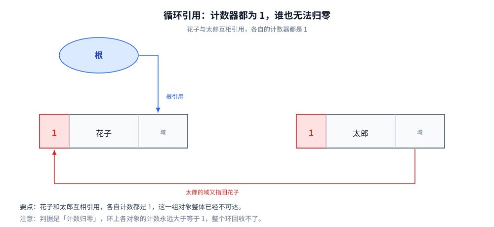
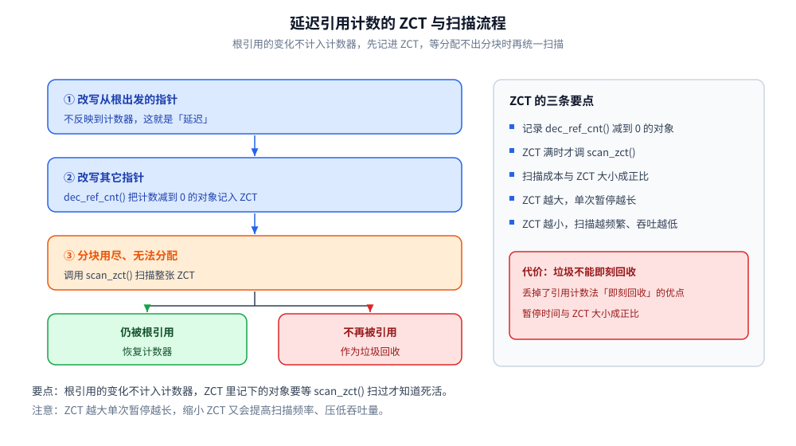
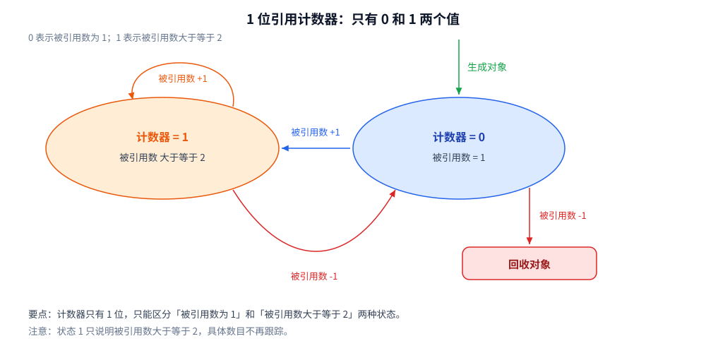
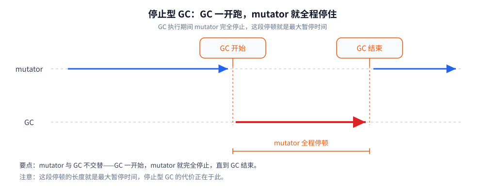
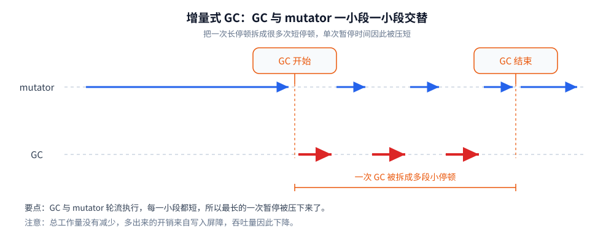
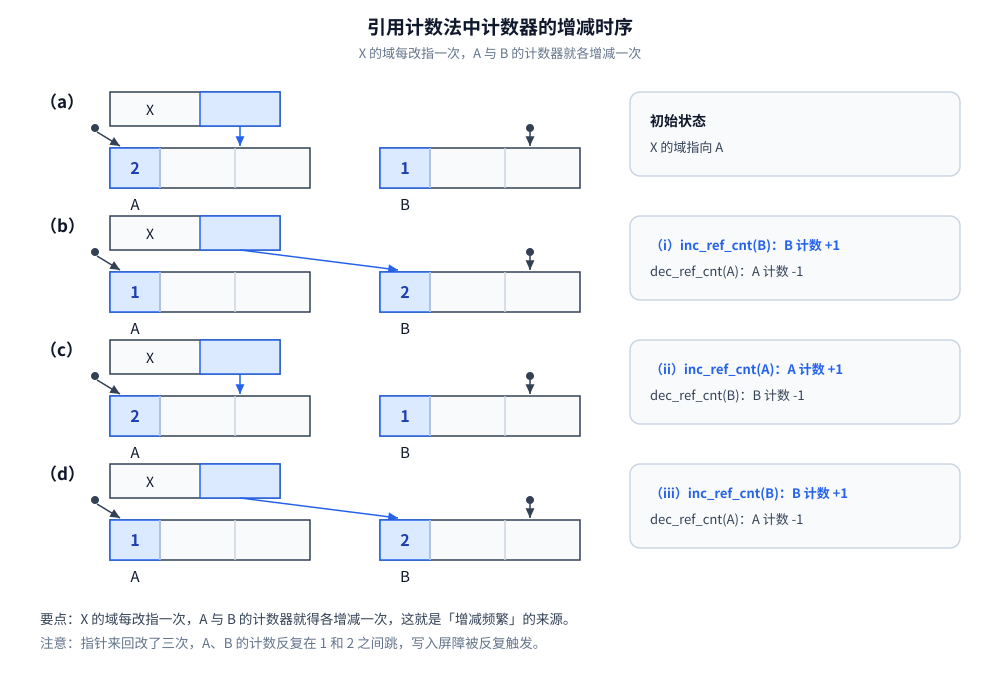

# 引用计数与增量回收

> 三条「把回收摊开」的路线：**引用计数**（让对象自己记账）、**增量式**（把一次 STW 切成许多小段）、**RC Immix**（把两者与块式分配拼起来）。
> 每条路线都按「它想解决什么 → 换来了什么 → 又亏了什么」推演，最后落到各语言的真实实现。
>
> 内容整理自语雀笔记，原书为《垃圾回收的算法与实现》（中村成洋 / 相川光）；评价维度与横向选型见 [GC基础算法.md](GC基础算法.md)。

## 一、不扫全堆，只凭每个对象自己的计数，凭什么判断它是垃圾？

### 1.1 起点：让对象自己知道「没人要我了」

GC 原本是一种「释放怎么都无法被引用的对象的机制」。那么最自然的想法是：让所有对象事先记录下「有多少程序引用自己」。让各对象知道自己的「人气指数」，从而让没有人气的对象自己消失——这就是引用计数法（Reference Counting），George E. Collins 于 1960 年提出。

引用计数法引入的核心概念是**计数器**：它表示有多少程序引用了这个对象（被引用数）。


每个对象在头部多出一个计数器，图里它的值是 1，表示有一个程序正引用这个对象；剩下的部分才是对象自己的**域**。代价是每个对象都要为计数器留出空间，位宽还必须够大，否则数不完所有引用。

### 1.2 记账规则：一次赋值为什么被放大成三步

在变更数组元素等的时候会进行指针的更新。通过更新指针，可能会产生没有被任何程序引用的垃圾对象。

引用计数法**监督在更新指针的时候是否有产生垃圾**，从而在产生垃圾时将其立刻回收。也就是说，这意味着在分配时没有分块的情况下，堆中所有的对象都为活动对象，这时没法新分配对象。另一方面，GC 标记-清除算法即使产生了垃圾也不会将其马上回收，只会在没有分块的时候将垃圾一并回收。

所以「把内存管理和 mutator 同时运行」正是引用计数法的一大特征——它没有独立的「回收阶段」，回收**寄生在每一次写入里**。

这一步直接决定了后面所有的账：因为回收寄生在写入里，所以它的成本正比于**引用改动次数**，而不是存活对象数。

### 1.3 它换来的三件事

**① 可即刻回收垃圾**

每个对象始终都知道自己的被引用数。当被引用数的值为 0 时，对象马上就会把自己作为空闲空间连接到空闲链表——**在变成垃圾的同时立刻被回收**。意义在于：内存空间不会被垃圾占领，垃圾全部都已连接到空闲链表，能作为分块再被利用。

对照其他 GC 算法：即使对象变成了垃圾，程序也无法立刻判别；只有当分块用尽后 GC 开始执行时，才能知道哪个是垃圾。也就是说，直到 GC 执行之前，都会有一部分内存空间被垃圾占用。

**② 最大暂停时间短**

只有当通过 mutator 更新指针时程序才会执行垃圾回收。每次通过 mutator 生成垃圾时这部分垃圾都会被回收，因而大幅削减了 mutator 的最大暂停时间。

**③ 没有必要沿指针查找**

和 GC 标记-清除算法不一样，它没必要由根沿指针查找。当想减少沿指针查找的次数时它就派上用场了：分布式环境中沿各计算节点之间的指针查找成本很高，因此需要极力控制查找次数。有一种做法就是——**在各个计算节点内回收垃圾时用 GC 标记-清除，处理节点间引用关系时用引用计数**。

### 1.4 三笔躲不掉的代价

**① 计数器值的增减处理繁重**

依据 mutator 的动作不同而略有差距，但在大多数情况下指针都会频繁更新。特别是有根的指针，会以近乎令人目眩的势头飞速更新——因为根可以通过 mutator 直接被引用。每当指针更新时计数器都要随之更新，因此增减处理必然繁重。

**② 计数器需要占用很多位**

计数器最大必须能数完堆中所有对象的引用数。假如用的是 32 位机器，就有可能有 2³² 个对象同时引用一个对象，于是各对象的计数器必须留 32 位。假如对象只有 2 个域，那么计数器就占了整体的 1/3——这是真实存在的空间税。

**③ 实现烦琐复杂**

算法本身简单，但实现起来不容易。进行指针更新操作的 `update_ptr()` 函数是在 mutator 这边调用的：需要把以往写成 `*ptr=obj` 的地方都重写成 `update_ptr(ptr, obj)`。调用点非常多，重写过程中**很容易出现遗漏**；漏掉一处，内存管理就无法正确进行。

### 1.5 环：局部判决唯一收不掉的东西



两个对象互相引用，于是各对象的计数器值都是 1，但它们并没有被其他任何对象引用。花子与太郎这个环整体成了垃圾，回收判据「计数归零」却永远达不到——**局部判决看不到「整组不可达」这件事**。

这是引用计数的结构性盲区：判决只看对象自己那一格计数，而「这个环是否还连着根」是一个全局性质。绕开它只有两条路——外挂一个环检测器（Python 的 `gc` 模块就是），或者把判决某一段交回给追踪式 GC（下面 2.5 的部分标记-清除）。

---

## 二、把计数攒起来算，能换回多少吞吐？

1.4 的第一笔代价是「增减繁重」。这一节的四条路线都在做同一件事：**想办法不逐次记账**——区别只在于「把账延迟到哪里」。

### 2.1 延迟引用计数：根上的改动为什么不记

延迟引用计数法（Deferred Reference Counting）由 L. Peter Deutsch 和 Daniel G. Bobrow 提出。思路：既然「计数器增减繁重」的原因之一是**从根的引用变化频繁**，那就让从根引用的指针变化**不反映在计数器上**——把重写全局变量指针的 `update_ptr($ptr, obj)` 改写成 `*$ptr=obj`。

收益是减轻了因根引用频繁变化而导致的计数器增减负担。

代价有两条：

- **垃圾不能马上回收**，会压迫堆——失去了「可即刻回收」这个最大优点；
- **`scan_zct()` 的暂停变长**：执行时间与 ZCT 的大小成正比，ZCT 越大要搜索的对象越多。想缩短单次暂停就缩小 ZCT，但那样调用频率上升、压低吞吐量——**本末倒置**。

### 2.2 ZCT 与 scan_zct：什么时候才真去算

延迟引用计数法用 ZCT（Zero Count Table）记录在 `dec_ref_cnt()` 作用下计数器变为 0 的对象。



整条流程只有三步：改写从根出发的指针时**不计数**，改写其它指针时把计数减到 0 的对象丢进 ZCT，直到分块用尽、分配不出来，才调 `scan_zct()` 把整张 ZCT 扫一遍。扫的时候仍被根引用的对象要恢复计数器，其余才真正回收——**代价就是垃圾不能即刻回收，而且扫描的暂停长度与 ZCT 大小成正比**。

### 2.3 增量式 RC：把计数拆成内外两层

延迟引用计数按「引用从哪来」延迟（根上的不记），Bacon & Rajan 的**增量式 RC** 换了个切法——按「引用在不在同一个块里」延迟：

- **把一格计数拆成两格**：每块维护**外部引用数**（块外指向块内的总数）加**内部引用数**（块内互指的总数）。
- **块内指针怎么折腾，屏障只做两个计数器之间的 ±1 搬运**——O(1)，与块内对象的引用次数脱耦。这是它相对 2.1 的关键差别：延迟引用计数把「根上的改动」攒起来，增量式 RC 把「块内的改动」压成一个数。
- **外部计数归零时才做试探删除**：把块内对象互相减一遍，剩下的才可能是真根；若试探后仍有活对象（外部其实没断），整块复活。所以它是「先假设这一块全死、再证伪」的路线。

这条路线与 1.5 的结论正面相关：**块内互指的环，在块内计数里根本不构成问题**——环上那些计数都落在内部那一格里，外部计数归零时整块一起被扫，环自然被拆掉。代价是把精确计数换成分层近似：任何一次跨块的引用变动，都要在两个计数器之间搬运，且块划分的粒度决定了这份近似的粗细。

### 2.4 Sticky 与 1 位计数：把位宽压到极限

**Sticky 引用计数法**针对的是 1.4 的第二笔代价（位宽）。假设计数器只有 5 位，最多数到 31；对象被超过 31 个对象引用就溢出——**跟车辆速度计的指针爆表是一个状况**。

对溢出（爆表）的对象要暂停计数管理，主要两种办法。其一**使用 GC 标记-清除算法进行管理**，这种变体与教科书版有三点不同：

1. 一开始就把所有对象的计数器值设为 0；
2. 不标记对象，而是对计数器进行增量操作；
3. 为了对计数器进行增量操作，算法对活动对象进行了不止一次的搜索。

这样把引用计数与标记-清除结合后，计数器溢出后即使对象成了垃圾也能回收，**此外还能回收循环垃圾**——顺带补上了 1.5 的盲区。

**1 位引用计数法**（1bit Reference Counting）是 Sticky 的极端例子：计数器只有 1 位，瞬间溢出，看上去几乎没意义。但据 Douglas W. Clark 和 C. Cordell Green 的观察，「几乎没有对象是被共有的，所有对象都能被马上回收」——用 0 表示被引用数为 1、1 表示被引用数 ≥2，也能有效率地管理内存。



0 表示被引用数为 1，1 表示被引用数大于等于 2。对象刚生成时计数为 0；被别人引用就跳到 1，再被别人引用仍停在 1（只加不减到不了 0）；反过来引用数减回 1 就退回 0，从 0 再减就意味着没人引用了，对象被回收。

优点是**不容易出现高速缓存缺失**：1 位计数器让对象头极小，对象排布更密。缺点跟 Sticky 一样——必须处理计数器溢出的对象。据 Clark 和 Green 的观测，很多对象的计数器值都不足 2；若这个前提成立，把溢出对象放置不管也没什么坏处。但**没法保证 mutator 能一直顺利运行**，很可能出现大量溢出对象（内存管理范围之外的对象），给堆带来巨大负担，于是很难保证分块。

### 2.5 部分标记-清除：只对可能成环的对象群动手

思路：**只对「可能有循环引用的对象群」使用 GC 标记-清除算法，其他对象仍用引用计数**。

它的特征是「要涂色的对象」和「要进行计数器减量的对象」**不是同一个对象**——据此可以很顺利地回收循环垃圾。优点是**把搜索对象限定在阴影对象及其子对象**，也就是「可能是循环垃圾的对象群」。

局限也很明确：从队列搜索对象的成本太大。被队列记录的对象毕竟是候选垃圾，要搜索的对象绝对不在少数——总计要查找 3 次对象，对从队列取出的阴影对象分别执行 `mark_gray()`、`scan_gray()`、`collect_white()`。这大大增加了内存管理时间；更糟的是，搜索对象**害得「最大暂停时间短」这个优点荡然无存**。

这条局限值得记住：**引用计数的优点之一是停顿分散，任何「回头补扫」的机制都会把这份优点还回去一部分**。后面 4.x 的 RC Immix 也是在同一处做权衡。

---

## 三、增量式回收：为什么把 STW 切碎就够，不必真并发？

### 3.1 停止型 GC 的问题在哪

增量式垃圾回收（Incremental GC）是一种通过逐渐推进垃圾回收来控制 mutator 最大暂停时间的方法。

通常的 GC 处理很繁重，一旦开始执行，不多久 mutator 就没法执行——GC 本来是从事幕后工作的，却一下子嚣张起来，害得 mutator 这个主角没法发挥作用。这种执行时害得 mutator 完全停止运行的 GC 叫**停止型 GC**。



横虚线是 mutator 与 GC 的时间轴。GC 一开始，mutator 那条蓝线就断了，直到 GC 结束才续上；两条橙色虚线夹出来的空白区间就是一次完整的暂停。停止型 GC 的暂停长度取决于整轮 GC 有多久，这也正是它最要命的地方。

根据应用程序的用途不同，有时停止型 GC 是很要命的。于是有了增量式：增量（incremental）这个词有「慢慢发生变化」的意思，增量式垃圾回收就是**将 GC 和 mutator 一点点交替运行**的手法。



同一条时间轴上，mutator 与 GC 变成一段一段交替推进：GC 被切成若干小段插入 mutator 的运行间隙。总工作量并没有减少，但任何一段连续的 GC 都变短了，所以最大暂停时间被压了下来。

### 3.2 三色标记：描述搜索进度的工具

描述增量式垃圾回收时有个方便的概念——Dijkstra 等人提出的**三色标记算法**（Tri-color marking）。它把 GC 中的对象按各自情况分成三种：

- 白色：还未搜索过的对象
- 灰色：正在搜索的对象
- 黑色：搜索完成的对象

GC 开始运行前所有对象都是白色。GC 一开始运行，所有从根能到达的对象都会被标记、被堆到栈里；GC 只是发现了这样的对象但还没搜索完，所以它们成了**灰色**。灰色对象会被依次从栈中取出，其子对象也被涂成灰色；当所有子对象都被涂成灰色时，对象就被涂成**黑色**。

当 GC 结束时已经不存在灰色对象，活动对象全部为黑色，垃圾则为白色。

> 注意这里的内核：**颜色不改变对象本身，它只是在描述「这个对象被搜索到哪一步了」**。这也解释了为什么三色能支撑并发——它是一个可以被随时检验的进度标记（正确性约束见 [并发标记与写屏障.md](并发标记与写屏障.md) 第一节）。

### 3.3 增量式标记-清除的三个阶段

增量式的 GC 标记-清除算法可分为三个阶段：

- **根查找阶段**：把能直接从根引用的对象涂成灰色；
- **标记阶段**：查找灰色对象，将其子对象也涂成灰色，查找结束后将灰色对象涂成黑色；
- **清除阶段**：查找堆，将白色对象连接到空闲链表，将黑色对象变回白色。


三张分图共用同一份堆：根直接引用的 B、C 在根查找阶段被涂灰；标记阶段把子对象 D 也拉进来，结束时可达对象全黑，E 仍是白色；清除阶段把白色的 E 连到空闲链表，再把黑对象统一改回白色。

### 3.4 它换来了什么、又亏了什么

**换来的：缩短最大暂停时间。** 它不是一口气运行 GC，而是和 mutator 交替运行，因此不会长时间妨碍 mutator。它适合那些相比吞吐量**更重视缩短最大暂停时间**的应用。

**亏掉的：吞吐量下降。** 只要用到写入屏障就会增加额外负担。在分代垃圾回收里，我们还能盼着通过缩短 GC 时间来抵消写入屏障的开销；但在增量式 GC 里不用想——目的本来就是缩短最大暂停时间，所以要有一份牺牲的心理准备。

这条取舍是后面所有并发收集器的母题：**停顿与吞吐不是可以同时优化的两个指标，而是同一笔预算的两端**。

### 3.5 三条路线：Steele / 汤浅 / Dijkstra 各拦哪一刻

- **Dijkstra 插入式**：拦在写入处，把**新加入**引用的目标直接涂灰。维护**强三色**。
- **Steele 的算法**（1977，论文名 *Deletion*，面向实时 Lisp 系统）：**前写屏障 + 删除式记录**。mutator 每次要覆盖指针字段，屏障先斩后奏地把**即将被删除的旧引用**记入一个类似记录集的集合，然后才真正执行写入。被删掉的路径因此「留了底」，白色对象虽失去灰侧的正常引用，仍可从该集合重新被标记——维持**弱三色**。代价是这个集合里的对象之后必须**重新扫描**，这笔账最终记在暂停或后续增量步里。它的思想直接影响了后来 CMS 一系「并发标记 + 停下补扫」的设计。
- **汤浅的算法**（Yuasa，1990）：同样拦「删除引用」这一侧，但更果断——写屏障触发时**当场把被覆盖旧值所指向的对象「冻结」**（直接标成已保护的颜色），不给它留「以后再扫」的尾巴，所以基本免除大范围重扫。手法在文献里叫 freeze-on-attempt（尝试删除即冻结），Boehm GC 的 YUA（Yuasa's Unicolor Accumulator）是它的工程化后代。注意两点：① 汤浅原文的颜色语义与现在通行的「白=未标、黑=完成」**相反**（原文是「从全黑开始、把疑似垃圾标灰」），读原始文献时极易混淆；② 冻结是**单向**的，当场保护的对象哪怕是垃圾也要留到下一轮，等于用更多浮动垃圾换更小的重扫成本。


Dijkstra 的插入式拦在写入处，把新加入引用的目标直接涂灰；Steele 与汤浅都拦在写入前，但前者只把旧引用目标记进记录集、留待重扫，后者当场把旧值目标冻结，因而基本免去重扫。三者维护的不变式因此分成强三色与弱三色两路。

### 3.6 屏障对照表：拦哪条边决定了一切

把本篇与下一篇出现的屏障放到一张表里对照（「拦哪条边」是理解一切变体的钥匙）：

| 屏障 | 拦截时机 | 保护对象 | 维护的不变式 | 重标记要不要重扫 | 代表 |
| --- | --- | --- | --- | --- | --- |
| 分代写屏障 | 写入**后**（后屏障） | 记下"写了指向年轻对象引用的老年对象" | 与三色无关（跨代记账） | 不需要，记录集/卡表直接当根 | Ungar 分代、JVM 卡表 |
| Steele（删除式） | 写入**前**（前屏障） | 被删除旧引用的目标对象（入集合待扫） | 弱三色 | **要**（重扫记录集） | 增量式回收 |
| 汤浅（freeze-on-attempt） | 写入**前** | 被删除旧值的目标，当场冻结 | 弱三色（保守化） | 基本不要 | Boehm GC（YUA） |
| Dijkstra 插入式 | 写入处 | **新加入**引用的目标染灰 | 强三色 | 不要，但"新分配对象"要特殊配合 | 教科书方案 |
| Shaston | 写入前 | 仅当"目标黑、新值白"时保护新值 | 强三色 | 不要 | IBM J9（snapshot within） |
| SATB（原始快照） | 写入**前** | 被覆盖的旧值记入缓冲区，由标记线程消化 | 弱三色 / 快照成立时点 | 不要重扫黑对象，只消化缓冲 | G1、Shenandoah |
| 增量更新 | 写入**前** | 记下字段被改的**黑对象**本身 | 强三色（暂时破坏、延后修复） | **要**（重扫被记录的黑对象） | CMS |
| 读屏障 | **读取**指针时 | 使用旧引用的现场（修正/拦截） | 与三色无关（多用于并发移动） | — | ZGC、（早期）Azul C4 |

细节以各收集器官方文档为准；本表只主张一点：**屏障的名字不重要，「在写发生前还是后、保护新边还是旧边」才决定它维护哪种不变式、留下什么代价**。

---

## 四、RC Immix 凭什么把引用计数拉回实用级？

RC Immix 把引用计数法的一大缺点——吞吐量低——改善到了实用级别。它由「合并型引用计数法」（Coalesced Reference Counting）与前面介绍的 Immix 组合而成。

### 4.1 合并型引用计数：让增减相互抵消

在吞吐量方面引用计数法比不上搜索型 GC，原因之一就是「计数器增减频繁」。



四个分图画的是同一个过程：X 的域先指向 A，再改指 B，之后又指回 A、再指回 B。每改一次，被丢掉的旧引用要让目标计数减 1，新接上的引用要让目标计数加 1，于是 A、B 的计数就在 1 和 2 之间来回跳三次。

由此可知：**比起一直保持计数器的正确状态，通过使增量和减量互相抵消，更能有效地管理计数器**。

把注意力放在某一时期最初和最后的状态上，在该期间内不进行计数器增减——这就是**合并型引用计数法**。即使指针发生改动，计数器也不增减；指针改动的信息被注册到**更改缓冲区**（Modified Buffer）。

这样会导致有一段时间计数器值是错误的，而这跟 2.1 的延迟引用计数法没什么两样：延迟引用计数法在 ZCT 满了时要查找 ZCT、重新正确设置计数器。合并型引用计数法则把**指针发生改动的对象和其所有子对象**注册到更改缓冲区，这项操作也通过写入屏障执行；因为不更新计数器，所以计数器保持错误的值。

### 4.2 块与线：为什么一条线里有一个活对象就整条不回收

在以往的合并型引用计数法中，通过查找更改缓冲区，计数器值为 0 的对象会被连接到空闲链表，为之后的分配做准备——可见和单纯的引用计数法一样。

RC Immix 的第二个改动是**撤除空闲链表**：以**线**为单位管理分块，只要在线内移动指针就可以分配，还省去了把分块重新连接到空闲链表的处理。这就是它在分配侧变快的原因（Immix 本身的设计见 [标记类GC算法.md](标记类GC算法.md) 4.3 的块与线划分）。

代价是**回收粒度变粗**：只要线内还有一个非垃圾对象（线的计数为 1），整条线都无法回收，会白白消耗大部分线。

### 4.3 收益与残留代价

**收益**：据论文记载，与以往的引用计数法相比吞吐量**平均提升了 12%**；根据基准测试程序的情况，甚至会超过搜索型 GC。原因有两个——① 导入合并型引用计数法，不再通过写入屏障执行计数器增减，引用关系频繁变化也不会大幅掉吞吐；② 撤除空闲链表，分配只需在线内移动指针。

**残留代价**：① 和合并型引用计数法一样会增加暂停时间（查找更改缓冲区时要暂停 mutator），可调缓冲区大小，但缓冲区小就换不到吞吐；② 4.2 那条线的残留问题——线内只要有活对象就整条不回收。

这两条恰好说明它为什么在工业界罕见：**它把「逐次记账」的税换成了「批量对账」的税，又把「碎片」的税换成了「块内残留」的税**，两笔都没消掉，只是换了付款方式。

---

## 五、应用场景：什么时候真的会用「不扫全堆」

| 场景 | 选它的理由 | 真实落点 | 注意 |
| --- | --- | --- | --- |
| 分布式 / 跨进程的引用管理 | 不必沿指针跨节点遍历，判决是局部的 | 各计算节点内用标记-清除、节点间引用用 RC | 跨节点环收不掉，需要协议级兜底 |
| 单机但要求「即时释放」 | 对象一归零立刻回收，内存不被垃圾占着 | Swift / ObjC 的 ARC、C++ 的 `shared_ptr` | 环必须靠 `weak` / `unowned` 手动打断 |
| 通用脚本语言 | 实现简单、可与标记-清除互补 | Python（RC 主策略 + `gc` 模块收环）、PHP（refcount + 周期收集器） | 环收集器是必需的，不是可选项 |
| 实时性敏感、对象图小 | 停顿分散且可解释，没有全局同步周期 | 嵌入式 / 游戏引擎的部分子系统 | 深链析构会一次性拖长释放时间 |
| 增量式 / 并发收集 | 把 STW 切碎以压最大暂停 | CMS、G1 的并发标记阶段（思想层面的祖先） | 总吞吐必然下降 |

三条判断口径：

- **对象图越「局部」越适合 RC**：跨节点、跨进程的引用如果用追踪式，遍历成本随图规模涨；RC 的判决只看自己那一格。
- **有环就必须配一个「回头扫」的机制**：要么专门的环收集器（Python），要么部分标记-清除（2.4），要么语言层强制 `weak`（Swift / Rust）。没有例外。
- **RC 不适合「分配极密、存活极少」的后端服务**：这类负载下大量对象还没死就先付了记账钱，正是追踪式赢下来的地方（见 [GC基础算法.md](GC基础算法.md) 1.3 的对照表）。

## 六、具体使用：怎么看见计数器在动

引用计数最大的好处是**可观测**——计数器就在对象头上，不需要等一次 GC 就能看到它变。

**① 直接读计数器**（Python）：

```python
import sys, gc
a = []
print(sys.getrefcount(a))   # 注意：传参本身会 +1，所以「独占」时读到 2 而不是 1
b = a
print(sys.getrefcount(a))   # 多了一个引用者
del b
print(sys.getrefcount(a))
```

判据：`getrefcount` 的返回值**恒比实际引用者多 1**（形参是一次临时引用）。这一条是新手最容易误判的地方——看到 2 就以为有泄漏。

**② 证明环收不掉、以及谁在收环**（Python）：

```python
import gc
class N:
    def __init__(self): self.me = self   # 自环
gc.disable()
n = N(); del n
print(gc.collect())   # 关掉自动回收后手动收，返回值是「本次收掉的不可达对象数」
```

判据：关掉 `gc` 后自环对象不会被释放（RC 停在 1），`gc.collect()` 返回非零——**这个非零就是「环收集器在替 RC 兜底」的直接读数**。

**③ 看 ARC 的编译器插桩**（Swift / ObjC）：`swiftc -emit-sil` 或 `clang -S -emit-llvm` 后搜索 `swift_retain` / `swift_release` / `objc_retain` 一类符号。判据：每一次强引用赋值都对应一对 retain/release，而 `weak` / `unowned` 走的是另一条路径（弱引用表 / 无操作）。**这就是 1.2「回收寄生在每一次写入里」在编译产物里的样子。**

**④ 一条不需要跑代码的推论**：把同一份「对象数固定、引用频繁改指」的逻辑分别用 RC 语言与追踪式语言写，前者耗时随**改指次数**线性增长，后者与改指次数基本无关。这是 1.2 那条「成本正比于引用改动次数」最直接的检验方式。

> **口径说明**：① ② 的语义是确定的（`sys.getrefcount` 的 +1、`gc.collect()` 的返回值含义），但**本机未逐条跑**；③ 的符号名随编译器版本变化，以 `nm` 实际输出为准；④ 是可验证的实验设计，不是结论。

## 延伸追问

- **引用计数为什么处理不了循环引用？** → 它的可回收判据是"计数归零"，而环上的对象互相持有引用，**各自计数永远 ≥ 1**，即使整个环已经不可达。要处理环，只能引入外部的"标记"能力（追踪式 GC，或专门收集环的算法）。
- **增量式回收和并发回收差在哪？** → **增量**是"把一次 STW 拆成多次小 STW"：mutator 与 GC **轮流**跑，仍有停顿、只是更短；**并发**是让两者**同时**跑，必须靠写屏障保证正确性（见 [并发标记与写屏障.md](并发标记与写屏障.md)）。前者降低单次停顿，后者才能把停顿压到接近零，复杂度也差一个量级。
- **RC Immix 想解决引用计数的什么问题？** → 老问题有两个：**①计数更新的指令开销**（每次指针赋值都要增减）、**②内存碎片**（每个对象单独分配）。RC Immix 用"**延迟计数 + 块内合并**"缓解：把计数更新攒起来批量处理，并按"块"而非"单个对象"管理内存，让分配与回收都更缓存友好。
- **为什么"延迟"这个思路在 RC 里出现了三次（延迟 RC / Sticky / 合并型）？** → 因为 RC 的成本全部集中在「每次写都要记账」上，而记账的绝大多数是**加减相抵的无效功**（对象频繁改指）。三条路线都是同一个动作：先把账记在别处，等真需要精确值的时候再一次性对账——代价一律是「某一段时间里计数是错的」，于是必须有个机制界定「错的窗口有多长」。

## 关联

- [GC基础算法.md](GC基础算法.md) — 评价维度与横向选型总表
- [并发标记与写屏障.md](并发标记与写屏障.md) — Steele / 汤浅 / Dijkstra 三条屏障路线在三色框架下的完整推导
- [标记类GC算法.md](标记类GC算法.md) — 标记-清除与标记-压缩的完整过程（2.5 部分标记-清除的祖先）
- [复制与分代回收.md](复制与分代回收.md) — 分代回收依赖的写屏障与卡表
- [垃圾回收原理与收集器.md](../../01-编程语言/java/运行时/垃圾回收原理与收集器.md) — 该算法在 JVM 里的落地与对应收集器
- [内存分配器.md](../../01-编程语言/go/运行时/内存分配器.md) — Go 侧的分配器分层（对照 4.2 的块式管理）
- [内存逃逸.md](../../01-编程语言/go/运行时/内存逃逸.md) — 分配量从哪来

> 反向引用（本篇被下列文档引到）：[并发标记与写屏障.md](并发标记与写屏障.md)
