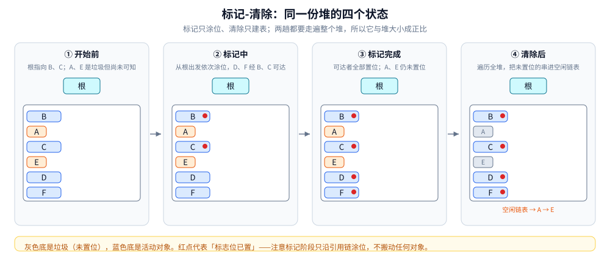
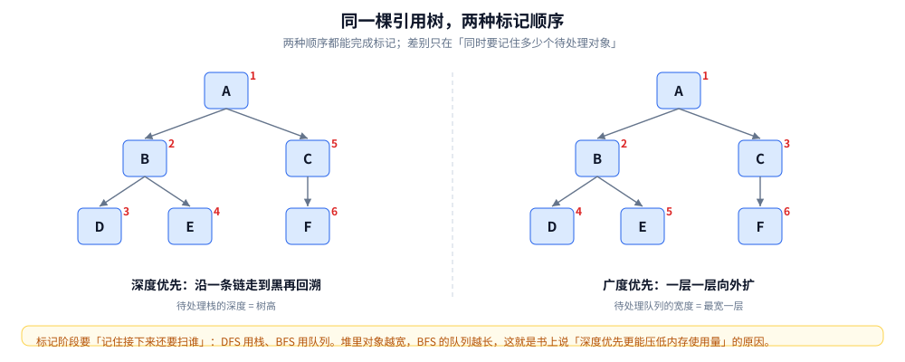
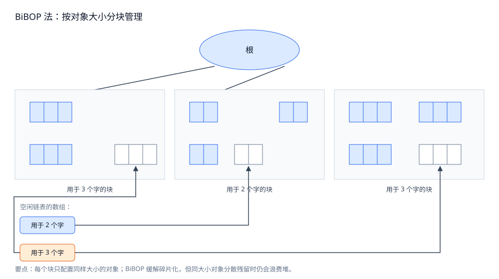
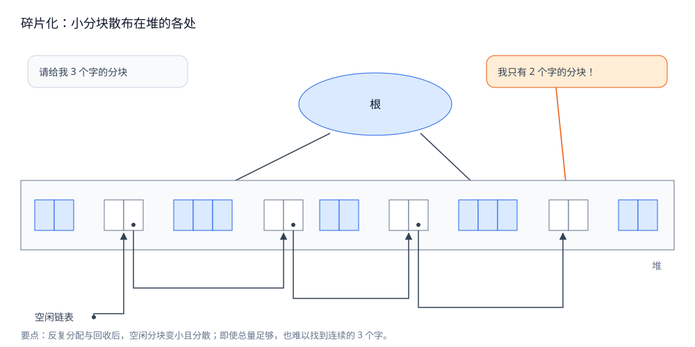
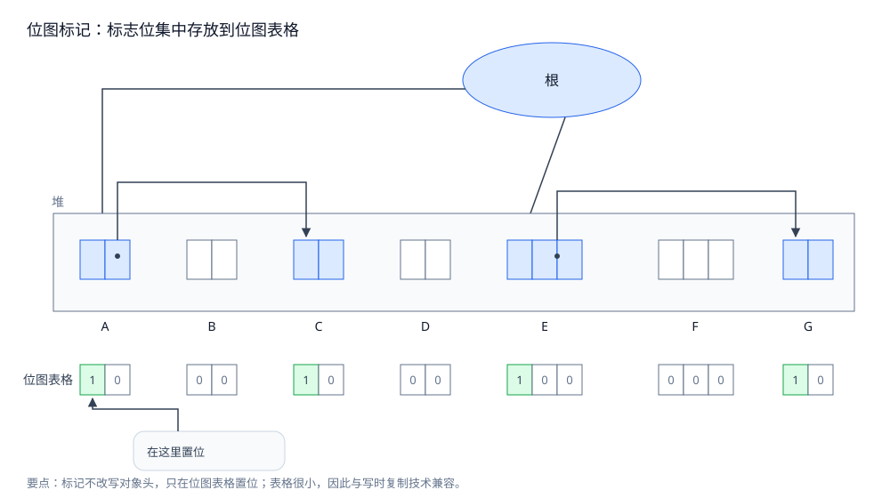
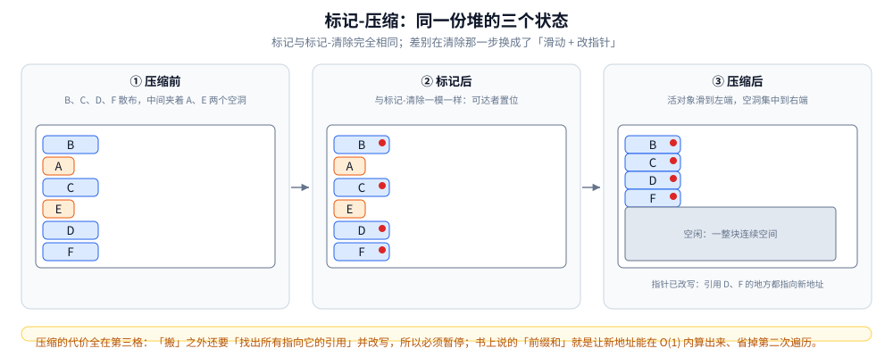
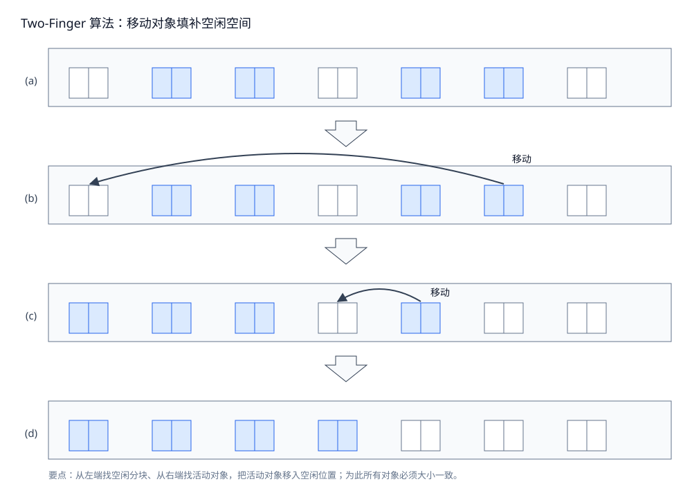

# 标记类 GC 算法

> 三条不靠引用计数的路线：**标记-清除**（原地涂位）、**标记-压缩**（搬走活对象）、**保守式 GC**（连指针都不确定也敢收）。
> 每一条都回答同一个问题的不同侧面：**不扫全堆就没法判死活，扫完之后怎么把空间腾出来**。
>
> 内容整理自语雀笔记，原书为《垃圾回收的算法与实现》（中村成洋 / 相川光）；评价维度与横向选型见 [GC基础算法.md](GC基础算法.md)。

## 一、不搬动对象，怎么把垃圾腾出来？

### 1.1 两趟：一趟涂位，一趟建表

GC 标记-清除算法由**标记阶段**和**清除阶段**构成：标记阶段把所有活动对象都做上标记，清除阶段把没有标记的对象（非活动对象）回收。



四个面板是同一份堆的四个状态：开始前根指向 B、C；标记从根出发沿引用链依次涂位（D、F 经 B、C 可达）；标记完成时可达者全部置位，A、E 仍未置位；清除遍历全堆，把未置位的串进空闲链表。**全程没有搬动任何一个对象**——这是它与其他所有路线的根本区别。

标记操作本身极简：把对象头里的标志位设为 TRUE，清除阶段依据有无标志位来区分活动对象与垃圾。

### 1.2 标记怎么走：DFS 与 BFS 的差别不在正确性

标记就是「遍历对象并标记」的处理过程，**这个过程对每个对象只执行一次**。遍历顺序有两种：



左边是深度优先：沿一条引用链走到最深处，无路可走时再回溯，转向其他分支；右边是广度优先：先访问离根最近的一层，再逐层向外推进。两种顺序都能完成标记，**差别只在「同时要记住多少个待处理对象」**——DFS 用栈，深度等于树高；BFS 用队列，宽度等于最宽那一层。

所以书上那句「深度优先比广度优先更能压低内存使用量」是有条件的：**堆里对象越宽，BFS 的队列越长**；反之树很深、很窄时，DFS 的栈也会长。工程实现的共识是默认 DFS，因为多数对象图的宽度远超深度。

### 1.3 清除：时间正比于堆大小

回收对象就是把对象作为分块，连接到被称为**空闲链表**的单向链表；之后分配时只要遍历这个空闲链表，就能找到分块。

清除阶段程序会**遍历所有堆**——所花时间与堆大小成正比，堆越大越慢。这一点常被忽略：标记阶段的成本正比于**活对象数**，清除阶段的成本正比于**堆总量**，两者是两个不同的量。

### 1.4 分配与合并：洞是怎么被记下来又怎么被并掉

**分配**指把回收的垃圾再利用：在清除阶段已经把垃圾连接到空闲链表了，分配就是搜索空闲链表、寻找大小合适的分块。

**合并**（coalescing）解决的是另一个问题：根据分配策略的不同可能会产生大量小分块，但如果它们**连续**，就能把所有小分块连在一起形成一个大分块。合并是在清除阶段进行的。

这里埋着后面所有「碎片」话题的根：合并只能处理**相邻**的空洞，无法处理「总量够、但分散在各处」的情况。

### 1.5 两笔收益与三笔代价

**收益一：实现简单。** 算法简单、实现容易，而实现简单意味着**与其他算法组合也简单**——书里后面讲的把标记-清除与引用计数、与复制结合起来的手法，全都建立在这个前提上。

**收益二：与保守式 GC 兼容。** 保守式 GC 中对象不能被移动（原因见第五节），所以它跟复制算法、标记-压缩都不兼容；标记-清除因为不移动对象，**非常适合搭配保守式 GC**。事实上很多采用保守式 GC 的处理程序里也用到了标记-清除。

**代价一：碎片化。** 使用过程中会逐渐产生被细化的分块，不久后无数小分块散布在堆的各处。因为分块在堆中的分布取决于 mutator 的运行情况，**只要用标记-清除，就或多或少会产生碎片**。而且把具有引用关系的对象安排在堆中较远的位置，会增加访问所需的时间——碎片伤害的不只是空间，还有缓存。

**代价二：分配速度。** 分块不是连续的，每次分配都必须遍历空闲链表找足够大的分块；最糟的情况是每次分配都得走到链表末尾。相比之下复制算法与标记-压缩的分块是一整块连续内存，不需要遍历，分配能非常高速地进行，还能在堆允许范围内分配很大的对象。

**代价三：与写时复制不兼容。** 写时复制（copy-on-write）是 Linux 等系统虚拟存储里的高速化方法：`fork()` 时并不真的复制内存空间，只是「装作复制了」，实际共享。当要对共享内存写入时，不能直接重写，要先复制自己私有空间的数据再改——「在写入时复制」，故得名。

问题在于：**即使没重写对象，GC 也会设置所有活动对象的标志位**，这样就会频繁发生本不应该发生的复制，压迫内存空间。解决办法是位图标记（见 2.4）。

---

## 二、它的四个毛病各有什么对症的招？

三个代价各有一招，再加上「清除暂停长」这一条，一共四招。**注意这四招都是补丁，没有一招能消掉根本矛盾**。

### 2.1 分配慢 → 多空闲链表与 BiBOP

之前只用一条空闲链表，大的和小的分块做同样处理，每次分配都要遍历一遍。**多个空闲链表**（multiple free-list）的思路是创建只连大分块的链表和只连小分块的链表——按 mutator 申请的大小选链表，就能在短时间内找到符合条件的分块。


上半部分：申请 3 个字，前面四个分块都不够，要走到第五个才拿到；下半部分：按大小分组后，申请 3 个字直接进「3 字」那个桶。**区别只是把「找」变成了「选桶」，碎片的数量一个都没减少。**

**BiBOP 法**（Big Bag Of Pages）更进一步：把堆分割成固定大小的块，让每个块只能配置同样大小的对象——「将大小相近的对象整理成固定大小的块进行管理的做法」。



堆被切成等大的块，每块只接纳一种尺寸的对象。这样「找合适大小的分块」就退化成「找对应尺寸的块」，分配近乎 O(1)，块内对象也天然紧凑；代价是块内只要还剩一个活对象，整块就腾不出来——第二级碎片从「整个堆」缩小到了「一个块」，但并没有消失。

### 2.2 碎片 → BiBOP 治一部分，压根治

BiBOP 用「同块同尺寸」把碎片约束在块内，但**并不能完全消除碎片化**：比方说在全部用于 2 个字的块中只有 1~2 个活动对象，这种情况就不能算有效利用了堆。BiBOP 原本是为了消除碎片、提高堆使用效率，但在多个块中分散残留着同样大小的对象时，反而会降低堆使用效率。



申请者要 3 个字，堆里却只有 2 个字的空洞——**总空闲量足够，连续空间不够**。这张图是碎片化危害的准确表述：危害不在于「浪费了内存」，而在于「明明够用却分配不出来」。

要真消除碎片只能靠压缩（第三节），那是另一条路线。

### 2.3 清除暂停长 → 延迟清除

**延迟清除法**（Lazy Sweep）是缩减「清除操作导致的 mutator 最大暂停时间」的方法。

它不一下遍历整个堆，**只在分配时执行必要的遍历**——所以能压缩因清除而导致的暂停。这就是「延迟」的意思：把一次长扫描摊成许多次短扫描，代价是分配路径上多了一点工作量。

### 2.4 与写时复制不兼容 → 位图标记

单纯标记-清除把标记位放在各个对象的头里，即「对象和头一并处理」，于是与写时复制不兼容。

**位图标记**（bitmap marking）的办法是：只收集各个对象的标志位并表格化，**不跟对象一起管理**。标记时不在对象头里置位，而是在这个表格中的特定场所置位。集合了标记位的表格称为**位图表格**（bitmap table），用这个表格进行标记的行为称为位图标记。位图表格可以用散列表、树形结构等多种方式实现。



标记时不改写对象头，而是在堆下方的位图表格中为活动对象置 1；重写只发生在很小的表格上，因此与写时复制技术兼容。

两笔红利：

- **与写时复制兼容**：以往的标记直接对对象设置标志位，会产生无谓的复制；位图标记不对对象设标志位，所以不会发生。虽然对位图表格的重写也会触发复制，但表格非常小，即使被复制也没什么大影响。
- **清除更高效**：以往清除必须遍历整个堆，把非活动对象连到空闲链表、同时取消活动对象的标志位；用位图表格则把所有标志位集合在一处，**可以快速消去**。

---

## 三、把活对象挤到一边，碎片就没了——代价是什么？

GC 标记-压缩算法（Mark Compact）是标记-清除与复制的结合：由**标记阶段**和**压缩阶段**构成。

### 3.1 Lisp2 的三趟



标记阶段与标记-清除**完全一样**：从根出发遍历，活动对象全部置位。差别在清除那一步换成了压缩：活动对象向一端滑动并更新所有指针，空闲空间集中到另一端，碎片随之消除。

压缩阶段（Lisp2 算法）由三个步骤构成：

1. 设定 forwarding 指针；
2. 更新指针；
3. 移动对象。

### 3.2 为什么必须三趟

这三步不能合并，原因在于**新地址算出来之前，旧位置必须留着线索**：

- 第 1 趟算出每个活对象的新地址，但此时对象还在原地——得先把「新家在哪」记下来，否则后面的对象不知道往哪搬；
- 第 2 趟才能改指针：遍历根与所有已标记对象，把旧地址改成新地址。这一步是压缩成本的大头，也是它**必须暂停**的根本原因——搬完还在用旧地址的引用会立刻悬空；
- 第 3 趟才真正搬。

对比标记-清除：清除阶段也要搜索整个堆，但**搜索 1 次就够**；标记-压缩要搜索 3 次，约 3 倍时间。**堆越大，这个缺陷越致命。**

### 3.3 堆利用率翻倍的代价

**收益是可有效利用堆**：压缩之后不会出现复制算法那样「只能用半个堆」的情况，可以在整个堆中安排对象，堆使用效率**几乎是复制算法的 2 倍**。说「几乎」，是因为要留出用于 forwarding 指针的空间，严格来说不到 2 倍。

对照标记-清除：它也能利用整个堆，但没有压缩，会产生碎片，**不能充分有效利用**——「能用」和「能用好」是两回事。

**代价**：如上，吞吐量因三趟全堆搜索而劣于其他算法。这条取舍贯穿整个压缩家族：**标记-压缩是「暂停换局部性」的算法**。

---

## 四、压缩的三个变体各让掉了什么？

Lisp2 的两笔账是「要额外的 forwarding 空间」和「不改善局部性的顺序」。下面三个变体各自从不同方向还债，也都各自付出新的代价。

### 4.1 Two-Finger：用「大小一致」换「不额外占地」

**制约条件**：必须将所有对象整理成大小一致。之前介绍的算法都没有这种限制，Two-Finger 必须严格遵守。

步骤只有两步（比 Lisp2 少一趟）：

1. 移动对象；
2. 更新指针。



Lisp2 是让活动对象往一边滑动；Two-Finger 是通过压缩让活动对象**填补空闲空间**——为了让对象能恰好填补空闲，必须让所有对象大小一致。

**收益**：Lisp2 要事先确保每个对象都留 1 个字用于 forwarding 指针，这就压迫了堆；Two-Finger 能把 forwarding 指针设置在**移动前对象的域里**，不需要额外内存，内存使用效率更高。此外压缩只需 2 次搜索，比 Lisp2 少 1 次，吞吐量占优。

**代价两条**：① 不考虑对象间的引用关系，一律压缩，导致对象顺序在压缩前后发生巨大变化——**基本无法期待缓存收益**；② 所有对象大小必须一致，能消除这个限制的处理系统不多，这制约了它的应用范围。不过配 BiBOP 可以缓解：把同一大小的对象安排在同一个分块里，就能对每个分块应用 Two-Finger。

### 4.2 表格算法：用「间隙表格」换「保住顺序」

与 Two-Finger 一样是 2 次压缩，但步骤是：

1. 移动对象（群）以及构筑**间隙表格**（break table）；
2. 更新指针。

**收益**：不必为压缩准备多余空间——它很好地利用了分块，**保留了更换指针所必需的信息**。这一点和 Two-Finger 相同。但**在压缩前后保留对象顺序**这一点上，表格算法比 Two-Finger 优秀得多，因此它能通过缓存提高访问速度。

**代价**：维持间隙表格的代价很高——每次移动活动对象群都要移动和更新表格。此外更新指针时不能忽略搜索表格的消耗；先在更新前排序可以加速搜索，但排序本身也要消耗，**不能从根本上解决问题**。

### 4.3 Immix：用「块与线」换「碎片与缓存」

Immix 把堆分为一定大小的**块**（block），再把每个块分成一定大小的**线**（line）。它不是以对象为单位，而是**以线为单位**回收垃圾。分配时先找空的线，安排对象；没找到就执行 GC。

GC 分三步：选定备用的 From 块 → 搜索阶段 → 清除阶段。

**收益来自两级管理**：分配时优先使用 RECYCLABLE 块而不是 FREE 块，这样容易把对象安排在同一个块里，**碎片问题得到解决，同时缓存也能被利用**。但如果只以块为单位管理，会白白浪费很多堆——极端例子是 1 个块里只有 1 个活动对象，也必须保留这个块里所有残留垃圾。所以再分成更小的线，能更精确地管理块里的对象、抑制堆的消耗。此外，**碎片化严重的块被拿来当备用 From 块**，这也能有效解决碎片问题。

**代价两条**：① 压缩过程中对象不是按顺序保存的，**不要期待缓存收益**——它只是为防止碎片化而压缩；② 别忘了一路用的是保守的标记，那些没有活动对象的线**有可能无法被回收**——虽然对吞吐量足够重视，但无法有效使用堆。

---

## 五、连指针和非指针都分不清，还能回收吗？

### 5.1 不明确的根：三个来源

保守式 GC（Conservative GC）指「不能识别指针和非指针的 GC」。它的出发点叫**不明确的根**（ambiguous roots），有三个来源：

1. 寄存器；
2. 调用栈；
3. 全局变量空间。

它们都是不明确的根——GC 不能识别其中的指针与非指针，**所有值都有可能是指针**。这样一来 GC 时就会大量出现「指针」和「被错误识别成指针的非指针」。所以保守式 GC 会检查不明确的根，以「某种程度」的精度来识别指针。

关键的那句原则：采用标记-清除的情况下，一找到貌似指针的非指针，就会把非指针指向的对象错误识别为活动对象并标记——**因为被错误识别的对象不会被废弃而会被保留，所以它遵守了 GC 的原则「不废弃活动对象」**。这种「把可疑的东西看作指针，稳妥处理」的态度，就是「保守」二字的来历。

### 5.2 保守的三笔代价

**① 识别指针与非指针需要成本。** 判断不明确的根和数据结构的值是「指针」还是「非指针」要付出代价，而这个代价在准确式 GC 里不存在。

**② 错误识别指针会压迫堆。** 存在貌似指针的非指针时，会把被引用的对象错误识别为活动对象；如果这个对象存在大量子对象，它们一律都会被看成活动对象。**已经死了的对象被看成活的，垃圾就严重压迫堆。**

**③ 能用的算法有限。** 无法正确识别指针，基本上就不能用复制等移动对象的算法：复制时要把根的值重写到新空间，用不明确的根就可能把**非指针**重写了；对象内重写指针时同样可能因不明确的数据结构而重写非指针。一旦重写了非指针，就会产生意想不到的 BUG。

### 5.3 打标签：用低位区分

准确式 GC（Exact GC）与保守式正好相反：能正确识别指针和非指针，基于**正确的根**（exact roots）执行。创建正确的根的方法有很多，共通点是都需要**语言处理程序的支援**，因此是依赖于语言处理程序实现的。

第一种是**打标签**（tag），目的是把不明确的根里所有非指针与指针区别开来。方法种类繁多，最基本的是用**低 1 位**作为标签。

**收益**：完全没有「错误识别指针」这个保守式固有问题——不会认为已经死了的对象还活着，GC 之后堆里只会留下活动对象。此外可以实现复制等移动对象的算法：因为能明确识别，即使移动对象、重写根的值，这个对象也不可能是非指针。

**代价**：语言处理程序必须对 GC 进行支援，即创建时必须顾及 GC。排除某些特殊实现，这会给实现者带来相当沉重的负担——**实现上比保守式麻烦**。而且要创建正确的根必须付出代价（保守式没有的）：好比打标签，每次计算都要先取消标签、再重新设置，这关系到整个语言处理程序的执行速度。

### 5.4 句柄间接引用：让对象能搬家

保守式「不能用复制等移动对象的算法」，解法之一是**间接引用**。原因很清楚：重写不明确的根（或不明确的数据结构）时，被重写的对象有可能是非指针。解法是**经由句柄**（handle）间接地处理对象——引用方保存的是句柄地址，句柄里才是对象地址，搬家只改句柄。

**收益**：有可能实现复制算法，于是能拿到复制的好处，例如消除碎片化；也能实现标记-压缩。

**代价**：必须把所有对象都经由句柄间接引用，**会拉低访问对象内数据的速度**，进而关系到整个语言处理程序的速度。

### 5.5 MostlyCopyingGC：把「不能动的」挑出来

MostlyCopyingGC 就是「把那些不明确的根指向的对象**以外**的对象都复制的 GC」——Mostly 是「大部分」的意思：抛开不能移动的对象，把其他「大部分」对象复制走。

前提条件四条：① 根是不明确的根；② 没有不明确的数据结构；③ 对象大小随意；④ CPU 是 32 位。

**收益**：能在保守式 GC 里使用复制算法，直接继承复制算法的优点。

**代价**：跟复制算法很像，此外还有它特有的——**在包含「从根引用的对象」的页内，所有对象都会被看成活动对象**，垃圾也会被看成活的，拉低了内存使用效率。

### 5.6 黑名单：把假引用圈起来

**黑名单**是一种「需要注意的地址的名单」：记录「不明确的根内的非指针，其指向的是有可能被分配对象的地址」，这个记录操作叫**记入黑名单**。

一旦分配程序把对象分配到这些地址，这个对象就很可能被非指针值所引用——**即使分配后成了垃圾，也很可能被错误识别成「它还活着」**。所以往这些地址分配对象时有两条限制：① 小对象；② 没有子对象的对象。理由很直接：这样的对象成了垃圾，即使被错误识别也不会有大的损失。

**收益与代价**：保守式「错误识别指针而压迫堆」这个一大问题得到了缓解，堆的使用效率也提升了——GC 对象少于通常的保守式 GC，执行速度大大提升；但相应地，**分配对象时需要花功夫检查黑名单**。

---

## 六、三个实现细节：位图、前缀和、不借空间

书上讲的 Lisp2 / Two-Finger / 表格算法之外，现代实现共享几个构件。

### 6.1 位图标记的第二个红利

**标记位图**：每堆字一个 bit 集中存放（即 2.4 的位图标记）。除了兼容写时复制，它还有第二个红利——**清理工可以按机器字整块处理**：全 0 字（连续死区）、全 1 字（连续活区）一次带过，不必逐对象看标记位。压缩阶段与「空闲链 / 已用链」的交替扫描（Bit-su 一系的思路）都建立在位图可批量读之上。

### 6.2 压缩就是前缀和

每个活对象的新地址 = 压缩区起点 + 它之前所有活对象的大小之和：

```text
堆:        [活4][死8][活4][死4][活8] ...
存活字节:    4          4        8
前缀和:      0          4        8      ← 各对象新家偏移
新地址 = 压缩基址 + (它之前的活对象大小之和)
```

麻烦在于：算前缀和与写新地址之间，「旧位置」还要放转发信息。不额外要空间的技巧有三类（见 6.3）；而前缀和本身还有一个额外好处——**让新地址能在 O(1) 内算出来，避免第二次遍历**。

### 6.3 不额外要空间的三类技巧

1. **偷对象自己的字**：Lisp2 / Cheney 形态（复制时顺手留 forwarding）；
2. **双向游标**：Two-Finger 把放得下转发的空间从死对象里「抠」出来（代价：不打乱顺序的要求满足不了）；
3. **方向位 + 撞位处理**：标记时顺手在对象头上放 1 bit「往哪个方向搬」，第一遍只算**目的地址**并就地存放，只有当两个对象撞进同一槽时才把其中之一暂存到别处（Thread-2 / Stuart 一系的思想，现代 JVM 老年代压缩与位图组合使用的思路与此同源；具体实现以 JDK 版本文档为准）。它依赖一个前提——对象头有富余位，这也是位图标记常配「头位不够用位图补」的原因。

### 6.4 压缩为什么改善缓存，以及分配路径上的两笔账

**压缩为什么改善局部性**：整理后的布局是「可达性遍历序」的投影，引用相近的对象物理相邻，再加上空洞消失、预取器按线性地址流预测命中。反过来，标记-清除长期使用后局部性单调劣化——这就是「跑了 Full GC / 压缩整理之后应用短暂无敌」这一工程玄学的算法解释。

**代价的本质**：移动对象 + 全量改引用，要么 STW，要么像 [并发标记与写屏障.md](并发标记与写屏障.md) 里的 Brooks 指针 / 着色指针那样用屏障把成本摊平。**标记-压缩是「暂停换局部性」的算法，它和「屏障换并发度」是同一枚硬币的两面。**

分配路径上另有两笔账：

- **合并时机二选一**：eager coalescing（释放时立刻合并相邻空闲块，成本前置）vs lazy coalescing（分配失败时才回头合并，成本落在最要命的分配路径上）。选哪头决定了「分配毛刺」出现在何时。
- **多线程分配的锁**：共享空闲链的每次摘取都要互斥，于是有了「每线程切一块再自由分配」（TLAB / mcache 思路，Go 侧对应 mcache/mcentral 分层，见 [内存分配器.md](../../01-编程语言/go/运行时/内存分配器.md)）——线程本地缓冲又引入新的碎片（缓冲里的零头归还时机）。碎片化的终极危害也不是浪费，而是**总量够但连续不够**：JVM 里的 promotion failure / concurrent mode failure 就是这么来的。

---

## 七、应用场景：三条路线各自落在哪

| 路线 | 什么时候选它 | 真实落点 | 它付出的账 |
| --- | --- | --- | --- |
| 标记-清除 | 对象不能移动（与保守式共存）、或要与别的算法组合 | CMS 的老年代、Go 的堆（不压缩）、Boehm GC | 碎片 + 分配慢；长期跑会劣化局部性 |
| 标记-压缩 | 需要消除碎片，且能接受一次长暂停 | Serial Old、Parallel Old；G1 的 Full GC 收尾 | 三趟全堆搜索；暂停与堆大小成正比 |
| Two-Finger / 表格 | 对象大小整齐、或必须保住顺序 | 少见（受「大小一致」或「表格维护贵」限制） | 缓存收益差 / 表格维护成本 |
| Immix | 想同时要碎片控制与块内缓存 | 研究型与部分教学实现；RC Immix 的前身（见 [引用计数与增量回收.md](引用计数与增量回收.md) 第四节） | 保守标记导致部分线收不回 |
| 保守式 GC | 没有类型信息、无法改造语言处理程序 | C/C++ 的 GC 扩展（Boehm）、早期 Lisp/Smalltalk 实现 | 假引用保活垃圾、对象不能移动 |

三条判断口径：

- **「能不能移动对象」是第一道分水岭**：不能移动 → 标记-清除 + 保守式；能移动 → 复制 / 压缩 / Immix。这一条决定了后面所有选择。
- **碎片是不是真问题，取决于对象尺寸分布**：尺寸整齐（如 BiBOP 分块）时碎片可控，可以不上压缩；尺寸差异大且长期运行，碎片一定会积累到必须整理。
- **压缩的暂停与堆大小成正比**，所以大堆上它总被当作「最后手段」——这也解释了为什么 G1 只在 Full GC 时才压缩。

## 八、具体使用：怎么看出「碎片」和「压缩」在发生

这一组现象的麻烦之处在于：**碎片不是一种错误，它只表现为「分配变慢」和「GC 变频繁」**，所以要从 GC 日志里间接读。

**① 看是否发生了「该回收却回收不掉」**（JVM，G1 / CMS）：

```bash
java -Xlog:gc*:file=gc.log:time,uptime -XX:+UseG1GC ...
```

判据：搜 `to-space exhausted` / `Evacuation Failure`（G1）或 `concurrent mode failure`、`promotion failed`（CMS）。这几条的含义都是**「空间总量够，但腾不出连续的一块」**——正是碎片化在日志里的唯一直接痕迹。

**② 看重整（压缩）的代价**：

同一条日志里，`Pause Full (G1 Compaction)` 一类记录的时长通常比 Young Pause 高一个数量级，且**随堆大小增长**。把它和 Young Pause 的时长画在同一张图上，就能看到「压缩是暂停换局部性」的定量样子。

**③ 看分配速率与 GC 频率的关系**（判断该修代码还是该整理堆）：

若单次回收后存活集没有明显增长，但 GC 间隔在缩短，说明**分配速率**在涨而不是泄漏；若每次回收后占用都在抬高，才是存活集在长。这两者的处置完全不同。

**④ 保守式 GC 的假引用**：Boehm GC 提供了统计输出（环境变量 `GC_PRINT_STATS=1`），可以看「被标记的字节数」与实际活对象大小的差距——差距就是假引用保活的部分。

> **口径说明**：本节四条都是「命令 + 该看什么」的观察路线，**本机未逐条实测**；①② 的日志标签在 JDK 9 之后统一到 `-Xlog:` 体系，且不同收集器的措辞不同，以 `java -Xlog:help` 与对应版本文档为准；④ 的环境变量名以所用 Boehm GC 版本的文档为准。

## 延伸追问

- **标记-清除为什么需要「空闲链表」？** → 清除后留下的是**不连续的空闲块**，分配器必须知道「哪里有洞、洞多大」，空闲链表就是记录这些洞的结构。所以它的分配**不是 O(1)**（要遍历链表找合适的块），这是它比复制算法慢的地方之一。
- **标记-压缩搬走对象后，指向它的指针怎么办？** → 必须**全部修正**：扫一遍根与所有已标记对象，把「旧地址」改成「新地址」。所以压缩的成本不只是「搬」，还包括「找出所有引用它的人」——这也是它**必须暂停**的根本原因。原文讲的「前缀和」技巧，就是让新地址能在 O(1) 内算出来、避免二次遍历。
- **保守式 GC 的「保守」保守在哪？** → 它**不区分「这个字是指针还是整数」**：只要值落在堆区间内就当作指针。好处是能用于没有类型信息的场景；代价有两条——①**假引用**（一个恰好等于堆地址的整数会保住垃圾对象，产生浮动垃圾）；②**不能移动对象**（无法修正假指针），所以保守式基本只能配标记-清除。
- **为什么标记-清除的「两趟」成本不对称？** → 标记的成本正比于**活对象数**（只沿可达路径走），清除的成本正比于**堆总量**（必须走遍每个槽）。所以「活对象少、堆很大」时，清除会成为主导项——这正是延迟清除法要对付的场景。

## 关联

- [GC基础算法.md](GC基础算法.md) — 评价维度与横向选型总表
- [复制与分代回收.md](复制与分代回收.md) — 另一条路线：把存活对象搬走，且只搬一部分
- [引用计数与增量回收.md](引用计数与增量回收.md) — 不用标记的两种思路，以及 Immix 与 RC 的结合（RC Immix）
- [并发标记与写屏障.md](并发标记与写屏障.md) — 标记阶段如何与 mutator 并发，以及压缩如何靠屏障摊平成本
- [垃圾回收原理与收集器.md](../../01-编程语言/java/运行时/垃圾回收原理与收集器.md) — 该算法在 JVM 里的落地与对应收集器
- [内存分配器.md](../../01-编程语言/go/运行时/内存分配器.md) — Go 侧的分配器分层（TLAB / mcache 的对照）
- [内存逃逸.md](../../01-编程语言/go/运行时/内存逃逸.md) — 分配量从哪来

> 反向引用（本篇被下列文档引到）：[双指针.md](../算法/基础算法/数组与序列技巧/双指针.md)
