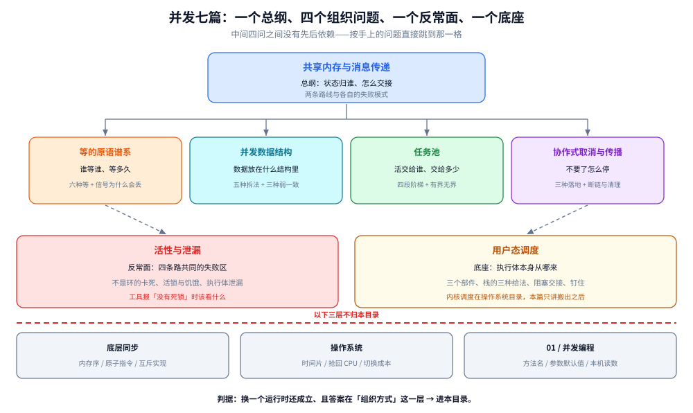

# 并发

> 覆盖：**语言无关的并发组织方式**——多个执行流怎么分工、怎么交接、怎么等、怎么停，以及这些路都会走到的失败状态。
> 一个总纲（两条路线与所有权）+ 四个组织问题（怎么等 / 数据放哪 / 活交给谁 / 怎么停）+ 一个反常面（卡住与泄漏）+ 一个底座（执行体从哪来）。
>
> 不覆盖：**同步的物理实现**（内存序、原子指令、互斥怎么进内核）在 [底层同步](../计算机底层原理/底层同步/README.md)；**内核调度**在 [操作系统](../操作系统/README.md)；**语言侧的 API、参数与读数**在 [Go 并发编程](../../01-编程语言/go/并发编程/README.md) 与 [Java 并发编程](../../01-编程语言/java/并发编程/README.md)。
>
> 当前 **7 篇散篇**。素材来自个人学习笔记，各篇引语里注明了自己那份素材的出处。

---

## 一、本目录与另外三层怎么分？

**本节要点**：判据是两条——**换一个运行时还成立吗**，以及**答案落在哪一层**。两条都过才进本目录。

| 层 | 它回答的问题 | 判据（一句话） | 例子 |
|---|---|---|---|
| [底层同步](../计算机底层原理/底层同步/README.md) | 同步**凭什么**成立 | 答案在**指令或内存序** | 三条内存序、CAS 是哪条指令、无竞争加锁为什么只要二十几纳秒 |
| [操作系统](../操作系统/README.md) | **谁**在用 CPU | 答案在**内核** | 时间片多长、上下文切换贵在哪、优先级怎么分 |
| **本目录** | 多个执行流怎么**分工与交接** | 答案在**组织方式**，换运行时仍成立 | 为什么信号会丢、锁该拆到多细、池该多大、取消怎么传 |
| [01 / 并发编程](../../01-编程语言/go/并发编程/README.md) | 这个语言**怎么写** | 答案必须报出**键名与参数名** | `sync.Map` 的 `read`/`dirty`、`-Xss` 默认值、`GOMAXPROCS` 怎么影响 P |

⚠️ 三条最容易越界的线：

1. **「内存模型 / 原子操作 / 互斥实现」这三题已经抽过了**，就在底层同步。再往上抽一次就是重复，剩下的只有 API 与读数，本就该留在 01 层。
2. **「时间片、切换成本」这两题已经抽过了**，在操作系统目录。本目录的 `用户态调度.md` 只讲**把调度搬出内核之后多出什么**，不重述内核调度。
3. **本目录不给读数**。所有带具体数字的实测（提交比新建便宜多少、写时复制慢多少倍、协程切换几纳秒）都在 01 层，本目录只引用结论、不复述过程。

## 二、七篇的分工：一个总纲 + 四问 + 一反 + 一底

**本节要点**：这七篇不是并列的。总纲给坐标系，四问是四个正交的组织问题，反常面是四条路共同的失败区，底座是这四条路都站着的执行体。

图里从上到下四层：顶部总纲是「状态归谁、怎么交接」这一个判断；中间四张卡片是四个组织问题，它们之间**没有先后依赖**，只有正交关系；再往下是两处支撑——左侧「卡住与泄漏」是四条路都会走到的失败区，右侧「用户态调度」是执行体本身的来源；底部红线是与底层同步、操作系统、01 层的分界。**要读出的是：中间那四问可以按手上的问题直接跳到任一格，不需要按顺序读。**

| 篇目 | 它回答的那个问法 | 核心内容 |
|---|---|---|
| [共享内存与消息传递.md](共享内存与消息传递.md) | **状态归谁、怎么交接** | 三个安全要素与三种共享出错形态、所有权才是根概念、两条路线的失败模式（错在值 vs 错在时）、七种语言的落点与「复杂度挪到哪」、代价量级与跨进程的反转条件、选型决策树、跨层投影 |
| [等的原语谱系.md](等的原语谱系.md) | **谁等谁、等多久** | 互斥与协作的分界、六种「等」（等事件 / 等到齐 / 等许可 / 等交换 / 等条件 / 等超时）、信号丢失的三种走法、为什么一个锁要挂多条队列、唤醒全部的代价 |
| [并发数据结构.md](并发数据结构.md) | **共享的数据放在什么结构里** | 五种拆法（不拆 / 按空间 / 按时间 / 不共享 / 乐观）、拆开必然失去的三种保证（聚合值、遍历快照、复合操作）、扩容的三条路线、热点为什么拆锁无效、对象池为什么不属于这一类 |
| [任务池.md](任务池.md) | **活交给谁执行、交给多少个** | 池化省的两样东西、提交的四段阶梯（核心 → 队列 → 扩容 → 拒绝）以及队列为什么排在扩容前、有界与无界的分叉、线程数的三个定法与各自假设、共享队列与工作窃取、拒绝之后的处置 |
| [协作式取消与传播.md](协作式取消与传播.md) | **不要了怎么停** | 强杀留下的三处烂摊子、取消的三种落地（标志位 / 异常中断 / 令牌传播）、断链的三种写法、取消与超时与关闭的差别、清理为什么不能用同一个令牌 |
| [活性与泄漏.md](活性与泄漏.md) | **为什么它卡住了，工具却说没死锁** | 三种检测只有两种判据、五种不构成环的卡死、活锁与饥饿与优先级反转的区分、执行体泄漏的四类形态、把卡死降级成超时的前提 |
| [用户态调度.md](用户态调度.md) | **执行体本身从哪来** | 内核调度不够用在哪、M:N 的三个部件及其耦合、栈的三种给法、阻塞时线程的三种处理、钉住是怎么产生的、用户态为什么难以抢占 |

⚠️ **三条边界纪律**：

1. **Coffman 四条件与等待图只在 03 层写一份**。`活性与泄漏.md` 明确把 [死锁原理与防治.md](../../03-数据与中间件/数据存储/并发控制/死锁原理与防治.md) 认作上游，自己只写它覆盖不到的那一半（不是环的卡死、活锁、饥饿、泄漏）。
2. **内核调度只在操作系统目录写一份**。`用户态调度.md` 的起点是「把它搬出内核之后多出什么」，不复述时间片与切换成本。
3. **落地一律指回 01 层**。本目录不给方法名、不给参数默认值、不给日志字段；每篇的最后一节都是「怎么观察」，并明确标注**未逐条实测**，实测在语言侧各篇。

## 三、与相邻目录的三处接口

| 接口 | 本目录给什么 | 对面给什么 |
|---|---|---|
| [底层同步](../计算机底层原理/底层同步/README.md) | 「为什么必须同步」与「拆到什么粒度」 | 三条内存序、原子指令单价、无竞争互斥的实测台阶 |
| [操作系统](../操作系统/README.md) | 「执行体被搬到用户态之后多出哪些部件」 | 时间片、抢回 CPU、上下文切换成本、调度类与优先级 |
| [数据结构](../数据结构/README.md) | 「同一个结构在并发下要多付什么」 | 各结构本体的复杂度与局部性；那边 README 有一列「并发写难度」，本目录的 `并发数据结构.md` 就是那一列的展开 |

⭐ **一条容易搞反的分界**：本目录讲「该怎么组织」，01 层讲「这个语言的默认值是什么」。所以**看到具体类名、参数名、版本号，就该判断它是不是写错层了**——这些一旦换运行时就不成立。

## 四、读序

**本节要点**：先读总纲拿到「所有权」这把尺子，然后**按手上的问题直接跳**，不要顺着目录读。四问之间没有依赖。

1. **[共享内存与消息传递.md](共享内存与消息传递.md)** —— 建立「状态归谁、怎么交接」这个坐标系，后面每一篇都在这个坐标系里选位置。
2. 按问题跳：
   - 「两个线程该谁先动」→ [等的原语谱系.md](等的原语谱系.md)
   - 「这张表要不要拆锁」→ [并发数据结构.md](并发数据结构.md)
   - 「并发度开多少、满了怎么办」→ [任务池.md](任务池.md)
   - 「请求取消了但还在跑」→ [协作式取消与传播.md](协作式取消与传播.md)
   - 「卡住了但工具说没死锁」→ [活性与泄漏.md](活性与泄漏.md)
   - 「协程到底比线程轻在哪」→ [用户态调度.md](用户态调度.md)
3. 需要落到某个语言的写法时，再回 [Go 并发编程](../../01-编程语言/go/并发编程/README.md) 或 [Java 并发编程](../../01-编程语言/java/并发编程/README.md)。

⚠️ 四问之间有三处强关联，读的时候别当孤立篇：

- **等的原语 3.1（一条队列两个角色会互相吃信号）⟷ 活性与泄漏 1.2（不是环的卡死）**：同一件事，一边给成因、一边给现场判据。
- **并发数据结构 2.5（乐观重试）⟷ 活性与泄漏 2.1（活锁）**：乐观路线的极端形态就是活锁，冲突一高就该退回锁。
- **任务池 2.2（队列排在扩容前）⟷ 活性与泄漏 3.1（无界增长）**：无界队列正是「上限永不生效」与「无界增长型泄漏」共同的机制前提。

---

## 关联

- [底层同步 README](../计算机底层原理/底层同步/README.md) — 本目录的物理底座：hb、原子指令、互斥实现
- [操作系统 README](../操作系统/README.md) — 进程、线程与内核调度；本目录的 `用户态调度.md` 是它的对照面
- [数据结构 README](../数据结构/README.md) — 「并发写难度」那一列的展开
- [Go 并发编程 README](../../01-编程语言/go/并发编程/README.md) — 本目录在 Go 侧的落地
- [Java 并发编程 README](../../01-编程语言/java/并发编程/README.md) — 本目录在 Java 侧的落地
- [死锁原理与防治.md](../../03-数据与中间件/数据存储/并发控制/死锁原理与防治.md) — Coffman 四条件与等待图的唯一宿主
- [目录.md](../../目录.md) — 全仓知识点索引
