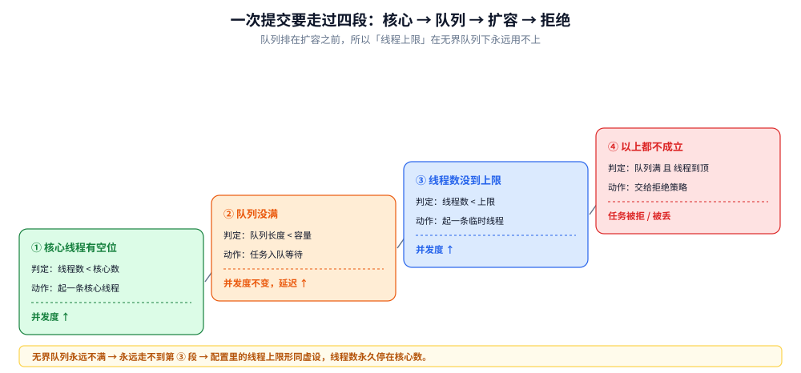
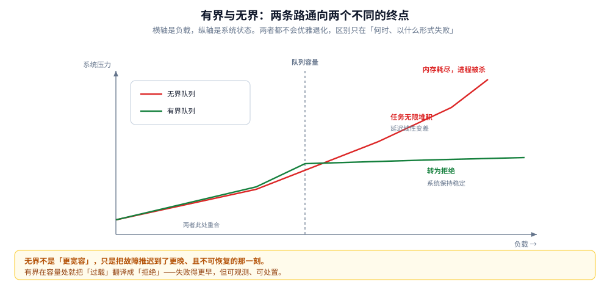
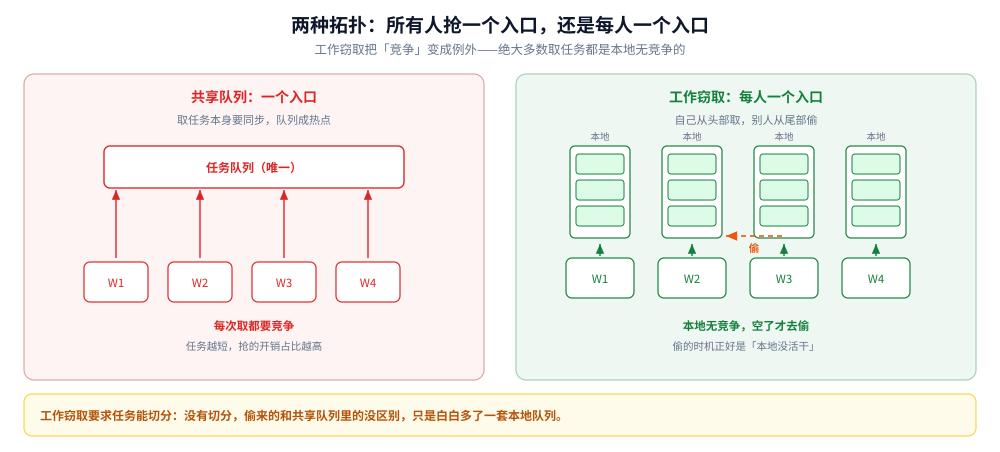

# 任务池：从提交到拒绝的四段阶梯

> 覆盖：池化到底省的是哪笔钱、一次提交要过的四段判定（核心 → 队列 → 扩容 → 拒绝）以及它为什么反直觉、有界与无界队列的分叉（「OOM 还是拒绝」）、线程数的三个定法各自的假设、共享队列与工作窃取两条拓扑、拒绝之后必须补的三件事。
>
> 不覆盖：具体类的构造参数、`Executors` 工厂方法的坑、关闭语义与监控指标清单见 [线程池.md](../../01-编程语言/java/并发编程/线程池.md)；切分与归并的写法见 [ForkJoin与并行流.md](../../01-编程语言/java/并发编程/ForkJoin与并行流.md)；池化对象的回收语义见 [sync.Pool.md](../../01-编程语言/go/并发编程/sync.Pool.md)。
>
> 内容整理自个人学习笔记，素材见 [素材清单.md](../../素材清单.md)。
>
> 口径：本篇**不新增实测**。文中「提交比新建便宜六十多倍」「第 7 个任务被拒绝」这类读数转引自语言侧那篇的真实实验，此处只用来支撑机制；三个线程数公式是文献结论，不是本机读数。

---

## 一、为什么要有池？

**本节要点**：池化买的是两样东西——**省掉创建成本**，以及**把「同时有多少个」变成一个可配的数**。第二样比第一样重要。

### 1.1 省掉的是创建与销毁

「一个任务一条执行体」的写法在低负载下看不出问题，因为创建成本被业务时间盖住了。一旦 QPS 上去，创建与销毁本身就成了主要开销：语言侧的实测里，提交一个已有任务的成本比新建一条线程便宜约 **60~70 倍**。池化把这笔钱省掉的方式很朴素——**用完不销毁，放回去下次接着用**。

### 1.2 但真正值钱的是「上限」

省成本只是第一层。第二层是：**池把「并发度」从一个涌现出来的结果，变成了一个显式配置的数**。

不设池的时候，并发度由「同时进来的请求数」决定，而这个数你控制不了。设了池，它就是 `core` 与 `max` 两个数字，可以算、可以测、可以告警。**过载时的行为也从「全部都慢」变成了「一部分被拒」**——后者是可观测、可处置的。

⚠️ 但池**不能**凭空提高吞吐。它只是给并发度加了一个阀门；如果瓶颈在下游数据库，池开得越大，打给数据库的压力越大，整体反而更慢。这是「池越大越好」这个直觉错得最厉害的地方。

## 二、一次提交为什么要走过四段？

**本节要点**：顺序是**核心线程 → 队列 → 扩容 → 拒绝**。第二段排在第三段前面，这一条反直觉，也是绝大多数配置事故的根源。

### 2.1 四段阶梯



图里四段从左到右，每段写了两件事：判定条件与「这一步之后并发度是多少」。要读出两点：**第一，队列排在扩容之前**——不是「线程不够就加线程」，而是「线程不够先排队，排不下了才加线程」。**第二，最后一段才是拒绝**，所以「拒绝」这个动作其实离「负载过高」隔了两道缓冲，等到它触发时，系统已经过了两轮忍让。

| 段 | 判定 | 满足后去哪 | 后果 |
|---|---|---|---|
| ① 核心线程有空位 | 当前线程数 < 核心数 | 直接起一条核心线程执行 | 并发度上升 |
| ② 队列没满 | 队列当前长度 < 容量 | 任务入队等待 | **并发度不变**，延迟上升 |
| ③ 线程数没到上限 | 当前线程数 < 上限 | 起一条临时线程执行 | 并发度上升 |
| ④ 以上都不成立 | —— | 交给拒绝策略 | 任务被丢弃、抛错或由调用方执行 |

### 2.2 为什么队列排在扩容前面

按直觉，线程不够就该加线程，加不动了才排队。实际实现反过来，理由是**线程比队列贵得多**：一条线程要占一块栈（大小固定，与任务无关），而队列里放一个任务只需要一个引用。所以「先用便宜的缓冲扛一下」是更划算的默认策略。

这个默认策略带来一个非常实际的后果：

> **队列容量是一个真正的旋钮，而线程上限几乎不是。**

因为只要队列不满，线程数就永远停在核心数上。配置里写着「上限 200」，实际跑起来永远是 8——**这不是 bug，是队列从来没满过**。语言侧实测把这个过程逐步冻结出来了：前两个任务起核心线程，第三第四个任务直接入队（线程数停在 2），第五第六个任务队列满了才扩线程，第七个才被拒。

反过来，**用无界队列时上限永久失效**：队列永远不满 → 永远不扩容 → 永远只有核心数在干活。这类问题在监控上的表现是「线程数贴着核心数、队列长度一路涨」，而配置表上明明写了很大的上限。

### 2.3 一个可用的排障指标

「池曾经达到过的最大线程数」这个计数器很好用：

- 它一直等于核心数 → 队列从没满过，上限从未生效，配置里的上限是摆设；
- 它等于上限 → **已经发生过拒绝**，只是拒绝可能被静默吞掉了。

这一个数就能区分「没扩容」与「扩到顶了」，比看当前线程数有用得多。

## 三、队列该有界还是无界？

**本节要点**：无界队列把「过载」这个事件**推迟**了，代价是它会在某个更晚的时刻以 OOM 的形式爆发。有界队列把过载当场暴露成「拒绝」。**没有第三条路。**

### 3.1 两条路通向两个不同的终点



图里横轴是负载、纵轴是系统状态，两条曲线在「队列容量」这个点上分岔：无界那条一路平缓上升（延迟变大但不出错），最后撞上内存上限突然崩塌；有界那条在容量处拐成水平（拒绝率上升），但系统本身保持稳定。要读出的是：**两者都不会「优雅地退化」，区别只在于「在哪一刻、以什么形式失败」**——一个失败得晚且不可恢复，一个失败得早且可观测。

| | 无界队列 | 有界队列 |
|---|---|---|
| 负载上升时 | 任务无限堆积，延迟线性变差 | 堆到容量后转为拒绝 |
| 线程上限 | **永久失效**（队列不满就不扩容） | 正常生效 |
| 失败形式 | 内存耗尽，进程被杀死 | 拒绝异常，可被捕获 |
| 失败时机 | 晚，且与「负载」之间隔着很长一段延迟 | 早，与负载同步 |
| 可观测性 | 差：只有内存曲线能看出来 | 好：队列长度 + 拒绝计数 |
| 恢复 | 只能重启 | 拒绝 + 降级 + 重试 |

### 3.2 为什么「无界」看起来更好用

因为它**不报错**。压测的时候无界队列的表现往往更漂亮：没有拒绝、没有异常、成功率 100%。问题要到生产上量之后才暴露——内存缓慢上涨，某一天突然崩。

这是「把故障推后」的典型：**推后不等于消除，只是把可观测的小故障换成了不可观测的大故障**。

### 3.3 容量该定多少

容量不是「越大越安全」，而是**一个时间预算**：队列满意味着任务要在这个队列里等多久。粗略的算法是

```text
队列容量 ≈ 可接受的最长排队时间 × 每秒处理量
```

比如能接受最长等 2 秒、每秒处理 500 个，容量就在 1000 上下。超出这个数的任务，等到了也大概率已经超时——**让它们早点被拒，比让它们等两秒再失败要好**。

## 四、线程数到底该定多少？

**本节要点**：三个公式，三种假设。**用错公式比不定公式更糟**，因为它会给你一个看起来很精确的错数。

### 4.1 三个定法与它们成立的前提

| 定法 | 公式 | 成立的前提 | 什么时候失效 |
|---|---|---|---|
| CPU 型经验值 | 核数 + 1 | 任务几乎不等待，纯计算 | 任务里有任何阻塞调用 |
| IO 型估算 | 核数 × (1 + 等待时间 / 计算时间) | 能估出等待与计算的比例 | 比例本身随负载变化 |
| 排队论下界 | 并发数 = 到达率 × 平均处理时间 | 系统近似稳态 | 突发流量下不成立 |

第二条是最常被引用的，也是最容易被滥用的：它的假设是「等待时间」是一个稳定常数。真实系统里等待时间随并发度上升而上升（下游被打慢了），于是公式右边也随左边变化，**解出来是一个不动点，不是一个可以直接代进去的数**。

第三条其实是前两条的另一种说法：如果每个请求平均处理 20 ms、每秒来 500 个，那平均同时有 10 个在处理——这个数和「核数」无关，它是负载决定的。**池大小必须大于这个数，否则请求会排队；但也只该比它大一点，多出来的部分只是在排队等着打下游。**

### 4.2 实践里怎么定

1. **先测**：在目标 QPS 下测出平均处理时间，用第三条算出一个下界。
2. **再按任务类型调**：纯计算的部分不超过核数；有阻塞的部分按比例放大。
3. **最后用压测验证**：把池大小从下界往上加，找到「吞吐不再上升、延迟开始变差」的那个点——那就是这个系统的上限。

⚠️ 第 3 步是必须的，因为公式只给起点，拐点只能测出来。而且**拐点会随下游状态漂移**：数据库慢了，同一个池大小的吞吐就下去。

## 五、任务该去共享队列抢，还是就近偷？

### 5.1 一个入口，所有人抢

最朴素的拓扑：所有执行体从同一条队列里取任务。好处是负载天然均衡——谁快谁多拿。代价是**取任务本身要同步**，而且队列成了单点：并发度一高，抢队列的开销会盖过干活的开销。

缓解办法是分片：把一条队列拆成几条，每个执行体绑定一条。这会牺牲均衡性（某条空了另一条还满着），换来取任务时不必全表竞争。

### 5.2 每人一个入口，闲了去偷



图里左边是共享队列，所有执行体指向同一个入口，箭头汇聚成一点；右边是每人的双端队列，自己从头部取、别人从尾部偷。要读出的是：**工作窃取把「竞争」变成了「例外」**——绝大多数取任务操作都是本地无竞争的，只有在本队列空了才去别处偷，而「本队列空了」这件事本身说明本地暂时没活干，偷的开销不占用关键路径。

| | 共享队列 | 工作窃取 |
|---|---|---|
| 取任务 | 每次都竞争 | 本地无竞争，空了才偷 |
| 均衡性 | 天然均衡 | 靠偷来补偿，有滞后 |
| 适合的任务 | 粒度大、数量少 | **粒度小、能递归切分** |
| 不适合 | 任务极短（抢队列比干活贵） | 任务不可切分（偷不到东西） |
| 副作用 | 队列成热点 | 本地队列的后进先出会改变执行顺序 |

### 5.3 工作窃取为什么要求「任务能切分」

因为它解决的是「一个大任务切成很多小任务之后，怎么让它们均匀落到各个执行体上」。如果没有切分这件事，偷来的任务和共享队列里的任务没有区别，白白多了一套本地队列。

反过来说：**任务不能切分时，用工作窃取没有收益**——这时该用的是共享队列或者分片。

还有一条容易忽略的副作用：本地队列通常按「后进先出」取，因为最近放进去的任务大概率还在缓存里。这会改变任务的执行顺序，**对有顺序要求的任务要留意**。

## 六、被拒绝了之后怎么办？

**本节要点**：拒绝不是终点，是一个必须被记录、被处置的事件。默认策略会抛异常，而异常最容易被上层吞掉。

### 6.1 四种拒绝姿态

| 姿态 | 行为 | 适用 |
|---|---|---|
| 抛错 | 让提交方知道「没接住」 | 默认；调用方有能力处理时 |
| 丢弃 | 静默扔掉 | 只在「丢一个无所谓」的场合，且必须记数 |
| 丢最老的 | 腾出位置给新任务 | 只关心最新状态的场景（如行情推送） |
| 由提交方自己执行 | 反压：提交方变成执行方 | 想自然限速、且提交方不介意被拖慢 |

最后一种最值得说：它把「拒绝」变成了**反压**——提交方被迫慢下来，负载自然被限住。代价是提交方的线程被占用，如果提交方本身是 IO 线程，会造成整条链路变慢。

### 6.2 拒绝必须可观测

三条底线：

1. **计一个数**。拒绝次数是过载最直接的信号，没有它，过载就是静默的。
2. **不吞异常**。异步提交时，任务里抛的异常可能被存进一个「结果对象」里，如果没人去取，这个异常就彻底消失了——**看起来提交成功了，实际什么也没做**。
3. **区分「拒绝」与「失败」**。拒绝是「我没接」，失败是「我接了但没做成」。两者的告警阈值与处置手段完全不同，混在一个指标里就没法定位。

## 七、应用场景

| 场景 | 队列 | 拒绝 | 判据 |
|---|---|---|---|
| 在线接口的请求处理 | 有界，容量按最长可接受排队时间算 | 抛错 + 上游降级 | 延迟敏感，宁可快速失败 |
| 后台批处理 | 有界，容量可以给大 | 由提交方执行（反压） | 不介意慢，介意丢 |
| 日志/埋点上报 | 有界，宁可丢 | 丢最老的 | 只关心最新状态 |
| 定时任务 | 按时间堆 | 抛错 | 任务有明确的触发时间 |
| 可递归切分的计算 | 工作窃取 | 通常不触发 | 任务粒度小、能切分 |
| 下游是稀缺资源（数据库连接） | **容量 = 连接数** | 抛错 | 池比下游大没有意义 |

最后一行的判据值得单独记：**任务池的上限不该超过它要打的下游的并发能力**。池开得比连接池大，多出来的执行体只是在等连接。

## 八、具体使用：怎么判断一个池配错了

**本节要点**：三个数就能定位——线程数是否贴着核心数、队列长度是否单调上涨、拒绝计数是否非零。三者的组合对应三种不同的错法。

本节是**判断路线**，**本机未实测**；具体方法名与实测读数在语言侧那篇。

### 8.1 三个数的组合

| 线程数 | 队列长度 | 拒绝计数 | 结论 |
|---|---|---|---|
| 等于核心数，从不涨 | 一路涨 | 0 | **队列无界**，上限永久失效 |
| 等于上限 | 高 | > 0 | 已经过载，在靠拒绝撑住 |
| 远小于核心数 | 0 | 0 | 负载不够，池开大了（不是问题，但浪费） |
| 反复上下 | 0 | 0 | 有突发流量，扩容策略在工作 |

第一种是最常见的配置事故，也是最难自查的：**一切看起来正常，除了越来越慢**。

### 8.2 用「曾经达到过的最大线程数」一次定性

这个计数器比上面三个数更省事：它等于核心数 → 队列从没满过（上限是摆设）；它等于上限 → 已经拒绝过（去看拒绝计数确认）。

### 8.3 提交前先问的一句

**「这个池打的是谁？」** 如果下游是数据库、是另一个服务、是磁盘，那池的上限应该由下游决定，而不是由「我想要多少并发」决定。绝大多数池配错，错在把上限当成了一个可以随便调大的性能旋钮。

## 延伸追问

- **为什么队列排在扩容前面，不能反过来吗？** → 可以自己实现一个反过来的池，但默认实现的选择有理由：线程比队列元素贵得多，先用便宜的缓冲扛。反过来会让线程数在轻微波动时就上下跳，创建销毁的成本反而回来。
- **设置了很大的线程上限，为什么并发上不去？** → 因为队列是无限的，永远不满，于是永远不会扩容，线程数停在核心数。这是 2.2 那条顺序的直接后果。
- **无界队列到底错在哪？** → 它把「过载」这个事件推迟成了「内存耗尽」。前者可观测、可处置；后者不可恢复。而且它顺带让线程上限失效。
- **线程数是不是越多越好？** → 不是。超过瓶颈之后，多的线程只会增加上下文切换与下游压力。判断标准是「吞吐不再上升、延迟开始变差」的那个拐点。
- **工作窃取是不是一定比共享队列快？** → 只在「任务能切分且粒度小」时成立。任务粒度大时，窃取的调度开销与本地队列的维护都是净成本。
- **拒绝策略选「丢」是不是很危险？** → 危险的不是丢，是**丢了不记数**。有计数的丢是可接受的降级；没计数的丢是数据丢失。
- **异步提交为什么容易丢异常？** → 因为异常被存进了结果对象，而不是抛给提交方。提交方不取结果，异常就没人看。要么取结果，要么在任务内部自己兜住并记录。
- **池的大小要不要随负载动态调整？** → 能调，但要非常小心：调大容易、调小难（正在执行的任务没法收回），而且动态调整会让「配置」与「实际」脱节，排障时容易误判。多数系统靠固定池 + 拒绝 + 反压更稳。

## 关联

- **上游/总纲**：[共享内存与消息传递.md](共享内存与消息传递.md) — 池是「单所有者 + 队列」这条路线最普遍的落地形态
- **上游/总纲**：[等的原语谱系.md](等的原语谱系.md) — 池的「取任务」就是一次等条件；队列有界与否决定这里是「等」还是「拒绝」
- **同层/底座**：[活性与泄漏.md](活性与泄漏.md) — 单线程池自锁、无界增长两类卡死都发生在池上；本篇 2.2 的顺序是它们的机制前提
- **同层/底座**：[并发数据结构.md](并发数据结构.md) — 队列本身就是并发容器的一档，取任务的开销决定了要不要分片
- **对照/互补**：[协作式取消与传播.md](协作式取消与传播.md) — 「关闭池」是取消的一种，已提交未执行的任务要不要跑完，是取消语义问题
- **下游机制**：[线程池.md](../../01-编程语言/java/并发编程/线程池.md) — 七参数、四段判定的逐次实测、四种拒绝策略的真实行为、工厂方法的坑
- **下游机制**：[ForkJoin与并行流.md](../../01-编程语言/java/并发编程/ForkJoin与并行流.md) — 工作窃取的实现细节、切分阈值与并行度
