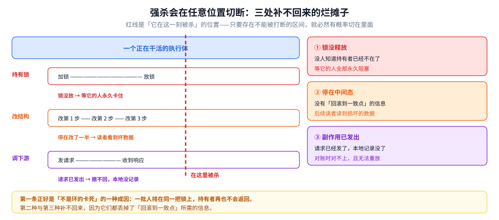
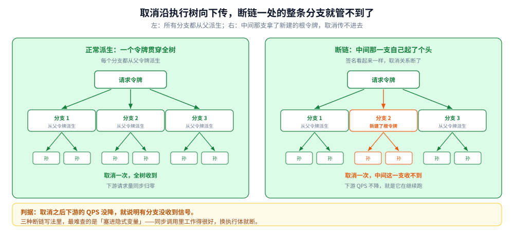

# 协作式取消与传播

> 覆盖：为什么不能直接把执行体杀掉、强杀会留下哪三处烂摊子、取消的三种落地形态（标志位 / 异常中断 / 令牌传播）各自的代价、取消为什么必须沿着执行树向下传播而断链会造成什么、以及「取消 / 超时 / 关闭」这三件常被混为一谈的事在清理要求上的差别。
>
> 不覆盖：具体语言的 API 与派生函数怎么选见 [context.md](../../01-编程语言/go/工程实践/context.md)；线程状态与中断的八种落点见 [线程基础与生命周期.md](../../01-编程语言/java/并发编程/线程基础与生命周期.md)；跨线程传值为什么容易泄漏见 [ThreadLocal与上下文传递.md](../../01-编程语言/java/并发编程/ThreadLocal与上下文传递.md)。
>
> 内容整理自个人学习笔记，素材见 [素材清单.md](../../素材清单.md)。
>
> 口径：本篇**不新增实测**，给的是机制与判据。丢弃任务时到底发生了什么、命令与转储在语言侧三篇里。

---

## 一、为什么不能「把执行体杀掉」？

**本节要点**：因为被杀的那一刻，它可能正处在一个**不能被中断的状态中间**。强杀不是「提前结束」，是「在任意位置切断」。

### 1.1 强杀会留下三处烂摊子

图里一个执行体正在做三件事——持有锁、改一个多步结构、调下游。红色竖线是「它在这一刻被杀」的位置。三处后果分别是：**那把锁没有放**（等它的所有人永久卡住）、**结构停在改了一半的位置**（后续读者看到损坏的数据）、**下游已经收到了请求但本地没记下结果**（对账时对不上）。要读出的是：这三处烂摊子的严重程度与「杀在哪」无关——只要存在任意一个「不能被打断的区间」，强杀就必然有概率切在里面。

| 烂摊子 | 直接后果 | 为什么事后补不回来 |
|---|---|---|
| 锁没释放 | 所有等它的人永久阻塞 | 没人知道这把锁的持有者已经不在了 |
| 结构停在中间态 | 后续读者看到损坏数据 | 没有「回滚到上一个一致点」的信息 |
| 副作用已发出 | 下游状态与本地不一致 | 请求已经发出去，撤不回来，而本地记录没了 |

第一条尤其值得记：**它正好是 [活性与泄漏.md](活性与泄漏.md) 1.2 里那条「射线」的成因之一**。一批人排在同一把锁上，持有者再也不会返回——转储里没有环，工具不报，只能靠人看。

### 1.2 于是只剩合作式

既然不能在任意位置切断，唯一可行的做法是：**由被取消方自己在「安全点」上检查，并主动退出**。

这就是「协作式」的全部含义——**取消是一个通知，不是一条命令**。发出方只能表达意愿，能不能停、什么时候停，由接收方决定。这也解释了协作式取消最常见的那句吐槽：「我取消了，但它还在跑。」

## 二、取消有三种落地形态

**本节要点**：三种形态解决的是递进的问题——标志位解决「要不要停」，异常中断解决「在阻塞里怎么醒来」，令牌传播解决「怎么沿着链路一路传下去还带上原因」。

### 2.1 标志位：最朴素，也最容易漏

一个原子布尔值，被取消方在循环里定期检查。

- 优点：实现最简单，没有异常，没有栈展开，清理代码就在原地。
- **致命缺点：它只能在「被取消方主动看它」的地方生效**。一旦它陷进一个阻塞调用（读网络、等锁、睡一段时间），就再也看不到那个标志了——**循环里检查得再勤，也拦不住一次阻塞**。
- 补法：给每个阻塞调用加超时，让阻塞变成「周期性醒来检查」。代价是每次醒来都要付一次系统调用。

### 2.2 异常中断：能在阻塞中被叫醒

把取消做成一个「在阻塞点抛出的特殊异常」。它的价值就在这一点上：**阻塞中的执行体可以被强制唤醒**，不需要等它自己醒。

代价是三项，而且都不轻：

| 代价 | 说明 |
|---|---|
| 异常可能被吞 | 中间的 `catch` 把异常吃掉了，取消信号到此为止 |
| 每一层都要处理 | 从阻塞点一路到最外层，任何一层漏掉，取消就传不下去 |
| 清理必须写在 `finally` 里 | 否则异常一跳，锁、连接、临时文件全留下 |

这里有个隐蔽的坑：**「捕获所有异常」的写法会把取消信号一起捕获**。于是代码看起来健壮了，实际上把取消机制给废了。

### 2.3 令牌传播：取消本身带层级与原因

把「取消」做成一个可以派生的对象：根令牌表示「不取消」，每次派生出一个子令牌，父被取消时子自动取消。还可以挂上截止时间与取消原因。

它比前两种多给了三样东西：

1. **层级**：取消可以沿着派生关系自动向下传播，不需要人手动转发。
2. **原因**：不只是「停了」，而是「为什么停」——超时、上游取消、主动关闭。
3. **截止时间**：超时不需要额外一层定时器，它内建在令牌里。

代价是**多了一个必须在每一层传递的参数**。于是出现一个非常常见的动作：为了不污染函数签名，把令牌塞进一个全局或线程本地变量里——而这正好是下一节要讲的「断链」。

### 2.4 三者对照

图里三列按「能解决的问题」递增排开：标志位只能解决「循环里要不要停」，异常中断加上了「阻塞里怎么醒来」，令牌传播再加上了「怎么自动传下去」。要读出的是：**三者不是替代关系，而是叠加关系**——令牌传播的内部仍然要用某种「被取消方主动检查」的机制，异常中断也仍然要清理。选哪一种取决于「取消要传多远」，不取决于「哪一种更先进」。

## 三、取消为什么必须能传播？

### 3.1 一个请求会长出一棵执行树

一个请求进来，为了在有限时间里做完，通常会分头做几件事：查一次缓存、调一次下游、算一段、写一次库。每件事可能各占一个执行体。**这些执行体不是并列的，它们从同一个请求派生出来**。

于是取消天然是一棵树的问题：客户端断开了 → 整个请求作废 → 树上每一个执行体都应该停。如果只有「当前这个执行体」知道要停，其余的分支会继续跑完——**它们的工作全部白做，而且可能还在打下游**。

### 3.2 断链的三种写法

「断链」指子执行体拿到的不是父令牌，而是一个全新的、永远不会被取消的根令牌。三种常见写法：

| 写法 | 怎么发生 | 后果 |
|---|---|---|
| 传了一个空/根令牌 | 为了「省事」在某个函数里硬写一个根 | 子树与父树断开，上层取消管不到它 |
| 中途换了新令牌 | 跨线程/跨异步边界时重新创建 | 同上，而且更隐蔽——签名看起来是对的 |
| 塞进隐式变量 | 通过线程本地或全局变量传递 | 换执行体时丢失，或前后拿到不同的令牌 |

前两种是显式的，能靠读代码发现。**第三种最危险**：因为「隐式传递」在同步调用里工作得很好，一到异步或线程池就断——数据还在（如果用了可继承的实现），取消关系却没了。

左右两棵树结构完全一样，差别只在中间那一支拿的是父令牌还是新建的根令牌。左侧取消一次，三个分支连同各自的子任务全部收到；右侧中间那一支的子树**在取消关系上已经不属于这棵树了**，它会一直跑到自己结束。要读出的是那条判据：**取消之后去下游看 QPS，如果没降，就说明有分支没收到信号**——这条比读代码更快。

### 3.3 传播方向只能是向下

子执行体取消，**不能**影响父。这是有意这样设计的：一个分支失败（比如缓存没命中）不该杀掉整个请求，它应该只是让这个分支提前结束。

所以正确的语义是：**取消沿派生关系单向下行，异常沿调用栈单向上行**。两股流方向相反，各管各的。把「子失败」当成「父取消」来写，会让一个可恢复的错误变成整条链路失败。

## 四、取消、超时、关闭是三件事

**本节要点**：三者的触发源不同、清理要求也不同。混为一谈的后果是「该收尾的时候直接放弃了」或者「该立刻走的时候还在慢慢收尾」。

| | 取消 | 超时 | 关闭 |
|---|---|---|---|
| 触发者 | 外部（客户端断开、上游取消） | 时间 | 系统自身（发布、缩容） |
| 语义 | 这件事**不需要做了** | 这件事**来不及做了** | 手上的**要做完**，新的不要了 |
| 清理要求 | 尽快释放，可以放弃中间结果 | 同取消 | **必须做到一致点**，不能半途而废 |
| 典型错误 | 该放的没放 | 只在外层设，内层没有预算 | 用「取消」的语义去做「关闭」，导致数据写了一半 |

第三行是关键差别。**取消与超时都可以「就地放弃」，关闭不可以**——关闭的目标是让系统停在一个干净的状态，所以它必须把手上的任务推到一致点，而不是从中间切断。

实践中常见的错误是把关闭实现成「给所有在途任务发取消信号」。结果就是：服务停止时，正在写库的请求被切断，留下半条记录。

## 五、取消之后谁负责收尾

### 5.1 三件必须做的事

1. **释放资源**：连接、文件、锁、临时对象。这一步最容易漏，因为取消路径通常不是主路径，测试覆盖不到。
2. **回滚或补偿**：已经产生副作用的操作，要么回滚，要么登记成待补偿。**这一步不能省**——省了就是对账时的不一致。
3. **留下原因**：日志里要能区分「客户端断开」「超时」「服务关闭」。只记一句「cancelled」等于没记。

### 5.2 清理本身也会被取消

这是最隐蔽的一个坑：**如果用同一个可取消的令牌去执行清理，那么取消发生时，清理也会被立刻取消**。

形态是这样的：收到取消 → 进入清理流程 → 清理流程里又要调一次网络/等一次锁 → 那个调用发现令牌已取消，立刻失败 → 清理没做完就退出了。看起来代码写了清理，实际一次都没成功执行过。

修法只有一条：**清理必须用一个独立的、不受这次取消影响的上下文**——但要有自己的超时，否则清理自己会变成新的永久阻塞。

这条判据很实用：**看到「取消处理函数里又发起了需要等待的调用」，就要检查它用的是哪个令牌**。

## 六、应用场景

| 场景 | 该怎么做 | 判据 |
|---|---|---|
| 客户端断开连接，请求作废 | 取消整棵执行树 | 派生的每个分支都应收到 |
| 一个请求有总时限 | 令牌带截止时间，逐层下发 | 外层预算必须大于内层之和 |
| 分头查多个数据源，取最快的一个 | 拿到结果后取消其余分支 | 这是「取消」不是「超时」 |
| 服务发布，要停止接收新请求 | 关闭语义：先摘流量，等在途做完 | 不能用取消，否则数据写一半 |
| 后台任务要能被运维叫停 | 标志位 + 定期检查 | 阻塞调用必须带超时 |
| 长时间计算要能中断 | 循环里检查标志位 | 阻塞型任务得靠异常或超时 |

## 七、具体使用：怎么判断取消真的生效了

**本节要点**：三个判据——取消之后执行体数量是否下降、下游是否还收到请求、清理日志是否出现。三个都成立才算真的取消。

本节是**观察路线**，**本机未实测**；命令与实测在语言侧各篇。

### 7.1 三个判据

| 判据 | 怎么看 | 不成立说明 |
|---|---|---|
| 执行体数量下降 | 取消前后对比数量曲线 | 有执行体没收到信号，或收到了没检查 |
| 下游请求量下降 | 看下游侧的入口指标 | 断链了，分支还在打下游 |
| 清理日志出现 | 每次取消都该有一条清理完成记录 | 清理被取消，或清理路径根本没写 |

第二个判据最容易被忽略，也最能说明问题：**你这边取消了，下游的 QPS 没降，就说明取消没传到底**。

### 7.2 一个自检清单

- 每一个「会阻塞的调用」，是否都有超时或可被唤醒？
- 每一次派生执行体，传的是父令牌还是新建的根令牌？
- 每一个「捕获所有异常」的地方，是否把取消信号也吞了？
- 每一处清理，用的是哪个令牌？
- 关闭流程用的是「取消」还是「等在途做完」？

五条都能答上，取消机制基本是完整的。答不上第三条和第四条的最多。

## 延伸追问

- **为什么不能强杀？** → 因为执行体可能正处在不能被打断的区间里：持有锁、改到一半的结构、已发出但未记录的副作用。强杀会在任意位置切断，三样都可能留下（1.1）。
- **「我取消了但它还在跑」是 bug 吗？** → 通常不是。协作式取消只表达意愿，被取消方要在安全点检查才生效。如果它陷在阻塞调用里，就检查不到——这是设计使然，补法是给阻塞加超时。
- **标志位和令牌传播能不能二选一？** → 不能完全替代。令牌传播解决了「传下去」，但「怎么检查」仍然要靠标志位或异常。两者是不同层次的东西。
- **为什么子取消不能影响父？** → 因为分支失败通常是可恢复的。让子影响父，会把一个局部错误放大成整条链路失败。
- **超时算不算取消？** → 机制上是（都是让等待提前结束），语义上不是（一个是「不需要了」，一个是「来不及了」）。日志里必须能区分，否则排障时判断不出是谁的问题。
- **关闭为什么不能用取消的语义？** → 关闭要求系统停在一致状态，取消允许就地放弃。用取消做关闭，就会留下写了一半的数据。
- **清理为什么不能用同一个令牌？** → 因为取消发生时那个令牌已经失效，清理里的每一步等待都会立刻失败，等于清理从没执行过。清理要用独立上下文，但必须自带超时。
- **怎么防止「捕获所有异常」吞掉取消信号？** → 捕获时先判断这个异常是不是取消信号，是的话继续往外抛。这条规则没法靠工具强制，只能靠约定与代码评审。

## 关联

- **上游/总纲**：[活性与泄漏.md](活性与泄漏.md) — 1.1 的「锁没释放」就是那里 1.2 的射线；本篇补上了它的一种成因
- **上游/总纲**：[共享内存与消息传递.md](共享内存与消息传递.md) — 消息传递路线里「关闭通道即广播」是取消的另一种表达
- **同层/底座**：[等的原语谱系.md](等的原语谱系.md) — 「等到超时」与「被取消」是同一处等待的两个出口，本篇讲后者
- **同层/底座**：[任务池.md](任务池.md) — 关闭池是关闭语义的典型，已提交未执行的任务要不要跑完，是第四节那张表里「关闭」那一行的取舍
- **对照/互补**：[并发数据结构.md](并发数据结构.md) — 取消时正在改的结构停在中间态，就是那里「复合操作不原子」的极端形态
- **下游机制**：[context.md](../../01-编程语言/go/工程实践/context.md) — 令牌传播的完整用法、四个派生函数、四个反模式
- **下游机制**：[线程基础与生命周期.md](../../01-编程语言/java/并发编程/线程基础与生命周期.md) — 异常中断的八种落点与中断标志的复位语义
- **下游机制**：[ThreadLocal与上下文传递.md](../../01-编程语言/java/并发编程/ThreadLocal与上下文传递.md) — 3.2 第三种断链（隐式传值）的完整展开
