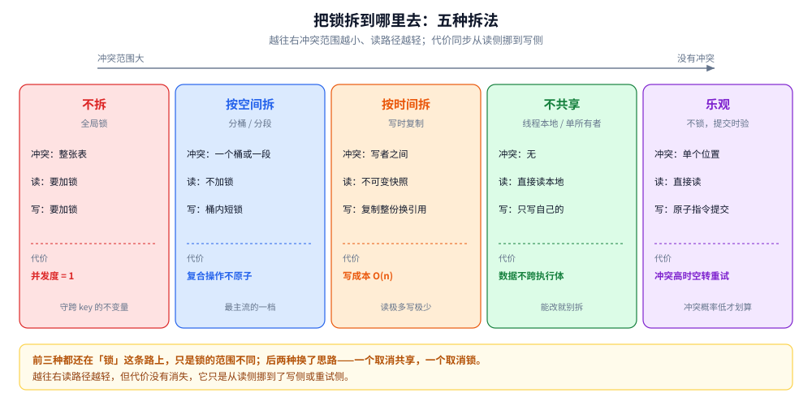
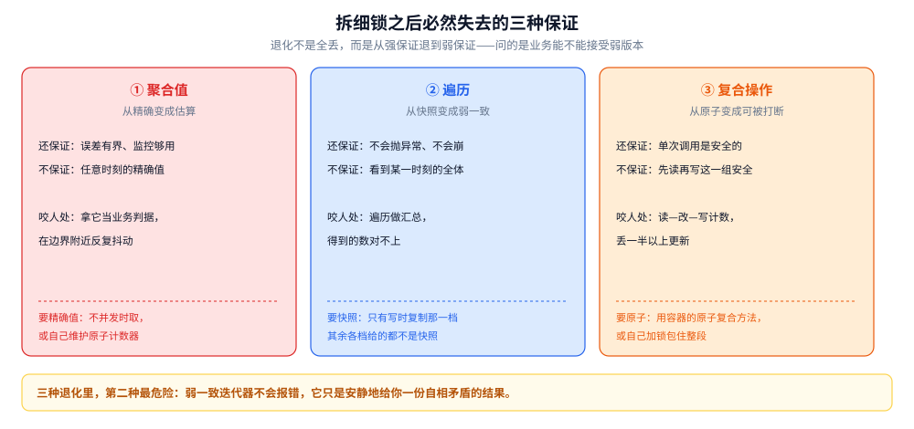
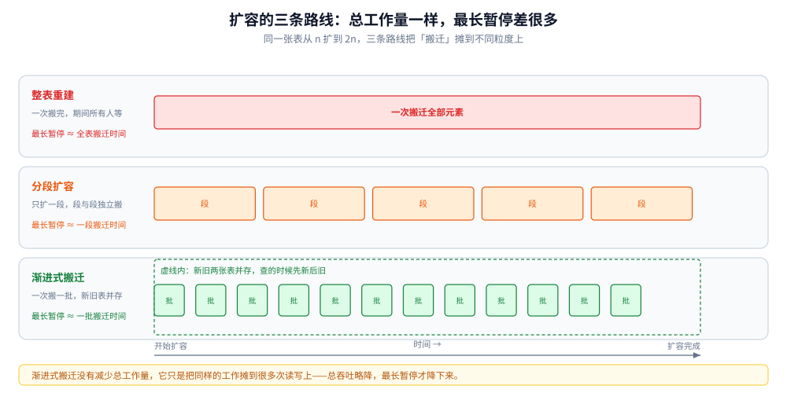

# 并发数据结构：把锁拆到哪里去

> 覆盖：一张结构要支持并发访问的五种拆法（不拆 / 按空间拆 / 按时间拆 / 不共享 / 乐观重试）、拆分必然带来的三种弱一致（聚合值、遍历快照、复合操作）、按空间拆绕不过的扩容与热点两个难题、写时复制的适用边界，以及对象池为什么根本不属于这一类问题。
>
> 不覆盖：具体容器的方法名、参数与实测读数在 [并发容器.md](../../01-编程语言/java/并发编程/并发容器.md) 与 [sync.Map.md](../../01-编程语言/go/并发编程/sync.Map.md)；哈希与树本身的复杂度与局部性在 [数据结构 README](../数据结构/README.md)；原子指令与内存序在 [原子操作.md](../计算机底层原理/底层同步/原子操作.md)。
>
> 内容整理自个人学习笔记，素材见 [素材清单.md](../../素材清单.md)。
>
> 口径：本篇**不新增实测**。出现的百分比读数均转引自语言侧两篇的真实实验，此处只用作说明量级。

---

## 一、给整张表套一把锁，问题解决了吗？

**本节要点**：正确性有了，并发度没了。而并发容器的全部设计，可以压缩成一句话——**在不冲突的地方不加锁**。

### 1.1 一把大锁买到的是「串行」

给一个普通哈希表外面套一层「所有方法都抢同一个对象锁」的包装，正确性是没有问题的：任何时刻只有一个执行体在读写，数据竞争不存在。

代价是**并发度退回 1**。四个线程去写四个互不相干的 key，本来可以完全并行，现在必须排队。Java 侧的实测里，同样是写 20 万个互不冲突的 key，全局锁版本比按桶拆的版本慢约 4.2 倍——**而这 4.2 倍没有任何正确性收益**，纯粹是排队排掉的。

### 1.2 出发点：冲突的定义域越小，能并行的越多

「冲突」在这里有精确含义：两个操作如果**访问同一个位置且至少一个是写**，它们就不能同时进行。所以拆锁的本质是**缩小「必须互斥」的定义域**：

- 拆到整表 → 所有操作互斥；
- 拆到桶 → 只有落在同一个桶上的操作互斥；
- 拆到「写者之间」→ 读完全不用互斥；
- 拆到没有共享 → 不存在互斥。

后面五种拆法，就是把这条线走得越来越远。

## 二、拆法只有五种

图里五档按「冲突定义域」从大到小排开，每一档标了三件事：冲突范围、读路径要不要加锁、主要代价。要读出两点：**第一，前三档（不拆 / 按空间拆 / 按时间拆）都还在「锁」这条路上，只是锁的范围不同；后两档换了思路**——一个取消共享，一个取消锁。**第二，越往右读路径越轻，代价越往写路径上挪**：按空间拆把代价变成「复合操作不原子」，按时间拆把代价变成「每次写复制全量」，乐观路线把代价变成「失败重试」。

### 2.1 不拆：全局锁

最朴素的一档，代表是一把锁包住整张表。它的问题不是「慢」，而是**慢得不分场合**：哪怕两个线程操作的是完全不同的 key，也要排队。

它并非没有位置：**需要跨多个 key 维护一个不变量的场景**（比如「表里元素总数不能超过 N，且每次插入都要检查」），只有全局锁能守住这个不变量。按桶拆之后，桶与桶之间互不知情，这类跨 key 的约束就守不住了。

### 2.2 按空间拆：分桶与分段

把 key 的空间划成若干份，每份一把锁（或干脆不加锁）。这是最主流的一档，也是「并发容器」这个词最常指的东西。

两个层次要分清：

| 层次 | 做法 | 冲突单位 |
|---|---|---|
| 分桶 | 每个哈希桶上的操作互斥，桶内用 CAS 或短锁 | 一个桶 |
| 分段 | 把表切成固定段数，每段一把锁 | 一段（很多桶） |

分段是分桶的粗粒度版本，好处是锁的数量可控、实现简单；坏处是段数固定，扩容时要重新分段，而且**热点 key 落在同一段时，段内照样排队**。

### 2.3 按时间拆：写时复制

读的时候不加锁，写的时候复制一份、改完再原子地换掉引用。于是**读者永远看到一份完整的、不可变的旧版本**，写者之间仍然互斥。

它的价值全在读路径上：读不需要等待、不会看到中间态、遍历时不会被打断。代价在写路径上，而且随容量线性增长（见第五节）。

### 2.4 不共享：线程本地与单所有者

最彻底的一档——**没有共享就没有冲突**。两条落地形态：

- **每个执行体一份**（线程本地存储）：数据不跨线程，天然无竞争。代价是数据也**不跨线程可见**，需要汇总时要另外设计。
- **单个所有者**（一个执行体独占状态，其他人通过消息请求它）：状态只被一个执行体碰，内部不需要锁，同步成本转移到队列上（见 [共享内存与消息传递.md](共享内存与消息传递.md) 第三节）。

这一档常被忽略，但它在工程上往往最划算：**能改成不共享的，就不该去拆锁**。

### 2.5 乐观：不锁，改完再验

不预先加锁，而是「读—算—用一条原子指令提交」，提交时如果发现值已经被别人改过就重来。它的好处是无阻塞：没有线程会被挂起，也就没有「持锁者被抢占导致全员等待」的问题。

代价换了个地方：**冲突多时重试次数上升，CPU 空转**。极端情况下大家一直在重试却谁也提交不了——这在形态上就是活锁（见 [活性与泄漏.md](活性与泄漏.md) 2.1）。所以乐观路线适合**冲突概率低**的场合，冲突一高就该退回锁。

### 2.6 五种拆法的对照

| 拆法 | 冲突范围 | 读要加锁吗 | 写要加锁吗 | 主要代价 | 典型位置 |
|---|---|---|---|---|---|
| 不拆 | 整张表 | 是 | 是 | 并发度 = 1 | 要守跨 key 不变量的场合 |
| 按空间拆（分桶） | 一个桶 | 否 | 否（桶内 CAS/短锁） | 复合操作不原子 | 主流并发哈希表 |
| 按空间拆（分段） | 一段 | 否 | 段内互斥 | 段数固定、热点段排队 | 老一代并发表、分片缓存 |
| 按时间拆（写时复制） | 写者之间 | 否 | 是（且复制全量） | 写成本 O(n) | 监听器表、白名单 |
| 不共享 | 无 | 否 | 否 | 数据不跨执行体 | 线程本地、单所有者 |
| 乐观重试 | 单个位置 | 否 | 否（提交时验） | 冲突高时空转重试 | 计数器、无锁栈/队列 |

## 三、拆开之后必然失去什么？

**本节要点**：这三种「失去」不是某个实现做得不好，而是**拆分的必然结果**。任何一个把锁拆细的结构，都至少失去其中一项。

图里三张卡片对应三种退化，每张都写了「它还保证什么」——这一点常被漏掉：**退化不是全丢，而是从强保证退到弱保证**。聚合值退化后仍是「大致正确」、遍历退化后仍然「不会抛异常」、复合操作退化后「单次操作仍然安全」。要读出的是：**判断能不能用，问的是「业务能不能接受这个弱版本」，而不是「它有没有 bug」**。

### 3.1 聚合值变成估算

拆开计数之后，要拿到全表的精确数量就得把所有分片数一遍，而数一遍的过程中别人还在写。于是大多数并发表给的是**估算值**（用分散计数，总和不保证是某一瞬间的真值）。

- 还保证：误差有界、单调性大体正确、监控够用。
- 不保证：任意时刻的精确值。
- 咬人的地方：**把它当业务判据**——「超过 1000 就拒绝」这类限流逻辑建在估算值上，会在边界附近抖动。

要精确值只有一条路：**在没有并发写的时候取**（启动初始化、停机前统计），或者自己维护一个原子计数器，而不是问容器要。

### 3.2 遍历不再有快照

- 弱一致迭代器：遍历期间的新增与删除**可能看得到也可能看不到**，但**不会抛异常**。它保证的是「不崩」，不是「一致」。
- 快照迭代器（写时复制的产物）：遍历的是一份不可变副本，**看到的永远是开始那一刻的状态**。代价是写要复制全量。

判据很直接：**要「遍历期间看到一个稳定视图」→ 只能选写时复制那一档；只是「大致扫一遍有哪些元素」→ 弱一致就够**。很多线上 bug 是把弱一致当成了快照——遍历出来做汇总，得到的数对不上。

### 3.3 复合操作不再原子

这是三种里最容易踩的。**容器只保证「单次方法调用」安全，不保证「两次调用合起来」安全**。

「先读、再算、再写」这个三步组合在拆开锁之后可以被别人插进来，于是更新会丢。Java 侧实测里，四个线程各做五万次「读—改—写」计数，期望二十万，实际只数到八万四——**丢了一半以上**。

这与 `volatile` 变量上的自增是同一类错误：**可见性/单次原子性 ≠ 复合原子性**。要原子只有两条路：

1. 用容器提供的**原子复合方法**（「不存在才写入」「存在才替换」「按函数更新」这类）。
2. 自己加锁，把整个复合逻辑包起来。

⚠️ 一个真实陷阱：容器的「按函数更新」方法通常**在桶锁内执行你传进去的函数**。如果这个函数里做了远程调用、复杂计算，甚至回头再改同一个表，就会长时间持锁或直接死锁。**把重活挪到原子操作之外做。**

## 四、按空间拆绕不过的两个难题

### 4.1 扩容：为什么必须能分段

哈希表的负载因子一高，冲突链变长，就得扩容——重新分配一张更大的表、把所有元素搬过去。单线程下这是一次 O(n) 的操作，没人打扰；**并发下它是最难处理的一段**，因为搬迁期间元素在两个位置都可能有。

三条路线：

| 路线 | 做法 | 并发下能不能用 |
|---|---|---|
| 整表重建 | 一次性搬完，期间所有人等 | 能，但要**停世界**——搬 100 万元素就是一次长暂停 |
| 分段扩容 | 只扩某一段，段与段独立搬 | 能，暂停切成小段；代价是段数要预先定、不能随意变 |
| 渐进式搬迁 | 一次搬一小批，新旧两张表并存一段时间，查的时候先新后旧 | 能，暂停最短；代价是**每次读写都要处理「两张表」这个中间态** |

图里三条路线画在同一时间轴上：整表重建是一根长条，分段扩容是几根中条，渐进式搬迁是很多根短条加上一段「新旧并存」的阴影区。要读出的是：**「暂停总时长」和「单次最长暂停」是两个不同的量**——渐进式搬迁并没有减少总工作量，它只是把同样的工作摊到了很多次读写上。选哪条，取决于你在意总吞吐还是最长暂停。

### 4.2 热点：拆得再细也可能撞在同一个桶上

按空间拆的效果完全依赖一件事：**访问在 key 空间上是分散的**。如果所有请求都打同一个 key（秒杀库存、热门配置项），那么无论拆成多少个桶，它们都落在同一个桶上，桶内照样排队。

这时候拆锁是无效的，能用的只有另外三档：

- **改成不共享**：把热点 key 拆到每个执行体本地累加，最后汇总（代价是汇总前看到的不是全局值）。
- **改成乐观**：热点 key 上的竞争变成重试，但重试也是成本，冲突极高时反而更糟。
- **改数据结构**：把「一个计数器」换成「一组计数器再求和」，本质上是把热点也拆成扇出——这仍然属于按空间拆，只是拆的维度从 key 换成了「更新者」。

**判据：先量 key 的分布，再决定拆不拆。** 分布均匀的场合按桶拆收益最大；分布极不均的场合，拆锁是白费力气。

## 五、按时间拆的边界在哪？

### 5.1 写成本随容量线性增长

写时复制的每次写都要复制整个集合，所以单次写的成本是 O(n)。放进并发环境里更糟：写者之间还要互斥，n 越大、持锁时间越长，写者排队越久。Java 侧实测里，四线程各写五万次的场景，写时复制比「加锁的普通列表」慢约 **386 倍**——因为后者只搬一个元素，前者要搬整张表。

### 5.2 唯一适合的场景

三个条件必须同时成立：

1. **写极少**（只发生在启动、配置变更、订阅变更这类时刻）；
2. **集合不大**（复制成本可以接受）；
3. **读需要稳定快照**（遍历期间不能被打断、不能看到中间态）。

典型是监听器表、拦截器链、白名单。反过来的两条禁令同样重要：**不要拿它当队列**（出队要搬整个数组）、**不要拿它存大集合**（复制成本线性涨）。

## 六、对象池为什么不是同一类问题？

**本节要点**：前五节解决的是「同一份数据被多个执行体访问」；对象池解决的是「稀缺资源要复用」。两者的正确性条件与失败模式都不一样，混在一起谈会得出错误结论。

### 6.1 它复用的是资源，不是共享数据

一个池化对象在任意时刻只属于**一个**借用者。所以池本身不需要「并发安全的数据结构」那套拆分——它只需要一个「借出/归还」的原子队列。真正需要小心的不是池的并发，而是**借出的对象身上带着上一次使用的状态**。

这就是为什么「借出来必须先重置」是一条铁律：池不会替你清状态，它只负责传递引用。

### 6.2 池的语义是「丢弃」，不是「释放」

这是最容易造成事故的一点，也是 [活性与泄漏.md](活性与泄漏.md) 3.1 第四种泄漏的来源。

**池丢弃一个引用，并不等于关闭这个对象持有的外部资源。** 如果对象身上挂着连接、心跳、订阅、文件句柄，那么池丢掉引用之后：外部系统仍然认为这个连接活着 → 心跳线程仍然引用着这个对象 → **GC 判定它可达** → 内存降不下来；同时代码已经拿不到它，也就无法关闭它。

于是同一个 bug 同时表现为「内存泄漏」与「执行体泄漏」，而根因只是一句话：**关闭必须显式写在丢弃路径上，池不负责这件事**。

还有一条边界要提前想清楚：**池化的对象不该有「外部可达性」**。能被外部系统反向引用到的对象（长连接、注册到全局表的回调）放进池里，就等于把一个不受控的生命周期交给了池。

## 七、应用场景

| 场景 | 该用哪一档 | 理由 |
|---|---|---|
| 请求上下文、每请求一份的缓冲 | 不共享（线程本地） | 根本没有共享，谈拆锁是多余的 |
| 本地缓存（读极多写极少，key 只增） | 按空间拆 + 读无锁 | 读路径是热点，写路径可以慢 |
| 会话表（key 一直增删） | 按空间拆，别用「写一次读多次」的优化 | 键集一直在翻转，专为「只增」优化的结构会退化 |
| 计数器聚合（指标、QPS） | 乐观（原子累加）或分散计数 | 单个位置、无复合逻辑；要精确值就别用估算 |
| 配置/白名单/监听器表 | 按时间拆（写时复制） | 写只在变更时，读要快照 |
| 跨 key 的容量约束（「总数不超过 N」） | 不拆（全局锁） | 不变量跨 key，拆开就守不住 |
| 秒杀库存这类单 key 热点 | 拆成扇出计数器汇总 | 按桶拆无效，热点落在同一个桶上 |
| 连接/缓冲对象复用 | 对象池 | 这是资源复用，不是并发数据访问 |

## 八、具体使用：怎么判断一个并发容器能不能用

**本节要点**：不问「它快不快」，先问三个「它不保证什么」。三个答案里有一个不能被业务接受，就换一档。

本节是**判断路线**，**本机未实测**；具体方法名与读数在语言侧两篇。

### 8.1 三个必问

| 问题 | 不能接受时换到哪 |
|---|---|
| 数量是精确值还是估算？ | 要精确 → 自己维护原子计数器，或在不并发时取 |
| 遍历看到的是快照还是弱一致？ | 要快照 → 写时复制那一档 |
| 「先读再写」是原子的吗？ | 要原子 → 用容器的原子复合方法，或自己加锁 |

三个问题里第二条最常被忽略，因为弱一致迭代器**不会报错**——它只是给你一份可能自相矛盾的结果。

### 8.2 一条反向验证

判断一个「并发优化」是不是白做，有个便宜的办法：**量 key 的分布**。如果访问高度集中在少数 key 上，那拆锁带来的收益接近于零，优化方向应该换成「把热点拆成扇出」或「改成不共享」。这一条能挡掉相当一部分「换了个并发容器但没变快」的改动。

### 8.3 什么时候该放弃拆锁

出现下面任一情况，说明拆分不划算，应该往上退一档：

- 需要在多个 key 之间维护不变量 → 全局锁；
- 复合逻辑复杂到必须整段加锁 → 全局锁或单所有者；
- 热点无法分散 → 改成不共享；
- 拆分之后要写的适配代码比原逻辑还长 → 停下来，按桶拆的收益抵不过维护成本。

## 延伸追问

- **「读无锁」是不是意味着读绝对不会阻塞？** → 不是。它意味着读路径上没有「抢锁」这个动作，但读者仍可能因为缓存行争用、内存序、GC 停顿而变慢。「无锁」省的是排队，不是全部延迟。
- **为什么并发容器大多不允许 null 值？** → 因为并发下「返回 null」有歧义：是没有这个 key，还是存了个 null？单线程可以用第二次查询消歧，并发下两次查询之间状态可能已变。禁止 null 让「返回 null」只剩一种含义。
- **分段锁为什么后来被分桶加 CAS 取代了？** → 段数是固定的，扩容要重新分段，热点段照样排队；而「每个桶一个位置 + CAS」把锁的粒度推到了单个元素，且没有「段」这个需要重算的结构。
- **写时复制能不能改成「只复制变化的部分」？** → 那就退化成持久化数据结构（结构共享），实现复杂度高出一个量级。收益是写成本从 O(n) 降到 O(log n)，代价是读路径要跟着指针跳、局部性变差。多数业务不需要走到这一步。
- **乐观重试和自旋锁有什么区别？** → 自旋锁在**等锁**，乐观重试在**重算**。前者不做有用功，后者做的功可能白做。高冲突下两者都表现成 CPU 空转，但自旋锁的失败是「没拿到」，乐观的失败是「拿到了但提交不上」。
- **对象池应该设上限吗？** → 应该，而且上限要有明确的拒绝策略。无上限的池在流量峰值时会把「复用」变成「无限创建」，这正是无界增长型泄漏（见 [活性与泄漏.md](活性与泄漏.md) 3.1）。
- **怎么判断「该拆还是该改成不共享」？** → 看数据是否需要跨执行体可见。需要 → 拆锁；不需要 → 不共享。很多所谓的并发优化，其实一开始就不该共享那份数据。

## 关联

- **上游/总纲**：[共享内存与消息传递.md](共享内存与消息传递.md) — 第三节「交接，而不是共享」；本篇 2.4 的「单所有者」正是这条路线在进程内的形态
- **同层/底座**：[原子操作.md](../计算机底层原理/底层同步/原子操作.md) — 乐观路线的指令基础，以及「原子性是指令属性」这条判据
- **同层/底座**：[互斥的实现.md](../计算机底层原理/底层同步/互斥的实现.md) — 第三节那组读数（200 万次加锁只有几百次进内核）说明分桶之后桶内的短锁便宜在哪
- **同层/底座**：[数据结构 README](../数据结构/README.md) — 各结构本体的复杂度与「并发写难度」那一列；本篇是那一列的展开
- **对照/互补**：[活性与泄漏.md](活性与泄漏.md) — 乐观重试的极端形态就是活锁；6.2 的「池丢弃引用」是那里第四种泄漏的根因
- **对照/互补**：[任务池.md](任务池.md) — 队列是任务池的中央结构，它的有界/无界决定了池的失败形态
- **下游机制**：[并发容器.md](../../01-编程语言/java/并发编程/并发容器.md) — Java 侧五种容器的实测：全局锁慢 4.2 倍、写时复制慢 386 倍、复合操作丢一半
- **下游机制**：[sync.Map.md](../../01-编程语言/go/并发编程/sync.Map.md) — Go 侧两代实现与「键集翻转就退化」的机制
- **下游机制**：[sync.Pool.md](../../01-编程语言/go/并发编程/sync.Pool.md) — 对象池的回收语义与「必须重置」的实测
